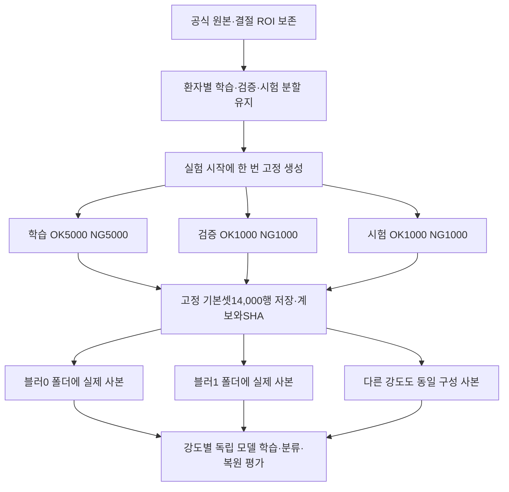

# 17차 고정 표본과 강도별 사본

2026-11-26 사용자 요청으로 기존 에폭별 온라인표집을 교체합니다. 주자료와 환자분할을 유지하며 원본을 수정하지 않습니다.

| 용도 | 원본 양성 | 원본 악성 | 고정 생성 양성 | 고정 생성 악성 | 사용 |
|---|---:|---:|---:|---:|---|
| 학습 | 3979 | 374 | 5000 | 5000 | 매 에폭 동일파일, 순서만 바꿀 수 있음 |
| 검증 | 839 | 98 | 1000 | 1000 | 모델/공격 선정에 사용, 원본937개도 별도 보고 |
| 시험 | 790 | 83 | 1000 | 1000 | 고정 균형 시험, 원본873개 시험과 별도 보고 |

표의 생성 개수는 독립 원본·환자 수가 아닙니다. 같은 원본의 반복·고정 증강이므로 환자별 군집 평가와 source_id/원본 여부를 보존합니다. 각 분할 안에서만 생성하고 환자를 옮기지 않습니다. 원본당 첫 사본을 보존하고 추가 증강은 처음 정한seed로 고정합니다. 원본 주시험 수치는 삭제하거나 생성 수치로 덮어쓰지 않습니다.

## 저장과 블러

- 대량 자료는 E17/work/data 아래에 저장합니다. 원본 ROI/manifest는 읽기 전용 입력입니다.
- 기본셋은 한 번 생성해 목록·입력·정책·파일SHA를 묶습니다. 재개 때 기존완료셋을 다시 생성하지 않습니다.
- 각sigma의 새 일반 폴더에 기본 파일을 물리적으로 복사합니다. 링크·바로가기·원본제자리변경을 하지 않습니다.
- DCT Gaussian의 float32 출력을 TIFF로 저장해 학습과 공격에 같은 값을 줍니다. 보기용 PNG는 미리보기이며 학습에 8bit양자화를 추가하는 경로가 아닙니다.
- 분류기가 저장된 블러 결과를 읽을 때 모델 안에서 다시 블러하지 않습니다. 사진복원·특징복원·연결·멤버십도 동일노출값을 사용합니다.
- 같은sigma의 분할/전체연결모델은 동일자료를 재사용하고 모델만 독립초기화합니다. 이전강도에블러를덧씌우지않고 항상기본셋사본에서만생성합니다.
- 불완료 파일은 완료로 표시하지 않습니다. 원본/정책/사본변경은 조용히 재생성하지 않고 사유와함께 거부합니다.

## 결과와 범위

모델 선정은 고정검증2000행 손실로 하며 원본검증937행 결과도 따로 남깁니다. 무증강원본873결절의 시험과 고정균형2000행 시험을 구분합니다. 복원점수 기준 평균영상은 실제 고정학습셋으로 계산합니다. 외부Histo306개는 따로 유지하고 학습·검증선정으로 보내지 않습니다. CSTL은 환자 대응 보류를 유지합니다.

검사에서는 작은 합성영상을 사용해 개수·같은구성·원본불변·실제사본·단계독립·중복블러방지·저장값/공격일치·재개변경거부를 확인합니다. 대량14000행이나GPU완료를 가장하지 않습니다. 12차는 그대로돌리고17차GPU는12차완료뒤입니다.
