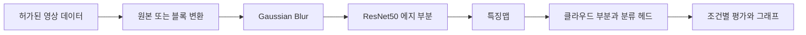

<div align="center">

# 🧬 폐암 영상 분류와 프라이버시 변환 실험

### ResNet50 · 블러 · 블록 재배열 · 에지·클라우드 분리

영상의 형태를 바꾸면 분류 결과는 어떻게 달라질까요?<br>
블러·블록·조합 변환과 모델 분리 조건을 비교하는 영상 분류 연구입니다.


[빠른 시작](#quick-start) · [저장소 구성](#repository-structure) · [실험 설정](#data-settings)

</div>

---

<a name="introduction"></a>

## ✨ 프로젝트 소개

원본 분류 실험, 블러 및 블록 변환, 두 변환의 조합, 에지·클라우드 분리 모델을 여러 노트북으로 보존합니다. 하나의 통일된 데이터셋·클래스 정의를 모든 파일에 적용하지 않으며, 실행할 노트북의 입력과 모델 구성을 먼저 확인해야 합니다.

| 기능 | 구현 내용 |
| :--- | :--- |
| 영상 변환 | Gaussian Blur와 시드 기반 블록 위치 재배열 |
| 조합 비교 | 블록 재배열 뒤 블러를 적용하는 순차 실험 |
| 분류 모델 | TensorFlow/Keras ResNet50 기반 학습 |
| 모델 분리 | `pool1_pool`을 경계로 에지·클라우드 부분 구성 |
| 평가 | 혼동행렬·분류 지표·ROC-AUC·클래스별 결과 |
| 시각화 | 특징맵, 학습 이력, 조건별 그래프와 GPU 기록 |



<a name="repository-structure"></a>

## 📁 저장소 구성

주요 실험 묶음을 발췌했습니다.

```text
.
├── 원본 실험/Lung Cancer/
├── 블러/2차 실험/
├── 블록/2차 실험/
├── 블러 엣지/
├── 블록 엣지/
├── 블록+블러/
├── 블록+블러 엣지/
│   └── block_blur_resnet50_edge.ipynb
├── 추가 학습모델과 실험/
└── docs/VERSIONS.md
```

- [블록·블러·분리 모델 실험](블록+블러%20엣지/block_blur_resnet50_edge.ipynb).
- [블러 실험](블러/2차%20실험/blur_resnet50_rebuilt2_KO.ipynb).
- [원본 앱](원본%20실험/Lung%20Cancer/main.py): 별도 `Model.h5`를 읽는 Streamlit 분류 화면.
- [버전 기록](docs/VERSIONS.md).

<a name="implementation"></a>

## 🧩 주요 기술과 모델 구성

조합 실험의 `block_scramble()`은 영상을 블록으로 나누고 시드로 생성한 순열에 따라 위치를 바꿉니다. `apply_gaussian_blur()`는 그 결과에 PIL GaussianBlur를 적용합니다. 이는 구현된 영상 변환 방식이며 암호학적 안전성이나 재식별 방지 성능을 보증하지 않습니다.

`build_full_pipeline()`은 에지·클라우드 부분을 연결해 학습하고, 이후 각 부분을 따로 저장하도록 구성합니다. 코드의 모델 분리와 실제 원격 기기·서버 간 배포 완료는 구분해야 합니다.

<a name="quick-start"></a>

## 🚀 빠른 시작

TensorFlow와 GPU 드라이버가 맞는 별도 실험 환경을 준비한 뒤 저장소 루트에서 노트북을 엽니다.

```powershell
python -m pip install jupyterlab numpy matplotlib scikit-learn pillow
python -m jupyter lab "블록+블러 엣지/block_blur_resnet50_edge.ipynb"
```

1. 노트북의 TensorFlow 임포트와 장치 확인 셀을 먼저 실행합니다.
2. `BASE_TRAIN`을 클래스별 입력 이미지 폴더에 맞춥니다. 기본값은 `/workspace/Train`입니다.
3. `BB_OUTPUT_ROOT` 또는 노트북의 출력 경로를 지정하고 저장 공간을 확인합니다.
4. 선택한 변환 조건·분할·학습 설정을 확인한 뒤 해당 셀을 실행합니다.

이미지·학습 가중치·환자 원본은 포함하지 않습니다. 기본 조합 실험은 많은 조건과 반복 학습을 포함하므로 노트북 전체 실행 전에 설정을 확인하세요.

<a name="data-settings"></a>

## 📊 데이터 구성과 실험 설정

아래 값은 `block_blur_resnet50_edge.ipynb` 설정 셀에 한정됩니다.

| 설정 | 코드의 값 |
| :--- | :--- |
| 입력 크기 | 512 × 512 |
| 블록 크기 | 512, 256, 128, 64, 32, 16, 8, 4, 2, 1 |
| 블러 sigma | 0, 1, 2, 4, 8, 16, 32, 64, 128, 256 |
| 조합 수 | 10 × 10 = 100 |
| 클래스 수 | 3 |
| 기본 시드 | 42 |
| 교차검증 | 7 folds |
| TTA | 20회 |
| 시험 분할 비율 | 0.10 |

원본 Streamlit 앱은 다섯 조직 유형을 정의하고 있어, 위의 3클래스 실험과 가중치를 서로 바꿔 사용하면 안 됩니다. 성능을 비교할 때는 데이터 출처·분할·증강과 교차검증의 관계를 함께 검토해야 합니다. 연구 코드의 출력은 임상 진단 성능의 검증 자료를 대신하지 않습니다.

<a name="troubleshooting"></a>

## 🛠️ 문제 해결

| 증상 | 확인할 내용 |
| :--- | :--- |
| 입력 폴더를 찾지 못함 | `BASE_TRAIN`과 클래스 하위 폴더 |
| GPU를 찾지 못함 | TensorFlow·CUDA·드라이버의 실행 환경 |
| 메모리 부족 | 입력 크기, 배치, 저장된 모델·변환 이미지 규모 |
| 이전 조건 결과가 재사용됨 | 출력 경로와 기존 조건별 캐시 |
| 클래스·가중치 불일치 | 해당 노트북과 원본 앱의 클래스 정의 구분 |
| 한글 그래프 오류 | 폰트 경로와 나눔고딕 설치 |

---

<div align="center">

**영상 변환과 분류 성능의 관계를 조건별로 탐색합니다.**

</div>
