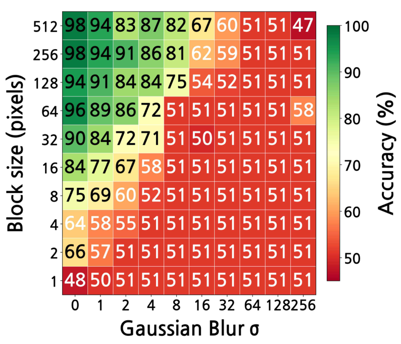
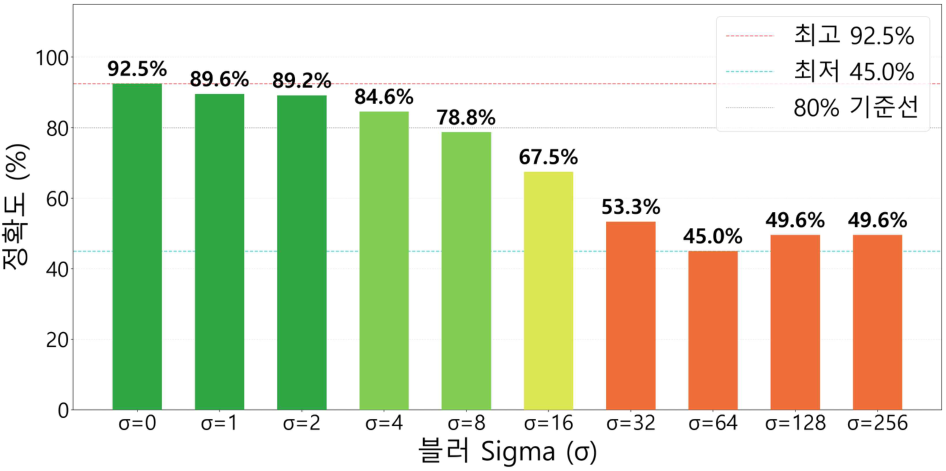

# 문서 읽기 레벨 구성 전체 비교

기준 커밋: `587735b7a9e22de8d45f655fcf50abe2daa89b7f`

기존 Markdown의 모든 수정 줄과 새 수준별 안내 전문을 비교합니다. 줄바꿈·공백 차이는 원문 Git 비교로도 확인할 수 있습니다. 새 변경 기록과 이 비교 문서 자체는 비교 대상에서 제외했습니다. 코드·데이터·논문·이미지와 나머지 파일은 기준 커밋과 같습니다.

````````````diff
--- a/1차/README.md
+++ b/1차/README.md
@@ -2,7 +2,11 @@
 
 # 1차
 
-블록·블러의 rebuilt·same_settings·metric_matched 변형과 노트북 수정 보조 스크립트를 함께 읽는 코드 자료 차수입니다.
+<!-- reading-levels17:start -->
+**읽기 수준 선택** · [LEVEL 1 - Beginner](../docs/%EC%9D%BD%EA%B8%B0%EC%95%88%EB%82%B4/%EB%A0%88%EB%B2%A81.md) · [LEVEL 2 - Explorer](../docs/%EC%9D%BD%EA%B8%B0%EC%95%88%EB%82%B4/%EB%A0%88%EB%B2%A82.md) · [LEVEL 3 - Practitioner](../docs/%EC%9D%BD%EA%B8%B0%EC%95%88%EB%82%B4/%EB%A0%88%EB%B2%A83.md) · [LEVEL 4 - Advanced](../docs/%EC%9D%BD%EA%B8%B0%EC%95%88%EB%82%B4/%EB%A0%88%EB%B2%A84.md) · [LEVEL 5 - Expert](../docs/%EC%9D%BD%EA%B8%B0%EC%95%88%EB%82%B4/%EB%A0%88%EB%B2%A85.md)
+<!-- reading-levels17:end -->
+
+**블록·블러의 rebuilt·same_settings·metric_matched 변형과 노트북 수정 보조 스크립트를 함께 읽는 코드 자료 차수입니다.**
 
 | 주요 구성 | 내용 |
 | --- | --- |

--- a/Conv1 블러 OK-NG 실험/1차/README.md
+++ b/Conv1 블러 OK-NG 실험/1차/README.md
@@ -2,7 +2,11 @@
 
 # 폐 CT 특징 블러 실험 1차
 
-폐 CT 영상에서 양성·정상을 OK(0), 악성을 NG(1)로 분류하고 첫 합성곱 특징에 10단계 블러를 적용하는 로컬 예비실험입니다. 원본 1,097장 중 양성 120장·정상 416장·악성 561장입니다.
+<!-- reading-levels17:start -->
+**읽기 수준 선택** · [LEVEL 1 - Beginner](../../docs/%EC%9D%BD%EA%B8%B0%EC%95%88%EB%82%B4/%EB%A0%88%EB%B2%A81.md) · [LEVEL 2 - Explorer](../../docs/%EC%9D%BD%EA%B8%B0%EC%95%88%EB%82%B4/%EB%A0%88%EB%B2%A82.md) · [LEVEL 3 - Practitioner](../../docs/%EC%9D%BD%EA%B8%B0%EC%95%88%EB%82%B4/%EB%A0%88%EB%B2%A83.md) · [LEVEL 4 - Advanced](../../docs/%EC%9D%BD%EA%B8%B0%EC%95%88%EB%82%B4/%EB%A0%88%EB%B2%A84.md) · [LEVEL 5 - Expert](../../docs/%EC%9D%BD%EA%B8%B0%EC%95%88%EB%82%B4/%EB%A0%88%EB%B2%A85.md)
+<!-- reading-levels17:end -->
+
+**폐 CT 영상에서 양성·정상을 OK(0), 악성을 NG(1)로 분류하고 첫 합성곱 특징에 10단계 블러를 적용하는 로컬 예비실험입니다.** 원본 1,097장 중 양성 120장·정상 416장·악성 561장입니다.
 
 매 학습 회차(epoch)에 클래스당 5,000개를 원본 학습 영상의 반복 표본과 온라인 증강으로 구성합니다. 이는 독립 영상이나 환자 5,000명을 의미하지 않습니다.
 

--- a/Conv1 블러 OK-NG 실험/1차/docs/실행방법.md
+++ b/Conv1 블러 OK-NG 실험/1차/docs/실행방법.md
@@ -1,6 +1,10 @@
 # 실행 방법
 
-PowerShell에서 프로젝트 1차 폴더를 작업 디렉터리로 열고 전용 환경을 사용합니다. 이미 실행 중인 학습이 있는지 먼저 확인하세요. 각 명령은 실제 상태 파일을 갱신하므로 진행 중에는 준비나 연결 검사도 중복 실행하지 마세요.
+<!-- reading-levels17:start -->
+**읽기 수준 선택** · [LEVEL 1 - Beginner](../../../docs/%EC%9D%BD%EA%B8%B0%EC%95%88%EB%82%B4/%EB%A0%88%EB%B2%A81.md) · [LEVEL 2 - Explorer](../../../docs/%EC%9D%BD%EA%B8%B0%EC%95%88%EB%82%B4/%EB%A0%88%EB%B2%A82.md) · [LEVEL 3 - Practitioner](../../../docs/%EC%9D%BD%EA%B8%B0%EC%95%88%EB%82%B4/%EB%A0%88%EB%B2%A83.md) · [LEVEL 4 - Advanced](../../../docs/%EC%9D%BD%EA%B8%B0%EC%95%88%EB%82%B4/%EB%A0%88%EB%B2%A84.md) · [LEVEL 5 - Expert](../../../docs/%EC%9D%BD%EA%B8%B0%EC%95%88%EB%82%B4/%EB%A0%88%EB%B2%A85.md)
+<!-- reading-levels17:end -->
+
+**PowerShell에서 프로젝트 1차 폴더를 작업 디렉터리로 열고 전용 환경을 사용합니다.** 이미 실행 중인 학습이 있는지 먼저 확인하세요. 각 명령은 실제 상태 파일을 갱신하므로 진행 중에는 준비나 연결 검사도 중복 실행하지 마세요.
 
 ```powershell
 .\.venv\Scripts\python.exe run_training.py prepare

--- a/Conv1 블러 OK-NG 실험/1차/docs/원본대비변경.md
+++ b/Conv1 블러 OK-NG 실험/1차/docs/원본대비변경.md
@@ -1,8 +1,12 @@
 # 원본 노트북과 이번 예비실험의 차이
+
+<!-- reading-levels17:start -->
+**읽기 수준 선택** · [LEVEL 1 - Beginner](../../../docs/%EC%9D%BD%EA%B8%B0%EC%95%88%EB%82%B4/%EB%A0%88%EB%B2%A81.md) · [LEVEL 2 - Explorer](../../../docs/%EC%9D%BD%EA%B8%B0%EC%95%88%EB%82%B4/%EB%A0%88%EB%B2%A82.md) · [LEVEL 3 - Practitioner](../../../docs/%EC%9D%BD%EA%B8%B0%EC%95%88%EB%82%B4/%EB%A0%88%EB%B2%A83.md) · [LEVEL 4 - Advanced](../../../docs/%EC%9D%BD%EA%B8%B0%EC%95%88%EB%82%B4/%EB%A0%88%EB%B2%A84.md) · [LEVEL 5 - Expert](../../../docs/%EC%9D%BD%EA%B8%B0%EC%95%88%EB%82%B4/%EB%A0%88%EB%B2%A85.md)
+<!-- reading-levels17:end -->
 
 제공 노트북은 TensorFlow/Keras ImageNet ResNet50에서 `conv1_conv`를 고정 Edge로 분리하고 DCT 기반 블러 뒤 Cloud의 마지막 잔차 블록과 분류 헤드를 학습합니다. 회색조 영상을 512×512로 맞춰 3채널로 복제하고 Keras의 BGR 평균 차감 전처리를 사용합니다. 환자 ID가 있는 입력을 요구하며 환자 단위 10% 시험 분리와 7-fold, 10개 sigma의 adaptive 분류, sigma 0 고정 대조군, 동일 영상 매칭 및 복원 공격을 포함합니다. 원본 기본값은 배치 2, 최대 35 epoch, patience 7, 분류 학습률 0.00008입니다.
 
-이번 코드는 PyTorch/torchvision ResNet50 V1.5와 ImageNet1K V1 가중치를 사용합니다. 구조의 stride와 가중치가 Keras와 다르며 회색조 3채널을 0~1로 변환한 뒤 RGB 평균·표준편차로 정규화합니다. 첫 합성곱과 모든 배치정규화를 고정하고 마지막 layer4의 비배치정규화 가중치와 128 유닛 분류 헤드를 학습합니다. sigma는 특징맵 픽셀 단위이며 값은 0, 1, 2, 4, 8, 16, 32, 64, 128, 256입니다. 원본과 수치적으로 동일한 재현이 아닙니다.
+**이번 코드는 PyTorch/torchvision ResNet50 V1.5와 ImageNet1K V1 가중치를 사용합니다.** 구조의 stride와 가중치가 Keras와 다르며 회색조 3채널을 0~1로 변환한 뒤 RGB 평균·표준편차로 정규화합니다. 첫 합성곱과 모든 배치정규화를 고정하고 마지막 layer4의 비배치정규화 가중치와 128 유닛 분류 헤드를 학습합니다. sigma는 특징맵 픽셀 단위이며 값은 0, 1, 2, 4, 8, 16, 32, 64, 128, 256입니다. 원본과 수치적으로 동일한 재현이 아닙니다.
 
 기본 설정은 영상 중복 그룹 기준 학습·검증·시험 약 70:15:15, 512 픽셀, 배치 2, 최대 35 epoch, patience 7, 학습률 0.00008입니다. 각 학습 epoch에는 클래스별 5,000개를 반복 추출하고 좌우 반전·명암·밝기 변화를 적용합니다. 검증과 시험에는 증강하지 않습니다. 완전 중복만 같은 분할에 묶으며 환자 ID가 없으므로 환자 독립성을 검증하지 못합니다.
 

--- a/Conv1 블러 OK-NG 실험/2차/README.md
+++ b/Conv1 블러 OK-NG 실험/2차/README.md
@@ -1,6 +1,10 @@
 # 폐 CT 특징 블러 실험 · 2차
 
-고정된 첫 합성곱의 특징에 블러를 적용한 뒤 양성·정상을 OK, 악성을 NG로 분류합니다. 원본을 분할한 뒤 학습에만 클래스당 5000개 온라인 표본을 구성합니다. 원본 환자 ID가 없어 영상 단위 예비실험입니다.
+<!-- reading-levels17:start -->
+**읽기 수준 선택** · [LEVEL 1 - Beginner](../../docs/%EC%9D%BD%EA%B8%B0%EC%95%88%EB%82%B4/%EB%A0%88%EB%B2%A81.md) · [LEVEL 2 - Explorer](../../docs/%EC%9D%BD%EA%B8%B0%EC%95%88%EB%82%B4/%EB%A0%88%EB%B2%A82.md) · [LEVEL 3 - Practitioner](../../docs/%EC%9D%BD%EA%B8%B0%EC%95%88%EB%82%B4/%EB%A0%88%EB%B2%A83.md) · [LEVEL 4 - Advanced](../../docs/%EC%9D%BD%EA%B8%B0%EC%95%88%EB%82%B4/%EB%A0%88%EB%B2%A84.md) · [LEVEL 5 - Expert](../../docs/%EC%9D%BD%EA%B8%B0%EC%95%88%EB%82%B4/%EB%A0%88%EB%B2%A85.md)
+<!-- reading-levels17:end -->
+
+**고정된 첫 합성곱의 특징에 블러를 적용한 뒤 양성·정상을 OK, 악성을 NG로 분류합니다.** 원본을 분할한 뒤 학습에만 클래스당 5000개 온라인 표본을 구성합니다. 원본 환자 ID가 없어 영상 단위 예비실험입니다.
 
 1차의 초기 검증 포화와 손실 계산을 감사한 뒤 평가 수치, 유사 영상 분할, 학습 예산·종료 기준을 보완했습니다. 1차의 결과·가중치는 보존하며 2차는 ImageNet 초기값으로 새로 시작합니다. 원본 노트북과 프레임워크·가중치·전처리가 달라 수치상 재현은 아닙니다.
 

--- a/Conv1 블러 OK-NG 실험/2차/docs/검토근거.md
+++ b/Conv1 블러 OK-NG 실험/2차/docs/검토근거.md
@@ -1,8 +1,12 @@
 # 2차 검토 근거
+
+<!-- reading-levels17:start -->
+**읽기 수준 선택** · [LEVEL 1 - Beginner](../../../docs/%EC%9D%BD%EA%B8%B0%EC%95%88%EB%82%B4/%EB%A0%88%EB%B2%A81.md) · [LEVEL 2 - Explorer](../../../docs/%EC%9D%BD%EA%B8%B0%EC%95%88%EB%82%B4/%EB%A0%88%EB%B2%A82.md) · [LEVEL 3 - Practitioner](../../../docs/%EC%9D%BD%EA%B8%B0%EC%95%88%EB%82%B4/%EB%A0%88%EB%B2%A83.md) · [LEVEL 4 - Advanced](../../../docs/%EC%9D%BD%EA%B8%B0%EC%95%88%EB%82%B4/%EB%A0%88%EB%B2%A84.md) · [LEVEL 5 - Expert](../../../docs/%EC%9D%BD%EA%B8%B0%EC%95%88%EB%82%B4/%EB%A0%88%EB%B2%A85.md)
+<!-- reading-levels17:end -->
 
 ## 확인된 문제와 한계
 
-1차에서는 epoch마다 OK·NG를 각각 5000개씩 학습했으며 배치 2로 5000번의 optimizer update가 발생했다. 따라서 epoch 숫자만으로 학습량을 비교하면 안 된다. 원본의 최대 35회 설정을 충분성 검토 없이 그대로 사용했다.
+**1차에서는 epoch마다 OK·NG를 각각 5000개씩 학습했으며 배치 2로 5000번의 optimizer update가 발생했다.** 따라서 epoch 숫자만으로 학습량을 비교하면 안 된다. 원본의 최대 35회 설정을 충분성 검토 없이 그대로 사용했다.
 
 1차 평가에서는 BF16 로짓의 sigmoid를 먼저 계산한 뒤 FP32로 바꿨다. 확률의 양자화와 동점 위험을 줄이기 위해 평가 정밀도를 높일 필요가 있다. 기존 정확도 1.0이 이 문제 때문이라고 확정하지 않는다.
 

--- a/Conv1 블러 OK-NG 실험/2차/docs/실행방법.md
+++ b/Conv1 블러 OK-NG 실험/2차/docs/실행방법.md
@@ -1,6 +1,10 @@
 # 실행 방법
 
-Python 3.12 환경을 준비하고 requirements.txt의 버전을 설치합니다. torch와 torchvision은 CUDA 12.8 공식 패키지 인덱스를 사용합니다. 기존 환경을 사용하는 경우 실제 패키지 버전과 CUDA·BF16 지원을 확인합니다. 폴더 연결이나 바로가기는 필요하지 않습니다.
+<!-- reading-levels17:start -->
+**읽기 수준 선택** · [LEVEL 1 - Beginner](../../../docs/%EC%9D%BD%EA%B8%B0%EC%95%88%EB%82%B4/%EB%A0%88%EB%B2%A81.md) · [LEVEL 2 - Explorer](../../../docs/%EC%9D%BD%EA%B8%B0%EC%95%88%EB%82%B4/%EB%A0%88%EB%B2%A82.md) · [LEVEL 3 - Practitioner](../../../docs/%EC%9D%BD%EA%B8%B0%EC%95%88%EB%82%B4/%EB%A0%88%EB%B2%A83.md) · [LEVEL 4 - Advanced](../../../docs/%EC%9D%BD%EA%B8%B0%EC%95%88%EB%82%B4/%EB%A0%88%EB%B2%A84.md) · [LEVEL 5 - Expert](../../../docs/%EC%9D%BD%EA%B8%B0%EC%95%88%EB%82%B4/%EB%A0%88%EB%B2%A85.md)
+<!-- reading-levels17:end -->
+
+**Python 3.12 환경을 준비하고 requirements.txt의 버전을 설치합니다.** torch와 torchvision은 CUDA 12.8 공식 패키지 인덱스를 사용합니다. 기존 환경을 사용하는 경우 실제 패키지 버전과 CUDA·BF16 지원을 확인합니다. 폴더 연결이나 바로가기는 필요하지 않습니다.
 
 공개본에서는 config.example.json을 config.json으로 복사한 뒤 자체 데이터 경로를 설정합니다. 이미지 원본이나 모델 가중치는 저장소에 포함하지 않습니다.
 

--- a/Conv1 블러 OK-NG 실험/2차/docs/원본대비변경.md
+++ b/Conv1 블러 OK-NG 실험/2차/docs/원본대비변경.md
@@ -1,8 +1,12 @@
 # 첨부 원본·1차와 2차의 차이
+
+<!-- reading-levels17:start -->
+**읽기 수준 선택** · [LEVEL 1 - Beginner](../../../docs/%EC%9D%BD%EA%B8%B0%EC%95%88%EB%82%B4/%EB%A0%88%EB%B2%A81.md) · [LEVEL 2 - Explorer](../../../docs/%EC%9D%BD%EA%B8%B0%EC%95%88%EB%82%B4/%EB%A0%88%EB%B2%A82.md) · [LEVEL 3 - Practitioner](../../../docs/%EC%9D%BD%EA%B8%B0%EC%95%88%EB%82%B4/%EB%A0%88%EB%B2%A83.md) · [LEVEL 4 - Advanced](../../../docs/%EC%9D%BD%EA%B8%B0%EC%95%88%EB%82%B4/%EB%A0%88%EB%B2%A84.md) · [LEVEL 5 - Expert](../../../docs/%EC%9D%BD%EA%B8%B0%EC%95%88%EB%82%B4/%EB%A0%88%EB%B2%A85.md)
+<!-- reading-levels17:end -->
 
 제공 노트북은 TensorFlow/Keras ImageNet ResNet50에서 `conv1_conv`를 고정 Edge로 분리하고 DCT 기반 블러 뒤 Cloud의 마지막 잔차 블록과 분류 헤드를 학습합니다. 회색조 영상을 512×512로 맞춰 3채널로 복제하고 Keras의 BGR 평균 차감 전처리를 사용합니다. 환자 ID가 있는 입력을 요구하며 환자 단위 10% 시험 분리와 7-fold, 10개 sigma의 adaptive 분류, sigma 0 고정 대조군, 동일 영상 매칭 및 복원 공격을 포함합니다. 원본 기본값은 배치 2, 최대 35 epoch, patience 7, 분류 학습률 0.00008입니다.
 
-1차부터 사용한 이식 코드는 PyTorch/torchvision ResNet50 V1.5와 ImageNet1K V1 가중치를 사용합니다. 구조의 stride와 가중치가 Keras와 다르며 회색조 3채널을 0~1로 변환한 뒤 RGB 평균·표준편차로 정규화합니다. 첫 합성곱과 모든 배치정규화를 고정하고 마지막 layer4의 비배치정규화 가중치와 128 유닛 분류 헤드를 학습합니다. sigma는 특징맵 픽셀 단위이며 값은 0, 1, 2, 4, 8, 16, 32, 64, 128, 256입니다. 원본과 수치적으로 동일한 재현이 아닙니다.
+**1차부터 사용한 이식 코드는 PyTorch/torchvision ResNet50 V1.5와 ImageNet1K V1 가중치를 사용합니다.** 구조의 stride와 가중치가 Keras와 다르며 회색조 3채널을 0~1로 변환한 뒤 RGB 평균·표준편차로 정규화합니다. 첫 합성곱과 모든 배치정규화를 고정하고 마지막 layer4의 비배치정규화 가중치와 128 유닛 분류 헤드를 학습합니다. sigma는 특징맵 픽셀 단위이며 값은 0, 1, 2, 4, 8, 16, 32, 64, 128, 256입니다. 원본과 수치적으로 동일한 재현이 아닙니다.
 
 1차 기본 설정은 영상 중복 그룹 기준 학습·검증·시험 약 70:15:15, 512 픽셀, 배치 2, 최대 35 epoch, patience 7, 학습률 0.00008입니다. 각 학습 epoch에는 클래스별 5,000개를 반복 추출하고 좌우 반전·명암·밝기 변화를 적용합니다. 검증과 시험에는 증강하지 않습니다. 완전 중복만 같은 분할에 묶으며 환자 ID가 없으므로 환자 독립성을 검증하지 못합니다.
 

--- a/Conv1 블러 OK-NG 실험/3차/README.md
+++ b/Conv1 블러 OK-NG 실험/3차/README.md
@@ -1,6 +1,10 @@
 # 폐 CT 특징맵 시각화 · 공개 코드 3차
 
-학습 2차에서 완료한 블러 조건의 특징맵을 범주·단계별로 저장하고 대시보드에서 살펴보는 소프트웨어 변경 묶음입니다. 학습 3차를 새로 시작한 결과가 아닙니다.
+<!-- reading-levels17:start -->
+**읽기 수준 선택** · [LEVEL 1 - Beginner](../../docs/%EC%9D%BD%EA%B8%B0%EC%95%88%EB%82%B4/%EB%A0%88%EB%B2%A81.md) · [LEVEL 2 - Explorer](../../docs/%EC%9D%BD%EA%B8%B0%EC%95%88%EB%82%B4/%EB%A0%88%EB%B2%A82.md) · [LEVEL 3 - Practitioner](../../docs/%EC%9D%BD%EA%B8%B0%EC%95%88%EB%82%B4/%EB%A0%88%EB%B2%A83.md) · [LEVEL 4 - Advanced](../../docs/%EC%9D%BD%EA%B8%B0%EC%95%88%EB%82%B4/%EB%A0%88%EB%B2%A84.md) · [LEVEL 5 - Expert](../../docs/%EC%9D%BD%EA%B8%B0%EC%95%88%EB%82%B4/%EB%A0%88%EB%B2%A85.md)
+<!-- reading-levels17:end -->
+
+**학습 2차에서 완료한 블러 조건의 특징맵을 범주·단계별로 저장하고 대시보드에서 살펴보는 소프트웨어 변경 묶음입니다.** 학습 3차를 새로 시작한 결과가 아닙니다.
 
 한 조건은 양성·악성·정상 대표 CT 3장과 입력부터 마지막 잔차 블록 묶음까지 6개 단계로 구성해 PNG 18개를 저장합니다. 원본 기준을 포함한 10조건이 모두 끝나면 180개입니다.
 

--- a/Conv1 블러 OK-NG 실험/3차/docs/검토근거.md
+++ b/Conv1 블러 OK-NG 실험/3차/docs/검토근거.md
@@ -1,8 +1,12 @@
 # 2차 검토 근거
+
+<!-- reading-levels17:start -->
+**읽기 수준 선택** · [LEVEL 1 - Beginner](../../../docs/%EC%9D%BD%EA%B8%B0%EC%95%88%EB%82%B4/%EB%A0%88%EB%B2%A81.md) · [LEVEL 2 - Explorer](../../../docs/%EC%9D%BD%EA%B8%B0%EC%95%88%EB%82%B4/%EB%A0%88%EB%B2%A82.md) · [LEVEL 3 - Practitioner](../../../docs/%EC%9D%BD%EA%B8%B0%EC%95%88%EB%82%B4/%EB%A0%88%EB%B2%A83.md) · [LEVEL 4 - Advanced](../../../docs/%EC%9D%BD%EA%B8%B0%EC%95%88%EB%82%B4/%EB%A0%88%EB%B2%A84.md) · [LEVEL 5 - Expert](../../../docs/%EC%9D%BD%EA%B8%B0%EC%95%88%EB%82%B4/%EB%A0%88%EB%B2%A85.md)
+<!-- reading-levels17:end -->
 
 ## 확인된 문제와 한계
 
-1차에서는 epoch마다 OK·NG를 각각 5000개씩 학습했으며 배치 2로 5000번의 optimizer update가 발생했다. 따라서 epoch 숫자만으로 학습량을 비교하면 안 된다. 원본의 최대 35회 설정을 충분성 검토 없이 그대로 사용했다.
+**1차에서는 epoch마다 OK·NG를 각각 5000개씩 학습했으며 배치 2로 5000번의 optimizer update가 발생했다.** 따라서 epoch 숫자만으로 학습량을 비교하면 안 된다. 원본의 최대 35회 설정을 충분성 검토 없이 그대로 사용했다.
 
 1차 평가에서는 BF16 로짓의 sigmoid를 먼저 계산한 뒤 FP32로 바꿨다. 확률의 양자화와 동점 위험을 줄이기 위해 평가 정밀도를 높일 필요가 있다. 기존 정확도 1.0이 이 문제 때문이라고 확정하지 않는다.
 

--- a/Conv1 블러 OK-NG 실험/3차/docs/실행방법.md
+++ b/Conv1 블러 OK-NG 실험/3차/docs/실행방법.md
@@ -1,6 +1,10 @@
 # 실행 방법
 
-Python 3.12 환경을 준비하고 requirements.txt의 버전을 설치합니다. torch와 torchvision은 CUDA 12.8 공식 패키지 인덱스를 사용합니다. 기존 환경을 사용하는 경우 실제 패키지 버전과 CUDA·BF16 지원을 확인합니다. 폴더 연결이나 바로가기는 필요하지 않습니다.
+<!-- reading-levels17:start -->
+**읽기 수준 선택** · [LEVEL 1 - Beginner](../../../docs/%EC%9D%BD%EA%B8%B0%EC%95%88%EB%82%B4/%EB%A0%88%EB%B2%A81.md) · [LEVEL 2 - Explorer](../../../docs/%EC%9D%BD%EA%B8%B0%EC%95%88%EB%82%B4/%EB%A0%88%EB%B2%A82.md) · [LEVEL 3 - Practitioner](../../../docs/%EC%9D%BD%EA%B8%B0%EC%95%88%EB%82%B4/%EB%A0%88%EB%B2%A83.md) · [LEVEL 4 - Advanced](../../../docs/%EC%9D%BD%EA%B8%B0%EC%95%88%EB%82%B4/%EB%A0%88%EB%B2%A84.md) · [LEVEL 5 - Expert](../../../docs/%EC%9D%BD%EA%B8%B0%EC%95%88%EB%82%B4/%EB%A0%88%EB%B2%A85.md)
+<!-- reading-levels17:end -->
+
+**Python 3.12 환경을 준비하고 requirements.txt의 버전을 설치합니다.** torch와 torchvision은 CUDA 12.8 공식 패키지 인덱스를 사용합니다. 기존 환경을 사용하는 경우 실제 패키지 버전과 CUDA·BF16 지원을 확인합니다. 폴더 연결이나 바로가기는 필요하지 않습니다.
 
 공개본에서는 config.example.json을 config.json으로 복사한 뒤 자체 데이터 경로를 설정합니다. 이미지 원본이나 모델 가중치는 저장소에 포함하지 않습니다.
 

--- a/Conv1 블러 OK-NG 실험/3차/docs/원본대비변경.md
+++ b/Conv1 블러 OK-NG 실험/3차/docs/원본대비변경.md
@@ -1,8 +1,12 @@
 # 첨부 원본·1차와 2차의 차이
+
+<!-- reading-levels17:start -->
+**읽기 수준 선택** · [LEVEL 1 - Beginner](../../../docs/%EC%9D%BD%EA%B8%B0%EC%95%88%EB%82%B4/%EB%A0%88%EB%B2%A81.md) · [LEVEL 2 - Explorer](../../../docs/%EC%9D%BD%EA%B8%B0%EC%95%88%EB%82%B4/%EB%A0%88%EB%B2%A82.md) · [LEVEL 3 - Practitioner](../../../docs/%EC%9D%BD%EA%B8%B0%EC%95%88%EB%82%B4/%EB%A0%88%EB%B2%A83.md) · [LEVEL 4 - Advanced](../../../docs/%EC%9D%BD%EA%B8%B0%EC%95%88%EB%82%B4/%EB%A0%88%EB%B2%A84.md) · [LEVEL 5 - Expert](../../../docs/%EC%9D%BD%EA%B8%B0%EC%95%88%EB%82%B4/%EB%A0%88%EB%B2%A85.md)
+<!-- reading-levels17:end -->
 
 제공 노트북은 TensorFlow/Keras ImageNet ResNet50에서 `conv1_conv`를 고정 Edge로 분리하고 DCT 기반 블러 뒤 Cloud의 마지막 잔차 블록과 분류 헤드를 학습합니다. 회색조 영상을 512×512로 맞춰 3채널로 복제하고 Keras의 BGR 평균 차감 전처리를 사용합니다. 환자 ID가 있는 입력을 요구하며 환자 단위 10% 시험 분리와 7-fold, 10개 sigma의 adaptive 분류, sigma 0 고정 대조군, 동일 영상 매칭 및 복원 공격을 포함합니다. 원본 기본값은 배치 2, 최대 35 epoch, patience 7, 분류 학습률 0.00008입니다.
 
-1차부터 사용한 이식 코드는 PyTorch/torchvision ResNet50 V1.5와 ImageNet1K V1 가중치를 사용합니다. 구조의 stride와 가중치가 Keras와 다르며 회색조 3채널을 0~1로 변환한 뒤 RGB 평균·표준편차로 정규화합니다. 첫 합성곱과 모든 배치정규화를 고정하고 마지막 layer4의 비배치정규화 가중치와 128 유닛 분류 헤드를 학습합니다. sigma는 특징맵 픽셀 단위이며 값은 0, 1, 2, 4, 8, 16, 32, 64, 128, 256입니다. 원본과 수치적으로 동일한 재현이 아닙니다.
+**1차부터 사용한 이식 코드는 PyTorch/torchvision ResNet50 V1.5와 ImageNet1K V1 가중치를 사용합니다.** 구조의 stride와 가중치가 Keras와 다르며 회색조 3채널을 0~1로 변환한 뒤 RGB 평균·표준편차로 정규화합니다. 첫 합성곱과 모든 배치정규화를 고정하고 마지막 layer4의 비배치정규화 가중치와 128 유닛 분류 헤드를 학습합니다. sigma는 특징맵 픽셀 단위이며 값은 0, 1, 2, 4, 8, 16, 32, 64, 128, 256입니다. 원본과 수치적으로 동일한 재현이 아닙니다.
 
 1차 기본 설정은 영상 중복 그룹 기준 학습·검증·시험 약 70:15:15, 512 픽셀, 배치 2, 최대 35 epoch, patience 7, 학습률 0.00008입니다. 각 학습 epoch에는 클래스별 5,000개를 반복 추출하고 좌우 반전·명암·밝기 변화를 적용합니다. 검증과 시험에는 증강하지 않습니다. 완전 중복만 같은 분할에 묶으며 환자 ID가 없으므로 환자 독립성을 검증하지 못합니다.
 

--- a/Conv1 블러 OK-NG 실험/3차/생성 도구/사용방법.md
+++ b/Conv1 블러 OK-NG 실험/3차/생성 도구/사용방법.md
@@ -1,6 +1,10 @@
 # 단계별 특징맵 저장
 
-완료한 학습 조건의 최적 체크포인트를 CPU에서 읽습니다. 참고 자료는 10조건·3원본 범주·6단계의 PNG 상대 경로 180개가 있는 로컬 폴더여야 합니다. 출력 폴더는 미리 준비한 별도 일반 폴더를 지정합니다. 원본 학습 폴더나 참고 자료 폴더를 출력으로 지정하지 않습니다.
+<!-- reading-levels17:start -->
+**읽기 수준 선택** · [LEVEL 1 - Beginner](../../../docs/%EC%9D%BD%EA%B8%B0%EC%95%88%EB%82%B4/%EB%A0%88%EB%B2%A81.md) · [LEVEL 2 - Explorer](../../../docs/%EC%9D%BD%EA%B8%B0%EC%95%88%EB%82%B4/%EB%A0%88%EB%B2%A82.md) · [LEVEL 3 - Practitioner](../../../docs/%EC%9D%BD%EA%B8%B0%EC%95%88%EB%82%B4/%EB%A0%88%EB%B2%A83.md) · [LEVEL 4 - Advanced](../../../docs/%EC%9D%BD%EA%B8%B0%EC%95%88%EB%82%B4/%EB%A0%88%EB%B2%A84.md) · [LEVEL 5 - Expert](../../../docs/%EC%9D%BD%EA%B8%B0%EC%95%88%EB%82%B4/%EB%A0%88%EB%B2%A85.md)
+<!-- reading-levels17:end -->
+
+**완료한 학습 조건의 최적 체크포인트를 CPU에서 읽습니다.** 참고 자료는 10조건·3원본 범주·6단계의 PNG 상대 경로 180개가 있는 로컬 폴더여야 합니다. 출력 폴더는 미리 준비한 별도 일반 폴더를 지정합니다. 원본 학습 폴더나 참고 자료 폴더를 출력으로 지정하지 않습니다.
 
 ```powershell
 python -B -X utf8 "생성 도구/단계별_특징맵_저장.py" --experiment-root "학습 폴더" --output-root "특징맵 출력 폴더" --reference-root "참고 특징맵 폴더" --run-id "실제 실행 식별자" --once

--- a/Conv1 블러 OK-NG 실험/4차/README.md
+++ b/Conv1 블러 OK-NG 실험/4차/README.md
@@ -2,7 +2,11 @@
 
 # 블러 강도별 결과 선택 · 공개 코드 4차
 
-강도 버튼을 고르면  사진· 학습 곡선· 시험 결과가 같은 강도로 바뀝니다. 상단의 마지막 실행 상태와 선택한 결과를 나눠 표시하고 자동 갱신에도 선택을 유지합니다.
+<!-- reading-levels17:start -->
+**읽기 수준 선택** · [LEVEL 1 - Beginner](../../docs/%EC%9D%BD%EA%B8%B0%EC%95%88%EB%82%B4/%EB%A0%88%EB%B2%A81.md) · [LEVEL 2 - Explorer](../../docs/%EC%9D%BD%EA%B8%B0%EC%95%88%EB%82%B4/%EB%A0%88%EB%B2%A82.md) · [LEVEL 3 - Practitioner](../../docs/%EC%9D%BD%EA%B8%B0%EC%95%88%EB%82%B4/%EB%A0%88%EB%B2%A83.md) · [LEVEL 4 - Advanced](../../docs/%EC%9D%BD%EA%B8%B0%EC%95%88%EB%82%B4/%EB%A0%88%EB%B2%A84.md) · [LEVEL 5 - Expert](../../docs/%EC%9D%BD%EA%B8%B0%EC%95%88%EB%82%B4/%EB%A0%88%EB%B2%A85.md)
+<!-- reading-levels17:end -->
+
+**강도 버튼을 고르면  사진· 학습 곡선· 시험 결과가 같은 강도로 바뀝니다.** 상단의 마지막 실행 상태와 선택한 결과를 나눠 표시하고 자동 갱신에도 선택을 유지합니다.
 
 실제 학습 2차의 대시보드 로컬 수리 3차를 공개 코드 4차로 보존한 사본입니다. 새 학습 차수를 시작하지 않습니다. 학습 코드·설정·가중치와 이전 공개 1~3차를 보존합니다.
 

--- a/Conv1 블러 OK-NG 실험/4차/docs/검토근거.md
+++ b/Conv1 블러 OK-NG 실험/4차/docs/검토근거.md
@@ -1,8 +1,12 @@
 # 2차 검토 근거
+
+<!-- reading-levels17:start -->
+**읽기 수준 선택** · [LEVEL 1 - Beginner](../../../docs/%EC%9D%BD%EA%B8%B0%EC%95%88%EB%82%B4/%EB%A0%88%EB%B2%A81.md) · [LEVEL 2 - Explorer](../../../docs/%EC%9D%BD%EA%B8%B0%EC%95%88%EB%82%B4/%EB%A0%88%EB%B2%A82.md) · [LEVEL 3 - Practitioner](../../../docs/%EC%9D%BD%EA%B8%B0%EC%95%88%EB%82%B4/%EB%A0%88%EB%B2%A83.md) · [LEVEL 4 - Advanced](../../../docs/%EC%9D%BD%EA%B8%B0%EC%95%88%EB%82%B4/%EB%A0%88%EB%B2%A84.md) · [LEVEL 5 - Expert](../../../docs/%EC%9D%BD%EA%B8%B0%EC%95%88%EB%82%B4/%EB%A0%88%EB%B2%A85.md)
+<!-- reading-levels17:end -->
 
 ## 확인된 문제와 한계
 
-1차에서는 epoch마다 OK·NG를 각각 5000개씩 학습했으며 배치 2로 5000번의 optimizer update가 발생했다. 따라서 epoch 숫자만으로 학습량을 비교하면 안 된다. 원본의 최대 35회 설정을 충분성 검토 없이 그대로 사용했다.
+**1차에서는 epoch마다 OK·NG를 각각 5000개씩 학습했으며 배치 2로 5000번의 optimizer update가 발생했다.** 따라서 epoch 숫자만으로 학습량을 비교하면 안 된다. 원본의 최대 35회 설정을 충분성 검토 없이 그대로 사용했다.
 
 1차 평가에서는 BF16 로짓의 sigmoid를 먼저 계산한 뒤 FP32로 바꿨다. 확률의 양자화와 동점 위험을 줄이기 위해 평가 정밀도를 높일 필요가 있다. 기존 정확도 1.0이 이 문제 때문이라고 확정하지 않는다.
 

--- a/Conv1 블러 OK-NG 실험/4차/docs/실행방법.md
+++ b/Conv1 블러 OK-NG 실험/4차/docs/실행방법.md
@@ -1,6 +1,10 @@
 # 실행 방법
 
-Python 3.12 환경을 준비하고 requirements.txt의 버전을 설치합니다. torch와 torchvision은 CUDA 12.8 공식 패키지 인덱스를 사용합니다. 기존 환경을 사용하는 경우 실제 패키지 버전과 CUDA·BF16 지원을 확인합니다. 폴더 연결이나 바로가기는 필요하지 않습니다.
+<!-- reading-levels17:start -->
+**읽기 수준 선택** · [LEVEL 1 - Beginner](../../../docs/%EC%9D%BD%EA%B8%B0%EC%95%88%EB%82%B4/%EB%A0%88%EB%B2%A81.md) · [LEVEL 2 - Explorer](../../../docs/%EC%9D%BD%EA%B8%B0%EC%95%88%EB%82%B4/%EB%A0%88%EB%B2%A82.md) · [LEVEL 3 - Practitioner](../../../docs/%EC%9D%BD%EA%B8%B0%EC%95%88%EB%82%B4/%EB%A0%88%EB%B2%A83.md) · [LEVEL 4 - Advanced](../../../docs/%EC%9D%BD%EA%B8%B0%EC%95%88%EB%82%B4/%EB%A0%88%EB%B2%A84.md) · [LEVEL 5 - Expert](../../../docs/%EC%9D%BD%EA%B8%B0%EC%95%88%EB%82%B4/%EB%A0%88%EB%B2%A85.md)
+<!-- reading-levels17:end -->
+
+**Python 3.12 환경을 준비하고 requirements.txt의 버전을 설치합니다.** torch와 torchvision은 CUDA 12.8 공식 패키지 인덱스를 사용합니다. 기존 환경을 사용하는 경우 실제 패키지 버전과 CUDA·BF16 지원을 확인합니다. 폴더 연결이나 바로가기는 필요하지 않습니다.
 
 공개본에서는 config.example.json을 config.json으로 복사한 뒤 자체 데이터 경로를 설정합니다. 이미지 원본이나 모델 가중치는 저장소에 포함하지 않습니다.
 

--- a/Conv1 블러 OK-NG 실험/4차/docs/원본대비변경.md
+++ b/Conv1 블러 OK-NG 실험/4차/docs/원본대비변경.md
@@ -1,8 +1,12 @@
 # 첨부 원본·1차와 2차의 차이
+
+<!-- reading-levels17:start -->
+**읽기 수준 선택** · [LEVEL 1 - Beginner](../../../docs/%EC%9D%BD%EA%B8%B0%EC%95%88%EB%82%B4/%EB%A0%88%EB%B2%A81.md) · [LEVEL 2 - Explorer](../../../docs/%EC%9D%BD%EA%B8%B0%EC%95%88%EB%82%B4/%EB%A0%88%EB%B2%A82.md) · [LEVEL 3 - Practitioner](../../../docs/%EC%9D%BD%EA%B8%B0%EC%95%88%EB%82%B4/%EB%A0%88%EB%B2%A83.md) · [LEVEL 4 - Advanced](../../../docs/%EC%9D%BD%EA%B8%B0%EC%95%88%EB%82%B4/%EB%A0%88%EB%B2%A84.md) · [LEVEL 5 - Expert](../../../docs/%EC%9D%BD%EA%B8%B0%EC%95%88%EB%82%B4/%EB%A0%88%EB%B2%A85.md)
+<!-- reading-levels17:end -->
 
 제공 노트북은 TensorFlow/Keras ImageNet ResNet50에서 `conv1_conv`를 고정 Edge로 분리하고 DCT 기반 블러 뒤 Cloud의 마지막 잔차 블록과 분류 헤드를 학습합니다. 회색조 영상을 512×512로 맞춰 3채널로 복제하고 Keras의 BGR 평균 차감 전처리를 사용합니다. 환자 ID가 있는 입력을 요구하며 환자 단위 10% 시험 분리와 7-fold, 10개 sigma의 adaptive 분류, sigma 0 고정 대조군, 동일 영상 매칭 및 복원 공격을 포함합니다. 원본 기본값은 배치 2, 최대 35 epoch, patience 7, 분류 학습률 0.00008입니다.
 
-1차부터 사용한 이식 코드는 PyTorch/torchvision ResNet50 V1.5와 ImageNet1K V1 가중치를 사용합니다. 구조의 stride와 가중치가 Keras와 다르며 회색조 3채널을 0~1로 변환한 뒤 RGB 평균·표준편차로 정규화합니다. 첫 합성곱과 모든 배치정규화를 고정하고 마지막 layer4의 비배치정규화 가중치와 128 유닛 분류 헤드를 학습합니다. sigma는 특징맵 픽셀 단위이며 값은 0, 1, 2, 4, 8, 16, 32, 64, 128, 256입니다. 원본과 수치적으로 동일한 재현이 아닙니다.
+**1차부터 사용한 이식 코드는 PyTorch/torchvision ResNet50 V1.5와 ImageNet1K V1 가중치를 사용합니다.** 구조의 stride와 가중치가 Keras와 다르며 회색조 3채널을 0~1로 변환한 뒤 RGB 평균·표준편차로 정규화합니다. 첫 합성곱과 모든 배치정규화를 고정하고 마지막 layer4의 비배치정규화 가중치와 128 유닛 분류 헤드를 학습합니다. sigma는 특징맵 픽셀 단위이며 값은 0, 1, 2, 4, 8, 16, 32, 64, 128, 256입니다. 원본과 수치적으로 동일한 재현이 아닙니다.
 
 1차 기본 설정은 영상 중복 그룹 기준 학습·검증·시험 약 70:15:15, 512 픽셀, 배치 2, 최대 35 epoch, patience 7, 학습률 0.00008입니다. 각 학습 epoch에는 클래스별 5,000개를 반복 추출하고 좌우 반전·명암·밝기 변화를 적용합니다. 검증과 시험에는 증강하지 않습니다. 완전 중복만 같은 분할에 묶으며 환자 ID가 없으므로 환자 독립성을 검증하지 못합니다.
 

--- a/Conv1 블러 OK-NG 실험/4차/생성 도구/사용방법.md
+++ b/Conv1 블러 OK-NG 실험/4차/생성 도구/사용방법.md
@@ -1,6 +1,10 @@
 # 단계별 특징맵 저장
 
-완료한 학습 조건의 최적 체크포인트를 CPU에서 읽습니다. 참고 자료는 10조건·3원본 범주·6단계의 PNG 상대 경로 180개가 있는 로컬 폴더여야 합니다. 출력 폴더는 미리 준비한 별도 일반 폴더를 지정합니다. 원본 학습 폴더나 참고 자료 폴더를 출력으로 지정하지 않습니다.
+<!-- reading-levels17:start -->
+**읽기 수준 선택** · [LEVEL 1 - Beginner](../../../docs/%EC%9D%BD%EA%B8%B0%EC%95%88%EB%82%B4/%EB%A0%88%EB%B2%A81.md) · [LEVEL 2 - Explorer](../../../docs/%EC%9D%BD%EA%B8%B0%EC%95%88%EB%82%B4/%EB%A0%88%EB%B2%A82.md) · [LEVEL 3 - Practitioner](../../../docs/%EC%9D%BD%EA%B8%B0%EC%95%88%EB%82%B4/%EB%A0%88%EB%B2%A83.md) · [LEVEL 4 - Advanced](../../../docs/%EC%9D%BD%EA%B8%B0%EC%95%88%EB%82%B4/%EB%A0%88%EB%B2%A84.md) · [LEVEL 5 - Expert](../../../docs/%EC%9D%BD%EA%B8%B0%EC%95%88%EB%82%B4/%EB%A0%88%EB%B2%A85.md)
+<!-- reading-levels17:end -->
+
+**완료한 학습 조건의 최적 체크포인트를 CPU에서 읽습니다.** 참고 자료는 10조건·3원본 범주·6단계의 PNG 상대 경로 180개가 있는 로컬 폴더여야 합니다. 출력 폴더는 미리 준비한 별도 일반 폴더를 지정합니다. 원본 학습 폴더나 참고 자료 폴더를 출력으로 지정하지 않습니다.
 
 ```powershell
 python -B -X utf8 "생성 도구/단계별_특징맵_저장.py" --experiment-root "학습 폴더" --output-root "특징맵 출력 폴더" --reference-root "참고 특징맵 폴더" --run-id "실제 실행 식별자" --once

--- a/Conv1 블러 OK-NG 실험/5차/README.md
+++ b/Conv1 블러 OK-NG 실험/5차/README.md
@@ -1,6 +1,10 @@
 # 폐 CT 특징 블러 실험 · 4차
 
-조기 종료의 영향을 확인하기 위해 동일 자료·분할·초기값으로 강도마다 100회를 학습하고, 기존 정책의 관찰용 모델과 비교합니다.
+<!-- reading-levels17:start -->
+**읽기 수준 선택** · [LEVEL 1 - Beginner](../../docs/%EC%9D%BD%EA%B8%B0%EC%95%88%EB%82%B4/%EB%A0%88%EB%B2%A81.md) · [LEVEL 2 - Explorer](../../docs/%EC%9D%BD%EA%B8%B0%EC%95%88%EB%82%B4/%EB%A0%88%EB%B2%A82.md) · [LEVEL 3 - Practitioner](../../docs/%EC%9D%BD%EA%B8%B0%EC%95%88%EB%82%B4/%EB%A0%88%EB%B2%A83.md) · [LEVEL 4 - Advanced](../../docs/%EC%9D%BD%EA%B8%B0%EC%95%88%EB%82%B4/%EB%A0%88%EB%B2%A84.md) · [LEVEL 5 - Expert](../../docs/%EC%9D%BD%EA%B8%B0%EC%95%88%EB%82%B4/%EB%A0%88%EB%B2%A85.md)
+<!-- reading-levels17:end -->
+
+**조기 종료의 영향을 확인하기 위해 동일 자료·분할·초기값으로 강도마다 100회를 학습하고, 기존 정책의 관찰용 모델과 비교합니다.**
 
 현재 연구는 환자 ID 없는 영상 단위 예비실험이며 높은 정확도를 임상 성능이나 프라이버시 효과로 해석하지 않습니다.
 

--- a/Conv1 블러 OK-NG 실험/5차/docs/검토근거.md
+++ b/Conv1 블러 OK-NG 실험/5차/docs/검토근거.md
@@ -1,6 +1,10 @@
 # 높은 정확도와 기법 적용의 해석
 
-앞선 점검에서 높은 정확도를 훨씬 뒤의 조기 종료만으로 설명하기 어려운 단서를 관측했습니다. 비영상 메타정보만으로도 분류할 수 있는 출처 차이의 가능성과 영상 유사성의 영향을 함께 고려합니다. 이는 실제 ResNet이 파일 크기 숫자를 입력받았다는 뜻이나 환자 누수가 확정됐다는 뜻은 아닙니다. 비공개 감사 집계 수치는 공개하지 않습니다.
+<!-- reading-levels17:start -->
+**읽기 수준 선택** · [LEVEL 1 - Beginner](../../../docs/%EC%9D%BD%EA%B8%B0%EC%95%88%EB%82%B4/%EB%A0%88%EB%B2%A81.md) · [LEVEL 2 - Explorer](../../../docs/%EC%9D%BD%EA%B8%B0%EC%95%88%EB%82%B4/%EB%A0%88%EB%B2%A82.md) · [LEVEL 3 - Practitioner](../../../docs/%EC%9D%BD%EA%B8%B0%EC%95%88%EB%82%B4/%EB%A0%88%EB%B2%A83.md) · [LEVEL 4 - Advanced](../../../docs/%EC%9D%BD%EA%B8%B0%EC%95%88%EB%82%B4/%EB%A0%88%EB%B2%A84.md) · [LEVEL 5 - Expert](../../../docs/%EC%9D%BD%EA%B8%B0%EC%95%88%EB%82%B4/%EB%A0%88%EB%B2%A85.md)
+<!-- reading-levels17:end -->
+
+**앞선 점검에서 높은 정확도를 훨씬 뒤의 조기 종료만으로 설명하기 어려운 단서를 관측했습니다.** 비영상 메타정보만으로도 분류할 수 있는 출처 차이의 가능성과 영상 유사성의 영향을 함께 고려합니다. 이는 실제 ResNet이 파일 크기 숫자를 입력받았다는 뜻이나 환자 누수가 확정됐다는 뜻은 아닙니다. 비공개 감사 집계 수치는 공개하지 않습니다.
 
 분할 전 원본을 묶고 학습 분할에서만 클래스당 5000개를 반복 추출합니다. 좌우 반전·대비·밝기 변화를 학습에 적용하고 검증·시험은 증강하지 않습니다. 반복 표본 수를 독립 원본이나 환자 수로 세지 않습니다.
 

--- a/Conv1 블러 OK-NG 실험/5차/docs/기준분할_준비.md
+++ b/Conv1 블러 OK-NG 실험/5차/docs/기준분할_준비.md
@@ -1,6 +1,10 @@
 # 자체 기준 manifest와 정확한 분할 준비
 
-이 비교는 기준 원본 목록·정확한 분할의 고정값을 요구합니다. 의료 원본·실제 manifest·원본 목록의 실제 해시는 공개하지 않습니다. config.example.json의 빈 해시를 채우기 전에는 실행할 수 없습니다. 검증 함수를 끄거나 필드를 삭제해 우회하지 않습니다.
+<!-- reading-levels17:start -->
+**읽기 수준 선택** · [LEVEL 1 - Beginner](../../../docs/%EC%9D%BD%EA%B8%B0%EC%95%88%EB%82%B4/%EB%A0%88%EB%B2%A81.md) · [LEVEL 2 - Explorer](../../../docs/%EC%9D%BD%EA%B8%B0%EC%95%88%EB%82%B4/%EB%A0%88%EB%B2%A82.md) · [LEVEL 3 - Practitioner](../../../docs/%EC%9D%BD%EA%B8%B0%EC%95%88%EB%82%B4/%EB%A0%88%EB%B2%A83.md) · [LEVEL 4 - Advanced](../../../docs/%EC%9D%BD%EA%B8%B0%EC%95%88%EB%82%B4/%EB%A0%88%EB%B2%A84.md) · [LEVEL 5 - Expert](../../../docs/%EC%9D%BD%EA%B8%B0%EC%95%88%EB%82%B4/%EB%A0%88%EB%B2%A85.md)
+<!-- reading-levels17:end -->
+
+**이 비교는 기준 원본 목록·정확한 분할의 고정값을 요구합니다.** 의료 원본·실제 manifest·원본 목록의 실제 해시는 공개하지 않습니다. config.example.json의 빈 해시를 채우기 전에는 실행할 수 없습니다. 검증 함수를 끄거나 필드를 삭제해 우회하지 않습니다.
 
 자신의 자료로 먼저 기준 실험의 manifest를 생성하고 보존합니다. 예를 들어 같은 저장소의 공개 2차에서 자체 config.json을 설정해 prepare를 실행하면 work/results/dataset_manifest_private.json이 생성됩니다. 두 실험의 dataset_root는 같은 실제 원본 경로를 가리켜야 하며 seed·분할 비율·유사 그룹 기준을 일치시킵니다. 기록에는 절대 원본 경로가 있으므로 같은 파일을 다른 경로로 옮겨 만든 목록도 동일한 기준으로 간주하지 않습니다.
 

--- a/Conv1 블러 OK-NG 실험/5차/docs/실행계획.md
+++ b/Conv1 블러 OK-NG 실험/5차/docs/실행계획.md
@@ -1,4 +1,8 @@
 # 4차 고정 100회 학습과 종료 정책 비교
+
+<!-- reading-levels17:start -->
+**읽기 수준 선택** · [LEVEL 1 - Beginner](../../../docs/%EC%9D%BD%EA%B8%B0%EC%95%88%EB%82%B4/%EB%A0%88%EB%B2%A81.md) · [LEVEL 2 - Explorer](../../../docs/%EC%9D%BD%EA%B8%B0%EC%95%88%EB%82%B4/%EB%A0%88%EB%B2%A82.md) · [LEVEL 3 - Practitioner](../../../docs/%EC%9D%BD%EA%B8%B0%EC%95%88%EB%82%B4/%EB%A0%88%EB%B2%A83.md) · [LEVEL 4 - Advanced](../../../docs/%EC%9D%BD%EA%B8%B0%EC%95%88%EB%82%B4/%EB%A0%88%EB%B2%A84.md) · [LEVEL 5 - Expert](../../../docs/%EC%9D%BD%EA%B8%B0%EC%95%88%EB%82%B4/%EB%A0%88%EB%B2%A85.md)
+<!-- reading-levels17:end -->
 
 2026-11-10 사용자 직접 요청으로 높은 정확도와 오버샘플링·증강·블러·분할·평가·조기 종료의 실제 적용을 검토하고 재실험합니다. 2차 학습·3차 화면 수정 기록을 보존하며 새 4차에서 시작합니다.
 

--- a/Conv1 블러 OK-NG 실험/5차/docs/실행방법.md
+++ b/Conv1 블러 OK-NG 실험/5차/docs/실행방법.md
@@ -1,6 +1,10 @@
 # 공개 코드 5차: 실험 4차 실행 방법
 
-이 공개 폴더는 고정 100회 비교를 수행하는 실제 실험 4차의 코드입니다. Python 환경과 requirements.txt 의존성을 준비합니다. 개인 환경·데이터·가중치는 포함하지 않습니다.
+<!-- reading-levels17:start -->
+**읽기 수준 선택** · [LEVEL 1 - Beginner](../../../docs/%EC%9D%BD%EA%B8%B0%EC%95%88%EB%82%B4/%EB%A0%88%EB%B2%A81.md) · [LEVEL 2 - Explorer](../../../docs/%EC%9D%BD%EA%B8%B0%EC%95%88%EB%82%B4/%EB%A0%88%EB%B2%A82.md) · [LEVEL 3 - Practitioner](../../../docs/%EC%9D%BD%EA%B8%B0%EC%95%88%EB%82%B4/%EB%A0%88%EB%B2%A83.md) · [LEVEL 4 - Advanced](../../../docs/%EC%9D%BD%EA%B8%B0%EC%95%88%EB%82%B4/%EB%A0%88%EB%B2%A84.md) · [LEVEL 5 - Expert](../../../docs/%EC%9D%BD%EA%B8%B0%EC%95%88%EB%82%B4/%EB%A0%88%EB%B2%A85.md)
+<!-- reading-levels17:end -->
+
+**이 공개 폴더는 고정 100회 비교를 수행하는 실제 실험 4차의 코드입니다.** Python 환경과 requirements.txt 의존성을 준비합니다. 개인 환경·데이터·가중치는 포함하지 않습니다.
 
 먼저 [자체 기준 분할 준비](기준분할_준비.md)를 따라 config.example.json을 config.json으로 복사하고 자신의 원본과 기준 manifest의 경로·파일 해시·원본 목록 해시를 채웁니다. 예제에 포함한 빈 해시는 실행 가능한 기준값이 아닙니다. 기준 파일과 원본 목록·정확한 분할이 다르면 prepare는 저장 전에 실패합니다.
 

--- a/Conv1 블러 OK-NG 실험/5차/docs/원본대비변경.md
+++ b/Conv1 블러 OK-NG 실험/5차/docs/원본대비변경.md
@@ -1,6 +1,10 @@
 # 원본·2차·4차의 차이
 
-첨부 노트북은 Keras ResNet50, 환자 ID 기반 7-fold, fixed 대조군, 매칭·복원 공격 등을 포함합니다. 현재 코드는 torchvision ResNet50 V1.5와 ImageNet1K V1 가중치의 단일 영상 유사 그룹 분할 예비실험입니다. 원본의 모든 연구를 재현했다고 주장하지 않습니다.
+<!-- reading-levels17:start -->
+**읽기 수준 선택** · [LEVEL 1 - Beginner](../../../docs/%EC%9D%BD%EA%B8%B0%EC%95%88%EB%82%B4/%EB%A0%88%EB%B2%A81.md) · [LEVEL 2 - Explorer](../../../docs/%EC%9D%BD%EA%B8%B0%EC%95%88%EB%82%B4/%EB%A0%88%EB%B2%A82.md) · [LEVEL 3 - Practitioner](../../../docs/%EC%9D%BD%EA%B8%B0%EC%95%88%EB%82%B4/%EB%A0%88%EB%B2%A83.md) · [LEVEL 4 - Advanced](../../../docs/%EC%9D%BD%EA%B8%B0%EC%95%88%EB%82%B4/%EB%A0%88%EB%B2%A84.md) · [LEVEL 5 - Expert](../../../docs/%EC%9D%BD%EA%B8%B0%EC%95%88%EB%82%B4/%EB%A0%88%EB%B2%A85.md)
+<!-- reading-levels17:end -->
+
+**첨부 노트북은 Keras ResNet50, 환자 ID 기반 7-fold, fixed 대조군, 매칭·복원 공격 등을 포함합니다.** 현재 코드는 torchvision ResNet50 V1.5와 ImageNet1K V1 가중치의 단일 영상 유사 그룹 분할 예비실험입니다. 원본의 모든 연구를 재현했다고 주장하지 않습니다.
 
 4차는 2차의 모델 구조·정규화·seed42·정확한 분할·학습 전용 온라인 증강·클래스당 5000개·배치 8·AdamW·검증 손실 기반 학습률 감소를 유지합니다. 고정 conv1→64채널 DCT Gaussian blur→고정 BN/layer1~3→학습 layer4 비BN 및 분류층입니다. sigma는 특징 픽셀 단위 0·1·2·4·8·16·32·64·128·256입니다.
 

--- a/README.md
+++ b/README.md
@@ -5,7 +5,17 @@
 
 # Lung CT Privacy Project
 
-블러·블록 변환이 폐 CT 분류 성능과 프라이버시에 미치는 영향을 비교합니다.
+**블러·블록 변환이 폐 CT 분류 성능과 프라이버시에 미치는 영향을 비교합니다.**
+
+<!-- reading-levels17:start -->
+| 읽기 수준 | 안내 내용 |
+| --- | --- |
+| [LEVEL 1 - Beginner](docs/%EC%9D%BD%EA%B8%B0%EC%95%88%EB%82%B4/%EB%A0%88%EB%B2%A81.md) | 낯선 용어를 풀고 입력부터 결과까지 구체적인 예로 읽기 |
+| [LEVEL 2 - Explorer](docs/%EC%9D%BD%EA%B8%B0%EC%95%88%EB%82%B4/%EB%A0%88%EB%B2%A82.md) | 핵심 개념과 처리 흐름의 관계 이해 |
+| [LEVEL 3 - Practitioner](docs/%EC%9D%BD%EA%B8%B0%EC%95%88%EB%82%B4/%EB%A0%88%EB%B2%A83.md) | 실험·사용 절차와 결과 해석 따라가기 |
+| [LEVEL 4 - Advanced](docs/%EC%9D%BD%EA%B8%B0%EC%95%88%EB%82%B4/%EB%A0%88%EB%B2%A84.md) | 코드 구조·설정·설계 선택과 제약 검토 |
+| [LEVEL 5 - Expert](docs/%EC%9D%BD%EA%B8%B0%EC%95%88%EB%82%B4/%EB%A0%88%EB%B2%A85.md) | 논문·프로토콜·분모·누수·미검증 범위 대조 |
+<!-- reading-levels17:end -->
 
 분야: 컴퓨터 비전 › 딥러닝 영상 분류 › 입력·특징 변환과 프라이버시 평가
 

--- a/docs/PAPERS.md
+++ b/docs/PAPERS.md
@@ -2,7 +2,11 @@
 
 # 논문과 최신 자료
 
-논문은 각 연구의 최종 전체본을 수록했습니다. 발표·대본·연구노트는 문서 목적을 구분해 연결합니다. 원문의 저자·소속·이메일·사진과 본문을 그대로 보존했습니다.
+<!-- reading-levels17:start -->
+**읽기 수준 선택** · [LEVEL 1 - Beginner](%EC%9D%BD%EA%B8%B0%EC%95%88%EB%82%B4/%EB%A0%88%EB%B2%A81.md) · [LEVEL 2 - Explorer](%EC%9D%BD%EA%B8%B0%EC%95%88%EB%82%B4/%EB%A0%88%EB%B2%A82.md) · [LEVEL 3 - Practitioner](%EC%9D%BD%EA%B8%B0%EC%95%88%EB%82%B4/%EB%A0%88%EB%B2%A83.md) · [LEVEL 4 - Advanced](%EC%9D%BD%EA%B8%B0%EC%95%88%EB%82%B4/%EB%A0%88%EB%B2%A84.md) · [LEVEL 5 - Expert](%EC%9D%BD%EA%B8%B0%EC%95%88%EB%82%B4/%EB%A0%88%EB%B2%A85.md)
+<!-- reading-levels17:end -->
+
+**논문은 각 연구의 최종 전체본을 수록했습니다.** 발표·대본·연구노트는 문서 목적을 구분해 연결합니다. 원문의 저자·소속·이메일·사진과 본문을 그대로 보존했습니다.
 
 | 자료 | 원문 파일 |
 |---|---|

--- a/docs/RESEARCH_STAGES.md
+++ b/docs/RESEARCH_STAGES.md
@@ -1,4 +1,8 @@
 # 연구 단계와 논문·코드의 연결
+
+<!-- reading-levels17:start -->
+**읽기 수준 선택** · [LEVEL 1 - Beginner](%EC%9D%BD%EA%B8%B0%EC%95%88%EB%82%B4/%EB%A0%88%EB%B2%A81.md) · [LEVEL 2 - Explorer](%EC%9D%BD%EA%B8%B0%EC%95%88%EB%82%B4/%EB%A0%88%EB%B2%A82.md) · [LEVEL 3 - Practitioner](%EC%9D%BD%EA%B8%B0%EC%95%88%EB%82%B4/%EB%A0%88%EB%B2%A83.md) · [LEVEL 4 - Advanced](%EC%9D%BD%EA%B8%B0%EC%95%88%EB%82%B4/%EB%A0%88%EB%B2%A84.md) · [LEVEL 5 - Expert](%EC%9D%BD%EA%B8%B0%EC%95%88%EB%82%B4/%EB%A0%88%EB%B2%A85.md)
+<!-- reading-levels17:end -->
 
 ## 연구 1 — EfficientNetV2-S 하계 연구
 
@@ -26,7 +30,7 @@
 
 [입력 변환 분리 모델](../%EB%B8%94%EB%A1%9D%2B%EB%B8%94%EB%9F%AC%20%EC%97%A3%EC%A7%80/block_blur_resnet50_edge.ipynb)과 [Stage 1 특징맵 블러](../%EB%B8%94%EB%9F%AC%20%EC%8A%A4%ED%85%8C%EC%9D%B4%EC%A7%80%201%20%EC%97%A3%EC%A7%80/stage1_edge_feature_blur_resnet50.ipynb)를 구분합니다. 전자는 입력 영상에 변환을 적용한 ResNet50을 부분 모델로 나누며, 후자는 `pool1_pool`에서 나온 특징을 변환합니다. 두 부분은 같은 프로세스에서 연결됩니다. 실제 원격 서버 통신·배포·기기 간 전송량 검증은 확인하지 않았습니다.
 
-Stage 1은 σ0·1·2·4·8·16·32·64·128·256을 지정하지만 큰 σ에서는 채널별 전역 평균으로 대체하고 기본값으로 σ32 결과를 더 큰 세 조건에 재사용합니다. 따라서 열 조건의 독립 학습 비교와 다릅니다. 단일 SSIM 특징 점수와 GAP 특징 cosine 유사도를 사용하며, 논문 2의 입력 영상 MS-SSIM 점수와 평가 대상이 다릅니다.
+**Stage 1은 σ0·1·2·4·8·16·32·64·128·256을 지정하지만 큰 σ에서는 채널별 전역 평균으로 대체하고 기본값으로 σ32 결과를 더 큰 세 조건에 재사용합니다.** 따라서 열 조건의 독립 학습 비교와 다릅니다. 단일 SSIM 특징 점수와 GAP 특징 cosine 유사도를 사용하며, 논문 2의 입력 영상 MS-SSIM 점수와 평가 대상이 다릅니다.
 
 추가 decoder는 동결된 edge 특징으로 원본 영상을 복원하도록 학습하고 PSNR·SSIM을 계산하는 구성입니다. 현재 코드에는 `Conv2D` import/정의가 필요하며, 공격 평가는 논문 2의 후속 과제입니다. 가중치 누락 시 ImageNet 대체, 체크포인트 저장 순서와 예시 데이터 대체 경로도 검토해야 합니다.
 

--- a/docs/REVISION_INDEX.md
+++ b/docs/REVISION_INDEX.md
@@ -2,7 +2,11 @@
 
 # 전체 차수
 
-연구 원고·실험 코드·발표 자료의 목적과 사용 순서를 단계별로 살펴봅니다.
+<!-- reading-levels17:start -->
+**읽기 수준 선택** · [LEVEL 1 - Beginner](%EC%9D%BD%EA%B8%B0%EC%95%88%EB%82%B4/%EB%A0%88%EB%B2%A81.md) · [LEVEL 2 - Explorer](%EC%9D%BD%EA%B8%B0%EC%95%88%EB%82%B4/%EB%A0%88%EB%B2%A82.md) · [LEVEL 3 - Practitioner](%EC%9D%BD%EA%B8%B0%EC%95%88%EB%82%B4/%EB%A0%88%EB%B2%A83.md) · [LEVEL 4 - Advanced](%EC%9D%BD%EA%B8%B0%EC%95%88%EB%82%B4/%EB%A0%88%EB%B2%A84.md) · [LEVEL 5 - Expert](%EC%9D%BD%EA%B8%B0%EC%95%88%EB%82%B4/%EB%A0%88%EB%B2%A85.md)
+<!-- reading-levels17:end -->
+
+**연구 원고·실험 코드·발표 자료의 목적과 사용 순서를 단계별로 살펴봅니다.**
 
 [프로젝트 전체 소개](../README.md)
 

--- a/docs/VERSIONS.md
+++ b/docs/VERSIONS.md
@@ -2,6 +2,10 @@
 
 # 차수별 연구 자료
 
+<!-- reading-levels17:start -->
+**읽기 수준 선택** · [LEVEL 1 - Beginner](%EC%9D%BD%EA%B8%B0%EC%95%88%EB%82%B4/%EB%A0%88%EB%B2%A81.md) · [LEVEL 2 - Explorer](%EC%9D%BD%EA%B8%B0%EC%95%88%EB%82%B4/%EB%A0%88%EB%B2%A82.md) · [LEVEL 3 - Practitioner](%EC%9D%BD%EA%B8%B0%EC%95%88%EB%82%B4/%EB%A0%88%EB%B2%A83.md) · [LEVEL 4 - Advanced](%EC%9D%BD%EA%B8%B0%EC%95%88%EB%82%B4/%EB%A0%88%EB%B2%A84.md) · [LEVEL 5 - Expert](%EC%9D%BD%EA%B8%B0%EC%95%88%EB%82%B4/%EB%A0%88%EB%B2%A85.md)
+<!-- reading-levels17:end -->
+
 [모든 실제 차수·원고·발표·최종본과 직전 차수 전체 비교](REVISION_INDEX.md)를 확인하실 수 있습니다.
 
 기존 `versions/`의 주제별 설명은 남겨 두고, 현재의 전체 파일·차수 목록은 새 색인으로 관리합니다.

--- a/docs/latest/lung-complete-talk-script.md
+++ b/docs/latest/lung-complete-talk-script.md
@@ -2,7 +2,11 @@
 
 # 하계학술대회 전체 발표 대본
 
-EfficientNetV2-S에서 입력 CT 영상에 Gaussian Blur와 블록 재배열을 각각 적용했을 때 분류 결과가 어떻게 달라지는지 비교한 하계 3쪽 연구입니다.
+<!-- reading-levels17:start -->
+**읽기 수준 선택** · [LEVEL 1 - Beginner](../%EC%9D%BD%EA%B8%B0%EC%95%88%EB%82%B4/%EB%A0%88%EB%B2%A81.md) · [LEVEL 2 - Explorer](../%EC%9D%BD%EA%B8%B0%EC%95%88%EB%82%B4/%EB%A0%88%EB%B2%A82.md) · [LEVEL 3 - Practitioner](../%EC%9D%BD%EA%B8%B0%EC%95%88%EB%82%B4/%EB%A0%88%EB%B2%A83.md) · [LEVEL 4 - Advanced](../%EC%9D%BD%EA%B8%B0%EC%95%88%EB%82%B4/%EB%A0%88%EB%B2%A84.md) · [LEVEL 5 - Expert](../%EC%9D%BD%EA%B8%B0%EC%95%88%EB%82%B4/%EB%A0%88%EB%B2%A85.md)
+<!-- reading-levels17:end -->
+
+**EfficientNetV2-S에서 입력 CT 영상에 Gaussian Blur와 블록 재배열을 각각 적용했을 때 분류 결과가 어떻게 달라지는지 비교한 하계 3쪽 연구입니다.**
 
 [목적·구성·사용법·결과의 상세 안내](../revisions/study-1.md) · [프로젝트](../../README.md) · [전체 차수](../REVISION_INDEX.md)
 

--- a/docs/latest/lung-study1-efficientnet.md
+++ b/docs/latest/lung-study1-efficientnet.md
@@ -2,7 +2,11 @@
 
 # EfficientNetV2-S 모델에서 개인정보 보호를 위한 영상 비식별화 기법의 성능 분석
 
-EfficientNetV2-S에서 입력 CT 영상에 Gaussian Blur와 블록 재배열을 각각 적용했을 때 분류 결과가 어떻게 달라지는지 비교한 하계 3쪽 연구입니다.
+<!-- reading-levels17:start -->
+**읽기 수준 선택** · [LEVEL 1 - Beginner](../%EC%9D%BD%EA%B8%B0%EC%95%88%EB%82%B4/%EB%A0%88%EB%B2%A81.md) · [LEVEL 2 - Explorer](../%EC%9D%BD%EA%B8%B0%EC%95%88%EB%82%B4/%EB%A0%88%EB%B2%A82.md) · [LEVEL 3 - Practitioner](../%EC%9D%BD%EA%B8%B0%EC%95%88%EB%82%B4/%EB%A0%88%EB%B2%A83.md) · [LEVEL 4 - Advanced](../%EC%9D%BD%EA%B8%B0%EC%95%88%EB%82%B4/%EB%A0%88%EB%B2%A84.md) · [LEVEL 5 - Expert](../%EC%9D%BD%EA%B8%B0%EC%95%88%EB%82%B4/%EB%A0%88%EB%B2%A85.md)
+<!-- reading-levels17:end -->
+
+**EfficientNetV2-S에서 입력 CT 영상에 Gaussian Blur와 블록 재배열을 각각 적용했을 때 분류 결과가 어떻게 달라지는지 비교한 하계 3쪽 연구입니다.**
 
 [목적·구성·사용법·결과의 상세 안내](../revisions/study-1.md) · [프로젝트](../../README.md) · [전체 차수](../REVISION_INDEX.md)
 

--- a/docs/latest/lung-study1-presentation.md
+++ b/docs/latest/lung-study1-presentation.md
@@ -2,7 +2,11 @@
 
 # EfficientNetV2-S 비식별화 연구 하계학술대회 발표
 
-EfficientNetV2-S에서 입력 CT 영상에 Gaussian Blur와 블록 재배열을 각각 적용했을 때 분류 결과가 어떻게 달라지는지 비교한 하계 3쪽 연구입니다.
+<!-- reading-levels17:start -->
+**읽기 수준 선택** · [LEVEL 1 - Beginner](../%EC%9D%BD%EA%B8%B0%EC%95%88%EB%82%B4/%EB%A0%88%EB%B2%A81.md) · [LEVEL 2 - Explorer](../%EC%9D%BD%EA%B8%B0%EC%95%88%EB%82%B4/%EB%A0%88%EB%B2%A82.md) · [LEVEL 3 - Practitioner](../%EC%9D%BD%EA%B8%B0%EC%95%88%EB%82%B4/%EB%A0%88%EB%B2%A83.md) · [LEVEL 4 - Advanced](../%EC%9D%BD%EA%B8%B0%EC%95%88%EB%82%B4/%EB%A0%88%EB%B2%A84.md) · [LEVEL 5 - Expert](../%EC%9D%BD%EA%B8%B0%EC%95%88%EB%82%B4/%EB%A0%88%EB%B2%A85.md)
+<!-- reading-levels17:end -->
+
+**EfficientNetV2-S에서 입력 CT 영상에 Gaussian Blur와 블록 재배열을 각각 적용했을 때 분류 결과가 어떻게 달라지는지 비교한 하계 3쪽 연구입니다.**
 
 [목적·구성·사용법·결과의 상세 안내](../revisions/study-1.md) · [프로젝트](../../README.md) · [전체 차수](../REVISION_INDEX.md)
 

--- a/docs/latest/lung-study2-resnet.md
+++ b/docs/latest/lung-study2-resnet.md
@@ -2,7 +2,11 @@
 
 # ResNet50 기반 폐암 CT 분류에서 Block Encryption·Gaussian Blur의 프라이버시-정확도 트레이드오프 분석
 
-ResNet50에서 Block·Blur 단독 20조건과 Block→Blur 조합 100조건을 비교하고, 분류 정확도와 영상 유사도 기반 점수를 함께 읽는 19쪽 후속 원고입니다.
+<!-- reading-levels17:start -->
+**읽기 수준 선택** · [LEVEL 1 - Beginner](../%EC%9D%BD%EA%B8%B0%EC%95%88%EB%82%B4/%EB%A0%88%EB%B2%A81.md) · [LEVEL 2 - Explorer](../%EC%9D%BD%EA%B8%B0%EC%95%88%EB%82%B4/%EB%A0%88%EB%B2%A82.md) · [LEVEL 3 - Practitioner](../%EC%9D%BD%EA%B8%B0%EC%95%88%EB%82%B4/%EB%A0%88%EB%B2%A83.md) · [LEVEL 4 - Advanced](../%EC%9D%BD%EA%B8%B0%EC%95%88%EB%82%B4/%EB%A0%88%EB%B2%A84.md) · [LEVEL 5 - Expert](../%EC%9D%BD%EA%B8%B0%EC%95%88%EB%82%B4/%EB%A0%88%EB%B2%A85.md)
+<!-- reading-levels17:end -->
+
+**ResNet50에서 Block·Blur 단독 20조건과 Block→Blur 조합 100조건을 비교하고, 분류 정확도와 영상 유사도 기반 점수를 함께 읽는 19쪽 후속 원고입니다.**
 
 [목적·구성·사용법·결과의 상세 안내](../revisions/study-2.md) · [프로젝트](../../README.md) · [전체 차수](../REVISION_INDEX.md)
 

--- a/docs/revisions/conv1-okng-round1.md
+++ b/docs/revisions/conv1-okng-round1.md
@@ -2,7 +2,283 @@
 
 # Conv1 블러 OK/NG 실험 1차
 
-양성·정상을 OK, 악성을 NG로 묶어 고정 첫 합성곱 특징에 블러를 적용한 뒤 Cloud 분류기를 학습합니다. 학습 표본은 원본 분할 이후에만 온라인 증강으로 클래스당 매 epoch 5,000개를 구성합니다.
+<!-- reading-levels17:start -->
+**읽기 수준 선택** · [LEVEL 1 - Beginner](#reading-level-1) · [LEVEL 2 - Explorer](#reading-level-2) · [LEVEL 3 - Practitioner](#reading-level-3) · [LEVEL 4 - Advanced](#reading-level-4) · [LEVEL 5 - Expert](#reading-level-5)
+
+<a id="reading-level-1"></a>
+
+## LEVEL 1 - Beginner
+
+[이 수준의 프로젝트 전체 안내](../%EC%9D%BD%EA%B8%B0%EC%95%88%EB%82%B4/%EB%A0%88%EB%B2%A81.md) · [같은 수준 프로필](https://github.com/PUVKID/PUVKID/blob/main/docs/읽기안내/레벨1.md)
+
+### LEVEL 1 · 목적과 대상
+
+**이 차수의 목적과 실제 구성**
+
+양성·정상을 OK, 악성을 NG로 묶어 고정 첫 합성곱 특징에 블러를 적용한 뒤 Cloud 분류기를 학습합니다. 학습 표본은 원본 분할 이후에만 온라인 증강으로 클래스당 매 epoch 5,000개를 구성합니다.
+
+환자 식별자가 없어 영상 중복 그룹 단위 예비실험이며 환자 독립성이 검증되지 않았습니다.
+
+TensorFlow 첨부 노트북을 참고하여 Windows CUDA 환경의 torchvision ResNet50 V1.5로 구현했습니다. 가중치·전처리·stride가 달라 원본 수치 재현이 아닙니다. 7-fold CV, 고정 모델 평가, 원본 영상 매칭 및 복원 공격은 이번 실행 범위에 포함되지 않습니다. 학습 완료나 성능 수치를 사전에 주장하지 않습니다.
+
+이 실험 묶음의 첫 차수이므로 직전 동일 실험 차수는 없습니다. 상위 프로젝트의 1~4차 및 이전 특징 블러 실험은 보존합니다. 기존 원고는 변경하지 않았고 이번 묶음에 새 논문 원고는 없습니다.
+
+추가 파일은 학습·분할·증강·블러 코드, 단위검사, 실시간 로컬 대시보드, 글꼴·라이선스 및 재실행 문서입니다. 기존 기능 파일 삭제는 없습니다. 전체 추가 텍스트는 비교 파일에, 바이너리는 크기·SHA-256으로 남깁니다. 비교 파일 자신은 재귀 비교에서 제외합니다.
+
+의료영상·영상별 manifest·가중치·학습 로그·개인 지침·접속정보·원본 첨부 노트북은 공개하지 않습니다. 이미지 원본은 별도 준비하고 config.example.json을 복사해 경로를 지정합니다.
+
+CT 사진을 흐리게 하거나 블록으로 재배열했을 때 분류 결과와 영상 유사도가 어떻게 달라지는지 살펴봅니다. 입력 사진을 바꾸는 연구와 모델 내부의 첫 합성곱 특징을 흐리는 실험이 함께 있습니다. **논문 연구 번호·공개 코드 차수·실제 학습 차수는 다릅니다.**
+
+### LEVEL 1 · 달라진 내용과 차수 관계
+
+Conv1 블러 OK/NG의 첫 로컬 예비실험 공개입니다. 이전 입력블러·블록 원고와 혼합하지 않습니다.
+
+사진의 모양이 바뀌었어도 분류기가 정답을 잘 맞추는지, 얼마나 비슷한 정보를 남기는지 따로 봅니다. OK는 양성+정상, NG는 악성입니다. 사진 수·독립 환자 수·반복 학습 표본 수를 섞지 않습니다.
+
+### LEVEL 1 · 입력과 실행 조건
+
+양성·정상을 OK, 악성을 NG로 묶어 고정 첫 합성곱 특징에 블러를 적용한 뒤 Cloud 분류기를 학습합니다. 학습 표본은 원본 분할 이후에만 온라인 증강으로 클래스당 매 epoch 5,000개를 구성합니다.
+
+환자 식별자가 없어 영상 중복 그룹 단위 예비실험이며 환자 독립성이 검증되지 않았습니다.
+
+TensorFlow 첨부 노트북을 참고하여 Windows CUDA 환경의 torchvision ResNet50 V1.5로 구현했습니다. 가중치·전처리·stride가 달라 원본 수치 재현이 아닙니다. 7-fold CV, 고정 모델 평가, 원본 영상 매칭 및 복원 공격은 이번 실행 범위에 포함되지 않습니다. 학습 완료나 성능 수치를 사전에 주장하지 않습니다.
+
+이 실험 묶음의 첫 차수이므로 직전 동일 실험 차수는 없습니다. 상위 프로젝트의 1~4차 및 이전 특징 블러 실험은 보존합니다. 기존 원고는 변경하지 않았고 이번 묶음에 새 논문 원고는 없습니다.
+
+추가 파일은 학습·분할·증강·블러 코드, 단위검사, 실시간 로컬 대시보드, 글꼴·라이선스 및 재실행 문서입니다. 기존 기능 파일 삭제는 없습니다. 전체 추가 텍스트는 비교 파일에, 바이너리는 크기·SHA-256으로 남깁니다. 비교 파일 자신은 재귀 비교에서 제외합니다.
+
+의료영상·영상별 manifest·가중치·학습 로그·개인 지침·접속정보·원본 첨부 노트북은 공개하지 않습니다. 이미지 원본은 별도 준비하고 config.example.json을 복사해 경로를 지정합니다.
+
+입력 사진에 블러·블록을 적용하는 경로와 모델이 뽑은 특징에 블러를 적용하는 경로를 나눕니다. 특징은 사진에서 찾은 선·무늬의 반응입니다. 그 색이 병변 위치나 악성 확률을 뜻하지 않습니다.
+
+### LEVEL 1 · 처리 절차
+
+원본을 먼저 분할하고 학습에만 온라인 증강을 적용하며 첫 합성곱 특징에 블러를 적용합니다. 기존 실행 명령과 설정은 아래 전체 상세에서 확인합니다.
+
+전체 차수 표에서 읽을 연구를 고릅니다. 노트북을 여는 것과 새 학습 시작은 다릅니다. 대시보드에서 같은 강도의 사진·곡선·시험 수치를 함께 읽되 미완료 조건은 미측정으로 남깁니다.
+
+### LEVEL 1 · 결과를 확인하는 방법
+
+Windows·Python 3.12·RTX 4090 환경에서 단위/통합 검사 33개가 통과했습니다. 실제 제품 reader와 writer의 동시 500회 교체에서 읽기 오류와 부분 JSON이 없었습니다. BF16 512픽셀 사전학습 모델의 연속 배치와 검증 연결을 확인했습니다. 이는 전체 10조건 학습 완료나 환자 단위 성능 검증이 아닙니다.
+
+연구 1의 원고 보고 정확도는 원본 92.5%, sigma32 블러 53.3%, Block32 재배열 79.2%입니다. 이는 당시 논문의 값이며 현재 Conv1 예비실험의 결과로 바꾸지 않습니다.
+
+### LEVEL 1 · 주의할 범위
+
+원본 환자 ID가 없어 영상 단위 예비실험입니다. CPU·GPU 연결 검사와 전체 학습 완료·임상 성능을 구분하며 원영상·가중치·영상별 목록은 공개하지 않습니다.
+
+환자 ID가 없어 같은 사람의 다른 사진이 섞였는지 모두 확인할 수 없습니다. 높은 정확도가 임상 성능이나 프라이버시 효과를 보장하지 않습니다. **반복 표본 5,000개를 독립 환자 5,000명으로 세지 않습니다.**
+
+[표·코드·실행 설정·파일 전체 비교를 포함한 공통 상세](#reading-level-5)
+
+<a id="reading-level-2"></a>
+
+## LEVEL 2 - Explorer
+
+[이 수준의 프로젝트 전체 안내](../%EC%9D%BD%EA%B8%B0%EC%95%88%EB%82%B4/%EB%A0%88%EB%B2%A82.md) · [같은 수준 프로필](https://github.com/PUVKID/PUVKID/blob/main/docs/읽기안내/레벨2.md)
+
+### LEVEL 2 · 목적과 대상
+
+**이 차수의 목적과 실제 구성**
+
+양성·정상을 OK, 악성을 NG로 묶어 고정 첫 합성곱 특징에 블러를 적용한 뒤 Cloud 분류기를 학습합니다. 학습 표본은 원본 분할 이후에만 온라인 증강으로 클래스당 매 epoch 5,000개를 구성합니다.
+
+환자 식별자가 없어 영상 중복 그룹 단위 예비실험이며 환자 독립성이 검증되지 않았습니다.
+
+TensorFlow 첨부 노트북을 참고하여 Windows CUDA 환경의 torchvision ResNet50 V1.5로 구현했습니다. 가중치·전처리·stride가 달라 원본 수치 재현이 아닙니다. 7-fold CV, 고정 모델 평가, 원본 영상 매칭 및 복원 공격은 이번 실행 범위에 포함되지 않습니다. 학습 완료나 성능 수치를 사전에 주장하지 않습니다.
+
+이 실험 묶음의 첫 차수이므로 직전 동일 실험 차수는 없습니다. 상위 프로젝트의 1~4차 및 이전 특징 블러 실험은 보존합니다. 기존 원고는 변경하지 않았고 이번 묶음에 새 논문 원고는 없습니다.
+
+추가 파일은 학습·분할·증강·블러 코드, 단위검사, 실시간 로컬 대시보드, 글꼴·라이선스 및 재실행 문서입니다. 기존 기능 파일 삭제는 없습니다. 전체 추가 텍스트는 비교 파일에, 바이너리는 크기·SHA-256으로 남깁니다. 비교 파일 자신은 재귀 비교에서 제외합니다.
+
+의료영상·영상별 manifest·가중치·학습 로그·개인 지침·접속정보·원본 첨부 노트북은 공개하지 않습니다. 이미지 원본은 별도 준비하고 config.example.json을 복사해 경로를 지정합니다.
+
+입력 변형 연구 1·2, 특징 블러 Stage 1, Conv1 OK/NG 예비실험을 구분합니다. 블러는 무늬를 부드럽게 하고 블록 재배열은 위치를 섞습니다. 분류 정확도와 유사도 기반 Privacy Score는 서로 다른 양을 측정합니다.
+
+### LEVEL 2 · 달라진 내용과 차수 관계
+
+Conv1 블러 OK/NG의 첫 로컬 예비실험 공개입니다. 이전 입력블러·블록 원고와 혼합하지 않습니다.
+
+이전 연구는 정상·양성·악성 3분류, Conv1은 OK/NG 이진 분류입니다. 원본 1,097장은 양성 120·정상 416·악성 561장입니다. 클래스당 매 epoch 5,000표본은 반복·온라인 증강이며 독립 영상 5,000장이 아닙니다.
+
+### LEVEL 2 · 입력과 실행 조건
+
+양성·정상을 OK, 악성을 NG로 묶어 고정 첫 합성곱 특징에 블러를 적용한 뒤 Cloud 분류기를 학습합니다. 학습 표본은 원본 분할 이후에만 온라인 증강으로 클래스당 매 epoch 5,000개를 구성합니다.
+
+환자 식별자가 없어 영상 중복 그룹 단위 예비실험이며 환자 독립성이 검증되지 않았습니다.
+
+TensorFlow 첨부 노트북을 참고하여 Windows CUDA 환경의 torchvision ResNet50 V1.5로 구현했습니다. 가중치·전처리·stride가 달라 원본 수치 재현이 아닙니다. 7-fold CV, 고정 모델 평가, 원본 영상 매칭 및 복원 공격은 이번 실행 범위에 포함되지 않습니다. 학습 완료나 성능 수치를 사전에 주장하지 않습니다.
+
+이 실험 묶음의 첫 차수이므로 직전 동일 실험 차수는 없습니다. 상위 프로젝트의 1~4차 및 이전 특징 블러 실험은 보존합니다. 기존 원고는 변경하지 않았고 이번 묶음에 새 논문 원고는 없습니다.
+
+추가 파일은 학습·분할·증강·블러 코드, 단위검사, 실시간 로컬 대시보드, 글꼴·라이선스 및 재실행 문서입니다. 기존 기능 파일 삭제는 없습니다. 전체 추가 텍스트는 비교 파일에, 바이너리는 크기·SHA-256으로 남깁니다. 비교 파일 자신은 재귀 비교에서 제외합니다.
+
+의료영상·영상별 manifest·가중치·학습 로그·개인 지침·접속정보·원본 첨부 노트북은 공개하지 않습니다. 이미지 원본은 별도 준비하고 config.example.json을 복사해 경로를 지정합니다.
+
+연구 1은 512×512 입력에 두 변환을 각각 적용해 정확도·ROC-AUC·혼동행렬을 봅니다. 연구 2는 Blur→Block·Block→Blur 조합과 입력 MS-SSIM을 비교합니다. Conv1은 첫 합성곱 특징을 바꾼 뒤 분류합니다.
+
+### LEVEL 2 · 처리 절차
+
+원본을 먼저 분할하고 학습에만 온라인 증강을 적용하며 첫 합성곱 특징에 블러를 적용합니다. 기존 실행 명령과 설정은 아래 전체 상세에서 확인합니다.
+
+대표 CT 3범주와 6단계에서 조건별 PNG 18개를 만듭니다. 원본 포함 10조건이 끝나면 180개입니다. 평균·최댓값·개별 8채널의 총 10패널은 특징 반응을 보여 줍니다.
+
+### LEVEL 2 · 결과를 확인하는 방법
+
+Windows·Python 3.12·RTX 4090 환경에서 단위/통합 검사 33개가 통과했습니다. 실제 제품 reader와 writer의 동시 500회 교체에서 읽기 오류와 부분 JSON이 없었습니다. BF16 512픽셀 사전학습 모델의 연속 배치와 검증 연결을 확인했습니다. 이는 전체 10조건 학습 완료나 환자 단위 성능 검증이 아닙니다.
+
+연구 2는 원본 98.17%, Block256+sigma0 정확도 98.17%·Privacy Score 49.65점을 보고합니다. 유사도 점수는 복원 공격 성공률이 아닙니다. 연구 1과 모델·조건이 달라 차이의 원인을 하나로 확정하지 않습니다.
+
+### LEVEL 2 · 주의할 범위
+
+원본 환자 ID가 없어 영상 단위 예비실험입니다. CPU·GPU 연결 검사와 전체 학습 완료·임상 성능을 구분하며 원영상·가중치·영상별 목록은 공개하지 않습니다.
+
+영상 단위 예비실험의 한계, 조건별 학습·결과 재사용, 입력과 특징의 다른 점수 정의를 함께 읽습니다. 새 종료 정책 실험의 준비와 완료도 구분합니다.
+
+[표·코드·실행 설정·파일 전체 비교를 포함한 공통 상세](#reading-level-5)
+
+<a id="reading-level-3"></a>
+
+## LEVEL 3 - Practitioner
+
+[이 수준의 프로젝트 전체 안내](../%EC%9D%BD%EA%B8%B0%EC%95%88%EB%82%B4/%EB%A0%88%EB%B2%A83.md) · [같은 수준 프로필](https://github.com/PUVKID/PUVKID/blob/main/docs/읽기안내/레벨3.md)
+
+### LEVEL 3 · 목적과 대상
+
+**이 차수의 목적과 실제 구성**
+
+양성·정상을 OK, 악성을 NG로 묶어 고정 첫 합성곱 특징에 블러를 적용한 뒤 Cloud 분류기를 학습합니다. 학습 표본은 원본 분할 이후에만 온라인 증강으로 클래스당 매 epoch 5,000개를 구성합니다.
+
+환자 식별자가 없어 영상 중복 그룹 단위 예비실험이며 환자 독립성이 검증되지 않았습니다.
+
+TensorFlow 첨부 노트북을 참고하여 Windows CUDA 환경의 torchvision ResNet50 V1.5로 구현했습니다. 가중치·전처리·stride가 달라 원본 수치 재현이 아닙니다. 7-fold CV, 고정 모델 평가, 원본 영상 매칭 및 복원 공격은 이번 실행 범위에 포함되지 않습니다. 학습 완료나 성능 수치를 사전에 주장하지 않습니다.
+
+이 실험 묶음의 첫 차수이므로 직전 동일 실험 차수는 없습니다. 상위 프로젝트의 1~4차 및 이전 특징 블러 실험은 보존합니다. 기존 원고는 변경하지 않았고 이번 묶음에 새 논문 원고는 없습니다.
+
+추가 파일은 학습·분할·증강·블러 코드, 단위검사, 실시간 로컬 대시보드, 글꼴·라이선스 및 재실행 문서입니다. 기존 기능 파일 삭제는 없습니다. 전체 추가 텍스트는 비교 파일에, 바이너리는 크기·SHA-256으로 남깁니다. 비교 파일 자신은 재귀 비교에서 제외합니다.
+
+의료영상·영상별 manifest·가중치·학습 로그·개인 지침·접속정보·원본 첨부 노트북은 공개하지 않습니다. 이미지 원본은 별도 준비하고 config.example.json을 복사해 경로를 지정합니다.
+
+원고·노트북·저장 결과·대시보드를 차수별로 읽습니다. 과거 논문의 보고값과 현재 Conv1 실행 결과를 합치지 않습니다. 재현에는 원영상·분할·설정·결과 계보가 필요하며 의료 원자료는 공개하지 않습니다.
+
+### LEVEL 3 · 달라진 내용과 차수 관계
+
+Conv1 블러 OK/NG의 첫 로컬 예비실험 공개입니다. 이전 입력블러·블록 원고와 혼합하지 않습니다.
+
+라벨 매핑과 원본 분할을 먼저 확인합니다. 증강은 학습에만 적용하고 검증·시험 원본과 구분합니다. source_class는 원본 범주 폴더 라벨이며 환자·병원·스캐너 식별자가 아닙니다.
+
+### LEVEL 3 · 입력과 실행 조건
+
+양성·정상을 OK, 악성을 NG로 묶어 고정 첫 합성곱 특징에 블러를 적용한 뒤 Cloud 분류기를 학습합니다. 학습 표본은 원본 분할 이후에만 온라인 증강으로 클래스당 매 epoch 5,000개를 구성합니다.
+
+환자 식별자가 없어 영상 중복 그룹 단위 예비실험이며 환자 독립성이 검증되지 않았습니다.
+
+TensorFlow 첨부 노트북을 참고하여 Windows CUDA 환경의 torchvision ResNet50 V1.5로 구현했습니다. 가중치·전처리·stride가 달라 원본 수치 재현이 아닙니다. 7-fold CV, 고정 모델 평가, 원본 영상 매칭 및 복원 공격은 이번 실행 범위에 포함되지 않습니다. 학습 완료나 성능 수치를 사전에 주장하지 않습니다.
+
+이 실험 묶음의 첫 차수이므로 직전 동일 실험 차수는 없습니다. 상위 프로젝트의 1~4차 및 이전 특징 블러 실험은 보존합니다. 기존 원고는 변경하지 않았고 이번 묶음에 새 논문 원고는 없습니다.
+
+추가 파일은 학습·분할·증강·블러 코드, 단위검사, 실시간 로컬 대시보드, 글꼴·라이선스 및 재실행 문서입니다. 기존 기능 파일 삭제는 없습니다. 전체 추가 텍스트는 비교 파일에, 바이너리는 크기·SHA-256으로 남깁니다. 비교 파일 자신은 재귀 비교에서 제외합니다.
+
+의료영상·영상별 manifest·가중치·학습 로그·개인 지침·접속정보·원본 첨부 노트북은 공개하지 않습니다. 이미지 원본은 별도 준비하고 config.example.json을 복사해 경로를 지정합니다.
+
+입력·변환 순서·분할·초기값·학습 예산을 차수별로 확인합니다. Stage 1의 pool1_pool 특징 SSIM은 입력 MS-SSIM과 직접 비교하지 않습니다. 원본 test 선분리와 학습 증강, 큰 sigma 결과 재사용도 확인합니다.
+
+### LEVEL 3 · 처리 절차
+
+원본을 먼저 분할하고 학습에만 온라인 증강을 적용하며 첫 합성곱 특징에 블러를 적용합니다. 기존 실행 명령과 설정은 아래 전체 상세에서 확인합니다.
+
+실제 완료한 최적 체크포인트와 실행 ID가 같은 결과만 조회합니다. 색은 패널별 최솟값·최댓값으로 표시하므로 다른 패널의 같은 색을 같은 값으로 보지 않습니다. 과거 PNG나 직전 시험 수치를 대기에 재사용하지 않습니다.
+
+### LEVEL 3 · 결과를 확인하는 방법
+
+Windows·Python 3.12·RTX 4090 환경에서 단위/통합 검사 33개가 통과했습니다. 실제 제품 reader와 writer의 동시 500회 교체에서 읽기 오류와 부분 JSON이 없었습니다. BF16 512픽셀 사전학습 모델의 연속 배치와 검증 연결을 확인했습니다. 이는 전체 10조건 학습 완료나 환자 단위 성능 검증이 아닙니다.
+
+현재 백분율 요약은 소수 첫째 자리 반올림이며 원비율·전체 백분율·정답 수를 함께 확인합니다. 과거 공개 4차의 둘째 자리 버림 설명은 당시 이력으로 두고 현재 규칙과 섞지 않습니다.
+
+### LEVEL 3 · 주의할 범위
+
+원본 환자 ID가 없어 영상 단위 예비실험입니다. CPU·GPU 연결 검사와 전체 학습 완료·임상 성능을 구분하며 원영상·가중치·영상별 목록은 공개하지 않습니다.
+
+원본과 분할 manifest의 실제 값은 자신의 로컬 자료로 준비해야 합니다. 공개 예제만으로 기준 비교가 동작하지 않습니다. 미완료 조건과 정의 불가 지표를 보기 좋은 값으로 채우지 않습니다.
+
+[표·코드·실행 설정·파일 전체 비교를 포함한 공통 상세](#reading-level-5)
+
+<a id="reading-level-4"></a>
+
+## LEVEL 4 - Advanced
+
+[이 수준의 프로젝트 전체 안내](../%EC%9D%BD%EA%B8%B0%EC%95%88%EB%82%B4/%EB%A0%88%EB%B2%A84.md) · [같은 수준 프로필](https://github.com/PUVKID/PUVKID/blob/main/docs/읽기안내/레벨4.md)
+
+### LEVEL 4 · 목적과 대상
+
+**이 차수의 목적과 실제 구성**
+
+양성·정상을 OK, 악성을 NG로 묶어 고정 첫 합성곱 특징에 블러를 적용한 뒤 Cloud 분류기를 학습합니다. 학습 표본은 원본 분할 이후에만 온라인 증강으로 클래스당 매 epoch 5,000개를 구성합니다.
+
+환자 식별자가 없어 영상 중복 그룹 단위 예비실험이며 환자 독립성이 검증되지 않았습니다.
+
+TensorFlow 첨부 노트북을 참고하여 Windows CUDA 환경의 torchvision ResNet50 V1.5로 구현했습니다. 가중치·전처리·stride가 달라 원본 수치 재현이 아닙니다. 7-fold CV, 고정 모델 평가, 원본 영상 매칭 및 복원 공격은 이번 실행 범위에 포함되지 않습니다. 학습 완료나 성능 수치를 사전에 주장하지 않습니다.
+
+이 실험 묶음의 첫 차수이므로 직전 동일 실험 차수는 없습니다. 상위 프로젝트의 1~4차 및 이전 특징 블러 실험은 보존합니다. 기존 원고는 변경하지 않았고 이번 묶음에 새 논문 원고는 없습니다.
+
+추가 파일은 학습·분할·증강·블러 코드, 단위검사, 실시간 로컬 대시보드, 글꼴·라이선스 및 재실행 문서입니다. 기존 기능 파일 삭제는 없습니다. 전체 추가 텍스트는 비교 파일에, 바이너리는 크기·SHA-256으로 남깁니다. 비교 파일 자신은 재귀 비교에서 제외합니다.
+
+의료영상·영상별 manifest·가중치·학습 로그·개인 지침·접속정보·원본 첨부 노트북은 공개하지 않습니다. 이미지 원본은 별도 준비하고 config.example.json을 복사해 경로를 지정합니다.
+
+입력 변형과 pool1_pool 특징 변형은 개입 위치가 다릅니다. 모델·학습·라벨·분할·점수 정의가 달라 단순 수치 차이를 모델 변경의 인과 효과로 설명할 수 없습니다. 종료 정책 비교도 별도 설계입니다.
+
+### LEVEL 4 · 달라진 내용과 차수 관계
+
+Conv1 블러 OK/NG의 첫 로컬 예비실험 공개입니다. 이전 입력블러·블록 원고와 혼합하지 않습니다.
+
+환자 ID 없는 영상 그룹 분할은 환자 독립 분할의 대체가 아닙니다. 소스별 촬영·압축 차이와 같은 환자의 다른 영상이 성능에 영향을 줄 수 있습니다. 높은 정확도의 원인을 조기 종료로 미리 확정하지 않습니다.
+
+### LEVEL 4 · 입력과 실행 조건
+
+양성·정상을 OK, 악성을 NG로 묶어 고정 첫 합성곱 특징에 블러를 적용한 뒤 Cloud 분류기를 학습합니다. 학습 표본은 원본 분할 이후에만 온라인 증강으로 클래스당 매 epoch 5,000개를 구성합니다.
+
+환자 식별자가 없어 영상 중복 그룹 단위 예비실험이며 환자 독립성이 검증되지 않았습니다.
+
+TensorFlow 첨부 노트북을 참고하여 Windows CUDA 환경의 torchvision ResNet50 V1.5로 구현했습니다. 가중치·전처리·stride가 달라 원본 수치 재현이 아닙니다. 7-fold CV, 고정 모델 평가, 원본 영상 매칭 및 복원 공격은 이번 실행 범위에 포함되지 않습니다. 학습 완료나 성능 수치를 사전에 주장하지 않습니다.
+
+이 실험 묶음의 첫 차수이므로 직전 동일 실험 차수는 없습니다. 상위 프로젝트의 1~4차 및 이전 특징 블러 실험은 보존합니다. 기존 원고는 변경하지 않았고 이번 묶음에 새 논문 원고는 없습니다.
+
+추가 파일은 학습·분할·증강·블러 코드, 단위검사, 실시간 로컬 대시보드, 글꼴·라이선스 및 재실행 문서입니다. 기존 기능 파일 삭제는 없습니다. 전체 추가 텍스트는 비교 파일에, 바이너리는 크기·SHA-256으로 남깁니다. 비교 파일 자신은 재귀 비교에서 제외합니다.
+
+의료영상·영상별 manifest·가중치·학습 로그·개인 지침·접속정보·원본 첨부 노트북은 공개하지 않습니다. 이미지 원본은 별도 준비하고 config.example.json을 복사해 경로를 지정합니다.
+
+Stage 1은 같은 프로세스의 Edge·Cloud 연결이며 실제 원격 전송이 아닙니다. 큰 sigma의 전역 평균 대체, sigma32 결과의 64/128/256 재사용과 Conv2D import 누락 같은 실행 제약을 구분합니다.
+
+### LEVEL 4 · 처리 절차
+
+원본을 먼저 분할하고 학습에만 온라인 증강을 적용하며 첫 합성곱 특징에 블러를 적용합니다. 기존 실행 명령과 설정은 아래 전체 상세에서 확인합니다.
+
+공개 4차는 학습 2차 대시보드의 로컬 수리 3차 사본입니다. 공개 5차는 실험 4차 고정 100회 비교 코드입니다. 원본 manifest·해시·정확 분할이 다르면 중단합니다.
+
+### LEVEL 4 · 결과를 확인하는 방법
+
+Windows·Python 3.12·RTX 4090 환경에서 단위/통합 검사 33개가 통과했습니다. 실제 제품 reader와 writer의 동시 500회 교체에서 읽기 오류와 부분 JSON이 없었습니다. BF16 512픽셀 사전학습 모델의 연속 배치와 검증 연결을 확인했습니다. 이는 전체 10조건 학습 완료나 환자 단위 성능 검증이 아닙니다.
+
+Blur sigma256의 51.38%는 다수 클래스 56/109와 같지만 모든 조건의 하한은 아닙니다. 별도 학습한 Block512+sigma256은 46.8%입니다. 조합·단독·별도 학습·시험 분모를 나누어 읽습니다.
+
+### LEVEL 4 · 주의할 범위
+
+원본 환자 ID가 없어 영상 단위 예비실험입니다. CPU·GPU 연결 검사와 전체 학습 완료·임상 성능을 구분하며 원영상·가중치·영상별 목록은 공개하지 않습니다.
+
+기존 분할·시험셋 재사용과 환자 ID 부재는 독립 임상 평가를 제한합니다. 높은 정확도의 원인을 조기 종료로 확정하지 않고 동일 조건 정책 비교를 합니다. 두 비교 모델은 같은 학습 경로에서 선택됩니다.
+
+[표·코드·실행 설정·파일 전체 비교를 포함한 공통 상세](#reading-level-5)
+
+<a id="reading-level-5"></a>
+
+## LEVEL 5 - Expert
+
+[전문가 수준 프로젝트 안내](../%EC%9D%BD%EA%B8%B0%EC%95%88%EB%82%B4/%EB%A0%88%EB%B2%A85.md) · [같은 수준 프로필](https://github.com/PUVKID/PUVKID/blob/main/docs/읽기안내/레벨5.md)
+
+**기존 전체 상세** — 다음 본문은 이 차수의 원래 방법·조건·결과·실패·한계와 전체 비교입니다. 위 수준의 설명에 필요한 공통 근거도 모두 여기서 확인할 수 있습니다.
+<!-- reading-levels17:end -->
+
+**양성·정상을 OK, 악성을 NG로 묶어 고정 첫 합성곱 특징에 블러를 적용한 뒤 Cloud 분류기를 학습합니다.** 학습 표본은 원본 분할 이후에만 온라인 증강으로 클래스당 매 epoch 5,000개를 구성합니다.
 
 환자 식별자가 없어 영상 중복 그룹 단위 예비실험이며 환자 독립성이 검증되지 않았습니다.
 

--- a/docs/revisions/conv1-okng-round2.md
+++ b/docs/revisions/conv1-okng-round2.md
@@ -1,6 +1,298 @@
 # 2차 변경 기록
 
-2026-11-10. 1차를 보존하고 별도 2차에서 학습 정책과 평가·분할을 보완했습니다.
+<!-- reading-levels17:start -->
+**읽기 수준 선택** · [LEVEL 1 - Beginner](#reading-level-1) · [LEVEL 2 - Explorer](#reading-level-2) · [LEVEL 3 - Practitioner](#reading-level-3) · [LEVEL 4 - Advanced](#reading-level-4) · [LEVEL 5 - Expert](#reading-level-5)
+
+<a id="reading-level-1"></a>
+
+## LEVEL 1 - Beginner
+
+[이 수준의 프로젝트 전체 안내](../%EC%9D%BD%EA%B8%B0%EC%95%88%EB%82%B4/%EB%A0%88%EB%B2%A81.md) · [같은 수준 프로필](https://github.com/PUVKID/PUVKID/blob/main/docs/읽기안내/레벨1.md)
+
+### LEVEL 1 · 목적과 대상
+
+**이 차수의 목적과 실제 구성**
+
+2026-11-10. 1차를 보존하고 별도 2차에서 학습 정책과 평가·분할을 보완했습니다.
+
+- 최대 35→100회, 조기 종료 7→15회. 종료 판단의 절대 개선량 0.0001과 실제 최저 손실 체크포인트 선택을 분리합니다.
+- Adam→AdamW, 학습률 0.00008→0.00003, 가중치 감쇠 0.0001. 검증 미개선 4회를 허용한 뒤 다음 미개선에서 0.5배 감소, 최저학습률 0.000001.
+- 배치 2→8로 epoch당 가중치 갱신 5000→1250회. OK·NG 학습 표본은 각각 5000개를 유지합니다.
+- 완전 중복에 고정 64px 회색조 RMSE≤5 유사 그룹을 추가해 분할하고 세 원본 범주의 평가를 구분합니다. 유사 그룹을 환자 ID로 해석하지 않습니다.
+- FP32 평가와 FP64 안정 손실, 로짓 순위 기반 AUC·AP로 수치 포화 영향을 줄입니다. 학습률·종료 상태·scheduler 재개 정보를 기록합니다.
+- 화면에서 2차·최대 에폭·학습률·조기 종료 대기·최적 회차·가중치 갱신 횟수와 중단 상태를 표시합니다. 기존 테마·3D·글꼴·라이선스를 보존합니다.
+
+세부 실제 파일 차이는 공개 차수 설명의 전체 비교에서 확인합니다. 검증 결과는 구현과 독립 검사 이후 기록합니다. 장시간 학습 전체 완료와 환자 독립 성능을 사전에 주장하지 않습니다. 의료 원본·영상별 자료·가중치·운영 로그·접속정보·개인 지침은 공개하지 않습니다. 새 논문 원고는 없습니다.
+
+CT 사진을 흐리게 하거나 블록으로 재배열했을 때 분류 결과와 영상 유사도가 어떻게 달라지는지 살펴봅니다. 입력 사진을 바꾸는 연구와 모델 내부의 첫 합성곱 특징을 흐리는 실험이 함께 있습니다. **논문 연구 번호·공개 코드 차수·실제 학습 차수는 다릅니다.**
+
+### LEVEL 1 · 달라진 내용과 차수 관계
+
+[1차](../../Conv1%20%EB%B8%94%EB%9F%AC%20OK-NG%20%EC%8B%A4%ED%97%98/1%EC%B0%A8)를 보존하고 별도 2차를 추가했습니다. 이번 전체 추가·수정·삭제 차이는 [전체 비교](../revision-diffs/conv1-okng-round2.diff)에서 확인합니다. 2차 코드는 독립 폴더로 추가되므로 같은 파일명이 차수마다 보존됩니다. 상위 README·목차·변경 기록의 수정과 주석·공백도 전체 비교에 포함합니다. 비교 파일 자신의 재귀 비교는 제외합니다.
+
+사진의 모양이 바뀌었어도 분류기가 정답을 잘 맞추는지, 얼마나 비슷한 정보를 남기는지 따로 봅니다. OK는 양성+정상, NG는 악성입니다. 사진 수·독립 환자 수·반복 학습 표본 수를 섞지 않습니다.
+
+### LEVEL 1 · 입력과 실행 조건
+
+2026-11-10. 1차를 보존하고 별도 2차에서 학습 정책과 평가·분할을 보완했습니다.
+
+- 최대 35→100회, 조기 종료 7→15회. 종료 판단의 절대 개선량 0.0001과 실제 최저 손실 체크포인트 선택을 분리합니다.
+- Adam→AdamW, 학습률 0.00008→0.00003, 가중치 감쇠 0.0001. 검증 미개선 4회를 허용한 뒤 다음 미개선에서 0.5배 감소, 최저학습률 0.000001.
+- 배치 2→8로 epoch당 가중치 갱신 5000→1250회. OK·NG 학습 표본은 각각 5000개를 유지합니다.
+- 완전 중복에 고정 64px 회색조 RMSE≤5 유사 그룹을 추가해 분할하고 세 원본 범주의 평가를 구분합니다. 유사 그룹을 환자 ID로 해석하지 않습니다.
+- FP32 평가와 FP64 안정 손실, 로짓 순위 기반 AUC·AP로 수치 포화 영향을 줄입니다. 학습률·종료 상태·scheduler 재개 정보를 기록합니다.
+- 화면에서 2차·최대 에폭·학습률·조기 종료 대기·최적 회차·가중치 갱신 횟수와 중단 상태를 표시합니다. 기존 테마·3D·글꼴·라이선스를 보존합니다.
+
+세부 실제 파일 차이는 공개 차수 설명의 전체 비교에서 확인합니다. 검증 결과는 구현과 독립 검사 이후 기록합니다. 장시간 학습 전체 완료와 환자 독립 성능을 사전에 주장하지 않습니다. 의료 원본·영상별 자료·가중치·운영 로그·접속정보·개인 지침은 공개하지 않습니다. 새 논문 원고는 없습니다.
+
+입력 사진에 블러·블록을 적용하는 경로와 모델이 뽑은 특징에 블러를 적용하는 경로를 나눕니다. 특징은 사진에서 찾은 선·무늬의 반응입니다. 그 색이 병변 위치나 악성 확률을 뜻하지 않습니다.
+
+### LEVEL 1 · 처리 절차
+
+동일 자료의 분할·증강·학습·검증·시험을 구분하고 단일 클래스·수치 안정성·재개 경로를 확인합니다. 실제 명령·조건·원본 수는 아래 공통 상세에서 유지합니다.
+
+전체 차수 표에서 읽을 연구를 고릅니다. 노트북을 여는 것과 새 학습 시작은 다릅니다. 대시보드에서 같은 강도의 사진·곡선·시험 수치를 함께 읽되 미완료 조건은 미측정으로 남깁니다.
+
+### LEVEL 1 · 결과를 확인하는 방법
+
+2차 전체 단위·통합 검사 43개가 통과했습니다. 새 분할에서 실제 512픽셀·배치 8·BF16 학습 20번과 검증 164장 FP32 추론/FP64 손실 연결을 확인했습니다. 이는 완성된 epoch나 연구 성능이 아닌 실행 연결 검사입니다.
+
+합성 포화 로짓, 작은 양수 손실, 유사 그룹 분할, 종료 제어 분리, optimizer·scheduler·RNG 재개, HTTP 경계와 동시 상태 읽기/쓰기를 검사했습니다.
+
+실제 분할은 학습 769장(양성 84·정상 292·악성 393), 검증 164장과 시험 164장(각 양성 18·정상 62·악성 84)입니다. 원본 1097장·완전 중복 그룹 1054개·고정 유사 그룹 820개이며 최대 유사 그룹은 26장입니다.
+
+공개 반영 전에는 구현자와 다른 검증자가 최종 소스와 요구 사항을 다시 대조하고 전체 검사를 실행합니다. 검토문과 운영 영수증은 비공개 로컬 기록에 별도로 보존합니다.
+
+연구 1의 원고 보고 정확도는 원본 92.5%, sigma32 블러 53.3%, Block32 재배열 79.2%입니다. 이는 당시 논문의 값이며 현재 Conv1 예비실험의 결과로 바꾸지 않습니다.
+
+### LEVEL 1 · 주의할 범위
+
+환자 ID 부재의 영상 단위 예비실험 한계를 유지합니다. 구현 연결 검사와 완성된 epoch·연구 성능은 다릅니다. 원영상·가중치·비공개 운영 기록은 공개하지 않습니다.
+
+환자 ID가 없어 같은 사람의 다른 사진이 섞였는지 모두 확인할 수 없습니다. 높은 정확도가 임상 성능이나 프라이버시 효과를 보장하지 않습니다. **반복 표본 5,000개를 독립 환자 5,000명으로 세지 않습니다.**
+
+[표·코드·실행 설정·파일 전체 비교를 포함한 공통 상세](#reading-level-5)
+
+<a id="reading-level-2"></a>
+
+## LEVEL 2 - Explorer
+
+[이 수준의 프로젝트 전체 안내](../%EC%9D%BD%EA%B8%B0%EC%95%88%EB%82%B4/%EB%A0%88%EB%B2%A82.md) · [같은 수준 프로필](https://github.com/PUVKID/PUVKID/blob/main/docs/읽기안내/레벨2.md)
+
+### LEVEL 2 · 목적과 대상
+
+**이 차수의 목적과 실제 구성**
+
+2026-11-10. 1차를 보존하고 별도 2차에서 학습 정책과 평가·분할을 보완했습니다.
+
+- 최대 35→100회, 조기 종료 7→15회. 종료 판단의 절대 개선량 0.0001과 실제 최저 손실 체크포인트 선택을 분리합니다.
+- Adam→AdamW, 학습률 0.00008→0.00003, 가중치 감쇠 0.0001. 검증 미개선 4회를 허용한 뒤 다음 미개선에서 0.5배 감소, 최저학습률 0.000001.
+- 배치 2→8로 epoch당 가중치 갱신 5000→1250회. OK·NG 학습 표본은 각각 5000개를 유지합니다.
+- 완전 중복에 고정 64px 회색조 RMSE≤5 유사 그룹을 추가해 분할하고 세 원본 범주의 평가를 구분합니다. 유사 그룹을 환자 ID로 해석하지 않습니다.
+- FP32 평가와 FP64 안정 손실, 로짓 순위 기반 AUC·AP로 수치 포화 영향을 줄입니다. 학습률·종료 상태·scheduler 재개 정보를 기록합니다.
+- 화면에서 2차·최대 에폭·학습률·조기 종료 대기·최적 회차·가중치 갱신 횟수와 중단 상태를 표시합니다. 기존 테마·3D·글꼴·라이선스를 보존합니다.
+
+세부 실제 파일 차이는 공개 차수 설명의 전체 비교에서 확인합니다. 검증 결과는 구현과 독립 검사 이후 기록합니다. 장시간 학습 전체 완료와 환자 독립 성능을 사전에 주장하지 않습니다. 의료 원본·영상별 자료·가중치·운영 로그·접속정보·개인 지침은 공개하지 않습니다. 새 논문 원고는 없습니다.
+
+입력 변형 연구 1·2, 특징 블러 Stage 1, Conv1 OK/NG 예비실험을 구분합니다. 블러는 무늬를 부드럽게 하고 블록 재배열은 위치를 섞습니다. 분류 정확도와 유사도 기반 Privacy Score는 서로 다른 양을 측정합니다.
+
+### LEVEL 2 · 달라진 내용과 차수 관계
+
+[1차](../../Conv1%20%EB%B8%94%EB%9F%AC%20OK-NG%20%EC%8B%A4%ED%97%98/1%EC%B0%A8)를 보존하고 별도 2차를 추가했습니다. 이번 전체 추가·수정·삭제 차이는 [전체 비교](../revision-diffs/conv1-okng-round2.diff)에서 확인합니다. 2차 코드는 독립 폴더로 추가되므로 같은 파일명이 차수마다 보존됩니다. 상위 README·목차·변경 기록의 수정과 주석·공백도 전체 비교에 포함합니다. 비교 파일 자신의 재귀 비교는 제외합니다.
+
+이전 연구는 정상·양성·악성 3분류, Conv1은 OK/NG 이진 분류입니다. 원본 1,097장은 양성 120·정상 416·악성 561장입니다. 클래스당 매 epoch 5,000표본은 반복·온라인 증강이며 독립 영상 5,000장이 아닙니다.
+
+### LEVEL 2 · 입력과 실행 조건
+
+2026-11-10. 1차를 보존하고 별도 2차에서 학습 정책과 평가·분할을 보완했습니다.
+
+- 최대 35→100회, 조기 종료 7→15회. 종료 판단의 절대 개선량 0.0001과 실제 최저 손실 체크포인트 선택을 분리합니다.
+- Adam→AdamW, 학습률 0.00008→0.00003, 가중치 감쇠 0.0001. 검증 미개선 4회를 허용한 뒤 다음 미개선에서 0.5배 감소, 최저학습률 0.000001.
+- 배치 2→8로 epoch당 가중치 갱신 5000→1250회. OK·NG 학습 표본은 각각 5000개를 유지합니다.
+- 완전 중복에 고정 64px 회색조 RMSE≤5 유사 그룹을 추가해 분할하고 세 원본 범주의 평가를 구분합니다. 유사 그룹을 환자 ID로 해석하지 않습니다.
+- FP32 평가와 FP64 안정 손실, 로짓 순위 기반 AUC·AP로 수치 포화 영향을 줄입니다. 학습률·종료 상태·scheduler 재개 정보를 기록합니다.
+- 화면에서 2차·최대 에폭·학습률·조기 종료 대기·최적 회차·가중치 갱신 횟수와 중단 상태를 표시합니다. 기존 테마·3D·글꼴·라이선스를 보존합니다.
+
+세부 실제 파일 차이는 공개 차수 설명의 전체 비교에서 확인합니다. 검증 결과는 구현과 독립 검사 이후 기록합니다. 장시간 학습 전체 완료와 환자 독립 성능을 사전에 주장하지 않습니다. 의료 원본·영상별 자료·가중치·운영 로그·접속정보·개인 지침은 공개하지 않습니다. 새 논문 원고는 없습니다.
+
+연구 1은 512×512 입력에 두 변환을 각각 적용해 정확도·ROC-AUC·혼동행렬을 봅니다. 연구 2는 Blur→Block·Block→Blur 조합과 입력 MS-SSIM을 비교합니다. Conv1은 첫 합성곱 특징을 바꾼 뒤 분류합니다.
+
+### LEVEL 2 · 처리 절차
+
+동일 자료의 분할·증강·학습·검증·시험을 구분하고 단일 클래스·수치 안정성·재개 경로를 확인합니다. 실제 명령·조건·원본 수는 아래 공통 상세에서 유지합니다.
+
+대표 CT 3범주와 6단계에서 조건별 PNG 18개를 만듭니다. 원본 포함 10조건이 끝나면 180개입니다. 평균·최댓값·개별 8채널의 총 10패널은 특징 반응을 보여 줍니다.
+
+### LEVEL 2 · 결과를 확인하는 방법
+
+2차 전체 단위·통합 검사 43개가 통과했습니다. 새 분할에서 실제 512픽셀·배치 8·BF16 학습 20번과 검증 164장 FP32 추론/FP64 손실 연결을 확인했습니다. 이는 완성된 epoch나 연구 성능이 아닌 실행 연결 검사입니다.
+
+합성 포화 로짓, 작은 양수 손실, 유사 그룹 분할, 종료 제어 분리, optimizer·scheduler·RNG 재개, HTTP 경계와 동시 상태 읽기/쓰기를 검사했습니다.
+
+실제 분할은 학습 769장(양성 84·정상 292·악성 393), 검증 164장과 시험 164장(각 양성 18·정상 62·악성 84)입니다. 원본 1097장·완전 중복 그룹 1054개·고정 유사 그룹 820개이며 최대 유사 그룹은 26장입니다.
+
+공개 반영 전에는 구현자와 다른 검증자가 최종 소스와 요구 사항을 다시 대조하고 전체 검사를 실행합니다. 검토문과 운영 영수증은 비공개 로컬 기록에 별도로 보존합니다.
+
+연구 2는 원본 98.17%, Block256+sigma0 정확도 98.17%·Privacy Score 49.65점을 보고합니다. 유사도 점수는 복원 공격 성공률이 아닙니다. 연구 1과 모델·조건이 달라 차이의 원인을 하나로 확정하지 않습니다.
+
+### LEVEL 2 · 주의할 범위
+
+환자 ID 부재의 영상 단위 예비실험 한계를 유지합니다. 구현 연결 검사와 완성된 epoch·연구 성능은 다릅니다. 원영상·가중치·비공개 운영 기록은 공개하지 않습니다.
+
+영상 단위 예비실험의 한계, 조건별 학습·결과 재사용, 입력과 특징의 다른 점수 정의를 함께 읽습니다. 새 종료 정책 실험의 준비와 완료도 구분합니다.
+
+[표·코드·실행 설정·파일 전체 비교를 포함한 공통 상세](#reading-level-5)
+
+<a id="reading-level-3"></a>
+
+## LEVEL 3 - Practitioner
+
+[이 수준의 프로젝트 전체 안내](../%EC%9D%BD%EA%B8%B0%EC%95%88%EB%82%B4/%EB%A0%88%EB%B2%A83.md) · [같은 수준 프로필](https://github.com/PUVKID/PUVKID/blob/main/docs/읽기안내/레벨3.md)
+
+### LEVEL 3 · 목적과 대상
+
+**이 차수의 목적과 실제 구성**
+
+2026-11-10. 1차를 보존하고 별도 2차에서 학습 정책과 평가·분할을 보완했습니다.
+
+- 최대 35→100회, 조기 종료 7→15회. 종료 판단의 절대 개선량 0.0001과 실제 최저 손실 체크포인트 선택을 분리합니다.
+- Adam→AdamW, 학습률 0.00008→0.00003, 가중치 감쇠 0.0001. 검증 미개선 4회를 허용한 뒤 다음 미개선에서 0.5배 감소, 최저학습률 0.000001.
+- 배치 2→8로 epoch당 가중치 갱신 5000→1250회. OK·NG 학습 표본은 각각 5000개를 유지합니다.
+- 완전 중복에 고정 64px 회색조 RMSE≤5 유사 그룹을 추가해 분할하고 세 원본 범주의 평가를 구분합니다. 유사 그룹을 환자 ID로 해석하지 않습니다.
+- FP32 평가와 FP64 안정 손실, 로짓 순위 기반 AUC·AP로 수치 포화 영향을 줄입니다. 학습률·종료 상태·scheduler 재개 정보를 기록합니다.
+- 화면에서 2차·최대 에폭·학습률·조기 종료 대기·최적 회차·가중치 갱신 횟수와 중단 상태를 표시합니다. 기존 테마·3D·글꼴·라이선스를 보존합니다.
+
+세부 실제 파일 차이는 공개 차수 설명의 전체 비교에서 확인합니다. 검증 결과는 구현과 독립 검사 이후 기록합니다. 장시간 학습 전체 완료와 환자 독립 성능을 사전에 주장하지 않습니다. 의료 원본·영상별 자료·가중치·운영 로그·접속정보·개인 지침은 공개하지 않습니다. 새 논문 원고는 없습니다.
+
+원고·노트북·저장 결과·대시보드를 차수별로 읽습니다. 과거 논문의 보고값과 현재 Conv1 실행 결과를 합치지 않습니다. 재현에는 원영상·분할·설정·결과 계보가 필요하며 의료 원자료는 공개하지 않습니다.
+
+### LEVEL 3 · 달라진 내용과 차수 관계
+
+[1차](../../Conv1%20%EB%B8%94%EB%9F%AC%20OK-NG%20%EC%8B%A4%ED%97%98/1%EC%B0%A8)를 보존하고 별도 2차를 추가했습니다. 이번 전체 추가·수정·삭제 차이는 [전체 비교](../revision-diffs/conv1-okng-round2.diff)에서 확인합니다. 2차 코드는 독립 폴더로 추가되므로 같은 파일명이 차수마다 보존됩니다. 상위 README·목차·변경 기록의 수정과 주석·공백도 전체 비교에 포함합니다. 비교 파일 자신의 재귀 비교는 제외합니다.
+
+라벨 매핑과 원본 분할을 먼저 확인합니다. 증강은 학습에만 적용하고 검증·시험 원본과 구분합니다. source_class는 원본 범주 폴더 라벨이며 환자·병원·스캐너 식별자가 아닙니다.
+
+### LEVEL 3 · 입력과 실행 조건
+
+2026-11-10. 1차를 보존하고 별도 2차에서 학습 정책과 평가·분할을 보완했습니다.
+
+- 최대 35→100회, 조기 종료 7→15회. 종료 판단의 절대 개선량 0.0001과 실제 최저 손실 체크포인트 선택을 분리합니다.
+- Adam→AdamW, 학습률 0.00008→0.00003, 가중치 감쇠 0.0001. 검증 미개선 4회를 허용한 뒤 다음 미개선에서 0.5배 감소, 최저학습률 0.000001.
+- 배치 2→8로 epoch당 가중치 갱신 5000→1250회. OK·NG 학습 표본은 각각 5000개를 유지합니다.
+- 완전 중복에 고정 64px 회색조 RMSE≤5 유사 그룹을 추가해 분할하고 세 원본 범주의 평가를 구분합니다. 유사 그룹을 환자 ID로 해석하지 않습니다.
+- FP32 평가와 FP64 안정 손실, 로짓 순위 기반 AUC·AP로 수치 포화 영향을 줄입니다. 학습률·종료 상태·scheduler 재개 정보를 기록합니다.
+- 화면에서 2차·최대 에폭·학습률·조기 종료 대기·최적 회차·가중치 갱신 횟수와 중단 상태를 표시합니다. 기존 테마·3D·글꼴·라이선스를 보존합니다.
+
+세부 실제 파일 차이는 공개 차수 설명의 전체 비교에서 확인합니다. 검증 결과는 구현과 독립 검사 이후 기록합니다. 장시간 학습 전체 완료와 환자 독립 성능을 사전에 주장하지 않습니다. 의료 원본·영상별 자료·가중치·운영 로그·접속정보·개인 지침은 공개하지 않습니다. 새 논문 원고는 없습니다.
+
+입력·변환 순서·분할·초기값·학습 예산을 차수별로 확인합니다. Stage 1의 pool1_pool 특징 SSIM은 입력 MS-SSIM과 직접 비교하지 않습니다. 원본 test 선분리와 학습 증강, 큰 sigma 결과 재사용도 확인합니다.
+
+### LEVEL 3 · 처리 절차
+
+동일 자료의 분할·증강·학습·검증·시험을 구분하고 단일 클래스·수치 안정성·재개 경로를 확인합니다. 실제 명령·조건·원본 수는 아래 공통 상세에서 유지합니다.
+
+실제 완료한 최적 체크포인트와 실행 ID가 같은 결과만 조회합니다. 색은 패널별 최솟값·최댓값으로 표시하므로 다른 패널의 같은 색을 같은 값으로 보지 않습니다. 과거 PNG나 직전 시험 수치를 대기에 재사용하지 않습니다.
+
+### LEVEL 3 · 결과를 확인하는 방법
+
+2차 전체 단위·통합 검사 43개가 통과했습니다. 새 분할에서 실제 512픽셀·배치 8·BF16 학습 20번과 검증 164장 FP32 추론/FP64 손실 연결을 확인했습니다. 이는 완성된 epoch나 연구 성능이 아닌 실행 연결 검사입니다.
+
+합성 포화 로짓, 작은 양수 손실, 유사 그룹 분할, 종료 제어 분리, optimizer·scheduler·RNG 재개, HTTP 경계와 동시 상태 읽기/쓰기를 검사했습니다.
+
+실제 분할은 학습 769장(양성 84·정상 292·악성 393), 검증 164장과 시험 164장(각 양성 18·정상 62·악성 84)입니다. 원본 1097장·완전 중복 그룹 1054개·고정 유사 그룹 820개이며 최대 유사 그룹은 26장입니다.
+
+공개 반영 전에는 구현자와 다른 검증자가 최종 소스와 요구 사항을 다시 대조하고 전체 검사를 실행합니다. 검토문과 운영 영수증은 비공개 로컬 기록에 별도로 보존합니다.
+
+현재 백분율 요약은 소수 첫째 자리 반올림이며 원비율·전체 백분율·정답 수를 함께 확인합니다. 과거 공개 4차의 둘째 자리 버림 설명은 당시 이력으로 두고 현재 규칙과 섞지 않습니다.
+
+### LEVEL 3 · 주의할 범위
+
+환자 ID 부재의 영상 단위 예비실험 한계를 유지합니다. 구현 연결 검사와 완성된 epoch·연구 성능은 다릅니다. 원영상·가중치·비공개 운영 기록은 공개하지 않습니다.
+
+원본과 분할 manifest의 실제 값은 자신의 로컬 자료로 준비해야 합니다. 공개 예제만으로 기준 비교가 동작하지 않습니다. 미완료 조건과 정의 불가 지표를 보기 좋은 값으로 채우지 않습니다.
+
+[표·코드·실행 설정·파일 전체 비교를 포함한 공통 상세](#reading-level-5)
+
+<a id="reading-level-4"></a>
+
+## LEVEL 4 - Advanced
+
+[이 수준의 프로젝트 전체 안내](../%EC%9D%BD%EA%B8%B0%EC%95%88%EB%82%B4/%EB%A0%88%EB%B2%A84.md) · [같은 수준 프로필](https://github.com/PUVKID/PUVKID/blob/main/docs/읽기안내/레벨4.md)
+
+### LEVEL 4 · 목적과 대상
+
+**이 차수의 목적과 실제 구성**
+
+2026-11-10. 1차를 보존하고 별도 2차에서 학습 정책과 평가·분할을 보완했습니다.
+
+- 최대 35→100회, 조기 종료 7→15회. 종료 판단의 절대 개선량 0.0001과 실제 최저 손실 체크포인트 선택을 분리합니다.
+- Adam→AdamW, 학습률 0.00008→0.00003, 가중치 감쇠 0.0001. 검증 미개선 4회를 허용한 뒤 다음 미개선에서 0.5배 감소, 최저학습률 0.000001.
+- 배치 2→8로 epoch당 가중치 갱신 5000→1250회. OK·NG 학습 표본은 각각 5000개를 유지합니다.
+- 완전 중복에 고정 64px 회색조 RMSE≤5 유사 그룹을 추가해 분할하고 세 원본 범주의 평가를 구분합니다. 유사 그룹을 환자 ID로 해석하지 않습니다.
+- FP32 평가와 FP64 안정 손실, 로짓 순위 기반 AUC·AP로 수치 포화 영향을 줄입니다. 학습률·종료 상태·scheduler 재개 정보를 기록합니다.
+- 화면에서 2차·최대 에폭·학습률·조기 종료 대기·최적 회차·가중치 갱신 횟수와 중단 상태를 표시합니다. 기존 테마·3D·글꼴·라이선스를 보존합니다.
+
+세부 실제 파일 차이는 공개 차수 설명의 전체 비교에서 확인합니다. 검증 결과는 구현과 독립 검사 이후 기록합니다. 장시간 학습 전체 완료와 환자 독립 성능을 사전에 주장하지 않습니다. 의료 원본·영상별 자료·가중치·운영 로그·접속정보·개인 지침은 공개하지 않습니다. 새 논문 원고는 없습니다.
+
+입력 변형과 pool1_pool 특징 변형은 개입 위치가 다릅니다. 모델·학습·라벨·분할·점수 정의가 달라 단순 수치 차이를 모델 변경의 인과 효과로 설명할 수 없습니다. 종료 정책 비교도 별도 설계입니다.
+
+### LEVEL 4 · 달라진 내용과 차수 관계
+
+[1차](../../Conv1%20%EB%B8%94%EB%9F%AC%20OK-NG%20%EC%8B%A4%ED%97%98/1%EC%B0%A8)를 보존하고 별도 2차를 추가했습니다. 이번 전체 추가·수정·삭제 차이는 [전체 비교](../revision-diffs/conv1-okng-round2.diff)에서 확인합니다. 2차 코드는 독립 폴더로 추가되므로 같은 파일명이 차수마다 보존됩니다. 상위 README·목차·변경 기록의 수정과 주석·공백도 전체 비교에 포함합니다. 비교 파일 자신의 재귀 비교는 제외합니다.
+
+환자 ID 없는 영상 그룹 분할은 환자 독립 분할의 대체가 아닙니다. 소스별 촬영·압축 차이와 같은 환자의 다른 영상이 성능에 영향을 줄 수 있습니다. 높은 정확도의 원인을 조기 종료로 미리 확정하지 않습니다.
+
+### LEVEL 4 · 입력과 실행 조건
+
+2026-11-10. 1차를 보존하고 별도 2차에서 학습 정책과 평가·분할을 보완했습니다.
+
+- 최대 35→100회, 조기 종료 7→15회. 종료 판단의 절대 개선량 0.0001과 실제 최저 손실 체크포인트 선택을 분리합니다.
+- Adam→AdamW, 학습률 0.00008→0.00003, 가중치 감쇠 0.0001. 검증 미개선 4회를 허용한 뒤 다음 미개선에서 0.5배 감소, 최저학습률 0.000001.
+- 배치 2→8로 epoch당 가중치 갱신 5000→1250회. OK·NG 학습 표본은 각각 5000개를 유지합니다.
+- 완전 중복에 고정 64px 회색조 RMSE≤5 유사 그룹을 추가해 분할하고 세 원본 범주의 평가를 구분합니다. 유사 그룹을 환자 ID로 해석하지 않습니다.
+- FP32 평가와 FP64 안정 손실, 로짓 순위 기반 AUC·AP로 수치 포화 영향을 줄입니다. 학습률·종료 상태·scheduler 재개 정보를 기록합니다.
+- 화면에서 2차·최대 에폭·학습률·조기 종료 대기·최적 회차·가중치 갱신 횟수와 중단 상태를 표시합니다. 기존 테마·3D·글꼴·라이선스를 보존합니다.
+
+세부 실제 파일 차이는 공개 차수 설명의 전체 비교에서 확인합니다. 검증 결과는 구현과 독립 검사 이후 기록합니다. 장시간 학습 전체 완료와 환자 독립 성능을 사전에 주장하지 않습니다. 의료 원본·영상별 자료·가중치·운영 로그·접속정보·개인 지침은 공개하지 않습니다. 새 논문 원고는 없습니다.
+
+Stage 1은 같은 프로세스의 Edge·Cloud 연결이며 실제 원격 전송이 아닙니다. 큰 sigma의 전역 평균 대체, sigma32 결과의 64/128/256 재사용과 Conv2D import 누락 같은 실행 제약을 구분합니다.
+
+### LEVEL 4 · 처리 절차
+
+동일 자료의 분할·증강·학습·검증·시험을 구분하고 단일 클래스·수치 안정성·재개 경로를 확인합니다. 실제 명령·조건·원본 수는 아래 공통 상세에서 유지합니다.
+
+공개 4차는 학습 2차 대시보드의 로컬 수리 3차 사본입니다. 공개 5차는 실험 4차 고정 100회 비교 코드입니다. 원본 manifest·해시·정확 분할이 다르면 중단합니다.
+
+### LEVEL 4 · 결과를 확인하는 방법
+
+2차 전체 단위·통합 검사 43개가 통과했습니다. 새 분할에서 실제 512픽셀·배치 8·BF16 학습 20번과 검증 164장 FP32 추론/FP64 손실 연결을 확인했습니다. 이는 완성된 epoch나 연구 성능이 아닌 실행 연결 검사입니다.
+
+합성 포화 로짓, 작은 양수 손실, 유사 그룹 분할, 종료 제어 분리, optimizer·scheduler·RNG 재개, HTTP 경계와 동시 상태 읽기/쓰기를 검사했습니다.
+
+실제 분할은 학습 769장(양성 84·정상 292·악성 393), 검증 164장과 시험 164장(각 양성 18·정상 62·악성 84)입니다. 원본 1097장·완전 중복 그룹 1054개·고정 유사 그룹 820개이며 최대 유사 그룹은 26장입니다.
+
+공개 반영 전에는 구현자와 다른 검증자가 최종 소스와 요구 사항을 다시 대조하고 전체 검사를 실행합니다. 검토문과 운영 영수증은 비공개 로컬 기록에 별도로 보존합니다.
+
+Blur sigma256의 51.38%는 다수 클래스 56/109와 같지만 모든 조건의 하한은 아닙니다. 별도 학습한 Block512+sigma256은 46.8%입니다. 조합·단독·별도 학습·시험 분모를 나누어 읽습니다.
+
+### LEVEL 4 · 주의할 범위
+
+환자 ID 부재의 영상 단위 예비실험 한계를 유지합니다. 구현 연결 검사와 완성된 epoch·연구 성능은 다릅니다. 원영상·가중치·비공개 운영 기록은 공개하지 않습니다.
+
+기존 분할·시험셋 재사용과 환자 ID 부재는 독립 임상 평가를 제한합니다. 높은 정확도의 원인을 조기 종료로 확정하지 않고 동일 조건 정책 비교를 합니다. 두 비교 모델은 같은 학습 경로에서 선택됩니다.
+
+[표·코드·실행 설정·파일 전체 비교를 포함한 공통 상세](#reading-level-5)
+
+<a id="reading-level-5"></a>
+
+## LEVEL 5 - Expert
+
+[전문가 수준 프로젝트 안내](../%EC%9D%BD%EA%B8%B0%EC%95%88%EB%82%B4/%EB%A0%88%EB%B2%A85.md) · [같은 수준 프로필](https://github.com/PUVKID/PUVKID/blob/main/docs/읽기안내/레벨5.md)
+
+**기존 전체 상세** — 다음 본문은 이 차수의 원래 방법·조건·결과·실패·한계와 전체 비교입니다. 위 수준의 설명에 필요한 공통 근거도 모두 여기서 확인할 수 있습니다.
+<!-- reading-levels17:end -->
+
+**2026-11-10. 1차를 보존하고 별도 2차에서 학습 정책과 평가·분할을 보완했습니다.**
 
 - 최대 35→100회, 조기 종료 7→15회. 종료 판단의 절대 개선량 0.0001과 실제 최저 손실 체크포인트 선택을 분리합니다.
 - Adam→AdamW, 학습률 0.00008→0.00003, 가중치 감쇠 0.0001. 검증 미개선 4회를 허용한 뒤 다음 미개선에서 0.5배 감소, 최저학습률 0.000001.

--- a/docs/revisions/conv1-okng-round3.md
+++ b/docs/revisions/conv1-okng-round3.md
@@ -2,13 +2,337 @@
 
 # 특징맵 전체 구성과 대시보드 · 공개 코드 3차
 
+<!-- reading-levels17:start -->
+**읽기 수준 선택** · [LEVEL 1 - Beginner](#reading-level-1) · [LEVEL 2 - Explorer](#reading-level-2) · [LEVEL 3 - Practitioner](#reading-level-3) · [LEVEL 4 - Advanced](#reading-level-4) · [LEVEL 5 - Expert](#reading-level-5)
+
+<a id="reading-level-1"></a>
+
+## LEVEL 1 - Beginner
+
+[이 수준의 프로젝트 전체 안내](../%EC%9D%BD%EA%B8%B0%EC%95%88%EB%82%B4/%EB%A0%88%EB%B2%A81.md) · [같은 수준 프로필](https://github.com/PUVKID/PUVKID/blob/main/docs/읽기안내/레벨1.md)
+
+### LEVEL 1 · 목적과 대상
+
+**이 차수의 목적과 실제 구성**
+
+**학습 2차의 결과를 읽는 시각화 소프트웨어**를 보완했습니다. 새로운 학습 차수를 시작한 변경이 아닙니다. 학습 코드·설정·분할·실행 식별자와 체크포인트는 그대로 사용합니다.
+
+화면에서는 ** 몸속 사진 →  선·무늬 찾기 →  찾은 무늬를 부드럽게 →  두 상자로 분류** 순서로 먼저 설명합니다. 이해를 돕는 비유이며 의학적 진단을 뜻하지 않습니다. 64채널·잔차 블록 같은 실제 기술 조건은 상세 설정에서 그대로 확인합니다.
+
+CT 사진을 흐리게 하거나 블록으로 재배열했을 때 분류 결과와 영상 유사도가 어떻게 달라지는지 살펴봅니다. 입력 사진을 바꾸는 연구와 모델 내부의 첫 합성곱 특징을 흐리는 실험이 함께 있습니다. **논문 연구 번호·공개 코드 차수·실제 학습 차수는 다릅니다.**
+
+### LEVEL 1 · 달라진 내용과 차수 관계
+
+학습2차의 결과를 읽는 공개 코드3차입니다. 새 학습 실험을 시작하지 않고 이전2차를 복사해 시각화·설명·저장 도구만 갱신합니다.
+
+사진의 모양이 바뀌었어도 분류기가 정답을 잘 맞추는지, 얼마나 비슷한 정보를 남기는지 따로 봅니다. OK는 양성+정상, NG는 악성입니다. 사진 수·독립 환자 수·반복 학습 표본 수를 섞지 않습니다.
+
+### LEVEL 1 · 입력과 실행 조건
+
+이전 미리보기는 블러 직후 특징 중 한 채널을 대표 이미지로 보여 주었습니다. 이번에는 원본 범주와 처리 단계별 PNG를 저장하고, 특징맵 한 그림 안에 여러 채널의 반응을 함께 배치합니다.
+
+| 구분 | 구성 |
+|---|---|
+| 조건 | 원본 기준과 블러 강도 1·2·4·8·16·32·64·128·256 |
+| 원본 범주 | 양성·악성·정상 각각 대표 CT 한 장 |
+| 추출 단계 | 입력 영상, 첫 합성곱의 블러 직후, 잔차 블록 묶음 1~4의 출력 |
+| 조건별 PNG | 원본 범주 3개 × 단계 6개 = 18개 |
+| 전체 구성 | 조건 10개 × 18개 = 180개 |
+| 특징맵 그림 | 전체 채널 평균·채널별 최댓값·균등 간격의 개별 채널 8개, 총 10패널 |
+
+참고 자료와 동일한 조건별 폴더·범주별 하위 폴더·단계별 파일 배열을 사용합니다. 과거 PNG를 현재 실험의 결과로 복사하지 않고, 현재 실험의 완료된 최적 체크포인트로 실제 특징을 계산합니다. 참고 자료와 모델·전처리·추출 경계가 다르므로 수치적으로 동일한 재현이나 같은 사진이라고 주장하지 않습니다. 첫 합성곱의 출력은 64채널이며 이후 잔차 블록 묶음에서는 채널 수와 공간 크기가 달라집니다.
+
+원본 기준의 폴더 이름은 `원본 파일 생성`, 블러 조건은 `sigma1 블러 파일 생성` 등으로 참고 구조를 유지합니다. 각 조건 안의 `피쳐맵`에는 `Bengin_cases`, `Malignant_cases`, `Normal_cases` 범주가 있고 단계 0~5 그림이 들어갑니다. 참고 자료의 고유 이름과 철자는 경로 대응을 위해 보존합니다.
+
+입력 사진에 블러·블록을 적용하는 경로와 모델이 뽑은 특징에 블러를 적용하는 경로를 나눕니다. 특징은 사진에서 찾은 선·무늬의 반응입니다. 그 색이 병변 위치나 악성 확률을 뜻하지 않습니다.
+
+### LEVEL 1 · 처리 절차
+
+그림에는 추출 지점·텐서 크기·패널 구성·실제 체크포인트와 연결되는 정보를 표시합니다. 사진 아래에는 해당 단계의 역할과 색의 의미를 설명합니다. 원본 입력의 회색은 픽셀 밝기입니다.
+
+특징맵의 색은 특징의 상대 반응이며 병변 위치나 악성 확률, 프라이버시 보장값이 아닙니다. 특징맵의 각 패널을 자체 최솟값·최댓값으로 표시하므로 서로 다른 패널의 같은 색을 같은 수치로 비교하지 않습니다.
+
+대시보드는 블러 강도·원본 범주·처리 단계를 선택해 사진과 설명을 보여 줍니다. 완료된 조건의 18장 묶음이 모두 준비되어야 공개하고, 아직 학습 중이거나 출력이 준비되지 않은 조건은 완료 사진으로 표시하지 않습니다. 내부 파일 경로와 영상별 원본 목록은 HTTP 응답에 포함하지 않습니다.
+
+각 사진을 선택하면 그 그림을 만든 조건을 확인할 수 있습니다. 블러 강도, 추출 단계, 텐서 크기, 선택 채널과 패널 범위, 체크포인트 회차, CPU·FP32 추론 조건과 학습 정책을 구분해 표시합니다. 사진을 만든 평가 추론 설정을 학습 정밀도와 혼동하지 않습니다. 설정은 서버가 허용한 항목만 제공하며 원본 CT 파일 경로나 인증정보는 보내지 않습니다.
+
+- `dashboard.py`: 완료 상태·실행 식별자·18장 묶음·정해진 파일 경로를 대조해 인증된 요청에 특징맵을 제공합니다.
+- `web/scene.js`, `web/style.css`: 특징맵 탐색과 설명, 입력부터 분류까지의 처리 흐름을 표시합니다.
+- `생성 도구/단계별_특징맵_저장.py`: 완료한 조건의 최적 체크포인트를 CPU에서 읽어 같은 대표 CT의 단계별 특징을 저장합니다. 학습 코드·설정·체크포인트는 쓰지 않습니다.
+- `README.md`, 차수 설명·전체 목차·변경 기록과 비교 자료: 소프트웨어 차수와 실제 학습 차수를 구분합니다.
+
+3차 폴더는 이전 2차의 공개 실행 묶음을 보존해 복사한 뒤 위 파일과 설명을 갱신한 사본입니다. `src/`, `run_training.py`, `config.example.json`과 의존성은 2차 공개본과 같습니다. 로컬 학습 디렉터리를 이 공개 사본으로 교체하거나 실행 중 소스를 옮기지 않습니다.
+
+공개 저장 도구에서는 개인 절대 참고 경로와 특정 실행 식별자 기본값만 제거했습니다. 실행할 때 `--experiment-root`, `--output-root`, `--reference-root`, `--run-id`를 실제 로컬 값으로 지정합니다. 참고 PNG와 실제 CT·특징맵 PNG·가중치·영상별 목록·실행 기록은 공개 저장소에 포함하지 않습니다.
+
+전체 차수 표에서 읽을 연구를 고릅니다. 노트북을 여는 것과 새 학습 시작은 다릅니다. 대시보드에서 같은 강도의 사진·곡선·시험 수치를 함께 읽되 미완료 조건은 미측정으로 남깁니다.
+
+### LEVEL 1 · 결과를 확인하는 방법
+
+출력 도구는 전체 PNG 경로 180개, 조건별 결과 18개, 실행·원본·체크포인트 해시, 유한 텐서와 이미지 크기를 대조합니다. 저장 순서는 학습 분할에서 범주별 상대 경로 정렬 첫 원본을 선택하며, 이 대표 사진을 전체 데이터나 환자의 대표성으로 일반화하지 않습니다. 완료되지 않은 조건의 결과를 미리 만들지 않습니다.
+
+직접 수행한 검사와 독립 검토의 상세 결과는 별도 검증 기록에서 관리합니다. 전체 학습 완료와 임상 성능을 소프트웨어 검사 통과로 대신하지 않습니다. 원본 환자 ID가 없어 영상 단위 예비실험이라는 한계가 유지됩니다. 새 논문 원고와 기존 공개 논문·PDF의 수정은 이번 묶음에 없습니다.
+
+연구 1의 원고 보고 정확도는 원본 92.5%, sigma32 블러 53.3%, Block32 재배열 79.2%입니다. 이는 당시 논문의 값이며 현재 Conv1 예비실험의 결과로 바꾸지 않습니다.
+
+### LEVEL 1 · 주의할 범위
+
+패널별 색은 상대 특징 반응이지 병변·악성 확률·프라이버시 보장값이 아닙니다. 미완료 조건의 결과는 생성하지 않고 의료영상·특징맵·가중치·원본 목록은 공개하지 않습니다.
+
+환자 ID가 없어 같은 사람의 다른 사진이 섞였는지 모두 확인할 수 없습니다. 높은 정확도가 임상 성능이나 프라이버시 효과를 보장하지 않습니다. **반복 표본 5,000개를 독립 환자 5,000명으로 세지 않습니다.**
+
+[표·코드·실행 설정·파일 전체 비교를 포함한 공통 상세](#reading-level-5)
+
+<a id="reading-level-2"></a>
+
+## LEVEL 2 - Explorer
+
+[이 수준의 프로젝트 전체 안내](../%EC%9D%BD%EA%B8%B0%EC%95%88%EB%82%B4/%EB%A0%88%EB%B2%A82.md) · [같은 수준 프로필](https://github.com/PUVKID/PUVKID/blob/main/docs/읽기안내/레벨2.md)
+
+### LEVEL 2 · 목적과 대상
+
+**이 차수의 목적과 실제 구성**
+
+**학습 2차의 결과를 읽는 시각화 소프트웨어**를 보완했습니다. 새로운 학습 차수를 시작한 변경이 아닙니다. 학습 코드·설정·분할·실행 식별자와 체크포인트는 그대로 사용합니다.
+
+화면에서는 ** 몸속 사진 →  선·무늬 찾기 →  찾은 무늬를 부드럽게 →  두 상자로 분류** 순서로 먼저 설명합니다. 이해를 돕는 비유이며 의학적 진단을 뜻하지 않습니다. 64채널·잔차 블록 같은 실제 기술 조건은 상세 설정에서 그대로 확인합니다.
+
+입력 변형 연구 1·2, 특징 블러 Stage 1, Conv1 OK/NG 예비실험을 구분합니다. 블러는 무늬를 부드럽게 하고 블록 재배열은 위치를 섞습니다. 분류 정확도와 유사도 기반 Privacy Score는 서로 다른 양을 측정합니다.
+
+### LEVEL 2 · 달라진 내용과 차수 관계
+
+학습2차의 결과를 읽는 공개 코드3차입니다. 새 학습 실험을 시작하지 않고 이전2차를 복사해 시각화·설명·저장 도구만 갱신합니다.
+
+이전 연구는 정상·양성·악성 3분류, Conv1은 OK/NG 이진 분류입니다. 원본 1,097장은 양성 120·정상 416·악성 561장입니다. 클래스당 매 epoch 5,000표본은 반복·온라인 증강이며 독립 영상 5,000장이 아닙니다.
+
+### LEVEL 2 · 입력과 실행 조건
+
+이전 미리보기는 블러 직후 특징 중 한 채널을 대표 이미지로 보여 주었습니다. 이번에는 원본 범주와 처리 단계별 PNG를 저장하고, 특징맵 한 그림 안에 여러 채널의 반응을 함께 배치합니다.
+
+| 구분 | 구성 |
+|---|---|
+| 조건 | 원본 기준과 블러 강도 1·2·4·8·16·32·64·128·256 |
+| 원본 범주 | 양성·악성·정상 각각 대표 CT 한 장 |
+| 추출 단계 | 입력 영상, 첫 합성곱의 블러 직후, 잔차 블록 묶음 1~4의 출력 |
+| 조건별 PNG | 원본 범주 3개 × 단계 6개 = 18개 |
+| 전체 구성 | 조건 10개 × 18개 = 180개 |
+| 특징맵 그림 | 전체 채널 평균·채널별 최댓값·균등 간격의 개별 채널 8개, 총 10패널 |
+
+참고 자료와 동일한 조건별 폴더·범주별 하위 폴더·단계별 파일 배열을 사용합니다. 과거 PNG를 현재 실험의 결과로 복사하지 않고, 현재 실험의 완료된 최적 체크포인트로 실제 특징을 계산합니다. 참고 자료와 모델·전처리·추출 경계가 다르므로 수치적으로 동일한 재현이나 같은 사진이라고 주장하지 않습니다. 첫 합성곱의 출력은 64채널이며 이후 잔차 블록 묶음에서는 채널 수와 공간 크기가 달라집니다.
+
+원본 기준의 폴더 이름은 `원본 파일 생성`, 블러 조건은 `sigma1 블러 파일 생성` 등으로 참고 구조를 유지합니다. 각 조건 안의 `피쳐맵`에는 `Bengin_cases`, `Malignant_cases`, `Normal_cases` 범주가 있고 단계 0~5 그림이 들어갑니다. 참고 자료의 고유 이름과 철자는 경로 대응을 위해 보존합니다.
+
+연구 1은 512×512 입력에 두 변환을 각각 적용해 정확도·ROC-AUC·혼동행렬을 봅니다. 연구 2는 Blur→Block·Block→Blur 조합과 입력 MS-SSIM을 비교합니다. Conv1은 첫 합성곱 특징을 바꾼 뒤 분류합니다.
+
+### LEVEL 2 · 처리 절차
+
+그림에는 추출 지점·텐서 크기·패널 구성·실제 체크포인트와 연결되는 정보를 표시합니다. 사진 아래에는 해당 단계의 역할과 색의 의미를 설명합니다. 원본 입력의 회색은 픽셀 밝기입니다.
+
+특징맵의 색은 특징의 상대 반응이며 병변 위치나 악성 확률, 프라이버시 보장값이 아닙니다. 특징맵의 각 패널을 자체 최솟값·최댓값으로 표시하므로 서로 다른 패널의 같은 색을 같은 수치로 비교하지 않습니다.
+
+대시보드는 블러 강도·원본 범주·처리 단계를 선택해 사진과 설명을 보여 줍니다. 완료된 조건의 18장 묶음이 모두 준비되어야 공개하고, 아직 학습 중이거나 출력이 준비되지 않은 조건은 완료 사진으로 표시하지 않습니다. 내부 파일 경로와 영상별 원본 목록은 HTTP 응답에 포함하지 않습니다.
+
+각 사진을 선택하면 그 그림을 만든 조건을 확인할 수 있습니다. 블러 강도, 추출 단계, 텐서 크기, 선택 채널과 패널 범위, 체크포인트 회차, CPU·FP32 추론 조건과 학습 정책을 구분해 표시합니다. 사진을 만든 평가 추론 설정을 학습 정밀도와 혼동하지 않습니다. 설정은 서버가 허용한 항목만 제공하며 원본 CT 파일 경로나 인증정보는 보내지 않습니다.
+
+- `dashboard.py`: 완료 상태·실행 식별자·18장 묶음·정해진 파일 경로를 대조해 인증된 요청에 특징맵을 제공합니다.
+- `web/scene.js`, `web/style.css`: 특징맵 탐색과 설명, 입력부터 분류까지의 처리 흐름을 표시합니다.
+- `생성 도구/단계별_특징맵_저장.py`: 완료한 조건의 최적 체크포인트를 CPU에서 읽어 같은 대표 CT의 단계별 특징을 저장합니다. 학습 코드·설정·체크포인트는 쓰지 않습니다.
+- `README.md`, 차수 설명·전체 목차·변경 기록과 비교 자료: 소프트웨어 차수와 실제 학습 차수를 구분합니다.
+
+3차 폴더는 이전 2차의 공개 실행 묶음을 보존해 복사한 뒤 위 파일과 설명을 갱신한 사본입니다. `src/`, `run_training.py`, `config.example.json`과 의존성은 2차 공개본과 같습니다. 로컬 학습 디렉터리를 이 공개 사본으로 교체하거나 실행 중 소스를 옮기지 않습니다.
+
+공개 저장 도구에서는 개인 절대 참고 경로와 특정 실행 식별자 기본값만 제거했습니다. 실행할 때 `--experiment-root`, `--output-root`, `--reference-root`, `--run-id`를 실제 로컬 값으로 지정합니다. 참고 PNG와 실제 CT·특징맵 PNG·가중치·영상별 목록·실행 기록은 공개 저장소에 포함하지 않습니다.
+
+대표 CT 3범주와 6단계에서 조건별 PNG 18개를 만듭니다. 원본 포함 10조건이 끝나면 180개입니다. 평균·최댓값·개별 8채널의 총 10패널은 특징 반응을 보여 줍니다.
+
+### LEVEL 2 · 결과를 확인하는 방법
+
+출력 도구는 전체 PNG 경로 180개, 조건별 결과 18개, 실행·원본·체크포인트 해시, 유한 텐서와 이미지 크기를 대조합니다. 저장 순서는 학습 분할에서 범주별 상대 경로 정렬 첫 원본을 선택하며, 이 대표 사진을 전체 데이터나 환자의 대표성으로 일반화하지 않습니다. 완료되지 않은 조건의 결과를 미리 만들지 않습니다.
+
+직접 수행한 검사와 독립 검토의 상세 결과는 별도 검증 기록에서 관리합니다. 전체 학습 완료와 임상 성능을 소프트웨어 검사 통과로 대신하지 않습니다. 원본 환자 ID가 없어 영상 단위 예비실험이라는 한계가 유지됩니다. 새 논문 원고와 기존 공개 논문·PDF의 수정은 이번 묶음에 없습니다.
+
+연구 2는 원본 98.17%, Block256+sigma0 정확도 98.17%·Privacy Score 49.65점을 보고합니다. 유사도 점수는 복원 공격 성공률이 아닙니다. 연구 1과 모델·조건이 달라 차이의 원인을 하나로 확정하지 않습니다.
+
+### LEVEL 2 · 주의할 범위
+
+패널별 색은 상대 특징 반응이지 병변·악성 확률·프라이버시 보장값이 아닙니다. 미완료 조건의 결과는 생성하지 않고 의료영상·특징맵·가중치·원본 목록은 공개하지 않습니다.
+
+영상 단위 예비실험의 한계, 조건별 학습·결과 재사용, 입력과 특징의 다른 점수 정의를 함께 읽습니다. 새 종료 정책 실험의 준비와 완료도 구분합니다.
+
+[표·코드·실행 설정·파일 전체 비교를 포함한 공통 상세](#reading-level-5)
+
+<a id="reading-level-3"></a>
+
+## LEVEL 3 - Practitioner
+
+[이 수준의 프로젝트 전체 안내](../%EC%9D%BD%EA%B8%B0%EC%95%88%EB%82%B4/%EB%A0%88%EB%B2%A83.md) · [같은 수준 프로필](https://github.com/PUVKID/PUVKID/blob/main/docs/읽기안내/레벨3.md)
+
+### LEVEL 3 · 목적과 대상
+
+**이 차수의 목적과 실제 구성**
+
+**학습 2차의 결과를 읽는 시각화 소프트웨어**를 보완했습니다. 새로운 학습 차수를 시작한 변경이 아닙니다. 학습 코드·설정·분할·실행 식별자와 체크포인트는 그대로 사용합니다.
+
+화면에서는 ** 몸속 사진 →  선·무늬 찾기 →  찾은 무늬를 부드럽게 →  두 상자로 분류** 순서로 먼저 설명합니다. 이해를 돕는 비유이며 의학적 진단을 뜻하지 않습니다. 64채널·잔차 블록 같은 실제 기술 조건은 상세 설정에서 그대로 확인합니다.
+
+원고·노트북·저장 결과·대시보드를 차수별로 읽습니다. 과거 논문의 보고값과 현재 Conv1 실행 결과를 합치지 않습니다. 재현에는 원영상·분할·설정·결과 계보가 필요하며 의료 원자료는 공개하지 않습니다.
+
+### LEVEL 3 · 달라진 내용과 차수 관계
+
+학습2차의 결과를 읽는 공개 코드3차입니다. 새 학습 실험을 시작하지 않고 이전2차를 복사해 시각화·설명·저장 도구만 갱신합니다.
+
+라벨 매핑과 원본 분할을 먼저 확인합니다. 증강은 학습에만 적용하고 검증·시험 원본과 구분합니다. source_class는 원본 범주 폴더 라벨이며 환자·병원·스캐너 식별자가 아닙니다.
+
+### LEVEL 3 · 입력과 실행 조건
+
+이전 미리보기는 블러 직후 특징 중 한 채널을 대표 이미지로 보여 주었습니다. 이번에는 원본 범주와 처리 단계별 PNG를 저장하고, 특징맵 한 그림 안에 여러 채널의 반응을 함께 배치합니다.
+
+| 구분 | 구성 |
+|---|---|
+| 조건 | 원본 기준과 블러 강도 1·2·4·8·16·32·64·128·256 |
+| 원본 범주 | 양성·악성·정상 각각 대표 CT 한 장 |
+| 추출 단계 | 입력 영상, 첫 합성곱의 블러 직후, 잔차 블록 묶음 1~4의 출력 |
+| 조건별 PNG | 원본 범주 3개 × 단계 6개 = 18개 |
+| 전체 구성 | 조건 10개 × 18개 = 180개 |
+| 특징맵 그림 | 전체 채널 평균·채널별 최댓값·균등 간격의 개별 채널 8개, 총 10패널 |
+
+참고 자료와 동일한 조건별 폴더·범주별 하위 폴더·단계별 파일 배열을 사용합니다. 과거 PNG를 현재 실험의 결과로 복사하지 않고, 현재 실험의 완료된 최적 체크포인트로 실제 특징을 계산합니다. 참고 자료와 모델·전처리·추출 경계가 다르므로 수치적으로 동일한 재현이나 같은 사진이라고 주장하지 않습니다. 첫 합성곱의 출력은 64채널이며 이후 잔차 블록 묶음에서는 채널 수와 공간 크기가 달라집니다.
+
+원본 기준의 폴더 이름은 `원본 파일 생성`, 블러 조건은 `sigma1 블러 파일 생성` 등으로 참고 구조를 유지합니다. 각 조건 안의 `피쳐맵`에는 `Bengin_cases`, `Malignant_cases`, `Normal_cases` 범주가 있고 단계 0~5 그림이 들어갑니다. 참고 자료의 고유 이름과 철자는 경로 대응을 위해 보존합니다.
+
+입력·변환 순서·분할·초기값·학습 예산을 차수별로 확인합니다. Stage 1의 pool1_pool 특징 SSIM은 입력 MS-SSIM과 직접 비교하지 않습니다. 원본 test 선분리와 학습 증강, 큰 sigma 결과 재사용도 확인합니다.
+
+### LEVEL 3 · 처리 절차
+
+그림에는 추출 지점·텐서 크기·패널 구성·실제 체크포인트와 연결되는 정보를 표시합니다. 사진 아래에는 해당 단계의 역할과 색의 의미를 설명합니다. 원본 입력의 회색은 픽셀 밝기입니다.
+
+특징맵의 색은 특징의 상대 반응이며 병변 위치나 악성 확률, 프라이버시 보장값이 아닙니다. 특징맵의 각 패널을 자체 최솟값·최댓값으로 표시하므로 서로 다른 패널의 같은 색을 같은 수치로 비교하지 않습니다.
+
+대시보드는 블러 강도·원본 범주·처리 단계를 선택해 사진과 설명을 보여 줍니다. 완료된 조건의 18장 묶음이 모두 준비되어야 공개하고, 아직 학습 중이거나 출력이 준비되지 않은 조건은 완료 사진으로 표시하지 않습니다. 내부 파일 경로와 영상별 원본 목록은 HTTP 응답에 포함하지 않습니다.
+
+각 사진을 선택하면 그 그림을 만든 조건을 확인할 수 있습니다. 블러 강도, 추출 단계, 텐서 크기, 선택 채널과 패널 범위, 체크포인트 회차, CPU·FP32 추론 조건과 학습 정책을 구분해 표시합니다. 사진을 만든 평가 추론 설정을 학습 정밀도와 혼동하지 않습니다. 설정은 서버가 허용한 항목만 제공하며 원본 CT 파일 경로나 인증정보는 보내지 않습니다.
+
+- `dashboard.py`: 완료 상태·실행 식별자·18장 묶음·정해진 파일 경로를 대조해 인증된 요청에 특징맵을 제공합니다.
+- `web/scene.js`, `web/style.css`: 특징맵 탐색과 설명, 입력부터 분류까지의 처리 흐름을 표시합니다.
+- `생성 도구/단계별_특징맵_저장.py`: 완료한 조건의 최적 체크포인트를 CPU에서 읽어 같은 대표 CT의 단계별 특징을 저장합니다. 학습 코드·설정·체크포인트는 쓰지 않습니다.
+- `README.md`, 차수 설명·전체 목차·변경 기록과 비교 자료: 소프트웨어 차수와 실제 학습 차수를 구분합니다.
+
+3차 폴더는 이전 2차의 공개 실행 묶음을 보존해 복사한 뒤 위 파일과 설명을 갱신한 사본입니다. `src/`, `run_training.py`, `config.example.json`과 의존성은 2차 공개본과 같습니다. 로컬 학습 디렉터리를 이 공개 사본으로 교체하거나 실행 중 소스를 옮기지 않습니다.
+
+공개 저장 도구에서는 개인 절대 참고 경로와 특정 실행 식별자 기본값만 제거했습니다. 실행할 때 `--experiment-root`, `--output-root`, `--reference-root`, `--run-id`를 실제 로컬 값으로 지정합니다. 참고 PNG와 실제 CT·특징맵 PNG·가중치·영상별 목록·실행 기록은 공개 저장소에 포함하지 않습니다.
+
+실제 완료한 최적 체크포인트와 실행 ID가 같은 결과만 조회합니다. 색은 패널별 최솟값·최댓값으로 표시하므로 다른 패널의 같은 색을 같은 값으로 보지 않습니다. 과거 PNG나 직전 시험 수치를 대기에 재사용하지 않습니다.
+
+### LEVEL 3 · 결과를 확인하는 방법
+
+출력 도구는 전체 PNG 경로 180개, 조건별 결과 18개, 실행·원본·체크포인트 해시, 유한 텐서와 이미지 크기를 대조합니다. 저장 순서는 학습 분할에서 범주별 상대 경로 정렬 첫 원본을 선택하며, 이 대표 사진을 전체 데이터나 환자의 대표성으로 일반화하지 않습니다. 완료되지 않은 조건의 결과를 미리 만들지 않습니다.
+
+직접 수행한 검사와 독립 검토의 상세 결과는 별도 검증 기록에서 관리합니다. 전체 학습 완료와 임상 성능을 소프트웨어 검사 통과로 대신하지 않습니다. 원본 환자 ID가 없어 영상 단위 예비실험이라는 한계가 유지됩니다. 새 논문 원고와 기존 공개 논문·PDF의 수정은 이번 묶음에 없습니다.
+
+현재 백분율 요약은 소수 첫째 자리 반올림이며 원비율·전체 백분율·정답 수를 함께 확인합니다. 과거 공개 4차의 둘째 자리 버림 설명은 당시 이력으로 두고 현재 규칙과 섞지 않습니다.
+
+### LEVEL 3 · 주의할 범위
+
+패널별 색은 상대 특징 반응이지 병변·악성 확률·프라이버시 보장값이 아닙니다. 미완료 조건의 결과는 생성하지 않고 의료영상·특징맵·가중치·원본 목록은 공개하지 않습니다.
+
+원본과 분할 manifest의 실제 값은 자신의 로컬 자료로 준비해야 합니다. 공개 예제만으로 기준 비교가 동작하지 않습니다. 미완료 조건과 정의 불가 지표를 보기 좋은 값으로 채우지 않습니다.
+
+[표·코드·실행 설정·파일 전체 비교를 포함한 공통 상세](#reading-level-5)
+
+<a id="reading-level-4"></a>
+
+## LEVEL 4 - Advanced
+
+[이 수준의 프로젝트 전체 안내](../%EC%9D%BD%EA%B8%B0%EC%95%88%EB%82%B4/%EB%A0%88%EB%B2%A84.md) · [같은 수준 프로필](https://github.com/PUVKID/PUVKID/blob/main/docs/읽기안내/레벨4.md)
+
+### LEVEL 4 · 목적과 대상
+
+**이 차수의 목적과 실제 구성**
+
+**학습 2차의 결과를 읽는 시각화 소프트웨어**를 보완했습니다. 새로운 학습 차수를 시작한 변경이 아닙니다. 학습 코드·설정·분할·실행 식별자와 체크포인트는 그대로 사용합니다.
+
+화면에서는 ** 몸속 사진 →  선·무늬 찾기 →  찾은 무늬를 부드럽게 →  두 상자로 분류** 순서로 먼저 설명합니다. 이해를 돕는 비유이며 의학적 진단을 뜻하지 않습니다. 64채널·잔차 블록 같은 실제 기술 조건은 상세 설정에서 그대로 확인합니다.
+
+입력 변형과 pool1_pool 특징 변형은 개입 위치가 다릅니다. 모델·학습·라벨·분할·점수 정의가 달라 단순 수치 차이를 모델 변경의 인과 효과로 설명할 수 없습니다. 종료 정책 비교도 별도 설계입니다.
+
+### LEVEL 4 · 달라진 내용과 차수 관계
+
+학습2차의 결과를 읽는 공개 코드3차입니다. 새 학습 실험을 시작하지 않고 이전2차를 복사해 시각화·설명·저장 도구만 갱신합니다.
+
+환자 ID 없는 영상 그룹 분할은 환자 독립 분할의 대체가 아닙니다. 소스별 촬영·압축 차이와 같은 환자의 다른 영상이 성능에 영향을 줄 수 있습니다. 높은 정확도의 원인을 조기 종료로 미리 확정하지 않습니다.
+
+### LEVEL 4 · 입력과 실행 조건
+
+이전 미리보기는 블러 직후 특징 중 한 채널을 대표 이미지로 보여 주었습니다. 이번에는 원본 범주와 처리 단계별 PNG를 저장하고, 특징맵 한 그림 안에 여러 채널의 반응을 함께 배치합니다.
+
+| 구분 | 구성 |
+|---|---|
+| 조건 | 원본 기준과 블러 강도 1·2·4·8·16·32·64·128·256 |
+| 원본 범주 | 양성·악성·정상 각각 대표 CT 한 장 |
+| 추출 단계 | 입력 영상, 첫 합성곱의 블러 직후, 잔차 블록 묶음 1~4의 출력 |
+| 조건별 PNG | 원본 범주 3개 × 단계 6개 = 18개 |
+| 전체 구성 | 조건 10개 × 18개 = 180개 |
+| 특징맵 그림 | 전체 채널 평균·채널별 최댓값·균등 간격의 개별 채널 8개, 총 10패널 |
+
+참고 자료와 동일한 조건별 폴더·범주별 하위 폴더·단계별 파일 배열을 사용합니다. 과거 PNG를 현재 실험의 결과로 복사하지 않고, 현재 실험의 완료된 최적 체크포인트로 실제 특징을 계산합니다. 참고 자료와 모델·전처리·추출 경계가 다르므로 수치적으로 동일한 재현이나 같은 사진이라고 주장하지 않습니다. 첫 합성곱의 출력은 64채널이며 이후 잔차 블록 묶음에서는 채널 수와 공간 크기가 달라집니다.
+
+원본 기준의 폴더 이름은 `원본 파일 생성`, 블러 조건은 `sigma1 블러 파일 생성` 등으로 참고 구조를 유지합니다. 각 조건 안의 `피쳐맵`에는 `Bengin_cases`, `Malignant_cases`, `Normal_cases` 범주가 있고 단계 0~5 그림이 들어갑니다. 참고 자료의 고유 이름과 철자는 경로 대응을 위해 보존합니다.
+
+Stage 1은 같은 프로세스의 Edge·Cloud 연결이며 실제 원격 전송이 아닙니다. 큰 sigma의 전역 평균 대체, sigma32 결과의 64/128/256 재사용과 Conv2D import 누락 같은 실행 제약을 구분합니다.
+
+### LEVEL 4 · 처리 절차
+
+그림에는 추출 지점·텐서 크기·패널 구성·실제 체크포인트와 연결되는 정보를 표시합니다. 사진 아래에는 해당 단계의 역할과 색의 의미를 설명합니다. 원본 입력의 회색은 픽셀 밝기입니다.
+
+특징맵의 색은 특징의 상대 반응이며 병변 위치나 악성 확률, 프라이버시 보장값이 아닙니다. 특징맵의 각 패널을 자체 최솟값·최댓값으로 표시하므로 서로 다른 패널의 같은 색을 같은 수치로 비교하지 않습니다.
+
+대시보드는 블러 강도·원본 범주·처리 단계를 선택해 사진과 설명을 보여 줍니다. 완료된 조건의 18장 묶음이 모두 준비되어야 공개하고, 아직 학습 중이거나 출력이 준비되지 않은 조건은 완료 사진으로 표시하지 않습니다. 내부 파일 경로와 영상별 원본 목록은 HTTP 응답에 포함하지 않습니다.
+
+각 사진을 선택하면 그 그림을 만든 조건을 확인할 수 있습니다. 블러 강도, 추출 단계, 텐서 크기, 선택 채널과 패널 범위, 체크포인트 회차, CPU·FP32 추론 조건과 학습 정책을 구분해 표시합니다. 사진을 만든 평가 추론 설정을 학습 정밀도와 혼동하지 않습니다. 설정은 서버가 허용한 항목만 제공하며 원본 CT 파일 경로나 인증정보는 보내지 않습니다.
+
+- `dashboard.py`: 완료 상태·실행 식별자·18장 묶음·정해진 파일 경로를 대조해 인증된 요청에 특징맵을 제공합니다.
+- `web/scene.js`, `web/style.css`: 특징맵 탐색과 설명, 입력부터 분류까지의 처리 흐름을 표시합니다.
+- `생성 도구/단계별_특징맵_저장.py`: 완료한 조건의 최적 체크포인트를 CPU에서 읽어 같은 대표 CT의 단계별 특징을 저장합니다. 학습 코드·설정·체크포인트는 쓰지 않습니다.
+- `README.md`, 차수 설명·전체 목차·변경 기록과 비교 자료: 소프트웨어 차수와 실제 학습 차수를 구분합니다.
+
+3차 폴더는 이전 2차의 공개 실행 묶음을 보존해 복사한 뒤 위 파일과 설명을 갱신한 사본입니다. `src/`, `run_training.py`, `config.example.json`과 의존성은 2차 공개본과 같습니다. 로컬 학습 디렉터리를 이 공개 사본으로 교체하거나 실행 중 소스를 옮기지 않습니다.
+
+공개 저장 도구에서는 개인 절대 참고 경로와 특정 실행 식별자 기본값만 제거했습니다. 실행할 때 `--experiment-root`, `--output-root`, `--reference-root`, `--run-id`를 실제 로컬 값으로 지정합니다. 참고 PNG와 실제 CT·특징맵 PNG·가중치·영상별 목록·실행 기록은 공개 저장소에 포함하지 않습니다.
+
+공개 4차는 학습 2차 대시보드의 로컬 수리 3차 사본입니다. 공개 5차는 실험 4차 고정 100회 비교 코드입니다. 원본 manifest·해시·정확 분할이 다르면 중단합니다.
+
+### LEVEL 4 · 결과를 확인하는 방법
+
+출력 도구는 전체 PNG 경로 180개, 조건별 결과 18개, 실행·원본·체크포인트 해시, 유한 텐서와 이미지 크기를 대조합니다. 저장 순서는 학습 분할에서 범주별 상대 경로 정렬 첫 원본을 선택하며, 이 대표 사진을 전체 데이터나 환자의 대표성으로 일반화하지 않습니다. 완료되지 않은 조건의 결과를 미리 만들지 않습니다.
+
+직접 수행한 검사와 독립 검토의 상세 결과는 별도 검증 기록에서 관리합니다. 전체 학습 완료와 임상 성능을 소프트웨어 검사 통과로 대신하지 않습니다. 원본 환자 ID가 없어 영상 단위 예비실험이라는 한계가 유지됩니다. 새 논문 원고와 기존 공개 논문·PDF의 수정은 이번 묶음에 없습니다.
+
+Blur sigma256의 51.38%는 다수 클래스 56/109와 같지만 모든 조건의 하한은 아닙니다. 별도 학습한 Block512+sigma256은 46.8%입니다. 조합·단독·별도 학습·시험 분모를 나누어 읽습니다.
+
+### LEVEL 4 · 주의할 범위
+
+패널별 색은 상대 특징 반응이지 병변·악성 확률·프라이버시 보장값이 아닙니다. 미완료 조건의 결과는 생성하지 않고 의료영상·특징맵·가중치·원본 목록은 공개하지 않습니다.
+
+기존 분할·시험셋 재사용과 환자 ID 부재는 독립 임상 평가를 제한합니다. 높은 정확도의 원인을 조기 종료로 확정하지 않고 동일 조건 정책 비교를 합니다. 두 비교 모델은 같은 학습 경로에서 선택됩니다.
+
+[표·코드·실행 설정·파일 전체 비교를 포함한 공통 상세](#reading-level-5)
+
+<a id="reading-level-5"></a>
+
+## LEVEL 5 - Expert
+
+[전문가 수준 프로젝트 안내](../%EC%9D%BD%EA%B8%B0%EC%95%88%EB%82%B4/%EB%A0%88%EB%B2%A85.md) · [같은 수준 프로필](https://github.com/PUVKID/PUVKID/blob/main/docs/읽기안내/레벨5.md)
+
+**기존 전체 상세** — 다음 본문은 이 차수의 원래 방법·조건·결과·실패·한계와 전체 비교입니다. 위 수준의 설명에 필요한 공통 근거도 모두 여기서 확인할 수 있습니다.
+<!-- reading-levels17:end -->
+
 **학습 2차의 결과를 읽는 시각화 소프트웨어**를 보완했습니다. 새로운 학습 차수를 시작한 변경이 아닙니다. 학습 코드·설정·분할·실행 식별자와 체크포인트는 그대로 사용합니다.
 
 화면에서는 ** 몸속 사진 →  선·무늬 찾기 →  찾은 무늬를 부드럽게 →  두 상자로 분류** 순서로 먼저 설명합니다. 이해를 돕는 비유이며 의학적 진단을 뜻하지 않습니다. 64채널·잔차 블록 같은 실제 기술 조건은 상세 설정에서 그대로 확인합니다.
 
 ## 달라진 표시와 저장 방식
 
-이전 미리보기는 블러 직후 특징 중 한 채널을 대표 이미지로 보여 주었습니다. 이번에는 원본 범주와 처리 단계별 PNG를 저장하고, 특징맵 한 그림 안에 여러 채널의 반응을 함께 배치합니다.
+**이전 미리보기는 블러 직후 특징 중 한 채널을 대표 이미지로 보여 주었습니다.** 이번에는 원본 범주와 처리 단계별 PNG를 저장하고, 특징맵 한 그림 안에 여러 채널의 반응을 함께 배치합니다.
 
 | 구분 | 구성 |
 |---|---|

--- a/docs/revisions/conv1-okng-round4.md
+++ b/docs/revisions/conv1-okng-round4.md
@@ -2,6 +2,302 @@
 
 # 블러 강도별 결과 선택 · 공개 코드 4차
 
+<!-- reading-levels17:start -->
+**읽기 수준 선택** · [LEVEL 1 - Beginner](#reading-level-1) · [LEVEL 2 - Explorer](#reading-level-2) · [LEVEL 3 - Practitioner](#reading-level-3) · [LEVEL 4 - Advanced](#reading-level-4) · [LEVEL 5 - Expert](#reading-level-5)
+
+<a id="reading-level-1"></a>
+
+## LEVEL 1 - Beginner
+
+[이 수준의 프로젝트 전체 안내](../%EC%9D%BD%EA%B8%B0%EC%95%88%EB%82%B4/%EB%A0%88%EB%B2%A81.md) · [같은 수준 프로필](https://github.com/PUVKID/PUVKID/blob/main/docs/읽기안내/레벨1.md)
+
+### LEVEL 1 · 목적과 대상
+
+**이 차수의 목적과 실제 구성**
+
+블러 강도를 바꿔도 사진만 바뀌고 학습 곡선·시험 수치는 마지막 강도에 남던 문제를 수정했습니다. 이제 **강도 하나를 고르면  사진· 학습 곡선· 시험 결과가 함께 바뀝니다.** 상단의 마지막 실행 상태와 사용자가 고른 결과를 구분해 표시합니다.
+
+이 자료는 **학습 2차를 읽는 대시보드의 로컬 수정 3차를 공개 코드 4차로 보존한 묶음**입니다. 새로운 학습 실험 3·4차를 시작한 변경이 아닙니다. 이전 공개 1~3차와 그 설명·비교 자료를 유지합니다.
+
+CT 사진을 흐리게 하거나 블록으로 재배열했을 때 분류 결과와 영상 유사도가 어떻게 달라지는지 살펴봅니다. 입력 사진을 바꾸는 연구와 모델 내부의 첫 합성곱 특징을 흐리는 실험이 함께 있습니다. **논문 연구 번호·공개 코드 차수·실제 학습 차수는 다릅니다.**
+
+### LEVEL 1 · 달라진 내용과 차수 관계
+
+학습2차 대시보드의 로컬수리3차를 공개코드4차로 보존했습니다. 새 학습 차수3·4를 시작한 것이 아닙니다.
+
+사진의 모양이 바뀌었어도 분류기가 정답을 잘 맞추는지, 얼마나 비슷한 정보를 남기는지 따로 봅니다. OK는 양성+정상, NG는 악성입니다. 사진 수·독립 환자 수·반복 학습 표본 수를 섞지 않습니다.
+
+### LEVEL 1 · 입력과 실행 조건
+
+| 선택과 상황 | 화면과 서버 동작 |
+|---|---|
+| 10개 강도 중 하나 선택 | 같은 강도의 사진·곡선·시험 수치와 최적·종료 회차·가중치 갱신 횟수 표시 |
+| 사진 영역의 강도 선택 | 상단 결과 선택과 같은 값을 사용 |
+| 3초 자동 갱신·테마·화면 크기 변경 | 사용자가 고른 강도 유지 |
+| 빠르게 0 → 256 → 0 선택 | 늦게 도착한 이전 응답을 반영하지 않음 |
+| 실행 식별자가 바뀜 | 이전 실행의 수치와 곡선을 먼저 비우고 새 결과를 읽음 |
+| 미완료·누락·다른 실행·잘못된 데이터 | 마지막 시험 결과를 재사용하지 않고 대기 또는 미측정 표시 |
+
+등록된 강도는 0·1·2·4·8·16·32·64·128·256입니다. 결과를 살펴보는 선택 기능이며 시험 수치를 이용해 학습 조건을 정하는 기능은 아닙니다. 실제 학습 코드·설정·분할·기록·결과·체크포인트는 수정하지 않습니다.
+
+입력 사진에 블러·블록을 적용하는 경로와 모델이 뽑은 특징에 블러를 적용하는 경로를 나눕니다. 특징은 사진에서 찾은 선·무늬의 반응입니다. 그 색이 병변 위치나 악성 확률을 뜻하지 않습니다.
+
+### LEVEL 1 · 처리 절차
+
+- `dashboard.py`: 인증된 읽기 전용 `/api/sigma-results/<강도>`에서 현재 실행과 일치하는 숫자만 제공합니다. 등록된 강도·경로 경계·파일 크기·결과 식별자와 수치의 타입·유한성·범위를 검사합니다. 정확도·AUC는 0~1, 손실·학습률은 음수가 아닌 유한수, 회차·갱신 횟수·영상 수는 불리언과 구분한 정수로 확인합니다. 원본 경로·개별 예측·가중치를 반환하지 않습니다.
+- `web/app.js`: 선택한 강도·실행과 결과 응답을 함께 관리하고 곡선·시험 수치·회차 정보를 갱신합니다. 요청 취소·응답 순서 확인·중복 요청 방지와 새 실행 전환 시 이전 수치 제거를 추가했습니다.
+- `web/scene.js`: 사진의 강도 선택과 결과 선택을 연결하고 다른 실행의 사진 응답을 거부합니다.
+- `web/index.html`, `web/style.css`: 선택 결과 안내와 회차 표시, 키보드로 누를 수 있는 강도 버튼과 선택 상태를 추가했습니다.
+- `tests/test_dashboard.py`, `tests/test_sigma_selection.mjs`: 10강도·인증과 경계·누락 및 잘못된 결과·실행 전환·역순 응답·버튼 재사용을 검사합니다.
+
+공개 4차는 공개 3차의 코드·자원을 복사하고 위 7개 파일과 설명을 갱신한 사본입니다. 학습 소스와 설정 예제·의존성·특징맵 생성 도구는 이전 공개본과 같습니다. 실제 학습 폴더를 이 공개 사본으로 교체하지 않습니다.
+
+전체 차수 표에서 읽을 연구를 고릅니다. 노트북을 여는 것과 새 학습 시작은 다릅니다. 대시보드에서 같은 강도의 사진·곡선·시험 수치를 함께 읽되 미완료 조건은 미측정으로 남깁니다.
+
+### LEVEL 1 · 결과를 확인하는 방법
+
+정확도 요약은 백분율 소수 둘째 자리까지 표시하고 이후 자리는 버립니다. 예를 들어 저장 비율이 0.98789이면 요약은 98.78%이며 98.79%로 올리지 않습니다. 이 값은 표시 방법을 설명하는 예시로 실제 실험 성능이 아닙니다.
+
+요약을 잘라 표시했다는 안내와 함께 원비율·백분율의 전체 자릿수를 확인할 수 있습니다.
+
+AUC·손실·학습률과 사진 생성 설정의 수치는 저장된 숫자의 문자열을 표시합니다. 학습 곡선 아래 표에서도 회차별 원값을 확인합니다. 미측정과 AUC 정의 불가를 구분하고 표시 목적 때문에 결과 파일의 값이나 시험 결과를 바꾸지 않습니다.
+
+연구 1의 원고 보고 정확도는 원본 92.5%, sigma32 블러 53.3%, Block32 재배열 79.2%입니다. 이는 당시 논문의 값이며 현재 Conv1 예비실험의 결과로 바꾸지 않습니다.
+
+### LEVEL 1 · 주의할 범위
+
+최종 구현자 직접 검사에서 대시보드 단위 검사 25개를 포함한 전체 명세 52개, app.js·scene.js Node 문법, 실제 선택 함수의 지연 응답 회귀와 수치 표시 조건을 통과했습니다. 실제 저장 결과 10강도의 응답 값과 학습 곡선 원값도 대조했습니다. 새 표시 기준에 따라 기존 UI 기대 22개 중 표현 3개를 조정하고 나머지 19개와 0·미측정·상한·중단의 의미는 유지했습니다.
+
+초기 모의 DOM API 누락과 구현 문구에 의존하던 회귀 검사 실패 2건을 보존했습니다. 이후 독립 제어 검사에서 숫자 필드에 중첩 객체가 들어오면 그대로 반환되는 결함을 발견해, 타입·유한성·범위와 완료 회차의 일관성 검사를 추가했습니다. 실제 의료 파일을 변조하거나 실제 정보 유출을 관측했다는 뜻은 아닙니다. 잘못된 값에는 고정 안내와 미측정 상태를 반환하며 입력 객체·경로·오류 원문을 응답에 넣지 않습니다. 검사 통과를 임상 성능이나 전체 무오류 보장으로 해석하지 않습니다.
+
+의료 원영상·특징맵 PNG·가중치·영상별 목록·실행 기록·접속정보는 공개하지 않습니다. 학위논문 계획서 HWP·DOCX·PDF와 그 이전본은 사용자의 외부 업로드 금지 자료로 이번 코드 공개 범위에서 제외합니다. 이번 수리에는 새 원고 작성이나 기존 공개 논문·PDF의 변경이 없습니다. 환자 ID가 없어 영상 단위 예비실험이라는 한계도 유지됩니다.
+
+환자 ID가 없어 같은 사람의 다른 사진이 섞였는지 모두 확인할 수 없습니다. 높은 정확도가 임상 성능이나 프라이버시 효과를 보장하지 않습니다. **반복 표본 5,000개를 독립 환자 5,000명으로 세지 않습니다.**
+
+[표·코드·실행 설정·파일 전체 비교를 포함한 공통 상세](#reading-level-5)
+
+<a id="reading-level-2"></a>
+
+## LEVEL 2 - Explorer
+
+[이 수준의 프로젝트 전체 안내](../%EC%9D%BD%EA%B8%B0%EC%95%88%EB%82%B4/%EB%A0%88%EB%B2%A82.md) · [같은 수준 프로필](https://github.com/PUVKID/PUVKID/blob/main/docs/읽기안내/레벨2.md)
+
+### LEVEL 2 · 목적과 대상
+
+**이 차수의 목적과 실제 구성**
+
+블러 강도를 바꿔도 사진만 바뀌고 학습 곡선·시험 수치는 마지막 강도에 남던 문제를 수정했습니다. 이제 **강도 하나를 고르면  사진· 학습 곡선· 시험 결과가 함께 바뀝니다.** 상단의 마지막 실행 상태와 사용자가 고른 결과를 구분해 표시합니다.
+
+이 자료는 **학습 2차를 읽는 대시보드의 로컬 수정 3차를 공개 코드 4차로 보존한 묶음**입니다. 새로운 학습 실험 3·4차를 시작한 변경이 아닙니다. 이전 공개 1~3차와 그 설명·비교 자료를 유지합니다.
+
+입력 변형 연구 1·2, 특징 블러 Stage 1, Conv1 OK/NG 예비실험을 구분합니다. 블러는 무늬를 부드럽게 하고 블록 재배열은 위치를 섞습니다. 분류 정확도와 유사도 기반 Privacy Score는 서로 다른 양을 측정합니다.
+
+### LEVEL 2 · 달라진 내용과 차수 관계
+
+학습2차 대시보드의 로컬수리3차를 공개코드4차로 보존했습니다. 새 학습 차수3·4를 시작한 것이 아닙니다.
+
+이전 연구는 정상·양성·악성 3분류, Conv1은 OK/NG 이진 분류입니다. 원본 1,097장은 양성 120·정상 416·악성 561장입니다. 클래스당 매 epoch 5,000표본은 반복·온라인 증강이며 독립 영상 5,000장이 아닙니다.
+
+### LEVEL 2 · 입력과 실행 조건
+
+| 선택과 상황 | 화면과 서버 동작 |
+|---|---|
+| 10개 강도 중 하나 선택 | 같은 강도의 사진·곡선·시험 수치와 최적·종료 회차·가중치 갱신 횟수 표시 |
+| 사진 영역의 강도 선택 | 상단 결과 선택과 같은 값을 사용 |
+| 3초 자동 갱신·테마·화면 크기 변경 | 사용자가 고른 강도 유지 |
+| 빠르게 0 → 256 → 0 선택 | 늦게 도착한 이전 응답을 반영하지 않음 |
+| 실행 식별자가 바뀜 | 이전 실행의 수치와 곡선을 먼저 비우고 새 결과를 읽음 |
+| 미완료·누락·다른 실행·잘못된 데이터 | 마지막 시험 결과를 재사용하지 않고 대기 또는 미측정 표시 |
+
+등록된 강도는 0·1·2·4·8·16·32·64·128·256입니다. 결과를 살펴보는 선택 기능이며 시험 수치를 이용해 학습 조건을 정하는 기능은 아닙니다. 실제 학습 코드·설정·분할·기록·결과·체크포인트는 수정하지 않습니다.
+
+연구 1은 512×512 입력에 두 변환을 각각 적용해 정확도·ROC-AUC·혼동행렬을 봅니다. 연구 2는 Blur→Block·Block→Blur 조합과 입력 MS-SSIM을 비교합니다. Conv1은 첫 합성곱 특징을 바꾼 뒤 분류합니다.
+
+### LEVEL 2 · 처리 절차
+
+- `dashboard.py`: 인증된 읽기 전용 `/api/sigma-results/<강도>`에서 현재 실행과 일치하는 숫자만 제공합니다. 등록된 강도·경로 경계·파일 크기·결과 식별자와 수치의 타입·유한성·범위를 검사합니다. 정확도·AUC는 0~1, 손실·학습률은 음수가 아닌 유한수, 회차·갱신 횟수·영상 수는 불리언과 구분한 정수로 확인합니다. 원본 경로·개별 예측·가중치를 반환하지 않습니다.
+- `web/app.js`: 선택한 강도·실행과 결과 응답을 함께 관리하고 곡선·시험 수치·회차 정보를 갱신합니다. 요청 취소·응답 순서 확인·중복 요청 방지와 새 실행 전환 시 이전 수치 제거를 추가했습니다.
+- `web/scene.js`: 사진의 강도 선택과 결과 선택을 연결하고 다른 실행의 사진 응답을 거부합니다.
+- `web/index.html`, `web/style.css`: 선택 결과 안내와 회차 표시, 키보드로 누를 수 있는 강도 버튼과 선택 상태를 추가했습니다.
+- `tests/test_dashboard.py`, `tests/test_sigma_selection.mjs`: 10강도·인증과 경계·누락 및 잘못된 결과·실행 전환·역순 응답·버튼 재사용을 검사합니다.
+
+공개 4차는 공개 3차의 코드·자원을 복사하고 위 7개 파일과 설명을 갱신한 사본입니다. 학습 소스와 설정 예제·의존성·특징맵 생성 도구는 이전 공개본과 같습니다. 실제 학습 폴더를 이 공개 사본으로 교체하지 않습니다.
+
+대표 CT 3범주와 6단계에서 조건별 PNG 18개를 만듭니다. 원본 포함 10조건이 끝나면 180개입니다. 평균·최댓값·개별 8채널의 총 10패널은 특징 반응을 보여 줍니다.
+
+### LEVEL 2 · 결과를 확인하는 방법
+
+정확도 요약은 백분율 소수 둘째 자리까지 표시하고 이후 자리는 버립니다. 예를 들어 저장 비율이 0.98789이면 요약은 98.78%이며 98.79%로 올리지 않습니다. 이 값은 표시 방법을 설명하는 예시로 실제 실험 성능이 아닙니다.
+
+요약을 잘라 표시했다는 안내와 함께 원비율·백분율의 전체 자릿수를 확인할 수 있습니다.
+
+AUC·손실·학습률과 사진 생성 설정의 수치는 저장된 숫자의 문자열을 표시합니다. 학습 곡선 아래 표에서도 회차별 원값을 확인합니다. 미측정과 AUC 정의 불가를 구분하고 표시 목적 때문에 결과 파일의 값이나 시험 결과를 바꾸지 않습니다.
+
+연구 2는 원본 98.17%, Block256+sigma0 정확도 98.17%·Privacy Score 49.65점을 보고합니다. 유사도 점수는 복원 공격 성공률이 아닙니다. 연구 1과 모델·조건이 달라 차이의 원인을 하나로 확정하지 않습니다.
+
+### LEVEL 2 · 주의할 범위
+
+최종 구현자 직접 검사에서 대시보드 단위 검사 25개를 포함한 전체 명세 52개, app.js·scene.js Node 문법, 실제 선택 함수의 지연 응답 회귀와 수치 표시 조건을 통과했습니다. 실제 저장 결과 10강도의 응답 값과 학습 곡선 원값도 대조했습니다. 새 표시 기준에 따라 기존 UI 기대 22개 중 표현 3개를 조정하고 나머지 19개와 0·미측정·상한·중단의 의미는 유지했습니다.
+
+초기 모의 DOM API 누락과 구현 문구에 의존하던 회귀 검사 실패 2건을 보존했습니다. 이후 독립 제어 검사에서 숫자 필드에 중첩 객체가 들어오면 그대로 반환되는 결함을 발견해, 타입·유한성·범위와 완료 회차의 일관성 검사를 추가했습니다. 실제 의료 파일을 변조하거나 실제 정보 유출을 관측했다는 뜻은 아닙니다. 잘못된 값에는 고정 안내와 미측정 상태를 반환하며 입력 객체·경로·오류 원문을 응답에 넣지 않습니다. 검사 통과를 임상 성능이나 전체 무오류 보장으로 해석하지 않습니다.
+
+의료 원영상·특징맵 PNG·가중치·영상별 목록·실행 기록·접속정보는 공개하지 않습니다. 학위논문 계획서 HWP·DOCX·PDF와 그 이전본은 사용자의 외부 업로드 금지 자료로 이번 코드 공개 범위에서 제외합니다. 이번 수리에는 새 원고 작성이나 기존 공개 논문·PDF의 변경이 없습니다. 환자 ID가 없어 영상 단위 예비실험이라는 한계도 유지됩니다.
+
+영상 단위 예비실험의 한계, 조건별 학습·결과 재사용, 입력과 특징의 다른 점수 정의를 함께 읽습니다. 새 종료 정책 실험의 준비와 완료도 구분합니다.
+
+[표·코드·실행 설정·파일 전체 비교를 포함한 공통 상세](#reading-level-5)
+
+<a id="reading-level-3"></a>
+
+## LEVEL 3 - Practitioner
+
+[이 수준의 프로젝트 전체 안내](../%EC%9D%BD%EA%B8%B0%EC%95%88%EB%82%B4/%EB%A0%88%EB%B2%A83.md) · [같은 수준 프로필](https://github.com/PUVKID/PUVKID/blob/main/docs/읽기안내/레벨3.md)
+
+### LEVEL 3 · 목적과 대상
+
+**이 차수의 목적과 실제 구성**
+
+블러 강도를 바꿔도 사진만 바뀌고 학습 곡선·시험 수치는 마지막 강도에 남던 문제를 수정했습니다. 이제 **강도 하나를 고르면  사진· 학습 곡선· 시험 결과가 함께 바뀝니다.** 상단의 마지막 실행 상태와 사용자가 고른 결과를 구분해 표시합니다.
+
+이 자료는 **학습 2차를 읽는 대시보드의 로컬 수정 3차를 공개 코드 4차로 보존한 묶음**입니다. 새로운 학습 실험 3·4차를 시작한 변경이 아닙니다. 이전 공개 1~3차와 그 설명·비교 자료를 유지합니다.
+
+원고·노트북·저장 결과·대시보드를 차수별로 읽습니다. 과거 논문의 보고값과 현재 Conv1 실행 결과를 합치지 않습니다. 재현에는 원영상·분할·설정·결과 계보가 필요하며 의료 원자료는 공개하지 않습니다.
+
+### LEVEL 3 · 달라진 내용과 차수 관계
+
+학습2차 대시보드의 로컬수리3차를 공개코드4차로 보존했습니다. 새 학습 차수3·4를 시작한 것이 아닙니다.
+
+라벨 매핑과 원본 분할을 먼저 확인합니다. 증강은 학습에만 적용하고 검증·시험 원본과 구분합니다. source_class는 원본 범주 폴더 라벨이며 환자·병원·스캐너 식별자가 아닙니다.
+
+### LEVEL 3 · 입력과 실행 조건
+
+| 선택과 상황 | 화면과 서버 동작 |
+|---|---|
+| 10개 강도 중 하나 선택 | 같은 강도의 사진·곡선·시험 수치와 최적·종료 회차·가중치 갱신 횟수 표시 |
+| 사진 영역의 강도 선택 | 상단 결과 선택과 같은 값을 사용 |
+| 3초 자동 갱신·테마·화면 크기 변경 | 사용자가 고른 강도 유지 |
+| 빠르게 0 → 256 → 0 선택 | 늦게 도착한 이전 응답을 반영하지 않음 |
+| 실행 식별자가 바뀜 | 이전 실행의 수치와 곡선을 먼저 비우고 새 결과를 읽음 |
+| 미완료·누락·다른 실행·잘못된 데이터 | 마지막 시험 결과를 재사용하지 않고 대기 또는 미측정 표시 |
+
+등록된 강도는 0·1·2·4·8·16·32·64·128·256입니다. 결과를 살펴보는 선택 기능이며 시험 수치를 이용해 학습 조건을 정하는 기능은 아닙니다. 실제 학습 코드·설정·분할·기록·결과·체크포인트는 수정하지 않습니다.
+
+입력·변환 순서·분할·초기값·학습 예산을 차수별로 확인합니다. Stage 1의 pool1_pool 특징 SSIM은 입력 MS-SSIM과 직접 비교하지 않습니다. 원본 test 선분리와 학습 증강, 큰 sigma 결과 재사용도 확인합니다.
+
+### LEVEL 3 · 처리 절차
+
+- `dashboard.py`: 인증된 읽기 전용 `/api/sigma-results/<강도>`에서 현재 실행과 일치하는 숫자만 제공합니다. 등록된 강도·경로 경계·파일 크기·결과 식별자와 수치의 타입·유한성·범위를 검사합니다. 정확도·AUC는 0~1, 손실·학습률은 음수가 아닌 유한수, 회차·갱신 횟수·영상 수는 불리언과 구분한 정수로 확인합니다. 원본 경로·개별 예측·가중치를 반환하지 않습니다.
+- `web/app.js`: 선택한 강도·실행과 결과 응답을 함께 관리하고 곡선·시험 수치·회차 정보를 갱신합니다. 요청 취소·응답 순서 확인·중복 요청 방지와 새 실행 전환 시 이전 수치 제거를 추가했습니다.
+- `web/scene.js`: 사진의 강도 선택과 결과 선택을 연결하고 다른 실행의 사진 응답을 거부합니다.
+- `web/index.html`, `web/style.css`: 선택 결과 안내와 회차 표시, 키보드로 누를 수 있는 강도 버튼과 선택 상태를 추가했습니다.
+- `tests/test_dashboard.py`, `tests/test_sigma_selection.mjs`: 10강도·인증과 경계·누락 및 잘못된 결과·실행 전환·역순 응답·버튼 재사용을 검사합니다.
+
+공개 4차는 공개 3차의 코드·자원을 복사하고 위 7개 파일과 설명을 갱신한 사본입니다. 학습 소스와 설정 예제·의존성·특징맵 생성 도구는 이전 공개본과 같습니다. 실제 학습 폴더를 이 공개 사본으로 교체하지 않습니다.
+
+실제 완료한 최적 체크포인트와 실행 ID가 같은 결과만 조회합니다. 색은 패널별 최솟값·최댓값으로 표시하므로 다른 패널의 같은 색을 같은 값으로 보지 않습니다. 과거 PNG나 직전 시험 수치를 대기에 재사용하지 않습니다.
+
+### LEVEL 3 · 결과를 확인하는 방법
+
+정확도 요약은 백분율 소수 둘째 자리까지 표시하고 이후 자리는 버립니다. 예를 들어 저장 비율이 0.98789이면 요약은 98.78%이며 98.79%로 올리지 않습니다. 이 값은 표시 방법을 설명하는 예시로 실제 실험 성능이 아닙니다.
+
+요약을 잘라 표시했다는 안내와 함께 원비율·백분율의 전체 자릿수를 확인할 수 있습니다.
+
+AUC·손실·학습률과 사진 생성 설정의 수치는 저장된 숫자의 문자열을 표시합니다. 학습 곡선 아래 표에서도 회차별 원값을 확인합니다. 미측정과 AUC 정의 불가를 구분하고 표시 목적 때문에 결과 파일의 값이나 시험 결과를 바꾸지 않습니다.
+
+현재 백분율 요약은 소수 첫째 자리 반올림이며 원비율·전체 백분율·정답 수를 함께 확인합니다. 과거 공개 4차의 둘째 자리 버림 설명은 당시 이력으로 두고 현재 규칙과 섞지 않습니다.
+
+### LEVEL 3 · 주의할 범위
+
+최종 구현자 직접 검사에서 대시보드 단위 검사 25개를 포함한 전체 명세 52개, app.js·scene.js Node 문법, 실제 선택 함수의 지연 응답 회귀와 수치 표시 조건을 통과했습니다. 실제 저장 결과 10강도의 응답 값과 학습 곡선 원값도 대조했습니다. 새 표시 기준에 따라 기존 UI 기대 22개 중 표현 3개를 조정하고 나머지 19개와 0·미측정·상한·중단의 의미는 유지했습니다.
+
+초기 모의 DOM API 누락과 구현 문구에 의존하던 회귀 검사 실패 2건을 보존했습니다. 이후 독립 제어 검사에서 숫자 필드에 중첩 객체가 들어오면 그대로 반환되는 결함을 발견해, 타입·유한성·범위와 완료 회차의 일관성 검사를 추가했습니다. 실제 의료 파일을 변조하거나 실제 정보 유출을 관측했다는 뜻은 아닙니다. 잘못된 값에는 고정 안내와 미측정 상태를 반환하며 입력 객체·경로·오류 원문을 응답에 넣지 않습니다. 검사 통과를 임상 성능이나 전체 무오류 보장으로 해석하지 않습니다.
+
+의료 원영상·특징맵 PNG·가중치·영상별 목록·실행 기록·접속정보는 공개하지 않습니다. 학위논문 계획서 HWP·DOCX·PDF와 그 이전본은 사용자의 외부 업로드 금지 자료로 이번 코드 공개 범위에서 제외합니다. 이번 수리에는 새 원고 작성이나 기존 공개 논문·PDF의 변경이 없습니다. 환자 ID가 없어 영상 단위 예비실험이라는 한계도 유지됩니다.
+
+원본과 분할 manifest의 실제 값은 자신의 로컬 자료로 준비해야 합니다. 공개 예제만으로 기준 비교가 동작하지 않습니다. 미완료 조건과 정의 불가 지표를 보기 좋은 값으로 채우지 않습니다.
+
+[표·코드·실행 설정·파일 전체 비교를 포함한 공통 상세](#reading-level-5)
+
+<a id="reading-level-4"></a>
+
+## LEVEL 4 - Advanced
+
+[이 수준의 프로젝트 전체 안내](../%EC%9D%BD%EA%B8%B0%EC%95%88%EB%82%B4/%EB%A0%88%EB%B2%A84.md) · [같은 수준 프로필](https://github.com/PUVKID/PUVKID/blob/main/docs/읽기안내/레벨4.md)
+
+### LEVEL 4 · 목적과 대상
+
+**이 차수의 목적과 실제 구성**
+
+블러 강도를 바꿔도 사진만 바뀌고 학습 곡선·시험 수치는 마지막 강도에 남던 문제를 수정했습니다. 이제 **강도 하나를 고르면  사진· 학습 곡선· 시험 결과가 함께 바뀝니다.** 상단의 마지막 실행 상태와 사용자가 고른 결과를 구분해 표시합니다.
+
+이 자료는 **학습 2차를 읽는 대시보드의 로컬 수정 3차를 공개 코드 4차로 보존한 묶음**입니다. 새로운 학습 실험 3·4차를 시작한 변경이 아닙니다. 이전 공개 1~3차와 그 설명·비교 자료를 유지합니다.
+
+입력 변형과 pool1_pool 특징 변형은 개입 위치가 다릅니다. 모델·학습·라벨·분할·점수 정의가 달라 단순 수치 차이를 모델 변경의 인과 효과로 설명할 수 없습니다. 종료 정책 비교도 별도 설계입니다.
+
+### LEVEL 4 · 달라진 내용과 차수 관계
+
+학습2차 대시보드의 로컬수리3차를 공개코드4차로 보존했습니다. 새 학습 차수3·4를 시작한 것이 아닙니다.
+
+환자 ID 없는 영상 그룹 분할은 환자 독립 분할의 대체가 아닙니다. 소스별 촬영·압축 차이와 같은 환자의 다른 영상이 성능에 영향을 줄 수 있습니다. 높은 정확도의 원인을 조기 종료로 미리 확정하지 않습니다.
+
+### LEVEL 4 · 입력과 실행 조건
+
+| 선택과 상황 | 화면과 서버 동작 |
+|---|---|
+| 10개 강도 중 하나 선택 | 같은 강도의 사진·곡선·시험 수치와 최적·종료 회차·가중치 갱신 횟수 표시 |
+| 사진 영역의 강도 선택 | 상단 결과 선택과 같은 값을 사용 |
+| 3초 자동 갱신·테마·화면 크기 변경 | 사용자가 고른 강도 유지 |
+| 빠르게 0 → 256 → 0 선택 | 늦게 도착한 이전 응답을 반영하지 않음 |
+| 실행 식별자가 바뀜 | 이전 실행의 수치와 곡선을 먼저 비우고 새 결과를 읽음 |
+| 미완료·누락·다른 실행·잘못된 데이터 | 마지막 시험 결과를 재사용하지 않고 대기 또는 미측정 표시 |
+
+등록된 강도는 0·1·2·4·8·16·32·64·128·256입니다. 결과를 살펴보는 선택 기능이며 시험 수치를 이용해 학습 조건을 정하는 기능은 아닙니다. 실제 학습 코드·설정·분할·기록·결과·체크포인트는 수정하지 않습니다.
+
+Stage 1은 같은 프로세스의 Edge·Cloud 연결이며 실제 원격 전송이 아닙니다. 큰 sigma의 전역 평균 대체, sigma32 결과의 64/128/256 재사용과 Conv2D import 누락 같은 실행 제약을 구분합니다.
+
+### LEVEL 4 · 처리 절차
+
+- `dashboard.py`: 인증된 읽기 전용 `/api/sigma-results/<강도>`에서 현재 실행과 일치하는 숫자만 제공합니다. 등록된 강도·경로 경계·파일 크기·결과 식별자와 수치의 타입·유한성·범위를 검사합니다. 정확도·AUC는 0~1, 손실·학습률은 음수가 아닌 유한수, 회차·갱신 횟수·영상 수는 불리언과 구분한 정수로 확인합니다. 원본 경로·개별 예측·가중치를 반환하지 않습니다.
+- `web/app.js`: 선택한 강도·실행과 결과 응답을 함께 관리하고 곡선·시험 수치·회차 정보를 갱신합니다. 요청 취소·응답 순서 확인·중복 요청 방지와 새 실행 전환 시 이전 수치 제거를 추가했습니다.
+- `web/scene.js`: 사진의 강도 선택과 결과 선택을 연결하고 다른 실행의 사진 응답을 거부합니다.
+- `web/index.html`, `web/style.css`: 선택 결과 안내와 회차 표시, 키보드로 누를 수 있는 강도 버튼과 선택 상태를 추가했습니다.
+- `tests/test_dashboard.py`, `tests/test_sigma_selection.mjs`: 10강도·인증과 경계·누락 및 잘못된 결과·실행 전환·역순 응답·버튼 재사용을 검사합니다.
+
+공개 4차는 공개 3차의 코드·자원을 복사하고 위 7개 파일과 설명을 갱신한 사본입니다. 학습 소스와 설정 예제·의존성·특징맵 생성 도구는 이전 공개본과 같습니다. 실제 학습 폴더를 이 공개 사본으로 교체하지 않습니다.
+
+공개 4차는 학습 2차 대시보드의 로컬 수리 3차 사본입니다. 공개 5차는 실험 4차 고정 100회 비교 코드입니다. 원본 manifest·해시·정확 분할이 다르면 중단합니다.
+
+### LEVEL 4 · 결과를 확인하는 방법
+
+정확도 요약은 백분율 소수 둘째 자리까지 표시하고 이후 자리는 버립니다. 예를 들어 저장 비율이 0.98789이면 요약은 98.78%이며 98.79%로 올리지 않습니다. 이 값은 표시 방법을 설명하는 예시로 실제 실험 성능이 아닙니다.
+
+요약을 잘라 표시했다는 안내와 함께 원비율·백분율의 전체 자릿수를 확인할 수 있습니다.
+
+AUC·손실·학습률과 사진 생성 설정의 수치는 저장된 숫자의 문자열을 표시합니다. 학습 곡선 아래 표에서도 회차별 원값을 확인합니다. 미측정과 AUC 정의 불가를 구분하고 표시 목적 때문에 결과 파일의 값이나 시험 결과를 바꾸지 않습니다.
+
+Blur sigma256의 51.38%는 다수 클래스 56/109와 같지만 모든 조건의 하한은 아닙니다. 별도 학습한 Block512+sigma256은 46.8%입니다. 조합·단독·별도 학습·시험 분모를 나누어 읽습니다.
+
+### LEVEL 4 · 주의할 범위
+
+최종 구현자 직접 검사에서 대시보드 단위 검사 25개를 포함한 전체 명세 52개, app.js·scene.js Node 문법, 실제 선택 함수의 지연 응답 회귀와 수치 표시 조건을 통과했습니다. 실제 저장 결과 10강도의 응답 값과 학습 곡선 원값도 대조했습니다. 새 표시 기준에 따라 기존 UI 기대 22개 중 표현 3개를 조정하고 나머지 19개와 0·미측정·상한·중단의 의미는 유지했습니다.
+
+초기 모의 DOM API 누락과 구현 문구에 의존하던 회귀 검사 실패 2건을 보존했습니다. 이후 독립 제어 검사에서 숫자 필드에 중첩 객체가 들어오면 그대로 반환되는 결함을 발견해, 타입·유한성·범위와 완료 회차의 일관성 검사를 추가했습니다. 실제 의료 파일을 변조하거나 실제 정보 유출을 관측했다는 뜻은 아닙니다. 잘못된 값에는 고정 안내와 미측정 상태를 반환하며 입력 객체·경로·오류 원문을 응답에 넣지 않습니다. 검사 통과를 임상 성능이나 전체 무오류 보장으로 해석하지 않습니다.
+
+의료 원영상·특징맵 PNG·가중치·영상별 목록·실행 기록·접속정보는 공개하지 않습니다. 학위논문 계획서 HWP·DOCX·PDF와 그 이전본은 사용자의 외부 업로드 금지 자료로 이번 코드 공개 범위에서 제외합니다. 이번 수리에는 새 원고 작성이나 기존 공개 논문·PDF의 변경이 없습니다. 환자 ID가 없어 영상 단위 예비실험이라는 한계도 유지됩니다.
+
+기존 분할·시험셋 재사용과 환자 ID 부재는 독립 임상 평가를 제한합니다. 높은 정확도의 원인을 조기 종료로 확정하지 않고 동일 조건 정책 비교를 합니다. 두 비교 모델은 같은 학습 경로에서 선택됩니다.
+
+[표·코드·실행 설정·파일 전체 비교를 포함한 공통 상세](#reading-level-5)
+
+<a id="reading-level-5"></a>
+
+## LEVEL 5 - Expert
+
+[전문가 수준 프로젝트 안내](../%EC%9D%BD%EA%B8%B0%EC%95%88%EB%82%B4/%EB%A0%88%EB%B2%A85.md) · [같은 수준 프로필](https://github.com/PUVKID/PUVKID/blob/main/docs/읽기안내/레벨5.md)
+
+**기존 전체 상세** — 다음 본문은 이 차수의 원래 방법·조건·결과·실패·한계와 전체 비교입니다. 위 수준의 설명에 필요한 공통 근거도 모두 여기서 확인할 수 있습니다.
+<!-- reading-levels17:end -->
+
 블러 강도를 바꿔도 사진만 바뀌고 학습 곡선·시험 수치는 마지막 강도에 남던 문제를 수정했습니다. 이제 **강도 하나를 고르면  사진· 학습 곡선· 시험 결과가 함께 바뀝니다.** 상단의 마지막 실행 상태와 사용자가 고른 결과를 구분해 표시합니다.
 
 이 자료는 **학습 2차를 읽는 대시보드의 로컬 수정 3차를 공개 코드 4차로 보존한 묶음**입니다. 새로운 학습 실험 3·4차를 시작한 변경이 아닙니다. 이전 공개 1~3차와 그 설명·비교 자료를 유지합니다.
@@ -17,7 +313,7 @@
 | 실행 식별자가 바뀜 | 이전 실행의 수치와 곡선을 먼저 비우고 새 결과를 읽음 |
 | 미완료·누락·다른 실행·잘못된 데이터 | 마지막 시험 결과를 재사용하지 않고 대기 또는 미측정 표시 |
 
-등록된 강도는 0·1·2·4·8·16·32·64·128·256입니다. 결과를 살펴보는 선택 기능이며 시험 수치를 이용해 학습 조건을 정하는 기능은 아닙니다. 실제 학습 코드·설정·분할·기록·결과·체크포인트는 수정하지 않습니다.
+**등록된 강도는 0·1·2·4·8·16·32·64·128·256입니다.** 결과를 살펴보는 선택 기능이며 시험 수치를 이용해 학습 조건을 정하는 기능은 아닙니다. 실제 학습 코드·설정·분할·기록·결과·체크포인트는 수정하지 않습니다.
 
 ## 수치를 올림하지 않고 확인하기
 

--- a/docs/revisions/conv1-okng-round5.md
+++ b/docs/revisions/conv1-okng-round5.md
@@ -2,10 +2,322 @@
 
 # 고정 100회 학습과 종료 정책 비교 · 공개 코드 5차
 
+<!-- reading-levels17:start -->
+**읽기 수준 선택** · [LEVEL 1 - Beginner](#reading-level-1) · [LEVEL 2 - Explorer](#reading-level-2) · [LEVEL 3 - Practitioner](#reading-level-3) · [LEVEL 4 - Advanced](#reading-level-4) · [LEVEL 5 - Expert](#reading-level-5)
+
+<a id="reading-level-1"></a>
+
+## LEVEL 1 - Beginner
+
+[이 수준의 프로젝트 전체 안내](../%EC%9D%BD%EA%B8%B0%EC%95%88%EB%82%B4/%EB%A0%88%EB%B2%A81.md) · [같은 수준 프로필](https://github.com/PUVKID/PUVKID/blob/main/docs/읽기안내/레벨1.md)
+
+### LEVEL 1 · 목적과 대상
+
+**이 차수의 목적과 실제 구성**
+
 조기 종료의 영향을 비교할 수 있도록 **실험 4차**를 준비했습니다. 공개 저장소에서는 이전 공개 1~4차를 보존하고 이 코드를 **공개 5차**에 담습니다. 공개 번호와 실제 학습 실험 번호는 다릅니다.
 
 코드·검증 준비, 학습 시작과 전체 학습 완료를 구분하며 아직 새 실험의 최종 성능을 보고하지 않습니다.
 
+CT 사진을 흐리게 하거나 블록으로 재배열했을 때 분류 결과와 영상 유사도가 어떻게 달라지는지 살펴봅니다. 입력 사진을 바꾸는 연구와 모델 내부의 첫 합성곱 특징을 흐리는 실험이 함께 있습니다. **논문 연구 번호·공개 코드 차수·실제 학습 차수는 다릅니다.**
+
+### LEVEL 1 · 달라진 내용과 차수 관계
+
+이전 공개1~4차를 보존하고 실제실험4차의 고정100회 비교코드를 공개5차에 담습니다.
+
+사진의 모양이 바뀌었어도 분류기가 정답을 잘 맞추는지, 얼마나 비슷한 정보를 남기는지 따로 봅니다. OK는 양성+정상, NG는 악성입니다. 사진 수·독립 환자 수·반복 학습 표본 수를 섞지 않습니다.
+
+### LEVEL 1 · 입력과 실행 조건
+
+같은 원본과 분할 →  같은 모델·초기값·학습 표본 →  강도마다 100회 학습 →  종료 정책에 따른 두 모델 비교 순서입니다.
+
+| 유지하는 조건 | 바꾸거나 추가한 조건 |
+|---|---|
+| 원본 목록·정확한 학습/검증/시험 분할 | 기준 manifest 파일·원본 목록 해시 및 실제 분할 동일성 검사 |
+| 모델·초기 seed·학습 전용 증강·클래스당 5000개 온라인 표본 | 조기 종료를 비활성화하고 강도마다 100회 학습 |
+| 배치·AdamW·검증 손실 기반 학습률 감소 | 기존 정책이 멈췄을 첫 회차와 그때까지의 검증 최저 모델을 관찰용으로 별도 보존 |
+| 시험셋을 학습·모델·강도 선택에 사용하지 않음 | 전체 100회 완료 뒤 전체 최저 검증 모델과 관찰용 모델을 같은 시험 자료로 비교 |
+
+두 모델은 같은 학습 경로의 앞부분과 전체 경로에서 고른 모델입니다. 관찰용 종료는 실제 학습을 중단하지 않습니다. 중단 후 재개할 때 관찰용 종료 상태·가중치·optimizer·scheduler·난수 상태도 보존합니다.
+
+이미 사용한 분할과 시험셋을 다시 이용하므로 탐색적 종료 정책 비교이며 새 독립 임상 검증이 아닙니다.
+
+입력 사진에 블러·블록을 적용하는 경로와 모델이 뽑은 특징에 블러를 적용하는 경로를 나눕니다. 특징은 사진에서 찾은 선·무늬의 반응입니다. 그 색이 병변 위치나 악성 확률을 뜻하지 않습니다.
+
+### LEVEL 1 · 처리 절차
+
+공개 설정 예제에는 개인 데이터 경로와 기준 manifest의 실제 식별 해시를 넣지 않습니다. 사용자는 자신의 원본과 기준 manifest를 준비하고 `expected_reference_manifest`, `expected_reference_manifest_sha256`, `expected_reference_records_sha256`를 채워야 합니다. 예제 그대로는 기준 비교를 실행할 수 없습니다. 원본 목록과 정확한 분할이 다르면 중단하는 검증 코드는 유지합니다. [공개 실행 방법](../../Conv1%20블러%20OK-NG%20실험/5차/docs/실행방법.md)을 따릅니다.
+
+특징맵 저장 도구는 [이전 공개 4차의 도구](../../Conv1%20블러%20OK-NG%20실험/4차/생성%20도구/사용방법.md)를 재사용할 수 있습니다. `--experiment-root`, `--output-root`, `--reference-root`, `--run-id`를 새 실험의 실제 값으로 명시합니다. 새 실험의 특징맵 사진을 이미 생성했다는 뜻은 아닙니다.
+
+전체 차수 표에서 읽을 연구를 고릅니다. 노트북을 여는 것과 새 학습 시작은 다릅니다. 대시보드에서 같은 강도의 사진·곡선·시험 수치를 함께 읽되 미완료 조건은 미측정으로 남깁니다.
+
+### LEVEL 1 · 결과를 확인하는 방법
+
+백분율 요약은 소수 첫째 자리까지 반올림합니다. 원비율·전체 백분율·정답 수를 함께 확인할 수 있어 반올림된 100.0%와 실제 모든 정답을 구분합니다. AUC·손실·학습률의 원값 조회는 유지하며 원본 결과 파일의 수치를 바꾸지 않습니다.
+
+새 실행 기록이 아직 없으면 대기 상태를 표시하고 결과 요청을 보내지 않습니다. 인증된 결과 API는 수치 타입·유한성·범위뿐 아니라 혼동행렬과 정답 수·정확도의 일관성을 대조합니다. 다른 실행이나 모순된 값은 결과로 표시하지 않습니다. 이 검사는 모든 미래 결함을 방지한다는 보장이 아닙니다.
+
+연구 1의 원고 보고 정확도는 원본 92.5%, sigma32 블러 53.3%, Block32 재배열 79.2%입니다. 이는 당시 논문의 값이며 현재 Conv1 예비실험의 결과로 바꾸지 않습니다.
+
+### LEVEL 1 · 주의할 범위
+
+새 실험의 `src/`, `run_training.py`, `dashboard.py`, 웹·검사 코드·README·문서 4개·글꼴과 라이선스·정제 설정 예제를 포함합니다. 코드의 함수·주석·공백 변화와 관찰용 종료 상태·분할 고정·정답 수·수치 표시 검사는 실제 전체 비교로 연결합니다.
+
+CPU 단위·통합 검사와 실제 GPU 배치 연결 검사는 실행 연결과 제어 동작을 확인하는 절차입니다. 장시간 10조건의 학습 완료나 새 연구 성능을 대신하지 않습니다. 최종 직접 검사 수와 독립 검토는 별도 검증 기록으로 확인합니다.
+
+원본 환자 ID와 실제 촬영 출처가 없어 환자 독립성·임상 성능·프라이버시 효과를 확정하지 않습니다. `source_class`는 원본 범주 폴더 라벨이며 병원·환자·스캐너 식별자가 아닙니다. 모든 알려진 증강이나 원본 노트북의 환자 7-fold·복원 공격을 구현했다는 주장도 하지 않습니다.
+
+의료영상·특징맵 PNG·원본 목록·예측·가중치·운영 기록·접속정보·개인 계획서·개인 지침은 제외합니다. 비공개 감사의 집계 수치도 공개하지 않습니다. 이번 코드 작업에는 새 논문 원고가 없으며 기존 공개 논문은 보존합니다.
+
+[이번 공개 변경 전체](../revision-diffs/conv1-okng-round5.diff) · [같은 파일별 공개 4차 대비 비교](../revision-diffs/conv1-okng-round5-vs-round4.diff)
+
+| 그대로 사용한 바이너리 | 바이트 | SHA-256 |
+|---|---:|---|
+| web/fonts/NanumGothic-Bold.ttf | 2073868 | f96298f9fb18e364d2370f4c3ce948ac67a2b61af992d7234bc15c42b033c674 |
+
+환자 ID가 없어 같은 사람의 다른 사진이 섞였는지 모두 확인할 수 없습니다. 높은 정확도가 임상 성능이나 프라이버시 효과를 보장하지 않습니다. **반복 표본 5,000개를 독립 환자 5,000명으로 세지 않습니다.**
+
+[표·코드·실행 설정·파일 전체 비교를 포함한 공통 상세](#reading-level-5)
+
+<a id="reading-level-2"></a>
+
+## LEVEL 2 - Explorer
+
+[이 수준의 프로젝트 전체 안내](../%EC%9D%BD%EA%B8%B0%EC%95%88%EB%82%B4/%EB%A0%88%EB%B2%A82.md) · [같은 수준 프로필](https://github.com/PUVKID/PUVKID/blob/main/docs/읽기안내/레벨2.md)
+
+### LEVEL 2 · 목적과 대상
+
+**이 차수의 목적과 실제 구성**
+
+조기 종료의 영향을 비교할 수 있도록 **실험 4차**를 준비했습니다. 공개 저장소에서는 이전 공개 1~4차를 보존하고 이 코드를 **공개 5차**에 담습니다. 공개 번호와 실제 학습 실험 번호는 다릅니다.
+
+코드·검증 준비, 학습 시작과 전체 학습 완료를 구분하며 아직 새 실험의 최종 성능을 보고하지 않습니다.
+
+입력 변형 연구 1·2, 특징 블러 Stage 1, Conv1 OK/NG 예비실험을 구분합니다. 블러는 무늬를 부드럽게 하고 블록 재배열은 위치를 섞습니다. 분류 정확도와 유사도 기반 Privacy Score는 서로 다른 양을 측정합니다.
+
+### LEVEL 2 · 달라진 내용과 차수 관계
+
+이전 공개1~4차를 보존하고 실제실험4차의 고정100회 비교코드를 공개5차에 담습니다.
+
+이전 연구는 정상·양성·악성 3분류, Conv1은 OK/NG 이진 분류입니다. 원본 1,097장은 양성 120·정상 416·악성 561장입니다. 클래스당 매 epoch 5,000표본은 반복·온라인 증강이며 독립 영상 5,000장이 아닙니다.
+
+### LEVEL 2 · 입력과 실행 조건
+
+같은 원본과 분할 →  같은 모델·초기값·학습 표본 →  강도마다 100회 학습 →  종료 정책에 따른 두 모델 비교 순서입니다.
+
+| 유지하는 조건 | 바꾸거나 추가한 조건 |
+|---|---|
+| 원본 목록·정확한 학습/검증/시험 분할 | 기준 manifest 파일·원본 목록 해시 및 실제 분할 동일성 검사 |
+| 모델·초기 seed·학습 전용 증강·클래스당 5000개 온라인 표본 | 조기 종료를 비활성화하고 강도마다 100회 학습 |
+| 배치·AdamW·검증 손실 기반 학습률 감소 | 기존 정책이 멈췄을 첫 회차와 그때까지의 검증 최저 모델을 관찰용으로 별도 보존 |
+| 시험셋을 학습·모델·강도 선택에 사용하지 않음 | 전체 100회 완료 뒤 전체 최저 검증 모델과 관찰용 모델을 같은 시험 자료로 비교 |
+
+두 모델은 같은 학습 경로의 앞부분과 전체 경로에서 고른 모델입니다. 관찰용 종료는 실제 학습을 중단하지 않습니다. 중단 후 재개할 때 관찰용 종료 상태·가중치·optimizer·scheduler·난수 상태도 보존합니다.
+
+이미 사용한 분할과 시험셋을 다시 이용하므로 탐색적 종료 정책 비교이며 새 독립 임상 검증이 아닙니다.
+
+연구 1은 512×512 입력에 두 변환을 각각 적용해 정확도·ROC-AUC·혼동행렬을 봅니다. 연구 2는 Blur→Block·Block→Blur 조합과 입력 MS-SSIM을 비교합니다. Conv1은 첫 합성곱 특징을 바꾼 뒤 분류합니다.
+
+### LEVEL 2 · 처리 절차
+
+공개 설정 예제에는 개인 데이터 경로와 기준 manifest의 실제 식별 해시를 넣지 않습니다. 사용자는 자신의 원본과 기준 manifest를 준비하고 `expected_reference_manifest`, `expected_reference_manifest_sha256`, `expected_reference_records_sha256`를 채워야 합니다. 예제 그대로는 기준 비교를 실행할 수 없습니다. 원본 목록과 정확한 분할이 다르면 중단하는 검증 코드는 유지합니다. [공개 실행 방법](../../Conv1%20블러%20OK-NG%20실험/5차/docs/실행방법.md)을 따릅니다.
+
+특징맵 저장 도구는 [이전 공개 4차의 도구](../../Conv1%20블러%20OK-NG%20실험/4차/생성%20도구/사용방법.md)를 재사용할 수 있습니다. `--experiment-root`, `--output-root`, `--reference-root`, `--run-id`를 새 실험의 실제 값으로 명시합니다. 새 실험의 특징맵 사진을 이미 생성했다는 뜻은 아닙니다.
+
+대표 CT 3범주와 6단계에서 조건별 PNG 18개를 만듭니다. 원본 포함 10조건이 끝나면 180개입니다. 평균·최댓값·개별 8채널의 총 10패널은 특징 반응을 보여 줍니다.
+
+### LEVEL 2 · 결과를 확인하는 방법
+
+백분율 요약은 소수 첫째 자리까지 반올림합니다. 원비율·전체 백분율·정답 수를 함께 확인할 수 있어 반올림된 100.0%와 실제 모든 정답을 구분합니다. AUC·손실·학습률의 원값 조회는 유지하며 원본 결과 파일의 수치를 바꾸지 않습니다.
+
+새 실행 기록이 아직 없으면 대기 상태를 표시하고 결과 요청을 보내지 않습니다. 인증된 결과 API는 수치 타입·유한성·범위뿐 아니라 혼동행렬과 정답 수·정확도의 일관성을 대조합니다. 다른 실행이나 모순된 값은 결과로 표시하지 않습니다. 이 검사는 모든 미래 결함을 방지한다는 보장이 아닙니다.
+
+연구 2는 원본 98.17%, Block256+sigma0 정확도 98.17%·Privacy Score 49.65점을 보고합니다. 유사도 점수는 복원 공격 성공률이 아닙니다. 연구 1과 모델·조건이 달라 차이의 원인을 하나로 확정하지 않습니다.
+
+### LEVEL 2 · 주의할 범위
+
+새 실험의 `src/`, `run_training.py`, `dashboard.py`, 웹·검사 코드·README·문서 4개·글꼴과 라이선스·정제 설정 예제를 포함합니다. 코드의 함수·주석·공백 변화와 관찰용 종료 상태·분할 고정·정답 수·수치 표시 검사는 실제 전체 비교로 연결합니다.
+
+CPU 단위·통합 검사와 실제 GPU 배치 연결 검사는 실행 연결과 제어 동작을 확인하는 절차입니다. 장시간 10조건의 학습 완료나 새 연구 성능을 대신하지 않습니다. 최종 직접 검사 수와 독립 검토는 별도 검증 기록으로 확인합니다.
+
+원본 환자 ID와 실제 촬영 출처가 없어 환자 독립성·임상 성능·프라이버시 효과를 확정하지 않습니다. `source_class`는 원본 범주 폴더 라벨이며 병원·환자·스캐너 식별자가 아닙니다. 모든 알려진 증강이나 원본 노트북의 환자 7-fold·복원 공격을 구현했다는 주장도 하지 않습니다.
+
+의료영상·특징맵 PNG·원본 목록·예측·가중치·운영 기록·접속정보·개인 계획서·개인 지침은 제외합니다. 비공개 감사의 집계 수치도 공개하지 않습니다. 이번 코드 작업에는 새 논문 원고가 없으며 기존 공개 논문은 보존합니다.
+
+[이번 공개 변경 전체](../revision-diffs/conv1-okng-round5.diff) · [같은 파일별 공개 4차 대비 비교](../revision-diffs/conv1-okng-round5-vs-round4.diff)
+
+| 그대로 사용한 바이너리 | 바이트 | SHA-256 |
+|---|---:|---|
+| web/fonts/NanumGothic-Bold.ttf | 2073868 | f96298f9fb18e364d2370f4c3ce948ac67a2b61af992d7234bc15c42b033c674 |
+
+영상 단위 예비실험의 한계, 조건별 학습·결과 재사용, 입력과 특징의 다른 점수 정의를 함께 읽습니다. 새 종료 정책 실험의 준비와 완료도 구분합니다.
+
+[표·코드·실행 설정·파일 전체 비교를 포함한 공통 상세](#reading-level-5)
+
+<a id="reading-level-3"></a>
+
+## LEVEL 3 - Practitioner
+
+[이 수준의 프로젝트 전체 안내](../%EC%9D%BD%EA%B8%B0%EC%95%88%EB%82%B4/%EB%A0%88%EB%B2%A83.md) · [같은 수준 프로필](https://github.com/PUVKID/PUVKID/blob/main/docs/읽기안내/레벨3.md)
+
+### LEVEL 3 · 목적과 대상
+
+**이 차수의 목적과 실제 구성**
+
+조기 종료의 영향을 비교할 수 있도록 **실험 4차**를 준비했습니다. 공개 저장소에서는 이전 공개 1~4차를 보존하고 이 코드를 **공개 5차**에 담습니다. 공개 번호와 실제 학습 실험 번호는 다릅니다.
+
+코드·검증 준비, 학습 시작과 전체 학습 완료를 구분하며 아직 새 실험의 최종 성능을 보고하지 않습니다.
+
+원고·노트북·저장 결과·대시보드를 차수별로 읽습니다. 과거 논문의 보고값과 현재 Conv1 실행 결과를 합치지 않습니다. 재현에는 원영상·분할·설정·결과 계보가 필요하며 의료 원자료는 공개하지 않습니다.
+
+### LEVEL 3 · 달라진 내용과 차수 관계
+
+이전 공개1~4차를 보존하고 실제실험4차의 고정100회 비교코드를 공개5차에 담습니다.
+
+라벨 매핑과 원본 분할을 먼저 확인합니다. 증강은 학습에만 적용하고 검증·시험 원본과 구분합니다. source_class는 원본 범주 폴더 라벨이며 환자·병원·스캐너 식별자가 아닙니다.
+
+### LEVEL 3 · 입력과 실행 조건
+
+같은 원본과 분할 →  같은 모델·초기값·학습 표본 →  강도마다 100회 학습 →  종료 정책에 따른 두 모델 비교 순서입니다.
+
+| 유지하는 조건 | 바꾸거나 추가한 조건 |
+|---|---|
+| 원본 목록·정확한 학습/검증/시험 분할 | 기준 manifest 파일·원본 목록 해시 및 실제 분할 동일성 검사 |
+| 모델·초기 seed·학습 전용 증강·클래스당 5000개 온라인 표본 | 조기 종료를 비활성화하고 강도마다 100회 학습 |
+| 배치·AdamW·검증 손실 기반 학습률 감소 | 기존 정책이 멈췄을 첫 회차와 그때까지의 검증 최저 모델을 관찰용으로 별도 보존 |
+| 시험셋을 학습·모델·강도 선택에 사용하지 않음 | 전체 100회 완료 뒤 전체 최저 검증 모델과 관찰용 모델을 같은 시험 자료로 비교 |
+
+두 모델은 같은 학습 경로의 앞부분과 전체 경로에서 고른 모델입니다. 관찰용 종료는 실제 학습을 중단하지 않습니다. 중단 후 재개할 때 관찰용 종료 상태·가중치·optimizer·scheduler·난수 상태도 보존합니다.
+
+이미 사용한 분할과 시험셋을 다시 이용하므로 탐색적 종료 정책 비교이며 새 독립 임상 검증이 아닙니다.
+
+입력·변환 순서·분할·초기값·학습 예산을 차수별로 확인합니다. Stage 1의 pool1_pool 특징 SSIM은 입력 MS-SSIM과 직접 비교하지 않습니다. 원본 test 선분리와 학습 증강, 큰 sigma 결과 재사용도 확인합니다.
+
+### LEVEL 3 · 처리 절차
+
+공개 설정 예제에는 개인 데이터 경로와 기준 manifest의 실제 식별 해시를 넣지 않습니다. 사용자는 자신의 원본과 기준 manifest를 준비하고 `expected_reference_manifest`, `expected_reference_manifest_sha256`, `expected_reference_records_sha256`를 채워야 합니다. 예제 그대로는 기준 비교를 실행할 수 없습니다. 원본 목록과 정확한 분할이 다르면 중단하는 검증 코드는 유지합니다. [공개 실행 방법](../../Conv1%20블러%20OK-NG%20실험/5차/docs/실행방법.md)을 따릅니다.
+
+특징맵 저장 도구는 [이전 공개 4차의 도구](../../Conv1%20블러%20OK-NG%20실험/4차/생성%20도구/사용방법.md)를 재사용할 수 있습니다. `--experiment-root`, `--output-root`, `--reference-root`, `--run-id`를 새 실험의 실제 값으로 명시합니다. 새 실험의 특징맵 사진을 이미 생성했다는 뜻은 아닙니다.
+
+실제 완료한 최적 체크포인트와 실행 ID가 같은 결과만 조회합니다. 색은 패널별 최솟값·최댓값으로 표시하므로 다른 패널의 같은 색을 같은 값으로 보지 않습니다. 과거 PNG나 직전 시험 수치를 대기에 재사용하지 않습니다.
+
+### LEVEL 3 · 결과를 확인하는 방법
+
+백분율 요약은 소수 첫째 자리까지 반올림합니다. 원비율·전체 백분율·정답 수를 함께 확인할 수 있어 반올림된 100.0%와 실제 모든 정답을 구분합니다. AUC·손실·학습률의 원값 조회는 유지하며 원본 결과 파일의 수치를 바꾸지 않습니다.
+
+새 실행 기록이 아직 없으면 대기 상태를 표시하고 결과 요청을 보내지 않습니다. 인증된 결과 API는 수치 타입·유한성·범위뿐 아니라 혼동행렬과 정답 수·정확도의 일관성을 대조합니다. 다른 실행이나 모순된 값은 결과로 표시하지 않습니다. 이 검사는 모든 미래 결함을 방지한다는 보장이 아닙니다.
+
+현재 백분율 요약은 소수 첫째 자리 반올림이며 원비율·전체 백분율·정답 수를 함께 확인합니다. 과거 공개 4차의 둘째 자리 버림 설명은 당시 이력으로 두고 현재 규칙과 섞지 않습니다.
+
+### LEVEL 3 · 주의할 범위
+
+새 실험의 `src/`, `run_training.py`, `dashboard.py`, 웹·검사 코드·README·문서 4개·글꼴과 라이선스·정제 설정 예제를 포함합니다. 코드의 함수·주석·공백 변화와 관찰용 종료 상태·분할 고정·정답 수·수치 표시 검사는 실제 전체 비교로 연결합니다.
+
+CPU 단위·통합 검사와 실제 GPU 배치 연결 검사는 실행 연결과 제어 동작을 확인하는 절차입니다. 장시간 10조건의 학습 완료나 새 연구 성능을 대신하지 않습니다. 최종 직접 검사 수와 독립 검토는 별도 검증 기록으로 확인합니다.
+
+원본 환자 ID와 실제 촬영 출처가 없어 환자 독립성·임상 성능·프라이버시 효과를 확정하지 않습니다. `source_class`는 원본 범주 폴더 라벨이며 병원·환자·스캐너 식별자가 아닙니다. 모든 알려진 증강이나 원본 노트북의 환자 7-fold·복원 공격을 구현했다는 주장도 하지 않습니다.
+
+의료영상·특징맵 PNG·원본 목록·예측·가중치·운영 기록·접속정보·개인 계획서·개인 지침은 제외합니다. 비공개 감사의 집계 수치도 공개하지 않습니다. 이번 코드 작업에는 새 논문 원고가 없으며 기존 공개 논문은 보존합니다.
+
+[이번 공개 변경 전체](../revision-diffs/conv1-okng-round5.diff) · [같은 파일별 공개 4차 대비 비교](../revision-diffs/conv1-okng-round5-vs-round4.diff)
+
+| 그대로 사용한 바이너리 | 바이트 | SHA-256 |
+|---|---:|---|
+| web/fonts/NanumGothic-Bold.ttf | 2073868 | f96298f9fb18e364d2370f4c3ce948ac67a2b61af992d7234bc15c42b033c674 |
+
+원본과 분할 manifest의 실제 값은 자신의 로컬 자료로 준비해야 합니다. 공개 예제만으로 기준 비교가 동작하지 않습니다. 미완료 조건과 정의 불가 지표를 보기 좋은 값으로 채우지 않습니다.
+
+[표·코드·실행 설정·파일 전체 비교를 포함한 공통 상세](#reading-level-5)
+
+<a id="reading-level-4"></a>
+
+## LEVEL 4 - Advanced
+
+[이 수준의 프로젝트 전체 안내](../%EC%9D%BD%EA%B8%B0%EC%95%88%EB%82%B4/%EB%A0%88%EB%B2%A84.md) · [같은 수준 프로필](https://github.com/PUVKID/PUVKID/blob/main/docs/읽기안내/레벨4.md)
+
+### LEVEL 4 · 목적과 대상
+
+**이 차수의 목적과 실제 구성**
+
+조기 종료의 영향을 비교할 수 있도록 **실험 4차**를 준비했습니다. 공개 저장소에서는 이전 공개 1~4차를 보존하고 이 코드를 **공개 5차**에 담습니다. 공개 번호와 실제 학습 실험 번호는 다릅니다.
+
+코드·검증 준비, 학습 시작과 전체 학습 완료를 구분하며 아직 새 실험의 최종 성능을 보고하지 않습니다.
+
+입력 변형과 pool1_pool 특징 변형은 개입 위치가 다릅니다. 모델·학습·라벨·분할·점수 정의가 달라 단순 수치 차이를 모델 변경의 인과 효과로 설명할 수 없습니다. 종료 정책 비교도 별도 설계입니다.
+
+### LEVEL 4 · 달라진 내용과 차수 관계
+
+이전 공개1~4차를 보존하고 실제실험4차의 고정100회 비교코드를 공개5차에 담습니다.
+
+환자 ID 없는 영상 그룹 분할은 환자 독립 분할의 대체가 아닙니다. 소스별 촬영·압축 차이와 같은 환자의 다른 영상이 성능에 영향을 줄 수 있습니다. 높은 정확도의 원인을 조기 종료로 미리 확정하지 않습니다.
+
+### LEVEL 4 · 입력과 실행 조건
+
+같은 원본과 분할 →  같은 모델·초기값·학습 표본 →  강도마다 100회 학습 →  종료 정책에 따른 두 모델 비교 순서입니다.
+
+| 유지하는 조건 | 바꾸거나 추가한 조건 |
+|---|---|
+| 원본 목록·정확한 학습/검증/시험 분할 | 기준 manifest 파일·원본 목록 해시 및 실제 분할 동일성 검사 |
+| 모델·초기 seed·학습 전용 증강·클래스당 5000개 온라인 표본 | 조기 종료를 비활성화하고 강도마다 100회 학습 |
+| 배치·AdamW·검증 손실 기반 학습률 감소 | 기존 정책이 멈췄을 첫 회차와 그때까지의 검증 최저 모델을 관찰용으로 별도 보존 |
+| 시험셋을 학습·모델·강도 선택에 사용하지 않음 | 전체 100회 완료 뒤 전체 최저 검증 모델과 관찰용 모델을 같은 시험 자료로 비교 |
+
+두 모델은 같은 학습 경로의 앞부분과 전체 경로에서 고른 모델입니다. 관찰용 종료는 실제 학습을 중단하지 않습니다. 중단 후 재개할 때 관찰용 종료 상태·가중치·optimizer·scheduler·난수 상태도 보존합니다.
+
+이미 사용한 분할과 시험셋을 다시 이용하므로 탐색적 종료 정책 비교이며 새 독립 임상 검증이 아닙니다.
+
+Stage 1은 같은 프로세스의 Edge·Cloud 연결이며 실제 원격 전송이 아닙니다. 큰 sigma의 전역 평균 대체, sigma32 결과의 64/128/256 재사용과 Conv2D import 누락 같은 실행 제약을 구분합니다.
+
+### LEVEL 4 · 처리 절차
+
+공개 설정 예제에는 개인 데이터 경로와 기준 manifest의 실제 식별 해시를 넣지 않습니다. 사용자는 자신의 원본과 기준 manifest를 준비하고 `expected_reference_manifest`, `expected_reference_manifest_sha256`, `expected_reference_records_sha256`를 채워야 합니다. 예제 그대로는 기준 비교를 실행할 수 없습니다. 원본 목록과 정확한 분할이 다르면 중단하는 검증 코드는 유지합니다. [공개 실행 방법](../../Conv1%20블러%20OK-NG%20실험/5차/docs/실행방법.md)을 따릅니다.
+
+특징맵 저장 도구는 [이전 공개 4차의 도구](../../Conv1%20블러%20OK-NG%20실험/4차/생성%20도구/사용방법.md)를 재사용할 수 있습니다. `--experiment-root`, `--output-root`, `--reference-root`, `--run-id`를 새 실험의 실제 값으로 명시합니다. 새 실험의 특징맵 사진을 이미 생성했다는 뜻은 아닙니다.
+
+공개 4차는 학습 2차 대시보드의 로컬 수리 3차 사본입니다. 공개 5차는 실험 4차 고정 100회 비교 코드입니다. 원본 manifest·해시·정확 분할이 다르면 중단합니다.
+
+### LEVEL 4 · 결과를 확인하는 방법
+
+백분율 요약은 소수 첫째 자리까지 반올림합니다. 원비율·전체 백분율·정답 수를 함께 확인할 수 있어 반올림된 100.0%와 실제 모든 정답을 구분합니다. AUC·손실·학습률의 원값 조회는 유지하며 원본 결과 파일의 수치를 바꾸지 않습니다.
+
+새 실행 기록이 아직 없으면 대기 상태를 표시하고 결과 요청을 보내지 않습니다. 인증된 결과 API는 수치 타입·유한성·범위뿐 아니라 혼동행렬과 정답 수·정확도의 일관성을 대조합니다. 다른 실행이나 모순된 값은 결과로 표시하지 않습니다. 이 검사는 모든 미래 결함을 방지한다는 보장이 아닙니다.
+
+Blur sigma256의 51.38%는 다수 클래스 56/109와 같지만 모든 조건의 하한은 아닙니다. 별도 학습한 Block512+sigma256은 46.8%입니다. 조합·단독·별도 학습·시험 분모를 나누어 읽습니다.
+
+### LEVEL 4 · 주의할 범위
+
+새 실험의 `src/`, `run_training.py`, `dashboard.py`, 웹·검사 코드·README·문서 4개·글꼴과 라이선스·정제 설정 예제를 포함합니다. 코드의 함수·주석·공백 변화와 관찰용 종료 상태·분할 고정·정답 수·수치 표시 검사는 실제 전체 비교로 연결합니다.
+
+CPU 단위·통합 검사와 실제 GPU 배치 연결 검사는 실행 연결과 제어 동작을 확인하는 절차입니다. 장시간 10조건의 학습 완료나 새 연구 성능을 대신하지 않습니다. 최종 직접 검사 수와 독립 검토는 별도 검증 기록으로 확인합니다.
+
+원본 환자 ID와 실제 촬영 출처가 없어 환자 독립성·임상 성능·프라이버시 효과를 확정하지 않습니다. `source_class`는 원본 범주 폴더 라벨이며 병원·환자·스캐너 식별자가 아닙니다. 모든 알려진 증강이나 원본 노트북의 환자 7-fold·복원 공격을 구현했다는 주장도 하지 않습니다.
+
+의료영상·특징맵 PNG·원본 목록·예측·가중치·운영 기록·접속정보·개인 계획서·개인 지침은 제외합니다. 비공개 감사의 집계 수치도 공개하지 않습니다. 이번 코드 작업에는 새 논문 원고가 없으며 기존 공개 논문은 보존합니다.
+
+[이번 공개 변경 전체](../revision-diffs/conv1-okng-round5.diff) · [같은 파일별 공개 4차 대비 비교](../revision-diffs/conv1-okng-round5-vs-round4.diff)
+
+| 그대로 사용한 바이너리 | 바이트 | SHA-256 |
+|---|---:|---|
+| web/fonts/NanumGothic-Bold.ttf | 2073868 | f96298f9fb18e364d2370f4c3ce948ac67a2b61af992d7234bc15c42b033c674 |
+
+기존 분할·시험셋 재사용과 환자 ID 부재는 독립 임상 평가를 제한합니다. 높은 정확도의 원인을 조기 종료로 확정하지 않고 동일 조건 정책 비교를 합니다. 두 비교 모델은 같은 학습 경로에서 선택됩니다.
+
+[표·코드·실행 설정·파일 전체 비교를 포함한 공통 상세](#reading-level-5)
+
+<a id="reading-level-5"></a>
+
+## LEVEL 5 - Expert
+
+[전문가 수준 프로젝트 안내](../%EC%9D%BD%EA%B8%B0%EC%95%88%EB%82%B4/%EB%A0%88%EB%B2%A85.md) · [같은 수준 프로필](https://github.com/PUVKID/PUVKID/blob/main/docs/읽기안내/레벨5.md)
+
+**기존 전체 상세** — 다음 본문은 이 차수의 원래 방법·조건·결과·실패·한계와 전체 비교입니다. 위 수준의 설명에 필요한 공통 근거도 모두 여기서 확인할 수 있습니다.
+<!-- reading-levels17:end -->
+
+조기 종료의 영향을 비교할 수 있도록 **실험 4차**를 준비했습니다. 공개 저장소에서는 이전 공개 1~4차를 보존하고 이 코드를 **공개 5차**에 담습니다. 공개 번호와 실제 학습 실험 번호는 다릅니다.
+
+**코드·검증 준비, 학습 시작과 전체 학습 완료를 구분하며 아직 새 실험의 최종 성능을 보고하지 않습니다.**
+
 <a id="무엇을-비교하나요"></a>
 
 ## 비교 조건

--- a/docs/revisions/experiment-10.md
+++ b/docs/revisions/experiment-10.md
@@ -2,25 +2,20 @@
 
 # 블록엣지 · 입력 재배열과 분리 모델
 
+<!-- reading-levels17:start -->
+**읽기 수준 선택** · [LEVEL 1 - Beginner](#reading-level-1) · [LEVEL 2 - Explorer](#reading-level-2) · [LEVEL 3 - Practitioner](#reading-level-3) · [LEVEL 4 - Advanced](#reading-level-4) · [LEVEL 5 - Expert](#reading-level-5)
+
+<a id="reading-level-1"></a>
+
+## LEVEL 1 - Beginner
+
+[이 수준의 프로젝트 전체 안내](../%EC%9D%BD%EA%B8%B0%EC%95%88%EB%82%B4/%EB%A0%88%EB%B2%A81.md) · [같은 수준 프로필](https://github.com/PUVKID/PUVKID/blob/main/docs/읽기안내/레벨1.md)
+
+### LEVEL 1 · 목적과 대상
+
+**이 차수의 목적과 실제 구성**
+
 입력 블록을 재배열한 뒤 pool1_pool 경계에서 edge와 cloud로 나눈 모델을 학습합니다.
-
-분야: 의료 영상 실험 코드 › TensorFlow·ResNet50 › 입력 블록→분리 모델
-
-[목적](#purpose) · [기능](#features) · [입출력](#flow) · [구성](#files) · [준비](#setup) · [사용법](#usage) · [결과](#results) · [제약](#limits) · [변경](#changes)
-
-<a name="purpose"></a>
-
-<a id="-이-단계에서-하는-일"></a>
-
-## 연구 목적
-
-이 단계의 핵심은 입력 블록→분리 모델입니다. 이 사본은 증강 후 train/test를 나누는 경로입니다. 블록별 특징 그림과 edge·cloud 가중치 저장 경로를 함께 확인합니다.
-
-<a name="features"></a>
-
-<a id="-주요-기능과-처리-방식"></a>
-
-## 방법과 구현
 
 | 구성 | 실제 역할 |
 | --- | --- |
@@ -32,43 +27,23 @@
 | 평가·저장 | 조건별 정확도·ROC-AUC·클래스별 Recall·혼동행렬과 모델·그래프 출력을 구분합니다. |
 | 테스트 의사 라벨 | 테스트 예측의 최대 확률이 0.88 이상인 영상을 예측 라벨로 학습 자료에 추가하는 후속 경로가 있습니다. |
 
-<a name="flow"></a>
-
-<a id="-입력--처리--출력"></a>
-
-## 입력·처리·출력
+CT 사진을 흐리게 하거나 블록으로 재배열했을 때 분류 결과와 영상 유사도가 어떻게 달라지는지 살펴봅니다. 입력 사진을 바꾸는 연구와 모델 내부의 첫 합성곱 특징을 흐리는 실험이 함께 있습니다. **논문 연구 번호·공개 코드 차수·실제 학습 차수는 다릅니다.**
+
+### LEVEL 1 · 달라진 내용과 차수 관계
+
+입력 블록→분리 모델의 구현과 평가 경로를 다루는 단계입니다. 변환 위치·모델 연결·분할 순서는 위 구성과 같으며, 기존 전체 비교에서 설정·함수·주석을 포함한 차이를 읽을 수 있습니다.
+
+[직전 단계 전체 비교·구성](../revision-diffs/experiment-10.diff) · [전체 파일 크기·해시](../revision-manifests/experiment-10.json)
+
+사진의 모양이 바뀌었어도 분류기가 정답을 잘 맞추는지, 얼마나 비슷한 정보를 남기는지 따로 봅니다. OK는 양성+정상, NG는 악성입니다. 사진 수·독립 환자 수·반복 학습 표본 수를 섞지 않습니다.
+
+### LEVEL 1 · 입력과 실행 조건
 
 | 입력 | 처리 | 출력 |
 | --- | --- | --- |
 | CT 원본과 클래스 | 분할·학습 자료 준비 | 학습·검증·시험 입력 |
 | 입력 또는 특징 | 설정한 변환과 모델 학습 | 조건별 예측 |
 | 예측·특징·자원 기록 | 분류 지표·그림·모델 저장 | 조건 비교 결과 |
-
-<a name="files"></a>
-
-<a id="-파일과-핵심-처리"></a>
-
-## 파일별 역할
-
-| 파일 | 이용 방법 |
-| --- | --- |
-| [블록 엣지/block_encryption_resnet50_edge_v2.ipynb](../../%EB%B8%94%EB%A1%9D%20%EC%97%A3%EC%A7%80/block_encryption_resnet50_edge_v2.ipynb) | 설정·함수·실행 셀 |
-
-<a id="-함수셀로-찾아가기"></a>
-
-### 관련 함수와 셀
-
-관련 함수와 셀을 파일별로 정리했습니다. 실행 전 설정과 호출 순서, 출력 경로를 확인하세요.
-
-| 파일 | 핵심 정의 |
-| --- | --- |
-| [블록 엣지/block_encryption_resnet50_edge_v2.ipynb](../../%EB%B8%94%EB%A1%9D%20%EC%97%A3%EC%A7%80/block_encryption_resnet50_edge_v2.ipynb) | 셀 6: `gpu_status` · `GPUMonitorCallback` · `__init__` · `on_epoch_end`<br>셀 8: `set_reproducible` · `list_class_dirs` · `list_image_files`<br>셀 10: `block_scramble` · `generate_block_dataset`<br>셀 12: `oversample_dir`<br>셀 14: `prepare_split`<br>셀 16: `_deterministic` · `get_paths_labels` · `load_image` · `augment_train` · `mixup_batch` · `cutmix_batch` · `apply_mixup` · `apply_cutmix`<br>셀 18: `focal_loss` · `loss_fn` · `CosineAnnealingWarmRestart` · `__init__` · `on_epoch_begin` · `SWACallback` · `__init__` · `on_epoch_end` |
-
-<a name="setup"></a>
-
-<a id="️-환경과-설정"></a>
-
-## 실행 환경과 설정
 
 | 항목 | 조건·기본값 |
 | --- | --- |
@@ -87,11 +62,9 @@
 | 중단·체크포인트 | val_loss 조기 중단·최선 가중치·과적합 제어·SWA/TTA 경로 |
 | 분리 모델의 fit | 최대 EPOCHS_S1+EPOCHS_S2=280epoch로 연결 학습 |
 
-<a name="usage"></a>
-
-<a id="-준비와-사용-순서"></a>
-
-## 실행 순서
+입력 사진에 블러·블록을 적용하는 경로와 모델이 뽑은 특징에 블러를 적용하는 경로를 나눕니다. 특징은 사진에서 찾은 선·무늬의 반응입니다. 그 색이 병변 위치나 악성 확률을 뜻하지 않습니다.
+
+### LEVEL 1 · 처리 절차
 
 1. 설정 셀에서 입력·작업·결과 경로와 변환 조건을 확인합니다.
 2. 분할·증강 함수의 호출 순서와 시험 자료가 분리되는 지점을 읽습니다.
@@ -99,21 +72,17 @@
 4. 기존 결과의 재사용 조건을 확인한 뒤 필요한 조건을 선택합니다.
 5. 조건별 JSON과 혼동행렬·ROC-AUC·Recall을 같은 분모와 클래스 순서로 비교합니다.
 
-<a name="results"></a>
-
-<a id="-결과를-읽는-방법"></a>
-
-## 결과와 해석
+전체 차수 표에서 읽을 연구를 고릅니다. 노트북을 여는 것과 새 학습 시작은 다릅니다. 대시보드에서 같은 강도의 사진·곡선·시험 수치를 함께 읽되 미완료 조건은 미측정으로 남깁니다.
+
+### LEVEL 1 · 결과를 확인하는 방법
 
 블록별 특징 그림과 edge·cloud 가중치 저장 경로를 함께 확인합니다.
 
 원고 보고값과 이 코드의 조건별 저장 결과를 구분합니다. 변환 위치·분할·시드와 실제 결과 파일이 같은지 확인합니다.
 
-<a name="limits"></a>
-
-<a id="️-알려진-제약과-확인-지점"></a>
-
-## 제약과 확인 사항
+연구 1의 원고 보고 정확도는 원본 92.5%, sigma32 블러 53.3%, Block32 재배열 79.2%입니다. 이는 당시 논문의 값이며 현재 Conv1 예비실험의 결과로 바꾸지 않습니다.
+
+### LEVEL 1 · 주의할 범위
 
 | 상황 | 확인할 내용 |
 | --- | --- |
@@ -126,6 +95,425 @@
 | 예시 그래프 | 실제 결과·학습 이력이 없으면 _dummy_results 또는 _dummy_histories 계열로 예시 값을 만드는 그래프 셀이 있습니다. 그래프가 그려졌다는 사실만으로 학습 결과로 인용하지 않습니다. |
 | 입력 스케일 | load_image는 float32 변환으로 0~255 입력을 유지합니다. ImageNet 사전학습과 연결할 때 전처리 가정을 확인합니다. |
 
+환자 ID가 없어 같은 사람의 다른 사진이 섞였는지 모두 확인할 수 없습니다. 높은 정확도가 임상 성능이나 프라이버시 효과를 보장하지 않습니다. **반복 표본 5,000개를 독립 환자 5,000명으로 세지 않습니다.**
+
+[표·코드·실행 설정·파일 전체 비교를 포함한 공통 상세](#reading-level-5)
+
+<a id="reading-level-2"></a>
+
+## LEVEL 2 - Explorer
+
+[이 수준의 프로젝트 전체 안내](../%EC%9D%BD%EA%B8%B0%EC%95%88%EB%82%B4/%EB%A0%88%EB%B2%A82.md) · [같은 수준 프로필](https://github.com/PUVKID/PUVKID/blob/main/docs/읽기안내/레벨2.md)
+
+### LEVEL 2 · 목적과 대상
+
+**이 차수의 목적과 실제 구성**
+
+입력 블록을 재배열한 뒤 pool1_pool 경계에서 edge와 cloud로 나눈 모델을 학습합니다.
+
+| 구성 | 실제 역할 |
+| --- | --- |
+| 변환 위치 | 입력 블록을 재배열한 뒤 pool1_pool 경계에서 edge와 cloud로 나눈 모델을 학습합니다. |
+| 모델 연결 | edge와 cloud를 같은 TensorFlow 프로세스에서 연결합니다. |
+| 분할·증강 | 이 사본은 증강 후 train/test를 나누는 경로입니다. |
+| 입력과 증강 | JPEG 3채널을 512×512 float32로 읽습니다. 학습에서는 좌우·상하 반전, 밝기·대비·잡음을 적용하며 평가 입력과 구분합니다. |
+| 분류 헤드 | GAP와 GMP를 연결하고 Dense512→BatchNorm·ReLU·Dropout0.35→Dense256→BatchNorm·ReLU·Dropout0.25→softmax로 분류합니다. |
+| 평가·저장 | 조건별 정확도·ROC-AUC·클래스별 Recall·혼동행렬과 모델·그래프 출력을 구분합니다. |
+| 테스트 의사 라벨 | 테스트 예측의 최대 확률이 0.88 이상인 영상을 예측 라벨로 학습 자료에 추가하는 후속 경로가 있습니다. |
+
+입력 변형 연구 1·2, 특징 블러 Stage 1, Conv1 OK/NG 예비실험을 구분합니다. 블러는 무늬를 부드럽게 하고 블록 재배열은 위치를 섞습니다. 분류 정확도와 유사도 기반 Privacy Score는 서로 다른 양을 측정합니다.
+
+### LEVEL 2 · 달라진 내용과 차수 관계
+
+입력 블록→분리 모델의 구현과 평가 경로를 다루는 단계입니다. 변환 위치·모델 연결·분할 순서는 위 구성과 같으며, 기존 전체 비교에서 설정·함수·주석을 포함한 차이를 읽을 수 있습니다.
+
+[직전 단계 전체 비교·구성](../revision-diffs/experiment-10.diff) · [전체 파일 크기·해시](../revision-manifests/experiment-10.json)
+
+이전 연구는 정상·양성·악성 3분류, Conv1은 OK/NG 이진 분류입니다. 원본 1,097장은 양성 120·정상 416·악성 561장입니다. 클래스당 매 epoch 5,000표본은 반복·온라인 증강이며 독립 영상 5,000장이 아닙니다.
+
+### LEVEL 2 · 입력과 실행 조건
+
+| 입력 | 처리 | 출력 |
+| --- | --- | --- |
+| CT 원본과 클래스 | 분할·학습 자료 준비 | 학습·검증·시험 입력 |
+| 입력 또는 특징 | 설정한 변환과 모델 학습 | 조건별 예측 |
+| 예측·특징·자원 기록 | 분류 지표·그림·모델 저장 | 조건 비교 결과 |
+
+| 항목 | 조건·기본값 |
+| --- | --- |
+| 이미지·배치 | 512×512·batch8 |
+| 재현 설정 | seed42·7fold·test 비율 0.10 |
+| 학습 설정 | 설정 셀의 단계별 epoch·SWA 시작 40·TTA20 |
+| 입력 | 별도 CT 데이터와 클래스 폴더 |
+| 변환 조건 | 입력 10조건 |
+| 최대 epoch | EPOCHS_S1=80·EPOCHS_S2=200 |
+| 학습 증강 | 밝기 최대 0.25×255·대비 0.75~1.25·Gaussian 잡음 표준편차 5 |
+| TTA 증강 | 좌우 반전·밝기 최대 0.15×255·대비 0.85~1.15 |
+| fold | StratifiedKFold·shuffle·seed42·클래스 가중치 |
+| 손실 | focal_loss: gamma2·학습 label smoothing0.02 |
+| 최적화 | AdamW·weight decay1e-4·학습률 1e-4 |
+| 후속 재학습 | 학습률 3e-5·label smoothing0.05 |
+| 중단·체크포인트 | val_loss 조기 중단·최선 가중치·과적합 제어·SWA/TTA 경로 |
+| 분리 모델의 fit | 최대 EPOCHS_S1+EPOCHS_S2=280epoch로 연결 학습 |
+
+연구 1은 512×512 입력에 두 변환을 각각 적용해 정확도·ROC-AUC·혼동행렬을 봅니다. 연구 2는 Blur→Block·Block→Blur 조합과 입력 MS-SSIM을 비교합니다. Conv1은 첫 합성곱 특징을 바꾼 뒤 분류합니다.
+
+### LEVEL 2 · 처리 절차
+
+1. 설정 셀에서 입력·작업·결과 경로와 변환 조건을 확인합니다.
+2. 분할·증강 함수의 호출 순서와 시험 자료가 분리되는 지점을 읽습니다.
+3. GPU·TensorFlow·학습 자료를 준비하고 설치·모니터·학습·출력 셀을 구분해 순서대로 읽습니다.
+4. 기존 결과의 재사용 조건을 확인한 뒤 필요한 조건을 선택합니다.
+5. 조건별 JSON과 혼동행렬·ROC-AUC·Recall을 같은 분모와 클래스 순서로 비교합니다.
+
+대표 CT 3범주와 6단계에서 조건별 PNG 18개를 만듭니다. 원본 포함 10조건이 끝나면 180개입니다. 평균·최댓값·개별 8채널의 총 10패널은 특징 반응을 보여 줍니다.
+
+### LEVEL 2 · 결과를 확인하는 방법
+
+블록별 특징 그림과 edge·cloud 가중치 저장 경로를 함께 확인합니다.
+
+원고 보고값과 이 코드의 조건별 저장 결과를 구분합니다. 변환 위치·분할·시드와 실제 결과 파일이 같은지 확인합니다.
+
+연구 2는 원본 98.17%, Block256+sigma0 정확도 98.17%·Privacy Score 49.65점을 보고합니다. 유사도 점수는 복원 공격 성공률이 아닙니다. 연구 1과 모델·조건이 달라 차이의 원인을 하나로 확정하지 않습니다.
+
+### LEVEL 2 · 주의할 범위
+
+| 상황 | 확인할 내용 |
+| --- | --- |
+| 변환의 의미 | 블록 재배열·블러 강도만으로 환자 재식별 저항성이나 암호학적 안전성을 보증하지 않습니다. |
+| 결과 재사용 | 조건별 데이터·가중치·결과를 만들거나 재사용하므로 입력·출력 폴더와 기존 결과를 구분합니다. |
+| 분할 | 이 사본은 증강 후 train/test를 나누는 경로입니다. |
+| 평가 방식 | 테스트 의사 라벨 추가 학습 후의 수치는 transductive 평가입니다. 테스트 자료를 전혀 이용하지 않은 독립 평가와 구분합니다. |
+| 자료 중복 | 증강 후 분할하는 이 사본에서는 같은 원영상에서 파생한 자료가 학습·시험 양쪽에 들어갈 위험을 확인해야 합니다. |
+| 배치 구조 | edge/cloud는 코드의 모듈 분리입니다. 이 노트북은 같은 프로세스에서 연결합니다. |
+| 예시 그래프 | 실제 결과·학습 이력이 없으면 _dummy_results 또는 _dummy_histories 계열로 예시 값을 만드는 그래프 셀이 있습니다. 그래프가 그려졌다는 사실만으로 학습 결과로 인용하지 않습니다. |
+| 입력 스케일 | load_image는 float32 변환으로 0~255 입력을 유지합니다. ImageNet 사전학습과 연결할 때 전처리 가정을 확인합니다. |
+
+영상 단위 예비실험의 한계, 조건별 학습·결과 재사용, 입력과 특징의 다른 점수 정의를 함께 읽습니다. 새 종료 정책 실험의 준비와 완료도 구분합니다.
+
+[표·코드·실행 설정·파일 전체 비교를 포함한 공통 상세](#reading-level-5)
+
+<a id="reading-level-3"></a>
+
+## LEVEL 3 - Practitioner
+
+[이 수준의 프로젝트 전체 안내](../%EC%9D%BD%EA%B8%B0%EC%95%88%EB%82%B4/%EB%A0%88%EB%B2%A83.md) · [같은 수준 프로필](https://github.com/PUVKID/PUVKID/blob/main/docs/읽기안내/레벨3.md)
+
+### LEVEL 3 · 목적과 대상
+
+**이 차수의 목적과 실제 구성**
+
+입력 블록을 재배열한 뒤 pool1_pool 경계에서 edge와 cloud로 나눈 모델을 학습합니다.
+
+| 구성 | 실제 역할 |
+| --- | --- |
+| 변환 위치 | 입력 블록을 재배열한 뒤 pool1_pool 경계에서 edge와 cloud로 나눈 모델을 학습합니다. |
+| 모델 연결 | edge와 cloud를 같은 TensorFlow 프로세스에서 연결합니다. |
+| 분할·증강 | 이 사본은 증강 후 train/test를 나누는 경로입니다. |
+| 입력과 증강 | JPEG 3채널을 512×512 float32로 읽습니다. 학습에서는 좌우·상하 반전, 밝기·대비·잡음을 적용하며 평가 입력과 구분합니다. |
+| 분류 헤드 | GAP와 GMP를 연결하고 Dense512→BatchNorm·ReLU·Dropout0.35→Dense256→BatchNorm·ReLU·Dropout0.25→softmax로 분류합니다. |
+| 평가·저장 | 조건별 정확도·ROC-AUC·클래스별 Recall·혼동행렬과 모델·그래프 출력을 구분합니다. |
+| 테스트 의사 라벨 | 테스트 예측의 최대 확률이 0.88 이상인 영상을 예측 라벨로 학습 자료에 추가하는 후속 경로가 있습니다. |
+
+원고·노트북·저장 결과·대시보드를 차수별로 읽습니다. 과거 논문의 보고값과 현재 Conv1 실행 결과를 합치지 않습니다. 재현에는 원영상·분할·설정·결과 계보가 필요하며 의료 원자료는 공개하지 않습니다.
+
+### LEVEL 3 · 달라진 내용과 차수 관계
+
+입력 블록→분리 모델의 구현과 평가 경로를 다루는 단계입니다. 변환 위치·모델 연결·분할 순서는 위 구성과 같으며, 기존 전체 비교에서 설정·함수·주석을 포함한 차이를 읽을 수 있습니다.
+
+[직전 단계 전체 비교·구성](../revision-diffs/experiment-10.diff) · [전체 파일 크기·해시](../revision-manifests/experiment-10.json)
+
+라벨 매핑과 원본 분할을 먼저 확인합니다. 증강은 학습에만 적용하고 검증·시험 원본과 구분합니다. source_class는 원본 범주 폴더 라벨이며 환자·병원·스캐너 식별자가 아닙니다.
+
+### LEVEL 3 · 입력과 실행 조건
+
+| 입력 | 처리 | 출력 |
+| --- | --- | --- |
+| CT 원본과 클래스 | 분할·학습 자료 준비 | 학습·검증·시험 입력 |
+| 입력 또는 특징 | 설정한 변환과 모델 학습 | 조건별 예측 |
+| 예측·특징·자원 기록 | 분류 지표·그림·모델 저장 | 조건 비교 결과 |
+
+| 항목 | 조건·기본값 |
+| --- | --- |
+| 이미지·배치 | 512×512·batch8 |
+| 재현 설정 | seed42·7fold·test 비율 0.10 |
+| 학습 설정 | 설정 셀의 단계별 epoch·SWA 시작 40·TTA20 |
+| 입력 | 별도 CT 데이터와 클래스 폴더 |
+| 변환 조건 | 입력 10조건 |
+| 최대 epoch | EPOCHS_S1=80·EPOCHS_S2=200 |
+| 학습 증강 | 밝기 최대 0.25×255·대비 0.75~1.25·Gaussian 잡음 표준편차 5 |
+| TTA 증강 | 좌우 반전·밝기 최대 0.15×255·대비 0.85~1.15 |
+| fold | StratifiedKFold·shuffle·seed42·클래스 가중치 |
+| 손실 | focal_loss: gamma2·학습 label smoothing0.02 |
+| 최적화 | AdamW·weight decay1e-4·학습률 1e-4 |
+| 후속 재학습 | 학습률 3e-5·label smoothing0.05 |
+| 중단·체크포인트 | val_loss 조기 중단·최선 가중치·과적합 제어·SWA/TTA 경로 |
+| 분리 모델의 fit | 최대 EPOCHS_S1+EPOCHS_S2=280epoch로 연결 학습 |
+
+입력·변환 순서·분할·초기값·학습 예산을 차수별로 확인합니다. Stage 1의 pool1_pool 특징 SSIM은 입력 MS-SSIM과 직접 비교하지 않습니다. 원본 test 선분리와 학습 증강, 큰 sigma 결과 재사용도 확인합니다.
+
+### LEVEL 3 · 처리 절차
+
+1. 설정 셀에서 입력·작업·결과 경로와 변환 조건을 확인합니다.
+2. 분할·증강 함수의 호출 순서와 시험 자료가 분리되는 지점을 읽습니다.
+3. GPU·TensorFlow·학습 자료를 준비하고 설치·모니터·학습·출력 셀을 구분해 순서대로 읽습니다.
+4. 기존 결과의 재사용 조건을 확인한 뒤 필요한 조건을 선택합니다.
+5. 조건별 JSON과 혼동행렬·ROC-AUC·Recall을 같은 분모와 클래스 순서로 비교합니다.
+
+실제 완료한 최적 체크포인트와 실행 ID가 같은 결과만 조회합니다. 색은 패널별 최솟값·최댓값으로 표시하므로 다른 패널의 같은 색을 같은 값으로 보지 않습니다. 과거 PNG나 직전 시험 수치를 대기에 재사용하지 않습니다.
+
+### LEVEL 3 · 결과를 확인하는 방법
+
+블록별 특징 그림과 edge·cloud 가중치 저장 경로를 함께 확인합니다.
+
+원고 보고값과 이 코드의 조건별 저장 결과를 구분합니다. 변환 위치·분할·시드와 실제 결과 파일이 같은지 확인합니다.
+
+현재 백분율 요약은 소수 첫째 자리 반올림이며 원비율·전체 백분율·정답 수를 함께 확인합니다. 과거 공개 4차의 둘째 자리 버림 설명은 당시 이력으로 두고 현재 규칙과 섞지 않습니다.
+
+### LEVEL 3 · 주의할 범위
+
+| 상황 | 확인할 내용 |
+| --- | --- |
+| 변환의 의미 | 블록 재배열·블러 강도만으로 환자 재식별 저항성이나 암호학적 안전성을 보증하지 않습니다. |
+| 결과 재사용 | 조건별 데이터·가중치·결과를 만들거나 재사용하므로 입력·출력 폴더와 기존 결과를 구분합니다. |
+| 분할 | 이 사본은 증강 후 train/test를 나누는 경로입니다. |
+| 평가 방식 | 테스트 의사 라벨 추가 학습 후의 수치는 transductive 평가입니다. 테스트 자료를 전혀 이용하지 않은 독립 평가와 구분합니다. |
+| 자료 중복 | 증강 후 분할하는 이 사본에서는 같은 원영상에서 파생한 자료가 학습·시험 양쪽에 들어갈 위험을 확인해야 합니다. |
+| 배치 구조 | edge/cloud는 코드의 모듈 분리입니다. 이 노트북은 같은 프로세스에서 연결합니다. |
+| 예시 그래프 | 실제 결과·학습 이력이 없으면 _dummy_results 또는 _dummy_histories 계열로 예시 값을 만드는 그래프 셀이 있습니다. 그래프가 그려졌다는 사실만으로 학습 결과로 인용하지 않습니다. |
+| 입력 스케일 | load_image는 float32 변환으로 0~255 입력을 유지합니다. ImageNet 사전학습과 연결할 때 전처리 가정을 확인합니다. |
+
+원본과 분할 manifest의 실제 값은 자신의 로컬 자료로 준비해야 합니다. 공개 예제만으로 기준 비교가 동작하지 않습니다. 미완료 조건과 정의 불가 지표를 보기 좋은 값으로 채우지 않습니다.
+
+[표·코드·실행 설정·파일 전체 비교를 포함한 공통 상세](#reading-level-5)
+
+<a id="reading-level-4"></a>
+
+## LEVEL 4 - Advanced
+
+[이 수준의 프로젝트 전체 안내](../%EC%9D%BD%EA%B8%B0%EC%95%88%EB%82%B4/%EB%A0%88%EB%B2%A84.md) · [같은 수준 프로필](https://github.com/PUVKID/PUVKID/blob/main/docs/읽기안내/레벨4.md)
+
+### LEVEL 4 · 목적과 대상
+
+**이 차수의 목적과 실제 구성**
+
+입력 블록을 재배열한 뒤 pool1_pool 경계에서 edge와 cloud로 나눈 모델을 학습합니다.
+
+| 구성 | 실제 역할 |
+| --- | --- |
+| 변환 위치 | 입력 블록을 재배열한 뒤 pool1_pool 경계에서 edge와 cloud로 나눈 모델을 학습합니다. |
+| 모델 연결 | edge와 cloud를 같은 TensorFlow 프로세스에서 연결합니다. |
+| 분할·증강 | 이 사본은 증강 후 train/test를 나누는 경로입니다. |
+| 입력과 증강 | JPEG 3채널을 512×512 float32로 읽습니다. 학습에서는 좌우·상하 반전, 밝기·대비·잡음을 적용하며 평가 입력과 구분합니다. |
+| 분류 헤드 | GAP와 GMP를 연결하고 Dense512→BatchNorm·ReLU·Dropout0.35→Dense256→BatchNorm·ReLU·Dropout0.25→softmax로 분류합니다. |
+| 평가·저장 | 조건별 정확도·ROC-AUC·클래스별 Recall·혼동행렬과 모델·그래프 출력을 구분합니다. |
+| 테스트 의사 라벨 | 테스트 예측의 최대 확률이 0.88 이상인 영상을 예측 라벨로 학습 자료에 추가하는 후속 경로가 있습니다. |
+
+입력 변형과 pool1_pool 특징 변형은 개입 위치가 다릅니다. 모델·학습·라벨·분할·점수 정의가 달라 단순 수치 차이를 모델 변경의 인과 효과로 설명할 수 없습니다. 종료 정책 비교도 별도 설계입니다.
+
+### LEVEL 4 · 달라진 내용과 차수 관계
+
+입력 블록→분리 모델의 구현과 평가 경로를 다루는 단계입니다. 변환 위치·모델 연결·분할 순서는 위 구성과 같으며, 기존 전체 비교에서 설정·함수·주석을 포함한 차이를 읽을 수 있습니다.
+
+[직전 단계 전체 비교·구성](../revision-diffs/experiment-10.diff) · [전체 파일 크기·해시](../revision-manifests/experiment-10.json)
+
+환자 ID 없는 영상 그룹 분할은 환자 독립 분할의 대체가 아닙니다. 소스별 촬영·압축 차이와 같은 환자의 다른 영상이 성능에 영향을 줄 수 있습니다. 높은 정확도의 원인을 조기 종료로 미리 확정하지 않습니다.
+
+### LEVEL 4 · 입력과 실행 조건
+
+| 입력 | 처리 | 출력 |
+| --- | --- | --- |
+| CT 원본과 클래스 | 분할·학습 자료 준비 | 학습·검증·시험 입력 |
+| 입력 또는 특징 | 설정한 변환과 모델 학습 | 조건별 예측 |
+| 예측·특징·자원 기록 | 분류 지표·그림·모델 저장 | 조건 비교 결과 |
+
+| 항목 | 조건·기본값 |
+| --- | --- |
+| 이미지·배치 | 512×512·batch8 |
+| 재현 설정 | seed42·7fold·test 비율 0.10 |
+| 학습 설정 | 설정 셀의 단계별 epoch·SWA 시작 40·TTA20 |
+| 입력 | 별도 CT 데이터와 클래스 폴더 |
+| 변환 조건 | 입력 10조건 |
+| 최대 epoch | EPOCHS_S1=80·EPOCHS_S2=200 |
+| 학습 증강 | 밝기 최대 0.25×255·대비 0.75~1.25·Gaussian 잡음 표준편차 5 |
+| TTA 증강 | 좌우 반전·밝기 최대 0.15×255·대비 0.85~1.15 |
+| fold | StratifiedKFold·shuffle·seed42·클래스 가중치 |
+| 손실 | focal_loss: gamma2·학습 label smoothing0.02 |
+| 최적화 | AdamW·weight decay1e-4·학습률 1e-4 |
+| 후속 재학습 | 학습률 3e-5·label smoothing0.05 |
+| 중단·체크포인트 | val_loss 조기 중단·최선 가중치·과적합 제어·SWA/TTA 경로 |
+| 분리 모델의 fit | 최대 EPOCHS_S1+EPOCHS_S2=280epoch로 연결 학습 |
+
+Stage 1은 같은 프로세스의 Edge·Cloud 연결이며 실제 원격 전송이 아닙니다. 큰 sigma의 전역 평균 대체, sigma32 결과의 64/128/256 재사용과 Conv2D import 누락 같은 실행 제약을 구분합니다.
+
+### LEVEL 4 · 처리 절차
+
+1. 설정 셀에서 입력·작업·결과 경로와 변환 조건을 확인합니다.
+2. 분할·증강 함수의 호출 순서와 시험 자료가 분리되는 지점을 읽습니다.
+3. GPU·TensorFlow·학습 자료를 준비하고 설치·모니터·학습·출력 셀을 구분해 순서대로 읽습니다.
+4. 기존 결과의 재사용 조건을 확인한 뒤 필요한 조건을 선택합니다.
+5. 조건별 JSON과 혼동행렬·ROC-AUC·Recall을 같은 분모와 클래스 순서로 비교합니다.
+
+공개 4차는 학습 2차 대시보드의 로컬 수리 3차 사본입니다. 공개 5차는 실험 4차 고정 100회 비교 코드입니다. 원본 manifest·해시·정확 분할이 다르면 중단합니다.
+
+### LEVEL 4 · 결과를 확인하는 방법
+
+블록별 특징 그림과 edge·cloud 가중치 저장 경로를 함께 확인합니다.
+
+원고 보고값과 이 코드의 조건별 저장 결과를 구분합니다. 변환 위치·분할·시드와 실제 결과 파일이 같은지 확인합니다.
+
+Blur sigma256의 51.38%는 다수 클래스 56/109와 같지만 모든 조건의 하한은 아닙니다. 별도 학습한 Block512+sigma256은 46.8%입니다. 조합·단독·별도 학습·시험 분모를 나누어 읽습니다.
+
+### LEVEL 4 · 주의할 범위
+
+| 상황 | 확인할 내용 |
+| --- | --- |
+| 변환의 의미 | 블록 재배열·블러 강도만으로 환자 재식별 저항성이나 암호학적 안전성을 보증하지 않습니다. |
+| 결과 재사용 | 조건별 데이터·가중치·결과를 만들거나 재사용하므로 입력·출력 폴더와 기존 결과를 구분합니다. |
+| 분할 | 이 사본은 증강 후 train/test를 나누는 경로입니다. |
+| 평가 방식 | 테스트 의사 라벨 추가 학습 후의 수치는 transductive 평가입니다. 테스트 자료를 전혀 이용하지 않은 독립 평가와 구분합니다. |
+| 자료 중복 | 증강 후 분할하는 이 사본에서는 같은 원영상에서 파생한 자료가 학습·시험 양쪽에 들어갈 위험을 확인해야 합니다. |
+| 배치 구조 | edge/cloud는 코드의 모듈 분리입니다. 이 노트북은 같은 프로세스에서 연결합니다. |
+| 예시 그래프 | 실제 결과·학습 이력이 없으면 _dummy_results 또는 _dummy_histories 계열로 예시 값을 만드는 그래프 셀이 있습니다. 그래프가 그려졌다는 사실만으로 학습 결과로 인용하지 않습니다. |
+| 입력 스케일 | load_image는 float32 변환으로 0~255 입력을 유지합니다. ImageNet 사전학습과 연결할 때 전처리 가정을 확인합니다. |
+
+기존 분할·시험셋 재사용과 환자 ID 부재는 독립 임상 평가를 제한합니다. 높은 정확도의 원인을 조기 종료로 확정하지 않고 동일 조건 정책 비교를 합니다. 두 비교 모델은 같은 학습 경로에서 선택됩니다.
+
+[표·코드·실행 설정·파일 전체 비교를 포함한 공통 상세](#reading-level-5)
+
+<a id="reading-level-5"></a>
+
+## LEVEL 5 - Expert
+
+[전문가 수준 프로젝트 안내](../%EC%9D%BD%EA%B8%B0%EC%95%88%EB%82%B4/%EB%A0%88%EB%B2%A85.md) · [같은 수준 프로필](https://github.com/PUVKID/PUVKID/blob/main/docs/읽기안내/레벨5.md)
+
+**기존 전체 상세** — 다음 본문은 이 차수의 원래 방법·조건·결과·실패·한계와 전체 비교입니다. 위 수준의 설명에 필요한 공통 근거도 모두 여기서 확인할 수 있습니다.
+<!-- reading-levels17:end -->
+
+**입력 블록을 재배열한 뒤 pool1_pool 경계에서 edge와 cloud로 나눈 모델을 학습합니다.**
+
+분야: 의료 영상 실험 코드 › TensorFlow·ResNet50 › 입력 블록→분리 모델
+
+[목적](#purpose) · [기능](#features) · [입출력](#flow) · [구성](#files) · [준비](#setup) · [사용법](#usage) · [결과](#results) · [제약](#limits) · [변경](#changes)
+
+<a name="purpose"></a>
+
+<a id="-이-단계에서-하는-일"></a>
+
+## 연구 목적
+
+이 단계의 핵심은 입력 블록→분리 모델입니다. 이 사본은 증강 후 train/test를 나누는 경로입니다. 블록별 특징 그림과 edge·cloud 가중치 저장 경로를 함께 확인합니다.
+
+<a name="features"></a>
+
+<a id="-주요-기능과-처리-방식"></a>
+
+## 방법과 구현
+
+| 구성 | 실제 역할 |
+| --- | --- |
+| 변환 위치 | 입력 블록을 재배열한 뒤 pool1_pool 경계에서 edge와 cloud로 나눈 모델을 학습합니다. |
+| 모델 연결 | edge와 cloud를 같은 TensorFlow 프로세스에서 연결합니다. |
+| 분할·증강 | 이 사본은 증강 후 train/test를 나누는 경로입니다. |
+| 입력과 증강 | JPEG 3채널을 512×512 float32로 읽습니다. 학습에서는 좌우·상하 반전, 밝기·대비·잡음을 적용하며 평가 입력과 구분합니다. |
+| 분류 헤드 | GAP와 GMP를 연결하고 Dense512→BatchNorm·ReLU·Dropout0.35→Dense256→BatchNorm·ReLU·Dropout0.25→softmax로 분류합니다. |
+| 평가·저장 | 조건별 정확도·ROC-AUC·클래스별 Recall·혼동행렬과 모델·그래프 출력을 구분합니다. |
+| 테스트 의사 라벨 | 테스트 예측의 최대 확률이 0.88 이상인 영상을 예측 라벨로 학습 자료에 추가하는 후속 경로가 있습니다. |
+
+<a name="flow"></a>
+
+<a id="-입력--처리--출력"></a>
+
+## 입력·처리·출력
+
+| 입력 | 처리 | 출력 |
+| --- | --- | --- |
+| CT 원본과 클래스 | 분할·학습 자료 준비 | 학습·검증·시험 입력 |
+| 입력 또는 특징 | 설정한 변환과 모델 학습 | 조건별 예측 |
+| 예측·특징·자원 기록 | 분류 지표·그림·모델 저장 | 조건 비교 결과 |
+
+<a name="files"></a>
+
+<a id="-파일과-핵심-처리"></a>
+
+## 파일별 역할
+
+| 파일 | 이용 방법 |
+| --- | --- |
+| [블록 엣지/block_encryption_resnet50_edge_v2.ipynb](../../%EB%B8%94%EB%A1%9D%20%EC%97%A3%EC%A7%80/block_encryption_resnet50_edge_v2.ipynb) | 설정·함수·실행 셀 |
+
+<a id="-함수셀로-찾아가기"></a>
+
+### 관련 함수와 셀
+
+관련 함수와 셀을 파일별로 정리했습니다. 실행 전 설정과 호출 순서, 출력 경로를 확인하세요.
+
+| 파일 | 핵심 정의 |
+| --- | --- |
+| [블록 엣지/block_encryption_resnet50_edge_v2.ipynb](../../%EB%B8%94%EB%A1%9D%20%EC%97%A3%EC%A7%80/block_encryption_resnet50_edge_v2.ipynb) | 셀 6: `gpu_status` · `GPUMonitorCallback` · `__init__` · `on_epoch_end`<br>셀 8: `set_reproducible` · `list_class_dirs` · `list_image_files`<br>셀 10: `block_scramble` · `generate_block_dataset`<br>셀 12: `oversample_dir`<br>셀 14: `prepare_split`<br>셀 16: `_deterministic` · `get_paths_labels` · `load_image` · `augment_train` · `mixup_batch` · `cutmix_batch` · `apply_mixup` · `apply_cutmix`<br>셀 18: `focal_loss` · `loss_fn` · `CosineAnnealingWarmRestart` · `__init__` · `on_epoch_begin` · `SWACallback` · `__init__` · `on_epoch_end` |
+
+<a name="setup"></a>
+
+<a id="️-환경과-설정"></a>
+
+## 실행 환경과 설정
+
+| 항목 | 조건·기본값 |
+| --- | --- |
+| 이미지·배치 | 512×512·batch8 |
+| 재현 설정 | seed42·7fold·test 비율 0.10 |
+| 학습 설정 | 설정 셀의 단계별 epoch·SWA 시작 40·TTA20 |
+| 입력 | 별도 CT 데이터와 클래스 폴더 |
+| 변환 조건 | 입력 10조건 |
+| 최대 epoch | EPOCHS_S1=80·EPOCHS_S2=200 |
+| 학습 증강 | 밝기 최대 0.25×255·대비 0.75~1.25·Gaussian 잡음 표준편차 5 |
+| TTA 증강 | 좌우 반전·밝기 최대 0.15×255·대비 0.85~1.15 |
+| fold | StratifiedKFold·shuffle·seed42·클래스 가중치 |
+| 손실 | focal_loss: gamma2·학습 label smoothing0.02 |
+| 최적화 | AdamW·weight decay1e-4·학습률 1e-4 |
+| 후속 재학습 | 학습률 3e-5·label smoothing0.05 |
+| 중단·체크포인트 | val_loss 조기 중단·최선 가중치·과적합 제어·SWA/TTA 경로 |
+| 분리 모델의 fit | 최대 EPOCHS_S1+EPOCHS_S2=280epoch로 연결 학습 |
+
+<a name="usage"></a>
+
+<a id="-준비와-사용-순서"></a>
+
+## 실행 순서
+
+1. 설정 셀에서 입력·작업·결과 경로와 변환 조건을 확인합니다.
+2. 분할·증강 함수의 호출 순서와 시험 자료가 분리되는 지점을 읽습니다.
+3. GPU·TensorFlow·학습 자료를 준비하고 설치·모니터·학습·출력 셀을 구분해 순서대로 읽습니다.
+4. 기존 결과의 재사용 조건을 확인한 뒤 필요한 조건을 선택합니다.
+5. 조건별 JSON과 혼동행렬·ROC-AUC·Recall을 같은 분모와 클래스 순서로 비교합니다.
+
+<a name="results"></a>
+
+<a id="-결과를-읽는-방법"></a>
+
+## 결과와 해석
+
+블록별 특징 그림과 edge·cloud 가중치 저장 경로를 함께 확인합니다.
+
+원고 보고값과 이 코드의 조건별 저장 결과를 구분합니다. 변환 위치·분할·시드와 실제 결과 파일이 같은지 확인합니다.
+
+<a name="limits"></a>
+
+<a id="️-알려진-제약과-확인-지점"></a>
+
+## 제약과 확인 사항
+
+| 상황 | 확인할 내용 |
+| --- | --- |
+| 변환의 의미 | 블록 재배열·블러 강도만으로 환자 재식별 저항성이나 암호학적 안전성을 보증하지 않습니다. |
+| 결과 재사용 | 조건별 데이터·가중치·결과를 만들거나 재사용하므로 입력·출력 폴더와 기존 결과를 구분합니다. |
+| 분할 | 이 사본은 증강 후 train/test를 나누는 경로입니다. |
+| 평가 방식 | 테스트 의사 라벨 추가 학습 후의 수치는 transductive 평가입니다. 테스트 자료를 전혀 이용하지 않은 독립 평가와 구분합니다. |
+| 자료 중복 | 증강 후 분할하는 이 사본에서는 같은 원영상에서 파생한 자료가 학습·시험 양쪽에 들어갈 위험을 확인해야 합니다. |
+| 배치 구조 | edge/cloud는 코드의 모듈 분리입니다. 이 노트북은 같은 프로세스에서 연결합니다. |
+| 예시 그래프 | 실제 결과·학습 이력이 없으면 _dummy_results 또는 _dummy_histories 계열로 예시 값을 만드는 그래프 셀이 있습니다. 그래프가 그려졌다는 사실만으로 학습 결과로 인용하지 않습니다. |
+| 입력 스케일 | load_image는 float32 변환으로 0~255 입력을 유지합니다. ImageNet 사전학습과 연결할 때 전처리 가정을 확인합니다. |
+
 <a name="changes"></a>
 
 <a id="-이전-단계와의-변화"></a>

--- a/docs/revisions/experiment-11.md
+++ b/docs/revisions/experiment-11.md
@@ -2,25 +2,20 @@
 
 # 조합엣지 · 입력 100조합과 분리 모델
 
+<!-- reading-levels17:start -->
+**읽기 수준 선택** · [LEVEL 1 - Beginner](#reading-level-1) · [LEVEL 2 - Explorer](#reading-level-2) · [LEVEL 3 - Practitioner](#reading-level-3) · [LEVEL 4 - Advanced](#reading-level-4) · [LEVEL 5 - Expert](#reading-level-5)
+
+<a id="reading-level-1"></a>
+
+## LEVEL 1 - Beginner
+
+[이 수준의 프로젝트 전체 안내](../%EC%9D%BD%EA%B8%B0%EC%95%88%EB%82%B4/%EB%A0%88%EB%B2%A81.md) · [같은 수준 프로필](https://github.com/PUVKID/PUVKID/blob/main/docs/읽기안내/레벨1.md)
+
+### LEVEL 1 · 목적과 대상
+
+**이 차수의 목적과 실제 구성**
+
 입력 Block→Blur의 100조합 뒤에 분리 모델을 연결합니다. 경계 특징에 FeatureGaussianBlur를 넣는 Stage1 실험과 변환 위치가 다릅니다.
-
-분야: 의료 영상 실험 코드 › TensorFlow·ResNet50 › 입력 조합→분리 모델
-
-[목적](#purpose) · [기능](#features) · [입출력](#flow) · [구성](#files) · [준비](#setup) · [사용법](#usage) · [결과](#results) · [제약](#limits) · [변경](#changes)
-
-<a name="purpose"></a>
-
-<a id="-이-단계에서-하는-일"></a>
-
-## 연구 목적
-
-이 단계의 핵심은 입력 조합→분리 모델입니다. 변환 원본에서 train/test를 먼저 나누고 학습 쪽을 증강합니다. 두 입력 변환의 순서와 특징 시각화를 같은 조건명으로 읽습니다.
-
-<a name="features"></a>
-
-<a id="-주요-기능과-처리-방식"></a>
-
-## 방법과 구현
 
 | 구성 | 실제 역할 |
 | --- | --- |
@@ -32,43 +27,23 @@
 | 평가·저장 | 조건별 정확도·ROC-AUC·클래스별 Recall·혼동행렬과 모델·그래프 출력을 구분합니다. |
 | 테스트 의사 라벨 | 테스트 예측의 최대 확률이 0.88 이상인 영상을 예측 라벨로 학습 자료에 추가하는 후속 경로가 있습니다. |
 
-<a name="flow"></a>
-
-<a id="-입력--처리--출력"></a>
-
-## 입력·처리·출력
+CT 사진을 흐리게 하거나 블록으로 재배열했을 때 분류 결과와 영상 유사도가 어떻게 달라지는지 살펴봅니다. 입력 사진을 바꾸는 연구와 모델 내부의 첫 합성곱 특징을 흐리는 실험이 함께 있습니다. **논문 연구 번호·공개 코드 차수·실제 학습 차수는 다릅니다.**
+
+### LEVEL 1 · 달라진 내용과 차수 관계
+
+입력 조합→분리 모델의 구현과 평가 경로를 다루는 단계입니다. 변환 위치·모델 연결·분할 순서는 위 구성과 같으며, 기존 전체 비교에서 설정·함수·주석을 포함한 차이를 읽을 수 있습니다.
+
+[직전 단계 전체 비교·구성](../revision-diffs/experiment-11.diff) · [전체 파일 크기·해시](../revision-manifests/experiment-11.json)
+
+사진의 모양이 바뀌었어도 분류기가 정답을 잘 맞추는지, 얼마나 비슷한 정보를 남기는지 따로 봅니다. OK는 양성+정상, NG는 악성입니다. 사진 수·독립 환자 수·반복 학습 표본 수를 섞지 않습니다.
+
+### LEVEL 1 · 입력과 실행 조건
 
 | 입력 | 처리 | 출력 |
 | --- | --- | --- |
 | CT 원본과 클래스 | 분할·학습 자료 준비 | 학습·검증·시험 입력 |
 | 입력 또는 특징 | 설정한 변환과 모델 학습 | 조건별 예측 |
 | 예측·특징·자원 기록 | 분류 지표·그림·모델 저장 | 조건 비교 결과 |
-
-<a name="files"></a>
-
-<a id="-파일과-핵심-처리"></a>
-
-## 파일별 역할
-
-| 파일 | 이용 방법 |
-| --- | --- |
-| [블록+블러 엣지/block_blur_resnet50_edge.ipynb](../../%EB%B8%94%EB%A1%9D%2B%EB%B8%94%EB%9F%AC%20%EC%97%A3%EC%A7%80/block_blur_resnet50_edge.ipynb) | 설정·함수·실행 셀 |
-
-<a id="-함수셀로-찾아가기"></a>
-
-### 관련 함수와 셀
-
-관련 함수와 셀을 파일별로 정리했습니다. 실행 전 설정과 호출 순서, 출력 경로를 확인하세요.
-
-| 파일 | 핵심 정의 |
-| --- | --- |
-| [블록+블러 엣지/block_blur_resnet50_edge.ipynb](../../%EB%B8%94%EB%A1%9D%2B%EB%B8%94%EB%9F%AC%20%EC%97%A3%EC%A7%80/block_blur_resnet50_edge.ipynb) | 셀 6: `gpu_status` · `GPUMonitorCallback` · `__init__` · `on_epoch_end`<br>셀 8: `condition_key` · `condition_label` · `condition_short_label` · `condition_label_from_key` · `set_reproducible` · `list_class_dirs` · `list_image_files`<br>셀 10: `block_scramble` · `generate_block_dataset` · `apply_gaussian_blur` · `generate_blur_dataset` · `generate_combined_dataset`<br>셀 12: `oversample_train`<br>셀 14: `prepare_split`<br>셀 16: `_deterministic` · `get_paths_labels` · `load_image` · `augment_train` · `mixup_batch` · `cutmix_batch` · `apply_mixup` · `apply_cutmix`<br>셀 18: `focal_loss` · `loss_fn` · `CosineAnnealingWarmRestart` · `__init__` · `on_epoch_begin` · `SWACallback` · `__init__` · `on_epoch_end` |
-
-<a name="setup"></a>
-
-<a id="️-환경과-설정"></a>
-
-## 실행 환경과 설정
 
 | 항목 | 조건·기본값 |
 | --- | --- |
@@ -87,11 +62,9 @@
 | 중단·체크포인트 | val_loss 조기 중단·최선 가중치·과적합 제어·SWA/TTA 경로 |
 | 분리 모델의 fit | 최대 EPOCHS_S1+EPOCHS_S2=280epoch로 연결 학습 |
 
-<a name="usage"></a>
-
-<a id="-준비와-사용-순서"></a>
-
-## 실행 순서
+입력 사진에 블러·블록을 적용하는 경로와 모델이 뽑은 특징에 블러를 적용하는 경로를 나눕니다. 특징은 사진에서 찾은 선·무늬의 반응입니다. 그 색이 병변 위치나 악성 확률을 뜻하지 않습니다.
+
+### LEVEL 1 · 처리 절차
 
 1. 설정 셀에서 입력·작업·결과 경로와 변환 조건을 확인합니다.
 2. 분할·증강 함수의 호출 순서와 시험 자료가 분리되는 지점을 읽습니다.
@@ -99,21 +72,17 @@
 4. 기존 결과의 재사용 조건을 확인한 뒤 필요한 조건을 선택합니다.
 5. 조건별 JSON과 혼동행렬·ROC-AUC·Recall을 같은 분모와 클래스 순서로 비교합니다.
 
-<a name="results"></a>
-
-<a id="-결과를-읽는-방법"></a>
-
-## 결과와 해석
+전체 차수 표에서 읽을 연구를 고릅니다. 노트북을 여는 것과 새 학습 시작은 다릅니다. 대시보드에서 같은 강도의 사진·곡선·시험 수치를 함께 읽되 미완료 조건은 미측정으로 남깁니다.
+
+### LEVEL 1 · 결과를 확인하는 방법
 
 두 입력 변환의 순서와 특징 시각화를 같은 조건명으로 읽습니다.
 
 원고 보고값과 이 코드의 조건별 저장 결과를 구분합니다. 변환 위치·분할·시드와 실제 결과 파일이 같은지 확인합니다.
 
-<a name="limits"></a>
-
-<a id="️-알려진-제약과-확인-지점"></a>
-
-## 제약과 확인 사항
+연구 1의 원고 보고 정확도는 원본 92.5%, sigma32 블러 53.3%, Block32 재배열 79.2%입니다. 이는 당시 논문의 값이며 현재 Conv1 예비실험의 결과로 바꾸지 않습니다.
+
+### LEVEL 1 · 주의할 범위
 
 | 상황 | 확인할 내용 |
 | --- | --- |
@@ -125,6 +94,421 @@
 | 예시 그래프 | 실제 결과·학습 이력이 없으면 _dummy_results 또는 _dummy_histories 계열로 예시 값을 만드는 그래프 셀이 있습니다. 그래프가 그려졌다는 사실만으로 학습 결과로 인용하지 않습니다. |
 | 입력 스케일 | load_image는 float32 변환으로 0~255 입력을 유지합니다. ImageNet 사전학습과 연결할 때 전처리 가정을 확인합니다. |
 
+환자 ID가 없어 같은 사람의 다른 사진이 섞였는지 모두 확인할 수 없습니다. 높은 정확도가 임상 성능이나 프라이버시 효과를 보장하지 않습니다. **반복 표본 5,000개를 독립 환자 5,000명으로 세지 않습니다.**
+
+[표·코드·실행 설정·파일 전체 비교를 포함한 공통 상세](#reading-level-5)
+
+<a id="reading-level-2"></a>
+
+## LEVEL 2 - Explorer
+
+[이 수준의 프로젝트 전체 안내](../%EC%9D%BD%EA%B8%B0%EC%95%88%EB%82%B4/%EB%A0%88%EB%B2%A82.md) · [같은 수준 프로필](https://github.com/PUVKID/PUVKID/blob/main/docs/읽기안내/레벨2.md)
+
+### LEVEL 2 · 목적과 대상
+
+**이 차수의 목적과 실제 구성**
+
+입력 Block→Blur의 100조합 뒤에 분리 모델을 연결합니다. 경계 특징에 FeatureGaussianBlur를 넣는 Stage1 실험과 변환 위치가 다릅니다.
+
+| 구성 | 실제 역할 |
+| --- | --- |
+| 변환 위치 | 입력 Block→Blur의 100조합 뒤에 분리 모델을 연결합니다. 경계 특징에 FeatureGaussianBlur를 넣는 Stage1 실험과 변환 위치가 다릅니다. |
+| 모델 연결 | edge와 cloud를 같은 TensorFlow 프로세스에서 연결합니다. |
+| 분할·증강 | 변환 원본에서 train/test를 먼저 나누고 학습 쪽을 증강합니다. |
+| 입력과 증강 | JPEG 3채널을 512×512 float32로 읽습니다. 학습에서는 좌우·상하 반전, 밝기·대비·잡음을 적용하며 평가 입력과 구분합니다. |
+| 분류 헤드 | GAP와 GMP를 연결하고 Dense512→BatchNorm·ReLU·Dropout0.35→Dense256→BatchNorm·ReLU·Dropout0.25→softmax로 분류합니다. |
+| 평가·저장 | 조건별 정확도·ROC-AUC·클래스별 Recall·혼동행렬과 모델·그래프 출력을 구분합니다. |
+| 테스트 의사 라벨 | 테스트 예측의 최대 확률이 0.88 이상인 영상을 예측 라벨로 학습 자료에 추가하는 후속 경로가 있습니다. |
+
+입력 변형 연구 1·2, 특징 블러 Stage 1, Conv1 OK/NG 예비실험을 구분합니다. 블러는 무늬를 부드럽게 하고 블록 재배열은 위치를 섞습니다. 분류 정확도와 유사도 기반 Privacy Score는 서로 다른 양을 측정합니다.
+
+### LEVEL 2 · 달라진 내용과 차수 관계
+
+입력 조합→분리 모델의 구현과 평가 경로를 다루는 단계입니다. 변환 위치·모델 연결·분할 순서는 위 구성과 같으며, 기존 전체 비교에서 설정·함수·주석을 포함한 차이를 읽을 수 있습니다.
+
+[직전 단계 전체 비교·구성](../revision-diffs/experiment-11.diff) · [전체 파일 크기·해시](../revision-manifests/experiment-11.json)
+
+이전 연구는 정상·양성·악성 3분류, Conv1은 OK/NG 이진 분류입니다. 원본 1,097장은 양성 120·정상 416·악성 561장입니다. 클래스당 매 epoch 5,000표본은 반복·온라인 증강이며 독립 영상 5,000장이 아닙니다.
+
+### LEVEL 2 · 입력과 실행 조건
+
+| 입력 | 처리 | 출력 |
+| --- | --- | --- |
+| CT 원본과 클래스 | 분할·학습 자료 준비 | 학습·검증·시험 입력 |
+| 입력 또는 특징 | 설정한 변환과 모델 학습 | 조건별 예측 |
+| 예측·특징·자원 기록 | 분류 지표·그림·모델 저장 | 조건 비교 결과 |
+
+| 항목 | 조건·기본값 |
+| --- | --- |
+| 이미지·배치 | 512×512·batch8 |
+| 재현 설정 | seed42·7fold·test 비율 0.10 |
+| 학습 설정 | 설정 셀의 단계별 epoch·SWA 시작 40·TTA20 |
+| 입력 | 별도 CT 데이터와 클래스 폴더 |
+| 변환 조건 | 입력 100조합 |
+| 최대 epoch | EPOCHS_S1=80·EPOCHS_S2=200 |
+| 학습 증강 | 밝기 최대 0.25×255·대비 0.75~1.25·Gaussian 잡음 표준편차 5 |
+| TTA 증강 | 좌우 반전·밝기 최대 0.15×255·대비 0.85~1.15 |
+| fold | StratifiedKFold·shuffle·seed42·클래스 가중치 |
+| 손실 | focal_loss: gamma2·학습 label smoothing0.02 |
+| 최적화 | AdamW·weight decay1e-4·학습률 1e-4 |
+| 후속 재학습 | 학습률 3e-5·label smoothing0.05 |
+| 중단·체크포인트 | val_loss 조기 중단·최선 가중치·과적합 제어·SWA/TTA 경로 |
+| 분리 모델의 fit | 최대 EPOCHS_S1+EPOCHS_S2=280epoch로 연결 학습 |
+
+연구 1은 512×512 입력에 두 변환을 각각 적용해 정확도·ROC-AUC·혼동행렬을 봅니다. 연구 2는 Blur→Block·Block→Blur 조합과 입력 MS-SSIM을 비교합니다. Conv1은 첫 합성곱 특징을 바꾼 뒤 분류합니다.
+
+### LEVEL 2 · 처리 절차
+
+1. 설정 셀에서 입력·작업·결과 경로와 변환 조건을 확인합니다.
+2. 분할·증강 함수의 호출 순서와 시험 자료가 분리되는 지점을 읽습니다.
+3. GPU·TensorFlow·학습 자료를 준비하고 설치·모니터·학습·출력 셀을 구분해 순서대로 읽습니다.
+4. 기존 결과의 재사용 조건을 확인한 뒤 필요한 조건을 선택합니다.
+5. 조건별 JSON과 혼동행렬·ROC-AUC·Recall을 같은 분모와 클래스 순서로 비교합니다.
+
+대표 CT 3범주와 6단계에서 조건별 PNG 18개를 만듭니다. 원본 포함 10조건이 끝나면 180개입니다. 평균·최댓값·개별 8채널의 총 10패널은 특징 반응을 보여 줍니다.
+
+### LEVEL 2 · 결과를 확인하는 방법
+
+두 입력 변환의 순서와 특징 시각화를 같은 조건명으로 읽습니다.
+
+원고 보고값과 이 코드의 조건별 저장 결과를 구분합니다. 변환 위치·분할·시드와 실제 결과 파일이 같은지 확인합니다.
+
+연구 2는 원본 98.17%, Block256+sigma0 정확도 98.17%·Privacy Score 49.65점을 보고합니다. 유사도 점수는 복원 공격 성공률이 아닙니다. 연구 1과 모델·조건이 달라 차이의 원인을 하나로 확정하지 않습니다.
+
+### LEVEL 2 · 주의할 범위
+
+| 상황 | 확인할 내용 |
+| --- | --- |
+| 변환의 의미 | 블록 재배열·블러 강도만으로 환자 재식별 저항성이나 암호학적 안전성을 보증하지 않습니다. |
+| 결과 재사용 | 조건별 데이터·가중치·결과를 만들거나 재사용하므로 입력·출력 폴더와 기존 결과를 구분합니다. |
+| 분할 | 변환 원본에서 train/test를 먼저 나누고 학습 쪽을 증강합니다. |
+| 평가 방식 | 테스트 의사 라벨 추가 학습 후의 수치는 transductive 평가입니다. 테스트 자료를 전혀 이용하지 않은 독립 평가와 구분합니다. |
+| 배치 구조 | edge/cloud는 코드의 모듈 분리입니다. 이 노트북은 같은 프로세스에서 연결합니다. |
+| 예시 그래프 | 실제 결과·학습 이력이 없으면 _dummy_results 또는 _dummy_histories 계열로 예시 값을 만드는 그래프 셀이 있습니다. 그래프가 그려졌다는 사실만으로 학습 결과로 인용하지 않습니다. |
+| 입력 스케일 | load_image는 float32 변환으로 0~255 입력을 유지합니다. ImageNet 사전학습과 연결할 때 전처리 가정을 확인합니다. |
+
+영상 단위 예비실험의 한계, 조건별 학습·결과 재사용, 입력과 특징의 다른 점수 정의를 함께 읽습니다. 새 종료 정책 실험의 준비와 완료도 구분합니다.
+
+[표·코드·실행 설정·파일 전체 비교를 포함한 공통 상세](#reading-level-5)
+
+<a id="reading-level-3"></a>
+
+## LEVEL 3 - Practitioner
+
+[이 수준의 프로젝트 전체 안내](../%EC%9D%BD%EA%B8%B0%EC%95%88%EB%82%B4/%EB%A0%88%EB%B2%A83.md) · [같은 수준 프로필](https://github.com/PUVKID/PUVKID/blob/main/docs/읽기안내/레벨3.md)
+
+### LEVEL 3 · 목적과 대상
+
+**이 차수의 목적과 실제 구성**
+
+입력 Block→Blur의 100조합 뒤에 분리 모델을 연결합니다. 경계 특징에 FeatureGaussianBlur를 넣는 Stage1 실험과 변환 위치가 다릅니다.
+
+| 구성 | 실제 역할 |
+| --- | --- |
+| 변환 위치 | 입력 Block→Blur의 100조합 뒤에 분리 모델을 연결합니다. 경계 특징에 FeatureGaussianBlur를 넣는 Stage1 실험과 변환 위치가 다릅니다. |
+| 모델 연결 | edge와 cloud를 같은 TensorFlow 프로세스에서 연결합니다. |
+| 분할·증강 | 변환 원본에서 train/test를 먼저 나누고 학습 쪽을 증강합니다. |
+| 입력과 증강 | JPEG 3채널을 512×512 float32로 읽습니다. 학습에서는 좌우·상하 반전, 밝기·대비·잡음을 적용하며 평가 입력과 구분합니다. |
+| 분류 헤드 | GAP와 GMP를 연결하고 Dense512→BatchNorm·ReLU·Dropout0.35→Dense256→BatchNorm·ReLU·Dropout0.25→softmax로 분류합니다. |
+| 평가·저장 | 조건별 정확도·ROC-AUC·클래스별 Recall·혼동행렬과 모델·그래프 출력을 구분합니다. |
+| 테스트 의사 라벨 | 테스트 예측의 최대 확률이 0.88 이상인 영상을 예측 라벨로 학습 자료에 추가하는 후속 경로가 있습니다. |
+
+원고·노트북·저장 결과·대시보드를 차수별로 읽습니다. 과거 논문의 보고값과 현재 Conv1 실행 결과를 합치지 않습니다. 재현에는 원영상·분할·설정·결과 계보가 필요하며 의료 원자료는 공개하지 않습니다.
+
+### LEVEL 3 · 달라진 내용과 차수 관계
+
+입력 조합→분리 모델의 구현과 평가 경로를 다루는 단계입니다. 변환 위치·모델 연결·분할 순서는 위 구성과 같으며, 기존 전체 비교에서 설정·함수·주석을 포함한 차이를 읽을 수 있습니다.
+
+[직전 단계 전체 비교·구성](../revision-diffs/experiment-11.diff) · [전체 파일 크기·해시](../revision-manifests/experiment-11.json)
+
+라벨 매핑과 원본 분할을 먼저 확인합니다. 증강은 학습에만 적용하고 검증·시험 원본과 구분합니다. source_class는 원본 범주 폴더 라벨이며 환자·병원·스캐너 식별자가 아닙니다.
+
+### LEVEL 3 · 입력과 실행 조건
+
+| 입력 | 처리 | 출력 |
+| --- | --- | --- |
+| CT 원본과 클래스 | 분할·학습 자료 준비 | 학습·검증·시험 입력 |
+| 입력 또는 특징 | 설정한 변환과 모델 학습 | 조건별 예측 |
+| 예측·특징·자원 기록 | 분류 지표·그림·모델 저장 | 조건 비교 결과 |
+
+| 항목 | 조건·기본값 |
+| --- | --- |
+| 이미지·배치 | 512×512·batch8 |
+| 재현 설정 | seed42·7fold·test 비율 0.10 |
+| 학습 설정 | 설정 셀의 단계별 epoch·SWA 시작 40·TTA20 |
+| 입력 | 별도 CT 데이터와 클래스 폴더 |
+| 변환 조건 | 입력 100조합 |
+| 최대 epoch | EPOCHS_S1=80·EPOCHS_S2=200 |
+| 학습 증강 | 밝기 최대 0.25×255·대비 0.75~1.25·Gaussian 잡음 표준편차 5 |
+| TTA 증강 | 좌우 반전·밝기 최대 0.15×255·대비 0.85~1.15 |
+| fold | StratifiedKFold·shuffle·seed42·클래스 가중치 |
+| 손실 | focal_loss: gamma2·학습 label smoothing0.02 |
+| 최적화 | AdamW·weight decay1e-4·학습률 1e-4 |
+| 후속 재학습 | 학습률 3e-5·label smoothing0.05 |
+| 중단·체크포인트 | val_loss 조기 중단·최선 가중치·과적합 제어·SWA/TTA 경로 |
+| 분리 모델의 fit | 최대 EPOCHS_S1+EPOCHS_S2=280epoch로 연결 학습 |
+
+입력·변환 순서·분할·초기값·학습 예산을 차수별로 확인합니다. Stage 1의 pool1_pool 특징 SSIM은 입력 MS-SSIM과 직접 비교하지 않습니다. 원본 test 선분리와 학습 증강, 큰 sigma 결과 재사용도 확인합니다.
+
+### LEVEL 3 · 처리 절차
+
+1. 설정 셀에서 입력·작업·결과 경로와 변환 조건을 확인합니다.
+2. 분할·증강 함수의 호출 순서와 시험 자료가 분리되는 지점을 읽습니다.
+3. GPU·TensorFlow·학습 자료를 준비하고 설치·모니터·학습·출력 셀을 구분해 순서대로 읽습니다.
+4. 기존 결과의 재사용 조건을 확인한 뒤 필요한 조건을 선택합니다.
+5. 조건별 JSON과 혼동행렬·ROC-AUC·Recall을 같은 분모와 클래스 순서로 비교합니다.
+
+실제 완료한 최적 체크포인트와 실행 ID가 같은 결과만 조회합니다. 색은 패널별 최솟값·최댓값으로 표시하므로 다른 패널의 같은 색을 같은 값으로 보지 않습니다. 과거 PNG나 직전 시험 수치를 대기에 재사용하지 않습니다.
+
+### LEVEL 3 · 결과를 확인하는 방법
+
+두 입력 변환의 순서와 특징 시각화를 같은 조건명으로 읽습니다.
+
+원고 보고값과 이 코드의 조건별 저장 결과를 구분합니다. 변환 위치·분할·시드와 실제 결과 파일이 같은지 확인합니다.
+
+현재 백분율 요약은 소수 첫째 자리 반올림이며 원비율·전체 백분율·정답 수를 함께 확인합니다. 과거 공개 4차의 둘째 자리 버림 설명은 당시 이력으로 두고 현재 규칙과 섞지 않습니다.
+
+### LEVEL 3 · 주의할 범위
+
+| 상황 | 확인할 내용 |
+| --- | --- |
+| 변환의 의미 | 블록 재배열·블러 강도만으로 환자 재식별 저항성이나 암호학적 안전성을 보증하지 않습니다. |
+| 결과 재사용 | 조건별 데이터·가중치·결과를 만들거나 재사용하므로 입력·출력 폴더와 기존 결과를 구분합니다. |
+| 분할 | 변환 원본에서 train/test를 먼저 나누고 학습 쪽을 증강합니다. |
+| 평가 방식 | 테스트 의사 라벨 추가 학습 후의 수치는 transductive 평가입니다. 테스트 자료를 전혀 이용하지 않은 독립 평가와 구분합니다. |
+| 배치 구조 | edge/cloud는 코드의 모듈 분리입니다. 이 노트북은 같은 프로세스에서 연결합니다. |
+| 예시 그래프 | 실제 결과·학습 이력이 없으면 _dummy_results 또는 _dummy_histories 계열로 예시 값을 만드는 그래프 셀이 있습니다. 그래프가 그려졌다는 사실만으로 학습 결과로 인용하지 않습니다. |
+| 입력 스케일 | load_image는 float32 변환으로 0~255 입력을 유지합니다. ImageNet 사전학습과 연결할 때 전처리 가정을 확인합니다. |
+
+원본과 분할 manifest의 실제 값은 자신의 로컬 자료로 준비해야 합니다. 공개 예제만으로 기준 비교가 동작하지 않습니다. 미완료 조건과 정의 불가 지표를 보기 좋은 값으로 채우지 않습니다.
+
+[표·코드·실행 설정·파일 전체 비교를 포함한 공통 상세](#reading-level-5)
+
+<a id="reading-level-4"></a>
+
+## LEVEL 4 - Advanced
+
+[이 수준의 프로젝트 전체 안내](../%EC%9D%BD%EA%B8%B0%EC%95%88%EB%82%B4/%EB%A0%88%EB%B2%A84.md) · [같은 수준 프로필](https://github.com/PUVKID/PUVKID/blob/main/docs/읽기안내/레벨4.md)
+
+### LEVEL 4 · 목적과 대상
+
+**이 차수의 목적과 실제 구성**
+
+입력 Block→Blur의 100조합 뒤에 분리 모델을 연결합니다. 경계 특징에 FeatureGaussianBlur를 넣는 Stage1 실험과 변환 위치가 다릅니다.
+
+| 구성 | 실제 역할 |
+| --- | --- |
+| 변환 위치 | 입력 Block→Blur의 100조합 뒤에 분리 모델을 연결합니다. 경계 특징에 FeatureGaussianBlur를 넣는 Stage1 실험과 변환 위치가 다릅니다. |
+| 모델 연결 | edge와 cloud를 같은 TensorFlow 프로세스에서 연결합니다. |
+| 분할·증강 | 변환 원본에서 train/test를 먼저 나누고 학습 쪽을 증강합니다. |
+| 입력과 증강 | JPEG 3채널을 512×512 float32로 읽습니다. 학습에서는 좌우·상하 반전, 밝기·대비·잡음을 적용하며 평가 입력과 구분합니다. |
+| 분류 헤드 | GAP와 GMP를 연결하고 Dense512→BatchNorm·ReLU·Dropout0.35→Dense256→BatchNorm·ReLU·Dropout0.25→softmax로 분류합니다. |
+| 평가·저장 | 조건별 정확도·ROC-AUC·클래스별 Recall·혼동행렬과 모델·그래프 출력을 구분합니다. |
+| 테스트 의사 라벨 | 테스트 예측의 최대 확률이 0.88 이상인 영상을 예측 라벨로 학습 자료에 추가하는 후속 경로가 있습니다. |
+
+입력 변형과 pool1_pool 특징 변형은 개입 위치가 다릅니다. 모델·학습·라벨·분할·점수 정의가 달라 단순 수치 차이를 모델 변경의 인과 효과로 설명할 수 없습니다. 종료 정책 비교도 별도 설계입니다.
+
+### LEVEL 4 · 달라진 내용과 차수 관계
+
+입력 조합→분리 모델의 구현과 평가 경로를 다루는 단계입니다. 변환 위치·모델 연결·분할 순서는 위 구성과 같으며, 기존 전체 비교에서 설정·함수·주석을 포함한 차이를 읽을 수 있습니다.
+
+[직전 단계 전체 비교·구성](../revision-diffs/experiment-11.diff) · [전체 파일 크기·해시](../revision-manifests/experiment-11.json)
+
+환자 ID 없는 영상 그룹 분할은 환자 독립 분할의 대체가 아닙니다. 소스별 촬영·압축 차이와 같은 환자의 다른 영상이 성능에 영향을 줄 수 있습니다. 높은 정확도의 원인을 조기 종료로 미리 확정하지 않습니다.
+
+### LEVEL 4 · 입력과 실행 조건
+
+| 입력 | 처리 | 출력 |
+| --- | --- | --- |
+| CT 원본과 클래스 | 분할·학습 자료 준비 | 학습·검증·시험 입력 |
+| 입력 또는 특징 | 설정한 변환과 모델 학습 | 조건별 예측 |
+| 예측·특징·자원 기록 | 분류 지표·그림·모델 저장 | 조건 비교 결과 |
+
+| 항목 | 조건·기본값 |
+| --- | --- |
+| 이미지·배치 | 512×512·batch8 |
+| 재현 설정 | seed42·7fold·test 비율 0.10 |
+| 학습 설정 | 설정 셀의 단계별 epoch·SWA 시작 40·TTA20 |
+| 입력 | 별도 CT 데이터와 클래스 폴더 |
+| 변환 조건 | 입력 100조합 |
+| 최대 epoch | EPOCHS_S1=80·EPOCHS_S2=200 |
+| 학습 증강 | 밝기 최대 0.25×255·대비 0.75~1.25·Gaussian 잡음 표준편차 5 |
+| TTA 증강 | 좌우 반전·밝기 최대 0.15×255·대비 0.85~1.15 |
+| fold | StratifiedKFold·shuffle·seed42·클래스 가중치 |
+| 손실 | focal_loss: gamma2·학습 label smoothing0.02 |
+| 최적화 | AdamW·weight decay1e-4·학습률 1e-4 |
+| 후속 재학습 | 학습률 3e-5·label smoothing0.05 |
+| 중단·체크포인트 | val_loss 조기 중단·최선 가중치·과적합 제어·SWA/TTA 경로 |
+| 분리 모델의 fit | 최대 EPOCHS_S1+EPOCHS_S2=280epoch로 연결 학습 |
+
+Stage 1은 같은 프로세스의 Edge·Cloud 연결이며 실제 원격 전송이 아닙니다. 큰 sigma의 전역 평균 대체, sigma32 결과의 64/128/256 재사용과 Conv2D import 누락 같은 실행 제약을 구분합니다.
+
+### LEVEL 4 · 처리 절차
+
+1. 설정 셀에서 입력·작업·결과 경로와 변환 조건을 확인합니다.
+2. 분할·증강 함수의 호출 순서와 시험 자료가 분리되는 지점을 읽습니다.
+3. GPU·TensorFlow·학습 자료를 준비하고 설치·모니터·학습·출력 셀을 구분해 순서대로 읽습니다.
+4. 기존 결과의 재사용 조건을 확인한 뒤 필요한 조건을 선택합니다.
+5. 조건별 JSON과 혼동행렬·ROC-AUC·Recall을 같은 분모와 클래스 순서로 비교합니다.
+
+공개 4차는 학습 2차 대시보드의 로컬 수리 3차 사본입니다. 공개 5차는 실험 4차 고정 100회 비교 코드입니다. 원본 manifest·해시·정확 분할이 다르면 중단합니다.
+
+### LEVEL 4 · 결과를 확인하는 방법
+
+두 입력 변환의 순서와 특징 시각화를 같은 조건명으로 읽습니다.
+
+원고 보고값과 이 코드의 조건별 저장 결과를 구분합니다. 변환 위치·분할·시드와 실제 결과 파일이 같은지 확인합니다.
+
+Blur sigma256의 51.38%는 다수 클래스 56/109와 같지만 모든 조건의 하한은 아닙니다. 별도 학습한 Block512+sigma256은 46.8%입니다. 조합·단독·별도 학습·시험 분모를 나누어 읽습니다.
+
+### LEVEL 4 · 주의할 범위
+
+| 상황 | 확인할 내용 |
+| --- | --- |
+| 변환의 의미 | 블록 재배열·블러 강도만으로 환자 재식별 저항성이나 암호학적 안전성을 보증하지 않습니다. |
+| 결과 재사용 | 조건별 데이터·가중치·결과를 만들거나 재사용하므로 입력·출력 폴더와 기존 결과를 구분합니다. |
+| 분할 | 변환 원본에서 train/test를 먼저 나누고 학습 쪽을 증강합니다. |
+| 평가 방식 | 테스트 의사 라벨 추가 학습 후의 수치는 transductive 평가입니다. 테스트 자료를 전혀 이용하지 않은 독립 평가와 구분합니다. |
+| 배치 구조 | edge/cloud는 코드의 모듈 분리입니다. 이 노트북은 같은 프로세스에서 연결합니다. |
+| 예시 그래프 | 실제 결과·학습 이력이 없으면 _dummy_results 또는 _dummy_histories 계열로 예시 값을 만드는 그래프 셀이 있습니다. 그래프가 그려졌다는 사실만으로 학습 결과로 인용하지 않습니다. |
+| 입력 스케일 | load_image는 float32 변환으로 0~255 입력을 유지합니다. ImageNet 사전학습과 연결할 때 전처리 가정을 확인합니다. |
+
+기존 분할·시험셋 재사용과 환자 ID 부재는 독립 임상 평가를 제한합니다. 높은 정확도의 원인을 조기 종료로 확정하지 않고 동일 조건 정책 비교를 합니다. 두 비교 모델은 같은 학습 경로에서 선택됩니다.
+
+[표·코드·실행 설정·파일 전체 비교를 포함한 공통 상세](#reading-level-5)
+
+<a id="reading-level-5"></a>
+
+## LEVEL 5 - Expert
+
+[전문가 수준 프로젝트 안내](../%EC%9D%BD%EA%B8%B0%EC%95%88%EB%82%B4/%EB%A0%88%EB%B2%A85.md) · [같은 수준 프로필](https://github.com/PUVKID/PUVKID/blob/main/docs/읽기안내/레벨5.md)
+
+**기존 전체 상세** — 다음 본문은 이 차수의 원래 방법·조건·결과·실패·한계와 전체 비교입니다. 위 수준의 설명에 필요한 공통 근거도 모두 여기서 확인할 수 있습니다.
+<!-- reading-levels17:end -->
+
+**입력 Block→Blur의 100조합 뒤에 분리 모델을 연결합니다.** 경계 특징에 FeatureGaussianBlur를 넣는 Stage1 실험과 변환 위치가 다릅니다.
+
+분야: 의료 영상 실험 코드 › TensorFlow·ResNet50 › 입력 조합→분리 모델
+
+[목적](#purpose) · [기능](#features) · [입출력](#flow) · [구성](#files) · [준비](#setup) · [사용법](#usage) · [결과](#results) · [제약](#limits) · [변경](#changes)
+
+<a name="purpose"></a>
+
+<a id="-이-단계에서-하는-일"></a>
+
+## 연구 목적
+
+이 단계의 핵심은 입력 조합→분리 모델입니다. 변환 원본에서 train/test를 먼저 나누고 학습 쪽을 증강합니다. 두 입력 변환의 순서와 특징 시각화를 같은 조건명으로 읽습니다.
+
+<a name="features"></a>
+
+<a id="-주요-기능과-처리-방식"></a>
+
+## 방법과 구현
+
+| 구성 | 실제 역할 |
+| --- | --- |
+| 변환 위치 | 입력 Block→Blur의 100조합 뒤에 분리 모델을 연결합니다. 경계 특징에 FeatureGaussianBlur를 넣는 Stage1 실험과 변환 위치가 다릅니다. |
+| 모델 연결 | edge와 cloud를 같은 TensorFlow 프로세스에서 연결합니다. |
+| 분할·증강 | 변환 원본에서 train/test를 먼저 나누고 학습 쪽을 증강합니다. |
+| 입력과 증강 | JPEG 3채널을 512×512 float32로 읽습니다. 학습에서는 좌우·상하 반전, 밝기·대비·잡음을 적용하며 평가 입력과 구분합니다. |
+| 분류 헤드 | GAP와 GMP를 연결하고 Dense512→BatchNorm·ReLU·Dropout0.35→Dense256→BatchNorm·ReLU·Dropout0.25→softmax로 분류합니다. |
+| 평가·저장 | 조건별 정확도·ROC-AUC·클래스별 Recall·혼동행렬과 모델·그래프 출력을 구분합니다. |
+| 테스트 의사 라벨 | 테스트 예측의 최대 확률이 0.88 이상인 영상을 예측 라벨로 학습 자료에 추가하는 후속 경로가 있습니다. |
+
+<a name="flow"></a>
+
+<a id="-입력--처리--출력"></a>
+
+## 입력·처리·출력
+
+| 입력 | 처리 | 출력 |
+| --- | --- | --- |
+| CT 원본과 클래스 | 분할·학습 자료 준비 | 학습·검증·시험 입력 |
+| 입력 또는 특징 | 설정한 변환과 모델 학습 | 조건별 예측 |
+| 예측·특징·자원 기록 | 분류 지표·그림·모델 저장 | 조건 비교 결과 |
+
+<a name="files"></a>
+
+<a id="-파일과-핵심-처리"></a>
+
+## 파일별 역할
+
+| 파일 | 이용 방법 |
+| --- | --- |
+| [블록+블러 엣지/block_blur_resnet50_edge.ipynb](../../%EB%B8%94%EB%A1%9D%2B%EB%B8%94%EB%9F%AC%20%EC%97%A3%EC%A7%80/block_blur_resnet50_edge.ipynb) | 설정·함수·실행 셀 |
+
+<a id="-함수셀로-찾아가기"></a>
+
+### 관련 함수와 셀
+
+관련 함수와 셀을 파일별로 정리했습니다. 실행 전 설정과 호출 순서, 출력 경로를 확인하세요.
+
+| 파일 | 핵심 정의 |
+| --- | --- |
+| [블록+블러 엣지/block_blur_resnet50_edge.ipynb](../../%EB%B8%94%EB%A1%9D%2B%EB%B8%94%EB%9F%AC%20%EC%97%A3%EC%A7%80/block_blur_resnet50_edge.ipynb) | 셀 6: `gpu_status` · `GPUMonitorCallback` · `__init__` · `on_epoch_end`<br>셀 8: `condition_key` · `condition_label` · `condition_short_label` · `condition_label_from_key` · `set_reproducible` · `list_class_dirs` · `list_image_files`<br>셀 10: `block_scramble` · `generate_block_dataset` · `apply_gaussian_blur` · `generate_blur_dataset` · `generate_combined_dataset`<br>셀 12: `oversample_train`<br>셀 14: `prepare_split`<br>셀 16: `_deterministic` · `get_paths_labels` · `load_image` · `augment_train` · `mixup_batch` · `cutmix_batch` · `apply_mixup` · `apply_cutmix`<br>셀 18: `focal_loss` · `loss_fn` · `CosineAnnealingWarmRestart` · `__init__` · `on_epoch_begin` · `SWACallback` · `__init__` · `on_epoch_end` |
+
+<a name="setup"></a>
+
+<a id="️-환경과-설정"></a>
+
+## 실행 환경과 설정
+
+| 항목 | 조건·기본값 |
+| --- | --- |
+| 이미지·배치 | 512×512·batch8 |
+| 재현 설정 | seed42·7fold·test 비율 0.10 |
+| 학습 설정 | 설정 셀의 단계별 epoch·SWA 시작 40·TTA20 |
+| 입력 | 별도 CT 데이터와 클래스 폴더 |
+| 변환 조건 | 입력 100조합 |
+| 최대 epoch | EPOCHS_S1=80·EPOCHS_S2=200 |
+| 학습 증강 | 밝기 최대 0.25×255·대비 0.75~1.25·Gaussian 잡음 표준편차 5 |
+| TTA 증강 | 좌우 반전·밝기 최대 0.15×255·대비 0.85~1.15 |
+| fold | StratifiedKFold·shuffle·seed42·클래스 가중치 |
+| 손실 | focal_loss: gamma2·학습 label smoothing0.02 |
+| 최적화 | AdamW·weight decay1e-4·학습률 1e-4 |
+| 후속 재학습 | 학습률 3e-5·label smoothing0.05 |
+| 중단·체크포인트 | val_loss 조기 중단·최선 가중치·과적합 제어·SWA/TTA 경로 |
+| 분리 모델의 fit | 최대 EPOCHS_S1+EPOCHS_S2=280epoch로 연결 학습 |
+
+<a name="usage"></a>
+
+<a id="-준비와-사용-순서"></a>
+
+## 실행 순서
+
+1. 설정 셀에서 입력·작업·결과 경로와 변환 조건을 확인합니다.
+2. 분할·증강 함수의 호출 순서와 시험 자료가 분리되는 지점을 읽습니다.
+3. GPU·TensorFlow·학습 자료를 준비하고 설치·모니터·학습·출력 셀을 구분해 순서대로 읽습니다.
+4. 기존 결과의 재사용 조건을 확인한 뒤 필요한 조건을 선택합니다.
+5. 조건별 JSON과 혼동행렬·ROC-AUC·Recall을 같은 분모와 클래스 순서로 비교합니다.
+
+<a name="results"></a>
+
+<a id="-결과를-읽는-방법"></a>
+
+## 결과와 해석
+
+두 입력 변환의 순서와 특징 시각화를 같은 조건명으로 읽습니다.
+
+원고 보고값과 이 코드의 조건별 저장 결과를 구분합니다. 변환 위치·분할·시드와 실제 결과 파일이 같은지 확인합니다.
+
+<a name="limits"></a>
+
+<a id="️-알려진-제약과-확인-지점"></a>
+
+## 제약과 확인 사항
+
+| 상황 | 확인할 내용 |
+| --- | --- |
+| 변환의 의미 | 블록 재배열·블러 강도만으로 환자 재식별 저항성이나 암호학적 안전성을 보증하지 않습니다. |
+| 결과 재사용 | 조건별 데이터·가중치·결과를 만들거나 재사용하므로 입력·출력 폴더와 기존 결과를 구분합니다. |
+| 분할 | 변환 원본에서 train/test를 먼저 나누고 학습 쪽을 증강합니다. |
+| 평가 방식 | 테스트 의사 라벨 추가 학습 후의 수치는 transductive 평가입니다. 테스트 자료를 전혀 이용하지 않은 독립 평가와 구분합니다. |
+| 배치 구조 | edge/cloud는 코드의 모듈 분리입니다. 이 노트북은 같은 프로세스에서 연결합니다. |
+| 예시 그래프 | 실제 결과·학습 이력이 없으면 _dummy_results 또는 _dummy_histories 계열로 예시 값을 만드는 그래프 셀이 있습니다. 그래프가 그려졌다는 사실만으로 학습 결과로 인용하지 않습니다. |
+| 입력 스케일 | load_image는 float32 변환으로 0~255 입력을 유지합니다. ImageNet 사전학습과 연결할 때 전처리 가정을 확인합니다. |
+
 <a name="changes"></a>
 
 <a id="-이전-단계와의-변화"></a>

--- a/docs/revisions/experiment-12.md
+++ b/docs/revisions/experiment-12.md
@@ -2,27 +2,20 @@
 
 # Stage1엣지 · 특징맵 자체에 블러
 
+<!-- reading-levels17:start -->
+**읽기 수준 선택** · [LEVEL 1 - Beginner](#reading-level-1) · [LEVEL 2 - Explorer](#reading-level-2) · [LEVEL 3 - Practitioner](#reading-level-3) · [LEVEL 4 - Advanced](#reading-level-4) · [LEVEL 5 - Expert](#reading-level-5)
+
+<a id="reading-level-1"></a>
+
+## LEVEL 1 - Beginner
+
+[이 수준의 프로젝트 전체 안내](../%EC%9D%BD%EA%B8%B0%EC%95%88%EB%82%B4/%EB%A0%88%EB%B2%A81.md) · [같은 수준 프로필](https://github.com/PUVKID/PUVKID/blob/main/docs/읽기안내/레벨1.md)
+
+### LEVEL 1 · 목적과 대상
+
+**이 차수의 목적과 실제 구성**
+
 ResNet50의 pool1_pool 특징에 채널별 고정 Gaussian 커널을 depthwise_conv2d로 적용합니다.
-
-분야: 의료 영상 실험 코드 › TensorFlow·ResNet50 › pool1_pool 특징 블러
-
-[목적](#purpose) · [기능](#features) · [입출력](#flow) · [구성](#files) · [준비](#setup) · [사용법](#usage) · [결과](#results) · [제약](#limits) · [변경](#changes)
-
-<a name="purpose"></a>
-
-<a id="-이-단계에서-하는-일"></a>
-
-## 연구 목적
-
-이 단계의 핵심은 pool1_pool 특징 블러입니다. 원본 test를 먼저 분리하고 학습 쪽을 증강합니다.
-
-σ32·64·128·256은 전역 평균 분기로 처리됩니다. REUSE_COLLAPSED_RESULTS를 켜면 같은 분기의 결과를 재사용합니다.
-
-<a name="features"></a>
-
-<a id="-주요-기능과-처리-방식"></a>
-
-## 방법과 구현
 
 | 구성 | 실제 역할 |
 | --- | --- |
@@ -35,43 +28,23 @@
 | 테스트 의사 라벨 | 테스트 예측의 최대 확률이 0.88 이상인 영상을 예측 라벨로 학습 자료에 추가하는 후속 경로가 있습니다. |
 | 추가 분석 | 특징 SSIM·cosine과 선택적 디코더 복원의 PSNR/SSIM 경로를 제공합니다. 설정과 저장된 결과를 구분합니다. |
 
-<a name="flow"></a>
-
-<a id="-입력--처리--출력"></a>
-
-## 입력·처리·출력
+CT 사진을 흐리게 하거나 블록으로 재배열했을 때 분류 결과와 영상 유사도가 어떻게 달라지는지 살펴봅니다. 입력 사진을 바꾸는 연구와 모델 내부의 첫 합성곱 특징을 흐리는 실험이 함께 있습니다. **논문 연구 번호·공개 코드 차수·실제 학습 차수는 다릅니다.**
+
+### LEVEL 1 · 달라진 내용과 차수 관계
+
+pool1_pool 특징 블러의 구현과 평가 경로를 다루는 단계입니다. 변환 위치·모델 연결·분할 순서는 위 구성과 같으며, 기존 전체 비교에서 설정·함수·주석을 포함한 차이를 읽을 수 있습니다.
+
+[직전 단계 전체 비교·구성](../revision-diffs/experiment-12.diff) · [전체 파일 크기·해시](../revision-manifests/experiment-12.json)
+
+사진의 모양이 바뀌었어도 분류기가 정답을 잘 맞추는지, 얼마나 비슷한 정보를 남기는지 따로 봅니다. OK는 양성+정상, NG는 악성입니다. 사진 수·독립 환자 수·반복 학습 표본 수를 섞지 않습니다.
+
+### LEVEL 1 · 입력과 실행 조건
 
 | 입력 | 처리 | 출력 |
 | --- | --- | --- |
 | CT 원본과 클래스 | 분할·학습 자료 준비 | 학습·검증·시험 입력 |
 | 입력 또는 특징 | 설정한 변환과 모델 학습 | 조건별 예측 |
 | 예측·특징·자원 기록 | 분류 지표·그림·모델 저장 | 조건 비교 결과 |
-
-<a name="files"></a>
-
-<a id="-파일과-핵심-처리"></a>
-
-## 파일별 역할
-
-| 파일 | 이용 방법 |
-| --- | --- |
-| [블러 스테이지 1 엣지/stage1_edge_feature_blur_resnet50.ipynb](../../%EB%B8%94%EB%9F%AC%20%EC%8A%A4%ED%85%8C%EC%9D%B4%EC%A7%80%201%20%EC%97%A3%EC%A7%80/stage1_edge_feature_blur_resnet50.ipynb) | 설정·함수·실행 셀 |
-
-<a id="-함수셀로-찾아가기"></a>
-
-### 관련 함수와 셀
-
-관련 함수와 셀을 파일별로 정리했습니다. 실행 전 설정과 호출 순서, 출력 경로를 확인하세요.
-
-| 파일 | 핵심 정의 |
-| --- | --- |
-| [블러 스테이지 1 엣지/stage1_edge_feature_blur_resnet50.ipynb](../../%EB%B8%94%EB%9F%AC%20%EC%8A%A4%ED%85%8C%EC%9D%B4%EC%A7%80%201%20%EC%97%A3%EC%A7%80/stage1_edge_feature_blur_resnet50.ipynb) | 셀 6: `gpu_status` · `GPUMonitorCallback` · `__init__` · `on_epoch_end`<br>셀 8: `condition_key` · `condition_label` · `condition_label_from_key` · `set_reproducible` · `list_class_dirs` · `list_image_files` · `_box_line`<br>셀 10: `prepare_split` · `oversample_train`<br>셀 12: `_deterministic` · `get_paths_labels` · `load_image` · `augment_train` · `mixup_batch` · `cutmix_batch` · `apply_mixup_cutmix` · `_apply`<br>셀 14: `focal_loss` · `loss_fn` · `CosineAnnealingWarmRestart` · `__init__` · `on_epoch_begin` · `SWACallback` · `__init__` · `on_epoch_end`<br>셀 16: `_gaussian_kernel_2d` · `FeatureGaussianBlur` · `__init__` · `call` · `get_config` · `is_collapse_sigma` · `build_edge_model` · `build_cloud_model`<br>셀 18: `diagnose_fit` · `print_fold_result` · `AdvancedMonitorCallback` · `__init__` · `on_epoch_end` · `OverfitControlCallback` · `__init__` · `on_epoch_end` |
-
-<a name="setup"></a>
-
-<a id="️-환경과-설정"></a>
-
-## 실행 환경과 설정
 
 | 항목 | 조건·기본값 |
 | --- | --- |
@@ -91,11 +64,9 @@
 | 분리 모델의 fit | 최대 EPOCHS_S1+EPOCHS_S2=280epoch로 연결 학습 |
 | 선택적 복원 디코더 | AdamW 학습률 5e-4·weight decay1e-5·MAE 손실 |
 
-<a name="usage"></a>
-
-<a id="-준비와-사용-순서"></a>
-
-## 실행 순서
+입력 사진에 블러·블록을 적용하는 경로와 모델이 뽑은 특징에 블러를 적용하는 경로를 나눕니다. 특징은 사진에서 찾은 선·무늬의 반응입니다. 그 색이 병변 위치나 악성 확률을 뜻하지 않습니다.
+
+### LEVEL 1 · 처리 절차
 
 1. 설정 셀에서 입력·작업·결과 경로와 변환 조건을 확인합니다.
 2. 분할·증강 함수의 호출 순서와 시험 자료가 분리되는 지점을 읽습니다.
@@ -103,21 +74,17 @@
 4. 기존 결과의 재사용 조건을 확인한 뒤 필요한 조건을 선택합니다.
 5. 조건별 JSON과 혼동행렬·ROC-AUC·Recall을 같은 분모와 클래스 순서로 비교합니다.
 
-<a name="results"></a>
-
-<a id="-결과를-읽는-방법"></a>
-
-## 결과와 해석
+전체 차수 표에서 읽을 연구를 고릅니다. 노트북을 여는 것과 새 학습 시작은 다릅니다. 대시보드에서 같은 강도의 사진·곡선·시험 수치를 함께 읽되 미완료 조건은 미측정으로 남깁니다.
+
+### LEVEL 1 · 결과를 확인하는 방법
 
 σ32·64·128·256은 전역 평균 분기로 처리됩니다. REUSE_COLLAPSED_RESULTS를 켜면 같은 분기의 결과를 재사용합니다.
 
 원고 보고값과 이 코드의 조건별 저장 결과를 구분합니다. 변환 위치·분할·시드와 실제 결과 파일이 같은지 확인합니다.
 
-<a name="limits"></a>
-
-<a id="️-알려진-제약과-확인-지점"></a>
-
-## 제약과 확인 사항
+연구 1의 원고 보고 정확도는 원본 92.5%, sigma32 블러 53.3%, Block32 재배열 79.2%입니다. 이는 당시 논문의 값이며 현재 Conv1 예비실험의 결과로 바꾸지 않습니다.
+
+### LEVEL 1 · 주의할 범위
 
 | 상황 | 확인할 내용 |
 | --- | --- |
@@ -131,6 +98,439 @@
 | 입력 스케일 | load_image는 float32 변환으로 0~255 입력을 유지합니다. ImageNet 사전학습과 연결할 때 전처리 가정을 확인합니다. |
 | 복원 코드 의존성 | 선택적 디코더는 Conv2D를 사용하지만 해당 이름의 import/정의가 필요합니다. 공격 실험을 실행하기 전에 의존성을 확인합니다. |
 
+환자 ID가 없어 같은 사람의 다른 사진이 섞였는지 모두 확인할 수 없습니다. 높은 정확도가 임상 성능이나 프라이버시 효과를 보장하지 않습니다. **반복 표본 5,000개를 독립 환자 5,000명으로 세지 않습니다.**
+
+[표·코드·실행 설정·파일 전체 비교를 포함한 공통 상세](#reading-level-5)
+
+<a id="reading-level-2"></a>
+
+## LEVEL 2 - Explorer
+
+[이 수준의 프로젝트 전체 안내](../%EC%9D%BD%EA%B8%B0%EC%95%88%EB%82%B4/%EB%A0%88%EB%B2%A82.md) · [같은 수준 프로필](https://github.com/PUVKID/PUVKID/blob/main/docs/읽기안내/레벨2.md)
+
+### LEVEL 2 · 목적과 대상
+
+**이 차수의 목적과 실제 구성**
+
+ResNet50의 pool1_pool 특징에 채널별 고정 Gaussian 커널을 depthwise_conv2d로 적용합니다.
+
+| 구성 | 실제 역할 |
+| --- | --- |
+| 변환 위치 | ResNet50의 pool1_pool 특징에 채널별 고정 Gaussian 커널을 depthwise_conv2d로 적용합니다. |
+| 모델 연결 | edge→FeatureGaussianBlur→cloud 순서로 연결합니다. |
+| 분할·증강 | 원본 test를 먼저 분리하고 학습 쪽을 증강합니다. |
+| 입력과 증강 | JPEG 3채널을 512×512 float32로 읽습니다. 학습에서는 좌우·상하 반전, 밝기·대비·잡음을 적용하며 평가 입력과 구분합니다. |
+| 분류 헤드 | GAP와 GMP를 연결하고 Dense512→BatchNorm·ReLU·Dropout0.35→Dense256→BatchNorm·ReLU·Dropout0.25→softmax로 분류합니다. |
+| 평가·저장 | 조건별 정확도·ROC-AUC·클래스별 Recall·혼동행렬과 모델·그래프 출력을 구분합니다. |
+| 테스트 의사 라벨 | 테스트 예측의 최대 확률이 0.88 이상인 영상을 예측 라벨로 학습 자료에 추가하는 후속 경로가 있습니다. |
+| 추가 분석 | 특징 SSIM·cosine과 선택적 디코더 복원의 PSNR/SSIM 경로를 제공합니다. 설정과 저장된 결과를 구분합니다. |
+
+입력 변형 연구 1·2, 특징 블러 Stage 1, Conv1 OK/NG 예비실험을 구분합니다. 블러는 무늬를 부드럽게 하고 블록 재배열은 위치를 섞습니다. 분류 정확도와 유사도 기반 Privacy Score는 서로 다른 양을 측정합니다.
+
+### LEVEL 2 · 달라진 내용과 차수 관계
+
+pool1_pool 특징 블러의 구현과 평가 경로를 다루는 단계입니다. 변환 위치·모델 연결·분할 순서는 위 구성과 같으며, 기존 전체 비교에서 설정·함수·주석을 포함한 차이를 읽을 수 있습니다.
+
+[직전 단계 전체 비교·구성](../revision-diffs/experiment-12.diff) · [전체 파일 크기·해시](../revision-manifests/experiment-12.json)
+
+이전 연구는 정상·양성·악성 3분류, Conv1은 OK/NG 이진 분류입니다. 원본 1,097장은 양성 120·정상 416·악성 561장입니다. 클래스당 매 epoch 5,000표본은 반복·온라인 증강이며 독립 영상 5,000장이 아닙니다.
+
+### LEVEL 2 · 입력과 실행 조건
+
+| 입력 | 처리 | 출력 |
+| --- | --- | --- |
+| CT 원본과 클래스 | 분할·학습 자료 준비 | 학습·검증·시험 입력 |
+| 입력 또는 특징 | 설정한 변환과 모델 학습 | 조건별 예측 |
+| 예측·특징·자원 기록 | 분류 지표·그림·모델 저장 | 조건 비교 결과 |
+
+| 항목 | 조건·기본값 |
+| --- | --- |
+| 이미지·배치 | 512×512·batch8 |
+| 재현 설정 | seed42·7fold·test 비율 0.10 |
+| 학습 설정 | 설정 셀의 단계별 epoch·SWA 시작 40·TTA20 |
+| 입력 | 별도 CT 데이터와 클래스 폴더 |
+| 변환 조건 | 특징 σ 10개 |
+| 최대 epoch | EPOCHS_S1=80·EPOCHS_S2=200 |
+| 학습 증강 | 밝기 최대 0.25×255·대비 0.75~1.25·Gaussian 잡음 표준편차 5 |
+| TTA 증강 | 좌우 반전·밝기 최대 0.15×255·대비 0.85~1.15 |
+| fold | StratifiedKFold·shuffle·seed42·클래스 가중치 |
+| 손실 | focal_loss: gamma2·학습 label smoothing0.02 |
+| 최적화 | AdamW·weight decay1e-4·학습률 1e-4 |
+| 후속 재학습 | 학습률 3e-5·label smoothing0.05 |
+| 중단·체크포인트 | val_loss 조기 중단·최선 가중치·과적합 제어·SWA/TTA 경로 |
+| 분리 모델의 fit | 최대 EPOCHS_S1+EPOCHS_S2=280epoch로 연결 학습 |
+| 선택적 복원 디코더 | AdamW 학습률 5e-4·weight decay1e-5·MAE 손실 |
+
+연구 1은 512×512 입력에 두 변환을 각각 적용해 정확도·ROC-AUC·혼동행렬을 봅니다. 연구 2는 Blur→Block·Block→Blur 조합과 입력 MS-SSIM을 비교합니다. Conv1은 첫 합성곱 특징을 바꾼 뒤 분류합니다.
+
+### LEVEL 2 · 처리 절차
+
+1. 설정 셀에서 입력·작업·결과 경로와 변환 조건을 확인합니다.
+2. 분할·증강 함수의 호출 순서와 시험 자료가 분리되는 지점을 읽습니다.
+3. GPU·TensorFlow·학습 자료를 준비하고 설치·모니터·학습·출력 셀을 구분해 순서대로 읽습니다.
+4. 기존 결과의 재사용 조건을 확인한 뒤 필요한 조건을 선택합니다.
+5. 조건별 JSON과 혼동행렬·ROC-AUC·Recall을 같은 분모와 클래스 순서로 비교합니다.
+
+대표 CT 3범주와 6단계에서 조건별 PNG 18개를 만듭니다. 원본 포함 10조건이 끝나면 180개입니다. 평균·최댓값·개별 8채널의 총 10패널은 특징 반응을 보여 줍니다.
+
+### LEVEL 2 · 결과를 확인하는 방법
+
+σ32·64·128·256은 전역 평균 분기로 처리됩니다. REUSE_COLLAPSED_RESULTS를 켜면 같은 분기의 결과를 재사용합니다.
+
+원고 보고값과 이 코드의 조건별 저장 결과를 구분합니다. 변환 위치·분할·시드와 실제 결과 파일이 같은지 확인합니다.
+
+연구 2는 원본 98.17%, Block256+sigma0 정확도 98.17%·Privacy Score 49.65점을 보고합니다. 유사도 점수는 복원 공격 성공률이 아닙니다. 연구 1과 모델·조건이 달라 차이의 원인을 하나로 확정하지 않습니다.
+
+### LEVEL 2 · 주의할 범위
+
+| 상황 | 확인할 내용 |
+| --- | --- |
+| 변환의 의미 | 블록 재배열·블러 강도만으로 환자 재식별 저항성이나 암호학적 안전성을 보증하지 않습니다. |
+| 결과 재사용 | 조건별 데이터·가중치·결과를 만들거나 재사용하므로 입력·출력 폴더와 기존 결과를 구분합니다. |
+| 분할 | 원본 test를 먼저 분리하고 학습 쪽을 증강합니다. |
+| 평가 방식 | 테스트 의사 라벨 추가 학습 후의 수치는 transductive 평가입니다. 테스트 자료를 전혀 이용하지 않은 독립 평가와 구분합니다. |
+| 배치 구조 | edge/cloud는 코드의 모듈 분리입니다. 이 노트북은 같은 프로세스에서 연결합니다. |
+| 전역 평균 분기 | 같은 분기의 재사용 결과를 조건마다 독립 재학습한 값으로 세지 않습니다. |
+| 예시 그래프 | 실제 결과·학습 이력이 없으면 _dummy_results 또는 _dummy_histories 계열로 예시 값을 만드는 그래프 셀이 있습니다. 그래프가 그려졌다는 사실만으로 학습 결과로 인용하지 않습니다. |
+| 입력 스케일 | load_image는 float32 변환으로 0~255 입력을 유지합니다. ImageNet 사전학습과 연결할 때 전처리 가정을 확인합니다. |
+| 복원 코드 의존성 | 선택적 디코더는 Conv2D를 사용하지만 해당 이름의 import/정의가 필요합니다. 공격 실험을 실행하기 전에 의존성을 확인합니다. |
+
+영상 단위 예비실험의 한계, 조건별 학습·결과 재사용, 입력과 특징의 다른 점수 정의를 함께 읽습니다. 새 종료 정책 실험의 준비와 완료도 구분합니다.
+
+[표·코드·실행 설정·파일 전체 비교를 포함한 공통 상세](#reading-level-5)
+
+<a id="reading-level-3"></a>
+
+## LEVEL 3 - Practitioner
+
+[이 수준의 프로젝트 전체 안내](../%EC%9D%BD%EA%B8%B0%EC%95%88%EB%82%B4/%EB%A0%88%EB%B2%A83.md) · [같은 수준 프로필](https://github.com/PUVKID/PUVKID/blob/main/docs/읽기안내/레벨3.md)
+
+### LEVEL 3 · 목적과 대상
+
+**이 차수의 목적과 실제 구성**
+
+ResNet50의 pool1_pool 특징에 채널별 고정 Gaussian 커널을 depthwise_conv2d로 적용합니다.
+
+| 구성 | 실제 역할 |
+| --- | --- |
+| 변환 위치 | ResNet50의 pool1_pool 특징에 채널별 고정 Gaussian 커널을 depthwise_conv2d로 적용합니다. |
+| 모델 연결 | edge→FeatureGaussianBlur→cloud 순서로 연결합니다. |
+| 분할·증강 | 원본 test를 먼저 분리하고 학습 쪽을 증강합니다. |
+| 입력과 증강 | JPEG 3채널을 512×512 float32로 읽습니다. 학습에서는 좌우·상하 반전, 밝기·대비·잡음을 적용하며 평가 입력과 구분합니다. |
+| 분류 헤드 | GAP와 GMP를 연결하고 Dense512→BatchNorm·ReLU·Dropout0.35→Dense256→BatchNorm·ReLU·Dropout0.25→softmax로 분류합니다. |
+| 평가·저장 | 조건별 정확도·ROC-AUC·클래스별 Recall·혼동행렬과 모델·그래프 출력을 구분합니다. |
+| 테스트 의사 라벨 | 테스트 예측의 최대 확률이 0.88 이상인 영상을 예측 라벨로 학습 자료에 추가하는 후속 경로가 있습니다. |
+| 추가 분석 | 특징 SSIM·cosine과 선택적 디코더 복원의 PSNR/SSIM 경로를 제공합니다. 설정과 저장된 결과를 구분합니다. |
+
+원고·노트북·저장 결과·대시보드를 차수별로 읽습니다. 과거 논문의 보고값과 현재 Conv1 실행 결과를 합치지 않습니다. 재현에는 원영상·분할·설정·결과 계보가 필요하며 의료 원자료는 공개하지 않습니다.
+
+### LEVEL 3 · 달라진 내용과 차수 관계
+
+pool1_pool 특징 블러의 구현과 평가 경로를 다루는 단계입니다. 변환 위치·모델 연결·분할 순서는 위 구성과 같으며, 기존 전체 비교에서 설정·함수·주석을 포함한 차이를 읽을 수 있습니다.
+
+[직전 단계 전체 비교·구성](../revision-diffs/experiment-12.diff) · [전체 파일 크기·해시](../revision-manifests/experiment-12.json)
+
+라벨 매핑과 원본 분할을 먼저 확인합니다. 증강은 학습에만 적용하고 검증·시험 원본과 구분합니다. source_class는 원본 범주 폴더 라벨이며 환자·병원·스캐너 식별자가 아닙니다.
+
+### LEVEL 3 · 입력과 실행 조건
+
+| 입력 | 처리 | 출력 |
+| --- | --- | --- |
+| CT 원본과 클래스 | 분할·학습 자료 준비 | 학습·검증·시험 입력 |
+| 입력 또는 특징 | 설정한 변환과 모델 학습 | 조건별 예측 |
+| 예측·특징·자원 기록 | 분류 지표·그림·모델 저장 | 조건 비교 결과 |
+
+| 항목 | 조건·기본값 |
+| --- | --- |
+| 이미지·배치 | 512×512·batch8 |
+| 재현 설정 | seed42·7fold·test 비율 0.10 |
+| 학습 설정 | 설정 셀의 단계별 epoch·SWA 시작 40·TTA20 |
+| 입력 | 별도 CT 데이터와 클래스 폴더 |
+| 변환 조건 | 특징 σ 10개 |
+| 최대 epoch | EPOCHS_S1=80·EPOCHS_S2=200 |
+| 학습 증강 | 밝기 최대 0.25×255·대비 0.75~1.25·Gaussian 잡음 표준편차 5 |
+| TTA 증강 | 좌우 반전·밝기 최대 0.15×255·대비 0.85~1.15 |
+| fold | StratifiedKFold·shuffle·seed42·클래스 가중치 |
+| 손실 | focal_loss: gamma2·학습 label smoothing0.02 |
+| 최적화 | AdamW·weight decay1e-4·학습률 1e-4 |
+| 후속 재학습 | 학습률 3e-5·label smoothing0.05 |
+| 중단·체크포인트 | val_loss 조기 중단·최선 가중치·과적합 제어·SWA/TTA 경로 |
+| 분리 모델의 fit | 최대 EPOCHS_S1+EPOCHS_S2=280epoch로 연결 학습 |
+| 선택적 복원 디코더 | AdamW 학습률 5e-4·weight decay1e-5·MAE 손실 |
+
+입력·변환 순서·분할·초기값·학습 예산을 차수별로 확인합니다. Stage 1의 pool1_pool 특징 SSIM은 입력 MS-SSIM과 직접 비교하지 않습니다. 원본 test 선분리와 학습 증강, 큰 sigma 결과 재사용도 확인합니다.
+
+### LEVEL 3 · 처리 절차
+
+1. 설정 셀에서 입력·작업·결과 경로와 변환 조건을 확인합니다.
+2. 분할·증강 함수의 호출 순서와 시험 자료가 분리되는 지점을 읽습니다.
+3. GPU·TensorFlow·학습 자료를 준비하고 설치·모니터·학습·출력 셀을 구분해 순서대로 읽습니다.
+4. 기존 결과의 재사용 조건을 확인한 뒤 필요한 조건을 선택합니다.
+5. 조건별 JSON과 혼동행렬·ROC-AUC·Recall을 같은 분모와 클래스 순서로 비교합니다.
+
+실제 완료한 최적 체크포인트와 실행 ID가 같은 결과만 조회합니다. 색은 패널별 최솟값·최댓값으로 표시하므로 다른 패널의 같은 색을 같은 값으로 보지 않습니다. 과거 PNG나 직전 시험 수치를 대기에 재사용하지 않습니다.
+
+### LEVEL 3 · 결과를 확인하는 방법
+
+σ32·64·128·256은 전역 평균 분기로 처리됩니다. REUSE_COLLAPSED_RESULTS를 켜면 같은 분기의 결과를 재사용합니다.
+
+원고 보고값과 이 코드의 조건별 저장 결과를 구분합니다. 변환 위치·분할·시드와 실제 결과 파일이 같은지 확인합니다.
+
+현재 백분율 요약은 소수 첫째 자리 반올림이며 원비율·전체 백분율·정답 수를 함께 확인합니다. 과거 공개 4차의 둘째 자리 버림 설명은 당시 이력으로 두고 현재 규칙과 섞지 않습니다.
+
+### LEVEL 3 · 주의할 범위
+
+| 상황 | 확인할 내용 |
+| --- | --- |
+| 변환의 의미 | 블록 재배열·블러 강도만으로 환자 재식별 저항성이나 암호학적 안전성을 보증하지 않습니다. |
+| 결과 재사용 | 조건별 데이터·가중치·결과를 만들거나 재사용하므로 입력·출력 폴더와 기존 결과를 구분합니다. |
+| 분할 | 원본 test를 먼저 분리하고 학습 쪽을 증강합니다. |
+| 평가 방식 | 테스트 의사 라벨 추가 학습 후의 수치는 transductive 평가입니다. 테스트 자료를 전혀 이용하지 않은 독립 평가와 구분합니다. |
+| 배치 구조 | edge/cloud는 코드의 모듈 분리입니다. 이 노트북은 같은 프로세스에서 연결합니다. |
+| 전역 평균 분기 | 같은 분기의 재사용 결과를 조건마다 독립 재학습한 값으로 세지 않습니다. |
+| 예시 그래프 | 실제 결과·학습 이력이 없으면 _dummy_results 또는 _dummy_histories 계열로 예시 값을 만드는 그래프 셀이 있습니다. 그래프가 그려졌다는 사실만으로 학습 결과로 인용하지 않습니다. |
+| 입력 스케일 | load_image는 float32 변환으로 0~255 입력을 유지합니다. ImageNet 사전학습과 연결할 때 전처리 가정을 확인합니다. |
+| 복원 코드 의존성 | 선택적 디코더는 Conv2D를 사용하지만 해당 이름의 import/정의가 필요합니다. 공격 실험을 실행하기 전에 의존성을 확인합니다. |
+
+원본과 분할 manifest의 실제 값은 자신의 로컬 자료로 준비해야 합니다. 공개 예제만으로 기준 비교가 동작하지 않습니다. 미완료 조건과 정의 불가 지표를 보기 좋은 값으로 채우지 않습니다.
+
+[표·코드·실행 설정·파일 전체 비교를 포함한 공통 상세](#reading-level-5)
+
+<a id="reading-level-4"></a>
+
+## LEVEL 4 - Advanced
+
+[이 수준의 프로젝트 전체 안내](../%EC%9D%BD%EA%B8%B0%EC%95%88%EB%82%B4/%EB%A0%88%EB%B2%A84.md) · [같은 수준 프로필](https://github.com/PUVKID/PUVKID/blob/main/docs/읽기안내/레벨4.md)
+
+### LEVEL 4 · 목적과 대상
+
+**이 차수의 목적과 실제 구성**
+
+ResNet50의 pool1_pool 특징에 채널별 고정 Gaussian 커널을 depthwise_conv2d로 적용합니다.
+
+| 구성 | 실제 역할 |
+| --- | --- |
+| 변환 위치 | ResNet50의 pool1_pool 특징에 채널별 고정 Gaussian 커널을 depthwise_conv2d로 적용합니다. |
+| 모델 연결 | edge→FeatureGaussianBlur→cloud 순서로 연결합니다. |
+| 분할·증강 | 원본 test를 먼저 분리하고 학습 쪽을 증강합니다. |
+| 입력과 증강 | JPEG 3채널을 512×512 float32로 읽습니다. 학습에서는 좌우·상하 반전, 밝기·대비·잡음을 적용하며 평가 입력과 구분합니다. |
+| 분류 헤드 | GAP와 GMP를 연결하고 Dense512→BatchNorm·ReLU·Dropout0.35→Dense256→BatchNorm·ReLU·Dropout0.25→softmax로 분류합니다. |
+| 평가·저장 | 조건별 정확도·ROC-AUC·클래스별 Recall·혼동행렬과 모델·그래프 출력을 구분합니다. |
+| 테스트 의사 라벨 | 테스트 예측의 최대 확률이 0.88 이상인 영상을 예측 라벨로 학습 자료에 추가하는 후속 경로가 있습니다. |
+| 추가 분석 | 특징 SSIM·cosine과 선택적 디코더 복원의 PSNR/SSIM 경로를 제공합니다. 설정과 저장된 결과를 구분합니다. |
+
+입력 변형과 pool1_pool 특징 변형은 개입 위치가 다릅니다. 모델·학습·라벨·분할·점수 정의가 달라 단순 수치 차이를 모델 변경의 인과 효과로 설명할 수 없습니다. 종료 정책 비교도 별도 설계입니다.
+
+### LEVEL 4 · 달라진 내용과 차수 관계
+
+pool1_pool 특징 블러의 구현과 평가 경로를 다루는 단계입니다. 변환 위치·모델 연결·분할 순서는 위 구성과 같으며, 기존 전체 비교에서 설정·함수·주석을 포함한 차이를 읽을 수 있습니다.
+
+[직전 단계 전체 비교·구성](../revision-diffs/experiment-12.diff) · [전체 파일 크기·해시](../revision-manifests/experiment-12.json)
+
+환자 ID 없는 영상 그룹 분할은 환자 독립 분할의 대체가 아닙니다. 소스별 촬영·압축 차이와 같은 환자의 다른 영상이 성능에 영향을 줄 수 있습니다. 높은 정확도의 원인을 조기 종료로 미리 확정하지 않습니다.
+
+### LEVEL 4 · 입력과 실행 조건
+
+| 입력 | 처리 | 출력 |
+| --- | --- | --- |
+| CT 원본과 클래스 | 분할·학습 자료 준비 | 학습·검증·시험 입력 |
+| 입력 또는 특징 | 설정한 변환과 모델 학습 | 조건별 예측 |
+| 예측·특징·자원 기록 | 분류 지표·그림·모델 저장 | 조건 비교 결과 |
+
+| 항목 | 조건·기본값 |
+| --- | --- |
+| 이미지·배치 | 512×512·batch8 |
+| 재현 설정 | seed42·7fold·test 비율 0.10 |
+| 학습 설정 | 설정 셀의 단계별 epoch·SWA 시작 40·TTA20 |
+| 입력 | 별도 CT 데이터와 클래스 폴더 |
+| 변환 조건 | 특징 σ 10개 |
+| 최대 epoch | EPOCHS_S1=80·EPOCHS_S2=200 |
+| 학습 증강 | 밝기 최대 0.25×255·대비 0.75~1.25·Gaussian 잡음 표준편차 5 |
+| TTA 증강 | 좌우 반전·밝기 최대 0.15×255·대비 0.85~1.15 |
+| fold | StratifiedKFold·shuffle·seed42·클래스 가중치 |
+| 손실 | focal_loss: gamma2·학습 label smoothing0.02 |
+| 최적화 | AdamW·weight decay1e-4·학습률 1e-4 |
+| 후속 재학습 | 학습률 3e-5·label smoothing0.05 |
+| 중단·체크포인트 | val_loss 조기 중단·최선 가중치·과적합 제어·SWA/TTA 경로 |
+| 분리 모델의 fit | 최대 EPOCHS_S1+EPOCHS_S2=280epoch로 연결 학습 |
+| 선택적 복원 디코더 | AdamW 학습률 5e-4·weight decay1e-5·MAE 손실 |
+
+Stage 1은 같은 프로세스의 Edge·Cloud 연결이며 실제 원격 전송이 아닙니다. 큰 sigma의 전역 평균 대체, sigma32 결과의 64/128/256 재사용과 Conv2D import 누락 같은 실행 제약을 구분합니다.
+
+### LEVEL 4 · 처리 절차
+
+1. 설정 셀에서 입력·작업·결과 경로와 변환 조건을 확인합니다.
+2. 분할·증강 함수의 호출 순서와 시험 자료가 분리되는 지점을 읽습니다.
+3. GPU·TensorFlow·학습 자료를 준비하고 설치·모니터·학습·출력 셀을 구분해 순서대로 읽습니다.
+4. 기존 결과의 재사용 조건을 확인한 뒤 필요한 조건을 선택합니다.
+5. 조건별 JSON과 혼동행렬·ROC-AUC·Recall을 같은 분모와 클래스 순서로 비교합니다.
+
+공개 4차는 학습 2차 대시보드의 로컬 수리 3차 사본입니다. 공개 5차는 실험 4차 고정 100회 비교 코드입니다. 원본 manifest·해시·정확 분할이 다르면 중단합니다.
+
+### LEVEL 4 · 결과를 확인하는 방법
+
+σ32·64·128·256은 전역 평균 분기로 처리됩니다. REUSE_COLLAPSED_RESULTS를 켜면 같은 분기의 결과를 재사용합니다.
+
+원고 보고값과 이 코드의 조건별 저장 결과를 구분합니다. 변환 위치·분할·시드와 실제 결과 파일이 같은지 확인합니다.
+
+Blur sigma256의 51.38%는 다수 클래스 56/109와 같지만 모든 조건의 하한은 아닙니다. 별도 학습한 Block512+sigma256은 46.8%입니다. 조합·단독·별도 학습·시험 분모를 나누어 읽습니다.
+
+### LEVEL 4 · 주의할 범위
+
+| 상황 | 확인할 내용 |
+| --- | --- |
+| 변환의 의미 | 블록 재배열·블러 강도만으로 환자 재식별 저항성이나 암호학적 안전성을 보증하지 않습니다. |
+| 결과 재사용 | 조건별 데이터·가중치·결과를 만들거나 재사용하므로 입력·출력 폴더와 기존 결과를 구분합니다. |
+| 분할 | 원본 test를 먼저 분리하고 학습 쪽을 증강합니다. |
+| 평가 방식 | 테스트 의사 라벨 추가 학습 후의 수치는 transductive 평가입니다. 테스트 자료를 전혀 이용하지 않은 독립 평가와 구분합니다. |
+| 배치 구조 | edge/cloud는 코드의 모듈 분리입니다. 이 노트북은 같은 프로세스에서 연결합니다. |
+| 전역 평균 분기 | 같은 분기의 재사용 결과를 조건마다 독립 재학습한 값으로 세지 않습니다. |
+| 예시 그래프 | 실제 결과·학습 이력이 없으면 _dummy_results 또는 _dummy_histories 계열로 예시 값을 만드는 그래프 셀이 있습니다. 그래프가 그려졌다는 사실만으로 학습 결과로 인용하지 않습니다. |
+| 입력 스케일 | load_image는 float32 변환으로 0~255 입력을 유지합니다. ImageNet 사전학습과 연결할 때 전처리 가정을 확인합니다. |
+| 복원 코드 의존성 | 선택적 디코더는 Conv2D를 사용하지만 해당 이름의 import/정의가 필요합니다. 공격 실험을 실행하기 전에 의존성을 확인합니다. |
+
+기존 분할·시험셋 재사용과 환자 ID 부재는 독립 임상 평가를 제한합니다. 높은 정확도의 원인을 조기 종료로 확정하지 않고 동일 조건 정책 비교를 합니다. 두 비교 모델은 같은 학습 경로에서 선택됩니다.
+
+[표·코드·실행 설정·파일 전체 비교를 포함한 공통 상세](#reading-level-5)
+
+<a id="reading-level-5"></a>
+
+## LEVEL 5 - Expert
+
+[전문가 수준 프로젝트 안내](../%EC%9D%BD%EA%B8%B0%EC%95%88%EB%82%B4/%EB%A0%88%EB%B2%A85.md) · [같은 수준 프로필](https://github.com/PUVKID/PUVKID/blob/main/docs/읽기안내/레벨5.md)
+
+**기존 전체 상세** — 다음 본문은 이 차수의 원래 방법·조건·결과·실패·한계와 전체 비교입니다. 위 수준의 설명에 필요한 공통 근거도 모두 여기서 확인할 수 있습니다.
+<!-- reading-levels17:end -->
+
+**ResNet50의 pool1_pool 특징에 채널별 고정 Gaussian 커널을 depthwise_conv2d로 적용합니다.**
+
+분야: 의료 영상 실험 코드 › TensorFlow·ResNet50 › pool1_pool 특징 블러
+
+[목적](#purpose) · [기능](#features) · [입출력](#flow) · [구성](#files) · [준비](#setup) · [사용법](#usage) · [결과](#results) · [제약](#limits) · [변경](#changes)
+
+<a name="purpose"></a>
+
+<a id="-이-단계에서-하는-일"></a>
+
+## 연구 목적
+
+이 단계의 핵심은 pool1_pool 특징 블러입니다. 원본 test를 먼저 분리하고 학습 쪽을 증강합니다.
+
+σ32·64·128·256은 전역 평균 분기로 처리됩니다. REUSE_COLLAPSED_RESULTS를 켜면 같은 분기의 결과를 재사용합니다.
+
+<a name="features"></a>
+
+<a id="-주요-기능과-처리-방식"></a>
+
+## 방법과 구현
+
+| 구성 | 실제 역할 |
+| --- | --- |
+| 변환 위치 | ResNet50의 pool1_pool 특징에 채널별 고정 Gaussian 커널을 depthwise_conv2d로 적용합니다. |
+| 모델 연결 | edge→FeatureGaussianBlur→cloud 순서로 연결합니다. |
+| 분할·증강 | 원본 test를 먼저 분리하고 학습 쪽을 증강합니다. |
+| 입력과 증강 | JPEG 3채널을 512×512 float32로 읽습니다. 학습에서는 좌우·상하 반전, 밝기·대비·잡음을 적용하며 평가 입력과 구분합니다. |
+| 분류 헤드 | GAP와 GMP를 연결하고 Dense512→BatchNorm·ReLU·Dropout0.35→Dense256→BatchNorm·ReLU·Dropout0.25→softmax로 분류합니다. |
+| 평가·저장 | 조건별 정확도·ROC-AUC·클래스별 Recall·혼동행렬과 모델·그래프 출력을 구분합니다. |
+| 테스트 의사 라벨 | 테스트 예측의 최대 확률이 0.88 이상인 영상을 예측 라벨로 학습 자료에 추가하는 후속 경로가 있습니다. |
+| 추가 분석 | 특징 SSIM·cosine과 선택적 디코더 복원의 PSNR/SSIM 경로를 제공합니다. 설정과 저장된 결과를 구분합니다. |
+
+<a name="flow"></a>
+
+<a id="-입력--처리--출력"></a>
+
+## 입력·처리·출력
+
+| 입력 | 처리 | 출력 |
+| --- | --- | --- |
+| CT 원본과 클래스 | 분할·학습 자료 준비 | 학습·검증·시험 입력 |
+| 입력 또는 특징 | 설정한 변환과 모델 학습 | 조건별 예측 |
+| 예측·특징·자원 기록 | 분류 지표·그림·모델 저장 | 조건 비교 결과 |
+
+<a name="files"></a>
+
+<a id="-파일과-핵심-처리"></a>
+
+## 파일별 역할
+
+| 파일 | 이용 방법 |
+| --- | --- |
+| [블러 스테이지 1 엣지/stage1_edge_feature_blur_resnet50.ipynb](../../%EB%B8%94%EB%9F%AC%20%EC%8A%A4%ED%85%8C%EC%9D%B4%EC%A7%80%201%20%EC%97%A3%EC%A7%80/stage1_edge_feature_blur_resnet50.ipynb) | 설정·함수·실행 셀 |
+
+<a id="-함수셀로-찾아가기"></a>
+
+### 관련 함수와 셀
+
+관련 함수와 셀을 파일별로 정리했습니다. 실행 전 설정과 호출 순서, 출력 경로를 확인하세요.
+
+| 파일 | 핵심 정의 |
+| --- | --- |
+| [블러 스테이지 1 엣지/stage1_edge_feature_blur_resnet50.ipynb](../../%EB%B8%94%EB%9F%AC%20%EC%8A%A4%ED%85%8C%EC%9D%B4%EC%A7%80%201%20%EC%97%A3%EC%A7%80/stage1_edge_feature_blur_resnet50.ipynb) | 셀 6: `gpu_status` · `GPUMonitorCallback` · `__init__` · `on_epoch_end`<br>셀 8: `condition_key` · `condition_label` · `condition_label_from_key` · `set_reproducible` · `list_class_dirs` · `list_image_files` · `_box_line`<br>셀 10: `prepare_split` · `oversample_train`<br>셀 12: `_deterministic` · `get_paths_labels` · `load_image` · `augment_train` · `mixup_batch` · `cutmix_batch` · `apply_mixup_cutmix` · `_apply`<br>셀 14: `focal_loss` · `loss_fn` · `CosineAnnealingWarmRestart` · `__init__` · `on_epoch_begin` · `SWACallback` · `__init__` · `on_epoch_end`<br>셀 16: `_gaussian_kernel_2d` · `FeatureGaussianBlur` · `__init__` · `call` · `get_config` · `is_collapse_sigma` · `build_edge_model` · `build_cloud_model`<br>셀 18: `diagnose_fit` · `print_fold_result` · `AdvancedMonitorCallback` · `__init__` · `on_epoch_end` · `OverfitControlCallback` · `__init__` · `on_epoch_end` |
+
+<a name="setup"></a>
+
+<a id="️-환경과-설정"></a>
+
+## 실행 환경과 설정
+
+| 항목 | 조건·기본값 |
+| --- | --- |
+| 이미지·배치 | 512×512·batch8 |
+| 재현 설정 | seed42·7fold·test 비율 0.10 |
+| 학습 설정 | 설정 셀의 단계별 epoch·SWA 시작 40·TTA20 |
+| 입력 | 별도 CT 데이터와 클래스 폴더 |
+| 변환 조건 | 특징 σ 10개 |
+| 최대 epoch | EPOCHS_S1=80·EPOCHS_S2=200 |
+| 학습 증강 | 밝기 최대 0.25×255·대비 0.75~1.25·Gaussian 잡음 표준편차 5 |
+| TTA 증강 | 좌우 반전·밝기 최대 0.15×255·대비 0.85~1.15 |
+| fold | StratifiedKFold·shuffle·seed42·클래스 가중치 |
+| 손실 | focal_loss: gamma2·학습 label smoothing0.02 |
+| 최적화 | AdamW·weight decay1e-4·학습률 1e-4 |
+| 후속 재학습 | 학습률 3e-5·label smoothing0.05 |
+| 중단·체크포인트 | val_loss 조기 중단·최선 가중치·과적합 제어·SWA/TTA 경로 |
+| 분리 모델의 fit | 최대 EPOCHS_S1+EPOCHS_S2=280epoch로 연결 학습 |
+| 선택적 복원 디코더 | AdamW 학습률 5e-4·weight decay1e-5·MAE 손실 |
+
+<a name="usage"></a>
+
+<a id="-준비와-사용-순서"></a>
+
+## 실행 순서
+
+1. 설정 셀에서 입력·작업·결과 경로와 변환 조건을 확인합니다.
+2. 분할·증강 함수의 호출 순서와 시험 자료가 분리되는 지점을 읽습니다.
+3. GPU·TensorFlow·학습 자료를 준비하고 설치·모니터·학습·출력 셀을 구분해 순서대로 읽습니다.
+4. 기존 결과의 재사용 조건을 확인한 뒤 필요한 조건을 선택합니다.
+5. 조건별 JSON과 혼동행렬·ROC-AUC·Recall을 같은 분모와 클래스 순서로 비교합니다.
+
+<a name="results"></a>
+
+<a id="-결과를-읽는-방법"></a>
+
+## 결과와 해석
+
+σ32·64·128·256은 전역 평균 분기로 처리됩니다. REUSE_COLLAPSED_RESULTS를 켜면 같은 분기의 결과를 재사용합니다.
+
+원고 보고값과 이 코드의 조건별 저장 결과를 구분합니다. 변환 위치·분할·시드와 실제 결과 파일이 같은지 확인합니다.
+
+<a name="limits"></a>
+
+<a id="️-알려진-제약과-확인-지점"></a>
+
+## 제약과 확인 사항
+
+| 상황 | 확인할 내용 |
+| --- | --- |
+| 변환의 의미 | 블록 재배열·블러 강도만으로 환자 재식별 저항성이나 암호학적 안전성을 보증하지 않습니다. |
+| 결과 재사용 | 조건별 데이터·가중치·결과를 만들거나 재사용하므로 입력·출력 폴더와 기존 결과를 구분합니다. |
+| 분할 | 원본 test를 먼저 분리하고 학습 쪽을 증강합니다. |
+| 평가 방식 | 테스트 의사 라벨 추가 학습 후의 수치는 transductive 평가입니다. 테스트 자료를 전혀 이용하지 않은 독립 평가와 구분합니다. |
+| 배치 구조 | edge/cloud는 코드의 모듈 분리입니다. 이 노트북은 같은 프로세스에서 연결합니다. |
+| 전역 평균 분기 | 같은 분기의 재사용 결과를 조건마다 독립 재학습한 값으로 세지 않습니다. |
+| 예시 그래프 | 실제 결과·학습 이력이 없으면 _dummy_results 또는 _dummy_histories 계열로 예시 값을 만드는 그래프 셀이 있습니다. 그래프가 그려졌다는 사실만으로 학습 결과로 인용하지 않습니다. |
+| 입력 스케일 | load_image는 float32 변환으로 0~255 입력을 유지합니다. ImageNet 사전학습과 연결할 때 전처리 가정을 확인합니다. |
+| 복원 코드 의존성 | 선택적 디코더는 Conv2D를 사용하지만 해당 이름의 import/정의가 필요합니다. 공격 실험을 실행하기 전에 의존성을 확인합니다. |
+
 <a name="changes"></a>
 
 <a id="-이전-단계와의-변화"></a>

--- a/docs/revisions/experiment-13.md
+++ b/docs/revisions/experiment-13.md
@@ -2,7 +2,319 @@
 
 # 원본 실험 · 조직영상 화면과 학습 노트북
 
+<!-- reading-levels17:start -->
+**읽기 수준 선택** · [LEVEL 1 - Beginner](#reading-level-1) · [LEVEL 2 - Explorer](#reading-level-2) · [LEVEL 3 - Practitioner](#reading-level-3) · [LEVEL 4 - Advanced](#reading-level-4) · [LEVEL 5 - Expert](#reading-level-5)
+
+<a id="reading-level-1"></a>
+
+## LEVEL 1 - Beginner
+
+[이 수준의 프로젝트 전체 안내](../%EC%9D%BD%EA%B8%B0%EC%95%88%EB%82%B4/%EB%A0%88%EB%B2%A81.md) · [같은 수준 프로필](https://github.com/PUVKID/PUVKID/blob/main/docs/읽기안내/레벨1.md)
+
+### LEVEL 1 · 목적과 대상
+
+**이 차수의 목적과 실제 구성**
+
 Streamlit 화면은 업로드 영상을 224×224로 전처리해 Model.h5의 조직영상 5라벨 예측을 표시합니다. 함께 있는 학습 노트북은 MobileNetV2의 3클래스 구성이어서 그대로 같은 모델로 간주하면 안 됩니다.
+
+| 구성 | 실제 역할 |
+| --- | --- |
+| 전처리 | preprocess_image가 영상을 224×224로 맞추고 255로 나누어 배치 차원을 추가합니다. |
+| 5라벨 화면 | 대장선암·대장정상·폐선암·폐정상·폐편평상피암의 예측 확률을 표시합니다. |
+| 그래프 | 예측 확률을 텍스트와 원형 그래프로 보여 줍니다. |
+| 학습 사본 | Train.ipynb의 MobileNetV2 3클래스·224·batch16·10epoch와 화면의 5라벨을 구분합니다. |
+
+CT 사진을 흐리게 하거나 블록으로 재배열했을 때 분류 결과와 영상 유사도가 어떻게 달라지는지 살펴봅니다. 입력 사진을 바꾸는 연구와 모델 내부의 첫 합성곱 특징을 흐리는 실험이 함께 있습니다. **논문 연구 번호·공개 코드 차수·실제 학습 차수는 다릅니다.**
+
+### LEVEL 1 · 달라진 내용과 차수 관계
+
+초기 화면과 학습 코드를 보관한 기본 자료입니다. 후속 ResNet50 입력·특징 변환 실험과 별도로 읽습니다.
+
+[직전 단계 전체 비교·구성](../revision-diffs/experiment-13.diff) · [전체 파일 크기·해시](../revision-manifests/experiment-13.json)
+
+사진의 모양이 바뀌었어도 분류기가 정답을 잘 맞추는지, 얼마나 비슷한 정보를 남기는지 따로 봅니다. OK는 양성+정상, NG는 악성입니다. 사진 수·독립 환자 수·반복 학습 표본 수를 섞지 않습니다.
+
+### LEVEL 1 · 입력과 실행 조건
+
+| 입력 | 처리 | 출력 |
+| --- | --- | --- |
+| 업로드 조직영상 | 224×224·정규화 | 모델 입력 |
+| Model.h5 | 예측 벡터와 5라벨 연결 | 클래스별 확률 |
+| 예측 확률 | 텍스트·원형 그래프 | 연구용 화면 |
+
+| 항목 | 조건·기본값 |
+| --- | --- |
+| 환경 | Streamlit·TensorFlow·NumPy·Matplotlib |
+| 입력 크기 | 224×224 |
+| 모델 | 화면은 Model.h5와 5라벨 |
+| 학습 노트북 | 3클래스 MobileNetV2·별도 모델 대응 확인 |
+
+입력 사진에 블러·블록을 적용하는 경로와 모델이 뽑은 특징에 블러를 적용하는 경로를 나눕니다. 특징은 사진에서 찾은 선·무늬의 반응입니다. 그 색이 병변 위치나 악성 확률을 뜻하지 않습니다.
+
+### LEVEL 1 · 처리 절차
+
+1. main.py의 모델 경로와 라벨 순서를 확인합니다.
+2. 모델 출력 차원이 화면의 5라벨과 같은지 확인합니다.
+3. 환경과 일치하는 모델을 준비하고 해당 폴더에서 Streamlit 앱을 엽니다.
+4. 업로드 영상의 전처리와 확률 표시를 읽으며 학습 노트북의 모델과 혼합하지 않습니다.
+
+전체 차수 표에서 읽을 연구를 고릅니다. 노트북을 여는 것과 새 학습 시작은 다릅니다. 대시보드에서 같은 강도의 사진·곡선·시험 수치를 함께 읽되 미완료 조건은 미측정으로 남깁니다.
+
+### LEVEL 1 · 결과를 확인하는 방법
+
+화면의 확률은 지정한 모델의 출력입니다. 5라벨 화면과 3클래스 학습 파일은 같은 모델이라는 근거가 필요합니다.
+
+이 초기 조직영상 코드는 후속 CT 비식별화 실험과 입력·모델이 다릅니다. 실제 진단 결과를 제공하는 자료로 해석하지 않습니다.
+
+연구 1의 원고 보고 정확도는 원본 92.5%, sigma32 블러 53.3%, Block32 재배열 79.2%입니다. 이는 당시 논문의 값이며 현재 Conv1 예비실험의 결과로 바꾸지 않습니다.
+
+### LEVEL 1 · 주의할 범위
+
+| 상황 | 확인할 내용 |
+| --- | --- |
+| 모델 불일치 | 5라벨 화면과 3클래스 학습의 모델·라벨 대응을 먼저 확인합니다. |
+| 입력 범위 | 조직영상과 CT를 구분합니다. |
+| 사용 목적 | 연구용 예측 화면이며 임상 진단 승인 자료가 아닙니다. |
+
+환자 ID가 없어 같은 사람의 다른 사진이 섞였는지 모두 확인할 수 없습니다. 높은 정확도가 임상 성능이나 프라이버시 효과를 보장하지 않습니다. **반복 표본 5,000개를 독립 환자 5,000명으로 세지 않습니다.**
+
+[표·코드·실행 설정·파일 전체 비교를 포함한 공통 상세](#reading-level-5)
+
+<a id="reading-level-2"></a>
+
+## LEVEL 2 - Explorer
+
+[이 수준의 프로젝트 전체 안내](../%EC%9D%BD%EA%B8%B0%EC%95%88%EB%82%B4/%EB%A0%88%EB%B2%A82.md) · [같은 수준 프로필](https://github.com/PUVKID/PUVKID/blob/main/docs/읽기안내/레벨2.md)
+
+### LEVEL 2 · 목적과 대상
+
+**이 차수의 목적과 실제 구성**
+
+Streamlit 화면은 업로드 영상을 224×224로 전처리해 Model.h5의 조직영상 5라벨 예측을 표시합니다. 함께 있는 학습 노트북은 MobileNetV2의 3클래스 구성이어서 그대로 같은 모델로 간주하면 안 됩니다.
+
+| 구성 | 실제 역할 |
+| --- | --- |
+| 전처리 | preprocess_image가 영상을 224×224로 맞추고 255로 나누어 배치 차원을 추가합니다. |
+| 5라벨 화면 | 대장선암·대장정상·폐선암·폐정상·폐편평상피암의 예측 확률을 표시합니다. |
+| 그래프 | 예측 확률을 텍스트와 원형 그래프로 보여 줍니다. |
+| 학습 사본 | Train.ipynb의 MobileNetV2 3클래스·224·batch16·10epoch와 화면의 5라벨을 구분합니다. |
+
+입력 변형 연구 1·2, 특징 블러 Stage 1, Conv1 OK/NG 예비실험을 구분합니다. 블러는 무늬를 부드럽게 하고 블록 재배열은 위치를 섞습니다. 분류 정확도와 유사도 기반 Privacy Score는 서로 다른 양을 측정합니다.
+
+### LEVEL 2 · 달라진 내용과 차수 관계
+
+초기 화면과 학습 코드를 보관한 기본 자료입니다. 후속 ResNet50 입력·특징 변환 실험과 별도로 읽습니다.
+
+[직전 단계 전체 비교·구성](../revision-diffs/experiment-13.diff) · [전체 파일 크기·해시](../revision-manifests/experiment-13.json)
+
+이전 연구는 정상·양성·악성 3분류, Conv1은 OK/NG 이진 분류입니다. 원본 1,097장은 양성 120·정상 416·악성 561장입니다. 클래스당 매 epoch 5,000표본은 반복·온라인 증강이며 독립 영상 5,000장이 아닙니다.
+
+### LEVEL 2 · 입력과 실행 조건
+
+| 입력 | 처리 | 출력 |
+| --- | --- | --- |
+| 업로드 조직영상 | 224×224·정규화 | 모델 입력 |
+| Model.h5 | 예측 벡터와 5라벨 연결 | 클래스별 확률 |
+| 예측 확률 | 텍스트·원형 그래프 | 연구용 화면 |
+
+| 항목 | 조건·기본값 |
+| --- | --- |
+| 환경 | Streamlit·TensorFlow·NumPy·Matplotlib |
+| 입력 크기 | 224×224 |
+| 모델 | 화면은 Model.h5와 5라벨 |
+| 학습 노트북 | 3클래스 MobileNetV2·별도 모델 대응 확인 |
+
+연구 1은 512×512 입력에 두 변환을 각각 적용해 정확도·ROC-AUC·혼동행렬을 봅니다. 연구 2는 Blur→Block·Block→Blur 조합과 입력 MS-SSIM을 비교합니다. Conv1은 첫 합성곱 특징을 바꾼 뒤 분류합니다.
+
+### LEVEL 2 · 처리 절차
+
+1. main.py의 모델 경로와 라벨 순서를 확인합니다.
+2. 모델 출력 차원이 화면의 5라벨과 같은지 확인합니다.
+3. 환경과 일치하는 모델을 준비하고 해당 폴더에서 Streamlit 앱을 엽니다.
+4. 업로드 영상의 전처리와 확률 표시를 읽으며 학습 노트북의 모델과 혼합하지 않습니다.
+
+대표 CT 3범주와 6단계에서 조건별 PNG 18개를 만듭니다. 원본 포함 10조건이 끝나면 180개입니다. 평균·최댓값·개별 8채널의 총 10패널은 특징 반응을 보여 줍니다.
+
+### LEVEL 2 · 결과를 확인하는 방법
+
+화면의 확률은 지정한 모델의 출력입니다. 5라벨 화면과 3클래스 학습 파일은 같은 모델이라는 근거가 필요합니다.
+
+이 초기 조직영상 코드는 후속 CT 비식별화 실험과 입력·모델이 다릅니다. 실제 진단 결과를 제공하는 자료로 해석하지 않습니다.
+
+연구 2는 원본 98.17%, Block256+sigma0 정확도 98.17%·Privacy Score 49.65점을 보고합니다. 유사도 점수는 복원 공격 성공률이 아닙니다. 연구 1과 모델·조건이 달라 차이의 원인을 하나로 확정하지 않습니다.
+
+### LEVEL 2 · 주의할 범위
+
+| 상황 | 확인할 내용 |
+| --- | --- |
+| 모델 불일치 | 5라벨 화면과 3클래스 학습의 모델·라벨 대응을 먼저 확인합니다. |
+| 입력 범위 | 조직영상과 CT를 구분합니다. |
+| 사용 목적 | 연구용 예측 화면이며 임상 진단 승인 자료가 아닙니다. |
+
+영상 단위 예비실험의 한계, 조건별 학습·결과 재사용, 입력과 특징의 다른 점수 정의를 함께 읽습니다. 새 종료 정책 실험의 준비와 완료도 구분합니다.
+
+[표·코드·실행 설정·파일 전체 비교를 포함한 공통 상세](#reading-level-5)
+
+<a id="reading-level-3"></a>
+
+## LEVEL 3 - Practitioner
+
+[이 수준의 프로젝트 전체 안내](../%EC%9D%BD%EA%B8%B0%EC%95%88%EB%82%B4/%EB%A0%88%EB%B2%A83.md) · [같은 수준 프로필](https://github.com/PUVKID/PUVKID/blob/main/docs/읽기안내/레벨3.md)
+
+### LEVEL 3 · 목적과 대상
+
+**이 차수의 목적과 실제 구성**
+
+Streamlit 화면은 업로드 영상을 224×224로 전처리해 Model.h5의 조직영상 5라벨 예측을 표시합니다. 함께 있는 학습 노트북은 MobileNetV2의 3클래스 구성이어서 그대로 같은 모델로 간주하면 안 됩니다.
+
+| 구성 | 실제 역할 |
+| --- | --- |
+| 전처리 | preprocess_image가 영상을 224×224로 맞추고 255로 나누어 배치 차원을 추가합니다. |
+| 5라벨 화면 | 대장선암·대장정상·폐선암·폐정상·폐편평상피암의 예측 확률을 표시합니다. |
+| 그래프 | 예측 확률을 텍스트와 원형 그래프로 보여 줍니다. |
+| 학습 사본 | Train.ipynb의 MobileNetV2 3클래스·224·batch16·10epoch와 화면의 5라벨을 구분합니다. |
+
+원고·노트북·저장 결과·대시보드를 차수별로 읽습니다. 과거 논문의 보고값과 현재 Conv1 실행 결과를 합치지 않습니다. 재현에는 원영상·분할·설정·결과 계보가 필요하며 의료 원자료는 공개하지 않습니다.
+
+### LEVEL 3 · 달라진 내용과 차수 관계
+
+초기 화면과 학습 코드를 보관한 기본 자료입니다. 후속 ResNet50 입력·특징 변환 실험과 별도로 읽습니다.
+
+[직전 단계 전체 비교·구성](../revision-diffs/experiment-13.diff) · [전체 파일 크기·해시](../revision-manifests/experiment-13.json)
+
+라벨 매핑과 원본 분할을 먼저 확인합니다. 증강은 학습에만 적용하고 검증·시험 원본과 구분합니다. source_class는 원본 범주 폴더 라벨이며 환자·병원·스캐너 식별자가 아닙니다.
+
+### LEVEL 3 · 입력과 실행 조건
+
+| 입력 | 처리 | 출력 |
+| --- | --- | --- |
+| 업로드 조직영상 | 224×224·정규화 | 모델 입력 |
+| Model.h5 | 예측 벡터와 5라벨 연결 | 클래스별 확률 |
+| 예측 확률 | 텍스트·원형 그래프 | 연구용 화면 |
+
+| 항목 | 조건·기본값 |
+| --- | --- |
+| 환경 | Streamlit·TensorFlow·NumPy·Matplotlib |
+| 입력 크기 | 224×224 |
+| 모델 | 화면은 Model.h5와 5라벨 |
+| 학습 노트북 | 3클래스 MobileNetV2·별도 모델 대응 확인 |
+
+입력·변환 순서·분할·초기값·학습 예산을 차수별로 확인합니다. Stage 1의 pool1_pool 특징 SSIM은 입력 MS-SSIM과 직접 비교하지 않습니다. 원본 test 선분리와 학습 증강, 큰 sigma 결과 재사용도 확인합니다.
+
+### LEVEL 3 · 처리 절차
+
+1. main.py의 모델 경로와 라벨 순서를 확인합니다.
+2. 모델 출력 차원이 화면의 5라벨과 같은지 확인합니다.
+3. 환경과 일치하는 모델을 준비하고 해당 폴더에서 Streamlit 앱을 엽니다.
+4. 업로드 영상의 전처리와 확률 표시를 읽으며 학습 노트북의 모델과 혼합하지 않습니다.
+
+실제 완료한 최적 체크포인트와 실행 ID가 같은 결과만 조회합니다. 색은 패널별 최솟값·최댓값으로 표시하므로 다른 패널의 같은 색을 같은 값으로 보지 않습니다. 과거 PNG나 직전 시험 수치를 대기에 재사용하지 않습니다.
+
+### LEVEL 3 · 결과를 확인하는 방법
+
+화면의 확률은 지정한 모델의 출력입니다. 5라벨 화면과 3클래스 학습 파일은 같은 모델이라는 근거가 필요합니다.
+
+이 초기 조직영상 코드는 후속 CT 비식별화 실험과 입력·모델이 다릅니다. 실제 진단 결과를 제공하는 자료로 해석하지 않습니다.
+
+현재 백분율 요약은 소수 첫째 자리 반올림이며 원비율·전체 백분율·정답 수를 함께 확인합니다. 과거 공개 4차의 둘째 자리 버림 설명은 당시 이력으로 두고 현재 규칙과 섞지 않습니다.
+
+### LEVEL 3 · 주의할 범위
+
+| 상황 | 확인할 내용 |
+| --- | --- |
+| 모델 불일치 | 5라벨 화면과 3클래스 학습의 모델·라벨 대응을 먼저 확인합니다. |
+| 입력 범위 | 조직영상과 CT를 구분합니다. |
+| 사용 목적 | 연구용 예측 화면이며 임상 진단 승인 자료가 아닙니다. |
+
+원본과 분할 manifest의 실제 값은 자신의 로컬 자료로 준비해야 합니다. 공개 예제만으로 기준 비교가 동작하지 않습니다. 미완료 조건과 정의 불가 지표를 보기 좋은 값으로 채우지 않습니다.
+
+[표·코드·실행 설정·파일 전체 비교를 포함한 공통 상세](#reading-level-5)
+
+<a id="reading-level-4"></a>
+
+## LEVEL 4 - Advanced
+
+[이 수준의 프로젝트 전체 안내](../%EC%9D%BD%EA%B8%B0%EC%95%88%EB%82%B4/%EB%A0%88%EB%B2%A84.md) · [같은 수준 프로필](https://github.com/PUVKID/PUVKID/blob/main/docs/읽기안내/레벨4.md)
+
+### LEVEL 4 · 목적과 대상
+
+**이 차수의 목적과 실제 구성**
+
+Streamlit 화면은 업로드 영상을 224×224로 전처리해 Model.h5의 조직영상 5라벨 예측을 표시합니다. 함께 있는 학습 노트북은 MobileNetV2의 3클래스 구성이어서 그대로 같은 모델로 간주하면 안 됩니다.
+
+| 구성 | 실제 역할 |
+| --- | --- |
+| 전처리 | preprocess_image가 영상을 224×224로 맞추고 255로 나누어 배치 차원을 추가합니다. |
+| 5라벨 화면 | 대장선암·대장정상·폐선암·폐정상·폐편평상피암의 예측 확률을 표시합니다. |
+| 그래프 | 예측 확률을 텍스트와 원형 그래프로 보여 줍니다. |
+| 학습 사본 | Train.ipynb의 MobileNetV2 3클래스·224·batch16·10epoch와 화면의 5라벨을 구분합니다. |
+
+입력 변형과 pool1_pool 특징 변형은 개입 위치가 다릅니다. 모델·학습·라벨·분할·점수 정의가 달라 단순 수치 차이를 모델 변경의 인과 효과로 설명할 수 없습니다. 종료 정책 비교도 별도 설계입니다.
+
+### LEVEL 4 · 달라진 내용과 차수 관계
+
+초기 화면과 학습 코드를 보관한 기본 자료입니다. 후속 ResNet50 입력·특징 변환 실험과 별도로 읽습니다.
+
+[직전 단계 전체 비교·구성](../revision-diffs/experiment-13.diff) · [전체 파일 크기·해시](../revision-manifests/experiment-13.json)
+
+환자 ID 없는 영상 그룹 분할은 환자 독립 분할의 대체가 아닙니다. 소스별 촬영·압축 차이와 같은 환자의 다른 영상이 성능에 영향을 줄 수 있습니다. 높은 정확도의 원인을 조기 종료로 미리 확정하지 않습니다.
+
+### LEVEL 4 · 입력과 실행 조건
+
+| 입력 | 처리 | 출력 |
+| --- | --- | --- |
+| 업로드 조직영상 | 224×224·정규화 | 모델 입력 |
+| Model.h5 | 예측 벡터와 5라벨 연결 | 클래스별 확률 |
+| 예측 확률 | 텍스트·원형 그래프 | 연구용 화면 |
+
+| 항목 | 조건·기본값 |
+| --- | --- |
+| 환경 | Streamlit·TensorFlow·NumPy·Matplotlib |
+| 입력 크기 | 224×224 |
+| 모델 | 화면은 Model.h5와 5라벨 |
+| 학습 노트북 | 3클래스 MobileNetV2·별도 모델 대응 확인 |
+
+Stage 1은 같은 프로세스의 Edge·Cloud 연결이며 실제 원격 전송이 아닙니다. 큰 sigma의 전역 평균 대체, sigma32 결과의 64/128/256 재사용과 Conv2D import 누락 같은 실행 제약을 구분합니다.
+
+### LEVEL 4 · 처리 절차
+
+1. main.py의 모델 경로와 라벨 순서를 확인합니다.
+2. 모델 출력 차원이 화면의 5라벨과 같은지 확인합니다.
+3. 환경과 일치하는 모델을 준비하고 해당 폴더에서 Streamlit 앱을 엽니다.
+4. 업로드 영상의 전처리와 확률 표시를 읽으며 학습 노트북의 모델과 혼합하지 않습니다.
+
+공개 4차는 학습 2차 대시보드의 로컬 수리 3차 사본입니다. 공개 5차는 실험 4차 고정 100회 비교 코드입니다. 원본 manifest·해시·정확 분할이 다르면 중단합니다.
+
+### LEVEL 4 · 결과를 확인하는 방법
+
+화면의 확률은 지정한 모델의 출력입니다. 5라벨 화면과 3클래스 학습 파일은 같은 모델이라는 근거가 필요합니다.
+
+이 초기 조직영상 코드는 후속 CT 비식별화 실험과 입력·모델이 다릅니다. 실제 진단 결과를 제공하는 자료로 해석하지 않습니다.
+
+Blur sigma256의 51.38%는 다수 클래스 56/109와 같지만 모든 조건의 하한은 아닙니다. 별도 학습한 Block512+sigma256은 46.8%입니다. 조합·단독·별도 학습·시험 분모를 나누어 읽습니다.
+
+### LEVEL 4 · 주의할 범위
+
+| 상황 | 확인할 내용 |
+| --- | --- |
+| 모델 불일치 | 5라벨 화면과 3클래스 학습의 모델·라벨 대응을 먼저 확인합니다. |
+| 입력 범위 | 조직영상과 CT를 구분합니다. |
+| 사용 목적 | 연구용 예측 화면이며 임상 진단 승인 자료가 아닙니다. |
+
+기존 분할·시험셋 재사용과 환자 ID 부재는 독립 임상 평가를 제한합니다. 높은 정확도의 원인을 조기 종료로 확정하지 않고 동일 조건 정책 비교를 합니다. 두 비교 모델은 같은 학습 경로에서 선택됩니다.
+
+[표·코드·실행 설정·파일 전체 비교를 포함한 공통 상세](#reading-level-5)
+
+<a id="reading-level-5"></a>
+
+## LEVEL 5 - Expert
+
+[전문가 수준 프로젝트 안내](../%EC%9D%BD%EA%B8%B0%EC%95%88%EB%82%B4/%EB%A0%88%EB%B2%A85.md) · [같은 수준 프로필](https://github.com/PUVKID/PUVKID/blob/main/docs/읽기안내/레벨5.md)
+
+**기존 전체 상세** — 다음 본문은 이 차수의 원래 방법·조건·결과·실패·한계와 전체 비교입니다. 위 수준의 설명에 필요한 공통 근거도 모두 여기서 확인할 수 있습니다.
+<!-- reading-levels17:end -->
+
+**Streamlit 화면은 업로드 영상을 224×224로 전처리해 Model.h5의 조직영상 5라벨 예측을 표시합니다.** 함께 있는 학습 노트북은 MobileNetV2의 3클래스 구성이어서 그대로 같은 모델로 간주하면 안 됩니다.
 
 분야: 의료 영상 코드 › Streamlit·TensorFlow › 조직영상 예측 화면
 

--- a/docs/revisions/experiment-14.md
+++ b/docs/revisions/experiment-14.md
@@ -2,7 +2,319 @@
 
 # 추가 실험 · 학습·유사도·도표 코드 모음
 
+<!-- reading-levels17:start -->
+**읽기 수준 선택** · [LEVEL 1 - Beginner](#reading-level-1) · [LEVEL 2 - Explorer](#reading-level-2) · [LEVEL 3 - Practitioner](#reading-level-3) · [LEVEL 4 - Advanced](#reading-level-4) · [LEVEL 5 - Expert](#reading-level-5)
+
+<a id="reading-level-1"></a>
+
+## LEVEL 1 - Beginner
+
+[이 수준의 프로젝트 전체 안내](../%EC%9D%BD%EA%B8%B0%EC%95%88%EB%82%B4/%EB%A0%88%EB%B2%A81.md) · [같은 수준 프로필](https://github.com/PUVKID/PUVKID/blob/main/docs/읽기안내/레벨1.md)
+
+### LEVEL 1 · 목적과 대상
+
+**이 차수의 목적과 실제 구성**
+
 EfficientNetV2-S·MobileNetV2·ResNet50의 서로 다른 학습 셀과 SSIM/MS-SSIM·도표 코드를 모은 자료입니다.
+
+| 구성 | 실제 역할 |
+| --- | --- |
+| Train.ipynb | 셀 0은 조직영상 5클래스, 셀 1·2는 EfficientNetV2-S의 CT 블록·블러, 셀 3~5는 MobileNetV2와 풀링 비교입니다. |
+| ResNet50 사본 | 단독·조합·edge·Stage1 특징 블러 노트북을 각각 구분합니다. |
+| 유사도 코드 | SSIM·PSNR·MS-SSIM과 DSSIM 기반 점수의 여러 버전을 보관합니다. |
+| 도표 | 저장된 분류 JSON과 유사도 CSV에서 막대·히트맵·논문 그림을 구성합니다. |
+
+CT 사진을 흐리게 하거나 블록으로 재배열했을 때 분류 결과와 영상 유사도가 어떻게 달라지는지 살펴봅니다. 입력 사진을 바꾸는 연구와 모델 내부의 첫 합성곱 특징을 흐리는 실험이 함께 있습니다. **논문 연구 번호·공개 코드 차수·실제 학습 차수는 다릅니다.**
+
+### LEVEL 1 · 달라진 내용과 차수 관계
+
+분류·유사도·도표의 추가 연구 코드를 모은 묶음입니다. 단독 실험·조합 실험·특징 변환과 각각 연결합니다.
+
+[직전 단계 전체 비교·구성](../revision-diffs/experiment-14.diff) · [전체 파일 크기·해시](../revision-manifests/experiment-14.json)
+
+사진의 모양이 바뀌었어도 분류기가 정답을 잘 맞추는지, 얼마나 비슷한 정보를 남기는지 따로 봅니다. OK는 양성+정상, NG는 악성입니다. 사진 수·독립 환자 수·반복 학습 표본 수를 섞지 않습니다.
+
+### LEVEL 1 · 입력과 실행 조건
+
+| 입력 | 처리 | 출력 |
+| --- | --- | --- |
+| 선택한 모델·영상 | 해당 셀의 학습·분류 | 모델별 결과 |
+| 원본·변환 영상 | SSIM·PSNR·MS-SSIM 계산 | 정의가 다른 유사도 지표 |
+| 저장 결과 | 조건 대조와 도표 작성 | 표·그림 |
+
+| 항목 | 조건·기본값 |
+| --- | --- |
+| 입력 크기 | 코드별 224 또는 512 |
+| 점수식 | SSIM과 MS-SSIM 기반 변형을 구분 |
+| 모델 | 조직영상·CT 모델과 클래스 수를 각 셀에서 확인 |
+| 실행 | 선택한 입력·가중치·패키지·GPU를 준비 |
+
+입력 사진에 블러·블록을 적용하는 경로와 모델이 뽑은 특징에 블러를 적용하는 경로를 나눕니다. 특징은 사진에서 찾은 선·무늬의 반응입니다. 그 색이 병변 위치나 악성 확률을 뜻하지 않습니다.
+
+### LEVEL 1 · 처리 절차
+
+1. 분류 학습·유사도 계산·도표 중 목적을 먼저 정합니다.
+2. 선택한 셀의 모델·영상 종류·크기·클래스와 입력 경로를 확인합니다.
+3. 설치·데이터 생성·학습·파일 쓰기 셀을 구분합니다.
+4. 지표식과 캐시·출력 파일을 읽고 같은 조건의 결과만 비교합니다.
+
+전체 차수 표에서 읽을 연구를 고릅니다. 노트북을 여는 것과 새 학습 시작은 다릅니다. 대시보드에서 같은 강도의 사진·곡선·시험 수치를 함께 읽되 미완료 조건은 미측정으로 남깁니다.
+
+### LEVEL 1 · 결과를 확인하는 방법
+
+Train.ipynb에는 정확도나 특징 수의 비율로 만든 security 표현도 있습니다. 이 값은 실제 공격 저항성 평가와 다릅니다.
+
+첫 학습 셀 끝의 Markdown 백틱과 사본별 문법·설정 차이를 확인해야 합니다. 후속 논문 보고값과 여러 실험 코드를 한 번의 동일 실행으로 합치지 않습니다.
+
+연구 1의 원고 보고 정확도는 원본 92.5%, sigma32 블러 53.3%, Block32 재배열 79.2%입니다. 이는 당시 논문의 값이며 현재 Conv1 예비실험의 결과로 바꾸지 않습니다.
+
+### LEVEL 1 · 주의할 범위
+
+| 상황 | 확인할 내용 |
+| --- | --- |
+| 셀 독립성 | 입력 종류·모델·클래스가 달라 모든 셀을 같은 학습으로 연속 실행하지 않습니다. |
+| 점수 정의 | 유사도·정확도·특징 수 비율로 만든 값은 서로 다른 지표입니다. |
+| 문법 | Train 첫 셀 끝의 백틱과 각 노트북의 구문을 확인합니다. |
+
+환자 ID가 없어 같은 사람의 다른 사진이 섞였는지 모두 확인할 수 없습니다. 높은 정확도가 임상 성능이나 프라이버시 효과를 보장하지 않습니다. **반복 표본 5,000개를 독립 환자 5,000명으로 세지 않습니다.**
+
+[표·코드·실행 설정·파일 전체 비교를 포함한 공통 상세](#reading-level-5)
+
+<a id="reading-level-2"></a>
+
+## LEVEL 2 - Explorer
+
+[이 수준의 프로젝트 전체 안내](../%EC%9D%BD%EA%B8%B0%EC%95%88%EB%82%B4/%EB%A0%88%EB%B2%A82.md) · [같은 수준 프로필](https://github.com/PUVKID/PUVKID/blob/main/docs/읽기안내/레벨2.md)
+
+### LEVEL 2 · 목적과 대상
+
+**이 차수의 목적과 실제 구성**
+
+EfficientNetV2-S·MobileNetV2·ResNet50의 서로 다른 학습 셀과 SSIM/MS-SSIM·도표 코드를 모은 자료입니다.
+
+| 구성 | 실제 역할 |
+| --- | --- |
+| Train.ipynb | 셀 0은 조직영상 5클래스, 셀 1·2는 EfficientNetV2-S의 CT 블록·블러, 셀 3~5는 MobileNetV2와 풀링 비교입니다. |
+| ResNet50 사본 | 단독·조합·edge·Stage1 특징 블러 노트북을 각각 구분합니다. |
+| 유사도 코드 | SSIM·PSNR·MS-SSIM과 DSSIM 기반 점수의 여러 버전을 보관합니다. |
+| 도표 | 저장된 분류 JSON과 유사도 CSV에서 막대·히트맵·논문 그림을 구성합니다. |
+
+입력 변형 연구 1·2, 특징 블러 Stage 1, Conv1 OK/NG 예비실험을 구분합니다. 블러는 무늬를 부드럽게 하고 블록 재배열은 위치를 섞습니다. 분류 정확도와 유사도 기반 Privacy Score는 서로 다른 양을 측정합니다.
+
+### LEVEL 2 · 달라진 내용과 차수 관계
+
+분류·유사도·도표의 추가 연구 코드를 모은 묶음입니다. 단독 실험·조합 실험·특징 변환과 각각 연결합니다.
+
+[직전 단계 전체 비교·구성](../revision-diffs/experiment-14.diff) · [전체 파일 크기·해시](../revision-manifests/experiment-14.json)
+
+이전 연구는 정상·양성·악성 3분류, Conv1은 OK/NG 이진 분류입니다. 원본 1,097장은 양성 120·정상 416·악성 561장입니다. 클래스당 매 epoch 5,000표본은 반복·온라인 증강이며 독립 영상 5,000장이 아닙니다.
+
+### LEVEL 2 · 입력과 실행 조건
+
+| 입력 | 처리 | 출력 |
+| --- | --- | --- |
+| 선택한 모델·영상 | 해당 셀의 학습·분류 | 모델별 결과 |
+| 원본·변환 영상 | SSIM·PSNR·MS-SSIM 계산 | 정의가 다른 유사도 지표 |
+| 저장 결과 | 조건 대조와 도표 작성 | 표·그림 |
+
+| 항목 | 조건·기본값 |
+| --- | --- |
+| 입력 크기 | 코드별 224 또는 512 |
+| 점수식 | SSIM과 MS-SSIM 기반 변형을 구분 |
+| 모델 | 조직영상·CT 모델과 클래스 수를 각 셀에서 확인 |
+| 실행 | 선택한 입력·가중치·패키지·GPU를 준비 |
+
+연구 1은 512×512 입력에 두 변환을 각각 적용해 정확도·ROC-AUC·혼동행렬을 봅니다. 연구 2는 Blur→Block·Block→Blur 조합과 입력 MS-SSIM을 비교합니다. Conv1은 첫 합성곱 특징을 바꾼 뒤 분류합니다.
+
+### LEVEL 2 · 처리 절차
+
+1. 분류 학습·유사도 계산·도표 중 목적을 먼저 정합니다.
+2. 선택한 셀의 모델·영상 종류·크기·클래스와 입력 경로를 확인합니다.
+3. 설치·데이터 생성·학습·파일 쓰기 셀을 구분합니다.
+4. 지표식과 캐시·출력 파일을 읽고 같은 조건의 결과만 비교합니다.
+
+대표 CT 3범주와 6단계에서 조건별 PNG 18개를 만듭니다. 원본 포함 10조건이 끝나면 180개입니다. 평균·최댓값·개별 8채널의 총 10패널은 특징 반응을 보여 줍니다.
+
+### LEVEL 2 · 결과를 확인하는 방법
+
+Train.ipynb에는 정확도나 특징 수의 비율로 만든 security 표현도 있습니다. 이 값은 실제 공격 저항성 평가와 다릅니다.
+
+첫 학습 셀 끝의 Markdown 백틱과 사본별 문법·설정 차이를 확인해야 합니다. 후속 논문 보고값과 여러 실험 코드를 한 번의 동일 실행으로 합치지 않습니다.
+
+연구 2는 원본 98.17%, Block256+sigma0 정확도 98.17%·Privacy Score 49.65점을 보고합니다. 유사도 점수는 복원 공격 성공률이 아닙니다. 연구 1과 모델·조건이 달라 차이의 원인을 하나로 확정하지 않습니다.
+
+### LEVEL 2 · 주의할 범위
+
+| 상황 | 확인할 내용 |
+| --- | --- |
+| 셀 독립성 | 입력 종류·모델·클래스가 달라 모든 셀을 같은 학습으로 연속 실행하지 않습니다. |
+| 점수 정의 | 유사도·정확도·특징 수 비율로 만든 값은 서로 다른 지표입니다. |
+| 문법 | Train 첫 셀 끝의 백틱과 각 노트북의 구문을 확인합니다. |
+
+영상 단위 예비실험의 한계, 조건별 학습·결과 재사용, 입력과 특징의 다른 점수 정의를 함께 읽습니다. 새 종료 정책 실험의 준비와 완료도 구분합니다.
+
+[표·코드·실행 설정·파일 전체 비교를 포함한 공통 상세](#reading-level-5)
+
+<a id="reading-level-3"></a>
+
+## LEVEL 3 - Practitioner
+
+[이 수준의 프로젝트 전체 안내](../%EC%9D%BD%EA%B8%B0%EC%95%88%EB%82%B4/%EB%A0%88%EB%B2%A83.md) · [같은 수준 프로필](https://github.com/PUVKID/PUVKID/blob/main/docs/읽기안내/레벨3.md)
+
+### LEVEL 3 · 목적과 대상
+
+**이 차수의 목적과 실제 구성**
+
+EfficientNetV2-S·MobileNetV2·ResNet50의 서로 다른 학습 셀과 SSIM/MS-SSIM·도표 코드를 모은 자료입니다.
+
+| 구성 | 실제 역할 |
+| --- | --- |
+| Train.ipynb | 셀 0은 조직영상 5클래스, 셀 1·2는 EfficientNetV2-S의 CT 블록·블러, 셀 3~5는 MobileNetV2와 풀링 비교입니다. |
+| ResNet50 사본 | 단독·조합·edge·Stage1 특징 블러 노트북을 각각 구분합니다. |
+| 유사도 코드 | SSIM·PSNR·MS-SSIM과 DSSIM 기반 점수의 여러 버전을 보관합니다. |
+| 도표 | 저장된 분류 JSON과 유사도 CSV에서 막대·히트맵·논문 그림을 구성합니다. |
+
+원고·노트북·저장 결과·대시보드를 차수별로 읽습니다. 과거 논문의 보고값과 현재 Conv1 실행 결과를 합치지 않습니다. 재현에는 원영상·분할·설정·결과 계보가 필요하며 의료 원자료는 공개하지 않습니다.
+
+### LEVEL 3 · 달라진 내용과 차수 관계
+
+분류·유사도·도표의 추가 연구 코드를 모은 묶음입니다. 단독 실험·조합 실험·특징 변환과 각각 연결합니다.
+
+[직전 단계 전체 비교·구성](../revision-diffs/experiment-14.diff) · [전체 파일 크기·해시](../revision-manifests/experiment-14.json)
+
+라벨 매핑과 원본 분할을 먼저 확인합니다. 증강은 학습에만 적용하고 검증·시험 원본과 구분합니다. source_class는 원본 범주 폴더 라벨이며 환자·병원·스캐너 식별자가 아닙니다.
+
+### LEVEL 3 · 입력과 실행 조건
+
+| 입력 | 처리 | 출력 |
+| --- | --- | --- |
+| 선택한 모델·영상 | 해당 셀의 학습·분류 | 모델별 결과 |
+| 원본·변환 영상 | SSIM·PSNR·MS-SSIM 계산 | 정의가 다른 유사도 지표 |
+| 저장 결과 | 조건 대조와 도표 작성 | 표·그림 |
+
+| 항목 | 조건·기본값 |
+| --- | --- |
+| 입력 크기 | 코드별 224 또는 512 |
+| 점수식 | SSIM과 MS-SSIM 기반 변형을 구분 |
+| 모델 | 조직영상·CT 모델과 클래스 수를 각 셀에서 확인 |
+| 실행 | 선택한 입력·가중치·패키지·GPU를 준비 |
+
+입력·변환 순서·분할·초기값·학습 예산을 차수별로 확인합니다. Stage 1의 pool1_pool 특징 SSIM은 입력 MS-SSIM과 직접 비교하지 않습니다. 원본 test 선분리와 학습 증강, 큰 sigma 결과 재사용도 확인합니다.
+
+### LEVEL 3 · 처리 절차
+
+1. 분류 학습·유사도 계산·도표 중 목적을 먼저 정합니다.
+2. 선택한 셀의 모델·영상 종류·크기·클래스와 입력 경로를 확인합니다.
+3. 설치·데이터 생성·학습·파일 쓰기 셀을 구분합니다.
+4. 지표식과 캐시·출력 파일을 읽고 같은 조건의 결과만 비교합니다.
+
+실제 완료한 최적 체크포인트와 실행 ID가 같은 결과만 조회합니다. 색은 패널별 최솟값·최댓값으로 표시하므로 다른 패널의 같은 색을 같은 값으로 보지 않습니다. 과거 PNG나 직전 시험 수치를 대기에 재사용하지 않습니다.
+
+### LEVEL 3 · 결과를 확인하는 방법
+
+Train.ipynb에는 정확도나 특징 수의 비율로 만든 security 표현도 있습니다. 이 값은 실제 공격 저항성 평가와 다릅니다.
+
+첫 학습 셀 끝의 Markdown 백틱과 사본별 문법·설정 차이를 확인해야 합니다. 후속 논문 보고값과 여러 실험 코드를 한 번의 동일 실행으로 합치지 않습니다.
+
+현재 백분율 요약은 소수 첫째 자리 반올림이며 원비율·전체 백분율·정답 수를 함께 확인합니다. 과거 공개 4차의 둘째 자리 버림 설명은 당시 이력으로 두고 현재 규칙과 섞지 않습니다.
+
+### LEVEL 3 · 주의할 범위
+
+| 상황 | 확인할 내용 |
+| --- | --- |
+| 셀 독립성 | 입력 종류·모델·클래스가 달라 모든 셀을 같은 학습으로 연속 실행하지 않습니다. |
+| 점수 정의 | 유사도·정확도·특징 수 비율로 만든 값은 서로 다른 지표입니다. |
+| 문법 | Train 첫 셀 끝의 백틱과 각 노트북의 구문을 확인합니다. |
+
+원본과 분할 manifest의 실제 값은 자신의 로컬 자료로 준비해야 합니다. 공개 예제만으로 기준 비교가 동작하지 않습니다. 미완료 조건과 정의 불가 지표를 보기 좋은 값으로 채우지 않습니다.
+
+[표·코드·실행 설정·파일 전체 비교를 포함한 공통 상세](#reading-level-5)
+
+<a id="reading-level-4"></a>
+
+## LEVEL 4 - Advanced
+
+[이 수준의 프로젝트 전체 안내](../%EC%9D%BD%EA%B8%B0%EC%95%88%EB%82%B4/%EB%A0%88%EB%B2%A84.md) · [같은 수준 프로필](https://github.com/PUVKID/PUVKID/blob/main/docs/읽기안내/레벨4.md)
+
+### LEVEL 4 · 목적과 대상
+
+**이 차수의 목적과 실제 구성**
+
+EfficientNetV2-S·MobileNetV2·ResNet50의 서로 다른 학습 셀과 SSIM/MS-SSIM·도표 코드를 모은 자료입니다.
+
+| 구성 | 실제 역할 |
+| --- | --- |
+| Train.ipynb | 셀 0은 조직영상 5클래스, 셀 1·2는 EfficientNetV2-S의 CT 블록·블러, 셀 3~5는 MobileNetV2와 풀링 비교입니다. |
+| ResNet50 사본 | 단독·조합·edge·Stage1 특징 블러 노트북을 각각 구분합니다. |
+| 유사도 코드 | SSIM·PSNR·MS-SSIM과 DSSIM 기반 점수의 여러 버전을 보관합니다. |
+| 도표 | 저장된 분류 JSON과 유사도 CSV에서 막대·히트맵·논문 그림을 구성합니다. |
+
+입력 변형과 pool1_pool 특징 변형은 개입 위치가 다릅니다. 모델·학습·라벨·분할·점수 정의가 달라 단순 수치 차이를 모델 변경의 인과 효과로 설명할 수 없습니다. 종료 정책 비교도 별도 설계입니다.
+
+### LEVEL 4 · 달라진 내용과 차수 관계
+
+분류·유사도·도표의 추가 연구 코드를 모은 묶음입니다. 단독 실험·조합 실험·특징 변환과 각각 연결합니다.
+
+[직전 단계 전체 비교·구성](../revision-diffs/experiment-14.diff) · [전체 파일 크기·해시](../revision-manifests/experiment-14.json)
+
+환자 ID 없는 영상 그룹 분할은 환자 독립 분할의 대체가 아닙니다. 소스별 촬영·압축 차이와 같은 환자의 다른 영상이 성능에 영향을 줄 수 있습니다. 높은 정확도의 원인을 조기 종료로 미리 확정하지 않습니다.
+
+### LEVEL 4 · 입력과 실행 조건
+
+| 입력 | 처리 | 출력 |
+| --- | --- | --- |
+| 선택한 모델·영상 | 해당 셀의 학습·분류 | 모델별 결과 |
+| 원본·변환 영상 | SSIM·PSNR·MS-SSIM 계산 | 정의가 다른 유사도 지표 |
+| 저장 결과 | 조건 대조와 도표 작성 | 표·그림 |
+
+| 항목 | 조건·기본값 |
+| --- | --- |
+| 입력 크기 | 코드별 224 또는 512 |
+| 점수식 | SSIM과 MS-SSIM 기반 변형을 구분 |
+| 모델 | 조직영상·CT 모델과 클래스 수를 각 셀에서 확인 |
+| 실행 | 선택한 입력·가중치·패키지·GPU를 준비 |
+
+Stage 1은 같은 프로세스의 Edge·Cloud 연결이며 실제 원격 전송이 아닙니다. 큰 sigma의 전역 평균 대체, sigma32 결과의 64/128/256 재사용과 Conv2D import 누락 같은 실행 제약을 구분합니다.
+
+### LEVEL 4 · 처리 절차
+
+1. 분류 학습·유사도 계산·도표 중 목적을 먼저 정합니다.
+2. 선택한 셀의 모델·영상 종류·크기·클래스와 입력 경로를 확인합니다.
+3. 설치·데이터 생성·학습·파일 쓰기 셀을 구분합니다.
+4. 지표식과 캐시·출력 파일을 읽고 같은 조건의 결과만 비교합니다.
+
+공개 4차는 학습 2차 대시보드의 로컬 수리 3차 사본입니다. 공개 5차는 실험 4차 고정 100회 비교 코드입니다. 원본 manifest·해시·정확 분할이 다르면 중단합니다.
+
+### LEVEL 4 · 결과를 확인하는 방법
+
+Train.ipynb에는 정확도나 특징 수의 비율로 만든 security 표현도 있습니다. 이 값은 실제 공격 저항성 평가와 다릅니다.
+
+첫 학습 셀 끝의 Markdown 백틱과 사본별 문법·설정 차이를 확인해야 합니다. 후속 논문 보고값과 여러 실험 코드를 한 번의 동일 실행으로 합치지 않습니다.
+
+Blur sigma256의 51.38%는 다수 클래스 56/109와 같지만 모든 조건의 하한은 아닙니다. 별도 학습한 Block512+sigma256은 46.8%입니다. 조합·단독·별도 학습·시험 분모를 나누어 읽습니다.
+
+### LEVEL 4 · 주의할 범위
+
+| 상황 | 확인할 내용 |
+| --- | --- |
+| 셀 독립성 | 입력 종류·모델·클래스가 달라 모든 셀을 같은 학습으로 연속 실행하지 않습니다. |
+| 점수 정의 | 유사도·정확도·특징 수 비율로 만든 값은 서로 다른 지표입니다. |
+| 문법 | Train 첫 셀 끝의 백틱과 각 노트북의 구문을 확인합니다. |
+
+기존 분할·시험셋 재사용과 환자 ID 부재는 독립 임상 평가를 제한합니다. 높은 정확도의 원인을 조기 종료로 확정하지 않고 동일 조건 정책 비교를 합니다. 두 비교 모델은 같은 학습 경로에서 선택됩니다.
+
+[표·코드·실행 설정·파일 전체 비교를 포함한 공통 상세](#reading-level-5)
+
+<a id="reading-level-5"></a>
+
+## LEVEL 5 - Expert
+
+[전문가 수준 프로젝트 안내](../%EC%9D%BD%EA%B8%B0%EC%95%88%EB%82%B4/%EB%A0%88%EB%B2%A85.md) · [같은 수준 프로필](https://github.com/PUVKID/PUVKID/blob/main/docs/읽기안내/레벨5.md)
+
+**기존 전체 상세** — 다음 본문은 이 차수의 원래 방법·조건·결과·실패·한계와 전체 비교입니다. 위 수준의 설명에 필요한 공통 근거도 모두 여기서 확인할 수 있습니다.
+<!-- reading-levels17:end -->
+
+**EfficientNetV2-S·MobileNetV2·ResNet50의 서로 다른 학습 셀과 SSIM/MS-SSIM·도표 코드를 모은 자료입니다.**
 
 분야: 실험 코드 모음 › TensorFlow·영상 유사도 › 학습·지표·그래프
 

--- a/docs/revisions/experiment-6.md
+++ b/docs/revisions/experiment-6.md
@@ -2,25 +2,20 @@
 
 # 블러 2차 · 입력 영상과 ResNet50
 
+<!-- reading-levels17:start -->
+**읽기 수준 선택** · [LEVEL 1 - Beginner](#reading-level-1) · [LEVEL 2 - Explorer](#reading-level-2) · [LEVEL 3 - Practitioner](#reading-level-3) · [LEVEL 4 - Advanced](#reading-level-4) · [LEVEL 5 - Expert](#reading-level-5)
+
+<a id="reading-level-1"></a>
+
+## LEVEL 1 - Beginner
+
+[이 수준의 프로젝트 전체 안내](../%EC%9D%BD%EA%B8%B0%EC%95%88%EB%82%B4/%EB%A0%88%EB%B2%A81.md) · [같은 수준 프로필](https://github.com/PUVKID/PUVKID/blob/main/docs/읽기안내/레벨1.md)
+
+### LEVEL 1 · 목적과 대상
+
+**이 차수의 목적과 실제 구성**
+
 입력 영상에 PIL GaussianBlur를 적용하는 10조건 실험입니다. σ0은 원본 배열을 복사합니다.
-
-분야: 의료 영상 실험 코드 › TensorFlow·ResNet50 › 입력 블러
-
-[목적](#purpose) · [기능](#features) · [입출력](#flow) · [구성](#files) · [준비](#setup) · [사용법](#usage) · [결과](#results) · [제약](#limits) · [변경](#changes)
-
-<a name="purpose"></a>
-
-<a id="-이-단계에서-하는-일"></a>
-
-## 연구 목적
-
-이 단계의 핵심은 입력 블러입니다. 원본 train/test를 먼저 나누고 학습 쪽을 증강합니다. 입력 σ0~256에 따른 분류 결과를 읽습니다.
-
-<a name="features"></a>
-
-<a id="-주요-기능과-처리-방식"></a>
-
-## 방법과 구현
 
 | 구성 | 실제 역할 |
 | --- | --- |
@@ -32,43 +27,23 @@
 | 평가·저장 | 조건별 정확도·ROC-AUC·클래스별 Recall·혼동행렬과 모델·그래프 출력을 구분합니다. |
 | 테스트 의사 라벨 | 테스트 예측의 최대 확률이 0.88 이상인 영상을 예측 라벨로 학습 자료에 추가하는 후속 경로가 있습니다. |
 
-<a name="flow"></a>
-
-<a id="-입력--처리--출력"></a>
-
-## 입력·처리·출력
+CT 사진을 흐리게 하거나 블록으로 재배열했을 때 분류 결과와 영상 유사도가 어떻게 달라지는지 살펴봅니다. 입력 사진을 바꾸는 연구와 모델 내부의 첫 합성곱 특징을 흐리는 실험이 함께 있습니다. **논문 연구 번호·공개 코드 차수·실제 학습 차수는 다릅니다.**
+
+### LEVEL 1 · 달라진 내용과 차수 관계
+
+입력 블러의 구현과 평가 경로를 다루는 단계입니다. 변환 위치·모델 연결·분할 순서는 위 구성과 같으며, 기존 전체 비교에서 설정·함수·주석을 포함한 차이를 읽을 수 있습니다.
+
+[직전 단계 전체 비교·구성](../revision-diffs/experiment-6.diff) · [전체 파일 크기·해시](../revision-manifests/experiment-6.json)
+
+사진의 모양이 바뀌었어도 분류기가 정답을 잘 맞추는지, 얼마나 비슷한 정보를 남기는지 따로 봅니다. OK는 양성+정상, NG는 악성입니다. 사진 수·독립 환자 수·반복 학습 표본 수를 섞지 않습니다.
+
+### LEVEL 1 · 입력과 실행 조건
 
 | 입력 | 처리 | 출력 |
 | --- | --- | --- |
 | CT 원본과 클래스 | 분할·학습 자료 준비 | 학습·검증·시험 입력 |
 | 입력 또는 특징 | 설정한 변환과 모델 학습 | 조건별 예측 |
 | 예측·특징·자원 기록 | 분류 지표·그림·모델 저장 | 조건 비교 결과 |
-
-<a name="files"></a>
-
-<a id="-파일과-핵심-처리"></a>
-
-## 파일별 역할
-
-| 파일 | 이용 방법 |
-| --- | --- |
-| [블러/2차 실험/blur_resnet50_rebuilt2_KO.ipynb](../../%EB%B8%94%EB%9F%AC/2%EC%B0%A8%20%EC%8B%A4%ED%97%98/blur_resnet50_rebuilt2_KO.ipynb) | 설정·함수·실행 셀 |
-
-<a id="-함수셀로-찾아가기"></a>
-
-### 관련 함수와 셀
-
-관련 함수와 셀을 파일별로 정리했습니다. 실행 전 설정과 호출 순서, 출력 경로를 확인하세요.
-
-| 파일 | 핵심 정의 |
-| --- | --- |
-| [블러/2차 실험/blur_resnet50_rebuilt2_KO.ipynb](../../%EB%B8%94%EB%9F%AC/2%EC%B0%A8%20%EC%8B%A4%ED%97%98/blur_resnet50_rebuilt2_KO.ipynb) | 셀 6: `gpu_status` · `GPUMonitorCallback` · `__init__` · `on_epoch_end`<br>셀 8: `set_reproducible` · `list_class_dirs` · `list_image_files`<br>셀 10: `apply_gaussian_blur` · `generate_blur_dataset`<br>셀 12: `oversample_train`<br>셀 14: `prepare_split`<br>셀 16: `_deterministic` · `get_paths_labels` · `load_image` · `augment_train` · `mixup_batch` · `cutmix_batch` · `apply_mixup` · `apply_cutmix`<br>셀 18: `focal_loss` · `loss_fn` · `CosineAnnealingWarmRestart` · `__init__` · `on_epoch_begin` · `SWACallback` · `__init__` · `on_epoch_end` |
-
-<a name="setup"></a>
-
-<a id="️-환경과-설정"></a>
-
-## 실행 환경과 설정
 
 | 항목 | 조건·기본값 |
 | --- | --- |
@@ -86,11 +61,9 @@
 | 후속 재학습 | 학습률 3e-5·label smoothing0.05 |
 | 중단·체크포인트 | val_loss 조기 중단·최선 가중치·과적합 제어·SWA/TTA 경로 |
 
-<a name="usage"></a>
-
-<a id="-준비와-사용-순서"></a>
-
-## 실행 순서
+입력 사진에 블러·블록을 적용하는 경로와 모델이 뽑은 특징에 블러를 적용하는 경로를 나눕니다. 특징은 사진에서 찾은 선·무늬의 반응입니다. 그 색이 병변 위치나 악성 확률을 뜻하지 않습니다.
+
+### LEVEL 1 · 처리 절차
 
 1. 설정 셀에서 입력·작업·결과 경로와 변환 조건을 확인합니다.
 2. 분할·증강 함수의 호출 순서와 시험 자료가 분리되는 지점을 읽습니다.
@@ -98,21 +71,17 @@
 4. 기존 결과의 재사용 조건을 확인한 뒤 필요한 조건을 선택합니다.
 5. 조건별 JSON과 혼동행렬·ROC-AUC·Recall을 같은 분모와 클래스 순서로 비교합니다.
 
-<a name="results"></a>
-
-<a id="-결과를-읽는-방법"></a>
-
-## 결과와 해석
+전체 차수 표에서 읽을 연구를 고릅니다. 노트북을 여는 것과 새 학습 시작은 다릅니다. 대시보드에서 같은 강도의 사진·곡선·시험 수치를 함께 읽되 미완료 조건은 미측정으로 남깁니다.
+
+### LEVEL 1 · 결과를 확인하는 방법
 
 입력 σ0~256에 따른 분류 결과를 읽습니다.
 
 원고 보고값과 이 코드의 조건별 저장 결과를 구분합니다. 변환 위치·분할·시드와 실제 결과 파일이 같은지 확인합니다.
 
-<a name="limits"></a>
-
-<a id="️-알려진-제약과-확인-지점"></a>
-
-## 제약과 확인 사항
+연구 1의 원고 보고 정확도는 원본 92.5%, sigma32 블러 53.3%, Block32 재배열 79.2%입니다. 이는 당시 논문의 값이며 현재 Conv1 예비실험의 결과로 바꾸지 않습니다.
+
+### LEVEL 1 · 주의할 범위
 
 | 상황 | 확인할 내용 |
 | --- | --- |
@@ -123,6 +92,413 @@
 | 예시 그래프 | 실제 결과·학습 이력이 없으면 _dummy_results 또는 _dummy_histories 계열로 예시 값을 만드는 그래프 셀이 있습니다. 그래프가 그려졌다는 사실만으로 학습 결과로 인용하지 않습니다. |
 | 입력 스케일 | load_image는 float32 변환으로 0~255 입력을 유지합니다. ImageNet 사전학습과 연결할 때 전처리 가정을 확인합니다. |
 
+환자 ID가 없어 같은 사람의 다른 사진이 섞였는지 모두 확인할 수 없습니다. 높은 정확도가 임상 성능이나 프라이버시 효과를 보장하지 않습니다. **반복 표본 5,000개를 독립 환자 5,000명으로 세지 않습니다.**
+
+[표·코드·실행 설정·파일 전체 비교를 포함한 공통 상세](#reading-level-5)
+
+<a id="reading-level-2"></a>
+
+## LEVEL 2 - Explorer
+
+[이 수준의 프로젝트 전체 안내](../%EC%9D%BD%EA%B8%B0%EC%95%88%EB%82%B4/%EB%A0%88%EB%B2%A82.md) · [같은 수준 프로필](https://github.com/PUVKID/PUVKID/blob/main/docs/읽기안내/레벨2.md)
+
+### LEVEL 2 · 목적과 대상
+
+**이 차수의 목적과 실제 구성**
+
+입력 영상에 PIL GaussianBlur를 적용하는 10조건 실험입니다. σ0은 원본 배열을 복사합니다.
+
+| 구성 | 실제 역할 |
+| --- | --- |
+| 변환 위치 | 입력 영상에 PIL GaussianBlur를 적용하는 10조건 실험입니다. σ0은 원본 배열을 복사합니다. |
+| 모델 연결 | 일반 ResNet50 분류 모델을 사용합니다. |
+| 분할·증강 | 원본 train/test를 먼저 나누고 학습 쪽을 증강합니다. |
+| 입력과 증강 | JPEG 3채널을 512×512 float32로 읽습니다. 학습에서는 좌우·상하 반전, 밝기·대비·잡음을 적용하며 평가 입력과 구분합니다. |
+| 분류 헤드 | GAP와 GMP를 연결하고 Dense512→BatchNorm·ReLU·Dropout0.35→Dense256→BatchNorm·ReLU·Dropout0.25→softmax로 분류합니다. |
+| 평가·저장 | 조건별 정확도·ROC-AUC·클래스별 Recall·혼동행렬과 모델·그래프 출력을 구분합니다. |
+| 테스트 의사 라벨 | 테스트 예측의 최대 확률이 0.88 이상인 영상을 예측 라벨로 학습 자료에 추가하는 후속 경로가 있습니다. |
+
+입력 변형 연구 1·2, 특징 블러 Stage 1, Conv1 OK/NG 예비실험을 구분합니다. 블러는 무늬를 부드럽게 하고 블록 재배열은 위치를 섞습니다. 분류 정확도와 유사도 기반 Privacy Score는 서로 다른 양을 측정합니다.
+
+### LEVEL 2 · 달라진 내용과 차수 관계
+
+입력 블러의 구현과 평가 경로를 다루는 단계입니다. 변환 위치·모델 연결·분할 순서는 위 구성과 같으며, 기존 전체 비교에서 설정·함수·주석을 포함한 차이를 읽을 수 있습니다.
+
+[직전 단계 전체 비교·구성](../revision-diffs/experiment-6.diff) · [전체 파일 크기·해시](../revision-manifests/experiment-6.json)
+
+이전 연구는 정상·양성·악성 3분류, Conv1은 OK/NG 이진 분류입니다. 원본 1,097장은 양성 120·정상 416·악성 561장입니다. 클래스당 매 epoch 5,000표본은 반복·온라인 증강이며 독립 영상 5,000장이 아닙니다.
+
+### LEVEL 2 · 입력과 실행 조건
+
+| 입력 | 처리 | 출력 |
+| --- | --- | --- |
+| CT 원본과 클래스 | 분할·학습 자료 준비 | 학습·검증·시험 입력 |
+| 입력 또는 특징 | 설정한 변환과 모델 학습 | 조건별 예측 |
+| 예측·특징·자원 기록 | 분류 지표·그림·모델 저장 | 조건 비교 결과 |
+
+| 항목 | 조건·기본값 |
+| --- | --- |
+| 이미지·배치 | 512×512·batch8 |
+| 재현 설정 | seed42·7fold·test 비율 0.10 |
+| 학습 설정 | 설정 셀의 단계별 epoch·SWA 시작 40·TTA20 |
+| 입력 | 별도 CT 데이터와 클래스 폴더 |
+| 변환 조건 | 입력 10조건 |
+| 최대 epoch | EPOCHS_S1=80·EPOCHS_S2=200 |
+| 학습 증강 | 밝기 최대 0.25×255·대비 0.75~1.25·Gaussian 잡음 표준편차 5 |
+| TTA 증강 | 좌우 반전·밝기 최대 0.15×255·대비 0.85~1.15 |
+| fold | StratifiedKFold·shuffle·seed42·클래스 가중치 |
+| 손실 | focal_loss: gamma2·학습 label smoothing0.02 |
+| 최적화 | AdamW·weight decay1e-4·학습률 1e-3→1e-4 |
+| 후속 재학습 | 학습률 3e-5·label smoothing0.05 |
+| 중단·체크포인트 | val_loss 조기 중단·최선 가중치·과적합 제어·SWA/TTA 경로 |
+
+연구 1은 512×512 입력에 두 변환을 각각 적용해 정확도·ROC-AUC·혼동행렬을 봅니다. 연구 2는 Blur→Block·Block→Blur 조합과 입력 MS-SSIM을 비교합니다. Conv1은 첫 합성곱 특징을 바꾼 뒤 분류합니다.
+
+### LEVEL 2 · 처리 절차
+
+1. 설정 셀에서 입력·작업·결과 경로와 변환 조건을 확인합니다.
+2. 분할·증강 함수의 호출 순서와 시험 자료가 분리되는 지점을 읽습니다.
+3. GPU·TensorFlow·학습 자료를 준비하고 설치·모니터·학습·출력 셀을 구분해 순서대로 읽습니다.
+4. 기존 결과의 재사용 조건을 확인한 뒤 필요한 조건을 선택합니다.
+5. 조건별 JSON과 혼동행렬·ROC-AUC·Recall을 같은 분모와 클래스 순서로 비교합니다.
+
+대표 CT 3범주와 6단계에서 조건별 PNG 18개를 만듭니다. 원본 포함 10조건이 끝나면 180개입니다. 평균·최댓값·개별 8채널의 총 10패널은 특징 반응을 보여 줍니다.
+
+### LEVEL 2 · 결과를 확인하는 방법
+
+입력 σ0~256에 따른 분류 결과를 읽습니다.
+
+원고 보고값과 이 코드의 조건별 저장 결과를 구분합니다. 변환 위치·분할·시드와 실제 결과 파일이 같은지 확인합니다.
+
+연구 2는 원본 98.17%, Block256+sigma0 정확도 98.17%·Privacy Score 49.65점을 보고합니다. 유사도 점수는 복원 공격 성공률이 아닙니다. 연구 1과 모델·조건이 달라 차이의 원인을 하나로 확정하지 않습니다.
+
+### LEVEL 2 · 주의할 범위
+
+| 상황 | 확인할 내용 |
+| --- | --- |
+| 변환의 의미 | 블록 재배열·블러 강도만으로 환자 재식별 저항성이나 암호학적 안전성을 보증하지 않습니다. |
+| 결과 재사용 | 조건별 데이터·가중치·결과를 만들거나 재사용하므로 입력·출력 폴더와 기존 결과를 구분합니다. |
+| 분할 | 원본 train/test를 먼저 나누고 학습 쪽을 증강합니다. |
+| 평가 방식 | 테스트 의사 라벨 추가 학습 후의 수치는 transductive 평가입니다. 테스트 자료를 전혀 이용하지 않은 독립 평가와 구분합니다. |
+| 예시 그래프 | 실제 결과·학습 이력이 없으면 _dummy_results 또는 _dummy_histories 계열로 예시 값을 만드는 그래프 셀이 있습니다. 그래프가 그려졌다는 사실만으로 학습 결과로 인용하지 않습니다. |
+| 입력 스케일 | load_image는 float32 변환으로 0~255 입력을 유지합니다. ImageNet 사전학습과 연결할 때 전처리 가정을 확인합니다. |
+
+영상 단위 예비실험의 한계, 조건별 학습·결과 재사용, 입력과 특징의 다른 점수 정의를 함께 읽습니다. 새 종료 정책 실험의 준비와 완료도 구분합니다.
+
+[표·코드·실행 설정·파일 전체 비교를 포함한 공통 상세](#reading-level-5)
+
+<a id="reading-level-3"></a>
+
+## LEVEL 3 - Practitioner
+
+[이 수준의 프로젝트 전체 안내](../%EC%9D%BD%EA%B8%B0%EC%95%88%EB%82%B4/%EB%A0%88%EB%B2%A83.md) · [같은 수준 프로필](https://github.com/PUVKID/PUVKID/blob/main/docs/읽기안내/레벨3.md)
+
+### LEVEL 3 · 목적과 대상
+
+**이 차수의 목적과 실제 구성**
+
+입력 영상에 PIL GaussianBlur를 적용하는 10조건 실험입니다. σ0은 원본 배열을 복사합니다.
+
+| 구성 | 실제 역할 |
+| --- | --- |
+| 변환 위치 | 입력 영상에 PIL GaussianBlur를 적용하는 10조건 실험입니다. σ0은 원본 배열을 복사합니다. |
+| 모델 연결 | 일반 ResNet50 분류 모델을 사용합니다. |
+| 분할·증강 | 원본 train/test를 먼저 나누고 학습 쪽을 증강합니다. |
+| 입력과 증강 | JPEG 3채널을 512×512 float32로 읽습니다. 학습에서는 좌우·상하 반전, 밝기·대비·잡음을 적용하며 평가 입력과 구분합니다. |
+| 분류 헤드 | GAP와 GMP를 연결하고 Dense512→BatchNorm·ReLU·Dropout0.35→Dense256→BatchNorm·ReLU·Dropout0.25→softmax로 분류합니다. |
+| 평가·저장 | 조건별 정확도·ROC-AUC·클래스별 Recall·혼동행렬과 모델·그래프 출력을 구분합니다. |
+| 테스트 의사 라벨 | 테스트 예측의 최대 확률이 0.88 이상인 영상을 예측 라벨로 학습 자료에 추가하는 후속 경로가 있습니다. |
+
+원고·노트북·저장 결과·대시보드를 차수별로 읽습니다. 과거 논문의 보고값과 현재 Conv1 실행 결과를 합치지 않습니다. 재현에는 원영상·분할·설정·결과 계보가 필요하며 의료 원자료는 공개하지 않습니다.
+
+### LEVEL 3 · 달라진 내용과 차수 관계
+
+입력 블러의 구현과 평가 경로를 다루는 단계입니다. 변환 위치·모델 연결·분할 순서는 위 구성과 같으며, 기존 전체 비교에서 설정·함수·주석을 포함한 차이를 읽을 수 있습니다.
+
+[직전 단계 전체 비교·구성](../revision-diffs/experiment-6.diff) · [전체 파일 크기·해시](../revision-manifests/experiment-6.json)
+
+라벨 매핑과 원본 분할을 먼저 확인합니다. 증강은 학습에만 적용하고 검증·시험 원본과 구분합니다. source_class는 원본 범주 폴더 라벨이며 환자·병원·스캐너 식별자가 아닙니다.
+
+### LEVEL 3 · 입력과 실행 조건
+
+| 입력 | 처리 | 출력 |
+| --- | --- | --- |
+| CT 원본과 클래스 | 분할·학습 자료 준비 | 학습·검증·시험 입력 |
+| 입력 또는 특징 | 설정한 변환과 모델 학습 | 조건별 예측 |
+| 예측·특징·자원 기록 | 분류 지표·그림·모델 저장 | 조건 비교 결과 |
+
+| 항목 | 조건·기본값 |
+| --- | --- |
+| 이미지·배치 | 512×512·batch8 |
+| 재현 설정 | seed42·7fold·test 비율 0.10 |
+| 학습 설정 | 설정 셀의 단계별 epoch·SWA 시작 40·TTA20 |
+| 입력 | 별도 CT 데이터와 클래스 폴더 |
+| 변환 조건 | 입력 10조건 |
+| 최대 epoch | EPOCHS_S1=80·EPOCHS_S2=200 |
+| 학습 증강 | 밝기 최대 0.25×255·대비 0.75~1.25·Gaussian 잡음 표준편차 5 |
+| TTA 증강 | 좌우 반전·밝기 최대 0.15×255·대비 0.85~1.15 |
+| fold | StratifiedKFold·shuffle·seed42·클래스 가중치 |
+| 손실 | focal_loss: gamma2·학습 label smoothing0.02 |
+| 최적화 | AdamW·weight decay1e-4·학습률 1e-3→1e-4 |
+| 후속 재학습 | 학습률 3e-5·label smoothing0.05 |
+| 중단·체크포인트 | val_loss 조기 중단·최선 가중치·과적합 제어·SWA/TTA 경로 |
+
+입력·변환 순서·분할·초기값·학습 예산을 차수별로 확인합니다. Stage 1의 pool1_pool 특징 SSIM은 입력 MS-SSIM과 직접 비교하지 않습니다. 원본 test 선분리와 학습 증강, 큰 sigma 결과 재사용도 확인합니다.
+
+### LEVEL 3 · 처리 절차
+
+1. 설정 셀에서 입력·작업·결과 경로와 변환 조건을 확인합니다.
+2. 분할·증강 함수의 호출 순서와 시험 자료가 분리되는 지점을 읽습니다.
+3. GPU·TensorFlow·학습 자료를 준비하고 설치·모니터·학습·출력 셀을 구분해 순서대로 읽습니다.
+4. 기존 결과의 재사용 조건을 확인한 뒤 필요한 조건을 선택합니다.
+5. 조건별 JSON과 혼동행렬·ROC-AUC·Recall을 같은 분모와 클래스 순서로 비교합니다.
+
+실제 완료한 최적 체크포인트와 실행 ID가 같은 결과만 조회합니다. 색은 패널별 최솟값·최댓값으로 표시하므로 다른 패널의 같은 색을 같은 값으로 보지 않습니다. 과거 PNG나 직전 시험 수치를 대기에 재사용하지 않습니다.
+
+### LEVEL 3 · 결과를 확인하는 방법
+
+입력 σ0~256에 따른 분류 결과를 읽습니다.
+
+원고 보고값과 이 코드의 조건별 저장 결과를 구분합니다. 변환 위치·분할·시드와 실제 결과 파일이 같은지 확인합니다.
+
+현재 백분율 요약은 소수 첫째 자리 반올림이며 원비율·전체 백분율·정답 수를 함께 확인합니다. 과거 공개 4차의 둘째 자리 버림 설명은 당시 이력으로 두고 현재 규칙과 섞지 않습니다.
+
+### LEVEL 3 · 주의할 범위
+
+| 상황 | 확인할 내용 |
+| --- | --- |
+| 변환의 의미 | 블록 재배열·블러 강도만으로 환자 재식별 저항성이나 암호학적 안전성을 보증하지 않습니다. |
+| 결과 재사용 | 조건별 데이터·가중치·결과를 만들거나 재사용하므로 입력·출력 폴더와 기존 결과를 구분합니다. |
+| 분할 | 원본 train/test를 먼저 나누고 학습 쪽을 증강합니다. |
+| 평가 방식 | 테스트 의사 라벨 추가 학습 후의 수치는 transductive 평가입니다. 테스트 자료를 전혀 이용하지 않은 독립 평가와 구분합니다. |
+| 예시 그래프 | 실제 결과·학습 이력이 없으면 _dummy_results 또는 _dummy_histories 계열로 예시 값을 만드는 그래프 셀이 있습니다. 그래프가 그려졌다는 사실만으로 학습 결과로 인용하지 않습니다. |
+| 입력 스케일 | load_image는 float32 변환으로 0~255 입력을 유지합니다. ImageNet 사전학습과 연결할 때 전처리 가정을 확인합니다. |
+
+원본과 분할 manifest의 실제 값은 자신의 로컬 자료로 준비해야 합니다. 공개 예제만으로 기준 비교가 동작하지 않습니다. 미완료 조건과 정의 불가 지표를 보기 좋은 값으로 채우지 않습니다.
+
+[표·코드·실행 설정·파일 전체 비교를 포함한 공통 상세](#reading-level-5)
+
+<a id="reading-level-4"></a>
+
+## LEVEL 4 - Advanced
+
+[이 수준의 프로젝트 전체 안내](../%EC%9D%BD%EA%B8%B0%EC%95%88%EB%82%B4/%EB%A0%88%EB%B2%A84.md) · [같은 수준 프로필](https://github.com/PUVKID/PUVKID/blob/main/docs/읽기안내/레벨4.md)
+
+### LEVEL 4 · 목적과 대상
+
+**이 차수의 목적과 실제 구성**
+
+입력 영상에 PIL GaussianBlur를 적용하는 10조건 실험입니다. σ0은 원본 배열을 복사합니다.
+
+| 구성 | 실제 역할 |
+| --- | --- |
+| 변환 위치 | 입력 영상에 PIL GaussianBlur를 적용하는 10조건 실험입니다. σ0은 원본 배열을 복사합니다. |
+| 모델 연결 | 일반 ResNet50 분류 모델을 사용합니다. |
+| 분할·증강 | 원본 train/test를 먼저 나누고 학습 쪽을 증강합니다. |
+| 입력과 증강 | JPEG 3채널을 512×512 float32로 읽습니다. 학습에서는 좌우·상하 반전, 밝기·대비·잡음을 적용하며 평가 입력과 구분합니다. |
+| 분류 헤드 | GAP와 GMP를 연결하고 Dense512→BatchNorm·ReLU·Dropout0.35→Dense256→BatchNorm·ReLU·Dropout0.25→softmax로 분류합니다. |
+| 평가·저장 | 조건별 정확도·ROC-AUC·클래스별 Recall·혼동행렬과 모델·그래프 출력을 구분합니다. |
+| 테스트 의사 라벨 | 테스트 예측의 최대 확률이 0.88 이상인 영상을 예측 라벨로 학습 자료에 추가하는 후속 경로가 있습니다. |
+
+입력 변형과 pool1_pool 특징 변형은 개입 위치가 다릅니다. 모델·학습·라벨·분할·점수 정의가 달라 단순 수치 차이를 모델 변경의 인과 효과로 설명할 수 없습니다. 종료 정책 비교도 별도 설계입니다.
+
+### LEVEL 4 · 달라진 내용과 차수 관계
+
+입력 블러의 구현과 평가 경로를 다루는 단계입니다. 변환 위치·모델 연결·분할 순서는 위 구성과 같으며, 기존 전체 비교에서 설정·함수·주석을 포함한 차이를 읽을 수 있습니다.
+
+[직전 단계 전체 비교·구성](../revision-diffs/experiment-6.diff) · [전체 파일 크기·해시](../revision-manifests/experiment-6.json)
+
+환자 ID 없는 영상 그룹 분할은 환자 독립 분할의 대체가 아닙니다. 소스별 촬영·압축 차이와 같은 환자의 다른 영상이 성능에 영향을 줄 수 있습니다. 높은 정확도의 원인을 조기 종료로 미리 확정하지 않습니다.
+
+### LEVEL 4 · 입력과 실행 조건
+
+| 입력 | 처리 | 출력 |
+| --- | --- | --- |
+| CT 원본과 클래스 | 분할·학습 자료 준비 | 학습·검증·시험 입력 |
+| 입력 또는 특징 | 설정한 변환과 모델 학습 | 조건별 예측 |
+| 예측·특징·자원 기록 | 분류 지표·그림·모델 저장 | 조건 비교 결과 |
+
+| 항목 | 조건·기본값 |
+| --- | --- |
+| 이미지·배치 | 512×512·batch8 |
+| 재현 설정 | seed42·7fold·test 비율 0.10 |
+| 학습 설정 | 설정 셀의 단계별 epoch·SWA 시작 40·TTA20 |
+| 입력 | 별도 CT 데이터와 클래스 폴더 |
+| 변환 조건 | 입력 10조건 |
+| 최대 epoch | EPOCHS_S1=80·EPOCHS_S2=200 |
+| 학습 증강 | 밝기 최대 0.25×255·대비 0.75~1.25·Gaussian 잡음 표준편차 5 |
+| TTA 증강 | 좌우 반전·밝기 최대 0.15×255·대비 0.85~1.15 |
+| fold | StratifiedKFold·shuffle·seed42·클래스 가중치 |
+| 손실 | focal_loss: gamma2·학습 label smoothing0.02 |
+| 최적화 | AdamW·weight decay1e-4·학습률 1e-3→1e-4 |
+| 후속 재학습 | 학습률 3e-5·label smoothing0.05 |
+| 중단·체크포인트 | val_loss 조기 중단·최선 가중치·과적합 제어·SWA/TTA 경로 |
+
+Stage 1은 같은 프로세스의 Edge·Cloud 연결이며 실제 원격 전송이 아닙니다. 큰 sigma의 전역 평균 대체, sigma32 결과의 64/128/256 재사용과 Conv2D import 누락 같은 실행 제약을 구분합니다.
+
+### LEVEL 4 · 처리 절차
+
+1. 설정 셀에서 입력·작업·결과 경로와 변환 조건을 확인합니다.
+2. 분할·증강 함수의 호출 순서와 시험 자료가 분리되는 지점을 읽습니다.
+3. GPU·TensorFlow·학습 자료를 준비하고 설치·모니터·학습·출력 셀을 구분해 순서대로 읽습니다.
+4. 기존 결과의 재사용 조건을 확인한 뒤 필요한 조건을 선택합니다.
+5. 조건별 JSON과 혼동행렬·ROC-AUC·Recall을 같은 분모와 클래스 순서로 비교합니다.
+
+공개 4차는 학습 2차 대시보드의 로컬 수리 3차 사본입니다. 공개 5차는 실험 4차 고정 100회 비교 코드입니다. 원본 manifest·해시·정확 분할이 다르면 중단합니다.
+
+### LEVEL 4 · 결과를 확인하는 방법
+
+입력 σ0~256에 따른 분류 결과를 읽습니다.
+
+원고 보고값과 이 코드의 조건별 저장 결과를 구분합니다. 변환 위치·분할·시드와 실제 결과 파일이 같은지 확인합니다.
+
+Blur sigma256의 51.38%는 다수 클래스 56/109와 같지만 모든 조건의 하한은 아닙니다. 별도 학습한 Block512+sigma256은 46.8%입니다. 조합·단독·별도 학습·시험 분모를 나누어 읽습니다.
+
+### LEVEL 4 · 주의할 범위
+
+| 상황 | 확인할 내용 |
+| --- | --- |
+| 변환의 의미 | 블록 재배열·블러 강도만으로 환자 재식별 저항성이나 암호학적 안전성을 보증하지 않습니다. |
+| 결과 재사용 | 조건별 데이터·가중치·결과를 만들거나 재사용하므로 입력·출력 폴더와 기존 결과를 구분합니다. |
+| 분할 | 원본 train/test를 먼저 나누고 학습 쪽을 증강합니다. |
+| 평가 방식 | 테스트 의사 라벨 추가 학습 후의 수치는 transductive 평가입니다. 테스트 자료를 전혀 이용하지 않은 독립 평가와 구분합니다. |
+| 예시 그래프 | 실제 결과·학습 이력이 없으면 _dummy_results 또는 _dummy_histories 계열로 예시 값을 만드는 그래프 셀이 있습니다. 그래프가 그려졌다는 사실만으로 학습 결과로 인용하지 않습니다. |
+| 입력 스케일 | load_image는 float32 변환으로 0~255 입력을 유지합니다. ImageNet 사전학습과 연결할 때 전처리 가정을 확인합니다. |
+
+기존 분할·시험셋 재사용과 환자 ID 부재는 독립 임상 평가를 제한합니다. 높은 정확도의 원인을 조기 종료로 확정하지 않고 동일 조건 정책 비교를 합니다. 두 비교 모델은 같은 학습 경로에서 선택됩니다.
+
+[표·코드·실행 설정·파일 전체 비교를 포함한 공통 상세](#reading-level-5)
+
+<a id="reading-level-5"></a>
+
+## LEVEL 5 - Expert
+
+[전문가 수준 프로젝트 안내](../%EC%9D%BD%EA%B8%B0%EC%95%88%EB%82%B4/%EB%A0%88%EB%B2%A85.md) · [같은 수준 프로필](https://github.com/PUVKID/PUVKID/blob/main/docs/읽기안내/레벨5.md)
+
+**기존 전체 상세** — 다음 본문은 이 차수의 원래 방법·조건·결과·실패·한계와 전체 비교입니다. 위 수준의 설명에 필요한 공통 근거도 모두 여기서 확인할 수 있습니다.
+<!-- reading-levels17:end -->
+
+**입력 영상에 PIL GaussianBlur를 적용하는 10조건 실험입니다.** σ0은 원본 배열을 복사합니다.
+
+분야: 의료 영상 실험 코드 › TensorFlow·ResNet50 › 입력 블러
+
+[목적](#purpose) · [기능](#features) · [입출력](#flow) · [구성](#files) · [준비](#setup) · [사용법](#usage) · [결과](#results) · [제약](#limits) · [변경](#changes)
+
+<a name="purpose"></a>
+
+<a id="-이-단계에서-하는-일"></a>
+
+## 연구 목적
+
+이 단계의 핵심은 입력 블러입니다. 원본 train/test를 먼저 나누고 학습 쪽을 증강합니다. 입력 σ0~256에 따른 분류 결과를 읽습니다.
+
+<a name="features"></a>
+
+<a id="-주요-기능과-처리-방식"></a>
+
+## 방법과 구현
+
+| 구성 | 실제 역할 |
+| --- | --- |
+| 변환 위치 | 입력 영상에 PIL GaussianBlur를 적용하는 10조건 실험입니다. σ0은 원본 배열을 복사합니다. |
+| 모델 연결 | 일반 ResNet50 분류 모델을 사용합니다. |
+| 분할·증강 | 원본 train/test를 먼저 나누고 학습 쪽을 증강합니다. |
+| 입력과 증강 | JPEG 3채널을 512×512 float32로 읽습니다. 학습에서는 좌우·상하 반전, 밝기·대비·잡음을 적용하며 평가 입력과 구분합니다. |
+| 분류 헤드 | GAP와 GMP를 연결하고 Dense512→BatchNorm·ReLU·Dropout0.35→Dense256→BatchNorm·ReLU·Dropout0.25→softmax로 분류합니다. |
+| 평가·저장 | 조건별 정확도·ROC-AUC·클래스별 Recall·혼동행렬과 모델·그래프 출력을 구분합니다. |
+| 테스트 의사 라벨 | 테스트 예측의 최대 확률이 0.88 이상인 영상을 예측 라벨로 학습 자료에 추가하는 후속 경로가 있습니다. |
+
+<a name="flow"></a>
+
+<a id="-입력--처리--출력"></a>
+
+## 입력·처리·출력
+
+| 입력 | 처리 | 출력 |
+| --- | --- | --- |
+| CT 원본과 클래스 | 분할·학습 자료 준비 | 학습·검증·시험 입력 |
+| 입력 또는 특징 | 설정한 변환과 모델 학습 | 조건별 예측 |
+| 예측·특징·자원 기록 | 분류 지표·그림·모델 저장 | 조건 비교 결과 |
+
+<a name="files"></a>
+
+<a id="-파일과-핵심-처리"></a>
+
+## 파일별 역할
+
+| 파일 | 이용 방법 |
+| --- | --- |
+| [블러/2차 실험/blur_resnet50_rebuilt2_KO.ipynb](../../%EB%B8%94%EB%9F%AC/2%EC%B0%A8%20%EC%8B%A4%ED%97%98/blur_resnet50_rebuilt2_KO.ipynb) | 설정·함수·실행 셀 |
+
+<a id="-함수셀로-찾아가기"></a>
+
+### 관련 함수와 셀
+
+관련 함수와 셀을 파일별로 정리했습니다. 실행 전 설정과 호출 순서, 출력 경로를 확인하세요.
+
+| 파일 | 핵심 정의 |
+| --- | --- |
+| [블러/2차 실험/blur_resnet50_rebuilt2_KO.ipynb](../../%EB%B8%94%EB%9F%AC/2%EC%B0%A8%20%EC%8B%A4%ED%97%98/blur_resnet50_rebuilt2_KO.ipynb) | 셀 6: `gpu_status` · `GPUMonitorCallback` · `__init__` · `on_epoch_end`<br>셀 8: `set_reproducible` · `list_class_dirs` · `list_image_files`<br>셀 10: `apply_gaussian_blur` · `generate_blur_dataset`<br>셀 12: `oversample_train`<br>셀 14: `prepare_split`<br>셀 16: `_deterministic` · `get_paths_labels` · `load_image` · `augment_train` · `mixup_batch` · `cutmix_batch` · `apply_mixup` · `apply_cutmix`<br>셀 18: `focal_loss` · `loss_fn` · `CosineAnnealingWarmRestart` · `__init__` · `on_epoch_begin` · `SWACallback` · `__init__` · `on_epoch_end` |
+
+<a name="setup"></a>
+
+<a id="️-환경과-설정"></a>
+
+## 실행 환경과 설정
+
+| 항목 | 조건·기본값 |
+| --- | --- |
+| 이미지·배치 | 512×512·batch8 |
+| 재현 설정 | seed42·7fold·test 비율 0.10 |
+| 학습 설정 | 설정 셀의 단계별 epoch·SWA 시작 40·TTA20 |
+| 입력 | 별도 CT 데이터와 클래스 폴더 |
+| 변환 조건 | 입력 10조건 |
+| 최대 epoch | EPOCHS_S1=80·EPOCHS_S2=200 |
+| 학습 증강 | 밝기 최대 0.25×255·대비 0.75~1.25·Gaussian 잡음 표준편차 5 |
+| TTA 증강 | 좌우 반전·밝기 최대 0.15×255·대비 0.85~1.15 |
+| fold | StratifiedKFold·shuffle·seed42·클래스 가중치 |
+| 손실 | focal_loss: gamma2·학습 label smoothing0.02 |
+| 최적화 | AdamW·weight decay1e-4·학습률 1e-3→1e-4 |
+| 후속 재학습 | 학습률 3e-5·label smoothing0.05 |
+| 중단·체크포인트 | val_loss 조기 중단·최선 가중치·과적합 제어·SWA/TTA 경로 |
+
+<a name="usage"></a>
+
+<a id="-준비와-사용-순서"></a>
+
+## 실행 순서
+
+1. 설정 셀에서 입력·작업·결과 경로와 변환 조건을 확인합니다.
+2. 분할·증강 함수의 호출 순서와 시험 자료가 분리되는 지점을 읽습니다.
+3. GPU·TensorFlow·학습 자료를 준비하고 설치·모니터·학습·출력 셀을 구분해 순서대로 읽습니다.
+4. 기존 결과의 재사용 조건을 확인한 뒤 필요한 조건을 선택합니다.
+5. 조건별 JSON과 혼동행렬·ROC-AUC·Recall을 같은 분모와 클래스 순서로 비교합니다.
+
+<a name="results"></a>
+
+<a id="-결과를-읽는-방법"></a>
+
+## 결과와 해석
+
+입력 σ0~256에 따른 분류 결과를 읽습니다.
+
+원고 보고값과 이 코드의 조건별 저장 결과를 구분합니다. 변환 위치·분할·시드와 실제 결과 파일이 같은지 확인합니다.
+
+<a name="limits"></a>
+
+<a id="️-알려진-제약과-확인-지점"></a>
+
+## 제약과 확인 사항
+
+| 상황 | 확인할 내용 |
+| --- | --- |
+| 변환의 의미 | 블록 재배열·블러 강도만으로 환자 재식별 저항성이나 암호학적 안전성을 보증하지 않습니다. |
+| 결과 재사용 | 조건별 데이터·가중치·결과를 만들거나 재사용하므로 입력·출력 폴더와 기존 결과를 구분합니다. |
+| 분할 | 원본 train/test를 먼저 나누고 학습 쪽을 증강합니다. |
+| 평가 방식 | 테스트 의사 라벨 추가 학습 후의 수치는 transductive 평가입니다. 테스트 자료를 전혀 이용하지 않은 독립 평가와 구분합니다. |
+| 예시 그래프 | 실제 결과·학습 이력이 없으면 _dummy_results 또는 _dummy_histories 계열로 예시 값을 만드는 그래프 셀이 있습니다. 그래프가 그려졌다는 사실만으로 학습 결과로 인용하지 않습니다. |
+| 입력 스케일 | load_image는 float32 변환으로 0~255 입력을 유지합니다. ImageNet 사전학습과 연결할 때 전처리 가정을 확인합니다. |
+
 <a name="changes"></a>
 
 <a id="-이전-단계와의-변화"></a>

--- a/docs/revisions/experiment-7.md
+++ b/docs/revisions/experiment-7.md
@@ -2,25 +2,20 @@
 
 # 블록 2차 · 위치 재배열과 ResNet50
 
+<!-- reading-levels17:start -->
+**읽기 수준 선택** · [LEVEL 1 - Beginner](#reading-level-1) · [LEVEL 2 - Explorer](#reading-level-2) · [LEVEL 3 - Practitioner](#reading-level-3) · [LEVEL 4 - Advanced](#reading-level-4) · [LEVEL 5 - Expert](#reading-level-5)
+
+<a id="reading-level-1"></a>
+
+## LEVEL 1 - Beginner
+
+[이 수준의 프로젝트 전체 안내](../%EC%9D%BD%EA%B8%B0%EC%95%88%EB%82%B4/%EB%A0%88%EB%B2%A81.md) · [같은 수준 프로필](https://github.com/PUVKID/PUVKID/blob/main/docs/읽기안내/레벨1.md)
+
+### LEVEL 1 · 목적과 대상
+
+**이 차수의 목적과 실제 구성**
+
 시드로 정한 순열에 따라 입력 블록의 위치를 바꾸며 블록 내부 픽셀 배열은 유지합니다. 영상보다 작지 않은 블록은 원본을 복사합니다.
-
-분야: 의료 영상 실험 코드 › TensorFlow·ResNet50 › 입력 블록 재배열
-
-[목적](#purpose) · [기능](#features) · [입출력](#flow) · [구성](#files) · [준비](#setup) · [사용법](#usage) · [결과](#results) · [제약](#limits) · [변경](#changes)
-
-<a name="purpose"></a>
-
-<a id="-이-단계에서-하는-일"></a>
-
-## 연구 목적
-
-이 단계의 핵심은 입력 블록 재배열입니다. 이 사본은 oversample_dir 뒤 prepare_split을 호출해 증강 후 train/test를 나눕니다. 블록 크기 512~1의 분류 결과를 비교합니다.
-
-<a name="features"></a>
-
-<a id="-주요-기능과-처리-방식"></a>
-
-## 방법과 구현
 
 | 구성 | 실제 역할 |
 | --- | --- |
@@ -32,43 +27,23 @@
 | 평가·저장 | 조건별 정확도·ROC-AUC·클래스별 Recall·혼동행렬과 모델·그래프 출력을 구분합니다. |
 | 테스트 의사 라벨 | 테스트 예측의 최대 확률이 0.88 이상인 영상을 예측 라벨로 학습 자료에 추가하는 후속 경로가 있습니다. |
 
-<a name="flow"></a>
-
-<a id="-입력--처리--출력"></a>
-
-## 입력·처리·출력
+CT 사진을 흐리게 하거나 블록으로 재배열했을 때 분류 결과와 영상 유사도가 어떻게 달라지는지 살펴봅니다. 입력 사진을 바꾸는 연구와 모델 내부의 첫 합성곱 특징을 흐리는 실험이 함께 있습니다. **논문 연구 번호·공개 코드 차수·실제 학습 차수는 다릅니다.**
+
+### LEVEL 1 · 달라진 내용과 차수 관계
+
+입력 블록 재배열의 구현과 평가 경로를 다루는 단계입니다. 변환 위치·모델 연결·분할 순서는 위 구성과 같으며, 기존 전체 비교에서 설정·함수·주석을 포함한 차이를 읽을 수 있습니다.
+
+[직전 단계 전체 비교·구성](../revision-diffs/experiment-7.diff) · [전체 파일 크기·해시](../revision-manifests/experiment-7.json)
+
+사진의 모양이 바뀌었어도 분류기가 정답을 잘 맞추는지, 얼마나 비슷한 정보를 남기는지 따로 봅니다. OK는 양성+정상, NG는 악성입니다. 사진 수·독립 환자 수·반복 학습 표본 수를 섞지 않습니다.
+
+### LEVEL 1 · 입력과 실행 조건
 
 | 입력 | 처리 | 출력 |
 | --- | --- | --- |
 | CT 원본과 클래스 | 분할·학습 자료 준비 | 학습·검증·시험 입력 |
 | 입력 또는 특징 | 설정한 변환과 모델 학습 | 조건별 예측 |
 | 예측·특징·자원 기록 | 분류 지표·그림·모델 저장 | 조건 비교 결과 |
-
-<a name="files"></a>
-
-<a id="-파일과-핵심-처리"></a>
-
-## 파일별 역할
-
-| 파일 | 이용 방법 |
-| --- | --- |
-| [블록/2차 실험/block_encryption_resnet50_rebuilt_KO.ipynb](../../%EB%B8%94%EB%A1%9D/2%EC%B0%A8%20%EC%8B%A4%ED%97%98/block_encryption_resnet50_rebuilt_KO.ipynb) | 설정·함수·실행 셀 |
-
-<a id="-함수셀로-찾아가기"></a>
-
-### 관련 함수와 셀
-
-관련 함수와 셀을 파일별로 정리했습니다. 실행 전 설정과 호출 순서, 출력 경로를 확인하세요.
-
-| 파일 | 핵심 정의 |
-| --- | --- |
-| [블록/2차 실험/block_encryption_resnet50_rebuilt_KO.ipynb](../../%EB%B8%94%EB%A1%9D/2%EC%B0%A8%20%EC%8B%A4%ED%97%98/block_encryption_resnet50_rebuilt_KO.ipynb) | 셀 6: `gpu_status` · `GPUMonitorCallback` · `__init__` · `on_epoch_end`<br>셀 8: `set_reproducible` · `list_class_dirs` · `list_image_files`<br>셀 10: `block_scramble` · `generate_block_dataset`<br>셀 12: `oversample_dir`<br>셀 14: `prepare_split`<br>셀 16: `_deterministic` · `get_paths_labels` · `load_image` · `augment_train` · `mixup_batch` · `cutmix_batch` · `apply_mixup` · `apply_cutmix`<br>셀 18: `focal_loss` · `loss_fn` · `CosineAnnealingWarmRestart` · `__init__` · `on_epoch_begin` · `SWACallback` · `__init__` · `on_epoch_end` |
-
-<a name="setup"></a>
-
-<a id="️-환경과-설정"></a>
-
-## 실행 환경과 설정
 
 | 항목 | 조건·기본값 |
 | --- | --- |
@@ -86,11 +61,9 @@
 | 후속 재학습 | 학습률 3e-5·label smoothing0.05 |
 | 중단·체크포인트 | val_loss 조기 중단·최선 가중치·과적합 제어·SWA/TTA 경로 |
 
-<a name="usage"></a>
-
-<a id="-준비와-사용-순서"></a>
-
-## 실행 순서
+입력 사진에 블러·블록을 적용하는 경로와 모델이 뽑은 특징에 블러를 적용하는 경로를 나눕니다. 특징은 사진에서 찾은 선·무늬의 반응입니다. 그 색이 병변 위치나 악성 확률을 뜻하지 않습니다.
+
+### LEVEL 1 · 처리 절차
 
 1. 설정 셀에서 입력·작업·결과 경로와 변환 조건을 확인합니다.
 2. 분할·증강 함수의 호출 순서와 시험 자료가 분리되는 지점을 읽습니다.
@@ -98,21 +71,17 @@
 4. 기존 결과의 재사용 조건을 확인한 뒤 필요한 조건을 선택합니다.
 5. 조건별 JSON과 혼동행렬·ROC-AUC·Recall을 같은 분모와 클래스 순서로 비교합니다.
 
-<a name="results"></a>
-
-<a id="-결과를-읽는-방법"></a>
-
-## 결과와 해석
+전체 차수 표에서 읽을 연구를 고릅니다. 노트북을 여는 것과 새 학습 시작은 다릅니다. 대시보드에서 같은 강도의 사진·곡선·시험 수치를 함께 읽되 미완료 조건은 미측정으로 남깁니다.
+
+### LEVEL 1 · 결과를 확인하는 방법
 
 블록 크기 512~1의 분류 결과를 비교합니다.
 
 원고 보고값과 이 코드의 조건별 저장 결과를 구분합니다. 변환 위치·분할·시드와 실제 결과 파일이 같은지 확인합니다.
 
-<a name="limits"></a>
-
-<a id="️-알려진-제약과-확인-지점"></a>
-
-## 제약과 확인 사항
+연구 1의 원고 보고 정확도는 원본 92.5%, sigma32 블러 53.3%, Block32 재배열 79.2%입니다. 이는 당시 논문의 값이며 현재 Conv1 예비실험의 결과로 바꾸지 않습니다.
+
+### LEVEL 1 · 주의할 범위
 
 | 상황 | 확인할 내용 |
 | --- | --- |
@@ -124,6 +93,417 @@
 | 예시 그래프 | 실제 결과·학습 이력이 없으면 _dummy_results 또는 _dummy_histories 계열로 예시 값을 만드는 그래프 셀이 있습니다. 그래프가 그려졌다는 사실만으로 학습 결과로 인용하지 않습니다. |
 | 입력 스케일 | load_image는 float32 변환으로 0~255 입력을 유지합니다. ImageNet 사전학습과 연결할 때 전처리 가정을 확인합니다. |
 
+환자 ID가 없어 같은 사람의 다른 사진이 섞였는지 모두 확인할 수 없습니다. 높은 정확도가 임상 성능이나 프라이버시 효과를 보장하지 않습니다. **반복 표본 5,000개를 독립 환자 5,000명으로 세지 않습니다.**
+
+[표·코드·실행 설정·파일 전체 비교를 포함한 공통 상세](#reading-level-5)
+
+<a id="reading-level-2"></a>
+
+## LEVEL 2 - Explorer
+
+[이 수준의 프로젝트 전체 안내](../%EC%9D%BD%EA%B8%B0%EC%95%88%EB%82%B4/%EB%A0%88%EB%B2%A82.md) · [같은 수준 프로필](https://github.com/PUVKID/PUVKID/blob/main/docs/읽기안내/레벨2.md)
+
+### LEVEL 2 · 목적과 대상
+
+**이 차수의 목적과 실제 구성**
+
+시드로 정한 순열에 따라 입력 블록의 위치를 바꾸며 블록 내부 픽셀 배열은 유지합니다. 영상보다 작지 않은 블록은 원본을 복사합니다.
+
+| 구성 | 실제 역할 |
+| --- | --- |
+| 변환 위치 | 시드로 정한 순열에 따라 입력 블록의 위치를 바꾸며 블록 내부 픽셀 배열은 유지합니다. 영상보다 작지 않은 블록은 원본을 복사합니다. |
+| 모델 연결 | 일반 ResNet50 분류 모델을 사용합니다. |
+| 분할·증강 | 이 사본은 oversample_dir 뒤 prepare_split을 호출해 증강 후 train/test를 나눕니다. |
+| 입력과 증강 | JPEG 3채널을 512×512 float32로 읽습니다. 학습에서는 좌우·상하 반전, 밝기·대비·잡음을 적용하며 평가 입력과 구분합니다. |
+| 분류 헤드 | GAP와 GMP를 연결하고 Dense512→BatchNorm·ReLU·Dropout0.35→Dense256→BatchNorm·ReLU·Dropout0.25→softmax로 분류합니다. |
+| 평가·저장 | 조건별 정확도·ROC-AUC·클래스별 Recall·혼동행렬과 모델·그래프 출력을 구분합니다. |
+| 테스트 의사 라벨 | 테스트 예측의 최대 확률이 0.88 이상인 영상을 예측 라벨로 학습 자료에 추가하는 후속 경로가 있습니다. |
+
+입력 변형 연구 1·2, 특징 블러 Stage 1, Conv1 OK/NG 예비실험을 구분합니다. 블러는 무늬를 부드럽게 하고 블록 재배열은 위치를 섞습니다. 분류 정확도와 유사도 기반 Privacy Score는 서로 다른 양을 측정합니다.
+
+### LEVEL 2 · 달라진 내용과 차수 관계
+
+입력 블록 재배열의 구현과 평가 경로를 다루는 단계입니다. 변환 위치·모델 연결·분할 순서는 위 구성과 같으며, 기존 전체 비교에서 설정·함수·주석을 포함한 차이를 읽을 수 있습니다.
+
+[직전 단계 전체 비교·구성](../revision-diffs/experiment-7.diff) · [전체 파일 크기·해시](../revision-manifests/experiment-7.json)
+
+이전 연구는 정상·양성·악성 3분류, Conv1은 OK/NG 이진 분류입니다. 원본 1,097장은 양성 120·정상 416·악성 561장입니다. 클래스당 매 epoch 5,000표본은 반복·온라인 증강이며 독립 영상 5,000장이 아닙니다.
+
+### LEVEL 2 · 입력과 실행 조건
+
+| 입력 | 처리 | 출력 |
+| --- | --- | --- |
+| CT 원본과 클래스 | 분할·학습 자료 준비 | 학습·검증·시험 입력 |
+| 입력 또는 특징 | 설정한 변환과 모델 학습 | 조건별 예측 |
+| 예측·특징·자원 기록 | 분류 지표·그림·모델 저장 | 조건 비교 결과 |
+
+| 항목 | 조건·기본값 |
+| --- | --- |
+| 이미지·배치 | 512×512·batch8 |
+| 재현 설정 | seed42·7fold·test 비율 0.10 |
+| 학습 설정 | 설정 셀의 단계별 epoch·SWA 시작 40·TTA20 |
+| 입력 | 별도 CT 데이터와 클래스 폴더 |
+| 변환 조건 | 입력 10조건 |
+| 최대 epoch | EPOCHS_S1=80·EPOCHS_S2=200 |
+| 학습 증강 | 밝기 최대 0.25×255·대비 0.75~1.25·Gaussian 잡음 표준편차 5 |
+| TTA 증강 | 좌우 반전·밝기 최대 0.15×255·대비 0.85~1.15 |
+| fold | StratifiedKFold·shuffle·seed42·클래스 가중치 |
+| 손실 | focal_loss: gamma2·학습 label smoothing0.02 |
+| 최적화 | AdamW·weight decay1e-4·학습률 1e-3→1e-4 |
+| 후속 재학습 | 학습률 3e-5·label smoothing0.05 |
+| 중단·체크포인트 | val_loss 조기 중단·최선 가중치·과적합 제어·SWA/TTA 경로 |
+
+연구 1은 512×512 입력에 두 변환을 각각 적용해 정확도·ROC-AUC·혼동행렬을 봅니다. 연구 2는 Blur→Block·Block→Blur 조합과 입력 MS-SSIM을 비교합니다. Conv1은 첫 합성곱 특징을 바꾼 뒤 분류합니다.
+
+### LEVEL 2 · 처리 절차
+
+1. 설정 셀에서 입력·작업·결과 경로와 변환 조건을 확인합니다.
+2. 분할·증강 함수의 호출 순서와 시험 자료가 분리되는 지점을 읽습니다.
+3. GPU·TensorFlow·학습 자료를 준비하고 설치·모니터·학습·출력 셀을 구분해 순서대로 읽습니다.
+4. 기존 결과의 재사용 조건을 확인한 뒤 필요한 조건을 선택합니다.
+5. 조건별 JSON과 혼동행렬·ROC-AUC·Recall을 같은 분모와 클래스 순서로 비교합니다.
+
+대표 CT 3범주와 6단계에서 조건별 PNG 18개를 만듭니다. 원본 포함 10조건이 끝나면 180개입니다. 평균·최댓값·개별 8채널의 총 10패널은 특징 반응을 보여 줍니다.
+
+### LEVEL 2 · 결과를 확인하는 방법
+
+블록 크기 512~1의 분류 결과를 비교합니다.
+
+원고 보고값과 이 코드의 조건별 저장 결과를 구분합니다. 변환 위치·분할·시드와 실제 결과 파일이 같은지 확인합니다.
+
+연구 2는 원본 98.17%, Block256+sigma0 정확도 98.17%·Privacy Score 49.65점을 보고합니다. 유사도 점수는 복원 공격 성공률이 아닙니다. 연구 1과 모델·조건이 달라 차이의 원인을 하나로 확정하지 않습니다.
+
+### LEVEL 2 · 주의할 범위
+
+| 상황 | 확인할 내용 |
+| --- | --- |
+| 변환의 의미 | 블록 재배열·블러 강도만으로 환자 재식별 저항성이나 암호학적 안전성을 보증하지 않습니다. |
+| 결과 재사용 | 조건별 데이터·가중치·결과를 만들거나 재사용하므로 입력·출력 폴더와 기존 결과를 구분합니다. |
+| 분할 | 이 사본은 oversample_dir 뒤 prepare_split을 호출해 증강 후 train/test를 나눕니다. |
+| 평가 방식 | 테스트 의사 라벨 추가 학습 후의 수치는 transductive 평가입니다. 테스트 자료를 전혀 이용하지 않은 독립 평가와 구분합니다. |
+| 자료 중복 | 증강 후 분할하는 이 사본에서는 같은 원영상에서 파생한 자료가 학습·시험 양쪽에 들어갈 위험을 확인해야 합니다. |
+| 예시 그래프 | 실제 결과·학습 이력이 없으면 _dummy_results 또는 _dummy_histories 계열로 예시 값을 만드는 그래프 셀이 있습니다. 그래프가 그려졌다는 사실만으로 학습 결과로 인용하지 않습니다. |
+| 입력 스케일 | load_image는 float32 변환으로 0~255 입력을 유지합니다. ImageNet 사전학습과 연결할 때 전처리 가정을 확인합니다. |
+
+영상 단위 예비실험의 한계, 조건별 학습·결과 재사용, 입력과 특징의 다른 점수 정의를 함께 읽습니다. 새 종료 정책 실험의 준비와 완료도 구분합니다.
+
+[표·코드·실행 설정·파일 전체 비교를 포함한 공통 상세](#reading-level-5)
+
+<a id="reading-level-3"></a>
+
+## LEVEL 3 - Practitioner
+
+[이 수준의 프로젝트 전체 안내](../%EC%9D%BD%EA%B8%B0%EC%95%88%EB%82%B4/%EB%A0%88%EB%B2%A83.md) · [같은 수준 프로필](https://github.com/PUVKID/PUVKID/blob/main/docs/읽기안내/레벨3.md)
+
+### LEVEL 3 · 목적과 대상
+
+**이 차수의 목적과 실제 구성**
+
+시드로 정한 순열에 따라 입력 블록의 위치를 바꾸며 블록 내부 픽셀 배열은 유지합니다. 영상보다 작지 않은 블록은 원본을 복사합니다.
+
+| 구성 | 실제 역할 |
+| --- | --- |
+| 변환 위치 | 시드로 정한 순열에 따라 입력 블록의 위치를 바꾸며 블록 내부 픽셀 배열은 유지합니다. 영상보다 작지 않은 블록은 원본을 복사합니다. |
+| 모델 연결 | 일반 ResNet50 분류 모델을 사용합니다. |
+| 분할·증강 | 이 사본은 oversample_dir 뒤 prepare_split을 호출해 증강 후 train/test를 나눕니다. |
+| 입력과 증강 | JPEG 3채널을 512×512 float32로 읽습니다. 학습에서는 좌우·상하 반전, 밝기·대비·잡음을 적용하며 평가 입력과 구분합니다. |
+| 분류 헤드 | GAP와 GMP를 연결하고 Dense512→BatchNorm·ReLU·Dropout0.35→Dense256→BatchNorm·ReLU·Dropout0.25→softmax로 분류합니다. |
+| 평가·저장 | 조건별 정확도·ROC-AUC·클래스별 Recall·혼동행렬과 모델·그래프 출력을 구분합니다. |
+| 테스트 의사 라벨 | 테스트 예측의 최대 확률이 0.88 이상인 영상을 예측 라벨로 학습 자료에 추가하는 후속 경로가 있습니다. |
+
+원고·노트북·저장 결과·대시보드를 차수별로 읽습니다. 과거 논문의 보고값과 현재 Conv1 실행 결과를 합치지 않습니다. 재현에는 원영상·분할·설정·결과 계보가 필요하며 의료 원자료는 공개하지 않습니다.
+
+### LEVEL 3 · 달라진 내용과 차수 관계
+
+입력 블록 재배열의 구현과 평가 경로를 다루는 단계입니다. 변환 위치·모델 연결·분할 순서는 위 구성과 같으며, 기존 전체 비교에서 설정·함수·주석을 포함한 차이를 읽을 수 있습니다.
+
+[직전 단계 전체 비교·구성](../revision-diffs/experiment-7.diff) · [전체 파일 크기·해시](../revision-manifests/experiment-7.json)
+
+라벨 매핑과 원본 분할을 먼저 확인합니다. 증강은 학습에만 적용하고 검증·시험 원본과 구분합니다. source_class는 원본 범주 폴더 라벨이며 환자·병원·스캐너 식별자가 아닙니다.
+
+### LEVEL 3 · 입력과 실행 조건
+
+| 입력 | 처리 | 출력 |
+| --- | --- | --- |
+| CT 원본과 클래스 | 분할·학습 자료 준비 | 학습·검증·시험 입력 |
+| 입력 또는 특징 | 설정한 변환과 모델 학습 | 조건별 예측 |
+| 예측·특징·자원 기록 | 분류 지표·그림·모델 저장 | 조건 비교 결과 |
+
+| 항목 | 조건·기본값 |
+| --- | --- |
+| 이미지·배치 | 512×512·batch8 |
+| 재현 설정 | seed42·7fold·test 비율 0.10 |
+| 학습 설정 | 설정 셀의 단계별 epoch·SWA 시작 40·TTA20 |
+| 입력 | 별도 CT 데이터와 클래스 폴더 |
+| 변환 조건 | 입력 10조건 |
+| 최대 epoch | EPOCHS_S1=80·EPOCHS_S2=200 |
+| 학습 증강 | 밝기 최대 0.25×255·대비 0.75~1.25·Gaussian 잡음 표준편차 5 |
+| TTA 증강 | 좌우 반전·밝기 최대 0.15×255·대비 0.85~1.15 |
+| fold | StratifiedKFold·shuffle·seed42·클래스 가중치 |
+| 손실 | focal_loss: gamma2·학습 label smoothing0.02 |
+| 최적화 | AdamW·weight decay1e-4·학습률 1e-3→1e-4 |
+| 후속 재학습 | 학습률 3e-5·label smoothing0.05 |
+| 중단·체크포인트 | val_loss 조기 중단·최선 가중치·과적합 제어·SWA/TTA 경로 |
+
+입력·변환 순서·분할·초기값·학습 예산을 차수별로 확인합니다. Stage 1의 pool1_pool 특징 SSIM은 입력 MS-SSIM과 직접 비교하지 않습니다. 원본 test 선분리와 학습 증강, 큰 sigma 결과 재사용도 확인합니다.
+
+### LEVEL 3 · 처리 절차
+
+1. 설정 셀에서 입력·작업·결과 경로와 변환 조건을 확인합니다.
+2. 분할·증강 함수의 호출 순서와 시험 자료가 분리되는 지점을 읽습니다.
+3. GPU·TensorFlow·학습 자료를 준비하고 설치·모니터·학습·출력 셀을 구분해 순서대로 읽습니다.
+4. 기존 결과의 재사용 조건을 확인한 뒤 필요한 조건을 선택합니다.
+5. 조건별 JSON과 혼동행렬·ROC-AUC·Recall을 같은 분모와 클래스 순서로 비교합니다.
+
+실제 완료한 최적 체크포인트와 실행 ID가 같은 결과만 조회합니다. 색은 패널별 최솟값·최댓값으로 표시하므로 다른 패널의 같은 색을 같은 값으로 보지 않습니다. 과거 PNG나 직전 시험 수치를 대기에 재사용하지 않습니다.
+
+### LEVEL 3 · 결과를 확인하는 방법
+
+블록 크기 512~1의 분류 결과를 비교합니다.
+
+원고 보고값과 이 코드의 조건별 저장 결과를 구분합니다. 변환 위치·분할·시드와 실제 결과 파일이 같은지 확인합니다.
+
+현재 백분율 요약은 소수 첫째 자리 반올림이며 원비율·전체 백분율·정답 수를 함께 확인합니다. 과거 공개 4차의 둘째 자리 버림 설명은 당시 이력으로 두고 현재 규칙과 섞지 않습니다.
+
+### LEVEL 3 · 주의할 범위
+
+| 상황 | 확인할 내용 |
+| --- | --- |
+| 변환의 의미 | 블록 재배열·블러 강도만으로 환자 재식별 저항성이나 암호학적 안전성을 보증하지 않습니다. |
+| 결과 재사용 | 조건별 데이터·가중치·결과를 만들거나 재사용하므로 입력·출력 폴더와 기존 결과를 구분합니다. |
+| 분할 | 이 사본은 oversample_dir 뒤 prepare_split을 호출해 증강 후 train/test를 나눕니다. |
+| 평가 방식 | 테스트 의사 라벨 추가 학습 후의 수치는 transductive 평가입니다. 테스트 자료를 전혀 이용하지 않은 독립 평가와 구분합니다. |
+| 자료 중복 | 증강 후 분할하는 이 사본에서는 같은 원영상에서 파생한 자료가 학습·시험 양쪽에 들어갈 위험을 확인해야 합니다. |
+| 예시 그래프 | 실제 결과·학습 이력이 없으면 _dummy_results 또는 _dummy_histories 계열로 예시 값을 만드는 그래프 셀이 있습니다. 그래프가 그려졌다는 사실만으로 학습 결과로 인용하지 않습니다. |
+| 입력 스케일 | load_image는 float32 변환으로 0~255 입력을 유지합니다. ImageNet 사전학습과 연결할 때 전처리 가정을 확인합니다. |
+
+원본과 분할 manifest의 실제 값은 자신의 로컬 자료로 준비해야 합니다. 공개 예제만으로 기준 비교가 동작하지 않습니다. 미완료 조건과 정의 불가 지표를 보기 좋은 값으로 채우지 않습니다.
+
+[표·코드·실행 설정·파일 전체 비교를 포함한 공통 상세](#reading-level-5)
+
+<a id="reading-level-4"></a>
+
+## LEVEL 4 - Advanced
+
+[이 수준의 프로젝트 전체 안내](../%EC%9D%BD%EA%B8%B0%EC%95%88%EB%82%B4/%EB%A0%88%EB%B2%A84.md) · [같은 수준 프로필](https://github.com/PUVKID/PUVKID/blob/main/docs/읽기안내/레벨4.md)
+
+### LEVEL 4 · 목적과 대상
+
+**이 차수의 목적과 실제 구성**
+
+시드로 정한 순열에 따라 입력 블록의 위치를 바꾸며 블록 내부 픽셀 배열은 유지합니다. 영상보다 작지 않은 블록은 원본을 복사합니다.
+
+| 구성 | 실제 역할 |
+| --- | --- |
+| 변환 위치 | 시드로 정한 순열에 따라 입력 블록의 위치를 바꾸며 블록 내부 픽셀 배열은 유지합니다. 영상보다 작지 않은 블록은 원본을 복사합니다. |
+| 모델 연결 | 일반 ResNet50 분류 모델을 사용합니다. |
+| 분할·증강 | 이 사본은 oversample_dir 뒤 prepare_split을 호출해 증강 후 train/test를 나눕니다. |
+| 입력과 증강 | JPEG 3채널을 512×512 float32로 읽습니다. 학습에서는 좌우·상하 반전, 밝기·대비·잡음을 적용하며 평가 입력과 구분합니다. |
+| 분류 헤드 | GAP와 GMP를 연결하고 Dense512→BatchNorm·ReLU·Dropout0.35→Dense256→BatchNorm·ReLU·Dropout0.25→softmax로 분류합니다. |
+| 평가·저장 | 조건별 정확도·ROC-AUC·클래스별 Recall·혼동행렬과 모델·그래프 출력을 구분합니다. |
+| 테스트 의사 라벨 | 테스트 예측의 최대 확률이 0.88 이상인 영상을 예측 라벨로 학습 자료에 추가하는 후속 경로가 있습니다. |
+
+입력 변형과 pool1_pool 특징 변형은 개입 위치가 다릅니다. 모델·학습·라벨·분할·점수 정의가 달라 단순 수치 차이를 모델 변경의 인과 효과로 설명할 수 없습니다. 종료 정책 비교도 별도 설계입니다.
+
+### LEVEL 4 · 달라진 내용과 차수 관계
+
+입력 블록 재배열의 구현과 평가 경로를 다루는 단계입니다. 변환 위치·모델 연결·분할 순서는 위 구성과 같으며, 기존 전체 비교에서 설정·함수·주석을 포함한 차이를 읽을 수 있습니다.
+
+[직전 단계 전체 비교·구성](../revision-diffs/experiment-7.diff) · [전체 파일 크기·해시](../revision-manifests/experiment-7.json)
+
+환자 ID 없는 영상 그룹 분할은 환자 독립 분할의 대체가 아닙니다. 소스별 촬영·압축 차이와 같은 환자의 다른 영상이 성능에 영향을 줄 수 있습니다. 높은 정확도의 원인을 조기 종료로 미리 확정하지 않습니다.
+
+### LEVEL 4 · 입력과 실행 조건
+
+| 입력 | 처리 | 출력 |
+| --- | --- | --- |
+| CT 원본과 클래스 | 분할·학습 자료 준비 | 학습·검증·시험 입력 |
+| 입력 또는 특징 | 설정한 변환과 모델 학습 | 조건별 예측 |
+| 예측·특징·자원 기록 | 분류 지표·그림·모델 저장 | 조건 비교 결과 |
+
+| 항목 | 조건·기본값 |
+| --- | --- |
+| 이미지·배치 | 512×512·batch8 |
+| 재현 설정 | seed42·7fold·test 비율 0.10 |
+| 학습 설정 | 설정 셀의 단계별 epoch·SWA 시작 40·TTA20 |
+| 입력 | 별도 CT 데이터와 클래스 폴더 |
+| 변환 조건 | 입력 10조건 |
+| 최대 epoch | EPOCHS_S1=80·EPOCHS_S2=200 |
+| 학습 증강 | 밝기 최대 0.25×255·대비 0.75~1.25·Gaussian 잡음 표준편차 5 |
+| TTA 증강 | 좌우 반전·밝기 최대 0.15×255·대비 0.85~1.15 |
+| fold | StratifiedKFold·shuffle·seed42·클래스 가중치 |
+| 손실 | focal_loss: gamma2·학습 label smoothing0.02 |
+| 최적화 | AdamW·weight decay1e-4·학습률 1e-3→1e-4 |
+| 후속 재학습 | 학습률 3e-5·label smoothing0.05 |
+| 중단·체크포인트 | val_loss 조기 중단·최선 가중치·과적합 제어·SWA/TTA 경로 |
+
+Stage 1은 같은 프로세스의 Edge·Cloud 연결이며 실제 원격 전송이 아닙니다. 큰 sigma의 전역 평균 대체, sigma32 결과의 64/128/256 재사용과 Conv2D import 누락 같은 실행 제약을 구분합니다.
+
+### LEVEL 4 · 처리 절차
+
+1. 설정 셀에서 입력·작업·결과 경로와 변환 조건을 확인합니다.
+2. 분할·증강 함수의 호출 순서와 시험 자료가 분리되는 지점을 읽습니다.
+3. GPU·TensorFlow·학습 자료를 준비하고 설치·모니터·학습·출력 셀을 구분해 순서대로 읽습니다.
+4. 기존 결과의 재사용 조건을 확인한 뒤 필요한 조건을 선택합니다.
+5. 조건별 JSON과 혼동행렬·ROC-AUC·Recall을 같은 분모와 클래스 순서로 비교합니다.
+
+공개 4차는 학습 2차 대시보드의 로컬 수리 3차 사본입니다. 공개 5차는 실험 4차 고정 100회 비교 코드입니다. 원본 manifest·해시·정확 분할이 다르면 중단합니다.
+
+### LEVEL 4 · 결과를 확인하는 방법
+
+블록 크기 512~1의 분류 결과를 비교합니다.
+
+원고 보고값과 이 코드의 조건별 저장 결과를 구분합니다. 변환 위치·분할·시드와 실제 결과 파일이 같은지 확인합니다.
+
+Blur sigma256의 51.38%는 다수 클래스 56/109와 같지만 모든 조건의 하한은 아닙니다. 별도 학습한 Block512+sigma256은 46.8%입니다. 조합·단독·별도 학습·시험 분모를 나누어 읽습니다.
+
+### LEVEL 4 · 주의할 범위
+
+| 상황 | 확인할 내용 |
+| --- | --- |
+| 변환의 의미 | 블록 재배열·블러 강도만으로 환자 재식별 저항성이나 암호학적 안전성을 보증하지 않습니다. |
+| 결과 재사용 | 조건별 데이터·가중치·결과를 만들거나 재사용하므로 입력·출력 폴더와 기존 결과를 구분합니다. |
+| 분할 | 이 사본은 oversample_dir 뒤 prepare_split을 호출해 증강 후 train/test를 나눕니다. |
+| 평가 방식 | 테스트 의사 라벨 추가 학습 후의 수치는 transductive 평가입니다. 테스트 자료를 전혀 이용하지 않은 독립 평가와 구분합니다. |
+| 자료 중복 | 증강 후 분할하는 이 사본에서는 같은 원영상에서 파생한 자료가 학습·시험 양쪽에 들어갈 위험을 확인해야 합니다. |
+| 예시 그래프 | 실제 결과·학습 이력이 없으면 _dummy_results 또는 _dummy_histories 계열로 예시 값을 만드는 그래프 셀이 있습니다. 그래프가 그려졌다는 사실만으로 학습 결과로 인용하지 않습니다. |
+| 입력 스케일 | load_image는 float32 변환으로 0~255 입력을 유지합니다. ImageNet 사전학습과 연결할 때 전처리 가정을 확인합니다. |
+
+기존 분할·시험셋 재사용과 환자 ID 부재는 독립 임상 평가를 제한합니다. 높은 정확도의 원인을 조기 종료로 확정하지 않고 동일 조건 정책 비교를 합니다. 두 비교 모델은 같은 학습 경로에서 선택됩니다.
+
+[표·코드·실행 설정·파일 전체 비교를 포함한 공통 상세](#reading-level-5)
+
+<a id="reading-level-5"></a>
+
+## LEVEL 5 - Expert
+
+[전문가 수준 프로젝트 안내](../%EC%9D%BD%EA%B8%B0%EC%95%88%EB%82%B4/%EB%A0%88%EB%B2%A85.md) · [같은 수준 프로필](https://github.com/PUVKID/PUVKID/blob/main/docs/읽기안내/레벨5.md)
+
+**기존 전체 상세** — 다음 본문은 이 차수의 원래 방법·조건·결과·실패·한계와 전체 비교입니다. 위 수준의 설명에 필요한 공통 근거도 모두 여기서 확인할 수 있습니다.
+<!-- reading-levels17:end -->
+
+**시드로 정한 순열에 따라 입력 블록의 위치를 바꾸며 블록 내부 픽셀 배열은 유지합니다.** 영상보다 작지 않은 블록은 원본을 복사합니다.
+
+분야: 의료 영상 실험 코드 › TensorFlow·ResNet50 › 입력 블록 재배열
+
+[목적](#purpose) · [기능](#features) · [입출력](#flow) · [구성](#files) · [준비](#setup) · [사용법](#usage) · [결과](#results) · [제약](#limits) · [변경](#changes)
+
+<a name="purpose"></a>
+
+<a id="-이-단계에서-하는-일"></a>
+
+## 연구 목적
+
+이 단계의 핵심은 입력 블록 재배열입니다. 이 사본은 oversample_dir 뒤 prepare_split을 호출해 증강 후 train/test를 나눕니다. 블록 크기 512~1의 분류 결과를 비교합니다.
+
+<a name="features"></a>
+
+<a id="-주요-기능과-처리-방식"></a>
+
+## 방법과 구현
+
+| 구성 | 실제 역할 |
+| --- | --- |
+| 변환 위치 | 시드로 정한 순열에 따라 입력 블록의 위치를 바꾸며 블록 내부 픽셀 배열은 유지합니다. 영상보다 작지 않은 블록은 원본을 복사합니다. |
+| 모델 연결 | 일반 ResNet50 분류 모델을 사용합니다. |
+| 분할·증강 | 이 사본은 oversample_dir 뒤 prepare_split을 호출해 증강 후 train/test를 나눕니다. |
+| 입력과 증강 | JPEG 3채널을 512×512 float32로 읽습니다. 학습에서는 좌우·상하 반전, 밝기·대비·잡음을 적용하며 평가 입력과 구분합니다. |
+| 분류 헤드 | GAP와 GMP를 연결하고 Dense512→BatchNorm·ReLU·Dropout0.35→Dense256→BatchNorm·ReLU·Dropout0.25→softmax로 분류합니다. |
+| 평가·저장 | 조건별 정확도·ROC-AUC·클래스별 Recall·혼동행렬과 모델·그래프 출력을 구분합니다. |
+| 테스트 의사 라벨 | 테스트 예측의 최대 확률이 0.88 이상인 영상을 예측 라벨로 학습 자료에 추가하는 후속 경로가 있습니다. |
+
+<a name="flow"></a>
+
+<a id="-입력--처리--출력"></a>
+
+## 입력·처리·출력
+
+| 입력 | 처리 | 출력 |
+| --- | --- | --- |
+| CT 원본과 클래스 | 분할·학습 자료 준비 | 학습·검증·시험 입력 |
+| 입력 또는 특징 | 설정한 변환과 모델 학습 | 조건별 예측 |
+| 예측·특징·자원 기록 | 분류 지표·그림·모델 저장 | 조건 비교 결과 |
+
+<a name="files"></a>
+
+<a id="-파일과-핵심-처리"></a>
+
+## 파일별 역할
+
+| 파일 | 이용 방법 |
+| --- | --- |
+| [블록/2차 실험/block_encryption_resnet50_rebuilt_KO.ipynb](../../%EB%B8%94%EB%A1%9D/2%EC%B0%A8%20%EC%8B%A4%ED%97%98/block_encryption_resnet50_rebuilt_KO.ipynb) | 설정·함수·실행 셀 |
+
+<a id="-함수셀로-찾아가기"></a>
+
+### 관련 함수와 셀
+
+관련 함수와 셀을 파일별로 정리했습니다. 실행 전 설정과 호출 순서, 출력 경로를 확인하세요.
+
+| 파일 | 핵심 정의 |
+| --- | --- |
+| [블록/2차 실험/block_encryption_resnet50_rebuilt_KO.ipynb](../../%EB%B8%94%EB%A1%9D/2%EC%B0%A8%20%EC%8B%A4%ED%97%98/block_encryption_resnet50_rebuilt_KO.ipynb) | 셀 6: `gpu_status` · `GPUMonitorCallback` · `__init__` · `on_epoch_end`<br>셀 8: `set_reproducible` · `list_class_dirs` · `list_image_files`<br>셀 10: `block_scramble` · `generate_block_dataset`<br>셀 12: `oversample_dir`<br>셀 14: `prepare_split`<br>셀 16: `_deterministic` · `get_paths_labels` · `load_image` · `augment_train` · `mixup_batch` · `cutmix_batch` · `apply_mixup` · `apply_cutmix`<br>셀 18: `focal_loss` · `loss_fn` · `CosineAnnealingWarmRestart` · `__init__` · `on_epoch_begin` · `SWACallback` · `__init__` · `on_epoch_end` |
+
+<a name="setup"></a>
+
+<a id="️-환경과-설정"></a>
+
+## 실행 환경과 설정
+
+| 항목 | 조건·기본값 |
+| --- | --- |
+| 이미지·배치 | 512×512·batch8 |
+| 재현 설정 | seed42·7fold·test 비율 0.10 |
+| 학습 설정 | 설정 셀의 단계별 epoch·SWA 시작 40·TTA20 |
+| 입력 | 별도 CT 데이터와 클래스 폴더 |
+| 변환 조건 | 입력 10조건 |
+| 최대 epoch | EPOCHS_S1=80·EPOCHS_S2=200 |
+| 학습 증강 | 밝기 최대 0.25×255·대비 0.75~1.25·Gaussian 잡음 표준편차 5 |
+| TTA 증강 | 좌우 반전·밝기 최대 0.15×255·대비 0.85~1.15 |
+| fold | StratifiedKFold·shuffle·seed42·클래스 가중치 |
+| 손실 | focal_loss: gamma2·학습 label smoothing0.02 |
+| 최적화 | AdamW·weight decay1e-4·학습률 1e-3→1e-4 |
+| 후속 재학습 | 학습률 3e-5·label smoothing0.05 |
+| 중단·체크포인트 | val_loss 조기 중단·최선 가중치·과적합 제어·SWA/TTA 경로 |
+
+<a name="usage"></a>
+
+<a id="-준비와-사용-순서"></a>
+
+## 실행 순서
+
+1. 설정 셀에서 입력·작업·결과 경로와 변환 조건을 확인합니다.
+2. 분할·증강 함수의 호출 순서와 시험 자료가 분리되는 지점을 읽습니다.
+3. GPU·TensorFlow·학습 자료를 준비하고 설치·모니터·학습·출력 셀을 구분해 순서대로 읽습니다.
+4. 기존 결과의 재사용 조건을 확인한 뒤 필요한 조건을 선택합니다.
+5. 조건별 JSON과 혼동행렬·ROC-AUC·Recall을 같은 분모와 클래스 순서로 비교합니다.
+
+<a name="results"></a>
+
+<a id="-결과를-읽는-방법"></a>
+
+## 결과와 해석
+
+블록 크기 512~1의 분류 결과를 비교합니다.
+
+원고 보고값과 이 코드의 조건별 저장 결과를 구분합니다. 변환 위치·분할·시드와 실제 결과 파일이 같은지 확인합니다.
+
+<a name="limits"></a>
+
+<a id="️-알려진-제약과-확인-지점"></a>
+
+## 제약과 확인 사항
+
+| 상황 | 확인할 내용 |
+| --- | --- |
+| 변환의 의미 | 블록 재배열·블러 강도만으로 환자 재식별 저항성이나 암호학적 안전성을 보증하지 않습니다. |
+| 결과 재사용 | 조건별 데이터·가중치·결과를 만들거나 재사용하므로 입력·출력 폴더와 기존 결과를 구분합니다. |
+| 분할 | 이 사본은 oversample_dir 뒤 prepare_split을 호출해 증강 후 train/test를 나눕니다. |
+| 평가 방식 | 테스트 의사 라벨 추가 학습 후의 수치는 transductive 평가입니다. 테스트 자료를 전혀 이용하지 않은 독립 평가와 구분합니다. |
+| 자료 중복 | 증강 후 분할하는 이 사본에서는 같은 원영상에서 파생한 자료가 학습·시험 양쪽에 들어갈 위험을 확인해야 합니다. |
+| 예시 그래프 | 실제 결과·학습 이력이 없으면 _dummy_results 또는 _dummy_histories 계열로 예시 값을 만드는 그래프 셀이 있습니다. 그래프가 그려졌다는 사실만으로 학습 결과로 인용하지 않습니다. |
+| 입력 스케일 | load_image는 float32 변환으로 0~255 입력을 유지합니다. ImageNet 사전학습과 연결할 때 전처리 가정을 확인합니다. |
+
 <a name="changes"></a>
 
 <a id="-이전-단계와의-변화"></a>

--- a/docs/revisions/experiment-8.md
+++ b/docs/revisions/experiment-8.md
@@ -2,25 +2,20 @@
 
 # 조합기본 · 입력 Block→Blur100조건
 
+<!-- reading-levels17:start -->
+**읽기 수준 선택** · [LEVEL 1 - Beginner](#reading-level-1) · [LEVEL 2 - Explorer](#reading-level-2) · [LEVEL 3 - Practitioner](#reading-level-3) · [LEVEL 4 - Advanced](#reading-level-4) · [LEVEL 5 - Expert](#reading-level-5)
+
+<a id="reading-level-1"></a>
+
+## LEVEL 1 - Beginner
+
+[이 수준의 프로젝트 전체 안내](../%EC%9D%BD%EA%B8%B0%EC%95%88%EB%82%B4/%EB%A0%88%EB%B2%A81.md) · [같은 수준 프로필](https://github.com/PUVKID/PUVKID/blob/main/docs/읽기안내/레벨1.md)
+
+### LEVEL 1 · 목적과 대상
+
+**이 차수의 목적과 실제 구성**
+
 블록 10개와 블러 10개의 100조합을 비교합니다. 입력 영상을 블록 재배열한 뒤 Gaussian Blur를 적용합니다.
-
-분야: 의료 영상 실험 코드 › TensorFlow·ResNet50 › 입력 Block→Blur
-
-[목적](#purpose) · [기능](#features) · [입출력](#flow) · [구성](#files) · [준비](#setup) · [사용법](#usage) · [결과](#results) · [제약](#limits) · [변경](#changes)
-
-<a name="purpose"></a>
-
-<a id="-이-단계에서-하는-일"></a>
-
-## 연구 목적
-
-이 단계의 핵심은 입력 Block→Blur입니다. 변환 원본에서 train/test를 먼저 나누고 학습 쪽을 증강합니다. 같은 블러 강도에서 블록 크기를 바꾸거나 같은 블록 크기에서 블러 강도를 바꿔 읽습니다.
-
-<a name="features"></a>
-
-<a id="-주요-기능과-처리-방식"></a>
-
-## 방법과 구현
 
 | 구성 | 실제 역할 |
 | --- | --- |
@@ -32,43 +27,23 @@
 | 평가·저장 | 조건별 정확도·ROC-AUC·클래스별 Recall·혼동행렬과 모델·그래프 출력을 구분합니다. |
 | 테스트 의사 라벨 | 테스트 예측의 최대 확률이 0.88 이상인 영상을 예측 라벨로 학습 자료에 추가하는 후속 경로가 있습니다. |
 
-<a name="flow"></a>
-
-<a id="-입력--처리--출력"></a>
-
-## 입력·처리·출력
+CT 사진을 흐리게 하거나 블록으로 재배열했을 때 분류 결과와 영상 유사도가 어떻게 달라지는지 살펴봅니다. 입력 사진을 바꾸는 연구와 모델 내부의 첫 합성곱 특징을 흐리는 실험이 함께 있습니다. **논문 연구 번호·공개 코드 차수·실제 학습 차수는 다릅니다.**
+
+### LEVEL 1 · 달라진 내용과 차수 관계
+
+입력 Block→Blur의 구현과 평가 경로를 다루는 단계입니다. 변환 위치·모델 연결·분할 순서는 위 구성과 같으며, 기존 전체 비교에서 설정·함수·주석을 포함한 차이를 읽을 수 있습니다.
+
+[직전 단계 전체 비교·구성](../revision-diffs/experiment-8.diff) · [전체 파일 크기·해시](../revision-manifests/experiment-8.json)
+
+사진의 모양이 바뀌었어도 분류기가 정답을 잘 맞추는지, 얼마나 비슷한 정보를 남기는지 따로 봅니다. OK는 양성+정상, NG는 악성입니다. 사진 수·독립 환자 수·반복 학습 표본 수를 섞지 않습니다.
+
+### LEVEL 1 · 입력과 실행 조건
 
 | 입력 | 처리 | 출력 |
 | --- | --- | --- |
 | CT 원본과 클래스 | 분할·학습 자료 준비 | 학습·검증·시험 입력 |
 | 입력 또는 특징 | 설정한 변환과 모델 학습 | 조건별 예측 |
 | 예측·특징·자원 기록 | 분류 지표·그림·모델 저장 | 조건 비교 결과 |
-
-<a name="files"></a>
-
-<a id="-파일과-핵심-처리"></a>
-
-## 파일별 역할
-
-| 파일 | 이용 방법 |
-| --- | --- |
-| [블록+블러/block_blur_resnet50_v4_KO.ipynb](../../%EB%B8%94%EB%A1%9D%2B%EB%B8%94%EB%9F%AC/block_blur_resnet50_v4_KO.ipynb) | 설정·함수·실행 셀 |
-
-<a id="-함수셀로-찾아가기"></a>
-
-### 관련 함수와 셀
-
-관련 함수와 셀을 파일별로 정리했습니다. 실행 전 설정과 호출 순서, 출력 경로를 확인하세요.
-
-| 파일 | 핵심 정의 |
-| --- | --- |
-| [블록+블러/block_blur_resnet50_v4_KO.ipynb](../../%EB%B8%94%EB%A1%9D%2B%EB%B8%94%EB%9F%AC/block_blur_resnet50_v4_KO.ipynb) | 셀 6: `gpu_status` · `GPUMonitorCallback` · `__init__` · `on_epoch_end`<br>셀 8: `condition_key` · `condition_label` · `condition_short_label` · `condition_label_from_key` · `set_reproducible` · `list_class_dirs` · `list_image_files`<br>셀 10: `block_scramble` · `generate_block_dataset` · `apply_gaussian_blur` · `generate_blur_dataset` · `generate_combined_dataset`<br>셀 12: `oversample_train`<br>셀 14: `prepare_split`<br>셀 16: `_deterministic` · `get_paths_labels` · `load_image` · `augment_train` · `mixup_batch` · `cutmix_batch` · `apply_mixup` · `apply_cutmix`<br>셀 18: `focal_loss` · `loss_fn` · `CosineAnnealingWarmRestart` · `__init__` · `on_epoch_begin` · `SWACallback` · `__init__` · `on_epoch_end` |
-
-<a name="setup"></a>
-
-<a id="️-환경과-설정"></a>
-
-## 실행 환경과 설정
 
 | 항목 | 조건·기본값 |
 | --- | --- |
@@ -86,11 +61,9 @@
 | 후속 재학습 | 학습률 3e-5·label smoothing0.05 |
 | 중단·체크포인트 | val_loss 조기 중단·최선 가중치·과적합 제어·SWA/TTA 경로 |
 
-<a name="usage"></a>
-
-<a id="-준비와-사용-순서"></a>
-
-## 실행 순서
+입력 사진에 블러·블록을 적용하는 경로와 모델이 뽑은 특징에 블러를 적용하는 경로를 나눕니다. 특징은 사진에서 찾은 선·무늬의 반응입니다. 그 색이 병변 위치나 악성 확률을 뜻하지 않습니다.
+
+### LEVEL 1 · 처리 절차
 
 1. 설정 셀에서 입력·작업·결과 경로와 변환 조건을 확인합니다.
 2. 분할·증강 함수의 호출 순서와 시험 자료가 분리되는 지점을 읽습니다.
@@ -98,21 +71,17 @@
 4. 기존 결과의 재사용 조건을 확인한 뒤 필요한 조건을 선택합니다.
 5. 조건별 JSON과 혼동행렬·ROC-AUC·Recall을 같은 분모와 클래스 순서로 비교합니다.
 
-<a name="results"></a>
-
-<a id="-결과를-읽는-방법"></a>
-
-## 결과와 해석
+전체 차수 표에서 읽을 연구를 고릅니다. 노트북을 여는 것과 새 학습 시작은 다릅니다. 대시보드에서 같은 강도의 사진·곡선·시험 수치를 함께 읽되 미완료 조건은 미측정으로 남깁니다.
+
+### LEVEL 1 · 결과를 확인하는 방법
 
 같은 블러 강도에서 블록 크기를 바꾸거나 같은 블록 크기에서 블러 강도를 바꿔 읽습니다.
 
 원고 보고값과 이 코드의 조건별 저장 결과를 구분합니다. 변환 위치·분할·시드와 실제 결과 파일이 같은지 확인합니다.
 
-<a name="limits"></a>
-
-<a id="️-알려진-제약과-확인-지점"></a>
-
-## 제약과 확인 사항
+연구 1의 원고 보고 정확도는 원본 92.5%, sigma32 블러 53.3%, Block32 재배열 79.2%입니다. 이는 당시 논문의 값이며 현재 Conv1 예비실험의 결과로 바꾸지 않습니다.
+
+### LEVEL 1 · 주의할 범위
 
 | 상황 | 확인할 내용 |
 | --- | --- |
@@ -123,6 +92,413 @@
 | 예시 그래프 | 실제 결과·학습 이력이 없으면 _dummy_results 또는 _dummy_histories 계열로 예시 값을 만드는 그래프 셀이 있습니다. 그래프가 그려졌다는 사실만으로 학습 결과로 인용하지 않습니다. |
 | 입력 스케일 | load_image는 float32 변환으로 0~255 입력을 유지합니다. ImageNet 사전학습과 연결할 때 전처리 가정을 확인합니다. |
 
+환자 ID가 없어 같은 사람의 다른 사진이 섞였는지 모두 확인할 수 없습니다. 높은 정확도가 임상 성능이나 프라이버시 효과를 보장하지 않습니다. **반복 표본 5,000개를 독립 환자 5,000명으로 세지 않습니다.**
+
+[표·코드·실행 설정·파일 전체 비교를 포함한 공통 상세](#reading-level-5)
+
+<a id="reading-level-2"></a>
+
+## LEVEL 2 - Explorer
+
+[이 수준의 프로젝트 전체 안내](../%EC%9D%BD%EA%B8%B0%EC%95%88%EB%82%B4/%EB%A0%88%EB%B2%A82.md) · [같은 수준 프로필](https://github.com/PUVKID/PUVKID/blob/main/docs/읽기안내/레벨2.md)
+
+### LEVEL 2 · 목적과 대상
+
+**이 차수의 목적과 실제 구성**
+
+블록 10개와 블러 10개의 100조합을 비교합니다. 입력 영상을 블록 재배열한 뒤 Gaussian Blur를 적용합니다.
+
+| 구성 | 실제 역할 |
+| --- | --- |
+| 변환 위치 | 블록 10개와 블러 10개의 100조합을 비교합니다. 입력 영상을 블록 재배열한 뒤 Gaussian Blur를 적용합니다. |
+| 모델 연결 | 일반 ResNet50 분류 모델을 사용합니다. |
+| 분할·증강 | 변환 원본에서 train/test를 먼저 나누고 학습 쪽을 증강합니다. |
+| 입력과 증강 | JPEG 3채널을 512×512 float32로 읽습니다. 학습에서는 좌우·상하 반전, 밝기·대비·잡음을 적용하며 평가 입력과 구분합니다. |
+| 분류 헤드 | GAP와 GMP를 연결하고 Dense512→BatchNorm·ReLU·Dropout0.35→Dense256→BatchNorm·ReLU·Dropout0.25→softmax로 분류합니다. |
+| 평가·저장 | 조건별 정확도·ROC-AUC·클래스별 Recall·혼동행렬과 모델·그래프 출력을 구분합니다. |
+| 테스트 의사 라벨 | 테스트 예측의 최대 확률이 0.88 이상인 영상을 예측 라벨로 학습 자료에 추가하는 후속 경로가 있습니다. |
+
+입력 변형 연구 1·2, 특징 블러 Stage 1, Conv1 OK/NG 예비실험을 구분합니다. 블러는 무늬를 부드럽게 하고 블록 재배열은 위치를 섞습니다. 분류 정확도와 유사도 기반 Privacy Score는 서로 다른 양을 측정합니다.
+
+### LEVEL 2 · 달라진 내용과 차수 관계
+
+입력 Block→Blur의 구현과 평가 경로를 다루는 단계입니다. 변환 위치·모델 연결·분할 순서는 위 구성과 같으며, 기존 전체 비교에서 설정·함수·주석을 포함한 차이를 읽을 수 있습니다.
+
+[직전 단계 전체 비교·구성](../revision-diffs/experiment-8.diff) · [전체 파일 크기·해시](../revision-manifests/experiment-8.json)
+
+이전 연구는 정상·양성·악성 3분류, Conv1은 OK/NG 이진 분류입니다. 원본 1,097장은 양성 120·정상 416·악성 561장입니다. 클래스당 매 epoch 5,000표본은 반복·온라인 증강이며 독립 영상 5,000장이 아닙니다.
+
+### LEVEL 2 · 입력과 실행 조건
+
+| 입력 | 처리 | 출력 |
+| --- | --- | --- |
+| CT 원본과 클래스 | 분할·학습 자료 준비 | 학습·검증·시험 입력 |
+| 입력 또는 특징 | 설정한 변환과 모델 학습 | 조건별 예측 |
+| 예측·특징·자원 기록 | 분류 지표·그림·모델 저장 | 조건 비교 결과 |
+
+| 항목 | 조건·기본값 |
+| --- | --- |
+| 이미지·배치 | 512×512·batch8 |
+| 재현 설정 | seed42·7fold·test 비율 0.10 |
+| 학습 설정 | 설정 셀의 단계별 epoch·SWA 시작 40·TTA20 |
+| 입력 | 별도 CT 데이터와 클래스 폴더 |
+| 변환 조건 | 입력 100조합 |
+| 최대 epoch | EPOCHS_S1=80·EPOCHS_S2=200 |
+| 학습 증강 | 밝기 최대 0.25×255·대비 0.75~1.25·Gaussian 잡음 표준편차 5 |
+| TTA 증강 | 좌우 반전·밝기 최대 0.15×255·대비 0.85~1.15 |
+| fold | StratifiedKFold·shuffle·seed42·클래스 가중치 |
+| 손실 | focal_loss: gamma2·학습 label smoothing0.02 |
+| 최적화 | AdamW·weight decay1e-4·학습률 1e-3→1e-4 |
+| 후속 재학습 | 학습률 3e-5·label smoothing0.05 |
+| 중단·체크포인트 | val_loss 조기 중단·최선 가중치·과적합 제어·SWA/TTA 경로 |
+
+연구 1은 512×512 입력에 두 변환을 각각 적용해 정확도·ROC-AUC·혼동행렬을 봅니다. 연구 2는 Blur→Block·Block→Blur 조합과 입력 MS-SSIM을 비교합니다. Conv1은 첫 합성곱 특징을 바꾼 뒤 분류합니다.
+
+### LEVEL 2 · 처리 절차
+
+1. 설정 셀에서 입력·작업·결과 경로와 변환 조건을 확인합니다.
+2. 분할·증강 함수의 호출 순서와 시험 자료가 분리되는 지점을 읽습니다.
+3. GPU·TensorFlow·학습 자료를 준비하고 설치·모니터·학습·출력 셀을 구분해 순서대로 읽습니다.
+4. 기존 결과의 재사용 조건을 확인한 뒤 필요한 조건을 선택합니다.
+5. 조건별 JSON과 혼동행렬·ROC-AUC·Recall을 같은 분모와 클래스 순서로 비교합니다.
+
+대표 CT 3범주와 6단계에서 조건별 PNG 18개를 만듭니다. 원본 포함 10조건이 끝나면 180개입니다. 평균·최댓값·개별 8채널의 총 10패널은 특징 반응을 보여 줍니다.
+
+### LEVEL 2 · 결과를 확인하는 방법
+
+같은 블러 강도에서 블록 크기를 바꾸거나 같은 블록 크기에서 블러 강도를 바꿔 읽습니다.
+
+원고 보고값과 이 코드의 조건별 저장 결과를 구분합니다. 변환 위치·분할·시드와 실제 결과 파일이 같은지 확인합니다.
+
+연구 2는 원본 98.17%, Block256+sigma0 정확도 98.17%·Privacy Score 49.65점을 보고합니다. 유사도 점수는 복원 공격 성공률이 아닙니다. 연구 1과 모델·조건이 달라 차이의 원인을 하나로 확정하지 않습니다.
+
+### LEVEL 2 · 주의할 범위
+
+| 상황 | 확인할 내용 |
+| --- | --- |
+| 변환의 의미 | 블록 재배열·블러 강도만으로 환자 재식별 저항성이나 암호학적 안전성을 보증하지 않습니다. |
+| 결과 재사용 | 조건별 데이터·가중치·결과를 만들거나 재사용하므로 입력·출력 폴더와 기존 결과를 구분합니다. |
+| 분할 | 변환 원본에서 train/test를 먼저 나누고 학습 쪽을 증강합니다. |
+| 평가 방식 | 테스트 의사 라벨 추가 학습 후의 수치는 transductive 평가입니다. 테스트 자료를 전혀 이용하지 않은 독립 평가와 구분합니다. |
+| 예시 그래프 | 실제 결과·학습 이력이 없으면 _dummy_results 또는 _dummy_histories 계열로 예시 값을 만드는 그래프 셀이 있습니다. 그래프가 그려졌다는 사실만으로 학습 결과로 인용하지 않습니다. |
+| 입력 스케일 | load_image는 float32 변환으로 0~255 입력을 유지합니다. ImageNet 사전학습과 연결할 때 전처리 가정을 확인합니다. |
+
+영상 단위 예비실험의 한계, 조건별 학습·결과 재사용, 입력과 특징의 다른 점수 정의를 함께 읽습니다. 새 종료 정책 실험의 준비와 완료도 구분합니다.
+
+[표·코드·실행 설정·파일 전체 비교를 포함한 공통 상세](#reading-level-5)
+
+<a id="reading-level-3"></a>
+
+## LEVEL 3 - Practitioner
+
+[이 수준의 프로젝트 전체 안내](../%EC%9D%BD%EA%B8%B0%EC%95%88%EB%82%B4/%EB%A0%88%EB%B2%A83.md) · [같은 수준 프로필](https://github.com/PUVKID/PUVKID/blob/main/docs/읽기안내/레벨3.md)
+
+### LEVEL 3 · 목적과 대상
+
+**이 차수의 목적과 실제 구성**
+
+블록 10개와 블러 10개의 100조합을 비교합니다. 입력 영상을 블록 재배열한 뒤 Gaussian Blur를 적용합니다.
+
+| 구성 | 실제 역할 |
+| --- | --- |
+| 변환 위치 | 블록 10개와 블러 10개의 100조합을 비교합니다. 입력 영상을 블록 재배열한 뒤 Gaussian Blur를 적용합니다. |
+| 모델 연결 | 일반 ResNet50 분류 모델을 사용합니다. |
+| 분할·증강 | 변환 원본에서 train/test를 먼저 나누고 학습 쪽을 증강합니다. |
+| 입력과 증강 | JPEG 3채널을 512×512 float32로 읽습니다. 학습에서는 좌우·상하 반전, 밝기·대비·잡음을 적용하며 평가 입력과 구분합니다. |
+| 분류 헤드 | GAP와 GMP를 연결하고 Dense512→BatchNorm·ReLU·Dropout0.35→Dense256→BatchNorm·ReLU·Dropout0.25→softmax로 분류합니다. |
+| 평가·저장 | 조건별 정확도·ROC-AUC·클래스별 Recall·혼동행렬과 모델·그래프 출력을 구분합니다. |
+| 테스트 의사 라벨 | 테스트 예측의 최대 확률이 0.88 이상인 영상을 예측 라벨로 학습 자료에 추가하는 후속 경로가 있습니다. |
+
+원고·노트북·저장 결과·대시보드를 차수별로 읽습니다. 과거 논문의 보고값과 현재 Conv1 실행 결과를 합치지 않습니다. 재현에는 원영상·분할·설정·결과 계보가 필요하며 의료 원자료는 공개하지 않습니다.
+
+### LEVEL 3 · 달라진 내용과 차수 관계
+
+입력 Block→Blur의 구현과 평가 경로를 다루는 단계입니다. 변환 위치·모델 연결·분할 순서는 위 구성과 같으며, 기존 전체 비교에서 설정·함수·주석을 포함한 차이를 읽을 수 있습니다.
+
+[직전 단계 전체 비교·구성](../revision-diffs/experiment-8.diff) · [전체 파일 크기·해시](../revision-manifests/experiment-8.json)
+
+라벨 매핑과 원본 분할을 먼저 확인합니다. 증강은 학습에만 적용하고 검증·시험 원본과 구분합니다. source_class는 원본 범주 폴더 라벨이며 환자·병원·스캐너 식별자가 아닙니다.
+
+### LEVEL 3 · 입력과 실행 조건
+
+| 입력 | 처리 | 출력 |
+| --- | --- | --- |
+| CT 원본과 클래스 | 분할·학습 자료 준비 | 학습·검증·시험 입력 |
+| 입력 또는 특징 | 설정한 변환과 모델 학습 | 조건별 예측 |
+| 예측·특징·자원 기록 | 분류 지표·그림·모델 저장 | 조건 비교 결과 |
+
+| 항목 | 조건·기본값 |
+| --- | --- |
+| 이미지·배치 | 512×512·batch8 |
+| 재현 설정 | seed42·7fold·test 비율 0.10 |
+| 학습 설정 | 설정 셀의 단계별 epoch·SWA 시작 40·TTA20 |
+| 입력 | 별도 CT 데이터와 클래스 폴더 |
+| 변환 조건 | 입력 100조합 |
+| 최대 epoch | EPOCHS_S1=80·EPOCHS_S2=200 |
+| 학습 증강 | 밝기 최대 0.25×255·대비 0.75~1.25·Gaussian 잡음 표준편차 5 |
+| TTA 증강 | 좌우 반전·밝기 최대 0.15×255·대비 0.85~1.15 |
+| fold | StratifiedKFold·shuffle·seed42·클래스 가중치 |
+| 손실 | focal_loss: gamma2·학습 label smoothing0.02 |
+| 최적화 | AdamW·weight decay1e-4·학습률 1e-3→1e-4 |
+| 후속 재학습 | 학습률 3e-5·label smoothing0.05 |
+| 중단·체크포인트 | val_loss 조기 중단·최선 가중치·과적합 제어·SWA/TTA 경로 |
+
+입력·변환 순서·분할·초기값·학습 예산을 차수별로 확인합니다. Stage 1의 pool1_pool 특징 SSIM은 입력 MS-SSIM과 직접 비교하지 않습니다. 원본 test 선분리와 학습 증강, 큰 sigma 결과 재사용도 확인합니다.
+
+### LEVEL 3 · 처리 절차
+
+1. 설정 셀에서 입력·작업·결과 경로와 변환 조건을 확인합니다.
+2. 분할·증강 함수의 호출 순서와 시험 자료가 분리되는 지점을 읽습니다.
+3. GPU·TensorFlow·학습 자료를 준비하고 설치·모니터·학습·출력 셀을 구분해 순서대로 읽습니다.
+4. 기존 결과의 재사용 조건을 확인한 뒤 필요한 조건을 선택합니다.
+5. 조건별 JSON과 혼동행렬·ROC-AUC·Recall을 같은 분모와 클래스 순서로 비교합니다.
+
+실제 완료한 최적 체크포인트와 실행 ID가 같은 결과만 조회합니다. 색은 패널별 최솟값·최댓값으로 표시하므로 다른 패널의 같은 색을 같은 값으로 보지 않습니다. 과거 PNG나 직전 시험 수치를 대기에 재사용하지 않습니다.
+
+### LEVEL 3 · 결과를 확인하는 방법
+
+같은 블러 강도에서 블록 크기를 바꾸거나 같은 블록 크기에서 블러 강도를 바꿔 읽습니다.
+
+원고 보고값과 이 코드의 조건별 저장 결과를 구분합니다. 변환 위치·분할·시드와 실제 결과 파일이 같은지 확인합니다.
+
+현재 백분율 요약은 소수 첫째 자리 반올림이며 원비율·전체 백분율·정답 수를 함께 확인합니다. 과거 공개 4차의 둘째 자리 버림 설명은 당시 이력으로 두고 현재 규칙과 섞지 않습니다.
+
+### LEVEL 3 · 주의할 범위
+
+| 상황 | 확인할 내용 |
+| --- | --- |
+| 변환의 의미 | 블록 재배열·블러 강도만으로 환자 재식별 저항성이나 암호학적 안전성을 보증하지 않습니다. |
+| 결과 재사용 | 조건별 데이터·가중치·결과를 만들거나 재사용하므로 입력·출력 폴더와 기존 결과를 구분합니다. |
+| 분할 | 변환 원본에서 train/test를 먼저 나누고 학습 쪽을 증강합니다. |
+| 평가 방식 | 테스트 의사 라벨 추가 학습 후의 수치는 transductive 평가입니다. 테스트 자료를 전혀 이용하지 않은 독립 평가와 구분합니다. |
+| 예시 그래프 | 실제 결과·학습 이력이 없으면 _dummy_results 또는 _dummy_histories 계열로 예시 값을 만드는 그래프 셀이 있습니다. 그래프가 그려졌다는 사실만으로 학습 결과로 인용하지 않습니다. |
+| 입력 스케일 | load_image는 float32 변환으로 0~255 입력을 유지합니다. ImageNet 사전학습과 연결할 때 전처리 가정을 확인합니다. |
+
+원본과 분할 manifest의 실제 값은 자신의 로컬 자료로 준비해야 합니다. 공개 예제만으로 기준 비교가 동작하지 않습니다. 미완료 조건과 정의 불가 지표를 보기 좋은 값으로 채우지 않습니다.
+
+[표·코드·실행 설정·파일 전체 비교를 포함한 공통 상세](#reading-level-5)
+
+<a id="reading-level-4"></a>
+
+## LEVEL 4 - Advanced
+
+[이 수준의 프로젝트 전체 안내](../%EC%9D%BD%EA%B8%B0%EC%95%88%EB%82%B4/%EB%A0%88%EB%B2%A84.md) · [같은 수준 프로필](https://github.com/PUVKID/PUVKID/blob/main/docs/읽기안내/레벨4.md)
+
+### LEVEL 4 · 목적과 대상
+
+**이 차수의 목적과 실제 구성**
+
+블록 10개와 블러 10개의 100조합을 비교합니다. 입력 영상을 블록 재배열한 뒤 Gaussian Blur를 적용합니다.
+
+| 구성 | 실제 역할 |
+| --- | --- |
+| 변환 위치 | 블록 10개와 블러 10개의 100조합을 비교합니다. 입력 영상을 블록 재배열한 뒤 Gaussian Blur를 적용합니다. |
+| 모델 연결 | 일반 ResNet50 분류 모델을 사용합니다. |
+| 분할·증강 | 변환 원본에서 train/test를 먼저 나누고 학습 쪽을 증강합니다. |
+| 입력과 증강 | JPEG 3채널을 512×512 float32로 읽습니다. 학습에서는 좌우·상하 반전, 밝기·대비·잡음을 적용하며 평가 입력과 구분합니다. |
+| 분류 헤드 | GAP와 GMP를 연결하고 Dense512→BatchNorm·ReLU·Dropout0.35→Dense256→BatchNorm·ReLU·Dropout0.25→softmax로 분류합니다. |
+| 평가·저장 | 조건별 정확도·ROC-AUC·클래스별 Recall·혼동행렬과 모델·그래프 출력을 구분합니다. |
+| 테스트 의사 라벨 | 테스트 예측의 최대 확률이 0.88 이상인 영상을 예측 라벨로 학습 자료에 추가하는 후속 경로가 있습니다. |
+
+입력 변형과 pool1_pool 특징 변형은 개입 위치가 다릅니다. 모델·학습·라벨·분할·점수 정의가 달라 단순 수치 차이를 모델 변경의 인과 효과로 설명할 수 없습니다. 종료 정책 비교도 별도 설계입니다.
+
+### LEVEL 4 · 달라진 내용과 차수 관계
+
+입력 Block→Blur의 구현과 평가 경로를 다루는 단계입니다. 변환 위치·모델 연결·분할 순서는 위 구성과 같으며, 기존 전체 비교에서 설정·함수·주석을 포함한 차이를 읽을 수 있습니다.
+
+[직전 단계 전체 비교·구성](../revision-diffs/experiment-8.diff) · [전체 파일 크기·해시](../revision-manifests/experiment-8.json)
+
+환자 ID 없는 영상 그룹 분할은 환자 독립 분할의 대체가 아닙니다. 소스별 촬영·압축 차이와 같은 환자의 다른 영상이 성능에 영향을 줄 수 있습니다. 높은 정확도의 원인을 조기 종료로 미리 확정하지 않습니다.
+
+### LEVEL 4 · 입력과 실행 조건
+
+| 입력 | 처리 | 출력 |
+| --- | --- | --- |
+| CT 원본과 클래스 | 분할·학습 자료 준비 | 학습·검증·시험 입력 |
+| 입력 또는 특징 | 설정한 변환과 모델 학습 | 조건별 예측 |
+| 예측·특징·자원 기록 | 분류 지표·그림·모델 저장 | 조건 비교 결과 |
+
+| 항목 | 조건·기본값 |
+| --- | --- |
+| 이미지·배치 | 512×512·batch8 |
+| 재현 설정 | seed42·7fold·test 비율 0.10 |
+| 학습 설정 | 설정 셀의 단계별 epoch·SWA 시작 40·TTA20 |
+| 입력 | 별도 CT 데이터와 클래스 폴더 |
+| 변환 조건 | 입력 100조합 |
+| 최대 epoch | EPOCHS_S1=80·EPOCHS_S2=200 |
+| 학습 증강 | 밝기 최대 0.25×255·대비 0.75~1.25·Gaussian 잡음 표준편차 5 |
+| TTA 증강 | 좌우 반전·밝기 최대 0.15×255·대비 0.85~1.15 |
+| fold | StratifiedKFold·shuffle·seed42·클래스 가중치 |
+| 손실 | focal_loss: gamma2·학습 label smoothing0.02 |
+| 최적화 | AdamW·weight decay1e-4·학습률 1e-3→1e-4 |
+| 후속 재학습 | 학습률 3e-5·label smoothing0.05 |
+| 중단·체크포인트 | val_loss 조기 중단·최선 가중치·과적합 제어·SWA/TTA 경로 |
+
+Stage 1은 같은 프로세스의 Edge·Cloud 연결이며 실제 원격 전송이 아닙니다. 큰 sigma의 전역 평균 대체, sigma32 결과의 64/128/256 재사용과 Conv2D import 누락 같은 실행 제약을 구분합니다.
+
+### LEVEL 4 · 처리 절차
+
+1. 설정 셀에서 입력·작업·결과 경로와 변환 조건을 확인합니다.
+2. 분할·증강 함수의 호출 순서와 시험 자료가 분리되는 지점을 읽습니다.
+3. GPU·TensorFlow·학습 자료를 준비하고 설치·모니터·학습·출력 셀을 구분해 순서대로 읽습니다.
+4. 기존 결과의 재사용 조건을 확인한 뒤 필요한 조건을 선택합니다.
+5. 조건별 JSON과 혼동행렬·ROC-AUC·Recall을 같은 분모와 클래스 순서로 비교합니다.
+
+공개 4차는 학습 2차 대시보드의 로컬 수리 3차 사본입니다. 공개 5차는 실험 4차 고정 100회 비교 코드입니다. 원본 manifest·해시·정확 분할이 다르면 중단합니다.
+
+### LEVEL 4 · 결과를 확인하는 방법
+
+같은 블러 강도에서 블록 크기를 바꾸거나 같은 블록 크기에서 블러 강도를 바꿔 읽습니다.
+
+원고 보고값과 이 코드의 조건별 저장 결과를 구분합니다. 변환 위치·분할·시드와 실제 결과 파일이 같은지 확인합니다.
+
+Blur sigma256의 51.38%는 다수 클래스 56/109와 같지만 모든 조건의 하한은 아닙니다. 별도 학습한 Block512+sigma256은 46.8%입니다. 조합·단독·별도 학습·시험 분모를 나누어 읽습니다.
+
+### LEVEL 4 · 주의할 범위
+
+| 상황 | 확인할 내용 |
+| --- | --- |
+| 변환의 의미 | 블록 재배열·블러 강도만으로 환자 재식별 저항성이나 암호학적 안전성을 보증하지 않습니다. |
+| 결과 재사용 | 조건별 데이터·가중치·결과를 만들거나 재사용하므로 입력·출력 폴더와 기존 결과를 구분합니다. |
+| 분할 | 변환 원본에서 train/test를 먼저 나누고 학습 쪽을 증강합니다. |
+| 평가 방식 | 테스트 의사 라벨 추가 학습 후의 수치는 transductive 평가입니다. 테스트 자료를 전혀 이용하지 않은 독립 평가와 구분합니다. |
+| 예시 그래프 | 실제 결과·학습 이력이 없으면 _dummy_results 또는 _dummy_histories 계열로 예시 값을 만드는 그래프 셀이 있습니다. 그래프가 그려졌다는 사실만으로 학습 결과로 인용하지 않습니다. |
+| 입력 스케일 | load_image는 float32 변환으로 0~255 입력을 유지합니다. ImageNet 사전학습과 연결할 때 전처리 가정을 확인합니다. |
+
+기존 분할·시험셋 재사용과 환자 ID 부재는 독립 임상 평가를 제한합니다. 높은 정확도의 원인을 조기 종료로 확정하지 않고 동일 조건 정책 비교를 합니다. 두 비교 모델은 같은 학습 경로에서 선택됩니다.
+
+[표·코드·실행 설정·파일 전체 비교를 포함한 공통 상세](#reading-level-5)
+
+<a id="reading-level-5"></a>
+
+## LEVEL 5 - Expert
+
+[전문가 수준 프로젝트 안내](../%EC%9D%BD%EA%B8%B0%EC%95%88%EB%82%B4/%EB%A0%88%EB%B2%A85.md) · [같은 수준 프로필](https://github.com/PUVKID/PUVKID/blob/main/docs/읽기안내/레벨5.md)
+
+**기존 전체 상세** — 다음 본문은 이 차수의 원래 방법·조건·결과·실패·한계와 전체 비교입니다. 위 수준의 설명에 필요한 공통 근거도 모두 여기서 확인할 수 있습니다.
+<!-- reading-levels17:end -->
+
+**블록 10개와 블러 10개의 100조합을 비교합니다.** 입력 영상을 블록 재배열한 뒤 Gaussian Blur를 적용합니다.
+
+분야: 의료 영상 실험 코드 › TensorFlow·ResNet50 › 입력 Block→Blur
+
+[목적](#purpose) · [기능](#features) · [입출력](#flow) · [구성](#files) · [준비](#setup) · [사용법](#usage) · [결과](#results) · [제약](#limits) · [변경](#changes)
+
+<a name="purpose"></a>
+
+<a id="-이-단계에서-하는-일"></a>
+
+## 연구 목적
+
+이 단계의 핵심은 입력 Block→Blur입니다. 변환 원본에서 train/test를 먼저 나누고 학습 쪽을 증강합니다. 같은 블러 강도에서 블록 크기를 바꾸거나 같은 블록 크기에서 블러 강도를 바꿔 읽습니다.
+
+<a name="features"></a>
+
+<a id="-주요-기능과-처리-방식"></a>
+
+## 방법과 구현
+
+| 구성 | 실제 역할 |
+| --- | --- |
+| 변환 위치 | 블록 10개와 블러 10개의 100조합을 비교합니다. 입력 영상을 블록 재배열한 뒤 Gaussian Blur를 적용합니다. |
+| 모델 연결 | 일반 ResNet50 분류 모델을 사용합니다. |
+| 분할·증강 | 변환 원본에서 train/test를 먼저 나누고 학습 쪽을 증강합니다. |
+| 입력과 증강 | JPEG 3채널을 512×512 float32로 읽습니다. 학습에서는 좌우·상하 반전, 밝기·대비·잡음을 적용하며 평가 입력과 구분합니다. |
+| 분류 헤드 | GAP와 GMP를 연결하고 Dense512→BatchNorm·ReLU·Dropout0.35→Dense256→BatchNorm·ReLU·Dropout0.25→softmax로 분류합니다. |
+| 평가·저장 | 조건별 정확도·ROC-AUC·클래스별 Recall·혼동행렬과 모델·그래프 출력을 구분합니다. |
+| 테스트 의사 라벨 | 테스트 예측의 최대 확률이 0.88 이상인 영상을 예측 라벨로 학습 자료에 추가하는 후속 경로가 있습니다. |
+
+<a name="flow"></a>
+
+<a id="-입력--처리--출력"></a>
+
+## 입력·처리·출력
+
+| 입력 | 처리 | 출력 |
+| --- | --- | --- |
+| CT 원본과 클래스 | 분할·학습 자료 준비 | 학습·검증·시험 입력 |
+| 입력 또는 특징 | 설정한 변환과 모델 학습 | 조건별 예측 |
+| 예측·특징·자원 기록 | 분류 지표·그림·모델 저장 | 조건 비교 결과 |
+
+<a name="files"></a>
+
+<a id="-파일과-핵심-처리"></a>
+
+## 파일별 역할
+
+| 파일 | 이용 방법 |
+| --- | --- |
+| [블록+블러/block_blur_resnet50_v4_KO.ipynb](../../%EB%B8%94%EB%A1%9D%2B%EB%B8%94%EB%9F%AC/block_blur_resnet50_v4_KO.ipynb) | 설정·함수·실행 셀 |
+
+<a id="-함수셀로-찾아가기"></a>
+
+### 관련 함수와 셀
+
+관련 함수와 셀을 파일별로 정리했습니다. 실행 전 설정과 호출 순서, 출력 경로를 확인하세요.
+
+| 파일 | 핵심 정의 |
+| --- | --- |
+| [블록+블러/block_blur_resnet50_v4_KO.ipynb](../../%EB%B8%94%EB%A1%9D%2B%EB%B8%94%EB%9F%AC/block_blur_resnet50_v4_KO.ipynb) | 셀 6: `gpu_status` · `GPUMonitorCallback` · `__init__` · `on_epoch_end`<br>셀 8: `condition_key` · `condition_label` · `condition_short_label` · `condition_label_from_key` · `set_reproducible` · `list_class_dirs` · `list_image_files`<br>셀 10: `block_scramble` · `generate_block_dataset` · `apply_gaussian_blur` · `generate_blur_dataset` · `generate_combined_dataset`<br>셀 12: `oversample_train`<br>셀 14: `prepare_split`<br>셀 16: `_deterministic` · `get_paths_labels` · `load_image` · `augment_train` · `mixup_batch` · `cutmix_batch` · `apply_mixup` · `apply_cutmix`<br>셀 18: `focal_loss` · `loss_fn` · `CosineAnnealingWarmRestart` · `__init__` · `on_epoch_begin` · `SWACallback` · `__init__` · `on_epoch_end` |
+
+<a name="setup"></a>
+
+<a id="️-환경과-설정"></a>
+
+## 실행 환경과 설정
+
+| 항목 | 조건·기본값 |
+| --- | --- |
+| 이미지·배치 | 512×512·batch8 |
+| 재현 설정 | seed42·7fold·test 비율 0.10 |
+| 학습 설정 | 설정 셀의 단계별 epoch·SWA 시작 40·TTA20 |
+| 입력 | 별도 CT 데이터와 클래스 폴더 |
+| 변환 조건 | 입력 100조합 |
+| 최대 epoch | EPOCHS_S1=80·EPOCHS_S2=200 |
+| 학습 증강 | 밝기 최대 0.25×255·대비 0.75~1.25·Gaussian 잡음 표준편차 5 |
+| TTA 증강 | 좌우 반전·밝기 최대 0.15×255·대비 0.85~1.15 |
+| fold | StratifiedKFold·shuffle·seed42·클래스 가중치 |
+| 손실 | focal_loss: gamma2·학습 label smoothing0.02 |
+| 최적화 | AdamW·weight decay1e-4·학습률 1e-3→1e-4 |
+| 후속 재학습 | 학습률 3e-5·label smoothing0.05 |
+| 중단·체크포인트 | val_loss 조기 중단·최선 가중치·과적합 제어·SWA/TTA 경로 |
+
+<a name="usage"></a>
+
+<a id="-준비와-사용-순서"></a>
+
+## 실행 순서
+
+1. 설정 셀에서 입력·작업·결과 경로와 변환 조건을 확인합니다.
+2. 분할·증강 함수의 호출 순서와 시험 자료가 분리되는 지점을 읽습니다.
+3. GPU·TensorFlow·학습 자료를 준비하고 설치·모니터·학습·출력 셀을 구분해 순서대로 읽습니다.
+4. 기존 결과의 재사용 조건을 확인한 뒤 필요한 조건을 선택합니다.
+5. 조건별 JSON과 혼동행렬·ROC-AUC·Recall을 같은 분모와 클래스 순서로 비교합니다.
+
+<a name="results"></a>
+
+<a id="-결과를-읽는-방법"></a>
+
+## 결과와 해석
+
+같은 블러 강도에서 블록 크기를 바꾸거나 같은 블록 크기에서 블러 강도를 바꿔 읽습니다.
+
+원고 보고값과 이 코드의 조건별 저장 결과를 구분합니다. 변환 위치·분할·시드와 실제 결과 파일이 같은지 확인합니다.
+
+<a name="limits"></a>
+
+<a id="️-알려진-제약과-확인-지점"></a>
+
+## 제약과 확인 사항
+
+| 상황 | 확인할 내용 |
+| --- | --- |
+| 변환의 의미 | 블록 재배열·블러 강도만으로 환자 재식별 저항성이나 암호학적 안전성을 보증하지 않습니다. |
+| 결과 재사용 | 조건별 데이터·가중치·결과를 만들거나 재사용하므로 입력·출력 폴더와 기존 결과를 구분합니다. |
+| 분할 | 변환 원본에서 train/test를 먼저 나누고 학습 쪽을 증강합니다. |
+| 평가 방식 | 테스트 의사 라벨 추가 학습 후의 수치는 transductive 평가입니다. 테스트 자료를 전혀 이용하지 않은 독립 평가와 구분합니다. |
+| 예시 그래프 | 실제 결과·학습 이력이 없으면 _dummy_results 또는 _dummy_histories 계열로 예시 값을 만드는 그래프 셀이 있습니다. 그래프가 그려졌다는 사실만으로 학습 결과로 인용하지 않습니다. |
+| 입력 스케일 | load_image는 float32 변환으로 0~255 입력을 유지합니다. ImageNet 사전학습과 연결할 때 전처리 가정을 확인합니다. |
+
 <a name="changes"></a>
 
 <a id="-이전-단계와의-변화"></a>

--- a/docs/revisions/experiment-9.md
+++ b/docs/revisions/experiment-9.md
@@ -2,25 +2,20 @@
 
 # 블러엣지 · 입력 블러와 분리 모델
 
+<!-- reading-levels17:start -->
+**읽기 수준 선택** · [LEVEL 1 - Beginner](#reading-level-1) · [LEVEL 2 - Explorer](#reading-level-2) · [LEVEL 3 - Practitioner](#reading-level-3) · [LEVEL 4 - Advanced](#reading-level-4) · [LEVEL 5 - Expert](#reading-level-5)
+
+<a id="reading-level-1"></a>
+
+## LEVEL 1 - Beginner
+
+[이 수준의 프로젝트 전체 안내](../%EC%9D%BD%EA%B8%B0%EC%95%88%EB%82%B4/%EB%A0%88%EB%B2%A81.md) · [같은 수준 프로필](https://github.com/PUVKID/PUVKID/blob/main/docs/읽기안내/레벨1.md)
+
+### LEVEL 1 · 목적과 대상
+
+**이 차수의 목적과 실제 구성**
+
 입력 영상을 블러 처리한 뒤 ResNet50의 pool1_pool 경계에서 edge와 cloud로 나눈 모델을 연결합니다.
-
-분야: 의료 영상 실험 코드 › TensorFlow·ResNet50 › 입력 블러→분리 모델
-
-[목적](#purpose) · [기능](#features) · [입출력](#flow) · [구성](#files) · [준비](#setup) · [사용법](#usage) · [결과](#results) · [제약](#limits) · [변경](#changes)
-
-<a name="purpose"></a>
-
-<a id="-이-단계에서-하는-일"></a>
-
-## 연구 목적
-
-이 단계의 핵심은 입력 블러→분리 모델입니다. 이 사본은 증강 후 train/test를 나누는 경로입니다. 셀 20에는 닫히지 않은 다중행 f-string이 있습니다. 실행 전에 이 문자열 구문을 확인해야 합니다.
-
-<a name="features"></a>
-
-<a id="-주요-기능과-처리-방식"></a>
-
-## 방법과 구현
 
 | 구성 | 실제 역할 |
 | --- | --- |
@@ -32,43 +27,23 @@
 | 평가·저장 | 조건별 정확도·ROC-AUC·클래스별 Recall·혼동행렬과 모델·그래프 출력을 구분합니다. |
 | 테스트 의사 라벨 | 테스트 예측의 최대 확률이 0.88 이상인 영상을 예측 라벨로 학습 자료에 추가하는 후속 경로가 있습니다. |
 
-<a name="flow"></a>
-
-<a id="-입력--처리--출력"></a>
-
-## 입력·처리·출력
+CT 사진을 흐리게 하거나 블록으로 재배열했을 때 분류 결과와 영상 유사도가 어떻게 달라지는지 살펴봅니다. 입력 사진을 바꾸는 연구와 모델 내부의 첫 합성곱 특징을 흐리는 실험이 함께 있습니다. **논문 연구 번호·공개 코드 차수·실제 학습 차수는 다릅니다.**
+
+### LEVEL 1 · 달라진 내용과 차수 관계
+
+입력 블러→분리 모델의 구현과 평가 경로를 다루는 단계입니다. 변환 위치·모델 연결·분할 순서는 위 구성과 같으며, 기존 전체 비교에서 설정·함수·주석을 포함한 차이를 읽을 수 있습니다.
+
+[직전 단계 전체 비교·구성](../revision-diffs/experiment-9.diff) · [전체 파일 크기·해시](../revision-manifests/experiment-9.json)
+
+사진의 모양이 바뀌었어도 분류기가 정답을 잘 맞추는지, 얼마나 비슷한 정보를 남기는지 따로 봅니다. OK는 양성+정상, NG는 악성입니다. 사진 수·독립 환자 수·반복 학습 표본 수를 섞지 않습니다.
+
+### LEVEL 1 · 입력과 실행 조건
 
 | 입력 | 처리 | 출력 |
 | --- | --- | --- |
 | CT 원본과 클래스 | 분할·학습 자료 준비 | 학습·검증·시험 입력 |
 | 입력 또는 특징 | 설정한 변환과 모델 학습 | 조건별 예측 |
 | 예측·특징·자원 기록 | 분류 지표·그림·모델 저장 | 조건 비교 결과 |
-
-<a name="files"></a>
-
-<a id="-파일과-핵심-처리"></a>
-
-## 파일별 역할
-
-| 파일 | 이용 방법 |
-| --- | --- |
-| [블러 엣지/blur_resnet50_edge_v6.ipynb](../../%EB%B8%94%EB%9F%AC%20%EC%97%A3%EC%A7%80/blur_resnet50_edge_v6.ipynb) | 설정·함수·실행 셀 |
-
-<a id="-함수셀로-찾아가기"></a>
-
-### 관련 함수와 셀
-
-관련 함수와 셀을 파일별로 정리했습니다. 실행 전 설정과 호출 순서, 출력 경로를 확인하세요.
-
-| 파일 | 핵심 정의 |
-| --- | --- |
-| [블러 엣지/blur_resnet50_edge_v6.ipynb](../../%EB%B8%94%EB%9F%AC%20%EC%97%A3%EC%A7%80/blur_resnet50_edge_v6.ipynb) | 셀 6: `gpu_status` · `GPUMonitorCallback` · `__init__` · `on_epoch_end`<br>셀 8: `set_reproducible` · `list_class_dirs` · `list_image_files`<br>셀 10: `apply_gaussian_blur` · `generate_blur_dataset`<br>셀 12: `oversample_dir`<br>셀 14: `prepare_split`<br>셀 16: `_deterministic` · `get_paths_labels` · `load_image` · `augment_train` · `mixup_batch` · `cutmix_batch` · `apply_mixup` · `apply_cutmix`<br>셀 18: `focal_loss` · `loss_fn` · `CosineAnnealingWarmRestart` · `__init__` · `on_epoch_begin` · `SWACallback` · `__init__` · `on_epoch_end` |
-
-<a name="setup"></a>
-
-<a id="️-환경과-설정"></a>
-
-## 실행 환경과 설정
 
 | 항목 | 조건·기본값 |
 | --- | --- |
@@ -87,11 +62,9 @@
 | 중단·체크포인트 | val_loss 조기 중단·최선 가중치·과적합 제어·SWA/TTA 경로 |
 | 분리 모델의 fit | 최대 EPOCHS_S1+EPOCHS_S2=280epoch로 연결 학습 |
 
-<a name="usage"></a>
-
-<a id="-준비와-사용-순서"></a>
-
-## 실행 순서
+입력 사진에 블러·블록을 적용하는 경로와 모델이 뽑은 특징에 블러를 적용하는 경로를 나눕니다. 특징은 사진에서 찾은 선·무늬의 반응입니다. 그 색이 병변 위치나 악성 확률을 뜻하지 않습니다.
+
+### LEVEL 1 · 처리 절차
 
 1. 설정 셀에서 입력·작업·결과 경로와 변환 조건을 확인합니다.
 2. 분할·증강 함수의 호출 순서와 시험 자료가 분리되는 지점을 읽습니다.
@@ -99,21 +72,17 @@
 4. 기존 결과의 재사용 조건을 확인한 뒤 필요한 조건을 선택합니다.
 5. 조건별 JSON과 혼동행렬·ROC-AUC·Recall을 같은 분모와 클래스 순서로 비교합니다.
 
-<a name="results"></a>
-
-<a id="-결과를-읽는-방법"></a>
-
-## 결과와 해석
+전체 차수 표에서 읽을 연구를 고릅니다. 노트북을 여는 것과 새 학습 시작은 다릅니다. 대시보드에서 같은 강도의 사진·곡선·시험 수치를 함께 읽되 미완료 조건은 미측정으로 남깁니다.
+
+### LEVEL 1 · 결과를 확인하는 방법
 
 셀 20에는 닫히지 않은 다중행 f-string이 있습니다. 실행 전에 이 문자열 구문을 확인해야 합니다.
 
 원고 보고값과 이 코드의 조건별 저장 결과를 구분합니다. 변환 위치·분할·시드와 실제 결과 파일이 같은지 확인합니다.
 
-<a name="limits"></a>
-
-<a id="️-알려진-제약과-확인-지점"></a>
-
-## 제약과 확인 사항
+연구 1의 원고 보고 정확도는 원본 92.5%, sigma32 블러 53.3%, Block32 재배열 79.2%입니다. 이는 당시 논문의 값이며 현재 Conv1 예비실험의 결과로 바꾸지 않습니다.
+
+### LEVEL 1 · 주의할 범위
 
 | 상황 | 확인할 내용 |
 | --- | --- |
@@ -127,6 +96,429 @@
 | 예시 그래프 | 실제 결과·학습 이력이 없으면 _dummy_results 또는 _dummy_histories 계열로 예시 값을 만드는 그래프 셀이 있습니다. 그래프가 그려졌다는 사실만으로 학습 결과로 인용하지 않습니다. |
 | 입력 스케일 | load_image는 float32 변환으로 0~255 입력을 유지합니다. ImageNet 사전학습과 연결할 때 전처리 가정을 확인합니다. |
 
+환자 ID가 없어 같은 사람의 다른 사진이 섞였는지 모두 확인할 수 없습니다. 높은 정확도가 임상 성능이나 프라이버시 효과를 보장하지 않습니다. **반복 표본 5,000개를 독립 환자 5,000명으로 세지 않습니다.**
+
+[표·코드·실행 설정·파일 전체 비교를 포함한 공통 상세](#reading-level-5)
+
+<a id="reading-level-2"></a>
+
+## LEVEL 2 - Explorer
+
+[이 수준의 프로젝트 전체 안내](../%EC%9D%BD%EA%B8%B0%EC%95%88%EB%82%B4/%EB%A0%88%EB%B2%A82.md) · [같은 수준 프로필](https://github.com/PUVKID/PUVKID/blob/main/docs/읽기안내/레벨2.md)
+
+### LEVEL 2 · 목적과 대상
+
+**이 차수의 목적과 실제 구성**
+
+입력 영상을 블러 처리한 뒤 ResNet50의 pool1_pool 경계에서 edge와 cloud로 나눈 모델을 연결합니다.
+
+| 구성 | 실제 역할 |
+| --- | --- |
+| 변환 위치 | 입력 영상을 블러 처리한 뒤 ResNet50의 pool1_pool 경계에서 edge와 cloud로 나눈 모델을 연결합니다. |
+| 모델 연결 | edge와 cloud를 같은 TensorFlow 프로세스에서 연결합니다. |
+| 분할·증강 | 이 사본은 증강 후 train/test를 나누는 경로입니다. |
+| 입력과 증강 | JPEG 3채널을 512×512 float32로 읽습니다. 학습에서는 좌우·상하 반전, 밝기·대비·잡음을 적용하며 평가 입력과 구분합니다. |
+| 분류 헤드 | GAP와 GMP를 연결하고 Dense512→BatchNorm·ReLU·Dropout0.35→Dense256→BatchNorm·ReLU·Dropout0.25→softmax로 분류합니다. |
+| 평가·저장 | 조건별 정확도·ROC-AUC·클래스별 Recall·혼동행렬과 모델·그래프 출력을 구분합니다. |
+| 테스트 의사 라벨 | 테스트 예측의 최대 확률이 0.88 이상인 영상을 예측 라벨로 학습 자료에 추가하는 후속 경로가 있습니다. |
+
+입력 변형 연구 1·2, 특징 블러 Stage 1, Conv1 OK/NG 예비실험을 구분합니다. 블러는 무늬를 부드럽게 하고 블록 재배열은 위치를 섞습니다. 분류 정확도와 유사도 기반 Privacy Score는 서로 다른 양을 측정합니다.
+
+### LEVEL 2 · 달라진 내용과 차수 관계
+
+입력 블러→분리 모델의 구현과 평가 경로를 다루는 단계입니다. 변환 위치·모델 연결·분할 순서는 위 구성과 같으며, 기존 전체 비교에서 설정·함수·주석을 포함한 차이를 읽을 수 있습니다.
+
+[직전 단계 전체 비교·구성](../revision-diffs/experiment-9.diff) · [전체 파일 크기·해시](../revision-manifests/experiment-9.json)
+
+이전 연구는 정상·양성·악성 3분류, Conv1은 OK/NG 이진 분류입니다. 원본 1,097장은 양성 120·정상 416·악성 561장입니다. 클래스당 매 epoch 5,000표본은 반복·온라인 증강이며 독립 영상 5,000장이 아닙니다.
+
+### LEVEL 2 · 입력과 실행 조건
+
+| 입력 | 처리 | 출력 |
+| --- | --- | --- |
+| CT 원본과 클래스 | 분할·학습 자료 준비 | 학습·검증·시험 입력 |
+| 입력 또는 특징 | 설정한 변환과 모델 학습 | 조건별 예측 |
+| 예측·특징·자원 기록 | 분류 지표·그림·모델 저장 | 조건 비교 결과 |
+
+| 항목 | 조건·기본값 |
+| --- | --- |
+| 이미지·배치 | 512×512·batch8 |
+| 재현 설정 | seed42·7fold·test 비율 0.10 |
+| 학습 설정 | 설정 셀의 단계별 epoch·SWA 시작 40·TTA20 |
+| 입력 | 별도 CT 데이터와 클래스 폴더 |
+| 변환 조건 | 입력 10조건 |
+| 최대 epoch | EPOCHS_S1=80·EPOCHS_S2=200 |
+| 학습 증강 | 밝기 최대 0.25×255·대비 0.75~1.25·Gaussian 잡음 표준편차 5 |
+| TTA 증강 | 좌우 반전·밝기 최대 0.15×255·대비 0.85~1.15 |
+| fold | StratifiedKFold·shuffle·seed42·클래스 가중치 |
+| 손실 | focal_loss: gamma2·학습 label smoothing0.02 |
+| 최적화 | AdamW·weight decay1e-4·학습률 1e-4 |
+| 후속 재학습 | 학습률 3e-5·label smoothing0.05 |
+| 중단·체크포인트 | val_loss 조기 중단·최선 가중치·과적합 제어·SWA/TTA 경로 |
+| 분리 모델의 fit | 최대 EPOCHS_S1+EPOCHS_S2=280epoch로 연결 학습 |
+
+연구 1은 512×512 입력에 두 변환을 각각 적용해 정확도·ROC-AUC·혼동행렬을 봅니다. 연구 2는 Blur→Block·Block→Blur 조합과 입력 MS-SSIM을 비교합니다. Conv1은 첫 합성곱 특징을 바꾼 뒤 분류합니다.
+
+### LEVEL 2 · 처리 절차
+
+1. 설정 셀에서 입력·작업·결과 경로와 변환 조건을 확인합니다.
+2. 분할·증강 함수의 호출 순서와 시험 자료가 분리되는 지점을 읽습니다.
+3. GPU·TensorFlow·학습 자료를 준비하고 설치·모니터·학습·출력 셀을 구분해 순서대로 읽습니다.
+4. 기존 결과의 재사용 조건을 확인한 뒤 필요한 조건을 선택합니다.
+5. 조건별 JSON과 혼동행렬·ROC-AUC·Recall을 같은 분모와 클래스 순서로 비교합니다.
+
+대표 CT 3범주와 6단계에서 조건별 PNG 18개를 만듭니다. 원본 포함 10조건이 끝나면 180개입니다. 평균·최댓값·개별 8채널의 총 10패널은 특징 반응을 보여 줍니다.
+
+### LEVEL 2 · 결과를 확인하는 방법
+
+셀 20에는 닫히지 않은 다중행 f-string이 있습니다. 실행 전에 이 문자열 구문을 확인해야 합니다.
+
+원고 보고값과 이 코드의 조건별 저장 결과를 구분합니다. 변환 위치·분할·시드와 실제 결과 파일이 같은지 확인합니다.
+
+연구 2는 원본 98.17%, Block256+sigma0 정확도 98.17%·Privacy Score 49.65점을 보고합니다. 유사도 점수는 복원 공격 성공률이 아닙니다. 연구 1과 모델·조건이 달라 차이의 원인을 하나로 확정하지 않습니다.
+
+### LEVEL 2 · 주의할 범위
+
+| 상황 | 확인할 내용 |
+| --- | --- |
+| 변환의 의미 | 블록 재배열·블러 강도만으로 환자 재식별 저항성이나 암호학적 안전성을 보증하지 않습니다. |
+| 결과 재사용 | 조건별 데이터·가중치·결과를 만들거나 재사용하므로 입력·출력 폴더와 기존 결과를 구분합니다. |
+| 분할 | 이 사본은 증강 후 train/test를 나누는 경로입니다. |
+| 평가 방식 | 테스트 의사 라벨 추가 학습 후의 수치는 transductive 평가입니다. 테스트 자료를 전혀 이용하지 않은 독립 평가와 구분합니다. |
+| 자료 중복 | 증강 후 분할하는 이 사본에서는 같은 원영상에서 파생한 자료가 학습·시험 양쪽에 들어갈 위험을 확인해야 합니다. |
+| 문법 오류 | 셀 20의 다중행 f-string이 닫히지 않아 해당 구문에서 실행이 중단됩니다. |
+| 배치 구조 | edge/cloud는 코드의 모듈 분리입니다. 이 노트북은 같은 프로세스에서 연결합니다. |
+| 예시 그래프 | 실제 결과·학습 이력이 없으면 _dummy_results 또는 _dummy_histories 계열로 예시 값을 만드는 그래프 셀이 있습니다. 그래프가 그려졌다는 사실만으로 학습 결과로 인용하지 않습니다. |
+| 입력 스케일 | load_image는 float32 변환으로 0~255 입력을 유지합니다. ImageNet 사전학습과 연결할 때 전처리 가정을 확인합니다. |
+
+영상 단위 예비실험의 한계, 조건별 학습·결과 재사용, 입력과 특징의 다른 점수 정의를 함께 읽습니다. 새 종료 정책 실험의 준비와 완료도 구분합니다.
+
+[표·코드·실행 설정·파일 전체 비교를 포함한 공통 상세](#reading-level-5)
+
+<a id="reading-level-3"></a>
+
+## LEVEL 3 - Practitioner
+
+[이 수준의 프로젝트 전체 안내](../%EC%9D%BD%EA%B8%B0%EC%95%88%EB%82%B4/%EB%A0%88%EB%B2%A83.md) · [같은 수준 프로필](https://github.com/PUVKID/PUVKID/blob/main/docs/읽기안내/레벨3.md)
+
+### LEVEL 3 · 목적과 대상
+
+**이 차수의 목적과 실제 구성**
+
+입력 영상을 블러 처리한 뒤 ResNet50의 pool1_pool 경계에서 edge와 cloud로 나눈 모델을 연결합니다.
+
+| 구성 | 실제 역할 |
+| --- | --- |
+| 변환 위치 | 입력 영상을 블러 처리한 뒤 ResNet50의 pool1_pool 경계에서 edge와 cloud로 나눈 모델을 연결합니다. |
+| 모델 연결 | edge와 cloud를 같은 TensorFlow 프로세스에서 연결합니다. |
+| 분할·증강 | 이 사본은 증강 후 train/test를 나누는 경로입니다. |
+| 입력과 증강 | JPEG 3채널을 512×512 float32로 읽습니다. 학습에서는 좌우·상하 반전, 밝기·대비·잡음을 적용하며 평가 입력과 구분합니다. |
+| 분류 헤드 | GAP와 GMP를 연결하고 Dense512→BatchNorm·ReLU·Dropout0.35→Dense256→BatchNorm·ReLU·Dropout0.25→softmax로 분류합니다. |
+| 평가·저장 | 조건별 정확도·ROC-AUC·클래스별 Recall·혼동행렬과 모델·그래프 출력을 구분합니다. |
+| 테스트 의사 라벨 | 테스트 예측의 최대 확률이 0.88 이상인 영상을 예측 라벨로 학습 자료에 추가하는 후속 경로가 있습니다. |
+
+원고·노트북·저장 결과·대시보드를 차수별로 읽습니다. 과거 논문의 보고값과 현재 Conv1 실행 결과를 합치지 않습니다. 재현에는 원영상·분할·설정·결과 계보가 필요하며 의료 원자료는 공개하지 않습니다.
+
+### LEVEL 3 · 달라진 내용과 차수 관계
+
+입력 블러→분리 모델의 구현과 평가 경로를 다루는 단계입니다. 변환 위치·모델 연결·분할 순서는 위 구성과 같으며, 기존 전체 비교에서 설정·함수·주석을 포함한 차이를 읽을 수 있습니다.
+
+[직전 단계 전체 비교·구성](../revision-diffs/experiment-9.diff) · [전체 파일 크기·해시](../revision-manifests/experiment-9.json)
+
+라벨 매핑과 원본 분할을 먼저 확인합니다. 증강은 학습에만 적용하고 검증·시험 원본과 구분합니다. source_class는 원본 범주 폴더 라벨이며 환자·병원·스캐너 식별자가 아닙니다.
+
+### LEVEL 3 · 입력과 실행 조건
+
+| 입력 | 처리 | 출력 |
+| --- | --- | --- |
+| CT 원본과 클래스 | 분할·학습 자료 준비 | 학습·검증·시험 입력 |
+| 입력 또는 특징 | 설정한 변환과 모델 학습 | 조건별 예측 |
+| 예측·특징·자원 기록 | 분류 지표·그림·모델 저장 | 조건 비교 결과 |
+
+| 항목 | 조건·기본값 |
+| --- | --- |
+| 이미지·배치 | 512×512·batch8 |
+| 재현 설정 | seed42·7fold·test 비율 0.10 |
+| 학습 설정 | 설정 셀의 단계별 epoch·SWA 시작 40·TTA20 |
+| 입력 | 별도 CT 데이터와 클래스 폴더 |
+| 변환 조건 | 입력 10조건 |
+| 최대 epoch | EPOCHS_S1=80·EPOCHS_S2=200 |
+| 학습 증강 | 밝기 최대 0.25×255·대비 0.75~1.25·Gaussian 잡음 표준편차 5 |
+| TTA 증강 | 좌우 반전·밝기 최대 0.15×255·대비 0.85~1.15 |
+| fold | StratifiedKFold·shuffle·seed42·클래스 가중치 |
+| 손실 | focal_loss: gamma2·학습 label smoothing0.02 |
+| 최적화 | AdamW·weight decay1e-4·학습률 1e-4 |
+| 후속 재학습 | 학습률 3e-5·label smoothing0.05 |
+| 중단·체크포인트 | val_loss 조기 중단·최선 가중치·과적합 제어·SWA/TTA 경로 |
+| 분리 모델의 fit | 최대 EPOCHS_S1+EPOCHS_S2=280epoch로 연결 학습 |
+
+입력·변환 순서·분할·초기값·학습 예산을 차수별로 확인합니다. Stage 1의 pool1_pool 특징 SSIM은 입력 MS-SSIM과 직접 비교하지 않습니다. 원본 test 선분리와 학습 증강, 큰 sigma 결과 재사용도 확인합니다.
+
+### LEVEL 3 · 처리 절차
+
+1. 설정 셀에서 입력·작업·결과 경로와 변환 조건을 확인합니다.
+2. 분할·증강 함수의 호출 순서와 시험 자료가 분리되는 지점을 읽습니다.
+3. GPU·TensorFlow·학습 자료를 준비하고 설치·모니터·학습·출력 셀을 구분해 순서대로 읽습니다.
+4. 기존 결과의 재사용 조건을 확인한 뒤 필요한 조건을 선택합니다.
+5. 조건별 JSON과 혼동행렬·ROC-AUC·Recall을 같은 분모와 클래스 순서로 비교합니다.
+
+실제 완료한 최적 체크포인트와 실행 ID가 같은 결과만 조회합니다. 색은 패널별 최솟값·최댓값으로 표시하므로 다른 패널의 같은 색을 같은 값으로 보지 않습니다. 과거 PNG나 직전 시험 수치를 대기에 재사용하지 않습니다.
+
+### LEVEL 3 · 결과를 확인하는 방법
+
+셀 20에는 닫히지 않은 다중행 f-string이 있습니다. 실행 전에 이 문자열 구문을 확인해야 합니다.
+
+원고 보고값과 이 코드의 조건별 저장 결과를 구분합니다. 변환 위치·분할·시드와 실제 결과 파일이 같은지 확인합니다.
+
+현재 백분율 요약은 소수 첫째 자리 반올림이며 원비율·전체 백분율·정답 수를 함께 확인합니다. 과거 공개 4차의 둘째 자리 버림 설명은 당시 이력으로 두고 현재 규칙과 섞지 않습니다.
+
+### LEVEL 3 · 주의할 범위
+
+| 상황 | 확인할 내용 |
+| --- | --- |
+| 변환의 의미 | 블록 재배열·블러 강도만으로 환자 재식별 저항성이나 암호학적 안전성을 보증하지 않습니다. |
+| 결과 재사용 | 조건별 데이터·가중치·결과를 만들거나 재사용하므로 입력·출력 폴더와 기존 결과를 구분합니다. |
+| 분할 | 이 사본은 증강 후 train/test를 나누는 경로입니다. |
+| 평가 방식 | 테스트 의사 라벨 추가 학습 후의 수치는 transductive 평가입니다. 테스트 자료를 전혀 이용하지 않은 독립 평가와 구분합니다. |
+| 자료 중복 | 증강 후 분할하는 이 사본에서는 같은 원영상에서 파생한 자료가 학습·시험 양쪽에 들어갈 위험을 확인해야 합니다. |
+| 문법 오류 | 셀 20의 다중행 f-string이 닫히지 않아 해당 구문에서 실행이 중단됩니다. |
+| 배치 구조 | edge/cloud는 코드의 모듈 분리입니다. 이 노트북은 같은 프로세스에서 연결합니다. |
+| 예시 그래프 | 실제 결과·학습 이력이 없으면 _dummy_results 또는 _dummy_histories 계열로 예시 값을 만드는 그래프 셀이 있습니다. 그래프가 그려졌다는 사실만으로 학습 결과로 인용하지 않습니다. |
+| 입력 스케일 | load_image는 float32 변환으로 0~255 입력을 유지합니다. ImageNet 사전학습과 연결할 때 전처리 가정을 확인합니다. |
+
+원본과 분할 manifest의 실제 값은 자신의 로컬 자료로 준비해야 합니다. 공개 예제만으로 기준 비교가 동작하지 않습니다. 미완료 조건과 정의 불가 지표를 보기 좋은 값으로 채우지 않습니다.
+
+[표·코드·실행 설정·파일 전체 비교를 포함한 공통 상세](#reading-level-5)
+
+<a id="reading-level-4"></a>
+
+## LEVEL 4 - Advanced
+
+[이 수준의 프로젝트 전체 안내](../%EC%9D%BD%EA%B8%B0%EC%95%88%EB%82%B4/%EB%A0%88%EB%B2%A84.md) · [같은 수준 프로필](https://github.com/PUVKID/PUVKID/blob/main/docs/읽기안내/레벨4.md)
+
+### LEVEL 4 · 목적과 대상
+
+**이 차수의 목적과 실제 구성**
+
+입력 영상을 블러 처리한 뒤 ResNet50의 pool1_pool 경계에서 edge와 cloud로 나눈 모델을 연결합니다.
+
+| 구성 | 실제 역할 |
+| --- | --- |
+| 변환 위치 | 입력 영상을 블러 처리한 뒤 ResNet50의 pool1_pool 경계에서 edge와 cloud로 나눈 모델을 연결합니다. |
+| 모델 연결 | edge와 cloud를 같은 TensorFlow 프로세스에서 연결합니다. |
+| 분할·증강 | 이 사본은 증강 후 train/test를 나누는 경로입니다. |
+| 입력과 증강 | JPEG 3채널을 512×512 float32로 읽습니다. 학습에서는 좌우·상하 반전, 밝기·대비·잡음을 적용하며 평가 입력과 구분합니다. |
+| 분류 헤드 | GAP와 GMP를 연결하고 Dense512→BatchNorm·ReLU·Dropout0.35→Dense256→BatchNorm·ReLU·Dropout0.25→softmax로 분류합니다. |
+| 평가·저장 | 조건별 정확도·ROC-AUC·클래스별 Recall·혼동행렬과 모델·그래프 출력을 구분합니다. |
+| 테스트 의사 라벨 | 테스트 예측의 최대 확률이 0.88 이상인 영상을 예측 라벨로 학습 자료에 추가하는 후속 경로가 있습니다. |
+
+입력 변형과 pool1_pool 특징 변형은 개입 위치가 다릅니다. 모델·학습·라벨·분할·점수 정의가 달라 단순 수치 차이를 모델 변경의 인과 효과로 설명할 수 없습니다. 종료 정책 비교도 별도 설계입니다.
+
+### LEVEL 4 · 달라진 내용과 차수 관계
+
+입력 블러→분리 모델의 구현과 평가 경로를 다루는 단계입니다. 변환 위치·모델 연결·분할 순서는 위 구성과 같으며, 기존 전체 비교에서 설정·함수·주석을 포함한 차이를 읽을 수 있습니다.
+
+[직전 단계 전체 비교·구성](../revision-diffs/experiment-9.diff) · [전체 파일 크기·해시](../revision-manifests/experiment-9.json)
+
+환자 ID 없는 영상 그룹 분할은 환자 독립 분할의 대체가 아닙니다. 소스별 촬영·압축 차이와 같은 환자의 다른 영상이 성능에 영향을 줄 수 있습니다. 높은 정확도의 원인을 조기 종료로 미리 확정하지 않습니다.
+
+### LEVEL 4 · 입력과 실행 조건
+
+| 입력 | 처리 | 출력 |
+| --- | --- | --- |
+| CT 원본과 클래스 | 분할·학습 자료 준비 | 학습·검증·시험 입력 |
+| 입력 또는 특징 | 설정한 변환과 모델 학습 | 조건별 예측 |
+| 예측·특징·자원 기록 | 분류 지표·그림·모델 저장 | 조건 비교 결과 |
+
+| 항목 | 조건·기본값 |
+| --- | --- |
+| 이미지·배치 | 512×512·batch8 |
+| 재현 설정 | seed42·7fold·test 비율 0.10 |
+| 학습 설정 | 설정 셀의 단계별 epoch·SWA 시작 40·TTA20 |
+| 입력 | 별도 CT 데이터와 클래스 폴더 |
+| 변환 조건 | 입력 10조건 |
+| 최대 epoch | EPOCHS_S1=80·EPOCHS_S2=200 |
+| 학습 증강 | 밝기 최대 0.25×255·대비 0.75~1.25·Gaussian 잡음 표준편차 5 |
+| TTA 증강 | 좌우 반전·밝기 최대 0.15×255·대비 0.85~1.15 |
+| fold | StratifiedKFold·shuffle·seed42·클래스 가중치 |
+| 손실 | focal_loss: gamma2·학습 label smoothing0.02 |
+| 최적화 | AdamW·weight decay1e-4·학습률 1e-4 |
+| 후속 재학습 | 학습률 3e-5·label smoothing0.05 |
+| 중단·체크포인트 | val_loss 조기 중단·최선 가중치·과적합 제어·SWA/TTA 경로 |
+| 분리 모델의 fit | 최대 EPOCHS_S1+EPOCHS_S2=280epoch로 연결 학습 |
+
+Stage 1은 같은 프로세스의 Edge·Cloud 연결이며 실제 원격 전송이 아닙니다. 큰 sigma의 전역 평균 대체, sigma32 결과의 64/128/256 재사용과 Conv2D import 누락 같은 실행 제약을 구분합니다.
+
+### LEVEL 4 · 처리 절차
+
+1. 설정 셀에서 입력·작업·결과 경로와 변환 조건을 확인합니다.
+2. 분할·증강 함수의 호출 순서와 시험 자료가 분리되는 지점을 읽습니다.
+3. GPU·TensorFlow·학습 자료를 준비하고 설치·모니터·학습·출력 셀을 구분해 순서대로 읽습니다.
+4. 기존 결과의 재사용 조건을 확인한 뒤 필요한 조건을 선택합니다.
+5. 조건별 JSON과 혼동행렬·ROC-AUC·Recall을 같은 분모와 클래스 순서로 비교합니다.
+
+공개 4차는 학습 2차 대시보드의 로컬 수리 3차 사본입니다. 공개 5차는 실험 4차 고정 100회 비교 코드입니다. 원본 manifest·해시·정확 분할이 다르면 중단합니다.
+
+### LEVEL 4 · 결과를 확인하는 방법
+
+셀 20에는 닫히지 않은 다중행 f-string이 있습니다. 실행 전에 이 문자열 구문을 확인해야 합니다.
+
+원고 보고값과 이 코드의 조건별 저장 결과를 구분합니다. 변환 위치·분할·시드와 실제 결과 파일이 같은지 확인합니다.
+
+Blur sigma256의 51.38%는 다수 클래스 56/109와 같지만 모든 조건의 하한은 아닙니다. 별도 학습한 Block512+sigma256은 46.8%입니다. 조합·단독·별도 학습·시험 분모를 나누어 읽습니다.
+
+### LEVEL 4 · 주의할 범위
+
+| 상황 | 확인할 내용 |
+| --- | --- |
+| 변환의 의미 | 블록 재배열·블러 강도만으로 환자 재식별 저항성이나 암호학적 안전성을 보증하지 않습니다. |
+| 결과 재사용 | 조건별 데이터·가중치·결과를 만들거나 재사용하므로 입력·출력 폴더와 기존 결과를 구분합니다. |
+| 분할 | 이 사본은 증강 후 train/test를 나누는 경로입니다. |
+| 평가 방식 | 테스트 의사 라벨 추가 학습 후의 수치는 transductive 평가입니다. 테스트 자료를 전혀 이용하지 않은 독립 평가와 구분합니다. |
+| 자료 중복 | 증강 후 분할하는 이 사본에서는 같은 원영상에서 파생한 자료가 학습·시험 양쪽에 들어갈 위험을 확인해야 합니다. |
+| 문법 오류 | 셀 20의 다중행 f-string이 닫히지 않아 해당 구문에서 실행이 중단됩니다. |
+| 배치 구조 | edge/cloud는 코드의 모듈 분리입니다. 이 노트북은 같은 프로세스에서 연결합니다. |
+| 예시 그래프 | 실제 결과·학습 이력이 없으면 _dummy_results 또는 _dummy_histories 계열로 예시 값을 만드는 그래프 셀이 있습니다. 그래프가 그려졌다는 사실만으로 학습 결과로 인용하지 않습니다. |
+| 입력 스케일 | load_image는 float32 변환으로 0~255 입력을 유지합니다. ImageNet 사전학습과 연결할 때 전처리 가정을 확인합니다. |
+
+기존 분할·시험셋 재사용과 환자 ID 부재는 독립 임상 평가를 제한합니다. 높은 정확도의 원인을 조기 종료로 확정하지 않고 동일 조건 정책 비교를 합니다. 두 비교 모델은 같은 학습 경로에서 선택됩니다.
+
+[표·코드·실행 설정·파일 전체 비교를 포함한 공통 상세](#reading-level-5)
+
+<a id="reading-level-5"></a>
+
+## LEVEL 5 - Expert
+
+[전문가 수준 프로젝트 안내](../%EC%9D%BD%EA%B8%B0%EC%95%88%EB%82%B4/%EB%A0%88%EB%B2%A85.md) · [같은 수준 프로필](https://github.com/PUVKID/PUVKID/blob/main/docs/읽기안내/레벨5.md)
+
+**기존 전체 상세** — 다음 본문은 이 차수의 원래 방법·조건·결과·실패·한계와 전체 비교입니다. 위 수준의 설명에 필요한 공통 근거도 모두 여기서 확인할 수 있습니다.
+<!-- reading-levels17:end -->
+
+**입력 영상을 블러 처리한 뒤 ResNet50의 pool1_pool 경계에서 edge와 cloud로 나눈 모델을 연결합니다.**
+
+분야: 의료 영상 실험 코드 › TensorFlow·ResNet50 › 입력 블러→분리 모델
+
+[목적](#purpose) · [기능](#features) · [입출력](#flow) · [구성](#files) · [준비](#setup) · [사용법](#usage) · [결과](#results) · [제약](#limits) · [변경](#changes)
+
+<a name="purpose"></a>
+
+<a id="-이-단계에서-하는-일"></a>
+
+## 연구 목적
+
+이 단계의 핵심은 입력 블러→분리 모델입니다. 이 사본은 증강 후 train/test를 나누는 경로입니다. 셀 20에는 닫히지 않은 다중행 f-string이 있습니다. 실행 전에 이 문자열 구문을 확인해야 합니다.
+
+<a name="features"></a>
+
+<a id="-주요-기능과-처리-방식"></a>
+
+## 방법과 구현
+
+| 구성 | 실제 역할 |
+| --- | --- |
+| 변환 위치 | 입력 영상을 블러 처리한 뒤 ResNet50의 pool1_pool 경계에서 edge와 cloud로 나눈 모델을 연결합니다. |
+| 모델 연결 | edge와 cloud를 같은 TensorFlow 프로세스에서 연결합니다. |
+| 분할·증강 | 이 사본은 증강 후 train/test를 나누는 경로입니다. |
+| 입력과 증강 | JPEG 3채널을 512×512 float32로 읽습니다. 학습에서는 좌우·상하 반전, 밝기·대비·잡음을 적용하며 평가 입력과 구분합니다. |
+| 분류 헤드 | GAP와 GMP를 연결하고 Dense512→BatchNorm·ReLU·Dropout0.35→Dense256→BatchNorm·ReLU·Dropout0.25→softmax로 분류합니다. |
+| 평가·저장 | 조건별 정확도·ROC-AUC·클래스별 Recall·혼동행렬과 모델·그래프 출력을 구분합니다. |
+| 테스트 의사 라벨 | 테스트 예측의 최대 확률이 0.88 이상인 영상을 예측 라벨로 학습 자료에 추가하는 후속 경로가 있습니다. |
+
+<a name="flow"></a>
+
+<a id="-입력--처리--출력"></a>
+
+## 입력·처리·출력
+
+| 입력 | 처리 | 출력 |
+| --- | --- | --- |
+| CT 원본과 클래스 | 분할·학습 자료 준비 | 학습·검증·시험 입력 |
+| 입력 또는 특징 | 설정한 변환과 모델 학습 | 조건별 예측 |
+| 예측·특징·자원 기록 | 분류 지표·그림·모델 저장 | 조건 비교 결과 |
+
+<a name="files"></a>
+
+<a id="-파일과-핵심-처리"></a>
+
+## 파일별 역할
+
+| 파일 | 이용 방법 |
+| --- | --- |
+| [블러 엣지/blur_resnet50_edge_v6.ipynb](../../%EB%B8%94%EB%9F%AC%20%EC%97%A3%EC%A7%80/blur_resnet50_edge_v6.ipynb) | 설정·함수·실행 셀 |
+
+<a id="-함수셀로-찾아가기"></a>
+
+### 관련 함수와 셀
+
+관련 함수와 셀을 파일별로 정리했습니다. 실행 전 설정과 호출 순서, 출력 경로를 확인하세요.
+
+| 파일 | 핵심 정의 |
+| --- | --- |
+| [블러 엣지/blur_resnet50_edge_v6.ipynb](../../%EB%B8%94%EB%9F%AC%20%EC%97%A3%EC%A7%80/blur_resnet50_edge_v6.ipynb) | 셀 6: `gpu_status` · `GPUMonitorCallback` · `__init__` · `on_epoch_end`<br>셀 8: `set_reproducible` · `list_class_dirs` · `list_image_files`<br>셀 10: `apply_gaussian_blur` · `generate_blur_dataset`<br>셀 12: `oversample_dir`<br>셀 14: `prepare_split`<br>셀 16: `_deterministic` · `get_paths_labels` · `load_image` · `augment_train` · `mixup_batch` · `cutmix_batch` · `apply_mixup` · `apply_cutmix`<br>셀 18: `focal_loss` · `loss_fn` · `CosineAnnealingWarmRestart` · `__init__` · `on_epoch_begin` · `SWACallback` · `__init__` · `on_epoch_end` |
+
+<a name="setup"></a>
+
+<a id="️-환경과-설정"></a>
+
+## 실행 환경과 설정
+
+| 항목 | 조건·기본값 |
+| --- | --- |
+| 이미지·배치 | 512×512·batch8 |
+| 재현 설정 | seed42·7fold·test 비율 0.10 |
+| 학습 설정 | 설정 셀의 단계별 epoch·SWA 시작 40·TTA20 |
+| 입력 | 별도 CT 데이터와 클래스 폴더 |
+| 변환 조건 | 입력 10조건 |
+| 최대 epoch | EPOCHS_S1=80·EPOCHS_S2=200 |
+| 학습 증강 | 밝기 최대 0.25×255·대비 0.75~1.25·Gaussian 잡음 표준편차 5 |
+| TTA 증강 | 좌우 반전·밝기 최대 0.15×255·대비 0.85~1.15 |
+| fold | StratifiedKFold·shuffle·seed42·클래스 가중치 |
+| 손실 | focal_loss: gamma2·학습 label smoothing0.02 |
+| 최적화 | AdamW·weight decay1e-4·학습률 1e-4 |
+| 후속 재학습 | 학습률 3e-5·label smoothing0.05 |
+| 중단·체크포인트 | val_loss 조기 중단·최선 가중치·과적합 제어·SWA/TTA 경로 |
+| 분리 모델의 fit | 최대 EPOCHS_S1+EPOCHS_S2=280epoch로 연결 학습 |
+
+<a name="usage"></a>
+
+<a id="-준비와-사용-순서"></a>
+
+## 실행 순서
+
+1. 설정 셀에서 입력·작업·결과 경로와 변환 조건을 확인합니다.
+2. 분할·증강 함수의 호출 순서와 시험 자료가 분리되는 지점을 읽습니다.
+3. GPU·TensorFlow·학습 자료를 준비하고 설치·모니터·학습·출력 셀을 구분해 순서대로 읽습니다.
+4. 기존 결과의 재사용 조건을 확인한 뒤 필요한 조건을 선택합니다.
+5. 조건별 JSON과 혼동행렬·ROC-AUC·Recall을 같은 분모와 클래스 순서로 비교합니다.
+
+<a name="results"></a>
+
+<a id="-결과를-읽는-방법"></a>
+
+## 결과와 해석
+
+셀 20에는 닫히지 않은 다중행 f-string이 있습니다. 실행 전에 이 문자열 구문을 확인해야 합니다.
+
+원고 보고값과 이 코드의 조건별 저장 결과를 구분합니다. 변환 위치·분할·시드와 실제 결과 파일이 같은지 확인합니다.
+
+<a name="limits"></a>
+
+<a id="️-알려진-제약과-확인-지점"></a>
+
+## 제약과 확인 사항
+
+| 상황 | 확인할 내용 |
+| --- | --- |
+| 변환의 의미 | 블록 재배열·블러 강도만으로 환자 재식별 저항성이나 암호학적 안전성을 보증하지 않습니다. |
+| 결과 재사용 | 조건별 데이터·가중치·결과를 만들거나 재사용하므로 입력·출력 폴더와 기존 결과를 구분합니다. |
+| 분할 | 이 사본은 증강 후 train/test를 나누는 경로입니다. |
+| 평가 방식 | 테스트 의사 라벨 추가 학습 후의 수치는 transductive 평가입니다. 테스트 자료를 전혀 이용하지 않은 독립 평가와 구분합니다. |
+| 자료 중복 | 증강 후 분할하는 이 사본에서는 같은 원영상에서 파생한 자료가 학습·시험 양쪽에 들어갈 위험을 확인해야 합니다. |
+| 문법 오류 | 셀 20의 다중행 f-string이 닫히지 않아 해당 구문에서 실행이 중단됩니다. |
+| 배치 구조 | edge/cloud는 코드의 모듈 분리입니다. 이 노트북은 같은 프로세스에서 연결합니다. |
+| 예시 그래프 | 실제 결과·학습 이력이 없으면 _dummy_results 또는 _dummy_histories 계열로 예시 값을 만드는 그래프 셀이 있습니다. 그래프가 그려졌다는 사실만으로 학습 결과로 인용하지 않습니다. |
+| 입력 스케일 | load_image는 float32 변환으로 0~255 입력을 유지합니다. ImageNet 사전학습과 연결할 때 전처리 가정을 확인합니다. |
+
 <a name="changes"></a>
 
 <a id="-이전-단계와의-변화"></a>

--- a/docs/revisions/experiment-original-block.md
+++ b/docs/revisions/experiment-original-block.md
@@ -2,25 +2,20 @@
 
 # 블록 1차 · 저장된 10조건 분류 결과
 
+<!-- reading-levels17:start -->
+**읽기 수준 선택** · [LEVEL 1 - Beginner](#reading-level-1) · [LEVEL 2 - Explorer](#reading-level-2) · [LEVEL 3 - Practitioner](#reading-level-3) · [LEVEL 4 - Advanced](#reading-level-4) · [LEVEL 5 - Expert](#reading-level-5)
+
+<a id="reading-level-1"></a>
+
+## LEVEL 1 - Beginner
+
+[이 수준의 프로젝트 전체 안내](../%EC%9D%BD%EA%B8%B0%EC%95%88%EB%82%B4/%EB%A0%88%EB%B2%A81.md) · [같은 수준 프로필](https://github.com/PUVKID/PUVKID/blob/main/docs/읽기안내/레벨1.md)
+
+### LEVEL 1 · 목적과 대상
+
+**이 차수의 목적과 실제 구성**
+
 입력 변환 조건별 정확도·ROC-AUC·클래스별 Recall·혼동행렬을 보관한 결과 JSON입니다. 저장 결과와 그래프 입력을 대조할 수 있습니다.
-
-분야: 저장된 실험 결과 › 조건별 JSON › 분류 지표와 혼동행렬
-
-[목적](#purpose) · [기능](#features) · [입출력](#flow) · [구성](#files) · [준비](#setup) · [사용법](#usage) · [결과](#results) · [제약](#limits) · [변경](#changes)
-
-<a name="purpose"></a>
-
-<a id="-이-단계에서-하는-일"></a>
-
-## 연구 목적
-
-이 자료의 기준 정확도는 0.9291666666666667입니다. 블러와 블록의 기준 실행값은 서로 구분합니다.
-
-<a name="features"></a>
-
-<a id="-주요-기능과-처리-방식"></a>
-
-## 방법과 구현
 
 | 구성 | 실제 역할 |
 | --- | --- |
@@ -29,11 +24,17 @@
 | 혼동행렬 | cm과 class_names의 순서를 함께 보며 클래스별 Recall을 확인합니다. |
 | 그래프 입력 | 연구 1의 그래프 노트북에서 같은 조건명·실행의 값을 사용하는지 확인합니다. |
 
-<a name="flow"></a>
-
-<a id="-입력--처리--출력"></a>
-
-## 입력·처리·출력
+CT 사진을 흐리게 하거나 블록으로 재배열했을 때 분류 결과와 영상 유사도가 어떻게 달라지는지 살펴봅니다. 입력 사진을 바꾸는 연구와 모델 내부의 첫 합성곱 특징을 흐리는 실험이 함께 있습니다. **논문 연구 번호·공개 코드 차수·실제 학습 차수는 다릅니다.**
+
+### LEVEL 1 · 달라진 내용과 차수 관계
+
+입력 변환의 기존 결과를 보관한 자료입니다. 각 조건의 전체 값·혼동행렬과 그래프를 연결합니다.
+
+[직전 단계 전체 비교·구성](../revision-diffs/experiment-original-block.diff) · [전체 파일 크기·해시](../revision-manifests/experiment-original-block.json)
+
+사진의 모양이 바뀌었어도 분류기가 정답을 잘 맞추는지, 얼마나 비슷한 정보를 남기는지 따로 봅니다. OK는 양성+정상, NG는 악성입니다. 사진 수·독립 환자 수·반복 학습 표본 수를 섞지 않습니다.
+
+### LEVEL 1 · 입력과 실행 조건
 
 | 입력 | 처리 | 출력 |
 | --- | --- | --- |
@@ -41,33 +42,6 @@
 | 혼동행렬 | 행별 정답 수와 대각선 비율 확인 | 클래스별 Recall |
 | 지표와 조건 | 표·그래프 대응 | 강도별 비교 |
 
-<a name="files"></a>
-
-<a id="-파일과-핵심-처리"></a>
-
-## 파일별 역할
-
-| 파일 | 이용 방법 |
-| --- | --- |
-| [원본자료/블록/1차 실험/블록 1/불록 결과/all_block_results.json](../../%EC%9B%90%EB%B3%B8%EC%9E%90%EB%A3%8C/%EB%B8%94%EB%A1%9D/1%EC%B0%A8%20%EC%8B%A4%ED%97%98/%EB%B8%94%EB%A1%9D%201/%EB%B6%88%EB%A1%9D%20%EA%B2%B0%EA%B3%BC/all_block_results.json) | 조건별 구조화 기록 |
-| [연구 1_하계_EfficientNetV2-S/그래프/Blur_Block_1차_그래프_white.ipynb](../../%EC%97%B0%EA%B5%AC1_%ED%95%98%EA%B3%84_EfficientNetV2-S/%EA%B7%B8%EB%9E%98%ED%94%84/Blur_Block_1%EC%B0%A8_%EA%B7%B8%EB%9E%98%ED%94%84_white.ipynb) | 설정·함수·실행 셀 |
-
-<a id="-함수셀로-찾아가기"></a>
-
-### 관련 함수와 셀
-
-관련 함수와 셀을 파일별로 정리했습니다. 실행 전 설정과 호출 순서, 출력 경로를 확인하세요.
-
-| 파일 | 핵심 정의 |
-| --- | --- |
-| [연구 1_하계_EfficientNetV2-S/그래프/Blur_Block_1차_그래프_white.ipynb](../../%EC%97%B0%EA%B5%AC1_%ED%95%98%EA%B3%84_EfficientNetV2-S/%EA%B7%B8%EB%9E%98%ED%94%84/Blur_Block_1%EC%B0%A8_%EA%B7%B8%EB%9E%98%ED%94%84_white.ipynb) | 셀 0: `acc_color` · `draw_cm`<br>셀 1: `block_label` · `acc_color` |
-
-<a name="setup"></a>
-
-<a id="️-환경과-설정"></a>
-
-## 실행 환경과 설정
-
 | 항목 | 조건·기본값 |
 | --- | --- |
 | 읽기 | JSON 뷰어 또는 Python |
@@ -75,32 +49,26 @@
 | 클래스 순서 | Bengin cases·Malignant cases·Normal cases |
 | 기준 정확도 | 0.9291666666666667 |
 
-<a name="usage"></a>
-
-<a id="-읽고-활용하는-순서"></a>
-
-## 원고 읽기
+입력 사진에 블러·블록을 적용하는 경로와 모델이 뽑은 특징에 블러를 적용하는 경로를 나눕니다. 특징은 사진에서 찾은 선·무늬의 반응입니다. 그 색이 병변 위치나 악성 확률을 뜻하지 않습니다.
+
+### LEVEL 1 · 처리 절차
 
 1. JSON에서 조건 키와 sigma 또는 block_size를 확인합니다.
 2. acc·roc_auc와 클래스별 값의 단위를 구분합니다.
 3. cm의 행·열 순서를 class_names에 맞춰 읽습니다.
 4. 그래프·논문과 비교할 때 저장 실행·조건·반올림을 함께 확인합니다.
 
-<a name="results"></a>
-
-<a id="-결과를-읽는-방법"></a>
-
-## 결과와 해석
+전체 차수 표에서 읽을 연구를 고릅니다. 노트북을 여는 것과 새 학습 시작은 다릅니다. 대시보드에서 같은 강도의 사진·곡선·시험 수치를 함께 읽되 미완료 조건은 미측정으로 남깁니다.
+
+### LEVEL 1 · 결과를 확인하는 방법
 
 per_class_acc는 혼동행렬의 해당 행 정답 비율과 대응하므로 클래스별 Recall로 읽습니다.
 
 저장 JSON은 조건별 결과 기록입니다. 전체 학습을 재현하려면 원영상·가중치·분할 기록이 따로 필요하며 후속 ResNet50 원고의 결과와 구분합니다.
 
-<a name="limits"></a>
-
-<a id="️-알려진-제약과-확인-지점"></a>
-
-## 제약과 확인 사항
+연구 1의 원고 보고 정확도는 원본 92.5%, sigma32 블러 53.3%, Block32 재배열 79.2%입니다. 이는 당시 논문의 값이며 현재 Conv1 예비실험의 결과로 바꾸지 않습니다.
+
+### LEVEL 1 · 주의할 범위
 
 | 상황 | 확인할 내용 |
 | --- | --- |
@@ -108,6 +76,350 @@
 | 재현 입력 | 원영상·모델·분할·학습 기록은 별도로 필요합니다. |
 | 연구 구분 | EfficientNetV2-S 하계 결과와 후속 ResNet50 결과를 혼합하지 않습니다. |
 
+환자 ID가 없어 같은 사람의 다른 사진이 섞였는지 모두 확인할 수 없습니다. 높은 정확도가 임상 성능이나 프라이버시 효과를 보장하지 않습니다. **반복 표본 5,000개를 독립 환자 5,000명으로 세지 않습니다.**
+
+[표·코드·실행 설정·파일 전체 비교를 포함한 공통 상세](#reading-level-5)
+
+<a id="reading-level-2"></a>
+
+## LEVEL 2 - Explorer
+
+[이 수준의 프로젝트 전체 안내](../%EC%9D%BD%EA%B8%B0%EC%95%88%EB%82%B4/%EB%A0%88%EB%B2%A82.md) · [같은 수준 프로필](https://github.com/PUVKID/PUVKID/blob/main/docs/읽기안내/레벨2.md)
+
+### LEVEL 2 · 목적과 대상
+
+**이 차수의 목적과 실제 구성**
+
+입력 변환 조건별 정확도·ROC-AUC·클래스별 Recall·혼동행렬을 보관한 결과 JSON입니다. 저장 결과와 그래프 입력을 대조할 수 있습니다.
+
+| 구성 | 실제 역할 |
+| --- | --- |
+| 조건 | 실제로 저장된 블록 512·256·128·64·32·16·8·4·2·1의 10조건을 읽습니다. |
+| 분류 지표 | acc·roc_auc·per_class_acc를 조건별로 담습니다. |
+| 혼동행렬 | cm과 class_names의 순서를 함께 보며 클래스별 Recall을 확인합니다. |
+| 그래프 입력 | 연구 1의 그래프 노트북에서 같은 조건명·실행의 값을 사용하는지 확인합니다. |
+
+입력 변형 연구 1·2, 특징 블러 Stage 1, Conv1 OK/NG 예비실험을 구분합니다. 블러는 무늬를 부드럽게 하고 블록 재배열은 위치를 섞습니다. 분류 정확도와 유사도 기반 Privacy Score는 서로 다른 양을 측정합니다.
+
+### LEVEL 2 · 달라진 내용과 차수 관계
+
+입력 변환의 기존 결과를 보관한 자료입니다. 각 조건의 전체 값·혼동행렬과 그래프를 연결합니다.
+
+[직전 단계 전체 비교·구성](../revision-diffs/experiment-original-block.diff) · [전체 파일 크기·해시](../revision-manifests/experiment-original-block.json)
+
+이전 연구는 정상·양성·악성 3분류, Conv1은 OK/NG 이진 분류입니다. 원본 1,097장은 양성 120·정상 416·악성 561장입니다. 클래스당 매 epoch 5,000표본은 반복·온라인 증강이며 독립 영상 5,000장이 아닙니다.
+
+### LEVEL 2 · 입력과 실행 조건
+
+| 입력 | 처리 | 출력 |
+| --- | --- | --- |
+| 조건별 JSON | 필드와 클래스 순서 확인 | 분류 지표 |
+| 혼동행렬 | 행별 정답 수와 대각선 비율 확인 | 클래스별 Recall |
+| 지표와 조건 | 표·그래프 대응 | 강도별 비교 |
+
+| 항목 | 조건·기본값 |
+| --- | --- |
+| 읽기 | JSON 뷰어 또는 Python |
+| 조건 수 | 10 |
+| 클래스 순서 | Bengin cases·Malignant cases·Normal cases |
+| 기준 정확도 | 0.9291666666666667 |
+
+연구 1은 512×512 입력에 두 변환을 각각 적용해 정확도·ROC-AUC·혼동행렬을 봅니다. 연구 2는 Blur→Block·Block→Blur 조합과 입력 MS-SSIM을 비교합니다. Conv1은 첫 합성곱 특징을 바꾼 뒤 분류합니다.
+
+### LEVEL 2 · 처리 절차
+
+1. JSON에서 조건 키와 sigma 또는 block_size를 확인합니다.
+2. acc·roc_auc와 클래스별 값의 단위를 구분합니다.
+3. cm의 행·열 순서를 class_names에 맞춰 읽습니다.
+4. 그래프·논문과 비교할 때 저장 실행·조건·반올림을 함께 확인합니다.
+
+대표 CT 3범주와 6단계에서 조건별 PNG 18개를 만듭니다. 원본 포함 10조건이 끝나면 180개입니다. 평균·최댓값·개별 8채널의 총 10패널은 특징 반응을 보여 줍니다.
+
+### LEVEL 2 · 결과를 확인하는 방법
+
+per_class_acc는 혼동행렬의 해당 행 정답 비율과 대응하므로 클래스별 Recall로 읽습니다.
+
+저장 JSON은 조건별 결과 기록입니다. 전체 학습을 재현하려면 원영상·가중치·분할 기록이 따로 필요하며 후속 ResNet50 원고의 결과와 구분합니다.
+
+연구 2는 원본 98.17%, Block256+sigma0 정확도 98.17%·Privacy Score 49.65점을 보고합니다. 유사도 점수는 복원 공격 성공률이 아닙니다. 연구 1과 모델·조건이 달라 차이의 원인을 하나로 확정하지 않습니다.
+
+### LEVEL 2 · 주의할 범위
+
+| 상황 | 확인할 내용 |
+| --- | --- |
+| 실행 범위 | 결과 기록이며 새 학습을 진행하는 코드가 아닙니다. |
+| 재현 입력 | 원영상·모델·분할·학습 기록은 별도로 필요합니다. |
+| 연구 구분 | EfficientNetV2-S 하계 결과와 후속 ResNet50 결과를 혼합하지 않습니다. |
+
+영상 단위 예비실험의 한계, 조건별 학습·결과 재사용, 입력과 특징의 다른 점수 정의를 함께 읽습니다. 새 종료 정책 실험의 준비와 완료도 구분합니다.
+
+[표·코드·실행 설정·파일 전체 비교를 포함한 공통 상세](#reading-level-5)
+
+<a id="reading-level-3"></a>
+
+## LEVEL 3 - Practitioner
+
+[이 수준의 프로젝트 전체 안내](../%EC%9D%BD%EA%B8%B0%EC%95%88%EB%82%B4/%EB%A0%88%EB%B2%A83.md) · [같은 수준 프로필](https://github.com/PUVKID/PUVKID/blob/main/docs/읽기안내/레벨3.md)
+
+### LEVEL 3 · 목적과 대상
+
+**이 차수의 목적과 실제 구성**
+
+입력 변환 조건별 정확도·ROC-AUC·클래스별 Recall·혼동행렬을 보관한 결과 JSON입니다. 저장 결과와 그래프 입력을 대조할 수 있습니다.
+
+| 구성 | 실제 역할 |
+| --- | --- |
+| 조건 | 실제로 저장된 블록 512·256·128·64·32·16·8·4·2·1의 10조건을 읽습니다. |
+| 분류 지표 | acc·roc_auc·per_class_acc를 조건별로 담습니다. |
+| 혼동행렬 | cm과 class_names의 순서를 함께 보며 클래스별 Recall을 확인합니다. |
+| 그래프 입력 | 연구 1의 그래프 노트북에서 같은 조건명·실행의 값을 사용하는지 확인합니다. |
+
+원고·노트북·저장 결과·대시보드를 차수별로 읽습니다. 과거 논문의 보고값과 현재 Conv1 실행 결과를 합치지 않습니다. 재현에는 원영상·분할·설정·결과 계보가 필요하며 의료 원자료는 공개하지 않습니다.
+
+### LEVEL 3 · 달라진 내용과 차수 관계
+
+입력 변환의 기존 결과를 보관한 자료입니다. 각 조건의 전체 값·혼동행렬과 그래프를 연결합니다.
+
+[직전 단계 전체 비교·구성](../revision-diffs/experiment-original-block.diff) · [전체 파일 크기·해시](../revision-manifests/experiment-original-block.json)
+
+라벨 매핑과 원본 분할을 먼저 확인합니다. 증강은 학습에만 적용하고 검증·시험 원본과 구분합니다. source_class는 원본 범주 폴더 라벨이며 환자·병원·스캐너 식별자가 아닙니다.
+
+### LEVEL 3 · 입력과 실행 조건
+
+| 입력 | 처리 | 출력 |
+| --- | --- | --- |
+| 조건별 JSON | 필드와 클래스 순서 확인 | 분류 지표 |
+| 혼동행렬 | 행별 정답 수와 대각선 비율 확인 | 클래스별 Recall |
+| 지표와 조건 | 표·그래프 대응 | 강도별 비교 |
+
+| 항목 | 조건·기본값 |
+| --- | --- |
+| 읽기 | JSON 뷰어 또는 Python |
+| 조건 수 | 10 |
+| 클래스 순서 | Bengin cases·Malignant cases·Normal cases |
+| 기준 정확도 | 0.9291666666666667 |
+
+입력·변환 순서·분할·초기값·학습 예산을 차수별로 확인합니다. Stage 1의 pool1_pool 특징 SSIM은 입력 MS-SSIM과 직접 비교하지 않습니다. 원본 test 선분리와 학습 증강, 큰 sigma 결과 재사용도 확인합니다.
+
+### LEVEL 3 · 처리 절차
+
+1. JSON에서 조건 키와 sigma 또는 block_size를 확인합니다.
+2. acc·roc_auc와 클래스별 값의 단위를 구분합니다.
+3. cm의 행·열 순서를 class_names에 맞춰 읽습니다.
+4. 그래프·논문과 비교할 때 저장 실행·조건·반올림을 함께 확인합니다.
+
+실제 완료한 최적 체크포인트와 실행 ID가 같은 결과만 조회합니다. 색은 패널별 최솟값·최댓값으로 표시하므로 다른 패널의 같은 색을 같은 값으로 보지 않습니다. 과거 PNG나 직전 시험 수치를 대기에 재사용하지 않습니다.
+
+### LEVEL 3 · 결과를 확인하는 방법
+
+per_class_acc는 혼동행렬의 해당 행 정답 비율과 대응하므로 클래스별 Recall로 읽습니다.
+
+저장 JSON은 조건별 결과 기록입니다. 전체 학습을 재현하려면 원영상·가중치·분할 기록이 따로 필요하며 후속 ResNet50 원고의 결과와 구분합니다.
+
+현재 백분율 요약은 소수 첫째 자리 반올림이며 원비율·전체 백분율·정답 수를 함께 확인합니다. 과거 공개 4차의 둘째 자리 버림 설명은 당시 이력으로 두고 현재 규칙과 섞지 않습니다.
+
+### LEVEL 3 · 주의할 범위
+
+| 상황 | 확인할 내용 |
+| --- | --- |
+| 실행 범위 | 결과 기록이며 새 학습을 진행하는 코드가 아닙니다. |
+| 재현 입력 | 원영상·모델·분할·학습 기록은 별도로 필요합니다. |
+| 연구 구분 | EfficientNetV2-S 하계 결과와 후속 ResNet50 결과를 혼합하지 않습니다. |
+
+원본과 분할 manifest의 실제 값은 자신의 로컬 자료로 준비해야 합니다. 공개 예제만으로 기준 비교가 동작하지 않습니다. 미완료 조건과 정의 불가 지표를 보기 좋은 값으로 채우지 않습니다.
+
+[표·코드·실행 설정·파일 전체 비교를 포함한 공통 상세](#reading-level-5)
+
+<a id="reading-level-4"></a>
+
+## LEVEL 4 - Advanced
+
+[이 수준의 프로젝트 전체 안내](../%EC%9D%BD%EA%B8%B0%EC%95%88%EB%82%B4/%EB%A0%88%EB%B2%A84.md) · [같은 수준 프로필](https://github.com/PUVKID/PUVKID/blob/main/docs/읽기안내/레벨4.md)
+
+### LEVEL 4 · 목적과 대상
+
+**이 차수의 목적과 실제 구성**
+
+입력 변환 조건별 정확도·ROC-AUC·클래스별 Recall·혼동행렬을 보관한 결과 JSON입니다. 저장 결과와 그래프 입력을 대조할 수 있습니다.
+
+| 구성 | 실제 역할 |
+| --- | --- |
+| 조건 | 실제로 저장된 블록 512·256·128·64·32·16·8·4·2·1의 10조건을 읽습니다. |
+| 분류 지표 | acc·roc_auc·per_class_acc를 조건별로 담습니다. |
+| 혼동행렬 | cm과 class_names의 순서를 함께 보며 클래스별 Recall을 확인합니다. |
+| 그래프 입력 | 연구 1의 그래프 노트북에서 같은 조건명·실행의 값을 사용하는지 확인합니다. |
+
+입력 변형과 pool1_pool 특징 변형은 개입 위치가 다릅니다. 모델·학습·라벨·분할·점수 정의가 달라 단순 수치 차이를 모델 변경의 인과 효과로 설명할 수 없습니다. 종료 정책 비교도 별도 설계입니다.
+
+### LEVEL 4 · 달라진 내용과 차수 관계
+
+입력 변환의 기존 결과를 보관한 자료입니다. 각 조건의 전체 값·혼동행렬과 그래프를 연결합니다.
+
+[직전 단계 전체 비교·구성](../revision-diffs/experiment-original-block.diff) · [전체 파일 크기·해시](../revision-manifests/experiment-original-block.json)
+
+환자 ID 없는 영상 그룹 분할은 환자 독립 분할의 대체가 아닙니다. 소스별 촬영·압축 차이와 같은 환자의 다른 영상이 성능에 영향을 줄 수 있습니다. 높은 정확도의 원인을 조기 종료로 미리 확정하지 않습니다.
+
+### LEVEL 4 · 입력과 실행 조건
+
+| 입력 | 처리 | 출력 |
+| --- | --- | --- |
+| 조건별 JSON | 필드와 클래스 순서 확인 | 분류 지표 |
+| 혼동행렬 | 행별 정답 수와 대각선 비율 확인 | 클래스별 Recall |
+| 지표와 조건 | 표·그래프 대응 | 강도별 비교 |
+
+| 항목 | 조건·기본값 |
+| --- | --- |
+| 읽기 | JSON 뷰어 또는 Python |
+| 조건 수 | 10 |
+| 클래스 순서 | Bengin cases·Malignant cases·Normal cases |
+| 기준 정확도 | 0.9291666666666667 |
+
+Stage 1은 같은 프로세스의 Edge·Cloud 연결이며 실제 원격 전송이 아닙니다. 큰 sigma의 전역 평균 대체, sigma32 결과의 64/128/256 재사용과 Conv2D import 누락 같은 실행 제약을 구분합니다.
+
+### LEVEL 4 · 처리 절차
+
+1. JSON에서 조건 키와 sigma 또는 block_size를 확인합니다.
+2. acc·roc_auc와 클래스별 값의 단위를 구분합니다.
+3. cm의 행·열 순서를 class_names에 맞춰 읽습니다.
+4. 그래프·논문과 비교할 때 저장 실행·조건·반올림을 함께 확인합니다.
+
+공개 4차는 학습 2차 대시보드의 로컬 수리 3차 사본입니다. 공개 5차는 실험 4차 고정 100회 비교 코드입니다. 원본 manifest·해시·정확 분할이 다르면 중단합니다.
+
+### LEVEL 4 · 결과를 확인하는 방법
+
+per_class_acc는 혼동행렬의 해당 행 정답 비율과 대응하므로 클래스별 Recall로 읽습니다.
+
+저장 JSON은 조건별 결과 기록입니다. 전체 학습을 재현하려면 원영상·가중치·분할 기록이 따로 필요하며 후속 ResNet50 원고의 결과와 구분합니다.
+
+Blur sigma256의 51.38%는 다수 클래스 56/109와 같지만 모든 조건의 하한은 아닙니다. 별도 학습한 Block512+sigma256은 46.8%입니다. 조합·단독·별도 학습·시험 분모를 나누어 읽습니다.
+
+### LEVEL 4 · 주의할 범위
+
+| 상황 | 확인할 내용 |
+| --- | --- |
+| 실행 범위 | 결과 기록이며 새 학습을 진행하는 코드가 아닙니다. |
+| 재현 입력 | 원영상·모델·분할·학습 기록은 별도로 필요합니다. |
+| 연구 구분 | EfficientNetV2-S 하계 결과와 후속 ResNet50 결과를 혼합하지 않습니다. |
+
+기존 분할·시험셋 재사용과 환자 ID 부재는 독립 임상 평가를 제한합니다. 높은 정확도의 원인을 조기 종료로 확정하지 않고 동일 조건 정책 비교를 합니다. 두 비교 모델은 같은 학습 경로에서 선택됩니다.
+
+[표·코드·실행 설정·파일 전체 비교를 포함한 공통 상세](#reading-level-5)
+
+<a id="reading-level-5"></a>
+
+## LEVEL 5 - Expert
+
+[전문가 수준 프로젝트 안내](../%EC%9D%BD%EA%B8%B0%EC%95%88%EB%82%B4/%EB%A0%88%EB%B2%A85.md) · [같은 수준 프로필](https://github.com/PUVKID/PUVKID/blob/main/docs/읽기안내/레벨5.md)
+
+**기존 전체 상세** — 다음 본문은 이 차수의 원래 방법·조건·결과·실패·한계와 전체 비교입니다. 위 수준의 설명에 필요한 공통 근거도 모두 여기서 확인할 수 있습니다.
+<!-- reading-levels17:end -->
+
+**입력 변환 조건별 정확도·ROC-AUC·클래스별 Recall·혼동행렬을 보관한 결과 JSON입니다.** 저장 결과와 그래프 입력을 대조할 수 있습니다.
+
+분야: 저장된 실험 결과 › 조건별 JSON › 분류 지표와 혼동행렬
+
+[목적](#purpose) · [기능](#features) · [입출력](#flow) · [구성](#files) · [준비](#setup) · [사용법](#usage) · [결과](#results) · [제약](#limits) · [변경](#changes)
+
+<a name="purpose"></a>
+
+<a id="-이-단계에서-하는-일"></a>
+
+## 연구 목적
+
+이 자료의 기준 정확도는 0.9291666666666667입니다. 블러와 블록의 기준 실행값은 서로 구분합니다.
+
+<a name="features"></a>
+
+<a id="-주요-기능과-처리-방식"></a>
+
+## 방법과 구현
+
+| 구성 | 실제 역할 |
+| --- | --- |
+| 조건 | 실제로 저장된 블록 512·256·128·64·32·16·8·4·2·1의 10조건을 읽습니다. |
+| 분류 지표 | acc·roc_auc·per_class_acc를 조건별로 담습니다. |
+| 혼동행렬 | cm과 class_names의 순서를 함께 보며 클래스별 Recall을 확인합니다. |
+| 그래프 입력 | 연구 1의 그래프 노트북에서 같은 조건명·실행의 값을 사용하는지 확인합니다. |
+
+<a name="flow"></a>
+
+<a id="-입력--처리--출력"></a>
+
+## 입력·처리·출력
+
+| 입력 | 처리 | 출력 |
+| --- | --- | --- |
+| 조건별 JSON | 필드와 클래스 순서 확인 | 분류 지표 |
+| 혼동행렬 | 행별 정답 수와 대각선 비율 확인 | 클래스별 Recall |
+| 지표와 조건 | 표·그래프 대응 | 강도별 비교 |
+
+<a name="files"></a>
+
+<a id="-파일과-핵심-처리"></a>
+
+## 파일별 역할
+
+| 파일 | 이용 방법 |
+| --- | --- |
+| [원본자료/블록/1차 실험/블록 1/불록 결과/all_block_results.json](../../%EC%9B%90%EB%B3%B8%EC%9E%90%EB%A3%8C/%EB%B8%94%EB%A1%9D/1%EC%B0%A8%20%EC%8B%A4%ED%97%98/%EB%B8%94%EB%A1%9D%201/%EB%B6%88%EB%A1%9D%20%EA%B2%B0%EA%B3%BC/all_block_results.json) | 조건별 구조화 기록 |
+| [연구 1_하계_EfficientNetV2-S/그래프/Blur_Block_1차_그래프_white.ipynb](../../%EC%97%B0%EA%B5%AC1_%ED%95%98%EA%B3%84_EfficientNetV2-S/%EA%B7%B8%EB%9E%98%ED%94%84/Blur_Block_1%EC%B0%A8_%EA%B7%B8%EB%9E%98%ED%94%84_white.ipynb) | 설정·함수·실행 셀 |
+
+<a id="-함수셀로-찾아가기"></a>
+
+### 관련 함수와 셀
+
+관련 함수와 셀을 파일별로 정리했습니다. 실행 전 설정과 호출 순서, 출력 경로를 확인하세요.
+
+| 파일 | 핵심 정의 |
+| --- | --- |
+| [연구 1_하계_EfficientNetV2-S/그래프/Blur_Block_1차_그래프_white.ipynb](../../%EC%97%B0%EA%B5%AC1_%ED%95%98%EA%B3%84_EfficientNetV2-S/%EA%B7%B8%EB%9E%98%ED%94%84/Blur_Block_1%EC%B0%A8_%EA%B7%B8%EB%9E%98%ED%94%84_white.ipynb) | 셀 0: `acc_color` · `draw_cm`<br>셀 1: `block_label` · `acc_color` |
+
+<a name="setup"></a>
+
+<a id="️-환경과-설정"></a>
+
+## 실행 환경과 설정
+
+| 항목 | 조건·기본값 |
+| --- | --- |
+| 읽기 | JSON 뷰어 또는 Python |
+| 조건 수 | 10 |
+| 클래스 순서 | Bengin cases·Malignant cases·Normal cases |
+| 기준 정확도 | 0.9291666666666667 |
+
+<a name="usage"></a>
+
+<a id="-읽고-활용하는-순서"></a>
+
+## 원고 읽기
+
+1. JSON에서 조건 키와 sigma 또는 block_size를 확인합니다.
+2. acc·roc_auc와 클래스별 값의 단위를 구분합니다.
+3. cm의 행·열 순서를 class_names에 맞춰 읽습니다.
+4. 그래프·논문과 비교할 때 저장 실행·조건·반올림을 함께 확인합니다.
+
+<a name="results"></a>
+
+<a id="-결과를-읽는-방법"></a>
+
+## 결과와 해석
+
+per_class_acc는 혼동행렬의 해당 행 정답 비율과 대응하므로 클래스별 Recall로 읽습니다.
+
+저장 JSON은 조건별 결과 기록입니다. 전체 학습을 재현하려면 원영상·가중치·분할 기록이 따로 필요하며 후속 ResNet50 원고의 결과와 구분합니다.
+
+<a name="limits"></a>
+
+<a id="️-알려진-제약과-확인-지점"></a>
+
+## 제약과 확인 사항
+
+| 상황 | 확인할 내용 |
+| --- | --- |
+| 실행 범위 | 결과 기록이며 새 학습을 진행하는 코드가 아닙니다. |
+| 재현 입력 | 원영상·모델·분할·학습 기록은 별도로 필요합니다. |
+| 연구 구분 | EfficientNetV2-S 하계 결과와 후속 ResNet50 결과를 혼합하지 않습니다. |
+
 <a name="changes"></a>
 
 <a id="-이전-단계와의-변화"></a>

--- a/docs/revisions/experiment-original-blur.md
+++ b/docs/revisions/experiment-original-blur.md
@@ -2,25 +2,20 @@
 
 # 블러 1차 · 저장된 10조건 분류 결과
 
+<!-- reading-levels17:start -->
+**읽기 수준 선택** · [LEVEL 1 - Beginner](#reading-level-1) · [LEVEL 2 - Explorer](#reading-level-2) · [LEVEL 3 - Practitioner](#reading-level-3) · [LEVEL 4 - Advanced](#reading-level-4) · [LEVEL 5 - Expert](#reading-level-5)
+
+<a id="reading-level-1"></a>
+
+## LEVEL 1 - Beginner
+
+[이 수준의 프로젝트 전체 안내](../%EC%9D%BD%EA%B8%B0%EC%95%88%EB%82%B4/%EB%A0%88%EB%B2%A81.md) · [같은 수준 프로필](https://github.com/PUVKID/PUVKID/blob/main/docs/읽기안내/레벨1.md)
+
+### LEVEL 1 · 목적과 대상
+
+**이 차수의 목적과 실제 구성**
+
 입력 변환 조건별 정확도·ROC-AUC·클래스별 Recall·혼동행렬을 보관한 결과 JSON입니다. 저장 결과와 그래프 입력을 대조할 수 있습니다.
-
-분야: 저장된 실험 결과 › 조건별 JSON › 분류 지표와 혼동행렬
-
-[목적](#purpose) · [기능](#features) · [입출력](#flow) · [구성](#files) · [준비](#setup) · [사용법](#usage) · [결과](#results) · [제약](#limits) · [변경](#changes)
-
-<a name="purpose"></a>
-
-<a id="-이-단계에서-하는-일"></a>
-
-## 연구 목적
-
-이 자료의 기준 정확도는 0.925입니다. 블러와 블록의 기준 실행값은 서로 구분합니다.
-
-<a name="features"></a>
-
-<a id="-주요-기능과-처리-방식"></a>
-
-## 방법과 구현
 
 | 구성 | 실제 역할 |
 | --- | --- |
@@ -29,11 +24,17 @@
 | 혼동행렬 | cm과 class_names의 순서를 함께 보며 클래스별 Recall을 확인합니다. |
 | 그래프 입력 | 연구 1의 그래프 노트북에서 같은 조건명·실행의 값을 사용하는지 확인합니다. |
 
-<a name="flow"></a>
-
-<a id="-입력--처리--출력"></a>
-
-## 입력·처리·출력
+CT 사진을 흐리게 하거나 블록으로 재배열했을 때 분류 결과와 영상 유사도가 어떻게 달라지는지 살펴봅니다. 입력 사진을 바꾸는 연구와 모델 내부의 첫 합성곱 특징을 흐리는 실험이 함께 있습니다. **논문 연구 번호·공개 코드 차수·실제 학습 차수는 다릅니다.**
+
+### LEVEL 1 · 달라진 내용과 차수 관계
+
+입력 변환의 기존 결과를 보관한 자료입니다. 각 조건의 전체 값·혼동행렬과 그래프를 연결합니다.
+
+[직전 단계 전체 비교·구성](../revision-diffs/experiment-original-blur.diff) · [전체 파일 크기·해시](../revision-manifests/experiment-original-blur.json)
+
+사진의 모양이 바뀌었어도 분류기가 정답을 잘 맞추는지, 얼마나 비슷한 정보를 남기는지 따로 봅니다. OK는 양성+정상, NG는 악성입니다. 사진 수·독립 환자 수·반복 학습 표본 수를 섞지 않습니다.
+
+### LEVEL 1 · 입력과 실행 조건
 
 | 입력 | 처리 | 출력 |
 | --- | --- | --- |
@@ -41,33 +42,6 @@
 | 혼동행렬 | 행별 정답 수와 대각선 비율 확인 | 클래스별 Recall |
 | 지표와 조건 | 표·그래프 대응 | 강도별 비교 |
 
-<a name="files"></a>
-
-<a id="-파일과-핵심-처리"></a>
-
-## 파일별 역할
-
-| 파일 | 이용 방법 |
-| --- | --- |
-| [원본자료/블러/1차 실험/블러 1/블러링 결과/all_blur_results.json](../../%EC%9B%90%EB%B3%B8%EC%9E%90%EB%A3%8C/%EB%B8%94%EB%9F%AC/1%EC%B0%A8%20%EC%8B%A4%ED%97%98/%EB%B8%94%EB%9F%AC%201/%EB%B8%94%EB%9F%AC%EB%A7%81%20%EA%B2%B0%EA%B3%BC/all_blur_results.json) | 조건별 구조화 기록 |
-| [연구 1_하계_EfficientNetV2-S/그래프/Blur_Block_1차_그래프_white.ipynb](../../%EC%97%B0%EA%B5%AC1_%ED%95%98%EA%B3%84_EfficientNetV2-S/%EA%B7%B8%EB%9E%98%ED%94%84/Blur_Block_1%EC%B0%A8_%EA%B7%B8%EB%9E%98%ED%94%84_white.ipynb) | 설정·함수·실행 셀 |
-
-<a id="-함수셀로-찾아가기"></a>
-
-### 관련 함수와 셀
-
-관련 함수와 셀을 파일별로 정리했습니다. 실행 전 설정과 호출 순서, 출력 경로를 확인하세요.
-
-| 파일 | 핵심 정의 |
-| --- | --- |
-| [연구 1_하계_EfficientNetV2-S/그래프/Blur_Block_1차_그래프_white.ipynb](../../%EC%97%B0%EA%B5%AC1_%ED%95%98%EA%B3%84_EfficientNetV2-S/%EA%B7%B8%EB%9E%98%ED%94%84/Blur_Block_1%EC%B0%A8_%EA%B7%B8%EB%9E%98%ED%94%84_white.ipynb) | 셀 0: `acc_color` · `draw_cm`<br>셀 1: `block_label` · `acc_color` |
-
-<a name="setup"></a>
-
-<a id="️-환경과-설정"></a>
-
-## 실행 환경과 설정
-
 | 항목 | 조건·기본값 |
 | --- | --- |
 | 읽기 | JSON 뷰어 또는 Python |
@@ -75,32 +49,26 @@
 | 클래스 순서 | Bengin cases·Malignant cases·Normal cases |
 | 기준 정확도 | 0.925 |
 
-<a name="usage"></a>
-
-<a id="-읽고-활용하는-순서"></a>
-
-## 원고 읽기
+입력 사진에 블러·블록을 적용하는 경로와 모델이 뽑은 특징에 블러를 적용하는 경로를 나눕니다. 특징은 사진에서 찾은 선·무늬의 반응입니다. 그 색이 병변 위치나 악성 확률을 뜻하지 않습니다.
+
+### LEVEL 1 · 처리 절차
 
 1. JSON에서 조건 키와 sigma 또는 block_size를 확인합니다.
 2. acc·roc_auc와 클래스별 값의 단위를 구분합니다.
 3. cm의 행·열 순서를 class_names에 맞춰 읽습니다.
 4. 그래프·논문과 비교할 때 저장 실행·조건·반올림을 함께 확인합니다.
 
-<a name="results"></a>
-
-<a id="-결과를-읽는-방법"></a>
-
-## 결과와 해석
+전체 차수 표에서 읽을 연구를 고릅니다. 노트북을 여는 것과 새 학습 시작은 다릅니다. 대시보드에서 같은 강도의 사진·곡선·시험 수치를 함께 읽되 미완료 조건은 미측정으로 남깁니다.
+
+### LEVEL 1 · 결과를 확인하는 방법
 
 per_class_acc는 혼동행렬의 해당 행 정답 비율과 대응하므로 클래스별 Recall로 읽습니다.
 
 저장 JSON은 조건별 결과 기록입니다. 전체 학습을 재현하려면 원영상·가중치·분할 기록이 따로 필요하며 후속 ResNet50 원고의 결과와 구분합니다.
 
-<a name="limits"></a>
-
-<a id="️-알려진-제약과-확인-지점"></a>
-
-## 제약과 확인 사항
+연구 1의 원고 보고 정확도는 원본 92.5%, sigma32 블러 53.3%, Block32 재배열 79.2%입니다. 이는 당시 논문의 값이며 현재 Conv1 예비실험의 결과로 바꾸지 않습니다.
+
+### LEVEL 1 · 주의할 범위
 
 | 상황 | 확인할 내용 |
 | --- | --- |
@@ -108,6 +76,350 @@
 | 재현 입력 | 원영상·모델·분할·학습 기록은 별도로 필요합니다. |
 | 연구 구분 | EfficientNetV2-S 하계 결과와 후속 ResNet50 결과를 혼합하지 않습니다. |
 
+환자 ID가 없어 같은 사람의 다른 사진이 섞였는지 모두 확인할 수 없습니다. 높은 정확도가 임상 성능이나 프라이버시 효과를 보장하지 않습니다. **반복 표본 5,000개를 독립 환자 5,000명으로 세지 않습니다.**
+
+[표·코드·실행 설정·파일 전체 비교를 포함한 공통 상세](#reading-level-5)
+
+<a id="reading-level-2"></a>
+
+## LEVEL 2 - Explorer
+
+[이 수준의 프로젝트 전체 안내](../%EC%9D%BD%EA%B8%B0%EC%95%88%EB%82%B4/%EB%A0%88%EB%B2%A82.md) · [같은 수준 프로필](https://github.com/PUVKID/PUVKID/blob/main/docs/읽기안내/레벨2.md)
+
+### LEVEL 2 · 목적과 대상
+
+**이 차수의 목적과 실제 구성**
+
+입력 변환 조건별 정확도·ROC-AUC·클래스별 Recall·혼동행렬을 보관한 결과 JSON입니다. 저장 결과와 그래프 입력을 대조할 수 있습니다.
+
+| 구성 | 실제 역할 |
+| --- | --- |
+| 조건 | 실제로 저장된 σ0·1·2·4·8·16·32·64·128·256의 10조건을 읽습니다. |
+| 분류 지표 | acc·roc_auc·per_class_acc를 조건별로 담습니다. |
+| 혼동행렬 | cm과 class_names의 순서를 함께 보며 클래스별 Recall을 확인합니다. |
+| 그래프 입력 | 연구 1의 그래프 노트북에서 같은 조건명·실행의 값을 사용하는지 확인합니다. |
+
+입력 변형 연구 1·2, 특징 블러 Stage 1, Conv1 OK/NG 예비실험을 구분합니다. 블러는 무늬를 부드럽게 하고 블록 재배열은 위치를 섞습니다. 분류 정확도와 유사도 기반 Privacy Score는 서로 다른 양을 측정합니다.
+
+### LEVEL 2 · 달라진 내용과 차수 관계
+
+입력 변환의 기존 결과를 보관한 자료입니다. 각 조건의 전체 값·혼동행렬과 그래프를 연결합니다.
+
+[직전 단계 전체 비교·구성](../revision-diffs/experiment-original-blur.diff) · [전체 파일 크기·해시](../revision-manifests/experiment-original-blur.json)
+
+이전 연구는 정상·양성·악성 3분류, Conv1은 OK/NG 이진 분류입니다. 원본 1,097장은 양성 120·정상 416·악성 561장입니다. 클래스당 매 epoch 5,000표본은 반복·온라인 증강이며 독립 영상 5,000장이 아닙니다.
+
+### LEVEL 2 · 입력과 실행 조건
+
+| 입력 | 처리 | 출력 |
+| --- | --- | --- |
+| 조건별 JSON | 필드와 클래스 순서 확인 | 분류 지표 |
+| 혼동행렬 | 행별 정답 수와 대각선 비율 확인 | 클래스별 Recall |
+| 지표와 조건 | 표·그래프 대응 | 강도별 비교 |
+
+| 항목 | 조건·기본값 |
+| --- | --- |
+| 읽기 | JSON 뷰어 또는 Python |
+| 조건 수 | 10 |
+| 클래스 순서 | Bengin cases·Malignant cases·Normal cases |
+| 기준 정확도 | 0.925 |
+
+연구 1은 512×512 입력에 두 변환을 각각 적용해 정확도·ROC-AUC·혼동행렬을 봅니다. 연구 2는 Blur→Block·Block→Blur 조합과 입력 MS-SSIM을 비교합니다. Conv1은 첫 합성곱 특징을 바꾼 뒤 분류합니다.
+
+### LEVEL 2 · 처리 절차
+
+1. JSON에서 조건 키와 sigma 또는 block_size를 확인합니다.
+2. acc·roc_auc와 클래스별 값의 단위를 구분합니다.
+3. cm의 행·열 순서를 class_names에 맞춰 읽습니다.
+4. 그래프·논문과 비교할 때 저장 실행·조건·반올림을 함께 확인합니다.
+
+대표 CT 3범주와 6단계에서 조건별 PNG 18개를 만듭니다. 원본 포함 10조건이 끝나면 180개입니다. 평균·최댓값·개별 8채널의 총 10패널은 특징 반응을 보여 줍니다.
+
+### LEVEL 2 · 결과를 확인하는 방법
+
+per_class_acc는 혼동행렬의 해당 행 정답 비율과 대응하므로 클래스별 Recall로 읽습니다.
+
+저장 JSON은 조건별 결과 기록입니다. 전체 학습을 재현하려면 원영상·가중치·분할 기록이 따로 필요하며 후속 ResNet50 원고의 결과와 구분합니다.
+
+연구 2는 원본 98.17%, Block256+sigma0 정확도 98.17%·Privacy Score 49.65점을 보고합니다. 유사도 점수는 복원 공격 성공률이 아닙니다. 연구 1과 모델·조건이 달라 차이의 원인을 하나로 확정하지 않습니다.
+
+### LEVEL 2 · 주의할 범위
+
+| 상황 | 확인할 내용 |
+| --- | --- |
+| 실행 범위 | 결과 기록이며 새 학습을 진행하는 코드가 아닙니다. |
+| 재현 입력 | 원영상·모델·분할·학습 기록은 별도로 필요합니다. |
+| 연구 구분 | EfficientNetV2-S 하계 결과와 후속 ResNet50 결과를 혼합하지 않습니다. |
+
+영상 단위 예비실험의 한계, 조건별 학습·결과 재사용, 입력과 특징의 다른 점수 정의를 함께 읽습니다. 새 종료 정책 실험의 준비와 완료도 구분합니다.
+
+[표·코드·실행 설정·파일 전체 비교를 포함한 공통 상세](#reading-level-5)
+
+<a id="reading-level-3"></a>
+
+## LEVEL 3 - Practitioner
+
+[이 수준의 프로젝트 전체 안내](../%EC%9D%BD%EA%B8%B0%EC%95%88%EB%82%B4/%EB%A0%88%EB%B2%A83.md) · [같은 수준 프로필](https://github.com/PUVKID/PUVKID/blob/main/docs/읽기안내/레벨3.md)
+
+### LEVEL 3 · 목적과 대상
+
+**이 차수의 목적과 실제 구성**
+
+입력 변환 조건별 정확도·ROC-AUC·클래스별 Recall·혼동행렬을 보관한 결과 JSON입니다. 저장 결과와 그래프 입력을 대조할 수 있습니다.
+
+| 구성 | 실제 역할 |
+| --- | --- |
+| 조건 | 실제로 저장된 σ0·1·2·4·8·16·32·64·128·256의 10조건을 읽습니다. |
+| 분류 지표 | acc·roc_auc·per_class_acc를 조건별로 담습니다. |
+| 혼동행렬 | cm과 class_names의 순서를 함께 보며 클래스별 Recall을 확인합니다. |
+| 그래프 입력 | 연구 1의 그래프 노트북에서 같은 조건명·실행의 값을 사용하는지 확인합니다. |
+
+원고·노트북·저장 결과·대시보드를 차수별로 읽습니다. 과거 논문의 보고값과 현재 Conv1 실행 결과를 합치지 않습니다. 재현에는 원영상·분할·설정·결과 계보가 필요하며 의료 원자료는 공개하지 않습니다.
+
+### LEVEL 3 · 달라진 내용과 차수 관계
+
+입력 변환의 기존 결과를 보관한 자료입니다. 각 조건의 전체 값·혼동행렬과 그래프를 연결합니다.
+
+[직전 단계 전체 비교·구성](../revision-diffs/experiment-original-blur.diff) · [전체 파일 크기·해시](../revision-manifests/experiment-original-blur.json)
+
+라벨 매핑과 원본 분할을 먼저 확인합니다. 증강은 학습에만 적용하고 검증·시험 원본과 구분합니다. source_class는 원본 범주 폴더 라벨이며 환자·병원·스캐너 식별자가 아닙니다.
+
+### LEVEL 3 · 입력과 실행 조건
+
+| 입력 | 처리 | 출력 |
+| --- | --- | --- |
+| 조건별 JSON | 필드와 클래스 순서 확인 | 분류 지표 |
+| 혼동행렬 | 행별 정답 수와 대각선 비율 확인 | 클래스별 Recall |
+| 지표와 조건 | 표·그래프 대응 | 강도별 비교 |
+
+| 항목 | 조건·기본값 |
+| --- | --- |
+| 읽기 | JSON 뷰어 또는 Python |
+| 조건 수 | 10 |
+| 클래스 순서 | Bengin cases·Malignant cases·Normal cases |
+| 기준 정확도 | 0.925 |
+
+입력·변환 순서·분할·초기값·학습 예산을 차수별로 확인합니다. Stage 1의 pool1_pool 특징 SSIM은 입력 MS-SSIM과 직접 비교하지 않습니다. 원본 test 선분리와 학습 증강, 큰 sigma 결과 재사용도 확인합니다.
+
+### LEVEL 3 · 처리 절차
+
+1. JSON에서 조건 키와 sigma 또는 block_size를 확인합니다.
+2. acc·roc_auc와 클래스별 값의 단위를 구분합니다.
+3. cm의 행·열 순서를 class_names에 맞춰 읽습니다.
+4. 그래프·논문과 비교할 때 저장 실행·조건·반올림을 함께 확인합니다.
+
+실제 완료한 최적 체크포인트와 실행 ID가 같은 결과만 조회합니다. 색은 패널별 최솟값·최댓값으로 표시하므로 다른 패널의 같은 색을 같은 값으로 보지 않습니다. 과거 PNG나 직전 시험 수치를 대기에 재사용하지 않습니다.
+
+### LEVEL 3 · 결과를 확인하는 방법
+
+per_class_acc는 혼동행렬의 해당 행 정답 비율과 대응하므로 클래스별 Recall로 읽습니다.
+
+저장 JSON은 조건별 결과 기록입니다. 전체 학습을 재현하려면 원영상·가중치·분할 기록이 따로 필요하며 후속 ResNet50 원고의 결과와 구분합니다.
+
+현재 백분율 요약은 소수 첫째 자리 반올림이며 원비율·전체 백분율·정답 수를 함께 확인합니다. 과거 공개 4차의 둘째 자리 버림 설명은 당시 이력으로 두고 현재 규칙과 섞지 않습니다.
+
+### LEVEL 3 · 주의할 범위
+
+| 상황 | 확인할 내용 |
+| --- | --- |
+| 실행 범위 | 결과 기록이며 새 학습을 진행하는 코드가 아닙니다. |
+| 재현 입력 | 원영상·모델·분할·학습 기록은 별도로 필요합니다. |
+| 연구 구분 | EfficientNetV2-S 하계 결과와 후속 ResNet50 결과를 혼합하지 않습니다. |
+
+원본과 분할 manifest의 실제 값은 자신의 로컬 자료로 준비해야 합니다. 공개 예제만으로 기준 비교가 동작하지 않습니다. 미완료 조건과 정의 불가 지표를 보기 좋은 값으로 채우지 않습니다.
+
+[표·코드·실행 설정·파일 전체 비교를 포함한 공통 상세](#reading-level-5)
+
+<a id="reading-level-4"></a>
+
+## LEVEL 4 - Advanced
+
+[이 수준의 프로젝트 전체 안내](../%EC%9D%BD%EA%B8%B0%EC%95%88%EB%82%B4/%EB%A0%88%EB%B2%A84.md) · [같은 수준 프로필](https://github.com/PUVKID/PUVKID/blob/main/docs/읽기안내/레벨4.md)
+
+### LEVEL 4 · 목적과 대상
+
+**이 차수의 목적과 실제 구성**
+
+입력 변환 조건별 정확도·ROC-AUC·클래스별 Recall·혼동행렬을 보관한 결과 JSON입니다. 저장 결과와 그래프 입력을 대조할 수 있습니다.
+
+| 구성 | 실제 역할 |
+| --- | --- |
+| 조건 | 실제로 저장된 σ0·1·2·4·8·16·32·64·128·256의 10조건을 읽습니다. |
+| 분류 지표 | acc·roc_auc·per_class_acc를 조건별로 담습니다. |
+| 혼동행렬 | cm과 class_names의 순서를 함께 보며 클래스별 Recall을 확인합니다. |
+| 그래프 입력 | 연구 1의 그래프 노트북에서 같은 조건명·실행의 값을 사용하는지 확인합니다. |
+
+입력 변형과 pool1_pool 특징 변형은 개입 위치가 다릅니다. 모델·학습·라벨·분할·점수 정의가 달라 단순 수치 차이를 모델 변경의 인과 효과로 설명할 수 없습니다. 종료 정책 비교도 별도 설계입니다.
+
+### LEVEL 4 · 달라진 내용과 차수 관계
+
+입력 변환의 기존 결과를 보관한 자료입니다. 각 조건의 전체 값·혼동행렬과 그래프를 연결합니다.
+
+[직전 단계 전체 비교·구성](../revision-diffs/experiment-original-blur.diff) · [전체 파일 크기·해시](../revision-manifests/experiment-original-blur.json)
+
+환자 ID 없는 영상 그룹 분할은 환자 독립 분할의 대체가 아닙니다. 소스별 촬영·압축 차이와 같은 환자의 다른 영상이 성능에 영향을 줄 수 있습니다. 높은 정확도의 원인을 조기 종료로 미리 확정하지 않습니다.
+
+### LEVEL 4 · 입력과 실행 조건
+
+| 입력 | 처리 | 출력 |
+| --- | --- | --- |
+| 조건별 JSON | 필드와 클래스 순서 확인 | 분류 지표 |
+| 혼동행렬 | 행별 정답 수와 대각선 비율 확인 | 클래스별 Recall |
+| 지표와 조건 | 표·그래프 대응 | 강도별 비교 |
+
+| 항목 | 조건·기본값 |
+| --- | --- |
+| 읽기 | JSON 뷰어 또는 Python |
+| 조건 수 | 10 |
+| 클래스 순서 | Bengin cases·Malignant cases·Normal cases |
+| 기준 정확도 | 0.925 |
+
+Stage 1은 같은 프로세스의 Edge·Cloud 연결이며 실제 원격 전송이 아닙니다. 큰 sigma의 전역 평균 대체, sigma32 결과의 64/128/256 재사용과 Conv2D import 누락 같은 실행 제약을 구분합니다.
+
+### LEVEL 4 · 처리 절차
+
+1. JSON에서 조건 키와 sigma 또는 block_size를 확인합니다.
+2. acc·roc_auc와 클래스별 값의 단위를 구분합니다.
+3. cm의 행·열 순서를 class_names에 맞춰 읽습니다.
+4. 그래프·논문과 비교할 때 저장 실행·조건·반올림을 함께 확인합니다.
+
+공개 4차는 학습 2차 대시보드의 로컬 수리 3차 사본입니다. 공개 5차는 실험 4차 고정 100회 비교 코드입니다. 원본 manifest·해시·정확 분할이 다르면 중단합니다.
+
+### LEVEL 4 · 결과를 확인하는 방법
+
+per_class_acc는 혼동행렬의 해당 행 정답 비율과 대응하므로 클래스별 Recall로 읽습니다.
+
+저장 JSON은 조건별 결과 기록입니다. 전체 학습을 재현하려면 원영상·가중치·분할 기록이 따로 필요하며 후속 ResNet50 원고의 결과와 구분합니다.
+
+Blur sigma256의 51.38%는 다수 클래스 56/109와 같지만 모든 조건의 하한은 아닙니다. 별도 학습한 Block512+sigma256은 46.8%입니다. 조합·단독·별도 학습·시험 분모를 나누어 읽습니다.
+
+### LEVEL 4 · 주의할 범위
+
+| 상황 | 확인할 내용 |
+| --- | --- |
+| 실행 범위 | 결과 기록이며 새 학습을 진행하는 코드가 아닙니다. |
+| 재현 입력 | 원영상·모델·분할·학습 기록은 별도로 필요합니다. |
+| 연구 구분 | EfficientNetV2-S 하계 결과와 후속 ResNet50 결과를 혼합하지 않습니다. |
+
+기존 분할·시험셋 재사용과 환자 ID 부재는 독립 임상 평가를 제한합니다. 높은 정확도의 원인을 조기 종료로 확정하지 않고 동일 조건 정책 비교를 합니다. 두 비교 모델은 같은 학습 경로에서 선택됩니다.
+
+[표·코드·실행 설정·파일 전체 비교를 포함한 공통 상세](#reading-level-5)
+
+<a id="reading-level-5"></a>
+
+## LEVEL 5 - Expert
+
+[전문가 수준 프로젝트 안내](../%EC%9D%BD%EA%B8%B0%EC%95%88%EB%82%B4/%EB%A0%88%EB%B2%A85.md) · [같은 수준 프로필](https://github.com/PUVKID/PUVKID/blob/main/docs/읽기안내/레벨5.md)
+
+**기존 전체 상세** — 다음 본문은 이 차수의 원래 방법·조건·결과·실패·한계와 전체 비교입니다. 위 수준의 설명에 필요한 공통 근거도 모두 여기서 확인할 수 있습니다.
+<!-- reading-levels17:end -->
+
+**입력 변환 조건별 정확도·ROC-AUC·클래스별 Recall·혼동행렬을 보관한 결과 JSON입니다.** 저장 결과와 그래프 입력을 대조할 수 있습니다.
+
+분야: 저장된 실험 결과 › 조건별 JSON › 분류 지표와 혼동행렬
+
+[목적](#purpose) · [기능](#features) · [입출력](#flow) · [구성](#files) · [준비](#setup) · [사용법](#usage) · [결과](#results) · [제약](#limits) · [변경](#changes)
+
+<a name="purpose"></a>
+
+<a id="-이-단계에서-하는-일"></a>
+
+## 연구 목적
+
+이 자료의 기준 정확도는 0.925입니다. 블러와 블록의 기준 실행값은 서로 구분합니다.
+
+<a name="features"></a>
+
+<a id="-주요-기능과-처리-방식"></a>
+
+## 방법과 구현
+
+| 구성 | 실제 역할 |
+| --- | --- |
+| 조건 | 실제로 저장된 σ0·1·2·4·8·16·32·64·128·256의 10조건을 읽습니다. |
+| 분류 지표 | acc·roc_auc·per_class_acc를 조건별로 담습니다. |
+| 혼동행렬 | cm과 class_names의 순서를 함께 보며 클래스별 Recall을 확인합니다. |
+| 그래프 입력 | 연구 1의 그래프 노트북에서 같은 조건명·실행의 값을 사용하는지 확인합니다. |
+
+<a name="flow"></a>
+
+<a id="-입력--처리--출력"></a>
+
+## 입력·처리·출력
+
+| 입력 | 처리 | 출력 |
+| --- | --- | --- |
+| 조건별 JSON | 필드와 클래스 순서 확인 | 분류 지표 |
+| 혼동행렬 | 행별 정답 수와 대각선 비율 확인 | 클래스별 Recall |
+| 지표와 조건 | 표·그래프 대응 | 강도별 비교 |
+
+<a name="files"></a>
+
+<a id="-파일과-핵심-처리"></a>
+
+## 파일별 역할
+
+| 파일 | 이용 방법 |
+| --- | --- |
+| [원본자료/블러/1차 실험/블러 1/블러링 결과/all_blur_results.json](../../%EC%9B%90%EB%B3%B8%EC%9E%90%EB%A3%8C/%EB%B8%94%EB%9F%AC/1%EC%B0%A8%20%EC%8B%A4%ED%97%98/%EB%B8%94%EB%9F%AC%201/%EB%B8%94%EB%9F%AC%EB%A7%81%20%EA%B2%B0%EA%B3%BC/all_blur_results.json) | 조건별 구조화 기록 |
+| [연구 1_하계_EfficientNetV2-S/그래프/Blur_Block_1차_그래프_white.ipynb](../../%EC%97%B0%EA%B5%AC1_%ED%95%98%EA%B3%84_EfficientNetV2-S/%EA%B7%B8%EB%9E%98%ED%94%84/Blur_Block_1%EC%B0%A8_%EA%B7%B8%EB%9E%98%ED%94%84_white.ipynb) | 설정·함수·실행 셀 |
+
+<a id="-함수셀로-찾아가기"></a>
+
+### 관련 함수와 셀
+
+관련 함수와 셀을 파일별로 정리했습니다. 실행 전 설정과 호출 순서, 출력 경로를 확인하세요.
+
+| 파일 | 핵심 정의 |
+| --- | --- |
+| [연구 1_하계_EfficientNetV2-S/그래프/Blur_Block_1차_그래프_white.ipynb](../../%EC%97%B0%EA%B5%AC1_%ED%95%98%EA%B3%84_EfficientNetV2-S/%EA%B7%B8%EB%9E%98%ED%94%84/Blur_Block_1%EC%B0%A8_%EA%B7%B8%EB%9E%98%ED%94%84_white.ipynb) | 셀 0: `acc_color` · `draw_cm`<br>셀 1: `block_label` · `acc_color` |
+
+<a name="setup"></a>
+
+<a id="️-환경과-설정"></a>
+
+## 실행 환경과 설정
+
+| 항목 | 조건·기본값 |
+| --- | --- |
+| 읽기 | JSON 뷰어 또는 Python |
+| 조건 수 | 10 |
+| 클래스 순서 | Bengin cases·Malignant cases·Normal cases |
+| 기준 정확도 | 0.925 |
+
+<a name="usage"></a>
+
+<a id="-읽고-활용하는-순서"></a>
+
+## 원고 읽기
+
+1. JSON에서 조건 키와 sigma 또는 block_size를 확인합니다.
+2. acc·roc_auc와 클래스별 값의 단위를 구분합니다.
+3. cm의 행·열 순서를 class_names에 맞춰 읽습니다.
+4. 그래프·논문과 비교할 때 저장 실행·조건·반올림을 함께 확인합니다.
+
+<a name="results"></a>
+
+<a id="-결과를-읽는-방법"></a>
+
+## 결과와 해석
+
+per_class_acc는 혼동행렬의 해당 행 정답 비율과 대응하므로 클래스별 Recall로 읽습니다.
+
+저장 JSON은 조건별 결과 기록입니다. 전체 학습을 재현하려면 원영상·가중치·분할 기록이 따로 필요하며 후속 ResNet50 원고의 결과와 구분합니다.
+
+<a name="limits"></a>
+
+<a id="️-알려진-제약과-확인-지점"></a>
+
+## 제약과 확인 사항
+
+| 상황 | 확인할 내용 |
+| --- | --- |
+| 실행 범위 | 결과 기록이며 새 학습을 진행하는 코드가 아닙니다. |
+| 재현 입력 | 원영상·모델·분할·학습 기록은 별도로 필요합니다. |
+| 연구 구분 | EfficientNetV2-S 하계 결과와 후속 ResNet50 결과를 혼합하지 않습니다. |
+
 <a name="changes"></a>
 
 <a id="-이전-단계와의-변화"></a>

--- a/docs/revisions/folder-1.md
+++ b/docs/revisions/folder-1.md
@@ -2,7 +2,319 @@
 
 # 자료 1차 · ResNet50 비교 노트북의 설정 정리
 
+<!-- reading-levels17:start -->
+**읽기 수준 선택** · [LEVEL 1 - Beginner](#reading-level-1) · [LEVEL 2 - Explorer](#reading-level-2) · [LEVEL 3 - Practitioner](#reading-level-3) · [LEVEL 4 - Advanced](#reading-level-4) · [LEVEL 5 - Expert](#reading-level-5)
+
+<a id="reading-level-1"></a>
+
+## LEVEL 1 - Beginner
+
+[이 수준의 프로젝트 전체 안내](../%EC%9D%BD%EA%B8%B0%EC%95%88%EB%82%B4/%EB%A0%88%EB%B2%A81.md) · [같은 수준 프로필](https://github.com/PUVKID/PUVKID/blob/main/docs/읽기안내/레벨1.md)
+
+### LEVEL 1 · 목적과 대상
+
+**이 차수의 목적과 실제 구성**
+
 블록·블러의 rebuilt·same_settings·metric_matched 변형과 노트북 수정 보조 스크립트를 함께 읽는 코드 자료 차수입니다.
+
+| 구성 | 실제 역할 |
+| --- | --- |
+| 여섯 노트북 | 블록·블러 각각 rebuilt·same_settings·metric_matched로 나누어 보관합니다. |
+| 강도 매칭 | metric_matched 블러는 블록 변환의 평균 SSIM/PSNR에 맞는 sigma를 보정하는 함수를 포함합니다. |
+| 학습 설정 | 변형별 batch4/8과 단계별 epoch·SWA 시작값이 다르므로 설정 셀을 확인합니다. |
+| 수정 도구 | 노트북 생성·콜백·반복 학습·과적합 제어를 수정하는 보조 스크립트가 있습니다. |
+
+CT 사진을 흐리게 하거나 블록으로 재배열했을 때 분류 결과와 영상 유사도가 어떻게 달라지는지 살펴봅니다. 입력 사진을 바꾸는 연구와 모델 내부의 첫 합성곱 특징을 흐리는 실험이 함께 있습니다. **논문 연구 번호·공개 코드 차수·실제 학습 차수는 다릅니다.**
+
+### LEVEL 1 · 달라진 내용과 차수 관계
+
+블록·블러 실험 노트북의 조건과 보조 도구를 정리한 자료 1차입니다. 논문의 연구 1 번호와 다른 코드 자료 구분입니다.
+
+[직전 단계 전체 비교·구성](../revision-diffs/folder-1.diff) · [전체 파일 크기·해시](../revision-manifests/folder-1.json)
+
+사진의 모양이 바뀌었어도 분류기가 정답을 잘 맞추는지, 얼마나 비슷한 정보를 남기는지 따로 봅니다. OK는 양성+정상, NG는 악성입니다. 사진 수·독립 환자 수·반복 학습 표본 수를 섞지 않습니다.
+
+### LEVEL 1 · 입력과 실행 조건
+
+| 입력 | 처리 | 출력 |
+| --- | --- | --- |
+| 블록·블러 노트북 | 설정과 변환 강도 비교 | 실행할 변형 선택 |
+| 보정용 영상 | SSIM/PSNR 기반 sigma 탐색 | 블록과 비교할 블러 강도 |
+| 노트북 원본 | 지정 셀·문자열 수정 | 다른 설정의 노트북 |
+
+| 항목 | 조건·기본값 |
+| --- | --- |
+| 입력 크기 | 512 |
+| 변환 | 블록 512~1·블러 조건별 sigma |
+| 비교 목적 | same_settings와 metric_matched 구분 |
+| 수정 도구 | Python 및 Node.js·실제 notebook 경로 |
+
+입력 사진에 블러·블록을 적용하는 경로와 모델이 뽑은 특징에 블러를 적용하는 경로를 나눕니다. 특징은 사진에서 찾은 선·무늬의 반응입니다. 그 색이 병변 위치나 악성 확률을 뜻하지 않습니다.
+
+### LEVEL 1 · 처리 절차
+
+1. 여섯 노트북의 설정 셀에서 비교 목적·batch·변환 강도를 확인합니다.
+2. metric_matched의 보정 영상 선택과 목표 SSIM/PSNR을 읽습니다.
+3. 실험 입력·저장 경로와 분할·증강 순서를 확인합니다.
+4. 수정 스크립트는 대상 파일을 다시 쓰므로 별도 사본에서 입력·치환 대상을 확인한 뒤 사용합니다.
+
+전체 차수 표에서 읽을 연구를 고릅니다. 노트북을 여는 것과 새 학습 시작은 다릅니다. 대시보드에서 같은 강도의 사진·곡선·시험 수치를 함께 읽되 미완료 조건은 미측정으로 남깁니다.
+
+### LEVEL 1 · 결과를 확인하는 방법
+
+노트북 변형은 실험 조건을 정리한 코드입니다. 설정이 달라졌다고 새 성능 결과가 이미 확보된 것으로 보지 않습니다.
+
+영상 유사도를 맞추는 보정은 분류 성능이나 프라이버시가 동등하다는 보장이 아닙니다. 보정에 사용하는 자료와 시험 자료의 관계도 확인해야 합니다.
+
+연구 1의 원고 보고 정확도는 원본 92.5%, sigma32 블러 53.3%, Block32 재배열 79.2%입니다. 이는 당시 논문의 값이며 현재 Conv1 예비실험의 결과로 바꾸지 않습니다.
+
+### LEVEL 1 · 주의할 범위
+
+| 상황 | 확인할 내용 |
+| --- | --- |
+| 이름과 역할 | rebuilt·same_settings·metric_matched가 같은 실행이라는 뜻은 아닙니다. |
+| 파일 쓰기 | 보조 도구는 지정 노트북을 덮어쓸 수 있으므로 사본과 경로를 준비합니다. |
+| 평가 기준 | 유사도 매칭과 독립 분류 시험을 구분합니다. |
+
+환자 ID가 없어 같은 사람의 다른 사진이 섞였는지 모두 확인할 수 없습니다. 높은 정확도가 임상 성능이나 프라이버시 효과를 보장하지 않습니다. **반복 표본 5,000개를 독립 환자 5,000명으로 세지 않습니다.**
+
+[표·코드·실행 설정·파일 전체 비교를 포함한 공통 상세](#reading-level-5)
+
+<a id="reading-level-2"></a>
+
+## LEVEL 2 - Explorer
+
+[이 수준의 프로젝트 전체 안내](../%EC%9D%BD%EA%B8%B0%EC%95%88%EB%82%B4/%EB%A0%88%EB%B2%A82.md) · [같은 수준 프로필](https://github.com/PUVKID/PUVKID/blob/main/docs/읽기안내/레벨2.md)
+
+### LEVEL 2 · 목적과 대상
+
+**이 차수의 목적과 실제 구성**
+
+블록·블러의 rebuilt·same_settings·metric_matched 변형과 노트북 수정 보조 스크립트를 함께 읽는 코드 자료 차수입니다.
+
+| 구성 | 실제 역할 |
+| --- | --- |
+| 여섯 노트북 | 블록·블러 각각 rebuilt·same_settings·metric_matched로 나누어 보관합니다. |
+| 강도 매칭 | metric_matched 블러는 블록 변환의 평균 SSIM/PSNR에 맞는 sigma를 보정하는 함수를 포함합니다. |
+| 학습 설정 | 변형별 batch4/8과 단계별 epoch·SWA 시작값이 다르므로 설정 셀을 확인합니다. |
+| 수정 도구 | 노트북 생성·콜백·반복 학습·과적합 제어를 수정하는 보조 스크립트가 있습니다. |
+
+입력 변형 연구 1·2, 특징 블러 Stage 1, Conv1 OK/NG 예비실험을 구분합니다. 블러는 무늬를 부드럽게 하고 블록 재배열은 위치를 섞습니다. 분류 정확도와 유사도 기반 Privacy Score는 서로 다른 양을 측정합니다.
+
+### LEVEL 2 · 달라진 내용과 차수 관계
+
+블록·블러 실험 노트북의 조건과 보조 도구를 정리한 자료 1차입니다. 논문의 연구 1 번호와 다른 코드 자료 구분입니다.
+
+[직전 단계 전체 비교·구성](../revision-diffs/folder-1.diff) · [전체 파일 크기·해시](../revision-manifests/folder-1.json)
+
+이전 연구는 정상·양성·악성 3분류, Conv1은 OK/NG 이진 분류입니다. 원본 1,097장은 양성 120·정상 416·악성 561장입니다. 클래스당 매 epoch 5,000표본은 반복·온라인 증강이며 독립 영상 5,000장이 아닙니다.
+
+### LEVEL 2 · 입력과 실행 조건
+
+| 입력 | 처리 | 출력 |
+| --- | --- | --- |
+| 블록·블러 노트북 | 설정과 변환 강도 비교 | 실행할 변형 선택 |
+| 보정용 영상 | SSIM/PSNR 기반 sigma 탐색 | 블록과 비교할 블러 강도 |
+| 노트북 원본 | 지정 셀·문자열 수정 | 다른 설정의 노트북 |
+
+| 항목 | 조건·기본값 |
+| --- | --- |
+| 입력 크기 | 512 |
+| 변환 | 블록 512~1·블러 조건별 sigma |
+| 비교 목적 | same_settings와 metric_matched 구분 |
+| 수정 도구 | Python 및 Node.js·실제 notebook 경로 |
+
+연구 1은 512×512 입력에 두 변환을 각각 적용해 정확도·ROC-AUC·혼동행렬을 봅니다. 연구 2는 Blur→Block·Block→Blur 조합과 입력 MS-SSIM을 비교합니다. Conv1은 첫 합성곱 특징을 바꾼 뒤 분류합니다.
+
+### LEVEL 2 · 처리 절차
+
+1. 여섯 노트북의 설정 셀에서 비교 목적·batch·변환 강도를 확인합니다.
+2. metric_matched의 보정 영상 선택과 목표 SSIM/PSNR을 읽습니다.
+3. 실험 입력·저장 경로와 분할·증강 순서를 확인합니다.
+4. 수정 스크립트는 대상 파일을 다시 쓰므로 별도 사본에서 입력·치환 대상을 확인한 뒤 사용합니다.
+
+대표 CT 3범주와 6단계에서 조건별 PNG 18개를 만듭니다. 원본 포함 10조건이 끝나면 180개입니다. 평균·최댓값·개별 8채널의 총 10패널은 특징 반응을 보여 줍니다.
+
+### LEVEL 2 · 결과를 확인하는 방법
+
+노트북 변형은 실험 조건을 정리한 코드입니다. 설정이 달라졌다고 새 성능 결과가 이미 확보된 것으로 보지 않습니다.
+
+영상 유사도를 맞추는 보정은 분류 성능이나 프라이버시가 동등하다는 보장이 아닙니다. 보정에 사용하는 자료와 시험 자료의 관계도 확인해야 합니다.
+
+연구 2는 원본 98.17%, Block256+sigma0 정확도 98.17%·Privacy Score 49.65점을 보고합니다. 유사도 점수는 복원 공격 성공률이 아닙니다. 연구 1과 모델·조건이 달라 차이의 원인을 하나로 확정하지 않습니다.
+
+### LEVEL 2 · 주의할 범위
+
+| 상황 | 확인할 내용 |
+| --- | --- |
+| 이름과 역할 | rebuilt·same_settings·metric_matched가 같은 실행이라는 뜻은 아닙니다. |
+| 파일 쓰기 | 보조 도구는 지정 노트북을 덮어쓸 수 있으므로 사본과 경로를 준비합니다. |
+| 평가 기준 | 유사도 매칭과 독립 분류 시험을 구분합니다. |
+
+영상 단위 예비실험의 한계, 조건별 학습·결과 재사용, 입력과 특징의 다른 점수 정의를 함께 읽습니다. 새 종료 정책 실험의 준비와 완료도 구분합니다.
+
+[표·코드·실행 설정·파일 전체 비교를 포함한 공통 상세](#reading-level-5)
+
+<a id="reading-level-3"></a>
+
+## LEVEL 3 - Practitioner
+
+[이 수준의 프로젝트 전체 안내](../%EC%9D%BD%EA%B8%B0%EC%95%88%EB%82%B4/%EB%A0%88%EB%B2%A83.md) · [같은 수준 프로필](https://github.com/PUVKID/PUVKID/blob/main/docs/읽기안내/레벨3.md)
+
+### LEVEL 3 · 목적과 대상
+
+**이 차수의 목적과 실제 구성**
+
+블록·블러의 rebuilt·same_settings·metric_matched 변형과 노트북 수정 보조 스크립트를 함께 읽는 코드 자료 차수입니다.
+
+| 구성 | 실제 역할 |
+| --- | --- |
+| 여섯 노트북 | 블록·블러 각각 rebuilt·same_settings·metric_matched로 나누어 보관합니다. |
+| 강도 매칭 | metric_matched 블러는 블록 변환의 평균 SSIM/PSNR에 맞는 sigma를 보정하는 함수를 포함합니다. |
+| 학습 설정 | 변형별 batch4/8과 단계별 epoch·SWA 시작값이 다르므로 설정 셀을 확인합니다. |
+| 수정 도구 | 노트북 생성·콜백·반복 학습·과적합 제어를 수정하는 보조 스크립트가 있습니다. |
+
+원고·노트북·저장 결과·대시보드를 차수별로 읽습니다. 과거 논문의 보고값과 현재 Conv1 실행 결과를 합치지 않습니다. 재현에는 원영상·분할·설정·결과 계보가 필요하며 의료 원자료는 공개하지 않습니다.
+
+### LEVEL 3 · 달라진 내용과 차수 관계
+
+블록·블러 실험 노트북의 조건과 보조 도구를 정리한 자료 1차입니다. 논문의 연구 1 번호와 다른 코드 자료 구분입니다.
+
+[직전 단계 전체 비교·구성](../revision-diffs/folder-1.diff) · [전체 파일 크기·해시](../revision-manifests/folder-1.json)
+
+라벨 매핑과 원본 분할을 먼저 확인합니다. 증강은 학습에만 적용하고 검증·시험 원본과 구분합니다. source_class는 원본 범주 폴더 라벨이며 환자·병원·스캐너 식별자가 아닙니다.
+
+### LEVEL 3 · 입력과 실행 조건
+
+| 입력 | 처리 | 출력 |
+| --- | --- | --- |
+| 블록·블러 노트북 | 설정과 변환 강도 비교 | 실행할 변형 선택 |
+| 보정용 영상 | SSIM/PSNR 기반 sigma 탐색 | 블록과 비교할 블러 강도 |
+| 노트북 원본 | 지정 셀·문자열 수정 | 다른 설정의 노트북 |
+
+| 항목 | 조건·기본값 |
+| --- | --- |
+| 입력 크기 | 512 |
+| 변환 | 블록 512~1·블러 조건별 sigma |
+| 비교 목적 | same_settings와 metric_matched 구분 |
+| 수정 도구 | Python 및 Node.js·실제 notebook 경로 |
+
+입력·변환 순서·분할·초기값·학습 예산을 차수별로 확인합니다. Stage 1의 pool1_pool 특징 SSIM은 입력 MS-SSIM과 직접 비교하지 않습니다. 원본 test 선분리와 학습 증강, 큰 sigma 결과 재사용도 확인합니다.
+
+### LEVEL 3 · 처리 절차
+
+1. 여섯 노트북의 설정 셀에서 비교 목적·batch·변환 강도를 확인합니다.
+2. metric_matched의 보정 영상 선택과 목표 SSIM/PSNR을 읽습니다.
+3. 실험 입력·저장 경로와 분할·증강 순서를 확인합니다.
+4. 수정 스크립트는 대상 파일을 다시 쓰므로 별도 사본에서 입력·치환 대상을 확인한 뒤 사용합니다.
+
+실제 완료한 최적 체크포인트와 실행 ID가 같은 결과만 조회합니다. 색은 패널별 최솟값·최댓값으로 표시하므로 다른 패널의 같은 색을 같은 값으로 보지 않습니다. 과거 PNG나 직전 시험 수치를 대기에 재사용하지 않습니다.
+
+### LEVEL 3 · 결과를 확인하는 방법
+
+노트북 변형은 실험 조건을 정리한 코드입니다. 설정이 달라졌다고 새 성능 결과가 이미 확보된 것으로 보지 않습니다.
+
+영상 유사도를 맞추는 보정은 분류 성능이나 프라이버시가 동등하다는 보장이 아닙니다. 보정에 사용하는 자료와 시험 자료의 관계도 확인해야 합니다.
+
+현재 백분율 요약은 소수 첫째 자리 반올림이며 원비율·전체 백분율·정답 수를 함께 확인합니다. 과거 공개 4차의 둘째 자리 버림 설명은 당시 이력으로 두고 현재 규칙과 섞지 않습니다.
+
+### LEVEL 3 · 주의할 범위
+
+| 상황 | 확인할 내용 |
+| --- | --- |
+| 이름과 역할 | rebuilt·same_settings·metric_matched가 같은 실행이라는 뜻은 아닙니다. |
+| 파일 쓰기 | 보조 도구는 지정 노트북을 덮어쓸 수 있으므로 사본과 경로를 준비합니다. |
+| 평가 기준 | 유사도 매칭과 독립 분류 시험을 구분합니다. |
+
+원본과 분할 manifest의 실제 값은 자신의 로컬 자료로 준비해야 합니다. 공개 예제만으로 기준 비교가 동작하지 않습니다. 미완료 조건과 정의 불가 지표를 보기 좋은 값으로 채우지 않습니다.
+
+[표·코드·실행 설정·파일 전체 비교를 포함한 공통 상세](#reading-level-5)
+
+<a id="reading-level-4"></a>
+
+## LEVEL 4 - Advanced
+
+[이 수준의 프로젝트 전체 안내](../%EC%9D%BD%EA%B8%B0%EC%95%88%EB%82%B4/%EB%A0%88%EB%B2%A84.md) · [같은 수준 프로필](https://github.com/PUVKID/PUVKID/blob/main/docs/읽기안내/레벨4.md)
+
+### LEVEL 4 · 목적과 대상
+
+**이 차수의 목적과 실제 구성**
+
+블록·블러의 rebuilt·same_settings·metric_matched 변형과 노트북 수정 보조 스크립트를 함께 읽는 코드 자료 차수입니다.
+
+| 구성 | 실제 역할 |
+| --- | --- |
+| 여섯 노트북 | 블록·블러 각각 rebuilt·same_settings·metric_matched로 나누어 보관합니다. |
+| 강도 매칭 | metric_matched 블러는 블록 변환의 평균 SSIM/PSNR에 맞는 sigma를 보정하는 함수를 포함합니다. |
+| 학습 설정 | 변형별 batch4/8과 단계별 epoch·SWA 시작값이 다르므로 설정 셀을 확인합니다. |
+| 수정 도구 | 노트북 생성·콜백·반복 학습·과적합 제어를 수정하는 보조 스크립트가 있습니다. |
+
+입력 변형과 pool1_pool 특징 변형은 개입 위치가 다릅니다. 모델·학습·라벨·분할·점수 정의가 달라 단순 수치 차이를 모델 변경의 인과 효과로 설명할 수 없습니다. 종료 정책 비교도 별도 설계입니다.
+
+### LEVEL 4 · 달라진 내용과 차수 관계
+
+블록·블러 실험 노트북의 조건과 보조 도구를 정리한 자료 1차입니다. 논문의 연구 1 번호와 다른 코드 자료 구분입니다.
+
+[직전 단계 전체 비교·구성](../revision-diffs/folder-1.diff) · [전체 파일 크기·해시](../revision-manifests/folder-1.json)
+
+환자 ID 없는 영상 그룹 분할은 환자 독립 분할의 대체가 아닙니다. 소스별 촬영·압축 차이와 같은 환자의 다른 영상이 성능에 영향을 줄 수 있습니다. 높은 정확도의 원인을 조기 종료로 미리 확정하지 않습니다.
+
+### LEVEL 4 · 입력과 실행 조건
+
+| 입력 | 처리 | 출력 |
+| --- | --- | --- |
+| 블록·블러 노트북 | 설정과 변환 강도 비교 | 실행할 변형 선택 |
+| 보정용 영상 | SSIM/PSNR 기반 sigma 탐색 | 블록과 비교할 블러 강도 |
+| 노트북 원본 | 지정 셀·문자열 수정 | 다른 설정의 노트북 |
+
+| 항목 | 조건·기본값 |
+| --- | --- |
+| 입력 크기 | 512 |
+| 변환 | 블록 512~1·블러 조건별 sigma |
+| 비교 목적 | same_settings와 metric_matched 구분 |
+| 수정 도구 | Python 및 Node.js·실제 notebook 경로 |
+
+Stage 1은 같은 프로세스의 Edge·Cloud 연결이며 실제 원격 전송이 아닙니다. 큰 sigma의 전역 평균 대체, sigma32 결과의 64/128/256 재사용과 Conv2D import 누락 같은 실행 제약을 구분합니다.
+
+### LEVEL 4 · 처리 절차
+
+1. 여섯 노트북의 설정 셀에서 비교 목적·batch·변환 강도를 확인합니다.
+2. metric_matched의 보정 영상 선택과 목표 SSIM/PSNR을 읽습니다.
+3. 실험 입력·저장 경로와 분할·증강 순서를 확인합니다.
+4. 수정 스크립트는 대상 파일을 다시 쓰므로 별도 사본에서 입력·치환 대상을 확인한 뒤 사용합니다.
+
+공개 4차는 학습 2차 대시보드의 로컬 수리 3차 사본입니다. 공개 5차는 실험 4차 고정 100회 비교 코드입니다. 원본 manifest·해시·정확 분할이 다르면 중단합니다.
+
+### LEVEL 4 · 결과를 확인하는 방법
+
+노트북 변형은 실험 조건을 정리한 코드입니다. 설정이 달라졌다고 새 성능 결과가 이미 확보된 것으로 보지 않습니다.
+
+영상 유사도를 맞추는 보정은 분류 성능이나 프라이버시가 동등하다는 보장이 아닙니다. 보정에 사용하는 자료와 시험 자료의 관계도 확인해야 합니다.
+
+Blur sigma256의 51.38%는 다수 클래스 56/109와 같지만 모든 조건의 하한은 아닙니다. 별도 학습한 Block512+sigma256은 46.8%입니다. 조합·단독·별도 학습·시험 분모를 나누어 읽습니다.
+
+### LEVEL 4 · 주의할 범위
+
+| 상황 | 확인할 내용 |
+| --- | --- |
+| 이름과 역할 | rebuilt·same_settings·metric_matched가 같은 실행이라는 뜻은 아닙니다. |
+| 파일 쓰기 | 보조 도구는 지정 노트북을 덮어쓸 수 있으므로 사본과 경로를 준비합니다. |
+| 평가 기준 | 유사도 매칭과 독립 분류 시험을 구분합니다. |
+
+기존 분할·시험셋 재사용과 환자 ID 부재는 독립 임상 평가를 제한합니다. 높은 정확도의 원인을 조기 종료로 확정하지 않고 동일 조건 정책 비교를 합니다. 두 비교 모델은 같은 학습 경로에서 선택됩니다.
+
+[표·코드·실행 설정·파일 전체 비교를 포함한 공통 상세](#reading-level-5)
+
+<a id="reading-level-5"></a>
+
+## LEVEL 5 - Expert
+
+[전문가 수준 프로젝트 안내](../%EC%9D%BD%EA%B8%B0%EC%95%88%EB%82%B4/%EB%A0%88%EB%B2%A85.md) · [같은 수준 프로필](https://github.com/PUVKID/PUVKID/blob/main/docs/읽기안내/레벨5.md)
+
+**기존 전체 상세** — 다음 본문은 이 차수의 원래 방법·조건·결과·실패·한계와 전체 비교입니다. 위 수준의 설명에 필요한 공통 근거도 모두 여기서 확인할 수 있습니다.
+<!-- reading-levels17:end -->
+
+**블록·블러의 rebuilt·same_settings·metric_matched 변형과 노트북 수정 보조 스크립트를 함께 읽는 코드 자료 차수입니다.**
 
 분야: 실험 코드 › ResNet50 단독 변환 › 설정 정렬·유사도 매칭
 

--- a/docs/revisions/folder-2.md
+++ b/docs/revisions/folder-2.md
@@ -2,25 +2,20 @@
 
 # 자료 2차 · 실험 방식 정렬과 조합 노트북 생성
 
+<!-- reading-levels17:start -->
+**읽기 수준 선택** · [LEVEL 1 - Beginner](#reading-level-1) · [LEVEL 2 - Explorer](#reading-level-2) · [LEVEL 3 - Practitioner](#reading-level-3) · [LEVEL 4 - Advanced](#reading-level-4) · [LEVEL 5 - Expert](#reading-level-5)
+
+<a id="reading-level-1"></a>
+
+## LEVEL 1 - Beginner
+
+[이 수준의 프로젝트 전체 안내](../%EC%9D%BD%EA%B8%B0%EC%95%88%EB%82%B4/%EB%A0%88%EB%B2%A81.md) · [같은 수준 프로필](https://github.com/PUVKID/PUVKID/blob/main/docs/읽기안내/레벨1.md)
+
+### LEVEL 1 · 목적과 대상
+
+**이 차수의 목적과 실제 구성**
+
 기존 Blur·Block 노트북의 학습·모니터 출력을 맞추고 Block→Blur 조합 노트북을 만드는 JavaScript 보조 도구 단계입니다.
-
-분야: 개발 보조 도구 › Node.js › 노트북 셀 생성·치환·복원
-
-[목적](#purpose) · [기능](#features) · [입출력](#flow) · [구성](#files) · [준비](#setup) · [사용법](#usage) · [결과](#results) · [제약](#limits) · [변경](#changes)
-
-<a name="purpose"></a>
-
-<a id="-이-단계에서-하는-일"></a>
-
-## 연구 목적
-
-노트북을 직접 학습하는 코드와 노트북의 셀 내용을 수정하는 도구를 구분합니다. 이 스크립트들은 파일을 읽고 지정 문자열을 치환한 뒤 다시 저장합니다.
-
-<a name="features"></a>
-
-<a id="-주요-기능과-처리-방식"></a>
-
-## 방법과 구현
 
 | 구성 | 실제 역할 |
 | --- | --- |
@@ -29,11 +24,17 @@
 | 입력 확인 | replaceOrThrow가 대상 문자열이 없으면 중단하도록 구성돼 있습니다. |
 | 복원 | rollback_original_notebooks.mjs가 보관본과 지정 셀을 이용해 이전 구성을 복원합니다. |
 
-<a name="flow"></a>
-
-<a id="-입력--처리--출력"></a>
-
-## 입력·처리·출력
+CT 사진을 흐리게 하거나 블록으로 재배열했을 때 분류 결과와 영상 유사도가 어떻게 달라지는지 살펴봅니다. 입력 사진을 바꾸는 연구와 모델 내부의 첫 합성곱 특징을 흐리는 실험이 함께 있습니다. **논문 연구 번호·공개 코드 차수·실제 학습 차수는 다릅니다.**
+
+### LEVEL 1 · 달라진 내용과 차수 관계
+
+자료 1차의 노트북 정리에서 방식 정렬·조합 생성·복원 도구로 이어지는 자료 2차입니다.
+
+[직전 단계 전체 비교·구성](../revision-diffs/folder-2.diff) · [전체 파일 크기·해시](../revision-manifests/folder-2.json)
+
+사진의 모양이 바뀌었어도 분류기가 정답을 잘 맞추는지, 얼마나 비슷한 정보를 남기는지 따로 봅니다. OK는 양성+정상, NG는 악성입니다. 사진 수·독립 환자 수·반복 학습 표본 수를 섞지 않습니다.
+
+### LEVEL 1 · 입력과 실행 조건
 
 | 입력 | 처리 | 출력 |
 | --- | --- | --- |
@@ -41,6 +42,317 @@
 | 지정 문자열·새 함수 | 존재 확인과 치환 | 설정이 맞춰진 ipynb |
 | 보관본 | 복사·선택 셀 복원 | 이전 구성 |
 
+| 항목 | 조건·기본값 |
+| --- | --- |
+| 실행기 | Node.js |
+| 입력 | 스크립트에 지정된 원본·보관 노트북 |
+| 출력 | 수정·생성된 ipynb |
+| 주의 | 입력 경로·셀 번호·치환 문자열을 먼저 확인 |
+
+입력 사진에 블러·블록을 적용하는 경로와 모델이 뽑은 특징에 블러를 적용하는 경로를 나눕니다. 특징은 사진에서 찾은 선·무늬의 반응입니다. 그 색이 병변 위치나 악성 확률을 뜻하지 않습니다.
+
+### LEVEL 1 · 처리 절차
+
+1. paths·sourcePath·outputPath의 실제 파일을 확인합니다.
+2. 수정할 셀과 replaceOrThrow의 전후 문자열을 읽습니다.
+3. 원본을 별도 보관하고 출력 대상이 실행 중인 노트북이 아닌지 확인합니다.
+4. 생성·수정 뒤 JSON·셀 소스와 전체 차이를 비교하고 이후 학습은 별도로 준비합니다.
+
+전체 차수 표에서 읽을 연구를 고릅니다. 노트북을 여는 것과 새 학습 시작은 다릅니다. 대시보드에서 같은 강도의 사진·곡선·시험 수치를 함께 읽되 미완료 조건은 미측정으로 남깁니다.
+
+### LEVEL 1 · 결과를 확인하는 방법
+
+도구의 실행 결과는 노트북 코드의 변경입니다. 학습이나 새 성능 평가의 완료를 의미하지 않습니다.
+
+공통 모니터 필드와 그래프의 호환성, 변환 순서와 원본 복원 범위를 구별해 읽습니다.
+
+연구 1의 원고 보고 정확도는 원본 92.5%, sigma32 블러 53.3%, Block32 재배열 79.2%입니다. 이는 당시 논문의 값이며 현재 Conv1 예비실험의 결과로 바꾸지 않습니다.
+
+### LEVEL 1 · 주의할 범위
+
+| 상황 | 확인할 내용 |
+| --- | --- |
+| 경로 | 도구에 지정된 경로와 실행 위치를 확인합니다. |
+| 원문 변경 | 노트북을 직접 다시 쓰므로 원본과 작업 사본을 구분합니다. |
+| 정확한 치환 | 예상 셀이 다른 버전이면 치환 전 조건부터 확인합니다. |
+
+환자 ID가 없어 같은 사람의 다른 사진이 섞였는지 모두 확인할 수 없습니다. 높은 정확도가 임상 성능이나 프라이버시 효과를 보장하지 않습니다. **반복 표본 5,000개를 독립 환자 5,000명으로 세지 않습니다.**
+
+[표·코드·실행 설정·파일 전체 비교를 포함한 공통 상세](#reading-level-5)
+
+<a id="reading-level-2"></a>
+
+## LEVEL 2 - Explorer
+
+[이 수준의 프로젝트 전체 안내](../%EC%9D%BD%EA%B8%B0%EC%95%88%EB%82%B4/%EB%A0%88%EB%B2%A82.md) · [같은 수준 프로필](https://github.com/PUVKID/PUVKID/blob/main/docs/읽기안내/레벨2.md)
+
+### LEVEL 2 · 목적과 대상
+
+**이 차수의 목적과 실제 구성**
+
+기존 Blur·Block 노트북의 학습·모니터 출력을 맞추고 Block→Blur 조합 노트북을 만드는 JavaScript 보조 도구 단계입니다.
+
+| 구성 | 실제 역할 |
+| --- | --- |
+| 방식 정렬 | align_experiment_methods.mjs가 Blur 설계를 유지하며 GPU 모니터 필드·그래프의 호환 처리를 맞춥니다. |
+| 조합 생성 | build_block_blur_notebook.mjs가 Blur 노트북을 바탕으로 Block→Blur100조합의 설정·함수를 구성합니다. |
+| 입력 확인 | replaceOrThrow가 대상 문자열이 없으면 중단하도록 구성돼 있습니다. |
+| 복원 | rollback_original_notebooks.mjs가 보관본과 지정 셀을 이용해 이전 구성을 복원합니다. |
+
+입력 변형 연구 1·2, 특징 블러 Stage 1, Conv1 OK/NG 예비실험을 구분합니다. 블러는 무늬를 부드럽게 하고 블록 재배열은 위치를 섞습니다. 분류 정확도와 유사도 기반 Privacy Score는 서로 다른 양을 측정합니다.
+
+### LEVEL 2 · 달라진 내용과 차수 관계
+
+자료 1차의 노트북 정리에서 방식 정렬·조합 생성·복원 도구로 이어지는 자료 2차입니다.
+
+[직전 단계 전체 비교·구성](../revision-diffs/folder-2.diff) · [전체 파일 크기·해시](../revision-manifests/folder-2.json)
+
+이전 연구는 정상·양성·악성 3분류, Conv1은 OK/NG 이진 분류입니다. 원본 1,097장은 양성 120·정상 416·악성 561장입니다. 클래스당 매 epoch 5,000표본은 반복·온라인 증강이며 독립 영상 5,000장이 아닙니다.
+
+### LEVEL 2 · 입력과 실행 조건
+
+| 입력 | 처리 | 출력 |
+| --- | --- | --- |
+| 기존 ipynb | JSON 읽기·셀 소스 추출 | 수정 대상 코드 |
+| 지정 문자열·새 함수 | 존재 확인과 치환 | 설정이 맞춰진 ipynb |
+| 보관본 | 복사·선택 셀 복원 | 이전 구성 |
+
+| 항목 | 조건·기본값 |
+| --- | --- |
+| 실행기 | Node.js |
+| 입력 | 스크립트에 지정된 원본·보관 노트북 |
+| 출력 | 수정·생성된 ipynb |
+| 주의 | 입력 경로·셀 번호·치환 문자열을 먼저 확인 |
+
+연구 1은 512×512 입력에 두 변환을 각각 적용해 정확도·ROC-AUC·혼동행렬을 봅니다. 연구 2는 Blur→Block·Block→Blur 조합과 입력 MS-SSIM을 비교합니다. Conv1은 첫 합성곱 특징을 바꾼 뒤 분류합니다.
+
+### LEVEL 2 · 처리 절차
+
+1. paths·sourcePath·outputPath의 실제 파일을 확인합니다.
+2. 수정할 셀과 replaceOrThrow의 전후 문자열을 읽습니다.
+3. 원본을 별도 보관하고 출력 대상이 실행 중인 노트북이 아닌지 확인합니다.
+4. 생성·수정 뒤 JSON·셀 소스와 전체 차이를 비교하고 이후 학습은 별도로 준비합니다.
+
+대표 CT 3범주와 6단계에서 조건별 PNG 18개를 만듭니다. 원본 포함 10조건이 끝나면 180개입니다. 평균·최댓값·개별 8채널의 총 10패널은 특징 반응을 보여 줍니다.
+
+### LEVEL 2 · 결과를 확인하는 방법
+
+도구의 실행 결과는 노트북 코드의 변경입니다. 학습이나 새 성능 평가의 완료를 의미하지 않습니다.
+
+공통 모니터 필드와 그래프의 호환성, 변환 순서와 원본 복원 범위를 구별해 읽습니다.
+
+연구 2는 원본 98.17%, Block256+sigma0 정확도 98.17%·Privacy Score 49.65점을 보고합니다. 유사도 점수는 복원 공격 성공률이 아닙니다. 연구 1과 모델·조건이 달라 차이의 원인을 하나로 확정하지 않습니다.
+
+### LEVEL 2 · 주의할 범위
+
+| 상황 | 확인할 내용 |
+| --- | --- |
+| 경로 | 도구에 지정된 경로와 실행 위치를 확인합니다. |
+| 원문 변경 | 노트북을 직접 다시 쓰므로 원본과 작업 사본을 구분합니다. |
+| 정확한 치환 | 예상 셀이 다른 버전이면 치환 전 조건부터 확인합니다. |
+
+영상 단위 예비실험의 한계, 조건별 학습·결과 재사용, 입력과 특징의 다른 점수 정의를 함께 읽습니다. 새 종료 정책 실험의 준비와 완료도 구분합니다.
+
+[표·코드·실행 설정·파일 전체 비교를 포함한 공통 상세](#reading-level-5)
+
+<a id="reading-level-3"></a>
+
+## LEVEL 3 - Practitioner
+
+[이 수준의 프로젝트 전체 안내](../%EC%9D%BD%EA%B8%B0%EC%95%88%EB%82%B4/%EB%A0%88%EB%B2%A83.md) · [같은 수준 프로필](https://github.com/PUVKID/PUVKID/blob/main/docs/읽기안내/레벨3.md)
+
+### LEVEL 3 · 목적과 대상
+
+**이 차수의 목적과 실제 구성**
+
+기존 Blur·Block 노트북의 학습·모니터 출력을 맞추고 Block→Blur 조합 노트북을 만드는 JavaScript 보조 도구 단계입니다.
+
+| 구성 | 실제 역할 |
+| --- | --- |
+| 방식 정렬 | align_experiment_methods.mjs가 Blur 설계를 유지하며 GPU 모니터 필드·그래프의 호환 처리를 맞춥니다. |
+| 조합 생성 | build_block_blur_notebook.mjs가 Blur 노트북을 바탕으로 Block→Blur100조합의 설정·함수를 구성합니다. |
+| 입력 확인 | replaceOrThrow가 대상 문자열이 없으면 중단하도록 구성돼 있습니다. |
+| 복원 | rollback_original_notebooks.mjs가 보관본과 지정 셀을 이용해 이전 구성을 복원합니다. |
+
+원고·노트북·저장 결과·대시보드를 차수별로 읽습니다. 과거 논문의 보고값과 현재 Conv1 실행 결과를 합치지 않습니다. 재현에는 원영상·분할·설정·결과 계보가 필요하며 의료 원자료는 공개하지 않습니다.
+
+### LEVEL 3 · 달라진 내용과 차수 관계
+
+자료 1차의 노트북 정리에서 방식 정렬·조합 생성·복원 도구로 이어지는 자료 2차입니다.
+
+[직전 단계 전체 비교·구성](../revision-diffs/folder-2.diff) · [전체 파일 크기·해시](../revision-manifests/folder-2.json)
+
+라벨 매핑과 원본 분할을 먼저 확인합니다. 증강은 학습에만 적용하고 검증·시험 원본과 구분합니다. source_class는 원본 범주 폴더 라벨이며 환자·병원·스캐너 식별자가 아닙니다.
+
+### LEVEL 3 · 입력과 실행 조건
+
+| 입력 | 처리 | 출력 |
+| --- | --- | --- |
+| 기존 ipynb | JSON 읽기·셀 소스 추출 | 수정 대상 코드 |
+| 지정 문자열·새 함수 | 존재 확인과 치환 | 설정이 맞춰진 ipynb |
+| 보관본 | 복사·선택 셀 복원 | 이전 구성 |
+
+| 항목 | 조건·기본값 |
+| --- | --- |
+| 실행기 | Node.js |
+| 입력 | 스크립트에 지정된 원본·보관 노트북 |
+| 출력 | 수정·생성된 ipynb |
+| 주의 | 입력 경로·셀 번호·치환 문자열을 먼저 확인 |
+
+입력·변환 순서·분할·초기값·학습 예산을 차수별로 확인합니다. Stage 1의 pool1_pool 특징 SSIM은 입력 MS-SSIM과 직접 비교하지 않습니다. 원본 test 선분리와 학습 증강, 큰 sigma 결과 재사용도 확인합니다.
+
+### LEVEL 3 · 처리 절차
+
+1. paths·sourcePath·outputPath의 실제 파일을 확인합니다.
+2. 수정할 셀과 replaceOrThrow의 전후 문자열을 읽습니다.
+3. 원본을 별도 보관하고 출력 대상이 실행 중인 노트북이 아닌지 확인합니다.
+4. 생성·수정 뒤 JSON·셀 소스와 전체 차이를 비교하고 이후 학습은 별도로 준비합니다.
+
+실제 완료한 최적 체크포인트와 실행 ID가 같은 결과만 조회합니다. 색은 패널별 최솟값·최댓값으로 표시하므로 다른 패널의 같은 색을 같은 값으로 보지 않습니다. 과거 PNG나 직전 시험 수치를 대기에 재사용하지 않습니다.
+
+### LEVEL 3 · 결과를 확인하는 방법
+
+도구의 실행 결과는 노트북 코드의 변경입니다. 학습이나 새 성능 평가의 완료를 의미하지 않습니다.
+
+공통 모니터 필드와 그래프의 호환성, 변환 순서와 원본 복원 범위를 구별해 읽습니다.
+
+현재 백분율 요약은 소수 첫째 자리 반올림이며 원비율·전체 백분율·정답 수를 함께 확인합니다. 과거 공개 4차의 둘째 자리 버림 설명은 당시 이력으로 두고 현재 규칙과 섞지 않습니다.
+
+### LEVEL 3 · 주의할 범위
+
+| 상황 | 확인할 내용 |
+| --- | --- |
+| 경로 | 도구에 지정된 경로와 실행 위치를 확인합니다. |
+| 원문 변경 | 노트북을 직접 다시 쓰므로 원본과 작업 사본을 구분합니다. |
+| 정확한 치환 | 예상 셀이 다른 버전이면 치환 전 조건부터 확인합니다. |
+
+원본과 분할 manifest의 실제 값은 자신의 로컬 자료로 준비해야 합니다. 공개 예제만으로 기준 비교가 동작하지 않습니다. 미완료 조건과 정의 불가 지표를 보기 좋은 값으로 채우지 않습니다.
+
+[표·코드·실행 설정·파일 전체 비교를 포함한 공통 상세](#reading-level-5)
+
+<a id="reading-level-4"></a>
+
+## LEVEL 4 - Advanced
+
+[이 수준의 프로젝트 전체 안내](../%EC%9D%BD%EA%B8%B0%EC%95%88%EB%82%B4/%EB%A0%88%EB%B2%A84.md) · [같은 수준 프로필](https://github.com/PUVKID/PUVKID/blob/main/docs/읽기안내/레벨4.md)
+
+### LEVEL 4 · 목적과 대상
+
+**이 차수의 목적과 실제 구성**
+
+기존 Blur·Block 노트북의 학습·모니터 출력을 맞추고 Block→Blur 조합 노트북을 만드는 JavaScript 보조 도구 단계입니다.
+
+| 구성 | 실제 역할 |
+| --- | --- |
+| 방식 정렬 | align_experiment_methods.mjs가 Blur 설계를 유지하며 GPU 모니터 필드·그래프의 호환 처리를 맞춥니다. |
+| 조합 생성 | build_block_blur_notebook.mjs가 Blur 노트북을 바탕으로 Block→Blur100조합의 설정·함수를 구성합니다. |
+| 입력 확인 | replaceOrThrow가 대상 문자열이 없으면 중단하도록 구성돼 있습니다. |
+| 복원 | rollback_original_notebooks.mjs가 보관본과 지정 셀을 이용해 이전 구성을 복원합니다. |
+
+입력 변형과 pool1_pool 특징 변형은 개입 위치가 다릅니다. 모델·학습·라벨·분할·점수 정의가 달라 단순 수치 차이를 모델 변경의 인과 효과로 설명할 수 없습니다. 종료 정책 비교도 별도 설계입니다.
+
+### LEVEL 4 · 달라진 내용과 차수 관계
+
+자료 1차의 노트북 정리에서 방식 정렬·조합 생성·복원 도구로 이어지는 자료 2차입니다.
+
+[직전 단계 전체 비교·구성](../revision-diffs/folder-2.diff) · [전체 파일 크기·해시](../revision-manifests/folder-2.json)
+
+환자 ID 없는 영상 그룹 분할은 환자 독립 분할의 대체가 아닙니다. 소스별 촬영·압축 차이와 같은 환자의 다른 영상이 성능에 영향을 줄 수 있습니다. 높은 정확도의 원인을 조기 종료로 미리 확정하지 않습니다.
+
+### LEVEL 4 · 입력과 실행 조건
+
+| 입력 | 처리 | 출력 |
+| --- | --- | --- |
+| 기존 ipynb | JSON 읽기·셀 소스 추출 | 수정 대상 코드 |
+| 지정 문자열·새 함수 | 존재 확인과 치환 | 설정이 맞춰진 ipynb |
+| 보관본 | 복사·선택 셀 복원 | 이전 구성 |
+
+| 항목 | 조건·기본값 |
+| --- | --- |
+| 실행기 | Node.js |
+| 입력 | 스크립트에 지정된 원본·보관 노트북 |
+| 출력 | 수정·생성된 ipynb |
+| 주의 | 입력 경로·셀 번호·치환 문자열을 먼저 확인 |
+
+Stage 1은 같은 프로세스의 Edge·Cloud 연결이며 실제 원격 전송이 아닙니다. 큰 sigma의 전역 평균 대체, sigma32 결과의 64/128/256 재사용과 Conv2D import 누락 같은 실행 제약을 구분합니다.
+
+### LEVEL 4 · 처리 절차
+
+1. paths·sourcePath·outputPath의 실제 파일을 확인합니다.
+2. 수정할 셀과 replaceOrThrow의 전후 문자열을 읽습니다.
+3. 원본을 별도 보관하고 출력 대상이 실행 중인 노트북이 아닌지 확인합니다.
+4. 생성·수정 뒤 JSON·셀 소스와 전체 차이를 비교하고 이후 학습은 별도로 준비합니다.
+
+공개 4차는 학습 2차 대시보드의 로컬 수리 3차 사본입니다. 공개 5차는 실험 4차 고정 100회 비교 코드입니다. 원본 manifest·해시·정확 분할이 다르면 중단합니다.
+
+### LEVEL 4 · 결과를 확인하는 방법
+
+도구의 실행 결과는 노트북 코드의 변경입니다. 학습이나 새 성능 평가의 완료를 의미하지 않습니다.
+
+공통 모니터 필드와 그래프의 호환성, 변환 순서와 원본 복원 범위를 구별해 읽습니다.
+
+Blur sigma256의 51.38%는 다수 클래스 56/109와 같지만 모든 조건의 하한은 아닙니다. 별도 학습한 Block512+sigma256은 46.8%입니다. 조합·단독·별도 학습·시험 분모를 나누어 읽습니다.
+
+### LEVEL 4 · 주의할 범위
+
+| 상황 | 확인할 내용 |
+| --- | --- |
+| 경로 | 도구에 지정된 경로와 실행 위치를 확인합니다. |
+| 원문 변경 | 노트북을 직접 다시 쓰므로 원본과 작업 사본을 구분합니다. |
+| 정확한 치환 | 예상 셀이 다른 버전이면 치환 전 조건부터 확인합니다. |
+
+기존 분할·시험셋 재사용과 환자 ID 부재는 독립 임상 평가를 제한합니다. 높은 정확도의 원인을 조기 종료로 확정하지 않고 동일 조건 정책 비교를 합니다. 두 비교 모델은 같은 학습 경로에서 선택됩니다.
+
+[표·코드·실행 설정·파일 전체 비교를 포함한 공통 상세](#reading-level-5)
+
+<a id="reading-level-5"></a>
+
+## LEVEL 5 - Expert
+
+[전문가 수준 프로젝트 안내](../%EC%9D%BD%EA%B8%B0%EC%95%88%EB%82%B4/%EB%A0%88%EB%B2%A85.md) · [같은 수준 프로필](https://github.com/PUVKID/PUVKID/blob/main/docs/읽기안내/레벨5.md)
+
+**기존 전체 상세** — 다음 본문은 이 차수의 원래 방법·조건·결과·실패·한계와 전체 비교입니다. 위 수준의 설명에 필요한 공통 근거도 모두 여기서 확인할 수 있습니다.
+<!-- reading-levels17:end -->
+
+**기존 Blur·Block 노트북의 학습·모니터 출력을 맞추고 Block→Blur 조합 노트북을 만드는 JavaScript 보조 도구 단계입니다.**
+
+분야: 개발 보조 도구 › Node.js › 노트북 셀 생성·치환·복원
+
+[목적](#purpose) · [기능](#features) · [입출력](#flow) · [구성](#files) · [준비](#setup) · [사용법](#usage) · [결과](#results) · [제약](#limits) · [변경](#changes)
+
+<a name="purpose"></a>
+
+<a id="-이-단계에서-하는-일"></a>
+
+## 연구 목적
+
+노트북을 직접 학습하는 코드와 노트북의 셀 내용을 수정하는 도구를 구분합니다. 이 스크립트들은 파일을 읽고 지정 문자열을 치환한 뒤 다시 저장합니다.
+
+<a name="features"></a>
+
+<a id="-주요-기능과-처리-방식"></a>
+
+## 방법과 구현
+
+| 구성 | 실제 역할 |
+| --- | --- |
+| 방식 정렬 | align_experiment_methods.mjs가 Blur 설계를 유지하며 GPU 모니터 필드·그래프의 호환 처리를 맞춥니다. |
+| 조합 생성 | build_block_blur_notebook.mjs가 Blur 노트북을 바탕으로 Block→Blur100조합의 설정·함수를 구성합니다. |
+| 입력 확인 | replaceOrThrow가 대상 문자열이 없으면 중단하도록 구성돼 있습니다. |
+| 복원 | rollback_original_notebooks.mjs가 보관본과 지정 셀을 이용해 이전 구성을 복원합니다. |
+
+<a name="flow"></a>
+
+<a id="-입력--처리--출력"></a>
+
+## 입력·처리·출력
+
+| 입력 | 처리 | 출력 |
+| --- | --- | --- |
+| 기존 ipynb | JSON 읽기·셀 소스 추출 | 수정 대상 코드 |
+| 지정 문자열·새 함수 | 존재 확인과 치환 | 설정이 맞춰진 ipynb |
+| 보관본 | 복사·선택 셀 복원 | 이전 구성 |
+
 <a name="files"></a>
 
 <a id="-파일과-핵심-처리"></a>

--- a/docs/revisions/folder-3.md
+++ b/docs/revisions/folder-3.md
@@ -2,7 +2,319 @@
 
 # 자료 3차 · Privacy Score의 소규모 계산 확인
 
+<!-- reading-levels17:start -->
+**읽기 수준 선택** · [LEVEL 1 - Beginner](#reading-level-1) · [LEVEL 2 - Explorer](#reading-level-2) · [LEVEL 3 - Practitioner](#reading-level-3) · [LEVEL 4 - Advanced](#reading-level-4) · [LEVEL 5 - Expert](#reading-level-5)
+
+<a id="reading-level-1"></a>
+
+## LEVEL 1 - Beginner
+
+[이 수준의 프로젝트 전체 안내](../%EC%9D%BD%EA%B8%B0%EC%95%88%EB%82%B4/%EB%A0%88%EB%B2%A81.md) · [같은 수준 프로필](https://github.com/PUVKID/PUVKID/blob/main/docs/읽기안내/레벨1.md)
+
+### LEVEL 1 · 목적과 대상
+
+**이 차수의 목적과 실제 구성**
+
 SSIM에서 DSSIM 기반 Privacy Score를 계산하는 경로와 3장·8조건의 저장 결과를 확인하는 자료 차수입니다. 전체 논문의 1,097장 실험과 구분합니다.
+
+| 구성 | 실제 역할 |
+| --- | --- |
+| 점수식 | Privacy Score=((1−SSIM)/2)×100을 사용하며 PSNR은 참고값으로 따로 저장합니다. |
+| 작은 조건 집합 | 블록 512·32, 블러σ0·2와 네 조합을 사용합니다. |
+| 집계 | long·방법별 요약·조합 pivot·best_conditions의 4CSV를 제공합니다. |
+| 점검 결과 | 각 조건 n_images=3이며 동일 변환과 항등 조건의 값 대응을 읽습니다. |
+
+CT 사진을 흐리게 하거나 블록으로 재배열했을 때 분류 결과와 영상 유사도가 어떻게 달라지는지 살펴봅니다. 입력 사진을 바꾸는 연구와 모델 내부의 첫 합성곱 특징을 흐리는 실험이 함께 있습니다. **논문 연구 번호·공개 코드 차수·실제 학습 차수는 다릅니다.**
+
+### LEVEL 1 · 달라진 내용과 차수 관계
+
+자료 2차의 실험 노트북 구성 이후 유사도 기반점수 계산과 소규모 결과 읽기를 정리했습니다.
+
+[직전 단계 전체 비교·구성](../revision-diffs/folder-3.diff) · [전체 파일 크기·해시](../revision-manifests/folder-3.json)
+
+사진의 모양이 바뀌었어도 분류기가 정답을 잘 맞추는지, 얼마나 비슷한 정보를 남기는지 따로 봅니다. OK는 양성+정상, NG는 악성입니다. 사진 수·독립 환자 수·반복 학습 표본 수를 섞지 않습니다.
+
+### LEVEL 1 · 입력과 실행 조건
+
+| 입력 | 처리 | 출력 |
+| --- | --- | --- |
+| 3장과 8개 조건 | 원본/변환 SSIM·PSNR 계산 | 조건별 지표 |
+| SSIM | DSSIM×100 변환 | Privacy Score |
+| 조건별 값 | 요약·pivot·최대 조건 정리 | CSV·통합표·도표 |
+
+| 항목 | 조건·기본값 |
+| --- | --- |
+| 입력 수 | 각 조건 3장 |
+| 조건 수 | 블록 2·블러 2·조합 4 |
+| 크기·시드 | 512·42 |
+| 지표 | SSIM·PSNR·DSSIM 기반점수 |
+
+입력 사진에 블러·블록을 적용하는 경로와 모델이 뽑은 특징에 블러를 적용하는 경로를 나눕니다. 특징은 사진에서 찾은 선·무늬의 반응입니다. 그 색이 병변 위치나 악성 확률을 뜻하지 않습니다.
+
+### LEVEL 1 · 처리 절차
+
+1. long CSV의 condition·method·n_images·ssim_mean·privacy_score 열을 확인합니다.
+2. Block512·σ0 항등 조건과 Block32·조합 B32_S0의 대응을 비교합니다.
+3. 방법별 요약과 2×2 pivot이 long표의 같은 조건에서 나온 값인지 읽습니다.
+4. 점수식을 최종 논문의 MS-SSIM식과 구별합니다.
+
+전체 차수 표에서 읽을 연구를 고릅니다. 노트북을 여는 것과 새 학습 시작은 다릅니다. 대시보드에서 같은 강도의 사진·곡선·시험 수치를 함께 읽되 미완료 조건은 미측정으로 남깁니다.
+
+### LEVEL 1 · 결과를 확인하는 방법
+
+저장표에서 Block32와 B32+σ0는 같은 점수 35.3667978…이고 항등 조건은 0입니다. 이는 3장 입력에 대한 계산 확인값입니다.
+
+계산 경로를 확인한 소규모 자료이지 임상·공격 저항성 평가나 전체 1,097장 논문 결과를 대신하지 않습니다.
+
+연구 1의 원고 보고 정확도는 원본 92.5%, sigma32 블러 53.3%, Block32 재배열 79.2%입니다. 이는 당시 논문의 값이며 현재 Conv1 예비실험의 결과로 바꾸지 않습니다.
+
+### LEVEL 1 · 주의할 범위
+
+| 상황 | 확인할 내용 |
+| --- | --- |
+| 표본 | 3장 결과를 전체 논문 수치로 일반화하지 않습니다. |
+| 점수식 | 이 자료는 SSIM이며 최종 MS-SSIM 기반점수와 구분합니다. |
+| 원영상 | 의료 원본·비교 이미지 자체는 포함하지 않습니다. |
+
+환자 ID가 없어 같은 사람의 다른 사진이 섞였는지 모두 확인할 수 없습니다. 높은 정확도가 임상 성능이나 프라이버시 효과를 보장하지 않습니다. **반복 표본 5,000개를 독립 환자 5,000명으로 세지 않습니다.**
+
+[표·코드·실행 설정·파일 전체 비교를 포함한 공통 상세](#reading-level-5)
+
+<a id="reading-level-2"></a>
+
+## LEVEL 2 - Explorer
+
+[이 수준의 프로젝트 전체 안내](../%EC%9D%BD%EA%B8%B0%EC%95%88%EB%82%B4/%EB%A0%88%EB%B2%A82.md) · [같은 수준 프로필](https://github.com/PUVKID/PUVKID/blob/main/docs/읽기안내/레벨2.md)
+
+### LEVEL 2 · 목적과 대상
+
+**이 차수의 목적과 실제 구성**
+
+SSIM에서 DSSIM 기반 Privacy Score를 계산하는 경로와 3장·8조건의 저장 결과를 확인하는 자료 차수입니다. 전체 논문의 1,097장 실험과 구분합니다.
+
+| 구성 | 실제 역할 |
+| --- | --- |
+| 점수식 | Privacy Score=((1−SSIM)/2)×100을 사용하며 PSNR은 참고값으로 따로 저장합니다. |
+| 작은 조건 집합 | 블록 512·32, 블러σ0·2와 네 조합을 사용합니다. |
+| 집계 | long·방법별 요약·조합 pivot·best_conditions의 4CSV를 제공합니다. |
+| 점검 결과 | 각 조건 n_images=3이며 동일 변환과 항등 조건의 값 대응을 읽습니다. |
+
+입력 변형 연구 1·2, 특징 블러 Stage 1, Conv1 OK/NG 예비실험을 구분합니다. 블러는 무늬를 부드럽게 하고 블록 재배열은 위치를 섞습니다. 분류 정확도와 유사도 기반 Privacy Score는 서로 다른 양을 측정합니다.
+
+### LEVEL 2 · 달라진 내용과 차수 관계
+
+자료 2차의 실험 노트북 구성 이후 유사도 기반점수 계산과 소규모 결과 읽기를 정리했습니다.
+
+[직전 단계 전체 비교·구성](../revision-diffs/folder-3.diff) · [전체 파일 크기·해시](../revision-manifests/folder-3.json)
+
+이전 연구는 정상·양성·악성 3분류, Conv1은 OK/NG 이진 분류입니다. 원본 1,097장은 양성 120·정상 416·악성 561장입니다. 클래스당 매 epoch 5,000표본은 반복·온라인 증강이며 독립 영상 5,000장이 아닙니다.
+
+### LEVEL 2 · 입력과 실행 조건
+
+| 입력 | 처리 | 출력 |
+| --- | --- | --- |
+| 3장과 8개 조건 | 원본/변환 SSIM·PSNR 계산 | 조건별 지표 |
+| SSIM | DSSIM×100 변환 | Privacy Score |
+| 조건별 값 | 요약·pivot·최대 조건 정리 | CSV·통합표·도표 |
+
+| 항목 | 조건·기본값 |
+| --- | --- |
+| 입력 수 | 각 조건 3장 |
+| 조건 수 | 블록 2·블러 2·조합 4 |
+| 크기·시드 | 512·42 |
+| 지표 | SSIM·PSNR·DSSIM 기반점수 |
+
+연구 1은 512×512 입력에 두 변환을 각각 적용해 정확도·ROC-AUC·혼동행렬을 봅니다. 연구 2는 Blur→Block·Block→Blur 조합과 입력 MS-SSIM을 비교합니다. Conv1은 첫 합성곱 특징을 바꾼 뒤 분류합니다.
+
+### LEVEL 2 · 처리 절차
+
+1. long CSV의 condition·method·n_images·ssim_mean·privacy_score 열을 확인합니다.
+2. Block512·σ0 항등 조건과 Block32·조합 B32_S0의 대응을 비교합니다.
+3. 방법별 요약과 2×2 pivot이 long표의 같은 조건에서 나온 값인지 읽습니다.
+4. 점수식을 최종 논문의 MS-SSIM식과 구별합니다.
+
+대표 CT 3범주와 6단계에서 조건별 PNG 18개를 만듭니다. 원본 포함 10조건이 끝나면 180개입니다. 평균·최댓값·개별 8채널의 총 10패널은 특징 반응을 보여 줍니다.
+
+### LEVEL 2 · 결과를 확인하는 방법
+
+저장표에서 Block32와 B32+σ0는 같은 점수 35.3667978…이고 항등 조건은 0입니다. 이는 3장 입력에 대한 계산 확인값입니다.
+
+계산 경로를 확인한 소규모 자료이지 임상·공격 저항성 평가나 전체 1,097장 논문 결과를 대신하지 않습니다.
+
+연구 2는 원본 98.17%, Block256+sigma0 정확도 98.17%·Privacy Score 49.65점을 보고합니다. 유사도 점수는 복원 공격 성공률이 아닙니다. 연구 1과 모델·조건이 달라 차이의 원인을 하나로 확정하지 않습니다.
+
+### LEVEL 2 · 주의할 범위
+
+| 상황 | 확인할 내용 |
+| --- | --- |
+| 표본 | 3장 결과를 전체 논문 수치로 일반화하지 않습니다. |
+| 점수식 | 이 자료는 SSIM이며 최종 MS-SSIM 기반점수와 구분합니다. |
+| 원영상 | 의료 원본·비교 이미지 자체는 포함하지 않습니다. |
+
+영상 단위 예비실험의 한계, 조건별 학습·결과 재사용, 입력과 특징의 다른 점수 정의를 함께 읽습니다. 새 종료 정책 실험의 준비와 완료도 구분합니다.
+
+[표·코드·실행 설정·파일 전체 비교를 포함한 공통 상세](#reading-level-5)
+
+<a id="reading-level-3"></a>
+
+## LEVEL 3 - Practitioner
+
+[이 수준의 프로젝트 전체 안내](../%EC%9D%BD%EA%B8%B0%EC%95%88%EB%82%B4/%EB%A0%88%EB%B2%A83.md) · [같은 수준 프로필](https://github.com/PUVKID/PUVKID/blob/main/docs/읽기안내/레벨3.md)
+
+### LEVEL 3 · 목적과 대상
+
+**이 차수의 목적과 실제 구성**
+
+SSIM에서 DSSIM 기반 Privacy Score를 계산하는 경로와 3장·8조건의 저장 결과를 확인하는 자료 차수입니다. 전체 논문의 1,097장 실험과 구분합니다.
+
+| 구성 | 실제 역할 |
+| --- | --- |
+| 점수식 | Privacy Score=((1−SSIM)/2)×100을 사용하며 PSNR은 참고값으로 따로 저장합니다. |
+| 작은 조건 집합 | 블록 512·32, 블러σ0·2와 네 조합을 사용합니다. |
+| 집계 | long·방법별 요약·조합 pivot·best_conditions의 4CSV를 제공합니다. |
+| 점검 결과 | 각 조건 n_images=3이며 동일 변환과 항등 조건의 값 대응을 읽습니다. |
+
+원고·노트북·저장 결과·대시보드를 차수별로 읽습니다. 과거 논문의 보고값과 현재 Conv1 실행 결과를 합치지 않습니다. 재현에는 원영상·분할·설정·결과 계보가 필요하며 의료 원자료는 공개하지 않습니다.
+
+### LEVEL 3 · 달라진 내용과 차수 관계
+
+자료 2차의 실험 노트북 구성 이후 유사도 기반점수 계산과 소규모 결과 읽기를 정리했습니다.
+
+[직전 단계 전체 비교·구성](../revision-diffs/folder-3.diff) · [전체 파일 크기·해시](../revision-manifests/folder-3.json)
+
+라벨 매핑과 원본 분할을 먼저 확인합니다. 증강은 학습에만 적용하고 검증·시험 원본과 구분합니다. source_class는 원본 범주 폴더 라벨이며 환자·병원·스캐너 식별자가 아닙니다.
+
+### LEVEL 3 · 입력과 실행 조건
+
+| 입력 | 처리 | 출력 |
+| --- | --- | --- |
+| 3장과 8개 조건 | 원본/변환 SSIM·PSNR 계산 | 조건별 지표 |
+| SSIM | DSSIM×100 변환 | Privacy Score |
+| 조건별 값 | 요약·pivot·최대 조건 정리 | CSV·통합표·도표 |
+
+| 항목 | 조건·기본값 |
+| --- | --- |
+| 입력 수 | 각 조건 3장 |
+| 조건 수 | 블록 2·블러 2·조합 4 |
+| 크기·시드 | 512·42 |
+| 지표 | SSIM·PSNR·DSSIM 기반점수 |
+
+입력·변환 순서·분할·초기값·학습 예산을 차수별로 확인합니다. Stage 1의 pool1_pool 특징 SSIM은 입력 MS-SSIM과 직접 비교하지 않습니다. 원본 test 선분리와 학습 증강, 큰 sigma 결과 재사용도 확인합니다.
+
+### LEVEL 3 · 처리 절차
+
+1. long CSV의 condition·method·n_images·ssim_mean·privacy_score 열을 확인합니다.
+2. Block512·σ0 항등 조건과 Block32·조합 B32_S0의 대응을 비교합니다.
+3. 방법별 요약과 2×2 pivot이 long표의 같은 조건에서 나온 값인지 읽습니다.
+4. 점수식을 최종 논문의 MS-SSIM식과 구별합니다.
+
+실제 완료한 최적 체크포인트와 실행 ID가 같은 결과만 조회합니다. 색은 패널별 최솟값·최댓값으로 표시하므로 다른 패널의 같은 색을 같은 값으로 보지 않습니다. 과거 PNG나 직전 시험 수치를 대기에 재사용하지 않습니다.
+
+### LEVEL 3 · 결과를 확인하는 방법
+
+저장표에서 Block32와 B32+σ0는 같은 점수 35.3667978…이고 항등 조건은 0입니다. 이는 3장 입력에 대한 계산 확인값입니다.
+
+계산 경로를 확인한 소규모 자료이지 임상·공격 저항성 평가나 전체 1,097장 논문 결과를 대신하지 않습니다.
+
+현재 백분율 요약은 소수 첫째 자리 반올림이며 원비율·전체 백분율·정답 수를 함께 확인합니다. 과거 공개 4차의 둘째 자리 버림 설명은 당시 이력으로 두고 현재 규칙과 섞지 않습니다.
+
+### LEVEL 3 · 주의할 범위
+
+| 상황 | 확인할 내용 |
+| --- | --- |
+| 표본 | 3장 결과를 전체 논문 수치로 일반화하지 않습니다. |
+| 점수식 | 이 자료는 SSIM이며 최종 MS-SSIM 기반점수와 구분합니다. |
+| 원영상 | 의료 원본·비교 이미지 자체는 포함하지 않습니다. |
+
+원본과 분할 manifest의 실제 값은 자신의 로컬 자료로 준비해야 합니다. 공개 예제만으로 기준 비교가 동작하지 않습니다. 미완료 조건과 정의 불가 지표를 보기 좋은 값으로 채우지 않습니다.
+
+[표·코드·실행 설정·파일 전체 비교를 포함한 공통 상세](#reading-level-5)
+
+<a id="reading-level-4"></a>
+
+## LEVEL 4 - Advanced
+
+[이 수준의 프로젝트 전체 안내](../%EC%9D%BD%EA%B8%B0%EC%95%88%EB%82%B4/%EB%A0%88%EB%B2%A84.md) · [같은 수준 프로필](https://github.com/PUVKID/PUVKID/blob/main/docs/읽기안내/레벨4.md)
+
+### LEVEL 4 · 목적과 대상
+
+**이 차수의 목적과 실제 구성**
+
+SSIM에서 DSSIM 기반 Privacy Score를 계산하는 경로와 3장·8조건의 저장 결과를 확인하는 자료 차수입니다. 전체 논문의 1,097장 실험과 구분합니다.
+
+| 구성 | 실제 역할 |
+| --- | --- |
+| 점수식 | Privacy Score=((1−SSIM)/2)×100을 사용하며 PSNR은 참고값으로 따로 저장합니다. |
+| 작은 조건 집합 | 블록 512·32, 블러σ0·2와 네 조합을 사용합니다. |
+| 집계 | long·방법별 요약·조합 pivot·best_conditions의 4CSV를 제공합니다. |
+| 점검 결과 | 각 조건 n_images=3이며 동일 변환과 항등 조건의 값 대응을 읽습니다. |
+
+입력 변형과 pool1_pool 특징 변형은 개입 위치가 다릅니다. 모델·학습·라벨·분할·점수 정의가 달라 단순 수치 차이를 모델 변경의 인과 효과로 설명할 수 없습니다. 종료 정책 비교도 별도 설계입니다.
+
+### LEVEL 4 · 달라진 내용과 차수 관계
+
+자료 2차의 실험 노트북 구성 이후 유사도 기반점수 계산과 소규모 결과 읽기를 정리했습니다.
+
+[직전 단계 전체 비교·구성](../revision-diffs/folder-3.diff) · [전체 파일 크기·해시](../revision-manifests/folder-3.json)
+
+환자 ID 없는 영상 그룹 분할은 환자 독립 분할의 대체가 아닙니다. 소스별 촬영·압축 차이와 같은 환자의 다른 영상이 성능에 영향을 줄 수 있습니다. 높은 정확도의 원인을 조기 종료로 미리 확정하지 않습니다.
+
+### LEVEL 4 · 입력과 실행 조건
+
+| 입력 | 처리 | 출력 |
+| --- | --- | --- |
+| 3장과 8개 조건 | 원본/변환 SSIM·PSNR 계산 | 조건별 지표 |
+| SSIM | DSSIM×100 변환 | Privacy Score |
+| 조건별 값 | 요약·pivot·최대 조건 정리 | CSV·통합표·도표 |
+
+| 항목 | 조건·기본값 |
+| --- | --- |
+| 입력 수 | 각 조건 3장 |
+| 조건 수 | 블록 2·블러 2·조합 4 |
+| 크기·시드 | 512·42 |
+| 지표 | SSIM·PSNR·DSSIM 기반점수 |
+
+Stage 1은 같은 프로세스의 Edge·Cloud 연결이며 실제 원격 전송이 아닙니다. 큰 sigma의 전역 평균 대체, sigma32 결과의 64/128/256 재사용과 Conv2D import 누락 같은 실행 제약을 구분합니다.
+
+### LEVEL 4 · 처리 절차
+
+1. long CSV의 condition·method·n_images·ssim_mean·privacy_score 열을 확인합니다.
+2. Block512·σ0 항등 조건과 Block32·조합 B32_S0의 대응을 비교합니다.
+3. 방법별 요약과 2×2 pivot이 long표의 같은 조건에서 나온 값인지 읽습니다.
+4. 점수식을 최종 논문의 MS-SSIM식과 구별합니다.
+
+공개 4차는 학습 2차 대시보드의 로컬 수리 3차 사본입니다. 공개 5차는 실험 4차 고정 100회 비교 코드입니다. 원본 manifest·해시·정확 분할이 다르면 중단합니다.
+
+### LEVEL 4 · 결과를 확인하는 방법
+
+저장표에서 Block32와 B32+σ0는 같은 점수 35.3667978…이고 항등 조건은 0입니다. 이는 3장 입력에 대한 계산 확인값입니다.
+
+계산 경로를 확인한 소규모 자료이지 임상·공격 저항성 평가나 전체 1,097장 논문 결과를 대신하지 않습니다.
+
+Blur sigma256의 51.38%는 다수 클래스 56/109와 같지만 모든 조건의 하한은 아닙니다. 별도 학습한 Block512+sigma256은 46.8%입니다. 조합·단독·별도 학습·시험 분모를 나누어 읽습니다.
+
+### LEVEL 4 · 주의할 범위
+
+| 상황 | 확인할 내용 |
+| --- | --- |
+| 표본 | 3장 결과를 전체 논문 수치로 일반화하지 않습니다. |
+| 점수식 | 이 자료는 SSIM이며 최종 MS-SSIM 기반점수와 구분합니다. |
+| 원영상 | 의료 원본·비교 이미지 자체는 포함하지 않습니다. |
+
+기존 분할·시험셋 재사용과 환자 ID 부재는 독립 임상 평가를 제한합니다. 높은 정확도의 원인을 조기 종료로 확정하지 않고 동일 조건 정책 비교를 합니다. 두 비교 모델은 같은 학습 경로에서 선택됩니다.
+
+[표·코드·실행 설정·파일 전체 비교를 포함한 공통 상세](#reading-level-5)
+
+<a id="reading-level-5"></a>
+
+## LEVEL 5 - Expert
+
+[전문가 수준 프로젝트 안내](../%EC%9D%BD%EA%B8%B0%EC%95%88%EB%82%B4/%EB%A0%88%EB%B2%A85.md) · [같은 수준 프로필](https://github.com/PUVKID/PUVKID/blob/main/docs/읽기안내/레벨5.md)
+
+**기존 전체 상세** — 다음 본문은 이 차수의 원래 방법·조건·결과·실패·한계와 전체 비교입니다. 위 수준의 설명에 필요한 공통 근거도 모두 여기서 확인할 수 있습니다.
+<!-- reading-levels17:end -->
+
+**SSIM에서 DSSIM 기반 Privacy Score를 계산하는 경로와 3장·8조건의 저장 결과를 확인하는 자료 차수입니다.** 전체 논문의 1,097장 실험과 구분합니다.
 
 분야: 영상 지표 › SSIM·DSSIM › 소규모 계산·표·그래프
 

--- a/docs/revisions/folder-4.md
+++ b/docs/revisions/folder-4.md
@@ -2,7 +2,319 @@
 
 # 자료 4차 · 후속 원고와 지표·도표 코드
 
+<!-- reading-levels17:start -->
+**읽기 수준 선택** · [LEVEL 1 - Beginner](#reading-level-1) · [LEVEL 2 - Explorer](#reading-level-2) · [LEVEL 3 - Practitioner](#reading-level-3) · [LEVEL 4 - Advanced](#reading-level-4) · [LEVEL 5 - Expert](#reading-level-5)
+
+<a id="reading-level-1"></a>
+
+## LEVEL 1 - Beginner
+
+[이 수준의 프로젝트 전체 안내](../%EC%9D%BD%EA%B8%B0%EC%95%88%EB%82%B4/%EB%A0%88%EB%B2%A81.md) · [같은 수준 프로필](https://github.com/PUVKID/PUVKID/blob/main/docs/읽기안내/레벨1.md)
+
+### LEVEL 1 · 목적과 대상
+
+**이 차수의 목적과 실제 구성**
+
 ResNet50 후속 원고와 입력 변환·유사도·도표 코드를 연결해 읽는 자료 차수입니다. 실제 코드 폴더는 자료차수/4차/코드에 있습니다.
+
+| 구성 | 실제 역할 |
+| --- | --- |
+| 학습 코드 | Blur·Block·조합 노트북이 조건별 입력과 ResNet50 평가를 구성합니다. |
+| 지표 계산 | privacy_score_ssim_psnr_updated가 MS-SSIM과 점수식을 계산합니다. |
+| 그림 코드 | heatmaps_windows·paper_figures_resnet50·plot_privacy_metrics_split 등이 표와 그림을 구성합니다. |
+| 원고 연결 | 연구 2 최종 PDF/HWP와 코드의 조건·그림을 대조합니다. |
+
+CT 사진을 흐리게 하거나 블록으로 재배열했을 때 분류 결과와 영상 유사도가 어떻게 달라지는지 살펴봅니다. 입력 사진을 바꾸는 연구와 모델 내부의 첫 합성곱 특징을 흐리는 실험이 함께 있습니다. **논문 연구 번호·공개 코드 차수·실제 학습 차수는 다릅니다.**
+
+### LEVEL 1 · 달라진 내용과 차수 관계
+
+자료 3차의 소규모 점검에서 후속 원고·전체 지표·도표 코드를 연결한 자료 4차입니다.
+
+[직전 단계 전체 비교·구성](../revision-diffs/folder-4.diff) · [전체 파일 크기·해시](../revision-manifests/folder-4.json)
+
+사진의 모양이 바뀌었어도 분류기가 정답을 잘 맞추는지, 얼마나 비슷한 정보를 남기는지 따로 봅니다. OK는 양성+정상, NG는 악성입니다. 사진 수·독립 환자 수·반복 학습 표본 수를 섞지 않습니다.
+
+### LEVEL 1 · 입력과 실행 조건
+
+| 입력 | 처리 | 출력 |
+| --- | --- | --- |
+| 분류 결과·변환 조건 | 지표 계산 | 정확도·유사도·점수 표 |
+| 결과표 | 히트맵·막대·분리 지표 그림 | 원고 도표 |
+| 최종 원고 | 방법·보고값과코드대조 | 연구 2 읽기 |
+
+| 항목 | 조건·기본값 |
+| --- | --- |
+| 코드 위치 | 자료차수/4차/코드 |
+| 원고 | 연구 2 최종 19쪽 |
+| 입력 | 의료 원영상·가중치는 별도 준비 |
+| 빈 파일 | pareto_scatter.ipynb는 0바이트 |
+
+입력 사진에 블러·블록을 적용하는 경로와 모델이 뽑은 특징에 블러를 적용하는 경로를 나눕니다. 특징은 사진에서 찾은 선·무늬의 반응입니다. 그 색이 병변 위치나 악성 확률을 뜻하지 않습니다.
+
+### LEVEL 1 · 처리 절차
+
+1. 논문에서 확인할 그림·지표를 정한 뒤 대응 코드 파일을 엽니다.
+2. 학습 결과를 입력받는 그림 코드와 원영상을 읽는 지표 코드를 구분합니다.
+3. 입력 경로·CSV/JSON 열·조건 순서를 확인합니다.
+4. 빈 pareto_scatter.ipynb는 실행 코드로 사용하지 않고 다른 도표 코드의 실제 내용을 확인합니다.
+
+전체 차수 표에서 읽을 연구를 고릅니다. 노트북을 여는 것과 새 학습 시작은 다릅니다. 대시보드에서 같은 강도의 사진·곡선·시험 수치를 함께 읽되 미완료 조건은 미측정으로 남깁니다.
+
+### LEVEL 1 · 결과를 확인하는 방법
+
+원고의 보고값과 코드의 설정·저장 결과를 대조하는 자료입니다. 도표 파일명만으로 새로운 실험 결과를 추정하지 않습니다.
+
+0바이트 pareto_scatter.ipynb는 내용 없는 원본 파일입니다. 실제 산점도·지표 계산 기능은 내용이 있는 대응 노트북을 확인해야 합니다.
+
+연구 1의 원고 보고 정확도는 원본 92.5%, sigma32 블러 53.3%, Block32 재배열 79.2%입니다. 이는 당시 논문의 값이며 현재 Conv1 예비실험의 결과로 바꾸지 않습니다.
+
+### LEVEL 1 · 주의할 범위
+
+| 상황 | 확인할 내용 |
+| --- | --- |
+| 빈 노트북 | 0바이트 파일에는 실행 가능한 분석 내용이 없습니다. |
+| 자료 범위 | 개인 실행기록과 의료 원영상은 포함하지 않습니다. |
+| 번호 구분 | 자료 4차는 코드·자료 보관 구분이며 네 번째 연구논문을 뜻하지 않습니다. |
+
+환자 ID가 없어 같은 사람의 다른 사진이 섞였는지 모두 확인할 수 없습니다. 높은 정확도가 임상 성능이나 프라이버시 효과를 보장하지 않습니다. **반복 표본 5,000개를 독립 환자 5,000명으로 세지 않습니다.**
+
+[표·코드·실행 설정·파일 전체 비교를 포함한 공통 상세](#reading-level-5)
+
+<a id="reading-level-2"></a>
+
+## LEVEL 2 - Explorer
+
+[이 수준의 프로젝트 전체 안내](../%EC%9D%BD%EA%B8%B0%EC%95%88%EB%82%B4/%EB%A0%88%EB%B2%A82.md) · [같은 수준 프로필](https://github.com/PUVKID/PUVKID/blob/main/docs/읽기안내/레벨2.md)
+
+### LEVEL 2 · 목적과 대상
+
+**이 차수의 목적과 실제 구성**
+
+ResNet50 후속 원고와 입력 변환·유사도·도표 코드를 연결해 읽는 자료 차수입니다. 실제 코드 폴더는 자료차수/4차/코드에 있습니다.
+
+| 구성 | 실제 역할 |
+| --- | --- |
+| 학습 코드 | Blur·Block·조합 노트북이 조건별 입력과 ResNet50 평가를 구성합니다. |
+| 지표 계산 | privacy_score_ssim_psnr_updated가 MS-SSIM과 점수식을 계산합니다. |
+| 그림 코드 | heatmaps_windows·paper_figures_resnet50·plot_privacy_metrics_split 등이 표와 그림을 구성합니다. |
+| 원고 연결 | 연구 2 최종 PDF/HWP와 코드의 조건·그림을 대조합니다. |
+
+입력 변형 연구 1·2, 특징 블러 Stage 1, Conv1 OK/NG 예비실험을 구분합니다. 블러는 무늬를 부드럽게 하고 블록 재배열은 위치를 섞습니다. 분류 정확도와 유사도 기반 Privacy Score는 서로 다른 양을 측정합니다.
+
+### LEVEL 2 · 달라진 내용과 차수 관계
+
+자료 3차의 소규모 점검에서 후속 원고·전체 지표·도표 코드를 연결한 자료 4차입니다.
+
+[직전 단계 전체 비교·구성](../revision-diffs/folder-4.diff) · [전체 파일 크기·해시](../revision-manifests/folder-4.json)
+
+이전 연구는 정상·양성·악성 3분류, Conv1은 OK/NG 이진 분류입니다. 원본 1,097장은 양성 120·정상 416·악성 561장입니다. 클래스당 매 epoch 5,000표본은 반복·온라인 증강이며 독립 영상 5,000장이 아닙니다.
+
+### LEVEL 2 · 입력과 실행 조건
+
+| 입력 | 처리 | 출력 |
+| --- | --- | --- |
+| 분류 결과·변환 조건 | 지표 계산 | 정확도·유사도·점수 표 |
+| 결과표 | 히트맵·막대·분리 지표 그림 | 원고 도표 |
+| 최종 원고 | 방법·보고값과코드대조 | 연구 2 읽기 |
+
+| 항목 | 조건·기본값 |
+| --- | --- |
+| 코드 위치 | 자료차수/4차/코드 |
+| 원고 | 연구 2 최종 19쪽 |
+| 입력 | 의료 원영상·가중치는 별도 준비 |
+| 빈 파일 | pareto_scatter.ipynb는 0바이트 |
+
+연구 1은 512×512 입력에 두 변환을 각각 적용해 정확도·ROC-AUC·혼동행렬을 봅니다. 연구 2는 Blur→Block·Block→Blur 조합과 입력 MS-SSIM을 비교합니다. Conv1은 첫 합성곱 특징을 바꾼 뒤 분류합니다.
+
+### LEVEL 2 · 처리 절차
+
+1. 논문에서 확인할 그림·지표를 정한 뒤 대응 코드 파일을 엽니다.
+2. 학습 결과를 입력받는 그림 코드와 원영상을 읽는 지표 코드를 구분합니다.
+3. 입력 경로·CSV/JSON 열·조건 순서를 확인합니다.
+4. 빈 pareto_scatter.ipynb는 실행 코드로 사용하지 않고 다른 도표 코드의 실제 내용을 확인합니다.
+
+대표 CT 3범주와 6단계에서 조건별 PNG 18개를 만듭니다. 원본 포함 10조건이 끝나면 180개입니다. 평균·최댓값·개별 8채널의 총 10패널은 특징 반응을 보여 줍니다.
+
+### LEVEL 2 · 결과를 확인하는 방법
+
+원고의 보고값과 코드의 설정·저장 결과를 대조하는 자료입니다. 도표 파일명만으로 새로운 실험 결과를 추정하지 않습니다.
+
+0바이트 pareto_scatter.ipynb는 내용 없는 원본 파일입니다. 실제 산점도·지표 계산 기능은 내용이 있는 대응 노트북을 확인해야 합니다.
+
+연구 2는 원본 98.17%, Block256+sigma0 정확도 98.17%·Privacy Score 49.65점을 보고합니다. 유사도 점수는 복원 공격 성공률이 아닙니다. 연구 1과 모델·조건이 달라 차이의 원인을 하나로 확정하지 않습니다.
+
+### LEVEL 2 · 주의할 범위
+
+| 상황 | 확인할 내용 |
+| --- | --- |
+| 빈 노트북 | 0바이트 파일에는 실행 가능한 분석 내용이 없습니다. |
+| 자료 범위 | 개인 실행기록과 의료 원영상은 포함하지 않습니다. |
+| 번호 구분 | 자료 4차는 코드·자료 보관 구분이며 네 번째 연구논문을 뜻하지 않습니다. |
+
+영상 단위 예비실험의 한계, 조건별 학습·결과 재사용, 입력과 특징의 다른 점수 정의를 함께 읽습니다. 새 종료 정책 실험의 준비와 완료도 구분합니다.
+
+[표·코드·실행 설정·파일 전체 비교를 포함한 공통 상세](#reading-level-5)
+
+<a id="reading-level-3"></a>
+
+## LEVEL 3 - Practitioner
+
+[이 수준의 프로젝트 전체 안내](../%EC%9D%BD%EA%B8%B0%EC%95%88%EB%82%B4/%EB%A0%88%EB%B2%A83.md) · [같은 수준 프로필](https://github.com/PUVKID/PUVKID/blob/main/docs/읽기안내/레벨3.md)
+
+### LEVEL 3 · 목적과 대상
+
+**이 차수의 목적과 실제 구성**
+
+ResNet50 후속 원고와 입력 변환·유사도·도표 코드를 연결해 읽는 자료 차수입니다. 실제 코드 폴더는 자료차수/4차/코드에 있습니다.
+
+| 구성 | 실제 역할 |
+| --- | --- |
+| 학습 코드 | Blur·Block·조합 노트북이 조건별 입력과 ResNet50 평가를 구성합니다. |
+| 지표 계산 | privacy_score_ssim_psnr_updated가 MS-SSIM과 점수식을 계산합니다. |
+| 그림 코드 | heatmaps_windows·paper_figures_resnet50·plot_privacy_metrics_split 등이 표와 그림을 구성합니다. |
+| 원고 연결 | 연구 2 최종 PDF/HWP와 코드의 조건·그림을 대조합니다. |
+
+원고·노트북·저장 결과·대시보드를 차수별로 읽습니다. 과거 논문의 보고값과 현재 Conv1 실행 결과를 합치지 않습니다. 재현에는 원영상·분할·설정·결과 계보가 필요하며 의료 원자료는 공개하지 않습니다.
+
+### LEVEL 3 · 달라진 내용과 차수 관계
+
+자료 3차의 소규모 점검에서 후속 원고·전체 지표·도표 코드를 연결한 자료 4차입니다.
+
+[직전 단계 전체 비교·구성](../revision-diffs/folder-4.diff) · [전체 파일 크기·해시](../revision-manifests/folder-4.json)
+
+라벨 매핑과 원본 분할을 먼저 확인합니다. 증강은 학습에만 적용하고 검증·시험 원본과 구분합니다. source_class는 원본 범주 폴더 라벨이며 환자·병원·스캐너 식별자가 아닙니다.
+
+### LEVEL 3 · 입력과 실행 조건
+
+| 입력 | 처리 | 출력 |
+| --- | --- | --- |
+| 분류 결과·변환 조건 | 지표 계산 | 정확도·유사도·점수 표 |
+| 결과표 | 히트맵·막대·분리 지표 그림 | 원고 도표 |
+| 최종 원고 | 방법·보고값과코드대조 | 연구 2 읽기 |
+
+| 항목 | 조건·기본값 |
+| --- | --- |
+| 코드 위치 | 자료차수/4차/코드 |
+| 원고 | 연구 2 최종 19쪽 |
+| 입력 | 의료 원영상·가중치는 별도 준비 |
+| 빈 파일 | pareto_scatter.ipynb는 0바이트 |
+
+입력·변환 순서·분할·초기값·학습 예산을 차수별로 확인합니다. Stage 1의 pool1_pool 특징 SSIM은 입력 MS-SSIM과 직접 비교하지 않습니다. 원본 test 선분리와 학습 증강, 큰 sigma 결과 재사용도 확인합니다.
+
+### LEVEL 3 · 처리 절차
+
+1. 논문에서 확인할 그림·지표를 정한 뒤 대응 코드 파일을 엽니다.
+2. 학습 결과를 입력받는 그림 코드와 원영상을 읽는 지표 코드를 구분합니다.
+3. 입력 경로·CSV/JSON 열·조건 순서를 확인합니다.
+4. 빈 pareto_scatter.ipynb는 실행 코드로 사용하지 않고 다른 도표 코드의 실제 내용을 확인합니다.
+
+실제 완료한 최적 체크포인트와 실행 ID가 같은 결과만 조회합니다. 색은 패널별 최솟값·최댓값으로 표시하므로 다른 패널의 같은 색을 같은 값으로 보지 않습니다. 과거 PNG나 직전 시험 수치를 대기에 재사용하지 않습니다.
+
+### LEVEL 3 · 결과를 확인하는 방법
+
+원고의 보고값과 코드의 설정·저장 결과를 대조하는 자료입니다. 도표 파일명만으로 새로운 실험 결과를 추정하지 않습니다.
+
+0바이트 pareto_scatter.ipynb는 내용 없는 원본 파일입니다. 실제 산점도·지표 계산 기능은 내용이 있는 대응 노트북을 확인해야 합니다.
+
+현재 백분율 요약은 소수 첫째 자리 반올림이며 원비율·전체 백분율·정답 수를 함께 확인합니다. 과거 공개 4차의 둘째 자리 버림 설명은 당시 이력으로 두고 현재 규칙과 섞지 않습니다.
+
+### LEVEL 3 · 주의할 범위
+
+| 상황 | 확인할 내용 |
+| --- | --- |
+| 빈 노트북 | 0바이트 파일에는 실행 가능한 분석 내용이 없습니다. |
+| 자료 범위 | 개인 실행기록과 의료 원영상은 포함하지 않습니다. |
+| 번호 구분 | 자료 4차는 코드·자료 보관 구분이며 네 번째 연구논문을 뜻하지 않습니다. |
+
+원본과 분할 manifest의 실제 값은 자신의 로컬 자료로 준비해야 합니다. 공개 예제만으로 기준 비교가 동작하지 않습니다. 미완료 조건과 정의 불가 지표를 보기 좋은 값으로 채우지 않습니다.
+
+[표·코드·실행 설정·파일 전체 비교를 포함한 공통 상세](#reading-level-5)
+
+<a id="reading-level-4"></a>
+
+## LEVEL 4 - Advanced
+
+[이 수준의 프로젝트 전체 안내](../%EC%9D%BD%EA%B8%B0%EC%95%88%EB%82%B4/%EB%A0%88%EB%B2%A84.md) · [같은 수준 프로필](https://github.com/PUVKID/PUVKID/blob/main/docs/읽기안내/레벨4.md)
+
+### LEVEL 4 · 목적과 대상
+
+**이 차수의 목적과 실제 구성**
+
+ResNet50 후속 원고와 입력 변환·유사도·도표 코드를 연결해 읽는 자료 차수입니다. 실제 코드 폴더는 자료차수/4차/코드에 있습니다.
+
+| 구성 | 실제 역할 |
+| --- | --- |
+| 학습 코드 | Blur·Block·조합 노트북이 조건별 입력과 ResNet50 평가를 구성합니다. |
+| 지표 계산 | privacy_score_ssim_psnr_updated가 MS-SSIM과 점수식을 계산합니다. |
+| 그림 코드 | heatmaps_windows·paper_figures_resnet50·plot_privacy_metrics_split 등이 표와 그림을 구성합니다. |
+| 원고 연결 | 연구 2 최종 PDF/HWP와 코드의 조건·그림을 대조합니다. |
+
+입력 변형과 pool1_pool 특징 변형은 개입 위치가 다릅니다. 모델·학습·라벨·분할·점수 정의가 달라 단순 수치 차이를 모델 변경의 인과 효과로 설명할 수 없습니다. 종료 정책 비교도 별도 설계입니다.
+
+### LEVEL 4 · 달라진 내용과 차수 관계
+
+자료 3차의 소규모 점검에서 후속 원고·전체 지표·도표 코드를 연결한 자료 4차입니다.
+
+[직전 단계 전체 비교·구성](../revision-diffs/folder-4.diff) · [전체 파일 크기·해시](../revision-manifests/folder-4.json)
+
+환자 ID 없는 영상 그룹 분할은 환자 독립 분할의 대체가 아닙니다. 소스별 촬영·압축 차이와 같은 환자의 다른 영상이 성능에 영향을 줄 수 있습니다. 높은 정확도의 원인을 조기 종료로 미리 확정하지 않습니다.
+
+### LEVEL 4 · 입력과 실행 조건
+
+| 입력 | 처리 | 출력 |
+| --- | --- | --- |
+| 분류 결과·변환 조건 | 지표 계산 | 정확도·유사도·점수 표 |
+| 결과표 | 히트맵·막대·분리 지표 그림 | 원고 도표 |
+| 최종 원고 | 방법·보고값과코드대조 | 연구 2 읽기 |
+
+| 항목 | 조건·기본값 |
+| --- | --- |
+| 코드 위치 | 자료차수/4차/코드 |
+| 원고 | 연구 2 최종 19쪽 |
+| 입력 | 의료 원영상·가중치는 별도 준비 |
+| 빈 파일 | pareto_scatter.ipynb는 0바이트 |
+
+Stage 1은 같은 프로세스의 Edge·Cloud 연결이며 실제 원격 전송이 아닙니다. 큰 sigma의 전역 평균 대체, sigma32 결과의 64/128/256 재사용과 Conv2D import 누락 같은 실행 제약을 구분합니다.
+
+### LEVEL 4 · 처리 절차
+
+1. 논문에서 확인할 그림·지표를 정한 뒤 대응 코드 파일을 엽니다.
+2. 학습 결과를 입력받는 그림 코드와 원영상을 읽는 지표 코드를 구분합니다.
+3. 입력 경로·CSV/JSON 열·조건 순서를 확인합니다.
+4. 빈 pareto_scatter.ipynb는 실행 코드로 사용하지 않고 다른 도표 코드의 실제 내용을 확인합니다.
+
+공개 4차는 학습 2차 대시보드의 로컬 수리 3차 사본입니다. 공개 5차는 실험 4차 고정 100회 비교 코드입니다. 원본 manifest·해시·정확 분할이 다르면 중단합니다.
+
+### LEVEL 4 · 결과를 확인하는 방법
+
+원고의 보고값과 코드의 설정·저장 결과를 대조하는 자료입니다. 도표 파일명만으로 새로운 실험 결과를 추정하지 않습니다.
+
+0바이트 pareto_scatter.ipynb는 내용 없는 원본 파일입니다. 실제 산점도·지표 계산 기능은 내용이 있는 대응 노트북을 확인해야 합니다.
+
+Blur sigma256의 51.38%는 다수 클래스 56/109와 같지만 모든 조건의 하한은 아닙니다. 별도 학습한 Block512+sigma256은 46.8%입니다. 조합·단독·별도 학습·시험 분모를 나누어 읽습니다.
+
+### LEVEL 4 · 주의할 범위
+
+| 상황 | 확인할 내용 |
+| --- | --- |
+| 빈 노트북 | 0바이트 파일에는 실행 가능한 분석 내용이 없습니다. |
+| 자료 범위 | 개인 실행기록과 의료 원영상은 포함하지 않습니다. |
+| 번호 구분 | 자료 4차는 코드·자료 보관 구분이며 네 번째 연구논문을 뜻하지 않습니다. |
+
+기존 분할·시험셋 재사용과 환자 ID 부재는 독립 임상 평가를 제한합니다. 높은 정확도의 원인을 조기 종료로 확정하지 않고 동일 조건 정책 비교를 합니다. 두 비교 모델은 같은 학습 경로에서 선택됩니다.
+
+[표·코드·실행 설정·파일 전체 비교를 포함한 공통 상세](#reading-level-5)
+
+<a id="reading-level-5"></a>
+
+## LEVEL 5 - Expert
+
+[전문가 수준 프로젝트 안내](../%EC%9D%BD%EA%B8%B0%EC%95%88%EB%82%B4/%EB%A0%88%EB%B2%A85.md) · [같은 수준 프로필](https://github.com/PUVKID/PUVKID/blob/main/docs/읽기안내/레벨5.md)
+
+**기존 전체 상세** — 다음 본문은 이 차수의 원래 방법·조건·결과·실패·한계와 전체 비교입니다. 위 수준의 설명에 필요한 공통 근거도 모두 여기서 확인할 수 있습니다.
+<!-- reading-levels17:end -->
+
+**ResNet50 후속 원고와 입력 변환·유사도·도표 코드를 연결해 읽는 자료 차수입니다.** 실제 코드 폴더는 자료차수/4차/코드에 있습니다.
 
 분야: 연구 자료 구성 › ResNet50·MS-SSIM › 학습·지표·논문 도표
 

--- a/docs/revisions/study-1.md
+++ b/docs/revisions/study-1.md
@@ -2,7 +2,327 @@
 
 # 연구 1 · EfficientNetV2-S와 입력 비식별화
 
+<!-- reading-levels17:start -->
+**읽기 수준 선택** · [LEVEL 1 - Beginner](#reading-level-1) · [LEVEL 2 - Explorer](#reading-level-2) · [LEVEL 3 - Practitioner](#reading-level-3) · [LEVEL 4 - Advanced](#reading-level-4) · [LEVEL 5 - Expert](#reading-level-5)
+
+<a id="reading-level-1"></a>
+
+## LEVEL 1 - Beginner
+
+[이 수준의 프로젝트 전체 안내](../%EC%9D%BD%EA%B8%B0%EC%95%88%EB%82%B4/%EB%A0%88%EB%B2%A81.md) · [같은 수준 프로필](https://github.com/PUVKID/PUVKID/blob/main/docs/읽기안내/레벨1.md)
+
+### LEVEL 1 · 목적과 대상
+
+**이 차수의 목적과 실제 구성**
+
 EfficientNetV2-S에서 입력 CT 영상에 Gaussian Blur와 블록 재배열을 각각 적용했을 때 분류 결과가 어떻게 달라지는지 비교한 하계 3쪽 연구입니다.
+
+| 구성 | 실제 역할 |
+| --- | --- |
+| 블러 비교 | σ0·1·2·4·8·16·32·64·128·256의 입력 블러를 비교합니다. |
+| 블록 비교 | 512에서 1까지 10개 블록 크기로 재배열한 입력을 비교합니다. |
+| 지표 읽기 | 정확도·ROC-AUC·클래스별 Recall과 혼동행렬을 함께 봅니다. |
+| 발표 연결 | 완성 발표 19장·전체 대본 9쪽·그래프 노트북을 같은 연구의 설명 자료로 연결합니다. |
+
+CT 사진을 흐리게 하거나 블록으로 재배열했을 때 분류 결과와 영상 유사도가 어떻게 달라지는지 살펴봅니다. 입력 사진을 바꾸는 연구와 모델 내부의 첫 합성곱 특징을 흐리는 실험이 함께 있습니다. **논문 연구 번호·공개 코드 차수·실제 학습 차수는 다릅니다.**
+
+### LEVEL 1 · 달라진 내용과 차수 관계
+
+입력 Blur·Block의 단독 비교를 정리한 연구 1입니다. 이후 연구 2는 ResNet50과 조합·영상 유사도 기반 점수를 별도의 후속 논문으로 다룹니다.
+
+[직전 단계 전체 비교·구성](../revision-diffs/study-1.diff) · [전체 파일 크기·해시](../revision-manifests/study-1.json)
+
+사진의 모양이 바뀌었어도 분류기가 정답을 잘 맞추는지, 얼마나 비슷한 정보를 남기는지 따로 봅니다. OK는 양성+정상, NG는 악성입니다. 사진 수·독립 환자 수·반복 학습 표본 수를 섞지 않습니다.
+
+### LEVEL 1 · 입력과 실행 조건
+
+| 입력 | 처리 | 출력 |
+| --- | --- | --- |
+| 512×512 CT와 클래스 | Blur 또는 Block 입력 변환 | 강도별 영상 조건 |
+| 조건별 영상 | EfficientNetV2-S 분류 | 분류 예측과 평가 지표 |
+| 지표와 혼동행렬 | 강도별 성능 변화 비교 | 비식별화와 유용성의 관계 |
+
+| 항목 | 조건·기본값 |
+| --- | --- |
+| 원고 | 하계 최종 3쪽 PDF/HWP |
+| 입력 | 512×512 CT3분류 |
+| 조건 | Blur10·Block10 단독 비교 |
+| 결과 자료 | 조건별 JSON·그래프 노트북·발표/대본 |
+
+입력 사진에 블러·블록을 적용하는 경로와 모델이 뽑은 특징에 블러를 적용하는 경로를 나눕니다. 특징은 사진에서 찾은 선·무늬의 반응입니다. 그 색이 병변 위치나 악성 확률을 뜻하지 않습니다.
+
+### LEVEL 1 · 처리 절차
+
+1. 최종 논문의 방법에서 두 입력 변환과 모델을 확인합니다.
+2. 결과표와 혼동행렬을 같은 조건명으로 비교합니다.
+3. 그래프 노트북과 저장 JSON에서 원본·조건별 값의 대응을 확인합니다.
+4. 발표 PDF와 전체 대본은 논문의 결과를 전달하는 흐름으로 함께 읽습니다.
+
+전체 차수 표에서 읽을 연구를 고릅니다. 노트북을 여는 것과 새 학습 시작은 다릅니다. 대시보드에서 같은 강도의 사진·곡선·시험 수치를 함께 읽되 미완료 조건은 미측정으로 남깁니다.
+
+### LEVEL 1 · 결과를 확인하는 방법
+
+원고는 원본 92.5%, Blurσ32 53.3%, Block32 79.2%, Block1 52.9% 등을 보고합니다.
+
+이 값은 하계 연구의 보고값이며 후속 연구의 수치로 대체하지 않습니다.
+
+저장된 Block512의 정확도 0.929166…와 Blurσ0의 0.925는 서로 다른 실행의 기준값입니다. 같은 원본 조건이라는 이유로 합치지 않고 실행과 지표를 구분해 읽습니다.
+
+연구 1의 원고 보고 정확도는 원본 92.5%, sigma32 블러 53.3%, Block32 재배열 79.2%입니다. 이는 당시 논문의 값이며 현재 Conv1 예비실험의 결과로 바꾸지 않습니다.
+
+### LEVEL 1 · 주의할 범위
+
+| 상황 | 확인할 내용 |
+| --- | --- |
+| 연구 간 조건 | 연구 2의 1,097장·ResNet50 설정을 이 하계 연구에 소급하지 않습니다. |
+| 프라이버시 해석 | 입력 변환의 분류 유용성 분석이며 실제 개인정보 공격 저항성의 입증과 구분합니다. |
+| 자료 범위 | 의료 원영상·환자 기록은 포함하지 않습니다. |
+
+환자 ID가 없어 같은 사람의 다른 사진이 섞였는지 모두 확인할 수 없습니다. 높은 정확도가 임상 성능이나 프라이버시 효과를 보장하지 않습니다. **반복 표본 5,000개를 독립 환자 5,000명으로 세지 않습니다.**
+
+[표·코드·실행 설정·파일 전체 비교를 포함한 공통 상세](#reading-level-5)
+
+<a id="reading-level-2"></a>
+
+## LEVEL 2 - Explorer
+
+[이 수준의 프로젝트 전체 안내](../%EC%9D%BD%EA%B8%B0%EC%95%88%EB%82%B4/%EB%A0%88%EB%B2%A82.md) · [같은 수준 프로필](https://github.com/PUVKID/PUVKID/blob/main/docs/읽기안내/레벨2.md)
+
+### LEVEL 2 · 목적과 대상
+
+**이 차수의 목적과 실제 구성**
+
+EfficientNetV2-S에서 입력 CT 영상에 Gaussian Blur와 블록 재배열을 각각 적용했을 때 분류 결과가 어떻게 달라지는지 비교한 하계 3쪽 연구입니다.
+
+| 구성 | 실제 역할 |
+| --- | --- |
+| 블러 비교 | σ0·1·2·4·8·16·32·64·128·256의 입력 블러를 비교합니다. |
+| 블록 비교 | 512에서 1까지 10개 블록 크기로 재배열한 입력을 비교합니다. |
+| 지표 읽기 | 정확도·ROC-AUC·클래스별 Recall과 혼동행렬을 함께 봅니다. |
+| 발표 연결 | 완성 발표 19장·전체 대본 9쪽·그래프 노트북을 같은 연구의 설명 자료로 연결합니다. |
+
+입력 변형 연구 1·2, 특징 블러 Stage 1, Conv1 OK/NG 예비실험을 구분합니다. 블러는 무늬를 부드럽게 하고 블록 재배열은 위치를 섞습니다. 분류 정확도와 유사도 기반 Privacy Score는 서로 다른 양을 측정합니다.
+
+### LEVEL 2 · 달라진 내용과 차수 관계
+
+입력 Blur·Block의 단독 비교를 정리한 연구 1입니다. 이후 연구 2는 ResNet50과 조합·영상 유사도 기반 점수를 별도의 후속 논문으로 다룹니다.
+
+[직전 단계 전체 비교·구성](../revision-diffs/study-1.diff) · [전체 파일 크기·해시](../revision-manifests/study-1.json)
+
+이전 연구는 정상·양성·악성 3분류, Conv1은 OK/NG 이진 분류입니다. 원본 1,097장은 양성 120·정상 416·악성 561장입니다. 클래스당 매 epoch 5,000표본은 반복·온라인 증강이며 독립 영상 5,000장이 아닙니다.
+
+### LEVEL 2 · 입력과 실행 조건
+
+| 입력 | 처리 | 출력 |
+| --- | --- | --- |
+| 512×512 CT와 클래스 | Blur 또는 Block 입력 변환 | 강도별 영상 조건 |
+| 조건별 영상 | EfficientNetV2-S 분류 | 분류 예측과 평가 지표 |
+| 지표와 혼동행렬 | 강도별 성능 변화 비교 | 비식별화와 유용성의 관계 |
+
+| 항목 | 조건·기본값 |
+| --- | --- |
+| 원고 | 하계 최종 3쪽 PDF/HWP |
+| 입력 | 512×512 CT3분류 |
+| 조건 | Blur10·Block10 단독 비교 |
+| 결과 자료 | 조건별 JSON·그래프 노트북·발표/대본 |
+
+연구 1은 512×512 입력에 두 변환을 각각 적용해 정확도·ROC-AUC·혼동행렬을 봅니다. 연구 2는 Blur→Block·Block→Blur 조합과 입력 MS-SSIM을 비교합니다. Conv1은 첫 합성곱 특징을 바꾼 뒤 분류합니다.
+
+### LEVEL 2 · 처리 절차
+
+1. 최종 논문의 방법에서 두 입력 변환과 모델을 확인합니다.
+2. 결과표와 혼동행렬을 같은 조건명으로 비교합니다.
+3. 그래프 노트북과 저장 JSON에서 원본·조건별 값의 대응을 확인합니다.
+4. 발표 PDF와 전체 대본은 논문의 결과를 전달하는 흐름으로 함께 읽습니다.
+
+대표 CT 3범주와 6단계에서 조건별 PNG 18개를 만듭니다. 원본 포함 10조건이 끝나면 180개입니다. 평균·최댓값·개별 8채널의 총 10패널은 특징 반응을 보여 줍니다.
+
+### LEVEL 2 · 결과를 확인하는 방법
+
+원고는 원본 92.5%, Blurσ32 53.3%, Block32 79.2%, Block1 52.9% 등을 보고합니다.
+
+이 값은 하계 연구의 보고값이며 후속 연구의 수치로 대체하지 않습니다.
+
+저장된 Block512의 정확도 0.929166…와 Blurσ0의 0.925는 서로 다른 실행의 기준값입니다. 같은 원본 조건이라는 이유로 합치지 않고 실행과 지표를 구분해 읽습니다.
+
+연구 2는 원본 98.17%, Block256+sigma0 정확도 98.17%·Privacy Score 49.65점을 보고합니다. 유사도 점수는 복원 공격 성공률이 아닙니다. 연구 1과 모델·조건이 달라 차이의 원인을 하나로 확정하지 않습니다.
+
+### LEVEL 2 · 주의할 범위
+
+| 상황 | 확인할 내용 |
+| --- | --- |
+| 연구 간 조건 | 연구 2의 1,097장·ResNet50 설정을 이 하계 연구에 소급하지 않습니다. |
+| 프라이버시 해석 | 입력 변환의 분류 유용성 분석이며 실제 개인정보 공격 저항성의 입증과 구분합니다. |
+| 자료 범위 | 의료 원영상·환자 기록은 포함하지 않습니다. |
+
+영상 단위 예비실험의 한계, 조건별 학습·결과 재사용, 입력과 특징의 다른 점수 정의를 함께 읽습니다. 새 종료 정책 실험의 준비와 완료도 구분합니다.
+
+[표·코드·실행 설정·파일 전체 비교를 포함한 공통 상세](#reading-level-5)
+
+<a id="reading-level-3"></a>
+
+## LEVEL 3 - Practitioner
+
+[이 수준의 프로젝트 전체 안내](../%EC%9D%BD%EA%B8%B0%EC%95%88%EB%82%B4/%EB%A0%88%EB%B2%A83.md) · [같은 수준 프로필](https://github.com/PUVKID/PUVKID/blob/main/docs/읽기안내/레벨3.md)
+
+### LEVEL 3 · 목적과 대상
+
+**이 차수의 목적과 실제 구성**
+
+EfficientNetV2-S에서 입력 CT 영상에 Gaussian Blur와 블록 재배열을 각각 적용했을 때 분류 결과가 어떻게 달라지는지 비교한 하계 3쪽 연구입니다.
+
+| 구성 | 실제 역할 |
+| --- | --- |
+| 블러 비교 | σ0·1·2·4·8·16·32·64·128·256의 입력 블러를 비교합니다. |
+| 블록 비교 | 512에서 1까지 10개 블록 크기로 재배열한 입력을 비교합니다. |
+| 지표 읽기 | 정확도·ROC-AUC·클래스별 Recall과 혼동행렬을 함께 봅니다. |
+| 발표 연결 | 완성 발표 19장·전체 대본 9쪽·그래프 노트북을 같은 연구의 설명 자료로 연결합니다. |
+
+원고·노트북·저장 결과·대시보드를 차수별로 읽습니다. 과거 논문의 보고값과 현재 Conv1 실행 결과를 합치지 않습니다. 재현에는 원영상·분할·설정·결과 계보가 필요하며 의료 원자료는 공개하지 않습니다.
+
+### LEVEL 3 · 달라진 내용과 차수 관계
+
+입력 Blur·Block의 단독 비교를 정리한 연구 1입니다. 이후 연구 2는 ResNet50과 조합·영상 유사도 기반 점수를 별도의 후속 논문으로 다룹니다.
+
+[직전 단계 전체 비교·구성](../revision-diffs/study-1.diff) · [전체 파일 크기·해시](../revision-manifests/study-1.json)
+
+라벨 매핑과 원본 분할을 먼저 확인합니다. 증강은 학습에만 적용하고 검증·시험 원본과 구분합니다. source_class는 원본 범주 폴더 라벨이며 환자·병원·스캐너 식별자가 아닙니다.
+
+### LEVEL 3 · 입력과 실행 조건
+
+| 입력 | 처리 | 출력 |
+| --- | --- | --- |
+| 512×512 CT와 클래스 | Blur 또는 Block 입력 변환 | 강도별 영상 조건 |
+| 조건별 영상 | EfficientNetV2-S 분류 | 분류 예측과 평가 지표 |
+| 지표와 혼동행렬 | 강도별 성능 변화 비교 | 비식별화와 유용성의 관계 |
+
+| 항목 | 조건·기본값 |
+| --- | --- |
+| 원고 | 하계 최종 3쪽 PDF/HWP |
+| 입력 | 512×512 CT3분류 |
+| 조건 | Blur10·Block10 단독 비교 |
+| 결과 자료 | 조건별 JSON·그래프 노트북·발표/대본 |
+
+입력·변환 순서·분할·초기값·학습 예산을 차수별로 확인합니다. Stage 1의 pool1_pool 특징 SSIM은 입력 MS-SSIM과 직접 비교하지 않습니다. 원본 test 선분리와 학습 증강, 큰 sigma 결과 재사용도 확인합니다.
+
+### LEVEL 3 · 처리 절차
+
+1. 최종 논문의 방법에서 두 입력 변환과 모델을 확인합니다.
+2. 결과표와 혼동행렬을 같은 조건명으로 비교합니다.
+3. 그래프 노트북과 저장 JSON에서 원본·조건별 값의 대응을 확인합니다.
+4. 발표 PDF와 전체 대본은 논문의 결과를 전달하는 흐름으로 함께 읽습니다.
+
+실제 완료한 최적 체크포인트와 실행 ID가 같은 결과만 조회합니다. 색은 패널별 최솟값·최댓값으로 표시하므로 다른 패널의 같은 색을 같은 값으로 보지 않습니다. 과거 PNG나 직전 시험 수치를 대기에 재사용하지 않습니다.
+
+### LEVEL 3 · 결과를 확인하는 방법
+
+원고는 원본 92.5%, Blurσ32 53.3%, Block32 79.2%, Block1 52.9% 등을 보고합니다.
+
+이 값은 하계 연구의 보고값이며 후속 연구의 수치로 대체하지 않습니다.
+
+저장된 Block512의 정확도 0.929166…와 Blurσ0의 0.925는 서로 다른 실행의 기준값입니다. 같은 원본 조건이라는 이유로 합치지 않고 실행과 지표를 구분해 읽습니다.
+
+현재 백분율 요약은 소수 첫째 자리 반올림이며 원비율·전체 백분율·정답 수를 함께 확인합니다. 과거 공개 4차의 둘째 자리 버림 설명은 당시 이력으로 두고 현재 규칙과 섞지 않습니다.
+
+### LEVEL 3 · 주의할 범위
+
+| 상황 | 확인할 내용 |
+| --- | --- |
+| 연구 간 조건 | 연구 2의 1,097장·ResNet50 설정을 이 하계 연구에 소급하지 않습니다. |
+| 프라이버시 해석 | 입력 변환의 분류 유용성 분석이며 실제 개인정보 공격 저항성의 입증과 구분합니다. |
+| 자료 범위 | 의료 원영상·환자 기록은 포함하지 않습니다. |
+
+원본과 분할 manifest의 실제 값은 자신의 로컬 자료로 준비해야 합니다. 공개 예제만으로 기준 비교가 동작하지 않습니다. 미완료 조건과 정의 불가 지표를 보기 좋은 값으로 채우지 않습니다.
+
+[표·코드·실행 설정·파일 전체 비교를 포함한 공통 상세](#reading-level-5)
+
+<a id="reading-level-4"></a>
+
+## LEVEL 4 - Advanced
+
+[이 수준의 프로젝트 전체 안내](../%EC%9D%BD%EA%B8%B0%EC%95%88%EB%82%B4/%EB%A0%88%EB%B2%A84.md) · [같은 수준 프로필](https://github.com/PUVKID/PUVKID/blob/main/docs/읽기안내/레벨4.md)
+
+### LEVEL 4 · 목적과 대상
+
+**이 차수의 목적과 실제 구성**
+
+EfficientNetV2-S에서 입력 CT 영상에 Gaussian Blur와 블록 재배열을 각각 적용했을 때 분류 결과가 어떻게 달라지는지 비교한 하계 3쪽 연구입니다.
+
+| 구성 | 실제 역할 |
+| --- | --- |
+| 블러 비교 | σ0·1·2·4·8·16·32·64·128·256의 입력 블러를 비교합니다. |
+| 블록 비교 | 512에서 1까지 10개 블록 크기로 재배열한 입력을 비교합니다. |
+| 지표 읽기 | 정확도·ROC-AUC·클래스별 Recall과 혼동행렬을 함께 봅니다. |
+| 발표 연결 | 완성 발표 19장·전체 대본 9쪽·그래프 노트북을 같은 연구의 설명 자료로 연결합니다. |
+
+입력 변형과 pool1_pool 특징 변형은 개입 위치가 다릅니다. 모델·학습·라벨·분할·점수 정의가 달라 단순 수치 차이를 모델 변경의 인과 효과로 설명할 수 없습니다. 종료 정책 비교도 별도 설계입니다.
+
+### LEVEL 4 · 달라진 내용과 차수 관계
+
+입력 Blur·Block의 단독 비교를 정리한 연구 1입니다. 이후 연구 2는 ResNet50과 조합·영상 유사도 기반 점수를 별도의 후속 논문으로 다룹니다.
+
+[직전 단계 전체 비교·구성](../revision-diffs/study-1.diff) · [전체 파일 크기·해시](../revision-manifests/study-1.json)
+
+환자 ID 없는 영상 그룹 분할은 환자 독립 분할의 대체가 아닙니다. 소스별 촬영·압축 차이와 같은 환자의 다른 영상이 성능에 영향을 줄 수 있습니다. 높은 정확도의 원인을 조기 종료로 미리 확정하지 않습니다.
+
+### LEVEL 4 · 입력과 실행 조건
+
+| 입력 | 처리 | 출력 |
+| --- | --- | --- |
+| 512×512 CT와 클래스 | Blur 또는 Block 입력 변환 | 강도별 영상 조건 |
+| 조건별 영상 | EfficientNetV2-S 분류 | 분류 예측과 평가 지표 |
+| 지표와 혼동행렬 | 강도별 성능 변화 비교 | 비식별화와 유용성의 관계 |
+
+| 항목 | 조건·기본값 |
+| --- | --- |
+| 원고 | 하계 최종 3쪽 PDF/HWP |
+| 입력 | 512×512 CT3분류 |
+| 조건 | Blur10·Block10 단독 비교 |
+| 결과 자료 | 조건별 JSON·그래프 노트북·발표/대본 |
+
+Stage 1은 같은 프로세스의 Edge·Cloud 연결이며 실제 원격 전송이 아닙니다. 큰 sigma의 전역 평균 대체, sigma32 결과의 64/128/256 재사용과 Conv2D import 누락 같은 실행 제약을 구분합니다.
+
+### LEVEL 4 · 처리 절차
+
+1. 최종 논문의 방법에서 두 입력 변환과 모델을 확인합니다.
+2. 결과표와 혼동행렬을 같은 조건명으로 비교합니다.
+3. 그래프 노트북과 저장 JSON에서 원본·조건별 값의 대응을 확인합니다.
+4. 발표 PDF와 전체 대본은 논문의 결과를 전달하는 흐름으로 함께 읽습니다.
+
+공개 4차는 학습 2차 대시보드의 로컬 수리 3차 사본입니다. 공개 5차는 실험 4차 고정 100회 비교 코드입니다. 원본 manifest·해시·정확 분할이 다르면 중단합니다.
+
+### LEVEL 4 · 결과를 확인하는 방법
+
+원고는 원본 92.5%, Blurσ32 53.3%, Block32 79.2%, Block1 52.9% 등을 보고합니다.
+
+이 값은 하계 연구의 보고값이며 후속 연구의 수치로 대체하지 않습니다.
+
+저장된 Block512의 정확도 0.929166…와 Blurσ0의 0.925는 서로 다른 실행의 기준값입니다. 같은 원본 조건이라는 이유로 합치지 않고 실행과 지표를 구분해 읽습니다.
+
+Blur sigma256의 51.38%는 다수 클래스 56/109와 같지만 모든 조건의 하한은 아닙니다. 별도 학습한 Block512+sigma256은 46.8%입니다. 조합·단독·별도 학습·시험 분모를 나누어 읽습니다.
+
+### LEVEL 4 · 주의할 범위
+
+| 상황 | 확인할 내용 |
+| --- | --- |
+| 연구 간 조건 | 연구 2의 1,097장·ResNet50 설정을 이 하계 연구에 소급하지 않습니다. |
+| 프라이버시 해석 | 입력 변환의 분류 유용성 분석이며 실제 개인정보 공격 저항성의 입증과 구분합니다. |
+| 자료 범위 | 의료 원영상·환자 기록은 포함하지 않습니다. |
+
+기존 분할·시험셋 재사용과 환자 ID 부재는 독립 임상 평가를 제한합니다. 높은 정확도의 원인을 조기 종료로 확정하지 않고 동일 조건 정책 비교를 합니다. 두 비교 모델은 같은 학습 경로에서 선택됩니다.
+
+[표·코드·실행 설정·파일 전체 비교를 포함한 공통 상세](#reading-level-5)
+
+<a id="reading-level-5"></a>
+
+## LEVEL 5 - Expert
+
+[전문가 수준 프로젝트 안내](../%EC%9D%BD%EA%B8%B0%EC%95%88%EB%82%B4/%EB%A0%88%EB%B2%A85.md) · [같은 수준 프로필](https://github.com/PUVKID/PUVKID/blob/main/docs/읽기안내/레벨5.md)
+
+**기존 전체 상세** — 다음 본문은 이 차수의 원래 방법·조건·결과·실패·한계와 전체 비교입니다. 위 수준의 설명에 필요한 공통 근거도 모두 여기서 확인할 수 있습니다.
+<!-- reading-levels17:end -->
+
+**EfficientNetV2-S에서 입력 CT 영상에 Gaussian Blur와 블록 재배열을 각각 적용했을 때 분류 결과가 어떻게 달라지는지 비교한 하계 3쪽 연구입니다.**
 
 분야: 의료 영상 연구 › EfficientNetV2-S 분류 › 입력 Blur·Block 단독 비교
 

--- a/docs/revisions/study-2.md
+++ b/docs/revisions/study-2.md
@@ -2,7 +2,327 @@
 
 # 연구 2 · ResNet50의 프라이버시·정확도 절충
 
+<!-- reading-levels17:start -->
+**읽기 수준 선택** · [LEVEL 1 - Beginner](#reading-level-1) · [LEVEL 2 - Explorer](#reading-level-2) · [LEVEL 3 - Practitioner](#reading-level-3) · [LEVEL 4 - Advanced](#reading-level-4) · [LEVEL 5 - Expert](#reading-level-5)
+
+<a id="reading-level-1"></a>
+
+## LEVEL 1 - Beginner
+
+[이 수준의 프로젝트 전체 안내](../%EC%9D%BD%EA%B8%B0%EC%95%88%EB%82%B4/%EB%A0%88%EB%B2%A81.md) · [같은 수준 프로필](https://github.com/PUVKID/PUVKID/blob/main/docs/읽기안내/레벨1.md)
+
+### LEVEL 1 · 목적과 대상
+
+**이 차수의 목적과 실제 구성**
+
 ResNet50에서 Block·Blur 단독 20조건과 Block→Blur 조합 100조건을 비교하고, 분류 정확도와 영상 유사도 기반 점수를 함께 읽는 19쪽 후속 원고입니다.
+
+| 구성 | 실제 역할 |
+| --- | --- |
+| 단독·조합 | 블록 10개·블러 10개와 Block→Blur100조합을 비교합니다. |
+| 분류 평가 | 정확도·macro OvR ROC-AUC·클래스별 Recall·혼동행렬을 봅니다. |
+| 영상 유사도 | 입력 1,097장에 대한 MS-SSIM과 Privacy Score를 정리합니다. |
+| 절충 분석 | 정확도와 구조 변화의 두 축에서 조건을 선택하는 Pareto 결과를 읽습니다. |
+
+CT 사진을 흐리게 하거나 블록으로 재배열했을 때 분류 결과와 영상 유사도가 어떻게 달라지는지 살펴봅니다. 입력 사진을 바꾸는 연구와 모델 내부의 첫 합성곱 특징을 흐리는 실험이 함께 있습니다. **논문 연구 번호·공개 코드 차수·실제 학습 차수는 다릅니다.**
+
+### LEVEL 1 · 달라진 내용과 차수 관계
+
+연구 1의 입력 변환 질문에서 ResNet50·조합·영상 유사도 절충 분석으로 확장한 별도 후속 논문입니다.
+
+[직전 단계 전체 비교·구성](../revision-diffs/study-2.diff) · [전체 파일 크기·해시](../revision-manifests/study-2.json)
+
+사진의 모양이 바뀌었어도 분류기가 정답을 잘 맞추는지, 얼마나 비슷한 정보를 남기는지 따로 봅니다. OK는 양성+정상, NG는 악성입니다. 사진 수·독립 환자 수·반복 학습 표본 수를 섞지 않습니다.
+
+### LEVEL 1 · 입력과 실행 조건
+
+| 입력 | 처리 | 출력 |
+| --- | --- | --- |
+| CT와 변환 조건 | Block→Blur 입력 생성 | 조건별 영상 |
+| 조건별 영상 | ResNet50 분류와 원본/변환 유사도 계산 | 정확도·MS-SSIM |
+| 두 지표 | Privacy Score·Pareto 비교 | 조건 선택의 장단점 |
+
+| 항목 | 조건·기본값 |
+| --- | --- |
+| 원고 | 19쪽 최종 PDF/HWP |
+| 조건 | 단독 20·조합 100 |
+| 유사도 입력 | 원고의 전체 1,097장 |
+| 점수식 | Privacy Score=((1−MS-SSIM)/2)×100 |
+
+입력 사진에 블러·블록을 적용하는 경로와 모델이 뽑은 특징에 블러를 적용하는 경로를 나눕니다. 특징은 사진에서 찾은 선·무늬의 반응입니다. 그 색이 병변 위치나 악성 확률을 뜻하지 않습니다.
+
+### LEVEL 1 · 처리 절차
+
+1. 원고의 데이터·분할·모델 조건을 연구 1과 별도로 확인합니다.
+2. 단독·조합 결과표에서 조건명과 분류 지표를 읽습니다.
+3. MS-SSIM 계산과 Privacy Score 변환식을 확인합니다.
+4. 정확도·점수의 산점도와 Pareto 조건을 함께 보며 선택 근거를 읽습니다.
+
+전체 차수 표에서 읽을 연구를 고릅니다. 노트북을 여는 것과 새 학습 시작은 다릅니다. 대시보드에서 같은 강도의 사진·곡선·시험 수치를 함께 읽되 미완료 조건은 미측정으로 남깁니다.
+
+### LEVEL 1 · 결과를 확인하는 방법
+
+원고는 원본 정확도 98.17%와 Block256+σ0의 98.17%·Privacy Score49.65점 등을 보고합니다.
+
+모델 변경만으로 연구 1 대비 차이의 원인을 확정하지 않습니다.
+
+Privacy Score는 원본과 변환 영상의 구조적 차이에서 만든 상대 지표입니다. 복원 공격·신원 재식별·암호학적 안전성을 직접 측정한 값과 구분합니다.
+
+연구 1의 원고 보고 정확도는 원본 92.5%, sigma32 블러 53.3%, Block32 재배열 79.2%입니다. 이는 당시 논문의 값이며 현재 Conv1 예비실험의 결과로 바꾸지 않습니다.
+
+### LEVEL 1 · 주의할 범위
+
+| 상황 | 확인할 내용 |
+| --- | --- |
+| 점수 정의 | SSIM 기반 소규모 점검 자료와 최종 MS-SSIM 점수식을 구분합니다. |
+| 기준 영상 | 의료 원영상은 별도로 준비해야 하며 공개 첨부에 포함하지 않습니다. |
+| 후속 코드 | pool1_pool 특징 블러·복원 코드를 원고의 입력 변환 실험 결과와 섞지 않습니다. |
+
+환자 ID가 없어 같은 사람의 다른 사진이 섞였는지 모두 확인할 수 없습니다. 높은 정확도가 임상 성능이나 프라이버시 효과를 보장하지 않습니다. **반복 표본 5,000개를 독립 환자 5,000명으로 세지 않습니다.**
+
+[표·코드·실행 설정·파일 전체 비교를 포함한 공통 상세](#reading-level-5)
+
+<a id="reading-level-2"></a>
+
+## LEVEL 2 - Explorer
+
+[이 수준의 프로젝트 전체 안내](../%EC%9D%BD%EA%B8%B0%EC%95%88%EB%82%B4/%EB%A0%88%EB%B2%A82.md) · [같은 수준 프로필](https://github.com/PUVKID/PUVKID/blob/main/docs/읽기안내/레벨2.md)
+
+### LEVEL 2 · 목적과 대상
+
+**이 차수의 목적과 실제 구성**
+
+ResNet50에서 Block·Blur 단독 20조건과 Block→Blur 조합 100조건을 비교하고, 분류 정확도와 영상 유사도 기반 점수를 함께 읽는 19쪽 후속 원고입니다.
+
+| 구성 | 실제 역할 |
+| --- | --- |
+| 단독·조합 | 블록 10개·블러 10개와 Block→Blur100조합을 비교합니다. |
+| 분류 평가 | 정확도·macro OvR ROC-AUC·클래스별 Recall·혼동행렬을 봅니다. |
+| 영상 유사도 | 입력 1,097장에 대한 MS-SSIM과 Privacy Score를 정리합니다. |
+| 절충 분석 | 정확도와 구조 변화의 두 축에서 조건을 선택하는 Pareto 결과를 읽습니다. |
+
+입력 변형 연구 1·2, 특징 블러 Stage 1, Conv1 OK/NG 예비실험을 구분합니다. 블러는 무늬를 부드럽게 하고 블록 재배열은 위치를 섞습니다. 분류 정확도와 유사도 기반 Privacy Score는 서로 다른 양을 측정합니다.
+
+### LEVEL 2 · 달라진 내용과 차수 관계
+
+연구 1의 입력 변환 질문에서 ResNet50·조합·영상 유사도 절충 분석으로 확장한 별도 후속 논문입니다.
+
+[직전 단계 전체 비교·구성](../revision-diffs/study-2.diff) · [전체 파일 크기·해시](../revision-manifests/study-2.json)
+
+이전 연구는 정상·양성·악성 3분류, Conv1은 OK/NG 이진 분류입니다. 원본 1,097장은 양성 120·정상 416·악성 561장입니다. 클래스당 매 epoch 5,000표본은 반복·온라인 증강이며 독립 영상 5,000장이 아닙니다.
+
+### LEVEL 2 · 입력과 실행 조건
+
+| 입력 | 처리 | 출력 |
+| --- | --- | --- |
+| CT와 변환 조건 | Block→Blur 입력 생성 | 조건별 영상 |
+| 조건별 영상 | ResNet50 분류와 원본/변환 유사도 계산 | 정확도·MS-SSIM |
+| 두 지표 | Privacy Score·Pareto 비교 | 조건 선택의 장단점 |
+
+| 항목 | 조건·기본값 |
+| --- | --- |
+| 원고 | 19쪽 최종 PDF/HWP |
+| 조건 | 단독 20·조합 100 |
+| 유사도 입력 | 원고의 전체 1,097장 |
+| 점수식 | Privacy Score=((1−MS-SSIM)/2)×100 |
+
+연구 1은 512×512 입력에 두 변환을 각각 적용해 정확도·ROC-AUC·혼동행렬을 봅니다. 연구 2는 Blur→Block·Block→Blur 조합과 입력 MS-SSIM을 비교합니다. Conv1은 첫 합성곱 특징을 바꾼 뒤 분류합니다.
+
+### LEVEL 2 · 처리 절차
+
+1. 원고의 데이터·분할·모델 조건을 연구 1과 별도로 확인합니다.
+2. 단독·조합 결과표에서 조건명과 분류 지표를 읽습니다.
+3. MS-SSIM 계산과 Privacy Score 변환식을 확인합니다.
+4. 정확도·점수의 산점도와 Pareto 조건을 함께 보며 선택 근거를 읽습니다.
+
+대표 CT 3범주와 6단계에서 조건별 PNG 18개를 만듭니다. 원본 포함 10조건이 끝나면 180개입니다. 평균·최댓값·개별 8채널의 총 10패널은 특징 반응을 보여 줍니다.
+
+### LEVEL 2 · 결과를 확인하는 방법
+
+원고는 원본 정확도 98.17%와 Block256+σ0의 98.17%·Privacy Score49.65점 등을 보고합니다.
+
+모델 변경만으로 연구 1 대비 차이의 원인을 확정하지 않습니다.
+
+Privacy Score는 원본과 변환 영상의 구조적 차이에서 만든 상대 지표입니다. 복원 공격·신원 재식별·암호학적 안전성을 직접 측정한 값과 구분합니다.
+
+연구 2는 원본 98.17%, Block256+sigma0 정확도 98.17%·Privacy Score 49.65점을 보고합니다. 유사도 점수는 복원 공격 성공률이 아닙니다. 연구 1과 모델·조건이 달라 차이의 원인을 하나로 확정하지 않습니다.
+
+### LEVEL 2 · 주의할 범위
+
+| 상황 | 확인할 내용 |
+| --- | --- |
+| 점수 정의 | SSIM 기반 소규모 점검 자료와 최종 MS-SSIM 점수식을 구분합니다. |
+| 기준 영상 | 의료 원영상은 별도로 준비해야 하며 공개 첨부에 포함하지 않습니다. |
+| 후속 코드 | pool1_pool 특징 블러·복원 코드를 원고의 입력 변환 실험 결과와 섞지 않습니다. |
+
+영상 단위 예비실험의 한계, 조건별 학습·결과 재사용, 입력과 특징의 다른 점수 정의를 함께 읽습니다. 새 종료 정책 실험의 준비와 완료도 구분합니다.
+
+[표·코드·실행 설정·파일 전체 비교를 포함한 공통 상세](#reading-level-5)
+
+<a id="reading-level-3"></a>
+
+## LEVEL 3 - Practitioner
+
+[이 수준의 프로젝트 전체 안내](../%EC%9D%BD%EA%B8%B0%EC%95%88%EB%82%B4/%EB%A0%88%EB%B2%A83.md) · [같은 수준 프로필](https://github.com/PUVKID/PUVKID/blob/main/docs/읽기안내/레벨3.md)
+
+### LEVEL 3 · 목적과 대상
+
+**이 차수의 목적과 실제 구성**
+
+ResNet50에서 Block·Blur 단독 20조건과 Block→Blur 조합 100조건을 비교하고, 분류 정확도와 영상 유사도 기반 점수를 함께 읽는 19쪽 후속 원고입니다.
+
+| 구성 | 실제 역할 |
+| --- | --- |
+| 단독·조합 | 블록 10개·블러 10개와 Block→Blur100조합을 비교합니다. |
+| 분류 평가 | 정확도·macro OvR ROC-AUC·클래스별 Recall·혼동행렬을 봅니다. |
+| 영상 유사도 | 입력 1,097장에 대한 MS-SSIM과 Privacy Score를 정리합니다. |
+| 절충 분석 | 정확도와 구조 변화의 두 축에서 조건을 선택하는 Pareto 결과를 읽습니다. |
+
+원고·노트북·저장 결과·대시보드를 차수별로 읽습니다. 과거 논문의 보고값과 현재 Conv1 실행 결과를 합치지 않습니다. 재현에는 원영상·분할·설정·결과 계보가 필요하며 의료 원자료는 공개하지 않습니다.
+
+### LEVEL 3 · 달라진 내용과 차수 관계
+
+연구 1의 입력 변환 질문에서 ResNet50·조합·영상 유사도 절충 분석으로 확장한 별도 후속 논문입니다.
+
+[직전 단계 전체 비교·구성](../revision-diffs/study-2.diff) · [전체 파일 크기·해시](../revision-manifests/study-2.json)
+
+라벨 매핑과 원본 분할을 먼저 확인합니다. 증강은 학습에만 적용하고 검증·시험 원본과 구분합니다. source_class는 원본 범주 폴더 라벨이며 환자·병원·스캐너 식별자가 아닙니다.
+
+### LEVEL 3 · 입력과 실행 조건
+
+| 입력 | 처리 | 출력 |
+| --- | --- | --- |
+| CT와 변환 조건 | Block→Blur 입력 생성 | 조건별 영상 |
+| 조건별 영상 | ResNet50 분류와 원본/변환 유사도 계산 | 정확도·MS-SSIM |
+| 두 지표 | Privacy Score·Pareto 비교 | 조건 선택의 장단점 |
+
+| 항목 | 조건·기본값 |
+| --- | --- |
+| 원고 | 19쪽 최종 PDF/HWP |
+| 조건 | 단독 20·조합 100 |
+| 유사도 입력 | 원고의 전체 1,097장 |
+| 점수식 | Privacy Score=((1−MS-SSIM)/2)×100 |
+
+입력·변환 순서·분할·초기값·학습 예산을 차수별로 확인합니다. Stage 1의 pool1_pool 특징 SSIM은 입력 MS-SSIM과 직접 비교하지 않습니다. 원본 test 선분리와 학습 증강, 큰 sigma 결과 재사용도 확인합니다.
+
+### LEVEL 3 · 처리 절차
+
+1. 원고의 데이터·분할·모델 조건을 연구 1과 별도로 확인합니다.
+2. 단독·조합 결과표에서 조건명과 분류 지표를 읽습니다.
+3. MS-SSIM 계산과 Privacy Score 변환식을 확인합니다.
+4. 정확도·점수의 산점도와 Pareto 조건을 함께 보며 선택 근거를 읽습니다.
+
+실제 완료한 최적 체크포인트와 실행 ID가 같은 결과만 조회합니다. 색은 패널별 최솟값·최댓값으로 표시하므로 다른 패널의 같은 색을 같은 값으로 보지 않습니다. 과거 PNG나 직전 시험 수치를 대기에 재사용하지 않습니다.
+
+### LEVEL 3 · 결과를 확인하는 방법
+
+원고는 원본 정확도 98.17%와 Block256+σ0의 98.17%·Privacy Score49.65점 등을 보고합니다.
+
+모델 변경만으로 연구 1 대비 차이의 원인을 확정하지 않습니다.
+
+Privacy Score는 원본과 변환 영상의 구조적 차이에서 만든 상대 지표입니다. 복원 공격·신원 재식별·암호학적 안전성을 직접 측정한 값과 구분합니다.
+
+현재 백분율 요약은 소수 첫째 자리 반올림이며 원비율·전체 백분율·정답 수를 함께 확인합니다. 과거 공개 4차의 둘째 자리 버림 설명은 당시 이력으로 두고 현재 규칙과 섞지 않습니다.
+
+### LEVEL 3 · 주의할 범위
+
+| 상황 | 확인할 내용 |
+| --- | --- |
+| 점수 정의 | SSIM 기반 소규모 점검 자료와 최종 MS-SSIM 점수식을 구분합니다. |
+| 기준 영상 | 의료 원영상은 별도로 준비해야 하며 공개 첨부에 포함하지 않습니다. |
+| 후속 코드 | pool1_pool 특징 블러·복원 코드를 원고의 입력 변환 실험 결과와 섞지 않습니다. |
+
+원본과 분할 manifest의 실제 값은 자신의 로컬 자료로 준비해야 합니다. 공개 예제만으로 기준 비교가 동작하지 않습니다. 미완료 조건과 정의 불가 지표를 보기 좋은 값으로 채우지 않습니다.
+
+[표·코드·실행 설정·파일 전체 비교를 포함한 공통 상세](#reading-level-5)
+
+<a id="reading-level-4"></a>
+
+## LEVEL 4 - Advanced
+
+[이 수준의 프로젝트 전체 안내](../%EC%9D%BD%EA%B8%B0%EC%95%88%EB%82%B4/%EB%A0%88%EB%B2%A84.md) · [같은 수준 프로필](https://github.com/PUVKID/PUVKID/blob/main/docs/읽기안내/레벨4.md)
+
+### LEVEL 4 · 목적과 대상
+
+**이 차수의 목적과 실제 구성**
+
+ResNet50에서 Block·Blur 단독 20조건과 Block→Blur 조합 100조건을 비교하고, 분류 정확도와 영상 유사도 기반 점수를 함께 읽는 19쪽 후속 원고입니다.
+
+| 구성 | 실제 역할 |
+| --- | --- |
+| 단독·조합 | 블록 10개·블러 10개와 Block→Blur100조합을 비교합니다. |
+| 분류 평가 | 정확도·macro OvR ROC-AUC·클래스별 Recall·혼동행렬을 봅니다. |
+| 영상 유사도 | 입력 1,097장에 대한 MS-SSIM과 Privacy Score를 정리합니다. |
+| 절충 분석 | 정확도와 구조 변화의 두 축에서 조건을 선택하는 Pareto 결과를 읽습니다. |
+
+입력 변형과 pool1_pool 특징 변형은 개입 위치가 다릅니다. 모델·학습·라벨·분할·점수 정의가 달라 단순 수치 차이를 모델 변경의 인과 효과로 설명할 수 없습니다. 종료 정책 비교도 별도 설계입니다.
+
+### LEVEL 4 · 달라진 내용과 차수 관계
+
+연구 1의 입력 변환 질문에서 ResNet50·조합·영상 유사도 절충 분석으로 확장한 별도 후속 논문입니다.
+
+[직전 단계 전체 비교·구성](../revision-diffs/study-2.diff) · [전체 파일 크기·해시](../revision-manifests/study-2.json)
+
+환자 ID 없는 영상 그룹 분할은 환자 독립 분할의 대체가 아닙니다. 소스별 촬영·압축 차이와 같은 환자의 다른 영상이 성능에 영향을 줄 수 있습니다. 높은 정확도의 원인을 조기 종료로 미리 확정하지 않습니다.
+
+### LEVEL 4 · 입력과 실행 조건
+
+| 입력 | 처리 | 출력 |
+| --- | --- | --- |
+| CT와 변환 조건 | Block→Blur 입력 생성 | 조건별 영상 |
+| 조건별 영상 | ResNet50 분류와 원본/변환 유사도 계산 | 정확도·MS-SSIM |
+| 두 지표 | Privacy Score·Pareto 비교 | 조건 선택의 장단점 |
+
+| 항목 | 조건·기본값 |
+| --- | --- |
+| 원고 | 19쪽 최종 PDF/HWP |
+| 조건 | 단독 20·조합 100 |
+| 유사도 입력 | 원고의 전체 1,097장 |
+| 점수식 | Privacy Score=((1−MS-SSIM)/2)×100 |
+
+Stage 1은 같은 프로세스의 Edge·Cloud 연결이며 실제 원격 전송이 아닙니다. 큰 sigma의 전역 평균 대체, sigma32 결과의 64/128/256 재사용과 Conv2D import 누락 같은 실행 제약을 구분합니다.
+
+### LEVEL 4 · 처리 절차
+
+1. 원고의 데이터·분할·모델 조건을 연구 1과 별도로 확인합니다.
+2. 단독·조합 결과표에서 조건명과 분류 지표를 읽습니다.
+3. MS-SSIM 계산과 Privacy Score 변환식을 확인합니다.
+4. 정확도·점수의 산점도와 Pareto 조건을 함께 보며 선택 근거를 읽습니다.
+
+공개 4차는 학습 2차 대시보드의 로컬 수리 3차 사본입니다. 공개 5차는 실험 4차 고정 100회 비교 코드입니다. 원본 manifest·해시·정확 분할이 다르면 중단합니다.
+
+### LEVEL 4 · 결과를 확인하는 방법
+
+원고는 원본 정확도 98.17%와 Block256+σ0의 98.17%·Privacy Score49.65점 등을 보고합니다.
+
+모델 변경만으로 연구 1 대비 차이의 원인을 확정하지 않습니다.
+
+Privacy Score는 원본과 변환 영상의 구조적 차이에서 만든 상대 지표입니다. 복원 공격·신원 재식별·암호학적 안전성을 직접 측정한 값과 구분합니다.
+
+Blur sigma256의 51.38%는 다수 클래스 56/109와 같지만 모든 조건의 하한은 아닙니다. 별도 학습한 Block512+sigma256은 46.8%입니다. 조합·단독·별도 학습·시험 분모를 나누어 읽습니다.
+
+### LEVEL 4 · 주의할 범위
+
+| 상황 | 확인할 내용 |
+| --- | --- |
+| 점수 정의 | SSIM 기반 소규모 점검 자료와 최종 MS-SSIM 점수식을 구분합니다. |
+| 기준 영상 | 의료 원영상은 별도로 준비해야 하며 공개 첨부에 포함하지 않습니다. |
+| 후속 코드 | pool1_pool 특징 블러·복원 코드를 원고의 입력 변환 실험 결과와 섞지 않습니다. |
+
+기존 분할·시험셋 재사용과 환자 ID 부재는 독립 임상 평가를 제한합니다. 높은 정확도의 원인을 조기 종료로 확정하지 않고 동일 조건 정책 비교를 합니다. 두 비교 모델은 같은 학습 경로에서 선택됩니다.
+
+[표·코드·실행 설정·파일 전체 비교를 포함한 공통 상세](#reading-level-5)
+
+<a id="reading-level-5"></a>
+
+## LEVEL 5 - Expert
+
+[전문가 수준 프로젝트 안내](../%EC%9D%BD%EA%B8%B0%EC%95%88%EB%82%B4/%EB%A0%88%EB%B2%A85.md) · [같은 수준 프로필](https://github.com/PUVKID/PUVKID/blob/main/docs/읽기안내/레벨5.md)
+
+**기존 전체 상세** — 다음 본문은 이 차수의 원래 방법·조건·결과·실패·한계와 전체 비교입니다. 위 수준의 설명에 필요한 공통 근거도 모두 여기서 확인할 수 있습니다.
+<!-- reading-levels17:end -->
+
+**ResNet50에서 Block·Blur 단독 20조건과 Block→Blur 조합 100조건을 비교하고, 분류 정확도와 영상 유사도 기반 점수를 함께 읽는 19쪽 후속 원고입니다.**
 
 분야: 의료 영상 연구 › ResNet50 분류 › MS-SSIM·프라이버시·정확도 절충
 

--- a/docs/versions/stage-1.md
+++ b/docs/versions/stage-1.md
@@ -2,7 +2,11 @@
 
 # 연구 1
 
-EfficientNetV2-S에서 입력 CT 영상에 Gaussian Blur와 블록 재배열을 각각 적용했을 때 분류 결과가 어떻게 달라지는지 비교한 하계 3쪽 연구입니다.
+<!-- reading-levels17:start -->
+**읽기 수준 선택** · [LEVEL 1 - Beginner](../%EC%9D%BD%EA%B8%B0%EC%95%88%EB%82%B4/%EB%A0%88%EB%B2%A81.md) · [LEVEL 2 - Explorer](../%EC%9D%BD%EA%B8%B0%EC%95%88%EB%82%B4/%EB%A0%88%EB%B2%A82.md) · [LEVEL 3 - Practitioner](../%EC%9D%BD%EA%B8%B0%EC%95%88%EB%82%B4/%EB%A0%88%EB%B2%A83.md) · [LEVEL 4 - Advanced](../%EC%9D%BD%EA%B8%B0%EC%95%88%EB%82%B4/%EB%A0%88%EB%B2%A84.md) · [LEVEL 5 - Expert](../%EC%9D%BD%EA%B8%B0%EC%95%88%EB%82%B4/%EB%A0%88%EB%B2%A85.md)
+<!-- reading-levels17:end -->
+
+**EfficientNetV2-S에서 입력 CT 영상에 Gaussian Blur와 블록 재배열을 각각 적용했을 때 분류 결과가 어떻게 달라지는지 비교한 하계 3쪽 연구입니다.**
 
 [목적·구성·사용법·결과의 상세 안내](../revisions/study-1.md) · [프로젝트](../../README.md) · [전체 차수](../REVISION_INDEX.md)
 

--- a/docs/versions/stage-2.md
+++ b/docs/versions/stage-2.md
@@ -2,7 +2,11 @@
 
 # 연구 2
 
-ResNet50에서 Block·Blur 단독 20조건과 Block→Blur 조합 100조건을 비교하고, 분류 정확도와 영상 유사도 기반 점수를 함께 읽는 19쪽 후속 원고입니다.
+<!-- reading-levels17:start -->
+**읽기 수준 선택** · [LEVEL 1 - Beginner](../%EC%9D%BD%EA%B8%B0%EC%95%88%EB%82%B4/%EB%A0%88%EB%B2%A81.md) · [LEVEL 2 - Explorer](../%EC%9D%BD%EA%B8%B0%EC%95%88%EB%82%B4/%EB%A0%88%EB%B2%A82.md) · [LEVEL 3 - Practitioner](../%EC%9D%BD%EA%B8%B0%EC%95%88%EB%82%B4/%EB%A0%88%EB%B2%A83.md) · [LEVEL 4 - Advanced](../%EC%9D%BD%EA%B8%B0%EC%95%88%EB%82%B4/%EB%A0%88%EB%B2%A84.md) · [LEVEL 5 - Expert](../%EC%9D%BD%EA%B8%B0%EC%95%88%EB%82%B4/%EB%A0%88%EB%B2%A85.md)
+<!-- reading-levels17:end -->
+
+**ResNet50에서 Block·Blur 단독 20조건과 Block→Blur 조합 100조건을 비교하고, 분류 정확도와 영상 유사도 기반 점수를 함께 읽는 19쪽 후속 원고입니다.**
 
 [목적·구성·사용법·결과의 상세 안내](../revisions/study-2.md) · [프로젝트](../../README.md) · [전체 차수](../REVISION_INDEX.md)
 

--- a/docs/versions/stage-3.md
+++ b/docs/versions/stage-3.md
@@ -2,7 +2,11 @@
 
 # 후속 특징맵
 
-ResNet50의 pool1_pool 특징에 채널별 고정 Gaussian 커널을 depthwise_conv2d로 적용합니다.
+<!-- reading-levels17:start -->
+**읽기 수준 선택** · [LEVEL 1 - Beginner](../%EC%9D%BD%EA%B8%B0%EC%95%88%EB%82%B4/%EB%A0%88%EB%B2%A81.md) · [LEVEL 2 - Explorer](../%EC%9D%BD%EA%B8%B0%EC%95%88%EB%82%B4/%EB%A0%88%EB%B2%A82.md) · [LEVEL 3 - Practitioner](../%EC%9D%BD%EA%B8%B0%EC%95%88%EB%82%B4/%EB%A0%88%EB%B2%A83.md) · [LEVEL 4 - Advanced](../%EC%9D%BD%EA%B8%B0%EC%95%88%EB%82%B4/%EB%A0%88%EB%B2%A84.md) · [LEVEL 5 - Expert](../%EC%9D%BD%EA%B8%B0%EC%95%88%EB%82%B4/%EB%A0%88%EB%B2%A85.md)
+<!-- reading-levels17:end -->
+
+**ResNet50의 pool1_pool 특징에 채널별 고정 Gaussian 커널을 depthwise_conv2d로 적용합니다.**
 
 [목적·구성·사용법·결과의 상세 안내](../revisions/experiment-12.md) · [프로젝트](../../README.md) · [전체 차수](../REVISION_INDEX.md)
 

--- a/논문/README.md
+++ b/논문/README.md
@@ -2,7 +2,11 @@
 
 # 논문
 
-이 폴더에 연결된 연구·개발 단계의 목적과 차이는 아래 개별 설명에서 확인할 수 있습니다.
+<!-- reading-levels17:start -->
+**읽기 수준 선택** · [LEVEL 1 - Beginner](../docs/%EC%9D%BD%EA%B8%B0%EC%95%88%EB%82%B4/%EB%A0%88%EB%B2%A81.md) · [LEVEL 2 - Explorer](../docs/%EC%9D%BD%EA%B8%B0%EC%95%88%EB%82%B4/%EB%A0%88%EB%B2%A82.md) · [LEVEL 3 - Practitioner](../docs/%EC%9D%BD%EA%B8%B0%EC%95%88%EB%82%B4/%EB%A0%88%EB%B2%A83.md) · [LEVEL 4 - Advanced](../docs/%EC%9D%BD%EA%B8%B0%EC%95%88%EB%82%B4/%EB%A0%88%EB%B2%A84.md) · [LEVEL 5 - Expert](../docs/%EC%9D%BD%EA%B8%B0%EC%95%88%EB%82%B4/%EB%A0%88%EB%B2%A85.md)
+<!-- reading-levels17:end -->
+
+**이 폴더에 연결된 연구·개발 단계의 목적과 차이는 아래 개별 설명에서 확인할 수 있습니다.**
 
 | 차수·단계 | 주요 내용 | 자료 | 직전 비교 |
 | --- | --- | --- | --- |

--- a/논문/연구2_원문_최종.hwp.md
+++ b/논문/연구2_원문_최종.hwp.md
@@ -2,6 +2,10 @@
 
 # 최신 편집 원문
 
+<!-- reading-levels17:start -->
+**읽기 수준 선택** · [LEVEL 1 - Beginner](../docs/%EC%9D%BD%EA%B8%B0%EC%95%88%EB%82%B4/%EB%A0%88%EB%B2%A81.md) · [LEVEL 2 - Explorer](../docs/%EC%9D%BD%EA%B8%B0%EC%95%88%EB%82%B4/%EB%A0%88%EB%B2%A82.md) · [LEVEL 3 - Practitioner](../docs/%EC%9D%BD%EA%B8%B0%EC%95%88%EB%82%B4/%EB%A0%88%EB%B2%A83.md) · [LEVEL 4 - Advanced](../docs/%EC%9D%BD%EA%B8%B0%EC%95%88%EB%82%B4/%EB%A0%88%EB%B2%A84.md) · [LEVEL 5 - Expert](../docs/%EC%9D%BD%EA%B8%B0%EC%95%88%EB%82%B4/%EB%A0%88%EB%B2%A85.md)
+<!-- reading-levels17:end -->
+
 [편집 원문 다운로드](%EC%97%B0%EA%B5%AC2_%EC%9B%90%EB%AC%B8_%EC%B5%9C%EC%A2%85.hwp) · [같은 판의 PDF](%EC%97%B0%EA%B5%AC2_%EC%9B%90%EB%AC%B8_%EC%B5%9C%EC%A2%85.pdf)
 
-논문의 저자·소속과 본문을 원문 그대로 제공합니다.
+**논문의 저자·소속과 본문을 원문 그대로 제공합니다.**

--- a/블러 스테이지 1 엣지/README.md
+++ b/블러 스테이지 1 엣지/README.md
@@ -2,7 +2,11 @@
 
 # 블러 스테이지 1 엣지
 
-ResNet50의 pool1_pool 특징에 채널별 고정 Gaussian 커널을 depthwise_conv2d로 적용합니다.
+<!-- reading-levels17:start -->
+**읽기 수준 선택** · [LEVEL 1 - Beginner](../docs/%EC%9D%BD%EA%B8%B0%EC%95%88%EB%82%B4/%EB%A0%88%EB%B2%A81.md) · [LEVEL 2 - Explorer](../docs/%EC%9D%BD%EA%B8%B0%EC%95%88%EB%82%B4/%EB%A0%88%EB%B2%A82.md) · [LEVEL 3 - Practitioner](../docs/%EC%9D%BD%EA%B8%B0%EC%95%88%EB%82%B4/%EB%A0%88%EB%B2%A83.md) · [LEVEL 4 - Advanced](../docs/%EC%9D%BD%EA%B8%B0%EC%95%88%EB%82%B4/%EB%A0%88%EB%B2%A84.md) · [LEVEL 5 - Expert](../docs/%EC%9D%BD%EA%B8%B0%EC%95%88%EB%82%B4/%EB%A0%88%EB%B2%A85.md)
+<!-- reading-levels17:end -->
+
+**ResNet50의 pool1_pool 특징에 채널별 고정 Gaussian 커널을 depthwise_conv2d로 적용합니다.**
 
 | 주요 구성 | 내용 |
 | --- | --- |

--- a/블러 엣지/README.md
+++ b/블러 엣지/README.md
@@ -2,7 +2,11 @@
 
 # 블러 엣지
 
-입력 영상을 블러 처리한 뒤 ResNet50의 pool1_pool 경계에서 edge와 cloud로 나눈 모델을 연결합니다.
+<!-- reading-levels17:start -->
+**읽기 수준 선택** · [LEVEL 1 - Beginner](../docs/%EC%9D%BD%EA%B8%B0%EC%95%88%EB%82%B4/%EB%A0%88%EB%B2%A81.md) · [LEVEL 2 - Explorer](../docs/%EC%9D%BD%EA%B8%B0%EC%95%88%EB%82%B4/%EB%A0%88%EB%B2%A82.md) · [LEVEL 3 - Practitioner](../docs/%EC%9D%BD%EA%B8%B0%EC%95%88%EB%82%B4/%EB%A0%88%EB%B2%A83.md) · [LEVEL 4 - Advanced](../docs/%EC%9D%BD%EA%B8%B0%EC%95%88%EB%82%B4/%EB%A0%88%EB%B2%A84.md) · [LEVEL 5 - Expert](../docs/%EC%9D%BD%EA%B8%B0%EC%95%88%EB%82%B4/%EB%A0%88%EB%B2%A85.md)
+<!-- reading-levels17:end -->
+
+**입력 영상을 블러 처리한 뒤 ResNet50의 pool1_pool 경계에서 edge와 cloud로 나눈 모델을 연결합니다.**
 
 | 주요 구성 | 내용 |
 | --- | --- |

--- a/블러/2차 실험/README.md
+++ b/블러/2차 실험/README.md
@@ -2,7 +2,11 @@
 
 # 블러/2차 실험
 
-입력 영상에 PIL GaussianBlur를 적용하는 10조건 실험입니다. σ0은 원본 배열을 복사합니다.
+<!-- reading-levels17:start -->
+**읽기 수준 선택** · [LEVEL 1 - Beginner](../../docs/%EC%9D%BD%EA%B8%B0%EC%95%88%EB%82%B4/%EB%A0%88%EB%B2%A81.md) · [LEVEL 2 - Explorer](../../docs/%EC%9D%BD%EA%B8%B0%EC%95%88%EB%82%B4/%EB%A0%88%EB%B2%A82.md) · [LEVEL 3 - Practitioner](../../docs/%EC%9D%BD%EA%B8%B0%EC%95%88%EB%82%B4/%EB%A0%88%EB%B2%A83.md) · [LEVEL 4 - Advanced](../../docs/%EC%9D%BD%EA%B8%B0%EC%95%88%EB%82%B4/%EB%A0%88%EB%B2%A84.md) · [LEVEL 5 - Expert](../../docs/%EC%9D%BD%EA%B8%B0%EC%95%88%EB%82%B4/%EB%A0%88%EB%B2%A85.md)
+<!-- reading-levels17:end -->
+
+**입력 영상에 PIL GaussianBlur를 적용하는 10조건 실험입니다.** σ0은 원본 배열을 복사합니다.
 
 | 주요 구성 | 내용 |
 | --- | --- |

--- a/블록 엣지/README.md
+++ b/블록 엣지/README.md
@@ -2,7 +2,11 @@
 
 # 블록 엣지
 
-입력 블록을 재배열한 뒤 pool1_pool 경계에서 edge와 cloud로 나눈 모델을 학습합니다.
+<!-- reading-levels17:start -->
+**읽기 수준 선택** · [LEVEL 1 - Beginner](../docs/%EC%9D%BD%EA%B8%B0%EC%95%88%EB%82%B4/%EB%A0%88%EB%B2%A81.md) · [LEVEL 2 - Explorer](../docs/%EC%9D%BD%EA%B8%B0%EC%95%88%EB%82%B4/%EB%A0%88%EB%B2%A82.md) · [LEVEL 3 - Practitioner](../docs/%EC%9D%BD%EA%B8%B0%EC%95%88%EB%82%B4/%EB%A0%88%EB%B2%A83.md) · [LEVEL 4 - Advanced](../docs/%EC%9D%BD%EA%B8%B0%EC%95%88%EB%82%B4/%EB%A0%88%EB%B2%A84.md) · [LEVEL 5 - Expert](../docs/%EC%9D%BD%EA%B8%B0%EC%95%88%EB%82%B4/%EB%A0%88%EB%B2%A85.md)
+<!-- reading-levels17:end -->
+
+**입력 블록을 재배열한 뒤 pool1_pool 경계에서 edge와 cloud로 나눈 모델을 학습합니다.**
 
 | 주요 구성 | 내용 |
 | --- | --- |

--- a/블록+블러 엣지/README.md
+++ b/블록+블러 엣지/README.md
@@ -2,7 +2,11 @@
 
 # 블록+블러 엣지
 
-입력 Block→Blur의 100조합 뒤에 분리 모델을 연결합니다. 경계 특징에 FeatureGaussianBlur를 넣는 Stage1 실험과 변환 위치가 다릅니다.
+<!-- reading-levels17:start -->
+**읽기 수준 선택** · [LEVEL 1 - Beginner](../docs/%EC%9D%BD%EA%B8%B0%EC%95%88%EB%82%B4/%EB%A0%88%EB%B2%A81.md) · [LEVEL 2 - Explorer](../docs/%EC%9D%BD%EA%B8%B0%EC%95%88%EB%82%B4/%EB%A0%88%EB%B2%A82.md) · [LEVEL 3 - Practitioner](../docs/%EC%9D%BD%EA%B8%B0%EC%95%88%EB%82%B4/%EB%A0%88%EB%B2%A83.md) · [LEVEL 4 - Advanced](../docs/%EC%9D%BD%EA%B8%B0%EC%95%88%EB%82%B4/%EB%A0%88%EB%B2%A84.md) · [LEVEL 5 - Expert](../docs/%EC%9D%BD%EA%B8%B0%EC%95%88%EB%82%B4/%EB%A0%88%EB%B2%A85.md)
+<!-- reading-levels17:end -->
+
+**입력 Block→Blur의 100조합 뒤에 분리 모델을 연결합니다.** 경계 특징에 FeatureGaussianBlur를 넣는 Stage1 실험과 변환 위치가 다릅니다.
 
 | 주요 구성 | 내용 |
 | --- | --- |

--- a/블록+블러/README.md
+++ b/블록+블러/README.md
@@ -2,7 +2,11 @@
 
 # 블록+블러
 
-블록 10개와 블러 10개의 100조합을 비교합니다. 입력 영상을 블록 재배열한 뒤 Gaussian Blur를 적용합니다.
+<!-- reading-levels17:start -->
+**읽기 수준 선택** · [LEVEL 1 - Beginner](../docs/%EC%9D%BD%EA%B8%B0%EC%95%88%EB%82%B4/%EB%A0%88%EB%B2%A81.md) · [LEVEL 2 - Explorer](../docs/%EC%9D%BD%EA%B8%B0%EC%95%88%EB%82%B4/%EB%A0%88%EB%B2%A82.md) · [LEVEL 3 - Practitioner](../docs/%EC%9D%BD%EA%B8%B0%EC%95%88%EB%82%B4/%EB%A0%88%EB%B2%A83.md) · [LEVEL 4 - Advanced](../docs/%EC%9D%BD%EA%B8%B0%EC%95%88%EB%82%B4/%EB%A0%88%EB%B2%A84.md) · [LEVEL 5 - Expert](../docs/%EC%9D%BD%EA%B8%B0%EC%95%88%EB%82%B4/%EB%A0%88%EB%B2%A85.md)
+<!-- reading-levels17:end -->
+
+**블록 10개와 블러 10개의 100조합을 비교합니다.** 입력 영상을 블록 재배열한 뒤 Gaussian Blur를 적용합니다.
 
 | 주요 구성 | 내용 |
 | --- | --- |

--- a/블록/2차 실험/README.md
+++ b/블록/2차 실험/README.md
@@ -2,7 +2,11 @@
 
 # 블록/2차 실험
 
-시드로 정한 순열에 따라 입력 블록의 위치를 바꾸며 블록 내부 픽셀 배열은 유지합니다. 영상보다 작지 않은 블록은 원본을 복사합니다.
+<!-- reading-levels17:start -->
+**읽기 수준 선택** · [LEVEL 1 - Beginner](../../docs/%EC%9D%BD%EA%B8%B0%EC%95%88%EB%82%B4/%EB%A0%88%EB%B2%A81.md) · [LEVEL 2 - Explorer](../../docs/%EC%9D%BD%EA%B8%B0%EC%95%88%EB%82%B4/%EB%A0%88%EB%B2%A82.md) · [LEVEL 3 - Practitioner](../../docs/%EC%9D%BD%EA%B8%B0%EC%95%88%EB%82%B4/%EB%A0%88%EB%B2%A83.md) · [LEVEL 4 - Advanced](../../docs/%EC%9D%BD%EA%B8%B0%EC%95%88%EB%82%B4/%EB%A0%88%EB%B2%A84.md) · [LEVEL 5 - Expert](../../docs/%EC%9D%BD%EA%B8%B0%EC%95%88%EB%82%B4/%EB%A0%88%EB%B2%A85.md)
+<!-- reading-levels17:end -->
+
+**시드로 정한 순열에 따라 입력 블록의 위치를 바꾸며 블록 내부 픽셀 배열은 유지합니다.** 영상보다 작지 않은 블록은 원본을 복사합니다.
 
 | 주요 구성 | 내용 |
 | --- | --- |

--- a/연구1_하계_EfficientNetV2-S/논문/원문_최종.hwp.md
+++ b/연구1_하계_EfficientNetV2-S/논문/원문_최종.hwp.md
@@ -2,6 +2,10 @@
 
 # 최신 편집 원문
 
+<!-- reading-levels17:start -->
+**읽기 수준 선택** · [LEVEL 1 - Beginner](../../docs/%EC%9D%BD%EA%B8%B0%EC%95%88%EB%82%B4/%EB%A0%88%EB%B2%A81.md) · [LEVEL 2 - Explorer](../../docs/%EC%9D%BD%EA%B8%B0%EC%95%88%EB%82%B4/%EB%A0%88%EB%B2%A82.md) · [LEVEL 3 - Practitioner](../../docs/%EC%9D%BD%EA%B8%B0%EC%95%88%EB%82%B4/%EB%A0%88%EB%B2%A83.md) · [LEVEL 4 - Advanced](../../docs/%EC%9D%BD%EA%B8%B0%EC%95%88%EB%82%B4/%EB%A0%88%EB%B2%A84.md) · [LEVEL 5 - Expert](../../docs/%EC%9D%BD%EA%B8%B0%EC%95%88%EB%82%B4/%EB%A0%88%EB%B2%A85.md)
+<!-- reading-levels17:end -->
+
 [편집 원문 다운로드](%EC%9B%90%EB%AC%B8_%EC%B5%9C%EC%A2%85.hwp) · [같은 판의 PDF](../../%EB%85%BC%EB%AC%B8/1%EC%B0%A8_EfficientNetV2-S_%ED%95%98%EA%B3%84_%EC%B5%9C%EC%A2%85.pdf)
 
-논문의 저자·소속과 본문을 원문 그대로 제공합니다.
+**논문의 저자·소속과 본문을 원문 그대로 제공합니다.**

--- a/원본 실험/Lung Cancer/README.md
+++ b/원본 실험/Lung Cancer/README.md
@@ -2,7 +2,11 @@
 
 # 원본 실험/Lung Cancer
 
-Streamlit 화면은 업로드 영상을 224×224로 전처리해 Model.h5의 조직영상 5라벨 예측을 표시합니다. 함께 있는 학습 노트북은 MobileNetV2의 3클래스 구성이어서 그대로 같은 모델로 간주하면 안 됩니다.
+<!-- reading-levels17:start -->
+**읽기 수준 선택** · [LEVEL 1 - Beginner](../../docs/%EC%9D%BD%EA%B8%B0%EC%95%88%EB%82%B4/%EB%A0%88%EB%B2%A81.md) · [LEVEL 2 - Explorer](../../docs/%EC%9D%BD%EA%B8%B0%EC%95%88%EB%82%B4/%EB%A0%88%EB%B2%A82.md) · [LEVEL 3 - Practitioner](../../docs/%EC%9D%BD%EA%B8%B0%EC%95%88%EB%82%B4/%EB%A0%88%EB%B2%A83.md) · [LEVEL 4 - Advanced](../../docs/%EC%9D%BD%EA%B8%B0%EC%95%88%EB%82%B4/%EB%A0%88%EB%B2%A84.md) · [LEVEL 5 - Expert](../../docs/%EC%9D%BD%EA%B8%B0%EC%95%88%EB%82%B4/%EB%A0%88%EB%B2%A85.md)
+<!-- reading-levels17:end -->
+
+**Streamlit 화면은 업로드 영상을 224×224로 전처리해 Model.h5의 조직영상 5라벨 예측을 표시합니다.** 함께 있는 학습 노트북은 MobileNetV2의 3클래스 구성이어서 그대로 같은 모델로 간주하면 안 됩니다.
 
 | 주요 구성 | 내용 |
 | --- | --- |

--- a/원본자료/블러/1차 실험/블러 1/블러링 결과/README.md
+++ b/원본자료/블러/1차 실험/블러 1/블러링 결과/README.md
@@ -2,7 +2,11 @@
 
 # 원본자료/블러/1차 실험/블러 1/블러링 결과
 
-입력 변환 조건별 정확도·ROC-AUC·클래스별 Recall·혼동행렬을 보관한 결과 JSON입니다. 저장 결과와 그래프 입력을 대조할 수 있습니다.
+<!-- reading-levels17:start -->
+**읽기 수준 선택** · [LEVEL 1 - Beginner](../../../../../docs/%EC%9D%BD%EA%B8%B0%EC%95%88%EB%82%B4/%EB%A0%88%EB%B2%A81.md) · [LEVEL 2 - Explorer](../../../../../docs/%EC%9D%BD%EA%B8%B0%EC%95%88%EB%82%B4/%EB%A0%88%EB%B2%A82.md) · [LEVEL 3 - Practitioner](../../../../../docs/%EC%9D%BD%EA%B8%B0%EC%95%88%EB%82%B4/%EB%A0%88%EB%B2%A83.md) · [LEVEL 4 - Advanced](../../../../../docs/%EC%9D%BD%EA%B8%B0%EC%95%88%EB%82%B4/%EB%A0%88%EB%B2%A84.md) · [LEVEL 5 - Expert](../../../../../docs/%EC%9D%BD%EA%B8%B0%EC%95%88%EB%82%B4/%EB%A0%88%EB%B2%A85.md)
+<!-- reading-levels17:end -->
+
+**입력 변환 조건별 정확도·ROC-AUC·클래스별 Recall·혼동행렬을 보관한 결과 JSON입니다.** 저장 결과와 그래프 입력을 대조할 수 있습니다.
 
 | 주요 구성 | 내용 |
 | --- | --- |

--- a/원본자료/블록/1차 실험/블록 1/불록 결과/README.md
+++ b/원본자료/블록/1차 실험/블록 1/불록 결과/README.md
@@ -2,7 +2,11 @@
 
 # 원본자료/블록/1차 실험/블록 1/불록 결과
 
-입력 변환 조건별 정확도·ROC-AUC·클래스별 Recall·혼동행렬을 보관한 결과 JSON입니다. 저장 결과와 그래프 입력을 대조할 수 있습니다.
+<!-- reading-levels17:start -->
+**읽기 수준 선택** · [LEVEL 1 - Beginner](../../../../../docs/%EC%9D%BD%EA%B8%B0%EC%95%88%EB%82%B4/%EB%A0%88%EB%B2%A81.md) · [LEVEL 2 - Explorer](../../../../../docs/%EC%9D%BD%EA%B8%B0%EC%95%88%EB%82%B4/%EB%A0%88%EB%B2%A82.md) · [LEVEL 3 - Practitioner](../../../../../docs/%EC%9D%BD%EA%B8%B0%EC%95%88%EB%82%B4/%EB%A0%88%EB%B2%A83.md) · [LEVEL 4 - Advanced](../../../../../docs/%EC%9D%BD%EA%B8%B0%EC%95%88%EB%82%B4/%EB%A0%88%EB%B2%A84.md) · [LEVEL 5 - Expert](../../../../../docs/%EC%9D%BD%EA%B8%B0%EC%95%88%EB%82%B4/%EB%A0%88%EB%B2%A85.md)
+<!-- reading-levels17:end -->
+
+**입력 변환 조건별 정확도·ROC-AUC·클래스별 Recall·혼동행렬을 보관한 결과 JSON입니다.** 저장 결과와 그래프 입력을 대조할 수 있습니다.
 
 | 주요 구성 | 내용 |
 | --- | --- |

--- a/원본자료/원본 실험/LungCancerClassification-main/README.md
+++ b/원본자료/원본 실험/LungCancerClassification-main/README.md
@@ -1,4 +1,8 @@
 # Lung Cancer Classification System
+
+<!-- reading-levels17:start -->
+**읽기 수준 선택** · [LEVEL 1 - Beginner](../../../docs/%EC%9D%BD%EA%B8%B0%EC%95%88%EB%82%B4/%EB%A0%88%EB%B2%A81.md) · [LEVEL 2 - Explorer](../../../docs/%EC%9D%BD%EA%B8%B0%EC%95%88%EB%82%B4/%EB%A0%88%EB%B2%A82.md) · [LEVEL 3 - Practitioner](../../../docs/%EC%9D%BD%EA%B8%B0%EC%95%88%EB%82%B4/%EB%A0%88%EB%B2%A83.md) · [LEVEL 4 - Advanced](../../../docs/%EC%9D%BD%EA%B8%B0%EC%95%88%EB%82%B4/%EB%A0%88%EB%B2%A84.md) · [LEVEL 5 - Expert](../../../docs/%EC%9D%BD%EA%B8%B0%EC%95%88%EB%82%B4/%EB%A0%88%EB%B2%A85.md)
+<!-- reading-levels17:end -->
 
 ---
 

--- a/자료차수/2차/README.md
+++ b/자료차수/2차/README.md
@@ -2,7 +2,11 @@
 
 # 자료차수/2차
 
-기존 Blur·Block 노트북의 학습·모니터 출력을 맞추고 Block→Blur 조합 노트북을 만드는 JavaScript 보조 도구 단계입니다.
+<!-- reading-levels17:start -->
+**읽기 수준 선택** · [LEVEL 1 - Beginner](../../docs/%EC%9D%BD%EA%B8%B0%EC%95%88%EB%82%B4/%EB%A0%88%EB%B2%A81.md) · [LEVEL 2 - Explorer](../../docs/%EC%9D%BD%EA%B8%B0%EC%95%88%EB%82%B4/%EB%A0%88%EB%B2%A82.md) · [LEVEL 3 - Practitioner](../../docs/%EC%9D%BD%EA%B8%B0%EC%95%88%EB%82%B4/%EB%A0%88%EB%B2%A83.md) · [LEVEL 4 - Advanced](../../docs/%EC%9D%BD%EA%B8%B0%EC%95%88%EB%82%B4/%EB%A0%88%EB%B2%A84.md) · [LEVEL 5 - Expert](../../docs/%EC%9D%BD%EA%B8%B0%EC%95%88%EB%82%B4/%EB%A0%88%EB%B2%A85.md)
+<!-- reading-levels17:end -->
+
+**기존 Blur·Block 노트북의 학습·모니터 출력을 맞추고 Block→Blur 조합 노트북을 만드는 JavaScript 보조 도구 단계입니다.**
 
 | 주요 구성 | 내용 |
 | --- | --- |

--- a/자료차수/3차/tables/README.md
+++ b/자료차수/3차/tables/README.md
@@ -2,7 +2,11 @@
 
 # 자료차수/3차/tables
 
-SSIM에서 DSSIM 기반 Privacy Score를 계산하는 경로와 3장·8조건의 저장 결과를 확인하는 자료 차수입니다. 전체 논문의 1,097장 실험과 구분합니다.
+<!-- reading-levels17:start -->
+**읽기 수준 선택** · [LEVEL 1 - Beginner](../../../docs/%EC%9D%BD%EA%B8%B0%EC%95%88%EB%82%B4/%EB%A0%88%EB%B2%A81.md) · [LEVEL 2 - Explorer](../../../docs/%EC%9D%BD%EA%B8%B0%EC%95%88%EB%82%B4/%EB%A0%88%EB%B2%A82.md) · [LEVEL 3 - Practitioner](../../../docs/%EC%9D%BD%EA%B8%B0%EC%95%88%EB%82%B4/%EB%A0%88%EB%B2%A83.md) · [LEVEL 4 - Advanced](../../../docs/%EC%9D%BD%EA%B8%B0%EC%95%88%EB%82%B4/%EB%A0%88%EB%B2%A84.md) · [LEVEL 5 - Expert](../../../docs/%EC%9D%BD%EA%B8%B0%EC%95%88%EB%82%B4/%EB%A0%88%EB%B2%A85.md)
+<!-- reading-levels17:end -->
+
+**SSIM에서 DSSIM 기반 Privacy Score를 계산하는 경로와 3장·8조건의 저장 결과를 확인하는 자료 차수입니다.** 전체 논문의 1,097장 실험과 구분합니다.
 
 | 주요 구성 | 내용 |
 | --- | --- |

--- a/자료차수/4차/코드/README.md
+++ b/자료차수/4차/코드/README.md
@@ -2,7 +2,11 @@
 
 # 자료차수/4차/코드
 
-ResNet50 후속 원고와 입력 변환·유사도·도표 코드를 연결해 읽는 자료 차수입니다. 실제 코드 폴더는 자료차수/4차/코드에 있습니다.
+<!-- reading-levels17:start -->
+**읽기 수준 선택** · [LEVEL 1 - Beginner](../../../docs/%EC%9D%BD%EA%B8%B0%EC%95%88%EB%82%B4/%EB%A0%88%EB%B2%A81.md) · [LEVEL 2 - Explorer](../../../docs/%EC%9D%BD%EA%B8%B0%EC%95%88%EB%82%B4/%EB%A0%88%EB%B2%A82.md) · [LEVEL 3 - Practitioner](../../../docs/%EC%9D%BD%EA%B8%B0%EC%95%88%EB%82%B4/%EB%A0%88%EB%B2%A83.md) · [LEVEL 4 - Advanced](../../../docs/%EC%9D%BD%EA%B8%B0%EC%95%88%EB%82%B4/%EB%A0%88%EB%B2%A84.md) · [LEVEL 5 - Expert](../../../docs/%EC%9D%BD%EA%B8%B0%EC%95%88%EB%82%B4/%EB%A0%88%EB%B2%A85.md)
+<!-- reading-levels17:end -->
+
+**ResNet50 후속 원고와 입력 변환·유사도·도표 코드를 연결해 읽는 자료 차수입니다.** 실제 코드 폴더는 자료차수/4차/코드에 있습니다.
 
 | 주요 구성 | 내용 |
 | --- | --- |

--- a/추가 학습모델과 실험/README.md
+++ b/추가 학습모델과 실험/README.md
@@ -2,7 +2,11 @@
 
 # 추가 학습모델과 실험
 
-EfficientNetV2-S·MobileNetV2·ResNet50의 서로 다른 학습 셀과 SSIM/MS-SSIM·도표 코드를 모은 자료입니다.
+<!-- reading-levels17:start -->
+**읽기 수준 선택** · [LEVEL 1 - Beginner](../docs/%EC%9D%BD%EA%B8%B0%EC%95%88%EB%82%B4/%EB%A0%88%EB%B2%A81.md) · [LEVEL 2 - Explorer](../docs/%EC%9D%BD%EA%B8%B0%EC%95%88%EB%82%B4/%EB%A0%88%EB%B2%A82.md) · [LEVEL 3 - Practitioner](../docs/%EC%9D%BD%EA%B8%B0%EC%95%88%EB%82%B4/%EB%A0%88%EB%B2%A83.md) · [LEVEL 4 - Advanced](../docs/%EC%9D%BD%EA%B8%B0%EC%95%88%EB%82%B4/%EB%A0%88%EB%B2%A84.md) · [LEVEL 5 - Expert](../docs/%EC%9D%BD%EA%B8%B0%EC%95%88%EB%82%B4/%EB%A0%88%EB%B2%A85.md)
+<!-- reading-levels17:end -->
+
+**EfficientNetV2-S·MobileNetV2·ResNet50의 서로 다른 학습 셀과 SSIM/MS-SSIM·도표 코드를 모은 자료입니다.**
 
 | 주요 구성 | 내용 |
 | --- | --- |

--- /dev/null
+++ b/docs/읽기안내/레벨1.md
@@ -0,0 +1,1307 @@
+# Lung-CT-Privacy-Project — LEVEL 1 - Beginner
+
+**읽기 수준 선택** · **LEVEL 1 - Beginner** · [LEVEL 2 - Explorer](%EB%A0%88%EB%B2%A82.md) · [LEVEL 3 - Practitioner](%EB%A0%88%EB%B2%A83.md) · [LEVEL 4 - Advanced](%EB%A0%88%EB%B2%A84.md) · [LEVEL 5 - Expert](%EB%A0%88%EB%B2%A85.md)
+
+[같은 수준 프로필](https://github.com/PUVKID/PUVKID/blob/main/docs/읽기안내/레벨1.md) · [저장소 첫 화면](../../README.md)
+
+<a id="guide-intro"></a>
+
+## 프로젝트 소개
+
+**CT 사진을 흐리게 하거나 블록으로 재배열했을 때 분류 결과와 영상 유사도가 어떻게 달라지는지 살펴봅니다.** 입력 사진을 바꾸는 연구와 모델 내부의 첫 합성곱 특징을 흐리는 실험이 함께 있습니다. **논문 연구 번호·공개 코드 차수·실제 학습 차수는 다릅니다.**
+
+<a id="guide-problem"></a>
+
+## 문제와 주요 기능
+
+사진의 모양이 바뀌었어도 분류기가 정답을 잘 맞추는지, 얼마나 비슷한 정보를 남기는지 따로 봅니다. OK는 양성+정상, NG는 악성입니다. 사진 수·독립 환자 수·반복 학습 표본 수를 섞지 않습니다.
+
+<a id="guide-flow"></a>
+
+## 입력·처리·출력
+
+입력 사진에 블러·블록을 적용하는 경로와 모델이 뽑은 특징에 블러를 적용하는 경로를 나눕니다. 특징은 사진에서 찾은 선·무늬의 반응입니다. 그 색이 병변 위치나 악성 확률을 뜻하지 않습니다.
+
+<a id="guide-practice"></a>
+
+## 실험과 사용 흐름
+
+전체 차수 표에서 읽을 연구를 고릅니다. 노트북을 여는 것과 새 학습 시작은 다릅니다. 대시보드에서 같은 강도의 사진·곡선·시험 수치를 함께 읽되 미완료 조건은 미측정으로 남깁니다.
+
+<a id="guide-results"></a>
+
+## 관측 결과와 해석
+
+연구 1의 원고 보고 정확도는 원본 92.5%, sigma32 블러 53.3%, Block32 재배열 79.2%입니다. 이는 당시 논문의 값이며 현재 Conv1 예비실험의 결과로 바꾸지 않습니다.
+
+<a id="guide-architecture"></a>
+
+## 구현과 핵심 파일
+
+노트북은 학습·분류·점수·그림을 담고 대시보드는 진행과 결과를 읽습니다. 특징맵 도구는 완료 체크포인트에서 그림을 저장합니다. 실제 의료 원영상·특징맵을 공개 그림으로 추가하지 않습니다.
+
+<a id="guide-paper"></a>
+
+## 실제 논문과 원고
+
+하계 3쪽 원고와 후속 19쪽 원고는 다른 연구입니다. 뒤의 코드·화면 차수가 모두 새 논문인 것은 아닙니다. 현재 공개 논문과 개인 학위 계획서는 공개 범위도 다릅니다.
+
+<a id="guide-limits"></a>
+
+## 조건·실패·미검증 한계
+
+환자 ID가 없어 같은 사람의 다른 사진이 섞였는지 모두 확인할 수 없습니다. 높은 정확도가 임상 성능이나 프라이버시 효과를 보장하지 않습니다. **반복 표본 5,000개를 독립 환자 5,000명으로 세지 않습니다.**
+
+## 전체 차수
+
+차수는 아래의 실제 자료 구분을 따릅니다. 설명은 현재 선택한 수준으로 열리며, 자료 폴더와 당시 전체 비교도 함께 확인할 수 있습니다.
+
+| 차수·단계 | 같은 수준 설명 | 자료 폴더 | 직전 비교·구성 |
+| --- | --- | --- | --- |
+| 연구 1 · 하계 EfficientNetV2-S | [LEVEL 1 - Beginner](../revisions/study-1.md#reading-level-1) | [자료](../../%EB%85%BC%EB%AC%B8) | [전체 비교](../revision-diffs/study-1.diff) |
+| 연구 2 · ResNet50 후속 원고 | [LEVEL 1 - Beginner](../revisions/study-2.md#reading-level-1) | [자료](../../%EB%85%BC%EB%AC%B8) | [전체 비교](../revision-diffs/study-2.diff) |
+| 1차 | [LEVEL 1 - Beginner](../revisions/folder-1.md#reading-level-1) | [자료](../../1%EC%B0%A8) | [전체 비교](../revision-diffs/folder-1.diff) |
+| 폴더 2차 | [LEVEL 1 - Beginner](../revisions/folder-2.md#reading-level-1) | [자료](../../%EC%9E%90%EB%A3%8C%EC%B0%A8%EC%88%98/2%EC%B0%A8) | [전체 비교](../revision-diffs/folder-2.diff) |
+| 폴더 3차 | [LEVEL 1 - Beginner](../revisions/folder-3.md#reading-level-1) | [자료](../../%EC%9E%90%EB%A3%8C%EC%B0%A8%EC%88%98/3%EC%B0%A8/tables) | [전체 비교](../revision-diffs/folder-3.diff) |
+| 폴더 4차 | [LEVEL 1 - Beginner](../revisions/folder-4.md#reading-level-1) | [자료](../../%EC%9E%90%EB%A3%8C%EC%B0%A8%EC%88%98/4%EC%B0%A8/%EC%BD%94%EB%93%9C) | [전체 비교](../revision-diffs/folder-4.diff) |
+| 블러 · 2차 실험 | [LEVEL 1 - Beginner](../revisions/experiment-6.md#reading-level-1) | [자료](../../%EB%B8%94%EB%9F%AC/2%EC%B0%A8%20%EC%8B%A4%ED%97%98) | [전체 비교](../revision-diffs/experiment-6.diff) |
+| 블록 · 2차 실험 | [LEVEL 1 - Beginner](../revisions/experiment-7.md#reading-level-1) | [자료](../../%EB%B8%94%EB%A1%9D/2%EC%B0%A8%20%EC%8B%A4%ED%97%98) | [전체 비교](../revision-diffs/experiment-7.diff) |
+| 블록+블러 · 기본 | [LEVEL 1 - Beginner](../revisions/experiment-8.md#reading-level-1) | [자료](../../%EB%B8%94%EB%A1%9D%2B%EB%B8%94%EB%9F%AC) | [전체 비교](../revision-diffs/experiment-8.diff) |
+| 블러 엣지 · 기본 | [LEVEL 1 - Beginner](../revisions/experiment-9.md#reading-level-1) | [자료](../../%EB%B8%94%EB%9F%AC%20%EC%97%A3%EC%A7%80) | [전체 비교](../revision-diffs/experiment-9.diff) |
+| 블록 엣지 · 기본 | [LEVEL 1 - Beginner](../revisions/experiment-10.md#reading-level-1) | [자료](../../%EB%B8%94%EB%A1%9D%20%EC%97%A3%EC%A7%80) | [전체 비교](../revision-diffs/experiment-10.diff) |
+| 블록+블러 엣지 · 기본 | [LEVEL 1 - Beginner](../revisions/experiment-11.md#reading-level-1) | [자료](../../%EB%B8%94%EB%A1%9D%2B%EB%B8%94%EB%9F%AC%20%EC%97%A3%EC%A7%80) | [전체 비교](../revision-diffs/experiment-11.diff) |
+| 블러 스테이지 1 엣지 · 기본 | [LEVEL 1 - Beginner](../revisions/experiment-12.md#reading-level-1) | [자료](../../%EB%B8%94%EB%9F%AC%20%EC%8A%A4%ED%85%8C%EC%9D%B4%EC%A7%80%201%20%EC%97%A3%EC%A7%80) | [전체 비교](../revision-diffs/experiment-12.diff) |
+| 원본 실험 · 기본 | [LEVEL 1 - Beginner](../revisions/experiment-13.md#reading-level-1) | [자료](../../%EC%9B%90%EB%B3%B8%20%EC%8B%A4%ED%97%98/Lung%20Cancer) | [전체 비교](../revision-diffs/experiment-13.diff) |
+| 추가 학습모델과 실험 · 기본 | [LEVEL 1 - Beginner](../revisions/experiment-14.md#reading-level-1) | [자료](../../%EC%B6%94%EA%B0%80%20%ED%95%99%EC%8A%B5%EB%AA%A8%EB%8D%B8%EA%B3%BC%20%EC%8B%A4%ED%97%98) | [전체 비교](../revision-diffs/experiment-14.diff) |
+| 블러 · 1차 실험 | [LEVEL 1 - Beginner](../revisions/experiment-original-blur.md#reading-level-1) | [자료](../../%EC%9B%90%EB%B3%B8%EC%9E%90%EB%A3%8C/%EB%B8%94%EB%9F%AC/1%EC%B0%A8%20%EC%8B%A4%ED%97%98/%EB%B8%94%EB%9F%AC%201/%EB%B8%94%EB%9F%AC%EB%A7%81%20%EA%B2%B0%EA%B3%BC) | [전체 비교](../revision-diffs/experiment-original-blur.diff) |
+| 블록 · 1차 실험 | [LEVEL 1 - Beginner](../revisions/experiment-original-block.md#reading-level-1) | [자료](../../%EC%9B%90%EB%B3%B8%EC%9E%90%EB%A3%8C/%EB%B8%94%EB%A1%9D/1%EC%B0%A8%20%EC%8B%A4%ED%97%98/%EB%B8%94%EB%A1%9D%201/%EB%B6%88%EB%A1%9D%20%EA%B2%B0%EA%B3%BC) | [전체 비교](../revision-diffs/experiment-original-block.diff) |
+| Conv1 블러 OK-NG 실험 · 1차 | [LEVEL 1 - Beginner](../revisions/conv1-okng-round1.md#reading-level-1) | [자료](../../Conv1%20%EB%B8%94%EB%9F%AC%20OK-NG%20%EC%8B%A4%ED%97%98/1%EC%B0%A8) | [전체 비교](../revision-diffs/conv1-okng-round1.diff) |
+| Conv1 블러 OK-NG 실험 · 2차 | [LEVEL 1 - Beginner](../revisions/conv1-okng-round2.md#reading-level-1) | [자료](../../Conv1%20%EB%B8%94%EB%9F%AC%20OK-NG%20%EC%8B%A4%ED%97%98/2%EC%B0%A8) | [전체 비교](../revision-diffs/conv1-okng-round2.diff) |
+| Conv1 블러 OK-NG 실험 · 3차 (시각화) | [LEVEL 1 - Beginner](../revisions/conv1-okng-round3.md#reading-level-1) | [자료](../../Conv1%20%EB%B8%94%EB%9F%AC%20OK-NG%20%EC%8B%A4%ED%97%98/3%EC%B0%A8) | [전체 비교](../revision-diffs/conv1-okng-round3.diff) |
+| Conv1 블러 OK-NG 실험 · 4차 (강도별 결과 선택) | [LEVEL 1 - Beginner](../revisions/conv1-okng-round4.md#reading-level-1) | [자료](../../Conv1%20%EB%B8%94%EB%9F%AC%20OK-NG%20%EC%8B%A4%ED%97%98/4%EC%B0%A8) | [전체 비교](../revision-diffs/conv1-okng-round4.diff) |
+| Conv1 블러 OK-NG 실험 · 5차 (실험 4차 고정 100회) | [LEVEL 1 - Beginner](../revisions/conv1-okng-round5.md#reading-level-1) | [자료](../../Conv1%20%EB%B8%94%EB%9F%AC%20OK-NG%20%EC%8B%A4%ED%97%98/5%EC%B0%A8) | [전체 비교](../revision-diffs/conv1-okng-round5.diff) |
+
+## 첫 화면의 모든 설명과 공통 근거
+
+아래는 기존 첫 화면의 실질 구성 전체입니다. 각 항목의 개념은 이 페이지의 풀이와 연결하고, 실제 표·코드·그림·상세 조건은 원문 공통 근거에서 확인합니다. 기존 전체 비교는 문장·주석·파일 단위의 작은 변화까지 보존하는 자료입니다.
+
+| 첫 화면 구성 | 이 수준의 풀이 | 원문 공통 근거 |
+| --- | --- | --- |
+| 연구 요약 | [프로젝트 소개](#guide-intro) | [전체 설명·표·그림](../../README.md#-%EC%97%B0%EA%B5%AC-%ED%95%B5%EC%8B%AC) |
+| 입력·처리·출력 | [입력·처리·출력](#guide-flow) | [전체 설명·표·그림](../../README.md#-%EC%9E%85%EB%A0%A5%EC%B2%98%EB%A6%AC%EC%B6%9C%EB%A0%A5) |
+| 논문과 최신 자료 | [실제 논문과 원고](#guide-paper) | [전체 설명·표·그림](../../README.md#-%EB%85%BC%EB%AC%B8%EA%B3%BC-%EC%B5%9C%EC%8B%A0-%EC%9E%90%EB%A3%8C) |
+| 전체 차수 | [문제와 주요 기능](#guide-problem) | [전체 설명·표·그림](../../README.md#%EF%B8%8F-%EC%B0%A8%EC%88%98%EB%B3%84-%ED%94%84%EB%A1%9C%EC%A0%9D%ED%8A%B8-%EC%95%88%EB%82%B4) |
+| 연구 방법 | [프로젝트 소개](#guide-intro) | [전체 설명·표·그림](../../README.md#-%ED%94%84%EB%A1%9C%EC%A0%9D%ED%8A%B8-%EC%86%8C%EA%B0%9C) |
+| 연구 단계와 보고 결과 | [관측 결과와 해석](#guide-results) | [전체 설명·표·그림](../../README.md#-%EC%97%B0%EA%B5%AC-%EB%8B%A8%EA%B3%84%EC%99%80-%EB%B3%B4%EA%B3%A0-%EA%B2%B0%EA%B3%BC) |
+| 기술과 처리 흐름 | [입력·처리·출력](#guide-flow) | [전체 설명·표·그림](../../README.md#-%EA%B8%B0%EC%88%A0%EA%B3%BC-%EC%B2%98%EB%A6%AC-%ED%9D%90%EB%A6%84) |
+| 저장소 구성 | [구현과 핵심 파일](#guide-architecture) | [전체 설명·표·그림](../../README.md#-%EC%A0%80%EC%9E%A5%EC%86%8C-%EA%B5%AC%EC%84%B1) |
+| 데이터·평가를 해석하는 방법 | [조건·실패·미검증 한계](#guide-limits) | [전체 설명·표·그림](../../README.md#-%EB%8D%B0%EC%9D%B4%ED%84%B0%ED%8F%89%EA%B0%80%EB%A5%BC-%ED%95%B4%EC%84%9D%ED%95%98%EB%8A%94-%EB%B0%A9%EB%B2%95) |
+| 실행 조건과 권장 확인 순서 | [실험과 사용 흐름](#guide-practice) | [전체 설명·표·그림](../../README.md#-%EC%8B%A4%ED%96%89-%EC%A1%B0%EA%B1%B4%EA%B3%BC-%EA%B6%8C%EC%9E%A5-%ED%99%95%EC%9D%B8-%EC%88%9C%EC%84%9C) |
+| 알려진 실행 문제와 점검 지점 | [실험과 사용 흐름](#guide-practice) | [전체 설명·표·그림](../../README.md#%EF%B8%8F-%EC%95%8C%EB%A0%A4%EC%A7%84-%EC%8B%A4%ED%96%89-%EB%AC%B8%EC%A0%9C%EC%99%80-%EC%A0%90%EA%B2%80-%EC%A7%80%EC%A0%90) |
+| 자료와 후속 방향 | [프로젝트 소개](#guide-intro) | [전체 설명·표·그림](../../README.md#-%EC%9E%90%EB%A3%8C%EC%99%80-%ED%9B%84%EC%86%8D-%EB%B0%A9%ED%96%A5) |
+| 최신 문서와 변경 이력 | [실제 논문과 원고](#guide-paper) | [전체 설명·표·그림](../../README.md#-%ED%98%84%EC%9E%AC-%EC%B2%A8%EB%B6%80-%EB%AC%B8%EC%84%9C) |
+| 차수별 방법과 조건 | [문제와 주요 기능](#guide-problem) | [전체 설명·표·그림](../../README.md#-%EC%97%B0%EA%B5%AC%EA%B5%AC%ED%98%84%EC%9D%98-%EC%84%B8%EB%B6%80-%ED%9D%90%EB%A6%84) |
+
+## 이어 읽기
+
+같은 난이도로 다른 프로젝트를 찾으려면 [프로필의 LEVEL 1 - Beginner](https://github.com/PUVKID/PUVKID/blob/main/docs/읽기안내/레벨1.md)를 엽니다. 이 저장소 안에서는 위 전체 차수 표의 같은 수준 설명으로 이동하세요. 단계별 선택표에서 깊이를 바꿀 수 있으며, LEVEL 5 아래에는 기존 상세 전체가 보존되어 있습니다.
+
+<!-- complete-source-facts17:start -->
+
+## 첫 화면의 세부 사실을 빠짐없이 읽기
+
+위의 수준별 풀이에 대응하는 실제 세부 사실입니다. 입력·조건·수치·표·그림·문서 판본과 작은 변경까지 같은 페이지에서 확인하도록 기존 첫 화면의 내용을 함께 수록했습니다. 각 절은 해당 수준의 앞선 설명과 연결해 읽으며, 원래 실행 코드·전체 비교·원고는 원문 주소로 이어집니다.
+
+<a id="facts-section-0"></a>
+
+### LEVEL 1 · 첫 화면 기본 정보
+
+
+블러·블록 변환이 폐 CT 분류 성능과 프라이버시에 미치는 영향을 비교합니다.
+
+분야: 컴퓨터 비전 › 딥러닝 영상 분류 › 입력·특징 변환과 프라이버시 평가
+
+`Python` `TensorFlow` `Jupyter` `논문·연구 자료`
+
+[빠른 시작](../../README.md#quick-start) · [저장소 구성](../../README.md#repository-structure) · [데이터와 평가](../../README.md#data-settings) · [연구 단계](../../docs/RESEARCH_STAGES.md) · [하계 논문](../../%EB%85%BC%EB%AC%B8/1%EC%B0%A8_EfficientNetV2-S_%ED%95%98%EA%B3%84_%EC%B5%9C%EC%A2%85.pdf) · [최신 PDF](../../%EB%85%BC%EB%AC%B8/%EC%97%B0%EA%B5%AC2_%EC%9B%90%EB%AC%B8_%EC%B5%9C%EC%A2%85.pdf) · [버전 기록](../../docs/VERSIONS.md)
+
+[핵심 구성](../../README.md#input-processing-output)
+
+
+
+
+
+<a id="facts-section-1"></a>
+
+### LEVEL 1 · 연구 요약
+
+
+
+
+#### LEVEL 1 · 연구 1 · 하계 EfficientNetV2-S
+
+512×512 CT 입력에 블러와 블록 재배열을 각각 적용하고 분류 정확도·ROC-AUC·혼동행렬을 비교합니다.
+
+하계 3쪽 원고의 보고 정확도는 원본 92.5%, σ32 53.3%, Block32 79.2%입니다. [연구 1 상세](../../docs/versions/stage-1.md)
+
+
+
+#### LEVEL 1 · 연구 2 · ResNet50와 프라이버시·정확도 절충
+
+분류 성능과 영상 구조의 비유사도를 함께 비교합니다. 단독 20조건과 Block→Blur 100조합을 비교하고, 전체 1,097장의 입력 영상 MS-SSIM으로 Privacy Score를 계산한 19쪽 후속 원고입니다.
+
+조합 Block256+σ0의 보고값은 정확도 98.17%·49.65점입니다. 점수는 복원 공격 성공률이 아니며 테스트 의사 라벨 사용 등 평가 조건을 함께 읽어야 합니다. [연구 2 상세](../../docs/versions/stage-2.md)
+
+
+
+#### LEVEL 1 · 후속 코드 · 모델 분리와 특징맵 블러
+
+입력 변환을 유지한 edge/cloud 분리 모델에서, `pool1_pool` **특징 자체**를 흐리는 Stage 1 실험으로 확장합니다. 동일 프로세스의 모델 연결이며 실제 원격 전송 구현은 아닙니다.
+
+특징 SSIM·cosine과 decoder 복원 PSNR/SSIM을 계산하는 코드가 있지만 큰 σ 결과 재사용, `Conv2D` import 누락, 대체 가중치·예시 결과 분기가 남아 있습니다. [후속 특징맵 상세](../../docs/versions/stage-3.md) · [전체 기록](../../docs/VERSIONS.md)
+
+
+
+
+
+**논문 그림** — 2차 ResNet50 공개 원고 12쪽: 블록 크기와 블러 강도에 따른 정확도 집계 그래프입니다. 연결한 도표에는 의료 원영상이 없습니다. 셀 숫자는 원고에서 정수로 표시한 정확도이며, 아래 표의 소수점 보고값과 표시 정밀도가 다릅니다.
+
+[최신 PDF](../../%EB%85%BC%EB%AC%B8/%EC%97%B0%EA%B5%AC2_%EC%9B%90%EB%AC%B8_%EC%B5%9C%EC%A2%85.pdf)
+
+
+
+**논문 그림** — 1차 EfficientNetV2-S 하계 공개 원고 2쪽: 블러 강도별 정확도 비교입니다. 원고의 기존 결과를 그대로 추출했습니다.
+
+[근거 파일 보기](../../%EB%85%BC%EB%AC%B8/1%EC%B0%A8_EfficientNetV2-S_%ED%95%98%EA%B3%84_%EC%B5%9C%EC%A2%85.pdf)
+
+
+
+
+
+
+
+<a id="facts-section-2"></a>
+
+### LEVEL 1 · 입력·처리·출력
+
+
+| 구분 | 내용 |
+| :--- | :--- |
+| 문제 | 영상 변환의 강도와 적용 위치에 따라 분류 성능과 프라이버시 지표가 어떻게 달라지는지 비교합니다. |
+| 입력 | CT 영상·클래스 라벨 |
+| 처리 | EfficientNetV2-S·ResNet50 분류, 블러·블록 변환, 구조 유사도 비교 |
+| 출력 | 조건별 분류 지표·Privacy Score·그래프 |
+
+
+
+
+
+<a id="facts-section-3"></a>
+
+### LEVEL 1 · 논문과 최신 자료
+
+
+| 자료 | 원문 파일 |
+|---|---|
+| 연구 1 최종 논문 · EfficientNetV2-S | [PDF 다운로드](../../%EB%85%BC%EB%AC%B8/1%EC%B0%A8_EfficientNetV2-S_%ED%95%98%EA%B3%84_%EC%B5%9C%EC%A2%85.pdf) |
+| 연구 1 최종 논문 · EfficientNetV2-S | [HWP 다운로드](../../%EC%97%B0%EA%B5%AC1_%ED%95%98%EA%B3%84_EfficientNetV2-S/%EB%85%BC%EB%AC%B8/%EC%9B%90%EB%AC%B8_%EC%B5%9C%EC%A2%85.hwp) |
+| 연구 2 최종 논문 · ResNet50 | [PDF 다운로드](../../%EB%85%BC%EB%AC%B8/%EC%97%B0%EA%B5%AC2_%EC%9B%90%EB%AC%B8_%EC%B5%9C%EC%A2%85.pdf) |
+| 연구 2 최종 논문 · ResNet50 | [HWP 다운로드](../../%EB%85%BC%EB%AC%B8/%EC%97%B0%EA%B5%AC2_%EC%9B%90%EB%AC%B8_%EC%B5%9C%EC%A2%85.hwp) |
+| 최종 발표 · 하계 연구 | [PDF 다운로드](../../%EC%97%B0%EA%B5%AC1_%ED%95%98%EA%B3%84_EfficientNetV2-S/%EB%B0%9C%ED%91%9C%EC%9E%90%EB%A3%8C/%ED%95%98%EA%B3%84%ED%95%99%EC%88%A0%EB%8C%80%ED%9A%8C%20PPT.pdf) |
+| 최종 발표 · 하계 연구 | [PPTX 다운로드](../../%EC%97%B0%EA%B5%AC1_%ED%95%98%EA%B3%84_EfficientNetV2-S/%EB%B0%9C%ED%91%9C%EC%9E%90%EB%A3%8C/%ED%95%98%EA%B3%84%ED%95%99%EC%88%A0%EB%8C%80%ED%9A%8C%20PPT.pptx) |
+| 완성 대본 · 하계 연구 | [PDF 다운로드](../../%EC%97%B0%EA%B5%AC1_%ED%95%98%EA%B3%84_EfficientNetV2-S/%EB%B0%9C%ED%91%9C%EC%9E%90%EB%A3%8C/%ED%95%98%EA%B3%84%ED%95%99%EC%88%A0%EB%8C%80%ED%9A%8C%20%EB%B0%9C%ED%91%9C%20%EB%8C%80%EB%B3%B8.pdf) |
+| 완성 대본 · 하계 연구 | [DOCX 다운로드](../../%EC%97%B0%EA%B5%AC1_%ED%95%98%EA%B3%84_EfficientNetV2-S/%EB%B0%9C%ED%91%9C%EC%9E%90%EB%A3%8C/%ED%95%98%EA%B3%84%ED%95%99%EC%88%A0%EB%8C%80%ED%9A%8C%20%EB%B0%9C%ED%91%9C%20%EB%8C%80%EB%B3%B8.docx) |
+
+[자료별 설명](../../docs/PAPERS.md) · [코드 차수와 변경 이력](../../docs/REVISION_INDEX.md)
+
+
+
+
+
+<a id="facts-section-4"></a>
+
+### LEVEL 1 · 전체 차수
+
+
+| 차수·단계 | 주요 내용 | 자료 | 직전 비교 |
+| --- | --- | --- | --- |
+| [연구 1 · 하계 EfficientNetV2-S](../../docs/revisions/study-1.md#reading-level-1) | EfficientNetV2-S에서 입력 CT 영상에 Gaussian Blur와 블록 재배열을 각각 적용했을 때 분류 결과가 어떻게 달라지는지 비교한 하계 3쪽 연구입니다. | [폴더](../../%EB%85%BC%EB%AC%B8) | [전체 비교](../../docs/revision-diffs/study-1.diff) |
+| [연구 2 · ResNet50 후속 원고](../../docs/revisions/study-2.md#reading-level-1) | ResNet50에서 Block·Blur 단독 20조건과 Block→Blur 조합 100조건을 비교하고, 분류 정확도와 영상 유사도 기반 점수를 함께 읽는 19쪽 후속 원고입니다. | [폴더](../../%EB%85%BC%EB%AC%B8) | [전체 비교](../../docs/revision-diffs/study-2.diff) |
+| [1차](../../docs/revisions/folder-1.md#reading-level-1) | 블록·블러의 rebuilt·same_settings·metric_matched 변형과 노트북 수정 보조 스크립트를 함께 읽는 코드 자료 차수입니다. | [폴더](../../1%EC%B0%A8) | [전체 비교](../../docs/revision-diffs/folder-1.diff) |
+| [폴더 2차](../../docs/revisions/folder-2.md#reading-level-1) | 기존 Blur·Block 노트북의 학습·모니터 출력을 맞추고 Block→Blur 조합 노트북을 만드는 JavaScript 보조 도구 단계입니다. | [폴더](../../%EC%9E%90%EB%A3%8C%EC%B0%A8%EC%88%98/2%EC%B0%A8) | [전체 비교](../../docs/revision-diffs/folder-2.diff) |
+| [폴더 3차](../../docs/revisions/folder-3.md#reading-level-1) | SSIM에서 DSSIM 기반 Privacy Score를 계산하는 경로와 3장·8조건의 저장 결과를 확인하는 자료 차수입니다. 전체 논문의 1,097장 실험과 구분합니다. | [폴더](../../%EC%9E%90%EB%A3%8C%EC%B0%A8%EC%88%98/3%EC%B0%A8/tables) | [전체 비교](../../docs/revision-diffs/folder-3.diff) |
+| [폴더 4차](../../docs/revisions/folder-4.md#reading-level-1) | ResNet50 후속 원고와 입력 변환·유사도·도표 코드를 연결해 읽는 자료 차수입니다. 실제 코드 폴더는 자료차수/4차/코드에 있습니다. | [폴더](../../%EC%9E%90%EB%A3%8C%EC%B0%A8%EC%88%98/4%EC%B0%A8/%EC%BD%94%EB%93%9C) | [전체 비교](../../docs/revision-diffs/folder-4.diff) |
+| [블러 · 2차 실험](../../docs/revisions/experiment-6.md#reading-level-1) | 입력 영상에 PIL GaussianBlur를 적용하는 10조건 실험입니다. σ0은 원본 배열을 복사합니다. | [폴더](../../%EB%B8%94%EB%9F%AC/2%EC%B0%A8%20%EC%8B%A4%ED%97%98) | [전체 비교](../../docs/revision-diffs/experiment-6.diff) |
+| [블록 · 2차 실험](../../docs/revisions/experiment-7.md#reading-level-1) | 시드로 정한 순열에 따라 입력 블록의 위치를 바꾸며 블록 내부 픽셀 배열은 유지합니다. 영상보다 작지 않은 블록은 원본을 복사합니다. | [폴더](../../%EB%B8%94%EB%A1%9D/2%EC%B0%A8%20%EC%8B%A4%ED%97%98) | [전체 비교](../../docs/revision-diffs/experiment-7.diff) |
+| [블록+블러 · 기본](../../docs/revisions/experiment-8.md#reading-level-1) | 블록 10개와 블러 10개의 100조합을 비교합니다. 입력 영상을 블록 재배열한 뒤 Gaussian Blur를 적용합니다. | [폴더](../../%EB%B8%94%EB%A1%9D%2B%EB%B8%94%EB%9F%AC) | [전체 비교](../../docs/revision-diffs/experiment-8.diff) |
+| [블러 엣지 · 기본](../../docs/revisions/experiment-9.md#reading-level-1) | 입력 영상을 블러 처리한 뒤 ResNet50의 pool1_pool 경계에서 edge와 cloud로 나눈 모델을 연결합니다. | [폴더](../../%EB%B8%94%EB%9F%AC%20%EC%97%A3%EC%A7%80) | [전체 비교](../../docs/revision-diffs/experiment-9.diff) |
+| [블록 엣지 · 기본](../../docs/revisions/experiment-10.md#reading-level-1) | 입력 블록을 재배열한 뒤 pool1_pool 경계에서 edge와 cloud로 나눈 모델을 학습합니다. | [폴더](../../%EB%B8%94%EB%A1%9D%20%EC%97%A3%EC%A7%80) | [전체 비교](../../docs/revision-diffs/experiment-10.diff) |
+| [블록+블러 엣지 · 기본](../../docs/revisions/experiment-11.md#reading-level-1) | 입력 Block→Blur의 100조합 뒤에 분리 모델을 연결합니다. 경계 특징에 FeatureGaussianBlur를 넣는 Stage1 실험과 변환 위치가 다릅니다. | [폴더](../../%EB%B8%94%EB%A1%9D%2B%EB%B8%94%EB%9F%AC%20%EC%97%A3%EC%A7%80) | [전체 비교](../../docs/revision-diffs/experiment-11.diff) |
+| [블러 스테이지 1 엣지 · 기본](../../docs/revisions/experiment-12.md#reading-level-1) | ResNet50의 pool1_pool 특징에 채널별 고정 Gaussian 커널을 depthwise_conv2d로 적용합니다. | [폴더](../../%EB%B8%94%EB%9F%AC%20%EC%8A%A4%ED%85%8C%EC%9D%B4%EC%A7%80%201%20%EC%97%A3%EC%A7%80) | [전체 비교](../../docs/revision-diffs/experiment-12.diff) |
+| [원본 실험 · 기본](../../docs/revisions/experiment-13.md#reading-level-1) | Streamlit 화면은 업로드 영상을 224×224로 전처리해 Model.h5의 조직영상 5라벨 예측을 표시합니다. 함께 있는 학습 노트북은 MobileNetV2의 3클래스 구성이어서 그대로 같은 모델로 간주하면 안 됩니다. | [폴더](../../%EC%9B%90%EB%B3%B8%20%EC%8B%A4%ED%97%98/Lung%20Cancer) | [전체 비교](../../docs/revision-diffs/experiment-13.diff) |
+| [추가 학습모델과 실험 · 기본](../../docs/revisions/experiment-14.md#reading-level-1) | EfficientNetV2-S·MobileNetV2·ResNet50의 서로 다른 학습 셀과 SSIM/MS-SSIM·도표 코드를 모은 자료입니다. | [폴더](../../%EC%B6%94%EA%B0%80%20%ED%95%99%EC%8A%B5%EB%AA%A8%EB%8D%B8%EA%B3%BC%20%EC%8B%A4%ED%97%98) | [전체 비교](../../docs/revision-diffs/experiment-14.diff) |
+| [블러 · 1차 실험](../../docs/revisions/experiment-original-blur.md#reading-level-1) | 입력 변환 조건별 정확도·ROC-AUC·클래스별 Recall·혼동행렬을 보관한 결과 JSON입니다. 저장 결과와 그래프 입력을 대조할 수 있습니다. | [폴더](../../%EC%9B%90%EB%B3%B8%EC%9E%90%EB%A3%8C/%EB%B8%94%EB%9F%AC/1%EC%B0%A8%20%EC%8B%A4%ED%97%98/%EB%B8%94%EB%9F%AC%201/%EB%B8%94%EB%9F%AC%EB%A7%81%20%EA%B2%B0%EA%B3%BC) | [전체 비교](../../docs/revision-diffs/experiment-original-blur.diff) |
+| [블록 · 1차 실험](../../docs/revisions/experiment-original-block.md#reading-level-1) | 입력 변환 조건별 정확도·ROC-AUC·클래스별 Recall·혼동행렬을 보관한 결과 JSON입니다. 저장 결과와 그래프 입력을 대조할 수 있습니다. | [폴더](../../%EC%9B%90%EB%B3%B8%EC%9E%90%EB%A3%8C/%EB%B8%94%EB%A1%9D/1%EC%B0%A8%20%EC%8B%A4%ED%97%98/%EB%B8%94%EB%A1%9D%201/%EB%B6%88%EB%A1%9D%20%EA%B2%B0%EA%B3%BC) | [전체 비교](../../docs/revision-diffs/experiment-original-block.diff) |
+| Conv1 블러 OK-NG 실험 · 1차 | [폴더](../../Conv1%20%EB%B8%94%EB%9F%AC%20OK-NG%20%EC%8B%A4%ED%97%98/1%EC%B0%A8) | [설명](../../docs/revisions/conv1-okng-round1.md#reading-level-1) | [전체 비교](../../docs/revision-diffs/conv1-okng-round1.diff) |
+| Conv1 블러 OK-NG 실험 · 2차 | [폴더](../../Conv1%20%EB%B8%94%EB%9F%AC%20OK-NG%20%EC%8B%A4%ED%97%98/2%EC%B0%A8) | [설명](../../docs/revisions/conv1-okng-round2.md#reading-level-1) | [전체 비교](../../docs/revision-diffs/conv1-okng-round2.diff) |
+| Conv1 블러 OK-NG 실험 · 3차 (시각화) | [폴더](../../Conv1%20%EB%B8%94%EB%9F%AC%20OK-NG%20%EC%8B%A4%ED%97%98/3%EC%B0%A8) | [설명](../../docs/revisions/conv1-okng-round3.md#reading-level-1) | [전체 비교](../../docs/revision-diffs/conv1-okng-round3.diff) |
+| Conv1 블러 OK-NG 실험 · 4차 (강도별 결과 선택) | [폴더](../../Conv1%20%EB%B8%94%EB%9F%AC%20OK-NG%20%EC%8B%A4%ED%97%98/4%EC%B0%A8) | [설명](../../docs/revisions/conv1-okng-round4.md#reading-level-1) | [전체 비교](../../docs/revision-diffs/conv1-okng-round4.diff) |
+| Conv1 블러 OK-NG 실험 · 5차 (실험 4차 고정 100회) | [폴더](../../Conv1%20%EB%B8%94%EB%9F%AC%20OK-NG%20%EC%8B%A4%ED%97%98/5%EC%B0%A8) | [설명](../../docs/revisions/conv1-okng-round5.md#reading-level-1) | [전체 비교](../../docs/revision-diffs/conv1-okng-round5.diff) |
+
+
+
+
+
+<a id="facts-section-5"></a>
+
+### LEVEL 1 · 연구 방법
+
+
+의료영상의 전역적인 모습을 흐리거나 재배열하면 원본을 알아보기 어려워지는 대신, 분류에 필요한 병변의 경계와 질감도 달라집니다. 이 프로젝트는 Gaussian Blur와 블록 위치 재배열을 적용하면서 폐암 CT 분류 정확도가 얼마나 유지되는지 조사합니다. 첫 연구의 EfficientNetV2-S 비교를 ResNet50, 두 변환의 조합, 구조 유사도 기반 Privacy Score 분석으로 확장했습니다.
+
+한국컴퓨터교육학회 **제 58회 2026 하계학술대회** 연구를 연구 1로 함께 수록했습니다. 연구 2는 **한국정보기술학회 논문 양식**으로 작성한 원고입니다. 논문 두 편, 연구 코드, 그래프 생성 코드, 초기 분류 앱을 연구 단계별로 정리했습니다.
+
+아래 성능은 **원고에 보고된 값**입니다. 노트북 실행에는 데이터와 모델 가중치가 필요합니다.
+
+
+
+
+
+<a id="facts-section-6"></a>
+
+### LEVEL 1 · 연구 단계와 보고 결과
+
+
+| 구분 | 연구 1: 하계 연구 | 연구 2: ResNet50 연구 | 후속 추가 실험 |
+| :--- | :--- | :--- | :--- |
+| 질문 | Blur와 Block 중 어떤 변환이 분류 성능을 더 유지하는가? | 정확도와 구조 유사도 기반 프라이버시 점수를 함께 고려하면 어떤 조건이 유리한가? | 입력 영상 대신 중간 특징을 변환하면 분류·복원 가능성이 어떻게 달라지는가? |
+| 모델 | EfficientNetV2-S | ImageNet 사전학습 ResNet50 | ResNet50의 `pool1_pool` 경계 분리 |
+| 변환 | 입력 영상 Blur·Block 각각 비교 | Block 10조건, Blur 10조건, Block→Blur 100조합 | 입력 변환을 사용하는 분리 모델 및 Stage 1 특징맵 Gaussian Blur |
+| 주요 평가 | 정확도·ROC-AUC·혼동행렬 | 정확도·macro OvR ROC-AUC·클래스별 Recall·MS-SSIM Privacy Score·Pareto 분석 | 특징 유사도·클래스 분리도·decoder 복원 PSNR/SSIM을 계산하는 코드 |
+| 해석 범위 | 초기 비식별화 성능 비교 | 동일 평가 절차 내 조건 비교 | 논문 2 이후의 특징 변환·복원 실험 코드 |
+
+
+
+
+
+#### LEVEL 1 · 연구 1 · EfficientNetV2-S
+
+[「EfficientNetV2-S 모델에서 개인정보 보호를 위한 영상 비식별화 기법의 성능 분석」](../../%EB%85%BC%EB%AC%B8/1%EC%B0%A8_EfficientNetV2-S_%ED%95%98%EA%B3%84_%EC%B5%9C%EC%A2%85.pdf)은 512×512 CT 영상을 Benign·Malignant·Normal의 세 클래스로 분류합니다. Gaussian Blur와 시드 기반 블록 재배열을 각각 적용하여 형태 변화에 따른 분류 성능을 비교합니다.
+
+| 원고의 조건 | 보고 정확도 |
+| :--- | ---: |
+| 원본 | 92.5% |
+| Gaussian Blur σ=32 | 53.3% |
+| Block 32×32 | 79.2% |
+| Block 1×1 | 52.9% |
+
+이 결과는 해당 실험에서 블록 내부의 국소 정보를 남기는 변환이 강한 블러보다 정확도를 더 유지했음을 보여줍니다. 원고의 결론에서 ResNet50 비교와 엣지 기반 분산 처리로의 확장을 후속 방향으로 제시합니다. [하계 그래프 노트북](../../%EC%97%B0%EA%B5%AC1_%ED%95%98%EA%B3%84_EfficientNetV2-S/%EA%B7%B8%EB%9E%98%ED%94%84/Blur_Block_1%EC%B0%A8_%EA%B7%B8%EB%9E%98%ED%94%84_white.ipynb)은 결과 JSON을 읽어 도표를 만드는 자료입니다. 그래프 생성 자체가 분류 모델의 재학습이나 보고값 재현을 의미하지 않습니다.
+
+
+
+
+
+#### LEVEL 1 · 연구 2 · ResNet50와 정량적 트레이드오프
+
+[최신 PDF](../../%EB%85%BC%EB%AC%B8/%EC%97%B0%EA%B5%AC2_%EC%9B%90%EB%AC%B8_%EC%B5%9C%EC%A2%85.pdf)은 단독 20조건과 조합 100조건을 비교합니다. **100조합 노트북 하나가 120조건 전체를 수행하는 구조는 아닙니다.** 블록 변환은 고정 시드 순열로 블록의 위치를 바꾸며, 조합에서는 그 뒤 PIL GaussianBlur를 적용합니다.
+
+| 원고의 실험·조건 | 정확도 | Privacy Score | 해석 |
+| :--- | ---: | ---: | :--- |
+| 원본 | 98.17% | 기준 조건 | 논문 평가 절차의 기준 성능 |
+| 조합 실험 Block256 + σ0 | 98.17% | 49.65 | 원고가 실질적인 절충점으로 제시한 조건 |
+| 조합 실험 Block256 + σ16 | 62.39% | 49.70 | 점수 0.05 상승에 큰 정확도 손실 |
+| 조합 실험 Block256 + σ32 | 58.72% | 49.85 | 점수 0.20 상승에 큰 정확도 손실 |
+| Blur 단독 σ256 | 51.38% | 34.62 | 강한 정보 손실 조건 |
+
+100조합 중 53조건에서 51.38%가 보고됩니다. 테스트 109장 중 Malignant 56장에 해당하는 `56/109`와 같아, 원고는 혼동행렬과 함께 다수 클래스 붕괴로 해석합니다. 모든 조건의 보편적인 하한은 아닙니다.
+
+조합 실험의 Block512 + σ256은 46.8%로, 별도로 학습한 Blur 단독 σ256의 51.38%와 다릅니다. 원고 본문 4.1절의 Block256 단독 97.25%와 조합 실험 σ0의 98.17%도 동일 실행의 값으로 합치지 않습니다.
+
+Privacy Score는 `50 × (1 − MS-SSIM)`입니다. 원고에서는 전체 1,097장의 원본·변환 영상에 대한 5개 스케일 구조 유사도로 산출합니다. **공격 성공률·재식별 확률·암호학적 안전성·차등 프라이버시 보증값이 아닙니다.** 원고는 실제 복원 공격과 사람의 지각 평가를 후속 과제로 남깁니다.
+
+
+
+
+
+<a id="facts-section-7"></a>
+
+### LEVEL 1 · 기술과 처리 흐름
+
+
+| 기술 | 역할과 구현 범위 |
+| :--- | :--- |
+| Python·Jupyter | 조건별 실험, 결과 정리, 시각화 |
+| TensorFlow/Keras | EfficientNetV2-S·ResNet50·MobileNetV2 학습 및 모델 구성 |
+| Pillow·NumPy | 블록 재배열과 입력 영상 Gaussian Blur |
+| scikit-learn | 층화 분할, 혼동행렬, ROC-AUC 등 |
+| Matplotlib·Seaborn | 학습 곡선, 조건별 그래프, 히트맵 |
+| SSIM·MS-SSIM·PSNR | 원본과 변환·복원 결과 사이의 영상 유사도 |
+| Streamlit | 초기 5클래스 조직 영상 분류 화면 |
+
+```mermaid
+flowchart TD
+    A[CT 영상: Benign / Malignant / Normal] --> B[입력 영상 변환]
+    B --> C[Block 재배열 또는 Gaussian Blur]
+    B --> D[Block 재배열 후 Gaussian Blur]
+    C --> E[연구 1 EfficientNetV2-S / 연구 2 ResNet50]
+    D --> E
+    E --> F[조건별 분류 평가]
+    A --> G[원본과 변환 영상의 MS-SSIM]
+    B --> G
+    G --> H[연구 2 Privacy Score와 Pareto 비교]
+    F --> H
+    A --> I[후속: ResNet50 edge의 중간 특징]
+    I --> J[Stage 1 특징맵 블러]
+    J --> K[cloud 분류 부분 / 복원 decoder]
+```
+
+연구 2의 일반 ResNet50 분류 헤드는 Global Average/Max Pooling을 합치고 Dense 512·BatchNorm·ReLU·Dropout 0.35, Dense 256·BatchNorm·ReLU·Dropout 0.25, 3클래스 softmax로 이어집니다.
+
+원고는 백본을 동결한 최대 80 epoch 학습 뒤 마지막 30개 레이어를 최대 200 epoch 미세조정하고, AdamW·Focal Loss(γ=2, label smoothing 0.02)·Mixup/CutMix·40 epoch 이후 SWA를 사용한다고 설명합니다.
+
+노트북별 동결·미세조정 설정과 모델 저장 순서는 서로 다르므로, 이 원고 설정을 모든 파일의 공통값으로 적용하지 않습니다.
+
+후속 분리 모델은 512×512 입력에서 `pool1_pool`의 128×128×64 특징을 경계로 나눕니다. Stage 1 실험은 이 특징에 블러를 적용한 뒤 나머지 ResNet50을 연결합니다. `edge`·`cloud`라는 이름과 별도 가중치 저장은 **동일 TensorFlow 프로세스 안의 모델 분리**를 뜻합니다. 실제 네트워크 전송·원격 배포·기기별 지연 측정을 완료한 코드로 설명하지 않습니다.
+
+
+
+
+
+
+
+<a id="facts-section-8"></a>
+
+### LEVEL 1 · 저장소 구성
+
+
+주요 실험 경로와 하계 연구 자료의 구성은 다음과 같습니다.
+
+```text
+.
+├── 논문/
+│   ├── 1차_EfficientNetV2-S_하계_최종.pdf
+│   └── 2차_ResNet50_최종.pdf
+├── 연구1_하계_EfficientNetV2-S/그래프/
+│   └── Blur_Block_1차_그래프_white.ipynb
+├── 블러/2차 실험/blur_resnet50_rebuilt2_KO.ipynb
+├── 블록/2차 실험/block_encryption_resnet50_rebuilt_KO.ipynb
+├── 블록+블러/block_blur_resnet50_v4_KO.ipynb
+├── 블러 엣지/blur_resnet50_edge_v6.ipynb
+├── 블록 엣지/block_encryption_resnet50_edge_v2.ipynb
+├── 블록+블러 엣지/block_blur_resnet50_edge.ipynb
+├── 블러 스테이지 1 엣지/stage1_edge_feature_blur_resnet50.ipynb
+├── 폐암 2차 논문/코드/
+├── 추가 학습모델과 실험/
+├── 원본 실험/Lung Cancer/
+│   ├── main.py
+│   ├── main.ipynb
+│   └── Train.ipynb
+├── docs/RESEARCH_STAGES.md
+├── docs/VERSIONS.md
+└── CHANGELOG.md
+```
+
+| 읽을 자료 | 목적 |
+| :--- | :--- |
+| [블록 단독](../../%EB%B8%94%EB%A1%9D/2%EC%B0%A8%20%EC%8B%A4%ED%97%98/block_encryption_resnet50_rebuilt_KO.ipynb) · [블러 단독](../../%EB%B8%94%EB%9F%AC/2%EC%B0%A8%20%EC%8B%A4%ED%97%98/blur_resnet50_rebuilt2_KO.ipynb) · [100조합](../../%EB%B8%94%EB%A1%9D%2B%EB%B8%94%EB%9F%AC/block_blur_resnet50_v4_KO.ipynb) | 입력 변환별 학습 흐름 |
+| [입력 변환과 모델 분리](../../%EB%B8%94%EB%A1%9D%2B%EB%B8%94%EB%9F%AC%20%EC%97%A3%EC%A7%80/block_blur_resnet50_edge.ipynb) | edge/cloud 부분 구성과 저장 |
+| [Stage 1 특징맵 블러](../../%EB%B8%94%EB%9F%AC%20%EC%8A%A4%ED%85%8C%EC%9D%B4%EC%A7%80%201%20%EC%97%A3%EC%A7%80/stage1_edge_feature_blur_resnet50.ipynb) | 중간 특징 변환과 복원 공격 추가 코드 |
+| [추가 Train 모음](../../%EC%B6%94%EA%B0%80%20%ED%95%99%EC%8A%B5%EB%AA%A8%EB%8D%B8%EA%B3%BC%20%EC%8B%A4%ED%97%98/Train.ipynb) | 조직 영상 5클래스 학습, EfficientNetV2-S 변환 비교, MobileNetV2 풀링 실험을 셀별로 보존 |
+| [히트맵](../../%EC%B6%94%EA%B0%80%20%ED%95%99%EC%8A%B5%EB%AA%A8%EB%8D%B8%EA%B3%BC%20%EC%8B%A4%ED%97%98/heatmaps.py) · [지표 그래프](../../%EC%B6%94%EA%B0%80%20%ED%95%99%EC%8A%B5%EB%AA%A8%EB%8D%B8%EA%B3%BC%20%EC%8B%A4%ED%97%98/plot_privacy_metrics_split.py) | 입력된 결과표를 시각화 |
+| [2×2 영상 합성](../../%ED%8F%90%EC%95%94%202%EC%B0%A8%20%EB%85%BC%EB%AC%B8/%EC%BD%94%EB%93%9C/picture2x2.ipynb) | 이미 만들어진 원본·변환 예시 영상 배치 |
+
+
+
+
+
+#### LEVEL 1 · 초기 앱과 CT 연구의 구분
+
+[초기 앱](../../%EC%9B%90%EB%B3%B8%20%EC%8B%A4%ED%97%98/Lung%20Cancer/main.py)은 `Model.h5`를 읽어 224×224 영상에 대해 대장 선암·대장 정상 조직·폐 선암·폐 정상 조직·폐 편평상피암의 **조직 영상 5라벨**을 표시합니다. CT의 Benign·Malignant·Normal 3클래스와 데이터 의미·출력 차원이 다릅니다.
+
+같은 폴더의 [초기 Train](../../%EC%9B%90%EB%B3%B8%20%EC%8B%A4%ED%97%98/Lung%20Cancer/Train.ipynb)은 동결한 MobileNetV2와 GAP·Dropout 0.3·3클래스 softmax를 학습하고 `LungCancer_3Class_Model.h5`를 저장합니다. 이 가중치를 파일명만 바꾸어 5라벨 앱에 연결하면 안 됩니다. 별도 `추가 학습모델과 실험/Train.ipynb`의 첫 셀은 `lung_colon_image_set` 조직 영상 5클래스 학습이며, 이후 셀의 EfficientNetV2-S·MobileNetV2 CT 실험과도 구분해야 합니다.
+
+
+
+
+
+
+
+<a id="facts-section-9"></a>
+
+### LEVEL 1 · 데이터·평가를 해석하는 방법
+
+
+연구 2 원고의 IQ-OTH/NCCD 데이터는 두 병원에서 수집한 110명의 영상 1,097장(Benign 120, Malignant 561, Normal 416)입니다. 환자 수와 영상 수는 서로 다른 단위입니다.
+
+원고는 클래스별 원본 10%를 먼저 분리하여 테스트 109장(12·56·41)을 만들고, 나머지를 클래스당 1,000장으로 증강한 뒤 7-fold·20회 TTA를 적용했다고 설명합니다. 연구 1의 3쪽 원고는 이 세부 표본 구성을 별도로 기술하지 않습니다.
+
+1. **원본 분리와 fold 분리는 따로 확인합니다.** 일부 최신 실험은 원본 테스트를 먼저 분리하지만, 증강한 학습 영상에 다시 fold를 나누므로 같은 원본의 파생 영상이 학습·검증 fold에 걸칠 가능성이 있습니다. 이전 블록 실험과 추가 Train의 일부 셀은 증강 후 테스트도 나눕니다. 환자 단위 분리와 파생 영상의 중복 여부를 점검하는 것은 후속 검증 과제입니다.
+2. **테스트 의사 라벨을 사용하는 평가입니다.** 여러 노트북에서 테스트 예측 확신도 0.88 이상인 영상이 10장 이상이면 추가 학습 15 epochs를 수행하고 같은 테스트를 다시 평가합니다. 추가 모델은 7개 fold 모델과 함께 앙상블에 들어갑니다. 일부 구현에서는 이 학습에 전체 증강 학습 자료가 들어가 fold 검증 자료도 다시 포함됩니다. 순수 hold-out 정확도와 구분해야 합니다.
+3. **논문 설명과 코드가 완전히 같지는 않습니다.** 예를 들어 논문은 Mixup 계수의 Beta 분포를 설명하지만 검토한 코드에는 uniform 샘플링이 있습니다. ImageNet ResNet50 입력에 `preprocess_input`이 없는 변형, 중첩 모델 내부 미세조정 범위를 확인해야 하는 변형, 최적 체크포인트를 종료/SWA 가중치로 다시 저장하는 흐름도 있습니다.
+4. **그림이 만들어졌다고 실측 자료인 것은 아닙니다.** 일부 실험 노트북은 결과·학습 이력·GPU 로그가 없을 때 예시 데이터를 생성합니다. 히트맵 스크립트는 코드에 들어 있는 표를 그립니다. 원본 결과 JSON, 학습 로그, 실행 조건과 대응되는 가중치를 확인해야 합니다.
+5. **조건별 반복 실험과 외부 검증이 필요합니다.** 7-fold 앙상블은 조건별 다중 시드 반복이나 별도 기관·환자 검증을 대신하지 않습니다. 논문 2는 Precision·F1을 산출하지 않았다고 명시합니다. 사람의 식별 가능성과 공격 저항성은 구조 비유사도와 별도로 평가할 과제입니다.
+
+Stage 1의 Privacy Score는 채널 평균 특징맵을 각각 정규화한 뒤 계산한 **단일 SSIM 기반 점수**이므로 논문 2의 입력 영상 MS-SSIM 점수와 수치만으로 비교하지 않습니다.
+
+이 실험은 큰 σ에서 특징 전체 평균으로 대체하며 기본 설정에서 σ32 결과를 σ64·128·256에 재사용합니다. 열 조건 중 일부는 동일 학습 결과를 사용합니다.
+
+추가 Train의 `100 − accuracy` 또는 특징 수 비율 기반 `security` 값 역시 공격 저항성 실측값이 아닙니다.
+
+
+
+
+
+
+
+<a id="facts-section-10"></a>
+
+### LEVEL 1 · 실행 조건과 권장 확인 순서
+
+
+논문 2는 RTX 4090 한 대, TensorFlow, 혼합정밀도 학습 환경을 보고합니다. 이 사양을 모든 코드의 필수·충분 조건이나 검증된 현재 환경으로 제시하지 않습니다. Python·TensorFlow/Keras·CUDA·드라이버 조합, AdamW 등 API, NumPy·Pillow·scikit-learn·Matplotlib·Seaborn 및 선택 노트북의 추가 import를 먼저 확인해야 합니다. 고정 의존성 잠금 파일로 재현 환경을 보증하는 저장소가 아닙니다.
+
+1. 연구 목적에 맞는 노트북을 고르고 설정 셀과 아래 알려진 실행 문제를 먼저 읽습니다. 전체 셀 일괄 실행 전에 해당 코드의 문법·import·입력 경로를 점검합니다.
+2. 허가된 데이터와 클래스 폴더를 별도로 준비합니다. 의료 원본 영상·학습 가중치·개인 원본 자료는 이 공개 저장소에 포함하지 않습니다.
+3. 학습 코드의 `BASE_TRAIN`(여러 파일의 기본값 `/workspace/Train`), 조건 목록, 출력 루트와 디스크 여유를 확인합니다. `BB_OUTPUT_ROOT`, `SB_OUTPUT_ROOT` 등은 해당 노트북에서 실제 읽는 변수만 사용합니다.
+4. 하계 그래프 노트북은 `EXPERIMENT_JSON_PATH_1`, `EXPERIMENT_JSON_PATH_2`, `EXPERIMENT_OUTPUT_DIR`을 준비합니다. 학습 데이터 경로와 그래프 입력 JSON 경로는 서로 다른 입력입니다.
+5. 기존 캐시를 새 실험과 구분하고 결과 JSON·분할 목록·시드·가중치·실제 로그를 함께 보관합니다. 조건별 전체 학습은 7-fold, TTA, 추가 학습, 최대 수백 epochs를 포함할 수 있습니다.
+
+준비된 Jupyter 환경에서 저장소 루트 기준으로 노트북을 열 수 있습니다. 아래 명령은 학습을 자동 수행하지 않습니다.
+
+```powershell
+python -m jupyter lab "블록+블러/block_blur_resnet50_v4_KO.ipynb"
+```
+
+
+
+
+
+<a id="facts-section-11"></a>
+
+### LEVEL 1 · 알려진 실행 문제와 점검 지점
+
+
+실험 코드는 당시 상태로 보관되어 있습니다. 실행할 노트북을 고를 때 다음 문제와 입력 조건을 먼저 확인하세요.
+
+| 증상·위험 | 해당 위치와 확인할 내용 |
+| :--- | :--- |
+| `unterminated f-string literal` | `블러 엣지/blur_resnet50_edge_v6.ipynb`의 0부터 세는 셀 20, 셀 내부 263행에서 정적 파싱 오류가 확인되었습니다. 문자열 안의 실제 개행 문제입니다. |
+| `Conv2D` 이름을 찾지 못함 | 두 Stage 1 특징맵 블러 사본의 복원 decoder가 `Conv2D`를 사용하지만 해당 import/정의가 없습니다. 깨끗한 커널에서 공격 단계 실행이 막힐 수 있습니다. |
+| 추가 Train 첫 셀 문법 오류 | `추가 학습모델과 실험/Train.ipynb` 첫 코드 셀 끝에 Markdown용 백틱 세 개가 남아 있습니다. |
+| 파일은 있는데 이미지 디코딩 실패 | 일부 로더는 PNG/BMP 확장자도 수집하면서 `decode_jpeg`로 고정 디코딩합니다. 실제 입력 형식을 확인합니다. |
+| 기존 학습 결과가 계속 사용됨 | 조건별 캐시와 파일 개수만으로 재사용하는 증강 폴더를 확인합니다. 다른 데이터·설정의 결과가 섞이지 않도록 구분해야 합니다. |
+| 누락한 edge 가중치로도 그림이 생성됨 | 일부 경로는 ImageNet 초기 가중치로 대체합니다. 학습된 edge를 평가한 것인지 확인합니다. |
+| GPU 그래프에서 키 오류 | 블러 변형의 로그 생성 키와 그래프가 기대하는 키가 다릅니다. 예시 GPU 로그로 그린 그림도 실제 GPU 측정과 구분합니다. |
+| 분류와 시각화가 다른 결과를 보임 | 입력 범위 0~255와 시각화의 `/255`, `training=True` 고정 호출, edge 저장 뒤 전체 모델 덮어쓰기의 영향을 확인합니다. |
+| 한글·글꼴·경로 오류 | 노트북별 Linux/Windows 경로와 글꼴을 확인합니다. 일부 셀은 apt-get 설치, 글꼴 다운로드, Matplotlib 캐시 삭제를 수행합니다. |
+| 예상과 다른 보안·압축 그래프 | 일부 추가 Train의 security는 정확도나 특징 수를 뒤집은 산식입니다. 풀링 크기 설명과 실제 특징 수 감소 방향도 함께 확인합니다. |
+
+
+
+
+
+<a id="facts-section-12"></a>
+
+### LEVEL 1 · 자료와 후속 방향
+
+
+[연구 단계 상세](../../docs/RESEARCH_STAGES.md)에는 원고와 코드의 대응, 원고에서 주장하는 범위, 후속 실험을 따로 정리했습니다. 기존 두 PDF는 이전 공개 경로에 보존하고, 연구 2의 연락처·저자사진을 포함한 전체 원문 PDF/HWP를 현재 논문 항목에 추가했습니다. 기존 하계 저장소는 [Lung CT Study 1 Archive](https://github.com/PUVKID/Lung-CT-Study-1-Archive)에서 통합 위치를 안내합니다.
+
+후속 검증에는 환자 단위 분할, 증강 원본별 fold 분리, 테스트 의사 라벨 사용 여부의 분리 비교, 조건별 다중 시드 반복, 외부 기관 데이터 검증과 실제 복원·재식별 공격 평가가 필요합니다. 특징맵 decoder 구현을 포함했다는 사실만으로 이러한 검증이 끝났다고 판단하지 않습니다.
+
+---
+
+**Kwak Yunsuk**
+영상의 구조 변화와 분류 성능을 함께 살피는 연구 기록입니다.
+
+
+
+
+
+<a id="facts-section-13"></a>
+
+### LEVEL 1 · 최신 문서와 변경 이력
+
+
+현재 제공하는 원문과 직전 공개본의 비교입니다. 이전 원고·발표와 코드는 전체 차수 표에서 확인할 수 있습니다.
+
+| 문서 | 자료 폴더 | 상세 | 직전 공개본 전체 비교 |
+|---|---|---|---|
+| 연구 1 최종 논문 · EfficientNetV2-S | [폴더](../../%EB%85%BC%EB%AC%B8) | [설명](../../docs/latest/lung-study1-efficientnet.md) | [전체 비교](../../docs/changes/2026-11-02-%EC%B5%9C%EC%8B%A0%EB%AC%B8%EC%84%9C-%EC%A0%84%EC%B2%B4%EB%B9%84%EA%B5%90.md) |
+| 연구 2 최종 논문 · ResNet50 | [폴더](../../%EB%85%BC%EB%AC%B8) | [설명](../../docs/latest/lung-study2-resnet.md) | [전체 비교](../../docs/changes/2026-11-02-%EC%B5%9C%EC%8B%A0%EB%AC%B8%EC%84%9C-%EC%A0%84%EC%B2%B4%EB%B9%84%EA%B5%90.md) |
+| 최종 발표 · 하계 연구 | [폴더](../../%EC%97%B0%EA%B5%AC1_%ED%95%98%EA%B3%84_EfficientNetV2-S/%EB%B0%9C%ED%91%9C%EC%9E%90%EB%A3%8C) | [설명](../../docs/latest/lung-study1-presentation.md) | [전체 비교](../../docs/changes/2026-11-02-%EC%B5%9C%EC%8B%A0%EB%AC%B8%EC%84%9C-%EC%A0%84%EC%B2%B4%EB%B9%84%EA%B5%90.md) |
+| 완성 대본 · 하계 연구 | [폴더](../../%EC%97%B0%EA%B5%AC1_%ED%95%98%EA%B3%84_EfficientNetV2-S/%EB%B0%9C%ED%91%9C%EC%9E%90%EB%A3%8C) | [설명](../../docs/latest/lung-complete-talk-script.md) | [전체 비교](../../docs/changes/2026-11-02-%EC%B5%9C%EC%8B%A0%EB%AC%B8%EC%84%9C-%EC%A0%84%EC%B2%B4%EB%B9%84%EA%B5%90.md) |
+
+[최신 문서 구성 변경](../../docs/changes/2026-11-02-%EC%B5%9C%EC%8B%A0%EB%AC%B8%EC%84%9C.md)
+
+
+
+
+
+
+
+<a id="facts-section-14"></a>
+
+### LEVEL 1 · 차수별 방법과 조건
+
+
+차수별 입력, 처리 방법, 실행 조건과 결과를 정리했습니다.
+
+
+
+<details>
+<summary>연구 1 · EfficientNetV2-S와 입력 비식별화</summary>
+
+#### LEVEL 1 · 연구 1 · EfficientNetV2-S와 입력 비식별화
+
+EfficientNetV2-S에서 입력 CT 영상에 Gaussian Blur와 블록 재배열을 각각 적용했을 때 분류 결과가 어떻게 달라지는지 비교한 하계 3쪽 연구입니다.
+
+| 구성 | 처리 내용 |
+| --- | --- |
+| 블러 비교 | σ0·1·2·4·8·16·32·64·128·256의 입력 블러를 비교합니다. |
+| 블록 비교 | 512에서 1까지 10개 블록 크기로 재배열한 입력을 비교합니다. |
+| 지표 읽기 | 정확도·ROC-AUC·클래스별 Recall과 혼동행렬을 함께 봅니다. |
+| 발표 연결 | 완성 발표 19장·전체 대본 9쪽·그래프 노트북을 같은 연구의 설명 자료로 연결합니다. |
+
+| 입력·실행 조건 | 내용 |
+| --- | --- |
+| 원고 | 하계 최종 3쪽 PDF/HWP |
+| 입력 | 512×512 CT3분류 |
+| 조건 | Blur10·Block10 단독 비교 |
+| 결과 자료 | 조건별 JSON·그래프 노트북·발표/대본 |
+
+원고는 원본 92.5%, Blurσ32 53.3%, Block32 79.2%, Block1 52.9% 등을 보고합니다.
+
+이 값은 하계 연구의 보고값이며 후속 연구의 수치로 대체하지 않습니다.
+
+저장된 Block512의 정확도 0.929166…와 Blurσ0의 0.925는 서로 다른 실행의 기준값입니다. 같은 원본 조건이라는 이유로 합치지 않고 실행과 지표를 구분해 읽습니다.
+
+| 제약 | 확인할 내용 |
+| --- | --- |
+| 연구 간 조건 | 연구 2의 1,097장·ResNet50 설정을 이 하계 연구에 소급하지 않습니다. |
+| 프라이버시 해석 | 입력 변환의 분류 유용성 분석이며 실제 개인정보 공격 저항성의 입증과 구분합니다. |
+| 자료 범위 | 의료 원영상·환자 기록은 포함하지 않습니다. |
+
+[파일 구성·핵심 정의·사용 순서](../../docs/revisions/study-1.md#reading-level-1) · [이 단계 전체 비교](../../docs/revision-diffs/study-1.diff)
+
+
+
+</details>
+
+<details>
+<summary>연구 2 · ResNet50의 프라이버시·정확도 절충</summary>
+
+#### LEVEL 1 · 연구 2 · ResNet50의 프라이버시·정확도 절충
+
+ResNet50에서 Block·Blur 단독 20조건과 Block→Blur 조합 100조건을 비교하고, 분류 정확도와 영상 유사도 기반 점수를 함께 읽는 19쪽 후속 원고입니다.
+
+| 구성 | 처리 내용 |
+| --- | --- |
+| 단독·조합 | 블록 10개·블러 10개와 Block→Blur100조합을 비교합니다. |
+| 분류 평가 | 정확도·macro OvR ROC-AUC·클래스별 Recall·혼동행렬을 봅니다. |
+| 영상 유사도 | 입력 1,097장에 대한 MS-SSIM과 Privacy Score를 정리합니다. |
+| 절충 분석 | 정확도와 구조 변화의 두 축에서 조건을 선택하는 Pareto 결과를 읽습니다. |
+
+| 입력·실행 조건 | 내용 |
+| --- | --- |
+| 원고 | 19쪽 최종 PDF/HWP |
+| 조건 | 단독 20·조합 100 |
+| 유사도 입력 | 원고의 전체 1,097장 |
+| 점수식 | Privacy Score=((1−MS-SSIM)/2)×100 |
+
+원고는 원본 정확도 98.17%와 Block256+σ0의 98.17%·Privacy Score49.65점 등을 보고합니다.
+
+모델 변경만으로 연구 1 대비 차이의 원인을 확정하지 않습니다.
+
+Privacy Score는 원본과 변환 영상의 구조적 차이에서 만든 상대 지표입니다. 복원 공격·신원 재식별·암호학적 안전성을 직접 측정한 값과 구분합니다.
+
+| 제약 | 확인할 내용 |
+| --- | --- |
+| 점수 정의 | SSIM 기반 소규모 점검 자료와 최종 MS-SSIM 점수식을 구분합니다. |
+| 기준 영상 | 의료 원영상은 별도로 준비해야 하며 공개 첨부에 포함하지 않습니다. |
+| 후속 코드 | pool1_pool 특징 블러·복원 코드를 원고의 입력 변환 실험 결과와 섞지 않습니다. |
+
+[파일 구성·핵심 정의·사용 순서](../../docs/revisions/study-2.md#reading-level-1) · [이 단계 전체 비교](../../docs/revision-diffs/study-2.diff)
+
+
+
+</details>
+
+<details>
+<summary>자료 1차 · ResNet50 비교 노트북의 설정 정리</summary>
+
+#### LEVEL 1 · 자료 1차 · ResNet50 비교 노트북의 설정 정리
+
+블록·블러의 rebuilt·same_settings·metric_matched 변형과 노트북 수정 보조 스크립트를 함께 읽는 코드 자료 차수입니다.
+
+| 구성 | 처리 내용 |
+| --- | --- |
+| 여섯 노트북 | 블록·블러 각각 rebuilt·same_settings·metric_matched로 나누어 보관합니다. |
+| 강도 매칭 | metric_matched 블러는 블록 변환의 평균 SSIM/PSNR에 맞는 sigma를 보정하는 함수를 포함합니다. |
+| 학습 설정 | 변형별 batch4/8과 단계별 epoch·SWA 시작값이 다르므로 설정 셀을 확인합니다. |
+| 수정 도구 | 노트북 생성·콜백·반복 학습·과적합 제어를 수정하는 보조 스크립트가 있습니다. |
+
+| 입력·실행 조건 | 내용 |
+| --- | --- |
+| 입력 크기 | 512 |
+| 변환 | 블록 512~1·블러 조건별 sigma |
+| 비교 목적 | same_settings와 metric_matched 구분 |
+| 수정 도구 | Python 및 Node.js·실제 notebook 경로 |
+
+노트북 변형은 실험 조건을 정리한 코드입니다. 설정이 달라졌다고 새 성능 결과가 이미 확보된 것으로 보지 않습니다.
+
+영상 유사도를 맞추는 보정은 분류 성능이나 프라이버시가 동등하다는 보장이 아닙니다. 보정에 사용하는 자료와 시험 자료의 관계도 확인해야 합니다.
+
+| 제약 | 확인할 내용 |
+| --- | --- |
+| 이름과 역할 | rebuilt·same_settings·metric_matched가 같은 실행이라는 뜻은 아닙니다. |
+| 파일 쓰기 | 보조 도구는 지정 노트북을 덮어쓸 수 있으므로 사본과 경로를 준비합니다. |
+| 평가 기준 | 유사도 매칭과 독립 분류 시험을 구분합니다. |
+
+[파일 구성·핵심 정의·사용 순서](../../docs/revisions/folder-1.md#reading-level-1) · [이 단계 전체 비교](../../docs/revision-diffs/folder-1.diff)
+
+
+
+</details>
+
+<details>
+<summary>자료 2차 · 실험 방식 정렬과 조합 노트북 생성</summary>
+
+#### LEVEL 1 · 자료 2차 · 실험 방식 정렬과 조합 노트북 생성
+
+기존 Blur·Block 노트북의 학습·모니터 출력을 맞추고 Block→Blur 조합 노트북을 만드는 JavaScript 보조 도구 단계입니다.
+
+| 구성 | 처리 내용 |
+| --- | --- |
+| 방식 정렬 | align_experiment_methods.mjs가 Blur 설계를 유지하며 GPU 모니터 필드·그래프의 호환 처리를 맞춥니다. |
+| 조합 생성 | build_block_blur_notebook.mjs가 Blur 노트북을 바탕으로 Block→Blur100조합의 설정·함수를 구성합니다. |
+| 입력 확인 | replaceOrThrow가 대상 문자열이 없으면 중단하도록 구성돼 있습니다. |
+| 복원 | rollback_original_notebooks.mjs가 보관본과 지정 셀을 이용해 이전 구성을 복원합니다. |
+
+| 입력·실행 조건 | 내용 |
+| --- | --- |
+| 실행기 | Node.js |
+| 입력 | 스크립트에 지정된 원본·보관 노트북 |
+| 출력 | 수정·생성된 ipynb |
+| 주의 | 입력 경로·셀 번호·치환 문자열을 먼저 확인 |
+
+도구의 실행 결과는 노트북 코드의 변경입니다. 학습이나 새 성능 평가의 완료를 의미하지 않습니다.
+
+공통 모니터 필드와 그래프의 호환성, 변환 순서와 원본 복원 범위를 구별해 읽습니다.
+
+| 제약 | 확인할 내용 |
+| --- | --- |
+| 경로 | 도구에 지정된 경로와 실행 위치를 확인합니다. |
+| 원문 변경 | 노트북을 직접 다시 쓰므로 원본과 작업 사본을 구분합니다. |
+| 정확한 치환 | 예상 셀이 다른 버전이면 치환 전 조건부터 확인합니다. |
+
+[파일 구성·핵심 정의·사용 순서](../../docs/revisions/folder-2.md#reading-level-1) · [이 단계 전체 비교](../../docs/revision-diffs/folder-2.diff)
+
+
+
+</details>
+
+<details>
+<summary>자료 3차 · Privacy Score의 소규모 계산 확인</summary>
+
+#### LEVEL 1 · 자료 3차 · Privacy Score의 소규모 계산 확인
+
+SSIM에서 DSSIM 기반 Privacy Score를 계산하는 경로와 3장·8조건의 저장 결과를 확인하는 자료 차수입니다. 전체 논문의 1,097장 실험과 구분합니다.
+
+| 구성 | 처리 내용 |
+| --- | --- |
+| 점수식 | Privacy Score=((1−SSIM)/2)×100을 사용하며 PSNR은 참고값으로 따로 저장합니다. |
+| 작은 조건 집합 | 블록 512·32, 블러σ0·2와 네 조합을 사용합니다. |
+| 집계 | long·방법별 요약·조합 pivot·best_conditions의 4CSV를 제공합니다. |
+| 점검 결과 | 각 조건 n_images=3이며 동일 변환과 항등 조건의 값 대응을 읽습니다. |
+
+| 입력·실행 조건 | 내용 |
+| --- | --- |
+| 입력 수 | 각 조건 3장 |
+| 조건 수 | 블록 2·블러 2·조합 4 |
+| 크기·시드 | 512·42 |
+| 지표 | SSIM·PSNR·DSSIM 기반점수 |
+
+저장표에서 Block32와 B32+σ0는 같은 점수 35.3667978…이고 항등 조건은 0입니다. 이는 3장 입력에 대한 계산 확인값입니다.
+
+계산 경로를 확인한 소규모 자료이지 임상·공격 저항성 평가나 전체 1,097장 논문 결과를 대신하지 않습니다.
+
+| 제약 | 확인할 내용 |
+| --- | --- |
+| 표본 | 3장 결과를 전체 논문 수치로 일반화하지 않습니다. |
+| 점수식 | 이 자료는 SSIM이며 최종 MS-SSIM 기반점수와 구분합니다. |
+| 원영상 | 의료 원본·비교 이미지 자체는 포함하지 않습니다. |
+
+[파일 구성·핵심 정의·사용 순서](../../docs/revisions/folder-3.md#reading-level-1) · [이 단계 전체 비교](../../docs/revision-diffs/folder-3.diff)
+
+
+
+</details>
+
+<details>
+<summary>자료 4차 · 후속 원고와 지표·도표 코드</summary>
+
+#### LEVEL 1 · 자료 4차 · 후속 원고와 지표·도표 코드
+
+ResNet50 후속 원고와 입력 변환·유사도·도표 코드를 연결해 읽는 자료 차수입니다. 실제 코드 폴더는 자료차수/4차/코드에 있습니다.
+
+| 구성 | 처리 내용 |
+| --- | --- |
+| 학습 코드 | Blur·Block·조합 노트북이 조건별 입력과 ResNet50 평가를 구성합니다. |
+| 지표 계산 | privacy_score_ssim_psnr_updated가 MS-SSIM과 점수식을 계산합니다. |
+| 그림 코드 | heatmaps_windows·paper_figures_resnet50·plot_privacy_metrics_split 등이 표와 그림을 구성합니다. |
+| 원고 연결 | 연구 2 최종 PDF/HWP와 코드의 조건·그림을 대조합니다. |
+
+| 입력·실행 조건 | 내용 |
+| --- | --- |
+| 코드 위치 | 자료차수/4차/코드 |
+| 원고 | 연구 2 최종 19쪽 |
+| 입력 | 의료 원영상·가중치는 별도 준비 |
+| 빈 파일 | pareto_scatter.ipynb는 0바이트 |
+
+원고의 보고값과 코드의 설정·저장 결과를 대조하는 자료입니다. 도표 파일명만으로 새로운 실험 결과를 추정하지 않습니다.
+
+0바이트 pareto_scatter.ipynb는 내용 없는 원본 파일입니다. 실제 산점도·지표 계산 기능은 내용이 있는 대응 노트북을 확인해야 합니다.
+
+| 제약 | 확인할 내용 |
+| --- | --- |
+| 빈 노트북 | 0바이트 파일에는 실행 가능한 분석 내용이 없습니다. |
+| 자료 범위 | 개인 실행기록과 의료 원영상은 포함하지 않습니다. |
+| 번호 구분 | 자료 4차는 코드·자료 보관 구분이며 네 번째 연구논문을 뜻하지 않습니다. |
+
+[파일 구성·핵심 정의·사용 순서](../../docs/revisions/folder-4.md#reading-level-1) · [이 단계 전체 비교](../../docs/revision-diffs/folder-4.diff)
+
+
+
+</details>
+
+<details>
+<summary>블러 2차 · 입력 영상과 ResNet50</summary>
+
+#### LEVEL 1 · 블러 2차 · 입력 영상과 ResNet50
+
+입력 영상에 PIL GaussianBlur를 적용하는 10조건 실험입니다. σ0은 원본 배열을 복사합니다.
+
+| 구성 | 처리 내용 |
+| --- | --- |
+| 변환 위치 | 입력 영상에 PIL GaussianBlur를 적용하는 10조건 실험입니다. σ0은 원본 배열을 복사합니다. |
+| 모델 연결 | 일반 ResNet50 분류 모델을 사용합니다. |
+| 분할·증강 | 원본 train/test를 먼저 나누고 학습 쪽을 증강합니다. |
+| 입력과 증강 | JPEG 3채널을 512×512 float32로 읽습니다. 학습에서는 좌우·상하 반전, 밝기·대비·잡음을 적용하며 평가 입력과 구분합니다. |
+| 분류 헤드 | GAP와 GMP를 연결하고 Dense512→BatchNorm·ReLU·Dropout0.35→Dense256→BatchNorm·ReLU·Dropout0.25→softmax로 분류합니다. |
+| 평가·저장 | 조건별 정확도·ROC-AUC·클래스별 Recall·혼동행렬과 모델·그래프 출력을 구분합니다. |
+| 테스트 의사 라벨 | 테스트 예측의 최대 확률이 0.88 이상인 영상을 예측 라벨로 학습 자료에 추가하는 후속 경로가 있습니다. |
+
+| 입력·실행 조건 | 내용 |
+| --- | --- |
+| 이미지·배치 | 512×512·batch8 |
+| 재현 설정 | seed42·7fold·test 비율 0.10 |
+| 학습 설정 | 설정 셀의 단계별 epoch·SWA 시작 40·TTA20 |
+| 입력 | 별도 CT 데이터와 클래스 폴더 |
+| 변환 조건 | 입력 10조건 |
+| 최대 epoch | EPOCHS_S1=80·EPOCHS_S2=200 |
+| 학습 증강 | 밝기 최대 0.25×255·대비 0.75~1.25·Gaussian 잡음 표준편차 5 |
+| TTA 증강 | 좌우 반전·밝기 최대 0.15×255·대비 0.85~1.15 |
+| fold | StratifiedKFold·shuffle·seed42·클래스 가중치 |
+| 손실 | focal_loss: gamma2·학습 label smoothing0.02 |
+| 최적화 | AdamW·weight decay1e-4·학습률 1e-3→1e-4 |
+| 후속 재학습 | 학습률 3e-5·label smoothing0.05 |
+| 중단·체크포인트 | val_loss 조기 중단·최선 가중치·과적합 제어·SWA/TTA 경로 |
+
+입력 σ0~256에 따른 분류 결과를 읽습니다.
+
+원고 보고값과 이 코드의 조건별 저장 결과를 구분합니다. 변환 위치·분할·시드와 실제 결과 파일이 같은지 확인합니다.
+
+| 제약 | 확인할 내용 |
+| --- | --- |
+| 변환의 의미 | 블록 재배열·블러 강도만으로 환자 재식별 저항성이나 암호학적 안전성을 보증하지 않습니다. |
+| 결과 재사용 | 조건별 데이터·가중치·결과를 만들거나 재사용하므로 입력·출력 폴더와 기존 결과를 구분합니다. |
+| 분할 | 원본 train/test를 먼저 나누고 학습 쪽을 증강합니다. |
+| 평가 방식 | 테스트 의사 라벨 추가 학습 후의 수치는 transductive 평가입니다. 테스트 자료를 전혀 이용하지 않은 독립 평가와 구분합니다. |
+| 예시 그래프 | 실제 결과·학습 이력이 없으면 _dummy_results 또는 _dummy_histories 계열로 예시 값을 만드는 그래프 셀이 있습니다. 그래프가 그려졌다는 사실만으로 학습 결과로 인용하지 않습니다. |
+| 입력 스케일 | load_image는 float32 변환으로 0~255 입력을 유지합니다. ImageNet 사전학습과 연결할 때 전처리 가정을 확인합니다. |
+
+[파일 구성·핵심 정의·사용 순서](../../docs/revisions/experiment-6.md#reading-level-1) · [이 단계 전체 비교](../../docs/revision-diffs/experiment-6.diff)
+
+
+
+</details>
+
+<details>
+<summary>블록 2차 · 위치 재배열과 ResNet50</summary>
+
+#### LEVEL 1 · 블록 2차 · 위치 재배열과 ResNet50
+
+시드로 정한 순열에 따라 입력 블록의 위치를 바꾸며 블록 내부 픽셀 배열은 유지합니다. 영상보다 작지 않은 블록은 원본을 복사합니다.
+
+| 구성 | 처리 내용 |
+| --- | --- |
+| 변환 위치 | 시드로 정한 순열에 따라 입력 블록의 위치를 바꾸며 블록 내부 픽셀 배열은 유지합니다. 영상보다 작지 않은 블록은 원본을 복사합니다. |
+| 모델 연결 | 일반 ResNet50 분류 모델을 사용합니다. |
+| 분할·증강 | 이 사본은 oversample_dir 뒤 prepare_split을 호출해 증강 후 train/test를 나눕니다. |
+| 입력과 증강 | JPEG 3채널을 512×512 float32로 읽습니다. 학습에서는 좌우·상하 반전, 밝기·대비·잡음을 적용하며 평가 입력과 구분합니다. |
+| 분류 헤드 | GAP와 GMP를 연결하고 Dense512→BatchNorm·ReLU·Dropout0.35→Dense256→BatchNorm·ReLU·Dropout0.25→softmax로 분류합니다. |
+| 평가·저장 | 조건별 정확도·ROC-AUC·클래스별 Recall·혼동행렬과 모델·그래프 출력을 구분합니다. |
+| 테스트 의사 라벨 | 테스트 예측의 최대 확률이 0.88 이상인 영상을 예측 라벨로 학습 자료에 추가하는 후속 경로가 있습니다. |
+
+| 입력·실행 조건 | 내용 |
+| --- | --- |
+| 이미지·배치 | 512×512·batch8 |
+| 재현 설정 | seed42·7fold·test 비율 0.10 |
+| 학습 설정 | 설정 셀의 단계별 epoch·SWA 시작 40·TTA20 |
+| 입력 | 별도 CT 데이터와 클래스 폴더 |
+| 변환 조건 | 입력 10조건 |
+| 최대 epoch | EPOCHS_S1=80·EPOCHS_S2=200 |
+| 학습 증강 | 밝기 최대 0.25×255·대비 0.75~1.25·Gaussian 잡음 표준편차 5 |
+| TTA 증강 | 좌우 반전·밝기 최대 0.15×255·대비 0.85~1.15 |
+| fold | StratifiedKFold·shuffle·seed42·클래스 가중치 |
+| 손실 | focal_loss: gamma2·학습 label smoothing0.02 |
+| 최적화 | AdamW·weight decay1e-4·학습률 1e-3→1e-4 |
+| 후속 재학습 | 학습률 3e-5·label smoothing0.05 |
+| 중단·체크포인트 | val_loss 조기 중단·최선 가중치·과적합 제어·SWA/TTA 경로 |
+
+블록 크기 512~1의 분류 결과를 비교합니다.
+
+원고 보고값과 이 코드의 조건별 저장 결과를 구분합니다. 변환 위치·분할·시드와 실제 결과 파일이 같은지 확인합니다.
+
+| 제약 | 확인할 내용 |
+| --- | --- |
+| 변환의 의미 | 블록 재배열·블러 강도만으로 환자 재식별 저항성이나 암호학적 안전성을 보증하지 않습니다. |
+| 결과 재사용 | 조건별 데이터·가중치·결과를 만들거나 재사용하므로 입력·출력 폴더와 기존 결과를 구분합니다. |
+| 분할 | 이 사본은 oversample_dir 뒤 prepare_split을 호출해 증강 후 train/test를 나눕니다. |
+| 평가 방식 | 테스트 의사 라벨 추가 학습 후의 수치는 transductive 평가입니다. 테스트 자료를 전혀 이용하지 않은 독립 평가와 구분합니다. |
+| 자료 중복 | 증강 후 분할하는 이 사본에서는 같은 원영상에서 파생한 자료가 학습·시험 양쪽에 들어갈 위험을 확인해야 합니다. |
+| 예시 그래프 | 실제 결과·학습 이력이 없으면 _dummy_results 또는 _dummy_histories 계열로 예시 값을 만드는 그래프 셀이 있습니다. 그래프가 그려졌다는 사실만으로 학습 결과로 인용하지 않습니다. |
+| 입력 스케일 | load_image는 float32 변환으로 0~255 입력을 유지합니다. ImageNet 사전학습과 연결할 때 전처리 가정을 확인합니다. |
+
+[파일 구성·핵심 정의·사용 순서](../../docs/revisions/experiment-7.md#reading-level-1) · [이 단계 전체 비교](../../docs/revision-diffs/experiment-7.diff)
+
+
+
+</details>
+
+<details>
+<summary>조합기본 · 입력 Block→Blur100조건</summary>
+
+#### LEVEL 1 · 조합기본 · 입력 Block→Blur100조건
+
+블록 10개와 블러 10개의 100조합을 비교합니다. 입력 영상을 블록 재배열한 뒤 Gaussian Blur를 적용합니다.
+
+| 구성 | 처리 내용 |
+| --- | --- |
+| 변환 위치 | 블록 10개와 블러 10개의 100조합을 비교합니다. 입력 영상을 블록 재배열한 뒤 Gaussian Blur를 적용합니다. |
+| 모델 연결 | 일반 ResNet50 분류 모델을 사용합니다. |
+| 분할·증강 | 변환 원본에서 train/test를 먼저 나누고 학습 쪽을 증강합니다. |
+| 입력과 증강 | JPEG 3채널을 512×512 float32로 읽습니다. 학습에서는 좌우·상하 반전, 밝기·대비·잡음을 적용하며 평가 입력과 구분합니다. |
+| 분류 헤드 | GAP와 GMP를 연결하고 Dense512→BatchNorm·ReLU·Dropout0.35→Dense256→BatchNorm·ReLU·Dropout0.25→softmax로 분류합니다. |
+| 평가·저장 | 조건별 정확도·ROC-AUC·클래스별 Recall·혼동행렬과 모델·그래프 출력을 구분합니다. |
+| 테스트 의사 라벨 | 테스트 예측의 최대 확률이 0.88 이상인 영상을 예측 라벨로 학습 자료에 추가하는 후속 경로가 있습니다. |
+
+| 입력·실행 조건 | 내용 |
+| --- | --- |
+| 이미지·배치 | 512×512·batch8 |
+| 재현 설정 | seed42·7fold·test 비율 0.10 |
+| 학습 설정 | 설정 셀의 단계별 epoch·SWA 시작 40·TTA20 |
+| 입력 | 별도 CT 데이터와 클래스 폴더 |
+| 변환 조건 | 입력 100조합 |
+| 최대 epoch | EPOCHS_S1=80·EPOCHS_S2=200 |
+| 학습 증강 | 밝기 최대 0.25×255·대비 0.75~1.25·Gaussian 잡음 표준편차 5 |
+| TTA 증강 | 좌우 반전·밝기 최대 0.15×255·대비 0.85~1.15 |
+| fold | StratifiedKFold·shuffle·seed42·클래스 가중치 |
+| 손실 | focal_loss: gamma2·학습 label smoothing0.02 |
+| 최적화 | AdamW·weight decay1e-4·학습률 1e-3→1e-4 |
+| 후속 재학습 | 학습률 3e-5·label smoothing0.05 |
+| 중단·체크포인트 | val_loss 조기 중단·최선 가중치·과적합 제어·SWA/TTA 경로 |
+
+같은 블러 강도에서 블록 크기를 바꾸거나 같은 블록 크기에서 블러 강도를 바꿔 읽습니다.
+
+원고 보고값과 이 코드의 조건별 저장 결과를 구분합니다. 변환 위치·분할·시드와 실제 결과 파일이 같은지 확인합니다.
+
+| 제약 | 확인할 내용 |
+| --- | --- |
+| 변환의 의미 | 블록 재배열·블러 강도만으로 환자 재식별 저항성이나 암호학적 안전성을 보증하지 않습니다. |
+| 결과 재사용 | 조건별 데이터·가중치·결과를 만들거나 재사용하므로 입력·출력 폴더와 기존 결과를 구분합니다. |
+| 분할 | 변환 원본에서 train/test를 먼저 나누고 학습 쪽을 증강합니다. |
+| 평가 방식 | 테스트 의사 라벨 추가 학습 후의 수치는 transductive 평가입니다. 테스트 자료를 전혀 이용하지 않은 독립 평가와 구분합니다. |
+| 예시 그래프 | 실제 결과·학습 이력이 없으면 _dummy_results 또는 _dummy_histories 계열로 예시 값을 만드는 그래프 셀이 있습니다. 그래프가 그려졌다는 사실만으로 학습 결과로 인용하지 않습니다. |
+| 입력 스케일 | load_image는 float32 변환으로 0~255 입력을 유지합니다. ImageNet 사전학습과 연결할 때 전처리 가정을 확인합니다. |
+
+[파일 구성·핵심 정의·사용 순서](../../docs/revisions/experiment-8.md#reading-level-1) · [이 단계 전체 비교](../../docs/revision-diffs/experiment-8.diff)
+
+
+
+</details>
+
+<details>
+<summary>블러엣지 · 입력 블러와 분리 모델</summary>
+
+#### LEVEL 1 · 블러엣지 · 입력 블러와 분리 모델
+
+입력 영상을 블러 처리한 뒤 ResNet50의 pool1_pool 경계에서 edge와 cloud로 나눈 모델을 연결합니다.
+
+| 구성 | 처리 내용 |
+| --- | --- |
+| 변환 위치 | 입력 영상을 블러 처리한 뒤 ResNet50의 pool1_pool 경계에서 edge와 cloud로 나눈 모델을 연결합니다. |
+| 모델 연결 | edge와 cloud를 같은 TensorFlow 프로세스에서 연결합니다. |
+| 분할·증강 | 이 사본은 증강 후 train/test를 나누는 경로입니다. |
+| 입력과 증강 | JPEG 3채널을 512×512 float32로 읽습니다. 학습에서는 좌우·상하 반전, 밝기·대비·잡음을 적용하며 평가 입력과 구분합니다. |
+| 분류 헤드 | GAP와 GMP를 연결하고 Dense512→BatchNorm·ReLU·Dropout0.35→Dense256→BatchNorm·ReLU·Dropout0.25→softmax로 분류합니다. |
+| 평가·저장 | 조건별 정확도·ROC-AUC·클래스별 Recall·혼동행렬과 모델·그래프 출력을 구분합니다. |
+| 테스트 의사 라벨 | 테스트 예측의 최대 확률이 0.88 이상인 영상을 예측 라벨로 학습 자료에 추가하는 후속 경로가 있습니다. |
+
+| 입력·실행 조건 | 내용 |
+| --- | --- |
+| 이미지·배치 | 512×512·batch8 |
+| 재현 설정 | seed42·7fold·test 비율 0.10 |
+| 학습 설정 | 설정 셀의 단계별 epoch·SWA 시작 40·TTA20 |
+| 입력 | 별도 CT 데이터와 클래스 폴더 |
+| 변환 조건 | 입력 10조건 |
+| 최대 epoch | EPOCHS_S1=80·EPOCHS_S2=200 |
+| 학습 증강 | 밝기 최대 0.25×255·대비 0.75~1.25·Gaussian 잡음 표준편차 5 |
+| TTA 증강 | 좌우 반전·밝기 최대 0.15×255·대비 0.85~1.15 |
+| fold | StratifiedKFold·shuffle·seed42·클래스 가중치 |
+| 손실 | focal_loss: gamma2·학습 label smoothing0.02 |
+| 최적화 | AdamW·weight decay1e-4·학습률 1e-4 |
+| 후속 재학습 | 학습률 3e-5·label smoothing0.05 |
+| 중단·체크포인트 | val_loss 조기 중단·최선 가중치·과적합 제어·SWA/TTA 경로 |
+| 분리 모델의 fit | 최대 EPOCHS_S1+EPOCHS_S2=280epoch로 연결 학습 |
+
+셀 20에는 닫히지 않은 다중행 f-string이 있습니다. 실행 전에 이 문자열 구문을 확인해야 합니다.
+
+원고 보고값과 이 코드의 조건별 저장 결과를 구분합니다. 변환 위치·분할·시드와 실제 결과 파일이 같은지 확인합니다.
+
+| 제약 | 확인할 내용 |
+| --- | --- |
+| 변환의 의미 | 블록 재배열·블러 강도만으로 환자 재식별 저항성이나 암호학적 안전성을 보증하지 않습니다. |
+| 결과 재사용 | 조건별 데이터·가중치·결과를 만들거나 재사용하므로 입력·출력 폴더와 기존 결과를 구분합니다. |
+| 분할 | 이 사본은 증강 후 train/test를 나누는 경로입니다. |
+| 평가 방식 | 테스트 의사 라벨 추가 학습 후의 수치는 transductive 평가입니다. 테스트 자료를 전혀 이용하지 않은 독립 평가와 구분합니다. |
+| 자료 중복 | 증강 후 분할하는 이 사본에서는 같은 원영상에서 파생한 자료가 학습·시험 양쪽에 들어갈 위험을 확인해야 합니다. |
+| 문법 오류 | 셀 20의 다중행 f-string이 닫히지 않아 해당 구문에서 실행이 중단됩니다. |
+| 배치 구조 | edge/cloud는 코드의 모듈 분리입니다. 이 노트북은 같은 프로세스에서 연결합니다. |
+| 예시 그래프 | 실제 결과·학습 이력이 없으면 _dummy_results 또는 _dummy_histories 계열로 예시 값을 만드는 그래프 셀이 있습니다. 그래프가 그려졌다는 사실만으로 학습 결과로 인용하지 않습니다. |
+| 입력 스케일 | load_image는 float32 변환으로 0~255 입력을 유지합니다. ImageNet 사전학습과 연결할 때 전처리 가정을 확인합니다. |
+
+[파일 구성·핵심 정의·사용 순서](../../docs/revisions/experiment-9.md#reading-level-1) · [이 단계 전체 비교](../../docs/revision-diffs/experiment-9.diff)
+
+
+
+</details>
+
+<details>
+<summary>블록엣지 · 입력 재배열과 분리 모델</summary>
+
+#### LEVEL 1 · 블록엣지 · 입력 재배열과 분리 모델
+
+입력 블록을 재배열한 뒤 pool1_pool 경계에서 edge와 cloud로 나눈 모델을 학습합니다.
+
+| 구성 | 처리 내용 |
+| --- | --- |
+| 변환 위치 | 입력 블록을 재배열한 뒤 pool1_pool 경계에서 edge와 cloud로 나눈 모델을 학습합니다. |
+| 모델 연결 | edge와 cloud를 같은 TensorFlow 프로세스에서 연결합니다. |
+| 분할·증강 | 이 사본은 증강 후 train/test를 나누는 경로입니다. |
+| 입력과 증강 | JPEG 3채널을 512×512 float32로 읽습니다. 학습에서는 좌우·상하 반전, 밝기·대비·잡음을 적용하며 평가 입력과 구분합니다. |
+| 분류 헤드 | GAP와 GMP를 연결하고 Dense512→BatchNorm·ReLU·Dropout0.35→Dense256→BatchNorm·ReLU·Dropout0.25→softmax로 분류합니다. |
+| 평가·저장 | 조건별 정확도·ROC-AUC·클래스별 Recall·혼동행렬과 모델·그래프 출력을 구분합니다. |
+| 테스트 의사 라벨 | 테스트 예측의 최대 확률이 0.88 이상인 영상을 예측 라벨로 학습 자료에 추가하는 후속 경로가 있습니다. |
+
+| 입력·실행 조건 | 내용 |
+| --- | --- |
+| 이미지·배치 | 512×512·batch8 |
+| 재현 설정 | seed42·7fold·test 비율 0.10 |
+| 학습 설정 | 설정 셀의 단계별 epoch·SWA 시작 40·TTA20 |
+| 입력 | 별도 CT 데이터와 클래스 폴더 |
+| 변환 조건 | 입력 10조건 |
+| 최대 epoch | EPOCHS_S1=80·EPOCHS_S2=200 |
+| 학습 증강 | 밝기 최대 0.25×255·대비 0.75~1.25·Gaussian 잡음 표준편차 5 |
+| TTA 증강 | 좌우 반전·밝기 최대 0.15×255·대비 0.85~1.15 |
+| fold | StratifiedKFold·shuffle·seed42·클래스 가중치 |
+| 손실 | focal_loss: gamma2·학습 label smoothing0.02 |
+| 최적화 | AdamW·weight decay1e-4·학습률 1e-4 |
+| 후속 재학습 | 학습률 3e-5·label smoothing0.05 |
+| 중단·체크포인트 | val_loss 조기 중단·최선 가중치·과적합 제어·SWA/TTA 경로 |
+| 분리 모델의 fit | 최대 EPOCHS_S1+EPOCHS_S2=280epoch로 연결 학습 |
+
+블록별 특징 그림과 edge·cloud 가중치 저장 경로를 함께 확인합니다.
+
+원고 보고값과 이 코드의 조건별 저장 결과를 구분합니다. 변환 위치·분할·시드와 실제 결과 파일이 같은지 확인합니다.
+
+| 제약 | 확인할 내용 |
+| --- | --- |
+| 변환의 의미 | 블록 재배열·블러 강도만으로 환자 재식별 저항성이나 암호학적 안전성을 보증하지 않습니다. |
+| 결과 재사용 | 조건별 데이터·가중치·결과를 만들거나 재사용하므로 입력·출력 폴더와 기존 결과를 구분합니다. |
+| 분할 | 이 사본은 증강 후 train/test를 나누는 경로입니다. |
+| 평가 방식 | 테스트 의사 라벨 추가 학습 후의 수치는 transductive 평가입니다. 테스트 자료를 전혀 이용하지 않은 독립 평가와 구분합니다. |
+| 자료 중복 | 증강 후 분할하는 이 사본에서는 같은 원영상에서 파생한 자료가 학습·시험 양쪽에 들어갈 위험을 확인해야 합니다. |
+| 배치 구조 | edge/cloud는 코드의 모듈 분리입니다. 이 노트북은 같은 프로세스에서 연결합니다. |
+| 예시 그래프 | 실제 결과·학습 이력이 없으면 _dummy_results 또는 _dummy_histories 계열로 예시 값을 만드는 그래프 셀이 있습니다. 그래프가 그려졌다는 사실만으로 학습 결과로 인용하지 않습니다. |
+| 입력 스케일 | load_image는 float32 변환으로 0~255 입력을 유지합니다. ImageNet 사전학습과 연결할 때 전처리 가정을 확인합니다. |
+
+[파일 구성·핵심 정의·사용 순서](../../docs/revisions/experiment-10.md#reading-level-1) · [이 단계 전체 비교](../../docs/revision-diffs/experiment-10.diff)
+
+
+
+</details>
+
+<details>
+<summary>조합엣지 · 입력 100조합과 분리 모델</summary>
+
+#### LEVEL 1 · 조합엣지 · 입력 100조합과 분리 모델
+
+입력 Block→Blur의 100조합 뒤에 분리 모델을 연결합니다. 경계 특징에 FeatureGaussianBlur를 넣는 Stage1 실험과 변환 위치가 다릅니다.
+
+| 구성 | 처리 내용 |
+| --- | --- |
+| 변환 위치 | 입력 Block→Blur의 100조합 뒤에 분리 모델을 연결합니다. 경계 특징에 FeatureGaussianBlur를 넣는 Stage1 실험과 변환 위치가 다릅니다. |
+| 모델 연결 | edge와 cloud를 같은 TensorFlow 프로세스에서 연결합니다. |
+| 분할·증강 | 변환 원본에서 train/test를 먼저 나누고 학습 쪽을 증강합니다. |
+| 입력과 증강 | JPEG 3채널을 512×512 float32로 읽습니다. 학습에서는 좌우·상하 반전, 밝기·대비·잡음을 적용하며 평가 입력과 구분합니다. |
+| 분류 헤드 | GAP와 GMP를 연결하고 Dense512→BatchNorm·ReLU·Dropout0.35→Dense256→BatchNorm·ReLU·Dropout0.25→softmax로 분류합니다. |
+| 평가·저장 | 조건별 정확도·ROC-AUC·클래스별 Recall·혼동행렬과 모델·그래프 출력을 구분합니다. |
+| 테스트 의사 라벨 | 테스트 예측의 최대 확률이 0.88 이상인 영상을 예측 라벨로 학습 자료에 추가하는 후속 경로가 있습니다. |
+
+| 입력·실행 조건 | 내용 |
+| --- | --- |
+| 이미지·배치 | 512×512·batch8 |
+| 재현 설정 | seed42·7fold·test 비율 0.10 |
+| 학습 설정 | 설정 셀의 단계별 epoch·SWA 시작 40·TTA20 |
+| 입력 | 별도 CT 데이터와 클래스 폴더 |
+| 변환 조건 | 입력 100조합 |
+| 최대 epoch | EPOCHS_S1=80·EPOCHS_S2=200 |
+| 학습 증강 | 밝기 최대 0.25×255·대비 0.75~1.25·Gaussian 잡음 표준편차 5 |
+| TTA 증강 | 좌우 반전·밝기 최대 0.15×255·대비 0.85~1.15 |
+| fold | StratifiedKFold·shuffle·seed42·클래스 가중치 |
+| 손실 | focal_loss: gamma2·학습 label smoothing0.02 |
+| 최적화 | AdamW·weight decay1e-4·학습률 1e-4 |
+| 후속 재학습 | 학습률 3e-5·label smoothing0.05 |
+| 중단·체크포인트 | val_loss 조기 중단·최선 가중치·과적합 제어·SWA/TTA 경로 |
+| 분리 모델의 fit | 최대 EPOCHS_S1+EPOCHS_S2=280epoch로 연결 학습 |
+
+두 입력 변환의 순서와 특징 시각화를 같은 조건명으로 읽습니다.
+
+원고 보고값과 이 코드의 조건별 저장 결과를 구분합니다. 변환 위치·분할·시드와 실제 결과 파일이 같은지 확인합니다.
+
+| 제약 | 확인할 내용 |
+| --- | --- |
+| 변환의 의미 | 블록 재배열·블러 강도만으로 환자 재식별 저항성이나 암호학적 안전성을 보증하지 않습니다. |
+| 결과 재사용 | 조건별 데이터·가중치·결과를 만들거나 재사용하므로 입력·출력 폴더와 기존 결과를 구분합니다. |
+| 분할 | 변환 원본에서 train/test를 먼저 나누고 학습 쪽을 증강합니다. |
+| 평가 방식 | 테스트 의사 라벨 추가 학습 후의 수치는 transductive 평가입니다. 테스트 자료를 전혀 이용하지 않은 독립 평가와 구분합니다. |
+| 배치 구조 | edge/cloud는 코드의 모듈 분리입니다. 이 노트북은 같은 프로세스에서 연결합니다. |
+| 예시 그래프 | 실제 결과·학습 이력이 없으면 _dummy_results 또는 _dummy_histories 계열로 예시 값을 만드는 그래프 셀이 있습니다. 그래프가 그려졌다는 사실만으로 학습 결과로 인용하지 않습니다. |
+| 입력 스케일 | load_image는 float32 변환으로 0~255 입력을 유지합니다. ImageNet 사전학습과 연결할 때 전처리 가정을 확인합니다. |
+
+[파일 구성·핵심 정의·사용 순서](../../docs/revisions/experiment-11.md#reading-level-1) · [이 단계 전체 비교](../../docs/revision-diffs/experiment-11.diff)
+
+
+
+</details>
+
+<details>
+<summary>Stage1엣지 · 특징맵 자체에 블러</summary>
+
+#### LEVEL 1 · Stage1엣지 · 특징맵 자체에 블러
+
+ResNet50의 pool1_pool 특징에 채널별 고정 Gaussian 커널을 depthwise_conv2d로 적용합니다.
+
+| 구성 | 처리 내용 |
+| --- | --- |
+| 변환 위치 | ResNet50의 pool1_pool 특징에 채널별 고정 Gaussian 커널을 depthwise_conv2d로 적용합니다. |
+| 모델 연결 | edge→FeatureGaussianBlur→cloud 순서로 연결합니다. |
+| 분할·증강 | 원본 test를 먼저 분리하고 학습 쪽을 증강합니다. |
+| 입력과 증강 | JPEG 3채널을 512×512 float32로 읽습니다. 학습에서는 좌우·상하 반전, 밝기·대비·잡음을 적용하며 평가 입력과 구분합니다. |
+| 분류 헤드 | GAP와 GMP를 연결하고 Dense512→BatchNorm·ReLU·Dropout0.35→Dense256→BatchNorm·ReLU·Dropout0.25→softmax로 분류합니다. |
+| 평가·저장 | 조건별 정확도·ROC-AUC·클래스별 Recall·혼동행렬과 모델·그래프 출력을 구분합니다. |
+| 테스트 의사 라벨 | 테스트 예측의 최대 확률이 0.88 이상인 영상을 예측 라벨로 학습 자료에 추가하는 후속 경로가 있습니다. |
+| 추가 분석 | 특징 SSIM·cosine과 선택적 디코더 복원의 PSNR/SSIM 경로를 제공합니다. 설정과 저장된 결과를 구분합니다. |
+
+| 입력·실행 조건 | 내용 |
+| --- | --- |
+| 이미지·배치 | 512×512·batch8 |
+| 재현 설정 | seed42·7fold·test 비율 0.10 |
+| 학습 설정 | 설정 셀의 단계별 epoch·SWA 시작 40·TTA20 |
+| 입력 | 별도 CT 데이터와 클래스 폴더 |
+| 변환 조건 | 특징 σ 10개 |
+| 최대 epoch | EPOCHS_S1=80·EPOCHS_S2=200 |
+| 학습 증강 | 밝기 최대 0.25×255·대비 0.75~1.25·Gaussian 잡음 표준편차 5 |
+| TTA 증강 | 좌우 반전·밝기 최대 0.15×255·대비 0.85~1.15 |
+| fold | StratifiedKFold·shuffle·seed42·클래스 가중치 |
+| 손실 | focal_loss: gamma2·학습 label smoothing0.02 |
+| 최적화 | AdamW·weight decay1e-4·학습률 1e-4 |
+| 후속 재학습 | 학습률 3e-5·label smoothing0.05 |
+| 중단·체크포인트 | val_loss 조기 중단·최선 가중치·과적합 제어·SWA/TTA 경로 |
+| 분리 모델의 fit | 최대 EPOCHS_S1+EPOCHS_S2=280epoch로 연결 학습 |
+| 선택적 복원 디코더 | AdamW 학습률 5e-4·weight decay1e-5·MAE 손실 |
+
+σ32·64·128·256은 전역 평균 분기로 처리됩니다. REUSE_COLLAPSED_RESULTS를 켜면 같은 분기의 결과를 재사용합니다.
+
+원고 보고값과 이 코드의 조건별 저장 결과를 구분합니다. 변환 위치·분할·시드와 실제 결과 파일이 같은지 확인합니다.
+
+| 제약 | 확인할 내용 |
+| --- | --- |
+| 변환의 의미 | 블록 재배열·블러 강도만으로 환자 재식별 저항성이나 암호학적 안전성을 보증하지 않습니다. |
+| 결과 재사용 | 조건별 데이터·가중치·결과를 만들거나 재사용하므로 입력·출력 폴더와 기존 결과를 구분합니다. |
+| 분할 | 원본 test를 먼저 분리하고 학습 쪽을 증강합니다. |
+| 평가 방식 | 테스트 의사 라벨 추가 학습 후의 수치는 transductive 평가입니다. 테스트 자료를 전혀 이용하지 않은 독립 평가와 구분합니다. |
+| 배치 구조 | edge/cloud는 코드의 모듈 분리입니다. 이 노트북은 같은 프로세스에서 연결합니다. |
+| 전역 평균 분기 | 같은 분기의 재사용 결과를 조건마다 독립 재학습한 값으로 세지 않습니다. |
+| 예시 그래프 | 실제 결과·학습 이력이 없으면 _dummy_results 또는 _dummy_histories 계열로 예시 값을 만드는 그래프 셀이 있습니다. 그래프가 그려졌다는 사실만으로 학습 결과로 인용하지 않습니다. |
+| 입력 스케일 | load_image는 float32 변환으로 0~255 입력을 유지합니다. ImageNet 사전학습과 연결할 때 전처리 가정을 확인합니다. |
+| 복원 코드 의존성 | 선택적 디코더는 Conv2D를 사용하지만 해당 이름의 import/정의가 필요합니다. 공격 실험을 실행하기 전에 의존성을 확인합니다. |
+
+[파일 구성·핵심 정의·사용 순서](../../docs/revisions/experiment-12.md#reading-level-1) · [이 단계 전체 비교](../../docs/revision-diffs/experiment-12.diff)
+
+
+
+</details>
+
+<details>
+<summary>원본 실험 · 조직영상 화면과 학습 노트북</summary>
+
+#### LEVEL 1 · 원본 실험 · 조직영상 화면과 학습 노트북
+
+Streamlit 화면은 업로드 영상을 224×224로 전처리해 Model.h5의 조직영상 5라벨 예측을 표시합니다. 함께 있는 학습 노트북은 MobileNetV2의 3클래스 구성이어서 그대로 같은 모델로 간주하면 안 됩니다.
+
+| 구성 | 처리 내용 |
+| --- | --- |
+| 전처리 | preprocess_image가 영상을 224×224로 맞추고 255로 나누어 배치 차원을 추가합니다. |
+| 5라벨 화면 | 대장선암·대장정상·폐선암·폐정상·폐편평상피암의 예측 확률을 표시합니다. |
+| 그래프 | 예측 확률을 텍스트와 원형 그래프로 보여 줍니다. |
+| 학습 사본 | Train.ipynb의 MobileNetV2 3클래스·224·batch16·10epoch와 화면의 5라벨을 구분합니다. |
+
+| 입력·실행 조건 | 내용 |
+| --- | --- |
+| 환경 | Streamlit·TensorFlow·NumPy·Matplotlib |
+| 입력 크기 | 224×224 |
+| 모델 | 화면은 Model.h5와 5라벨 |
+| 학습 노트북 | 3클래스 MobileNetV2·별도 모델 대응 확인 |
+
+화면의 확률은 지정한 모델의 출력입니다. 5라벨 화면과 3클래스 학습 파일은 같은 모델이라는 근거가 필요합니다.
+
+이 초기 조직영상 코드는 후속 CT 비식별화 실험과 입력·모델이 다릅니다. 실제 진단 결과를 제공하는 자료로 해석하지 않습니다.
+
+| 제약 | 확인할 내용 |
+| --- | --- |
+| 모델 불일치 | 5라벨 화면과 3클래스 학습의 모델·라벨 대응을 먼저 확인합니다. |
+| 입력 범위 | 조직영상과 CT를 구분합니다. |
+| 사용 목적 | 연구용 예측 화면이며 임상 진단 승인 자료가 아닙니다. |
+
+[파일 구성·핵심 정의·사용 순서](../../docs/revisions/experiment-13.md#reading-level-1) · [이 단계 전체 비교](../../docs/revision-diffs/experiment-13.diff)
+
+
+
+</details>
+
+<details>
+<summary>추가 실험 · 학습·유사도·도표 코드 모음</summary>
+
+#### LEVEL 1 · 추가 실험 · 학습·유사도·도표 코드 모음
+
+EfficientNetV2-S·MobileNetV2·ResNet50의 서로 다른 학습 셀과 SSIM/MS-SSIM·도표 코드를 모은 자료입니다.
+
+| 구성 | 처리 내용 |
+| --- | --- |
+| Train.ipynb | 셀 0은 조직영상 5클래스, 셀 1·2는 EfficientNetV2-S의 CT 블록·블러, 셀 3~5는 MobileNetV2와 풀링 비교입니다. |
+| ResNet50 사본 | 단독·조합·edge·Stage1 특징 블러 노트북을 각각 구분합니다. |
+| 유사도 코드 | SSIM·PSNR·MS-SSIM과 DSSIM 기반 점수의 여러 버전을 보관합니다. |
+| 도표 | 저장된 분류 JSON과 유사도 CSV에서 막대·히트맵·논문 그림을 구성합니다. |
+
+| 입력·실행 조건 | 내용 |
+| --- | --- |
+| 입력 크기 | 코드별 224 또는 512 |
+| 점수식 | SSIM과 MS-SSIM 기반 변형을 구분 |
+| 모델 | 조직영상·CT 모델과 클래스 수를 각 셀에서 확인 |
+| 실행 | 선택한 입력·가중치·패키지·GPU를 준비 |
+
+Train.ipynb에는 정확도나 특징 수의 비율로 만든 security 표현도 있습니다. 이 값은 실제 공격 저항성 평가와 다릅니다.
+
+첫 학습 셀 끝의 Markdown 백틱과 사본별 문법·설정 차이를 확인해야 합니다. 후속 논문 보고값과 여러 실험 코드를 한 번의 동일 실행으로 합치지 않습니다.
+
+| 제약 | 확인할 내용 |
+| --- | --- |
+| 셀 독립성 | 입력 종류·모델·클래스가 달라 모든 셀을 같은 학습으로 연속 실행하지 않습니다. |
+| 점수 정의 | 유사도·정확도·특징 수 비율로 만든 값은 서로 다른 지표입니다. |
+| 문법 | Train 첫 셀 끝의 백틱과 각 노트북의 구문을 확인합니다. |
+
+[파일 구성·핵심 정의·사용 순서](../../docs/revisions/experiment-14.md#reading-level-1) · [이 단계 전체 비교](../../docs/revision-diffs/experiment-14.diff)
+
+
+
+</details>
+
+<details>
+<summary>블러 1차 · 저장된 10조건 분류 결과</summary>
+
+#### LEVEL 1 · 블러 1차 · 저장된 10조건 분류 결과
+
+입력 변환 조건별 정확도·ROC-AUC·클래스별 Recall·혼동행렬을 보관한 결과 JSON입니다. 저장 결과와 그래프 입력을 대조할 수 있습니다.
+
+| 구성 | 처리 내용 |
+| --- | --- |
+| 조건 | 실제로 저장된 σ0·1·2·4·8·16·32·64·128·256의 10조건을 읽습니다. |
+| 분류 지표 | acc·roc_auc·per_class_acc를 조건별로 담습니다. |
+| 혼동행렬 | cm과 class_names의 순서를 함께 보며 클래스별 Recall을 확인합니다. |
+| 그래프 입력 | 연구 1의 그래프 노트북에서 같은 조건명·실행의 값을 사용하는지 확인합니다. |
+
+| 입력·실행 조건 | 내용 |
+| --- | --- |
+| 읽기 | JSON 뷰어 또는 Python |
+| 조건 수 | 10 |
+| 클래스 순서 | Bengin cases·Malignant cases·Normal cases |
+| 기준 정확도 | 0.925 |
+
+per_class_acc는 혼동행렬의 해당 행 정답 비율과 대응하므로 클래스별 Recall로 읽습니다.
+
+저장 JSON은 조건별 결과 기록입니다. 전체 학습을 재현하려면 원영상·가중치·분할 기록이 따로 필요하며 후속 ResNet50 원고의 결과와 구분합니다.
+
+| 제약 | 확인할 내용 |
+| --- | --- |
+| 실행 범위 | 결과 기록이며 새 학습을 진행하는 코드가 아닙니다. |
+| 재현 입력 | 원영상·모델·분할·학습 기록은 별도로 필요합니다. |
+| 연구 구분 | EfficientNetV2-S 하계 결과와 후속 ResNet50 결과를 혼합하지 않습니다. |
+
+[파일 구성·핵심 정의·사용 순서](../../docs/revisions/experiment-original-blur.md#reading-level-1) · [이 단계 전체 비교](../../docs/revision-diffs/experiment-original-blur.diff)
+
+
+
+</details>
+
+<details>
+<summary>블록 1차 · 저장된 10조건 분류 결과</summary>
+
+#### LEVEL 1 · 블록 1차 · 저장된 10조건 분류 결과
+
+입력 변환 조건별 정확도·ROC-AUC·클래스별 Recall·혼동행렬을 보관한 결과 JSON입니다. 저장 결과와 그래프 입력을 대조할 수 있습니다.
+
+| 구성 | 처리 내용 |
+| --- | --- |
+| 조건 | 실제로 저장된 블록 512·256·128·64·32·16·8·4·2·1의 10조건을 읽습니다. |
+| 분류 지표 | acc·roc_auc·per_class_acc를 조건별로 담습니다. |
+| 혼동행렬 | cm과 class_names의 순서를 함께 보며 클래스별 Recall을 확인합니다. |
+| 그래프 입력 | 연구 1의 그래프 노트북에서 같은 조건명·실행의 값을 사용하는지 확인합니다. |
+
+| 입력·실행 조건 | 내용 |
+| --- | --- |
+| 읽기 | JSON 뷰어 또는 Python |
+| 조건 수 | 10 |
+| 클래스 순서 | Bengin cases·Malignant cases·Normal cases |
+| 기준 정확도 | 0.9291666666666667 |
+
+per_class_acc는 혼동행렬의 해당 행 정답 비율과 대응하므로 클래스별 Recall로 읽습니다.
+
+저장 JSON은 조건별 결과 기록입니다. 전체 학습을 재현하려면 원영상·가중치·분할 기록이 따로 필요하며 후속 ResNet50 원고의 결과와 구분합니다.
+
+| 제약 | 확인할 내용 |
+| --- | --- |
+| 실행 범위 | 결과 기록이며 새 학습을 진행하는 코드가 아닙니다. |
+| 재현 입력 | 원영상·모델·분할·학습 기록은 별도로 필요합니다. |
+| 연구 구분 | EfficientNetV2-S 하계 결과와 후속 ResNet50 결과를 혼합하지 않습니다. |
+
+[파일 구성·핵심 정의·사용 순서](../../docs/revisions/experiment-original-block.md#reading-level-1) · [이 단계 전체 비교](../../docs/revision-diffs/experiment-original-block.diff)
+
+[차수별 안내 변경](../../docs/changes/2026-11-03-%EC%B0%A8%EC%88%98%EB%B3%84%ED%94%84%EB%A1%9C%EC%A0%9D%ED%8A%B8%EC%95%88%EB%82%B4.md)
+
+</details>
+
+
+<!-- complete-source-facts17:end -->

--- /dev/null
+++ b/docs/읽기안내/레벨2.md
@@ -0,0 +1,1307 @@
+# Lung-CT-Privacy-Project — LEVEL 2 - Explorer
+
+**읽기 수준 선택** · [LEVEL 1 - Beginner](%EB%A0%88%EB%B2%A81.md) · **LEVEL 2 - Explorer** · [LEVEL 3 - Practitioner](%EB%A0%88%EB%B2%A83.md) · [LEVEL 4 - Advanced](%EB%A0%88%EB%B2%A84.md) · [LEVEL 5 - Expert](%EB%A0%88%EB%B2%A85.md)
+
+[같은 수준 프로필](https://github.com/PUVKID/PUVKID/blob/main/docs/읽기안내/레벨2.md) · [저장소 첫 화면](../../README.md)
+
+<a id="guide-intro"></a>
+
+## 프로젝트 소개
+
+**입력 변형 연구 1·2, 특징 블러 Stage 1, Conv1 OK/NG 예비실험을 구분합니다.** 블러는 무늬를 부드럽게 하고 블록 재배열은 위치를 섞습니다. 분류 정확도와 유사도 기반 Privacy Score는 서로 다른 양을 측정합니다.
+
+<a id="guide-problem"></a>
+
+## 문제와 주요 기능
+
+이전 연구는 정상·양성·악성 3분류, Conv1은 OK/NG 이진 분류입니다. 원본 1,097장은 양성 120·정상 416·악성 561장입니다. 클래스당 매 epoch 5,000표본은 반복·온라인 증강이며 독립 영상 5,000장이 아닙니다.
+
+<a id="guide-flow"></a>
+
+## 입력·처리·출력
+
+연구 1은 512×512 입력에 두 변환을 각각 적용해 정확도·ROC-AUC·혼동행렬을 봅니다. 연구 2는 Blur→Block·Block→Blur 조합과 입력 MS-SSIM을 비교합니다. Conv1은 첫 합성곱 특징을 바꾼 뒤 분류합니다.
+
+<a id="guide-practice"></a>
+
+## 실험과 사용 흐름
+
+대표 CT 3범주와 6단계에서 조건별 PNG 18개를 만듭니다. 원본 포함 10조건이 끝나면 180개입니다. 평균·최댓값·개별 8채널의 총 10패널은 특징 반응을 보여 줍니다.
+
+<a id="guide-results"></a>
+
+## 관측 결과와 해석
+
+연구 2는 원본 98.17%, Block256+sigma0 정확도 98.17%·Privacy Score 49.65점을 보고합니다. 유사도 점수는 복원 공격 성공률이 아닙니다. 연구 1과 모델·조건이 달라 차이의 원인을 하나로 확정하지 않습니다.
+
+<a id="guide-architecture"></a>
+
+## 구현과 핵심 파일
+
+ResNet50·EfficientNetV2-S 연구와 Conv1 실행 묶음을 구분합니다. dashboard.py는 인증된 결과 조회, 웹 파일은 강도 선택과 사진·곡선 표시를 맡습니다. 원본·가중치·영상별 목록을 응답에 노출하지 않습니다.
+
+<a id="guide-paper"></a>
+
+## 실제 논문과 원고
+
+전체 차수에는 논문·보관 폴더·실험 노트북·Conv1 코드가 있습니다. 폴더 번호를 논문 연구 번호로 읽지 않습니다. 실제 원고·자료·직전 전체 비교에서 당시 조건을 확인합니다.
+
+<a id="guide-limits"></a>
+
+## 조건·실패·미검증 한계
+
+영상 단위 예비실험의 한계, 조건별 학습·결과 재사용, 입력과 특징의 다른 점수 정의를 함께 읽습니다. 새 종료 정책 실험의 준비와 완료도 구분합니다.
+
+## 전체 차수
+
+차수는 아래의 실제 자료 구분을 따릅니다. 설명은 현재 선택한 수준으로 열리며, 자료 폴더와 당시 전체 비교도 함께 확인할 수 있습니다.
+
+| 차수·단계 | 같은 수준 설명 | 자료 폴더 | 직전 비교·구성 |
+| --- | --- | --- | --- |
+| 연구 1 · 하계 EfficientNetV2-S | [LEVEL 2 - Explorer](../revisions/study-1.md#reading-level-2) | [자료](../../%EB%85%BC%EB%AC%B8) | [전체 비교](../revision-diffs/study-1.diff) |
+| 연구 2 · ResNet50 후속 원고 | [LEVEL 2 - Explorer](../revisions/study-2.md#reading-level-2) | [자료](../../%EB%85%BC%EB%AC%B8) | [전체 비교](../revision-diffs/study-2.diff) |
+| 1차 | [LEVEL 2 - Explorer](../revisions/folder-1.md#reading-level-2) | [자료](../../1%EC%B0%A8) | [전체 비교](../revision-diffs/folder-1.diff) |
+| 폴더 2차 | [LEVEL 2 - Explorer](../revisions/folder-2.md#reading-level-2) | [자료](../../%EC%9E%90%EB%A3%8C%EC%B0%A8%EC%88%98/2%EC%B0%A8) | [전체 비교](../revision-diffs/folder-2.diff) |
+| 폴더 3차 | [LEVEL 2 - Explorer](../revisions/folder-3.md#reading-level-2) | [자료](../../%EC%9E%90%EB%A3%8C%EC%B0%A8%EC%88%98/3%EC%B0%A8/tables) | [전체 비교](../revision-diffs/folder-3.diff) |
+| 폴더 4차 | [LEVEL 2 - Explorer](../revisions/folder-4.md#reading-level-2) | [자료](../../%EC%9E%90%EB%A3%8C%EC%B0%A8%EC%88%98/4%EC%B0%A8/%EC%BD%94%EB%93%9C) | [전체 비교](../revision-diffs/folder-4.diff) |
+| 블러 · 2차 실험 | [LEVEL 2 - Explorer](../revisions/experiment-6.md#reading-level-2) | [자료](../../%EB%B8%94%EB%9F%AC/2%EC%B0%A8%20%EC%8B%A4%ED%97%98) | [전체 비교](../revision-diffs/experiment-6.diff) |
+| 블록 · 2차 실험 | [LEVEL 2 - Explorer](../revisions/experiment-7.md#reading-level-2) | [자료](../../%EB%B8%94%EB%A1%9D/2%EC%B0%A8%20%EC%8B%A4%ED%97%98) | [전체 비교](../revision-diffs/experiment-7.diff) |
+| 블록+블러 · 기본 | [LEVEL 2 - Explorer](../revisions/experiment-8.md#reading-level-2) | [자료](../../%EB%B8%94%EB%A1%9D%2B%EB%B8%94%EB%9F%AC) | [전체 비교](../revision-diffs/experiment-8.diff) |
+| 블러 엣지 · 기본 | [LEVEL 2 - Explorer](../revisions/experiment-9.md#reading-level-2) | [자료](../../%EB%B8%94%EB%9F%AC%20%EC%97%A3%EC%A7%80) | [전체 비교](../revision-diffs/experiment-9.diff) |
+| 블록 엣지 · 기본 | [LEVEL 2 - Explorer](../revisions/experiment-10.md#reading-level-2) | [자료](../../%EB%B8%94%EB%A1%9D%20%EC%97%A3%EC%A7%80) | [전체 비교](../revision-diffs/experiment-10.diff) |
+| 블록+블러 엣지 · 기본 | [LEVEL 2 - Explorer](../revisions/experiment-11.md#reading-level-2) | [자료](../../%EB%B8%94%EB%A1%9D%2B%EB%B8%94%EB%9F%AC%20%EC%97%A3%EC%A7%80) | [전체 비교](../revision-diffs/experiment-11.diff) |
+| 블러 스테이지 1 엣지 · 기본 | [LEVEL 2 - Explorer](../revisions/experiment-12.md#reading-level-2) | [자료](../../%EB%B8%94%EB%9F%AC%20%EC%8A%A4%ED%85%8C%EC%9D%B4%EC%A7%80%201%20%EC%97%A3%EC%A7%80) | [전체 비교](../revision-diffs/experiment-12.diff) |
+| 원본 실험 · 기본 | [LEVEL 2 - Explorer](../revisions/experiment-13.md#reading-level-2) | [자료](../../%EC%9B%90%EB%B3%B8%20%EC%8B%A4%ED%97%98/Lung%20Cancer) | [전체 비교](../revision-diffs/experiment-13.diff) |
+| 추가 학습모델과 실험 · 기본 | [LEVEL 2 - Explorer](../revisions/experiment-14.md#reading-level-2) | [자료](../../%EC%B6%94%EA%B0%80%20%ED%95%99%EC%8A%B5%EB%AA%A8%EB%8D%B8%EA%B3%BC%20%EC%8B%A4%ED%97%98) | [전체 비교](../revision-diffs/experiment-14.diff) |
+| 블러 · 1차 실험 | [LEVEL 2 - Explorer](../revisions/experiment-original-blur.md#reading-level-2) | [자료](../../%EC%9B%90%EB%B3%B8%EC%9E%90%EB%A3%8C/%EB%B8%94%EB%9F%AC/1%EC%B0%A8%20%EC%8B%A4%ED%97%98/%EB%B8%94%EB%9F%AC%201/%EB%B8%94%EB%9F%AC%EB%A7%81%20%EA%B2%B0%EA%B3%BC) | [전체 비교](../revision-diffs/experiment-original-blur.diff) |
+| 블록 · 1차 실험 | [LEVEL 2 - Explorer](../revisions/experiment-original-block.md#reading-level-2) | [자료](../../%EC%9B%90%EB%B3%B8%EC%9E%90%EB%A3%8C/%EB%B8%94%EB%A1%9D/1%EC%B0%A8%20%EC%8B%A4%ED%97%98/%EB%B8%94%EB%A1%9D%201/%EB%B6%88%EB%A1%9D%20%EA%B2%B0%EA%B3%BC) | [전체 비교](../revision-diffs/experiment-original-block.diff) |
+| Conv1 블러 OK-NG 실험 · 1차 | [LEVEL 2 - Explorer](../revisions/conv1-okng-round1.md#reading-level-2) | [자료](../../Conv1%20%EB%B8%94%EB%9F%AC%20OK-NG%20%EC%8B%A4%ED%97%98/1%EC%B0%A8) | [전체 비교](../revision-diffs/conv1-okng-round1.diff) |
+| Conv1 블러 OK-NG 실험 · 2차 | [LEVEL 2 - Explorer](../revisions/conv1-okng-round2.md#reading-level-2) | [자료](../../Conv1%20%EB%B8%94%EB%9F%AC%20OK-NG%20%EC%8B%A4%ED%97%98/2%EC%B0%A8) | [전체 비교](../revision-diffs/conv1-okng-round2.diff) |
+| Conv1 블러 OK-NG 실험 · 3차 (시각화) | [LEVEL 2 - Explorer](../revisions/conv1-okng-round3.md#reading-level-2) | [자료](../../Conv1%20%EB%B8%94%EB%9F%AC%20OK-NG%20%EC%8B%A4%ED%97%98/3%EC%B0%A8) | [전체 비교](../revision-diffs/conv1-okng-round3.diff) |
+| Conv1 블러 OK-NG 실험 · 4차 (강도별 결과 선택) | [LEVEL 2 - Explorer](../revisions/conv1-okng-round4.md#reading-level-2) | [자료](../../Conv1%20%EB%B8%94%EB%9F%AC%20OK-NG%20%EC%8B%A4%ED%97%98/4%EC%B0%A8) | [전체 비교](../revision-diffs/conv1-okng-round4.diff) |
+| Conv1 블러 OK-NG 실험 · 5차 (실험 4차 고정 100회) | [LEVEL 2 - Explorer](../revisions/conv1-okng-round5.md#reading-level-2) | [자료](../../Conv1%20%EB%B8%94%EB%9F%AC%20OK-NG%20%EC%8B%A4%ED%97%98/5%EC%B0%A8) | [전체 비교](../revision-diffs/conv1-okng-round5.diff) |
+
+## 첫 화면의 모든 설명과 공통 근거
+
+아래는 기존 첫 화면의 실질 구성 전체입니다. 각 항목의 개념은 이 페이지의 풀이와 연결하고, 실제 표·코드·그림·상세 조건은 원문 공통 근거에서 확인합니다. 기존 전체 비교는 문장·주석·파일 단위의 작은 변화까지 보존하는 자료입니다.
+
+| 첫 화면 구성 | 이 수준의 풀이 | 원문 공통 근거 |
+| --- | --- | --- |
+| 연구 요약 | [프로젝트 소개](#guide-intro) | [전체 설명·표·그림](../../README.md#-%EC%97%B0%EA%B5%AC-%ED%95%B5%EC%8B%AC) |
+| 입력·처리·출력 | [입력·처리·출력](#guide-flow) | [전체 설명·표·그림](../../README.md#-%EC%9E%85%EB%A0%A5%EC%B2%98%EB%A6%AC%EC%B6%9C%EB%A0%A5) |
+| 논문과 최신 자료 | [실제 논문과 원고](#guide-paper) | [전체 설명·표·그림](../../README.md#-%EB%85%BC%EB%AC%B8%EA%B3%BC-%EC%B5%9C%EC%8B%A0-%EC%9E%90%EB%A3%8C) |
+| 전체 차수 | [문제와 주요 기능](#guide-problem) | [전체 설명·표·그림](../../README.md#%EF%B8%8F-%EC%B0%A8%EC%88%98%EB%B3%84-%ED%94%84%EB%A1%9C%EC%A0%9D%ED%8A%B8-%EC%95%88%EB%82%B4) |
+| 연구 방법 | [프로젝트 소개](#guide-intro) | [전체 설명·표·그림](../../README.md#-%ED%94%84%EB%A1%9C%EC%A0%9D%ED%8A%B8-%EC%86%8C%EA%B0%9C) |
+| 연구 단계와 보고 결과 | [관측 결과와 해석](#guide-results) | [전체 설명·표·그림](../../README.md#-%EC%97%B0%EA%B5%AC-%EB%8B%A8%EA%B3%84%EC%99%80-%EB%B3%B4%EA%B3%A0-%EA%B2%B0%EA%B3%BC) |
+| 기술과 처리 흐름 | [입력·처리·출력](#guide-flow) | [전체 설명·표·그림](../../README.md#-%EA%B8%B0%EC%88%A0%EA%B3%BC-%EC%B2%98%EB%A6%AC-%ED%9D%90%EB%A6%84) |
+| 저장소 구성 | [구현과 핵심 파일](#guide-architecture) | [전체 설명·표·그림](../../README.md#-%EC%A0%80%EC%9E%A5%EC%86%8C-%EA%B5%AC%EC%84%B1) |
+| 데이터·평가를 해석하는 방법 | [조건·실패·미검증 한계](#guide-limits) | [전체 설명·표·그림](../../README.md#-%EB%8D%B0%EC%9D%B4%ED%84%B0%ED%8F%89%EA%B0%80%EB%A5%BC-%ED%95%B4%EC%84%9D%ED%95%98%EB%8A%94-%EB%B0%A9%EB%B2%95) |
+| 실행 조건과 권장 확인 순서 | [실험과 사용 흐름](#guide-practice) | [전체 설명·표·그림](../../README.md#-%EC%8B%A4%ED%96%89-%EC%A1%B0%EA%B1%B4%EA%B3%BC-%EA%B6%8C%EC%9E%A5-%ED%99%95%EC%9D%B8-%EC%88%9C%EC%84%9C) |
+| 알려진 실행 문제와 점검 지점 | [실험과 사용 흐름](#guide-practice) | [전체 설명·표·그림](../../README.md#%EF%B8%8F-%EC%95%8C%EB%A0%A4%EC%A7%84-%EC%8B%A4%ED%96%89-%EB%AC%B8%EC%A0%9C%EC%99%80-%EC%A0%90%EA%B2%80-%EC%A7%80%EC%A0%90) |
+| 자료와 후속 방향 | [프로젝트 소개](#guide-intro) | [전체 설명·표·그림](../../README.md#-%EC%9E%90%EB%A3%8C%EC%99%80-%ED%9B%84%EC%86%8D-%EB%B0%A9%ED%96%A5) |
+| 최신 문서와 변경 이력 | [실제 논문과 원고](#guide-paper) | [전체 설명·표·그림](../../README.md#-%ED%98%84%EC%9E%AC-%EC%B2%A8%EB%B6%80-%EB%AC%B8%EC%84%9C) |
+| 차수별 방법과 조건 | [문제와 주요 기능](#guide-problem) | [전체 설명·표·그림](../../README.md#-%EC%97%B0%EA%B5%AC%EA%B5%AC%ED%98%84%EC%9D%98-%EC%84%B8%EB%B6%80-%ED%9D%90%EB%A6%84) |
+
+## 이어 읽기
+
+같은 난이도로 다른 프로젝트를 찾으려면 [프로필의 LEVEL 2 - Explorer](https://github.com/PUVKID/PUVKID/blob/main/docs/읽기안내/레벨2.md)를 엽니다. 이 저장소 안에서는 위 전체 차수 표의 같은 수준 설명으로 이동하세요. 단계별 선택표에서 깊이를 바꿀 수 있으며, LEVEL 5 아래에는 기존 상세 전체가 보존되어 있습니다.
+
+<!-- complete-source-facts17:start -->
+
+## 첫 화면의 세부 사실을 빠짐없이 읽기
+
+위의 수준별 풀이에 대응하는 실제 세부 사실입니다. 입력·조건·수치·표·그림·문서 판본과 작은 변경까지 같은 페이지에서 확인하도록 기존 첫 화면의 내용을 함께 수록했습니다. 각 절은 해당 수준의 앞선 설명과 연결해 읽으며, 원래 실행 코드·전체 비교·원고는 원문 주소로 이어집니다.
+
+<a id="facts-section-0"></a>
+
+### LEVEL 2 · 첫 화면 기본 정보
+
+
+블러·블록 변환이 폐 CT 분류 성능과 프라이버시에 미치는 영향을 비교합니다.
+
+분야: 컴퓨터 비전 › 딥러닝 영상 분류 › 입력·특징 변환과 프라이버시 평가
+
+`Python` `TensorFlow` `Jupyter` `논문·연구 자료`
+
+[빠른 시작](../../README.md#quick-start) · [저장소 구성](../../README.md#repository-structure) · [데이터와 평가](../../README.md#data-settings) · [연구 단계](../../docs/RESEARCH_STAGES.md) · [하계 논문](../../%EB%85%BC%EB%AC%B8/1%EC%B0%A8_EfficientNetV2-S_%ED%95%98%EA%B3%84_%EC%B5%9C%EC%A2%85.pdf) · [최신 PDF](../../%EB%85%BC%EB%AC%B8/%EC%97%B0%EA%B5%AC2_%EC%9B%90%EB%AC%B8_%EC%B5%9C%EC%A2%85.pdf) · [버전 기록](../../docs/VERSIONS.md)
+
+[핵심 구성](../../README.md#input-processing-output)
+
+
+
+
+
+<a id="facts-section-1"></a>
+
+### LEVEL 2 · 연구 요약
+
+
+
+
+#### LEVEL 2 · 연구 1 · 하계 EfficientNetV2-S
+
+512×512 CT 입력에 블러와 블록 재배열을 각각 적용하고 분류 정확도·ROC-AUC·혼동행렬을 비교합니다.
+
+하계 3쪽 원고의 보고 정확도는 원본 92.5%, σ32 53.3%, Block32 79.2%입니다. [연구 1 상세](../../docs/versions/stage-1.md)
+
+
+
+#### LEVEL 2 · 연구 2 · ResNet50와 프라이버시·정확도 절충
+
+분류 성능과 영상 구조의 비유사도를 함께 비교합니다. 단독 20조건과 Block→Blur 100조합을 비교하고, 전체 1,097장의 입력 영상 MS-SSIM으로 Privacy Score를 계산한 19쪽 후속 원고입니다.
+
+조합 Block256+σ0의 보고값은 정확도 98.17%·49.65점입니다. 점수는 복원 공격 성공률이 아니며 테스트 의사 라벨 사용 등 평가 조건을 함께 읽어야 합니다. [연구 2 상세](../../docs/versions/stage-2.md)
+
+
+
+#### LEVEL 2 · 후속 코드 · 모델 분리와 특징맵 블러
+
+입력 변환을 유지한 edge/cloud 분리 모델에서, `pool1_pool` **특징 자체**를 흐리는 Stage 1 실험으로 확장합니다. 동일 프로세스의 모델 연결이며 실제 원격 전송 구현은 아닙니다.
+
+특징 SSIM·cosine과 decoder 복원 PSNR/SSIM을 계산하는 코드가 있지만 큰 σ 결과 재사용, `Conv2D` import 누락, 대체 가중치·예시 결과 분기가 남아 있습니다. [후속 특징맵 상세](../../docs/versions/stage-3.md) · [전체 기록](../../docs/VERSIONS.md)
+
+
+
+
+
+**논문 그림** — 2차 ResNet50 공개 원고 12쪽: 블록 크기와 블러 강도에 따른 정확도 집계 그래프입니다. 연결한 도표에는 의료 원영상이 없습니다. 셀 숫자는 원고에서 정수로 표시한 정확도이며, 아래 표의 소수점 보고값과 표시 정밀도가 다릅니다.
+
+[최신 PDF](../../%EB%85%BC%EB%AC%B8/%EC%97%B0%EA%B5%AC2_%EC%9B%90%EB%AC%B8_%EC%B5%9C%EC%A2%85.pdf)
+
+
+
+**논문 그림** — 1차 EfficientNetV2-S 하계 공개 원고 2쪽: 블러 강도별 정확도 비교입니다. 원고의 기존 결과를 그대로 추출했습니다.
+
+[근거 파일 보기](../../%EB%85%BC%EB%AC%B8/1%EC%B0%A8_EfficientNetV2-S_%ED%95%98%EA%B3%84_%EC%B5%9C%EC%A2%85.pdf)
+
+
+
+
+
+
+
+<a id="facts-section-2"></a>
+
+### LEVEL 2 · 입력·처리·출력
+
+
+| 구분 | 내용 |
+| :--- | :--- |
+| 문제 | 영상 변환의 강도와 적용 위치에 따라 분류 성능과 프라이버시 지표가 어떻게 달라지는지 비교합니다. |
+| 입력 | CT 영상·클래스 라벨 |
+| 처리 | EfficientNetV2-S·ResNet50 분류, 블러·블록 변환, 구조 유사도 비교 |
+| 출력 | 조건별 분류 지표·Privacy Score·그래프 |
+
+
+
+
+
+<a id="facts-section-3"></a>
+
+### LEVEL 2 · 논문과 최신 자료
+
+
+| 자료 | 원문 파일 |
+|---|---|
+| 연구 1 최종 논문 · EfficientNetV2-S | [PDF 다운로드](../../%EB%85%BC%EB%AC%B8/1%EC%B0%A8_EfficientNetV2-S_%ED%95%98%EA%B3%84_%EC%B5%9C%EC%A2%85.pdf) |
+| 연구 1 최종 논문 · EfficientNetV2-S | [HWP 다운로드](../../%EC%97%B0%EA%B5%AC1_%ED%95%98%EA%B3%84_EfficientNetV2-S/%EB%85%BC%EB%AC%B8/%EC%9B%90%EB%AC%B8_%EC%B5%9C%EC%A2%85.hwp) |
+| 연구 2 최종 논문 · ResNet50 | [PDF 다운로드](../../%EB%85%BC%EB%AC%B8/%EC%97%B0%EA%B5%AC2_%EC%9B%90%EB%AC%B8_%EC%B5%9C%EC%A2%85.pdf) |
+| 연구 2 최종 논문 · ResNet50 | [HWP 다운로드](../../%EB%85%BC%EB%AC%B8/%EC%97%B0%EA%B5%AC2_%EC%9B%90%EB%AC%B8_%EC%B5%9C%EC%A2%85.hwp) |
+| 최종 발표 · 하계 연구 | [PDF 다운로드](../../%EC%97%B0%EA%B5%AC1_%ED%95%98%EA%B3%84_EfficientNetV2-S/%EB%B0%9C%ED%91%9C%EC%9E%90%EB%A3%8C/%ED%95%98%EA%B3%84%ED%95%99%EC%88%A0%EB%8C%80%ED%9A%8C%20PPT.pdf) |
+| 최종 발표 · 하계 연구 | [PPTX 다운로드](../../%EC%97%B0%EA%B5%AC1_%ED%95%98%EA%B3%84_EfficientNetV2-S/%EB%B0%9C%ED%91%9C%EC%9E%90%EB%A3%8C/%ED%95%98%EA%B3%84%ED%95%99%EC%88%A0%EB%8C%80%ED%9A%8C%20PPT.pptx) |
+| 완성 대본 · 하계 연구 | [PDF 다운로드](../../%EC%97%B0%EA%B5%AC1_%ED%95%98%EA%B3%84_EfficientNetV2-S/%EB%B0%9C%ED%91%9C%EC%9E%90%EB%A3%8C/%ED%95%98%EA%B3%84%ED%95%99%EC%88%A0%EB%8C%80%ED%9A%8C%20%EB%B0%9C%ED%91%9C%20%EB%8C%80%EB%B3%B8.pdf) |
+| 완성 대본 · 하계 연구 | [DOCX 다운로드](../../%EC%97%B0%EA%B5%AC1_%ED%95%98%EA%B3%84_EfficientNetV2-S/%EB%B0%9C%ED%91%9C%EC%9E%90%EB%A3%8C/%ED%95%98%EA%B3%84%ED%95%99%EC%88%A0%EB%8C%80%ED%9A%8C%20%EB%B0%9C%ED%91%9C%20%EB%8C%80%EB%B3%B8.docx) |
+
+[자료별 설명](../../docs/PAPERS.md) · [코드 차수와 변경 이력](../../docs/REVISION_INDEX.md)
+
+
+
+
+
+<a id="facts-section-4"></a>
+
+### LEVEL 2 · 전체 차수
+
+
+| 차수·단계 | 주요 내용 | 자료 | 직전 비교 |
+| --- | --- | --- | --- |
+| [연구 1 · 하계 EfficientNetV2-S](../../docs/revisions/study-1.md#reading-level-2) | EfficientNetV2-S에서 입력 CT 영상에 Gaussian Blur와 블록 재배열을 각각 적용했을 때 분류 결과가 어떻게 달라지는지 비교한 하계 3쪽 연구입니다. | [폴더](../../%EB%85%BC%EB%AC%B8) | [전체 비교](../../docs/revision-diffs/study-1.diff) |
+| [연구 2 · ResNet50 후속 원고](../../docs/revisions/study-2.md#reading-level-2) | ResNet50에서 Block·Blur 단독 20조건과 Block→Blur 조합 100조건을 비교하고, 분류 정확도와 영상 유사도 기반 점수를 함께 읽는 19쪽 후속 원고입니다. | [폴더](../../%EB%85%BC%EB%AC%B8) | [전체 비교](../../docs/revision-diffs/study-2.diff) |
+| [1차](../../docs/revisions/folder-1.md#reading-level-2) | 블록·블러의 rebuilt·same_settings·metric_matched 변형과 노트북 수정 보조 스크립트를 함께 읽는 코드 자료 차수입니다. | [폴더](../../1%EC%B0%A8) | [전체 비교](../../docs/revision-diffs/folder-1.diff) |
+| [폴더 2차](../../docs/revisions/folder-2.md#reading-level-2) | 기존 Blur·Block 노트북의 학습·모니터 출력을 맞추고 Block→Blur 조합 노트북을 만드는 JavaScript 보조 도구 단계입니다. | [폴더](../../%EC%9E%90%EB%A3%8C%EC%B0%A8%EC%88%98/2%EC%B0%A8) | [전체 비교](../../docs/revision-diffs/folder-2.diff) |
+| [폴더 3차](../../docs/revisions/folder-3.md#reading-level-2) | SSIM에서 DSSIM 기반 Privacy Score를 계산하는 경로와 3장·8조건의 저장 결과를 확인하는 자료 차수입니다. 전체 논문의 1,097장 실험과 구분합니다. | [폴더](../../%EC%9E%90%EB%A3%8C%EC%B0%A8%EC%88%98/3%EC%B0%A8/tables) | [전체 비교](../../docs/revision-diffs/folder-3.diff) |
+| [폴더 4차](../../docs/revisions/folder-4.md#reading-level-2) | ResNet50 후속 원고와 입력 변환·유사도·도표 코드를 연결해 읽는 자료 차수입니다. 실제 코드 폴더는 자료차수/4차/코드에 있습니다. | [폴더](../../%EC%9E%90%EB%A3%8C%EC%B0%A8%EC%88%98/4%EC%B0%A8/%EC%BD%94%EB%93%9C) | [전체 비교](../../docs/revision-diffs/folder-4.diff) |
+| [블러 · 2차 실험](../../docs/revisions/experiment-6.md#reading-level-2) | 입력 영상에 PIL GaussianBlur를 적용하는 10조건 실험입니다. σ0은 원본 배열을 복사합니다. | [폴더](../../%EB%B8%94%EB%9F%AC/2%EC%B0%A8%20%EC%8B%A4%ED%97%98) | [전체 비교](../../docs/revision-diffs/experiment-6.diff) |
+| [블록 · 2차 실험](../../docs/revisions/experiment-7.md#reading-level-2) | 시드로 정한 순열에 따라 입력 블록의 위치를 바꾸며 블록 내부 픽셀 배열은 유지합니다. 영상보다 작지 않은 블록은 원본을 복사합니다. | [폴더](../../%EB%B8%94%EB%A1%9D/2%EC%B0%A8%20%EC%8B%A4%ED%97%98) | [전체 비교](../../docs/revision-diffs/experiment-7.diff) |
+| [블록+블러 · 기본](../../docs/revisions/experiment-8.md#reading-level-2) | 블록 10개와 블러 10개의 100조합을 비교합니다. 입력 영상을 블록 재배열한 뒤 Gaussian Blur를 적용합니다. | [폴더](../../%EB%B8%94%EB%A1%9D%2B%EB%B8%94%EB%9F%AC) | [전체 비교](../../docs/revision-diffs/experiment-8.diff) |
+| [블러 엣지 · 기본](../../docs/revisions/experiment-9.md#reading-level-2) | 입력 영상을 블러 처리한 뒤 ResNet50의 pool1_pool 경계에서 edge와 cloud로 나눈 모델을 연결합니다. | [폴더](../../%EB%B8%94%EB%9F%AC%20%EC%97%A3%EC%A7%80) | [전체 비교](../../docs/revision-diffs/experiment-9.diff) |
+| [블록 엣지 · 기본](../../docs/revisions/experiment-10.md#reading-level-2) | 입력 블록을 재배열한 뒤 pool1_pool 경계에서 edge와 cloud로 나눈 모델을 학습합니다. | [폴더](../../%EB%B8%94%EB%A1%9D%20%EC%97%A3%EC%A7%80) | [전체 비교](../../docs/revision-diffs/experiment-10.diff) |
+| [블록+블러 엣지 · 기본](../../docs/revisions/experiment-11.md#reading-level-2) | 입력 Block→Blur의 100조합 뒤에 분리 모델을 연결합니다. 경계 특징에 FeatureGaussianBlur를 넣는 Stage1 실험과 변환 위치가 다릅니다. | [폴더](../../%EB%B8%94%EB%A1%9D%2B%EB%B8%94%EB%9F%AC%20%EC%97%A3%EC%A7%80) | [전체 비교](../../docs/revision-diffs/experiment-11.diff) |
+| [블러 스테이지 1 엣지 · 기본](../../docs/revisions/experiment-12.md#reading-level-2) | ResNet50의 pool1_pool 특징에 채널별 고정 Gaussian 커널을 depthwise_conv2d로 적용합니다. | [폴더](../../%EB%B8%94%EB%9F%AC%20%EC%8A%A4%ED%85%8C%EC%9D%B4%EC%A7%80%201%20%EC%97%A3%EC%A7%80) | [전체 비교](../../docs/revision-diffs/experiment-12.diff) |
+| [원본 실험 · 기본](../../docs/revisions/experiment-13.md#reading-level-2) | Streamlit 화면은 업로드 영상을 224×224로 전처리해 Model.h5의 조직영상 5라벨 예측을 표시합니다. 함께 있는 학습 노트북은 MobileNetV2의 3클래스 구성이어서 그대로 같은 모델로 간주하면 안 됩니다. | [폴더](../../%EC%9B%90%EB%B3%B8%20%EC%8B%A4%ED%97%98/Lung%20Cancer) | [전체 비교](../../docs/revision-diffs/experiment-13.diff) |
+| [추가 학습모델과 실험 · 기본](../../docs/revisions/experiment-14.md#reading-level-2) | EfficientNetV2-S·MobileNetV2·ResNet50의 서로 다른 학습 셀과 SSIM/MS-SSIM·도표 코드를 모은 자료입니다. | [폴더](../../%EC%B6%94%EA%B0%80%20%ED%95%99%EC%8A%B5%EB%AA%A8%EB%8D%B8%EA%B3%BC%20%EC%8B%A4%ED%97%98) | [전체 비교](../../docs/revision-diffs/experiment-14.diff) |
+| [블러 · 1차 실험](../../docs/revisions/experiment-original-blur.md#reading-level-2) | 입력 변환 조건별 정확도·ROC-AUC·클래스별 Recall·혼동행렬을 보관한 결과 JSON입니다. 저장 결과와 그래프 입력을 대조할 수 있습니다. | [폴더](../../%EC%9B%90%EB%B3%B8%EC%9E%90%EB%A3%8C/%EB%B8%94%EB%9F%AC/1%EC%B0%A8%20%EC%8B%A4%ED%97%98/%EB%B8%94%EB%9F%AC%201/%EB%B8%94%EB%9F%AC%EB%A7%81%20%EA%B2%B0%EA%B3%BC) | [전체 비교](../../docs/revision-diffs/experiment-original-blur.diff) |
+| [블록 · 1차 실험](../../docs/revisions/experiment-original-block.md#reading-level-2) | 입력 변환 조건별 정확도·ROC-AUC·클래스별 Recall·혼동행렬을 보관한 결과 JSON입니다. 저장 결과와 그래프 입력을 대조할 수 있습니다. | [폴더](../../%EC%9B%90%EB%B3%B8%EC%9E%90%EB%A3%8C/%EB%B8%94%EB%A1%9D/1%EC%B0%A8%20%EC%8B%A4%ED%97%98/%EB%B8%94%EB%A1%9D%201/%EB%B6%88%EB%A1%9D%20%EA%B2%B0%EA%B3%BC) | [전체 비교](../../docs/revision-diffs/experiment-original-block.diff) |
+| Conv1 블러 OK-NG 실험 · 1차 | [폴더](../../Conv1%20%EB%B8%94%EB%9F%AC%20OK-NG%20%EC%8B%A4%ED%97%98/1%EC%B0%A8) | [설명](../../docs/revisions/conv1-okng-round1.md#reading-level-2) | [전체 비교](../../docs/revision-diffs/conv1-okng-round1.diff) |
+| Conv1 블러 OK-NG 실험 · 2차 | [폴더](../../Conv1%20%EB%B8%94%EB%9F%AC%20OK-NG%20%EC%8B%A4%ED%97%98/2%EC%B0%A8) | [설명](../../docs/revisions/conv1-okng-round2.md#reading-level-2) | [전체 비교](../../docs/revision-diffs/conv1-okng-round2.diff) |
+| Conv1 블러 OK-NG 실험 · 3차 (시각화) | [폴더](../../Conv1%20%EB%B8%94%EB%9F%AC%20OK-NG%20%EC%8B%A4%ED%97%98/3%EC%B0%A8) | [설명](../../docs/revisions/conv1-okng-round3.md#reading-level-2) | [전체 비교](../../docs/revision-diffs/conv1-okng-round3.diff) |
+| Conv1 블러 OK-NG 실험 · 4차 (강도별 결과 선택) | [폴더](../../Conv1%20%EB%B8%94%EB%9F%AC%20OK-NG%20%EC%8B%A4%ED%97%98/4%EC%B0%A8) | [설명](../../docs/revisions/conv1-okng-round4.md#reading-level-2) | [전체 비교](../../docs/revision-diffs/conv1-okng-round4.diff) |
+| Conv1 블러 OK-NG 실험 · 5차 (실험 4차 고정 100회) | [폴더](../../Conv1%20%EB%B8%94%EB%9F%AC%20OK-NG%20%EC%8B%A4%ED%97%98/5%EC%B0%A8) | [설명](../../docs/revisions/conv1-okng-round5.md#reading-level-2) | [전체 비교](../../docs/revision-diffs/conv1-okng-round5.diff) |
+
+
+
+
+
+<a id="facts-section-5"></a>
+
+### LEVEL 2 · 연구 방법
+
+
+의료영상의 전역적인 모습을 흐리거나 재배열하면 원본을 알아보기 어려워지는 대신, 분류에 필요한 병변의 경계와 질감도 달라집니다. 이 프로젝트는 Gaussian Blur와 블록 위치 재배열을 적용하면서 폐암 CT 분류 정확도가 얼마나 유지되는지 조사합니다. 첫 연구의 EfficientNetV2-S 비교를 ResNet50, 두 변환의 조합, 구조 유사도 기반 Privacy Score 분석으로 확장했습니다.
+
+한국컴퓨터교육학회 **제 58회 2026 하계학술대회** 연구를 연구 1로 함께 수록했습니다. 연구 2는 **한국정보기술학회 논문 양식**으로 작성한 원고입니다. 논문 두 편, 연구 코드, 그래프 생성 코드, 초기 분류 앱을 연구 단계별로 정리했습니다.
+
+아래 성능은 **원고에 보고된 값**입니다. 노트북 실행에는 데이터와 모델 가중치가 필요합니다.
+
+
+
+
+
+<a id="facts-section-6"></a>
+
+### LEVEL 2 · 연구 단계와 보고 결과
+
+
+| 구분 | 연구 1: 하계 연구 | 연구 2: ResNet50 연구 | 후속 추가 실험 |
+| :--- | :--- | :--- | :--- |
+| 질문 | Blur와 Block 중 어떤 변환이 분류 성능을 더 유지하는가? | 정확도와 구조 유사도 기반 프라이버시 점수를 함께 고려하면 어떤 조건이 유리한가? | 입력 영상 대신 중간 특징을 변환하면 분류·복원 가능성이 어떻게 달라지는가? |
+| 모델 | EfficientNetV2-S | ImageNet 사전학습 ResNet50 | ResNet50의 `pool1_pool` 경계 분리 |
+| 변환 | 입력 영상 Blur·Block 각각 비교 | Block 10조건, Blur 10조건, Block→Blur 100조합 | 입력 변환을 사용하는 분리 모델 및 Stage 1 특징맵 Gaussian Blur |
+| 주요 평가 | 정확도·ROC-AUC·혼동행렬 | 정확도·macro OvR ROC-AUC·클래스별 Recall·MS-SSIM Privacy Score·Pareto 분석 | 특징 유사도·클래스 분리도·decoder 복원 PSNR/SSIM을 계산하는 코드 |
+| 해석 범위 | 초기 비식별화 성능 비교 | 동일 평가 절차 내 조건 비교 | 논문 2 이후의 특징 변환·복원 실험 코드 |
+
+
+
+
+
+#### LEVEL 2 · 연구 1 · EfficientNetV2-S
+
+[「EfficientNetV2-S 모델에서 개인정보 보호를 위한 영상 비식별화 기법의 성능 분석」](../../%EB%85%BC%EB%AC%B8/1%EC%B0%A8_EfficientNetV2-S_%ED%95%98%EA%B3%84_%EC%B5%9C%EC%A2%85.pdf)은 512×512 CT 영상을 Benign·Malignant·Normal의 세 클래스로 분류합니다. Gaussian Blur와 시드 기반 블록 재배열을 각각 적용하여 형태 변화에 따른 분류 성능을 비교합니다.
+
+| 원고의 조건 | 보고 정확도 |
+| :--- | ---: |
+| 원본 | 92.5% |
+| Gaussian Blur σ=32 | 53.3% |
+| Block 32×32 | 79.2% |
+| Block 1×1 | 52.9% |
+
+이 결과는 해당 실험에서 블록 내부의 국소 정보를 남기는 변환이 강한 블러보다 정확도를 더 유지했음을 보여줍니다. 원고의 결론에서 ResNet50 비교와 엣지 기반 분산 처리로의 확장을 후속 방향으로 제시합니다. [하계 그래프 노트북](../../%EC%97%B0%EA%B5%AC1_%ED%95%98%EA%B3%84_EfficientNetV2-S/%EA%B7%B8%EB%9E%98%ED%94%84/Blur_Block_1%EC%B0%A8_%EA%B7%B8%EB%9E%98%ED%94%84_white.ipynb)은 결과 JSON을 읽어 도표를 만드는 자료입니다. 그래프 생성 자체가 분류 모델의 재학습이나 보고값 재현을 의미하지 않습니다.
+
+
+
+
+
+#### LEVEL 2 · 연구 2 · ResNet50와 정량적 트레이드오프
+
+[최신 PDF](../../%EB%85%BC%EB%AC%B8/%EC%97%B0%EA%B5%AC2_%EC%9B%90%EB%AC%B8_%EC%B5%9C%EC%A2%85.pdf)은 단독 20조건과 조합 100조건을 비교합니다. **100조합 노트북 하나가 120조건 전체를 수행하는 구조는 아닙니다.** 블록 변환은 고정 시드 순열로 블록의 위치를 바꾸며, 조합에서는 그 뒤 PIL GaussianBlur를 적용합니다.
+
+| 원고의 실험·조건 | 정확도 | Privacy Score | 해석 |
+| :--- | ---: | ---: | :--- |
+| 원본 | 98.17% | 기준 조건 | 논문 평가 절차의 기준 성능 |
+| 조합 실험 Block256 + σ0 | 98.17% | 49.65 | 원고가 실질적인 절충점으로 제시한 조건 |
+| 조합 실험 Block256 + σ16 | 62.39% | 49.70 | 점수 0.05 상승에 큰 정확도 손실 |
+| 조합 실험 Block256 + σ32 | 58.72% | 49.85 | 점수 0.20 상승에 큰 정확도 손실 |
+| Blur 단독 σ256 | 51.38% | 34.62 | 강한 정보 손실 조건 |
+
+100조합 중 53조건에서 51.38%가 보고됩니다. 테스트 109장 중 Malignant 56장에 해당하는 `56/109`와 같아, 원고는 혼동행렬과 함께 다수 클래스 붕괴로 해석합니다. 모든 조건의 보편적인 하한은 아닙니다.
+
+조합 실험의 Block512 + σ256은 46.8%로, 별도로 학습한 Blur 단독 σ256의 51.38%와 다릅니다. 원고 본문 4.1절의 Block256 단독 97.25%와 조합 실험 σ0의 98.17%도 동일 실행의 값으로 합치지 않습니다.
+
+Privacy Score는 `50 × (1 − MS-SSIM)`입니다. 원고에서는 전체 1,097장의 원본·변환 영상에 대한 5개 스케일 구조 유사도로 산출합니다. **공격 성공률·재식별 확률·암호학적 안전성·차등 프라이버시 보증값이 아닙니다.** 원고는 실제 복원 공격과 사람의 지각 평가를 후속 과제로 남깁니다.
+
+
+
+
+
+<a id="facts-section-7"></a>
+
+### LEVEL 2 · 기술과 처리 흐름
+
+
+| 기술 | 역할과 구현 범위 |
+| :--- | :--- |
+| Python·Jupyter | 조건별 실험, 결과 정리, 시각화 |
+| TensorFlow/Keras | EfficientNetV2-S·ResNet50·MobileNetV2 학습 및 모델 구성 |
+| Pillow·NumPy | 블록 재배열과 입력 영상 Gaussian Blur |
+| scikit-learn | 층화 분할, 혼동행렬, ROC-AUC 등 |
+| Matplotlib·Seaborn | 학습 곡선, 조건별 그래프, 히트맵 |
+| SSIM·MS-SSIM·PSNR | 원본과 변환·복원 결과 사이의 영상 유사도 |
+| Streamlit | 초기 5클래스 조직 영상 분류 화면 |
+
+```mermaid
+flowchart TD
+    A[CT 영상: Benign / Malignant / Normal] --> B[입력 영상 변환]
+    B --> C[Block 재배열 또는 Gaussian Blur]
+    B --> D[Block 재배열 후 Gaussian Blur]
+    C --> E[연구 1 EfficientNetV2-S / 연구 2 ResNet50]
+    D --> E
+    E --> F[조건별 분류 평가]
+    A --> G[원본과 변환 영상의 MS-SSIM]
+    B --> G
+    G --> H[연구 2 Privacy Score와 Pareto 비교]
+    F --> H
+    A --> I[후속: ResNet50 edge의 중간 특징]
+    I --> J[Stage 1 특징맵 블러]
+    J --> K[cloud 분류 부분 / 복원 decoder]
+```
+
+연구 2의 일반 ResNet50 분류 헤드는 Global Average/Max Pooling을 합치고 Dense 512·BatchNorm·ReLU·Dropout 0.35, Dense 256·BatchNorm·ReLU·Dropout 0.25, 3클래스 softmax로 이어집니다.
+
+원고는 백본을 동결한 최대 80 epoch 학습 뒤 마지막 30개 레이어를 최대 200 epoch 미세조정하고, AdamW·Focal Loss(γ=2, label smoothing 0.02)·Mixup/CutMix·40 epoch 이후 SWA를 사용한다고 설명합니다.
+
+노트북별 동결·미세조정 설정과 모델 저장 순서는 서로 다르므로, 이 원고 설정을 모든 파일의 공통값으로 적용하지 않습니다.
+
+후속 분리 모델은 512×512 입력에서 `pool1_pool`의 128×128×64 특징을 경계로 나눕니다. Stage 1 실험은 이 특징에 블러를 적용한 뒤 나머지 ResNet50을 연결합니다. `edge`·`cloud`라는 이름과 별도 가중치 저장은 **동일 TensorFlow 프로세스 안의 모델 분리**를 뜻합니다. 실제 네트워크 전송·원격 배포·기기별 지연 측정을 완료한 코드로 설명하지 않습니다.
+
+
+
+
+
+
+
+<a id="facts-section-8"></a>
+
+### LEVEL 2 · 저장소 구성
+
+
+주요 실험 경로와 하계 연구 자료의 구성은 다음과 같습니다.
+
+```text
+.
+├── 논문/
+│   ├── 1차_EfficientNetV2-S_하계_최종.pdf
+│   └── 2차_ResNet50_최종.pdf
+├── 연구1_하계_EfficientNetV2-S/그래프/
+│   └── Blur_Block_1차_그래프_white.ipynb
+├── 블러/2차 실험/blur_resnet50_rebuilt2_KO.ipynb
+├── 블록/2차 실험/block_encryption_resnet50_rebuilt_KO.ipynb
+├── 블록+블러/block_blur_resnet50_v4_KO.ipynb
+├── 블러 엣지/blur_resnet50_edge_v6.ipynb
+├── 블록 엣지/block_encryption_resnet50_edge_v2.ipynb
+├── 블록+블러 엣지/block_blur_resnet50_edge.ipynb
+├── 블러 스테이지 1 엣지/stage1_edge_feature_blur_resnet50.ipynb
+├── 폐암 2차 논문/코드/
+├── 추가 학습모델과 실험/
+├── 원본 실험/Lung Cancer/
+│   ├── main.py
+│   ├── main.ipynb
+│   └── Train.ipynb
+├── docs/RESEARCH_STAGES.md
+├── docs/VERSIONS.md
+└── CHANGELOG.md
+```
+
+| 읽을 자료 | 목적 |
+| :--- | :--- |
+| [블록 단독](../../%EB%B8%94%EB%A1%9D/2%EC%B0%A8%20%EC%8B%A4%ED%97%98/block_encryption_resnet50_rebuilt_KO.ipynb) · [블러 단독](../../%EB%B8%94%EB%9F%AC/2%EC%B0%A8%20%EC%8B%A4%ED%97%98/blur_resnet50_rebuilt2_KO.ipynb) · [100조합](../../%EB%B8%94%EB%A1%9D%2B%EB%B8%94%EB%9F%AC/block_blur_resnet50_v4_KO.ipynb) | 입력 변환별 학습 흐름 |
+| [입력 변환과 모델 분리](../../%EB%B8%94%EB%A1%9D%2B%EB%B8%94%EB%9F%AC%20%EC%97%A3%EC%A7%80/block_blur_resnet50_edge.ipynb) | edge/cloud 부분 구성과 저장 |
+| [Stage 1 특징맵 블러](../../%EB%B8%94%EB%9F%AC%20%EC%8A%A4%ED%85%8C%EC%9D%B4%EC%A7%80%201%20%EC%97%A3%EC%A7%80/stage1_edge_feature_blur_resnet50.ipynb) | 중간 특징 변환과 복원 공격 추가 코드 |
+| [추가 Train 모음](../../%EC%B6%94%EA%B0%80%20%ED%95%99%EC%8A%B5%EB%AA%A8%EB%8D%B8%EA%B3%BC%20%EC%8B%A4%ED%97%98/Train.ipynb) | 조직 영상 5클래스 학습, EfficientNetV2-S 변환 비교, MobileNetV2 풀링 실험을 셀별로 보존 |
+| [히트맵](../../%EC%B6%94%EA%B0%80%20%ED%95%99%EC%8A%B5%EB%AA%A8%EB%8D%B8%EA%B3%BC%20%EC%8B%A4%ED%97%98/heatmaps.py) · [지표 그래프](../../%EC%B6%94%EA%B0%80%20%ED%95%99%EC%8A%B5%EB%AA%A8%EB%8D%B8%EA%B3%BC%20%EC%8B%A4%ED%97%98/plot_privacy_metrics_split.py) | 입력된 결과표를 시각화 |
+| [2×2 영상 합성](../../%ED%8F%90%EC%95%94%202%EC%B0%A8%20%EB%85%BC%EB%AC%B8/%EC%BD%94%EB%93%9C/picture2x2.ipynb) | 이미 만들어진 원본·변환 예시 영상 배치 |
+
+
+
+
+
+#### LEVEL 2 · 초기 앱과 CT 연구의 구분
+
+[초기 앱](../../%EC%9B%90%EB%B3%B8%20%EC%8B%A4%ED%97%98/Lung%20Cancer/main.py)은 `Model.h5`를 읽어 224×224 영상에 대해 대장 선암·대장 정상 조직·폐 선암·폐 정상 조직·폐 편평상피암의 **조직 영상 5라벨**을 표시합니다. CT의 Benign·Malignant·Normal 3클래스와 데이터 의미·출력 차원이 다릅니다.
+
+같은 폴더의 [초기 Train](../../%EC%9B%90%EB%B3%B8%20%EC%8B%A4%ED%97%98/Lung%20Cancer/Train.ipynb)은 동결한 MobileNetV2와 GAP·Dropout 0.3·3클래스 softmax를 학습하고 `LungCancer_3Class_Model.h5`를 저장합니다. 이 가중치를 파일명만 바꾸어 5라벨 앱에 연결하면 안 됩니다. 별도 `추가 학습모델과 실험/Train.ipynb`의 첫 셀은 `lung_colon_image_set` 조직 영상 5클래스 학습이며, 이후 셀의 EfficientNetV2-S·MobileNetV2 CT 실험과도 구분해야 합니다.
+
+
+
+
+
+
+
+<a id="facts-section-9"></a>
+
+### LEVEL 2 · 데이터·평가를 해석하는 방법
+
+
+연구 2 원고의 IQ-OTH/NCCD 데이터는 두 병원에서 수집한 110명의 영상 1,097장(Benign 120, Malignant 561, Normal 416)입니다. 환자 수와 영상 수는 서로 다른 단위입니다.
+
+원고는 클래스별 원본 10%를 먼저 분리하여 테스트 109장(12·56·41)을 만들고, 나머지를 클래스당 1,000장으로 증강한 뒤 7-fold·20회 TTA를 적용했다고 설명합니다. 연구 1의 3쪽 원고는 이 세부 표본 구성을 별도로 기술하지 않습니다.
+
+1. **원본 분리와 fold 분리는 따로 확인합니다.** 일부 최신 실험은 원본 테스트를 먼저 분리하지만, 증강한 학습 영상에 다시 fold를 나누므로 같은 원본의 파생 영상이 학습·검증 fold에 걸칠 가능성이 있습니다. 이전 블록 실험과 추가 Train의 일부 셀은 증강 후 테스트도 나눕니다. 환자 단위 분리와 파생 영상의 중복 여부를 점검하는 것은 후속 검증 과제입니다.
+2. **테스트 의사 라벨을 사용하는 평가입니다.** 여러 노트북에서 테스트 예측 확신도 0.88 이상인 영상이 10장 이상이면 추가 학습 15 epochs를 수행하고 같은 테스트를 다시 평가합니다. 추가 모델은 7개 fold 모델과 함께 앙상블에 들어갑니다. 일부 구현에서는 이 학습에 전체 증강 학습 자료가 들어가 fold 검증 자료도 다시 포함됩니다. 순수 hold-out 정확도와 구분해야 합니다.
+3. **논문 설명과 코드가 완전히 같지는 않습니다.** 예를 들어 논문은 Mixup 계수의 Beta 분포를 설명하지만 검토한 코드에는 uniform 샘플링이 있습니다. ImageNet ResNet50 입력에 `preprocess_input`이 없는 변형, 중첩 모델 내부 미세조정 범위를 확인해야 하는 변형, 최적 체크포인트를 종료/SWA 가중치로 다시 저장하는 흐름도 있습니다.
+4. **그림이 만들어졌다고 실측 자료인 것은 아닙니다.** 일부 실험 노트북은 결과·학습 이력·GPU 로그가 없을 때 예시 데이터를 생성합니다. 히트맵 스크립트는 코드에 들어 있는 표를 그립니다. 원본 결과 JSON, 학습 로그, 실행 조건과 대응되는 가중치를 확인해야 합니다.
+5. **조건별 반복 실험과 외부 검증이 필요합니다.** 7-fold 앙상블은 조건별 다중 시드 반복이나 별도 기관·환자 검증을 대신하지 않습니다. 논문 2는 Precision·F1을 산출하지 않았다고 명시합니다. 사람의 식별 가능성과 공격 저항성은 구조 비유사도와 별도로 평가할 과제입니다.
+
+Stage 1의 Privacy Score는 채널 평균 특징맵을 각각 정규화한 뒤 계산한 **단일 SSIM 기반 점수**이므로 논문 2의 입력 영상 MS-SSIM 점수와 수치만으로 비교하지 않습니다.
+
+이 실험은 큰 σ에서 특징 전체 평균으로 대체하며 기본 설정에서 σ32 결과를 σ64·128·256에 재사용합니다. 열 조건 중 일부는 동일 학습 결과를 사용합니다.
+
+추가 Train의 `100 − accuracy` 또는 특징 수 비율 기반 `security` 값 역시 공격 저항성 실측값이 아닙니다.
+
+
+
+
+
+
+
+<a id="facts-section-10"></a>
+
+### LEVEL 2 · 실행 조건과 권장 확인 순서
+
+
+논문 2는 RTX 4090 한 대, TensorFlow, 혼합정밀도 학습 환경을 보고합니다. 이 사양을 모든 코드의 필수·충분 조건이나 검증된 현재 환경으로 제시하지 않습니다. Python·TensorFlow/Keras·CUDA·드라이버 조합, AdamW 등 API, NumPy·Pillow·scikit-learn·Matplotlib·Seaborn 및 선택 노트북의 추가 import를 먼저 확인해야 합니다. 고정 의존성 잠금 파일로 재현 환경을 보증하는 저장소가 아닙니다.
+
+1. 연구 목적에 맞는 노트북을 고르고 설정 셀과 아래 알려진 실행 문제를 먼저 읽습니다. 전체 셀 일괄 실행 전에 해당 코드의 문법·import·입력 경로를 점검합니다.
+2. 허가된 데이터와 클래스 폴더를 별도로 준비합니다. 의료 원본 영상·학습 가중치·개인 원본 자료는 이 공개 저장소에 포함하지 않습니다.
+3. 학습 코드의 `BASE_TRAIN`(여러 파일의 기본값 `/workspace/Train`), 조건 목록, 출력 루트와 디스크 여유를 확인합니다. `BB_OUTPUT_ROOT`, `SB_OUTPUT_ROOT` 등은 해당 노트북에서 실제 읽는 변수만 사용합니다.
+4. 하계 그래프 노트북은 `EXPERIMENT_JSON_PATH_1`, `EXPERIMENT_JSON_PATH_2`, `EXPERIMENT_OUTPUT_DIR`을 준비합니다. 학습 데이터 경로와 그래프 입력 JSON 경로는 서로 다른 입력입니다.
+5. 기존 캐시를 새 실험과 구분하고 결과 JSON·분할 목록·시드·가중치·실제 로그를 함께 보관합니다. 조건별 전체 학습은 7-fold, TTA, 추가 학습, 최대 수백 epochs를 포함할 수 있습니다.
+
+준비된 Jupyter 환경에서 저장소 루트 기준으로 노트북을 열 수 있습니다. 아래 명령은 학습을 자동 수행하지 않습니다.
+
+```powershell
+python -m jupyter lab "블록+블러/block_blur_resnet50_v4_KO.ipynb"
+```
+
+
+
+
+
+<a id="facts-section-11"></a>
+
+### LEVEL 2 · 알려진 실행 문제와 점검 지점
+
+
+실험 코드는 당시 상태로 보관되어 있습니다. 실행할 노트북을 고를 때 다음 문제와 입력 조건을 먼저 확인하세요.
+
+| 증상·위험 | 해당 위치와 확인할 내용 |
+| :--- | :--- |
+| `unterminated f-string literal` | `블러 엣지/blur_resnet50_edge_v6.ipynb`의 0부터 세는 셀 20, 셀 내부 263행에서 정적 파싱 오류가 확인되었습니다. 문자열 안의 실제 개행 문제입니다. |
+| `Conv2D` 이름을 찾지 못함 | 두 Stage 1 특징맵 블러 사본의 복원 decoder가 `Conv2D`를 사용하지만 해당 import/정의가 없습니다. 깨끗한 커널에서 공격 단계 실행이 막힐 수 있습니다. |
+| 추가 Train 첫 셀 문법 오류 | `추가 학습모델과 실험/Train.ipynb` 첫 코드 셀 끝에 Markdown용 백틱 세 개가 남아 있습니다. |
+| 파일은 있는데 이미지 디코딩 실패 | 일부 로더는 PNG/BMP 확장자도 수집하면서 `decode_jpeg`로 고정 디코딩합니다. 실제 입력 형식을 확인합니다. |
+| 기존 학습 결과가 계속 사용됨 | 조건별 캐시와 파일 개수만으로 재사용하는 증강 폴더를 확인합니다. 다른 데이터·설정의 결과가 섞이지 않도록 구분해야 합니다. |
+| 누락한 edge 가중치로도 그림이 생성됨 | 일부 경로는 ImageNet 초기 가중치로 대체합니다. 학습된 edge를 평가한 것인지 확인합니다. |
+| GPU 그래프에서 키 오류 | 블러 변형의 로그 생성 키와 그래프가 기대하는 키가 다릅니다. 예시 GPU 로그로 그린 그림도 실제 GPU 측정과 구분합니다. |
+| 분류와 시각화가 다른 결과를 보임 | 입력 범위 0~255와 시각화의 `/255`, `training=True` 고정 호출, edge 저장 뒤 전체 모델 덮어쓰기의 영향을 확인합니다. |
+| 한글·글꼴·경로 오류 | 노트북별 Linux/Windows 경로와 글꼴을 확인합니다. 일부 셀은 apt-get 설치, 글꼴 다운로드, Matplotlib 캐시 삭제를 수행합니다. |
+| 예상과 다른 보안·압축 그래프 | 일부 추가 Train의 security는 정확도나 특징 수를 뒤집은 산식입니다. 풀링 크기 설명과 실제 특징 수 감소 방향도 함께 확인합니다. |
+
+
+
+
+
+<a id="facts-section-12"></a>
+
+### LEVEL 2 · 자료와 후속 방향
+
+
+[연구 단계 상세](../../docs/RESEARCH_STAGES.md)에는 원고와 코드의 대응, 원고에서 주장하는 범위, 후속 실험을 따로 정리했습니다. 기존 두 PDF는 이전 공개 경로에 보존하고, 연구 2의 연락처·저자사진을 포함한 전체 원문 PDF/HWP를 현재 논문 항목에 추가했습니다. 기존 하계 저장소는 [Lung CT Study 1 Archive](https://github.com/PUVKID/Lung-CT-Study-1-Archive)에서 통합 위치를 안내합니다.
+
+후속 검증에는 환자 단위 분할, 증강 원본별 fold 분리, 테스트 의사 라벨 사용 여부의 분리 비교, 조건별 다중 시드 반복, 외부 기관 데이터 검증과 실제 복원·재식별 공격 평가가 필요합니다. 특징맵 decoder 구현을 포함했다는 사실만으로 이러한 검증이 끝났다고 판단하지 않습니다.
+
+---
+
+**Kwak Yunsuk**
+영상의 구조 변화와 분류 성능을 함께 살피는 연구 기록입니다.
+
+
+
+
+
+<a id="facts-section-13"></a>
+
+### LEVEL 2 · 최신 문서와 변경 이력
+
+
+현재 제공하는 원문과 직전 공개본의 비교입니다. 이전 원고·발표와 코드는 전체 차수 표에서 확인할 수 있습니다.
+
+| 문서 | 자료 폴더 | 상세 | 직전 공개본 전체 비교 |
+|---|---|---|---|
+| 연구 1 최종 논문 · EfficientNetV2-S | [폴더](../../%EB%85%BC%EB%AC%B8) | [설명](../../docs/latest/lung-study1-efficientnet.md) | [전체 비교](../../docs/changes/2026-11-02-%EC%B5%9C%EC%8B%A0%EB%AC%B8%EC%84%9C-%EC%A0%84%EC%B2%B4%EB%B9%84%EA%B5%90.md) |
+| 연구 2 최종 논문 · ResNet50 | [폴더](../../%EB%85%BC%EB%AC%B8) | [설명](../../docs/latest/lung-study2-resnet.md) | [전체 비교](../../docs/changes/2026-11-02-%EC%B5%9C%EC%8B%A0%EB%AC%B8%EC%84%9C-%EC%A0%84%EC%B2%B4%EB%B9%84%EA%B5%90.md) |
+| 최종 발표 · 하계 연구 | [폴더](../../%EC%97%B0%EA%B5%AC1_%ED%95%98%EA%B3%84_EfficientNetV2-S/%EB%B0%9C%ED%91%9C%EC%9E%90%EB%A3%8C) | [설명](../../docs/latest/lung-study1-presentation.md) | [전체 비교](../../docs/changes/2026-11-02-%EC%B5%9C%EC%8B%A0%EB%AC%B8%EC%84%9C-%EC%A0%84%EC%B2%B4%EB%B9%84%EA%B5%90.md) |
+| 완성 대본 · 하계 연구 | [폴더](../../%EC%97%B0%EA%B5%AC1_%ED%95%98%EA%B3%84_EfficientNetV2-S/%EB%B0%9C%ED%91%9C%EC%9E%90%EB%A3%8C) | [설명](../../docs/latest/lung-complete-talk-script.md) | [전체 비교](../../docs/changes/2026-11-02-%EC%B5%9C%EC%8B%A0%EB%AC%B8%EC%84%9C-%EC%A0%84%EC%B2%B4%EB%B9%84%EA%B5%90.md) |
+
+[최신 문서 구성 변경](../../docs/changes/2026-11-02-%EC%B5%9C%EC%8B%A0%EB%AC%B8%EC%84%9C.md)
+
+
+
+
+
+
+
+<a id="facts-section-14"></a>
+
+### LEVEL 2 · 차수별 방법과 조건
+
+
+차수별 입력, 처리 방법, 실행 조건과 결과를 정리했습니다.
+
+
+
+<details>
+<summary>연구 1 · EfficientNetV2-S와 입력 비식별화</summary>
+
+#### LEVEL 2 · 연구 1 · EfficientNetV2-S와 입력 비식별화
+
+EfficientNetV2-S에서 입력 CT 영상에 Gaussian Blur와 블록 재배열을 각각 적용했을 때 분류 결과가 어떻게 달라지는지 비교한 하계 3쪽 연구입니다.
+
+| 구성 | 처리 내용 |
+| --- | --- |
+| 블러 비교 | σ0·1·2·4·8·16·32·64·128·256의 입력 블러를 비교합니다. |
+| 블록 비교 | 512에서 1까지 10개 블록 크기로 재배열한 입력을 비교합니다. |
+| 지표 읽기 | 정확도·ROC-AUC·클래스별 Recall과 혼동행렬을 함께 봅니다. |
+| 발표 연결 | 완성 발표 19장·전체 대본 9쪽·그래프 노트북을 같은 연구의 설명 자료로 연결합니다. |
+
+| 입력·실행 조건 | 내용 |
+| --- | --- |
+| 원고 | 하계 최종 3쪽 PDF/HWP |
+| 입력 | 512×512 CT3분류 |
+| 조건 | Blur10·Block10 단독 비교 |
+| 결과 자료 | 조건별 JSON·그래프 노트북·발표/대본 |
+
+원고는 원본 92.5%, Blurσ32 53.3%, Block32 79.2%, Block1 52.9% 등을 보고합니다.
+
+이 값은 하계 연구의 보고값이며 후속 연구의 수치로 대체하지 않습니다.
+
+저장된 Block512의 정확도 0.929166…와 Blurσ0의 0.925는 서로 다른 실행의 기준값입니다. 같은 원본 조건이라는 이유로 합치지 않고 실행과 지표를 구분해 읽습니다.
+
+| 제약 | 확인할 내용 |
+| --- | --- |
+| 연구 간 조건 | 연구 2의 1,097장·ResNet50 설정을 이 하계 연구에 소급하지 않습니다. |
+| 프라이버시 해석 | 입력 변환의 분류 유용성 분석이며 실제 개인정보 공격 저항성의 입증과 구분합니다. |
+| 자료 범위 | 의료 원영상·환자 기록은 포함하지 않습니다. |
+
+[파일 구성·핵심 정의·사용 순서](../../docs/revisions/study-1.md#reading-level-2) · [이 단계 전체 비교](../../docs/revision-diffs/study-1.diff)
+
+
+
+</details>
+
+<details>
+<summary>연구 2 · ResNet50의 프라이버시·정확도 절충</summary>
+
+#### LEVEL 2 · 연구 2 · ResNet50의 프라이버시·정확도 절충
+
+ResNet50에서 Block·Blur 단독 20조건과 Block→Blur 조합 100조건을 비교하고, 분류 정확도와 영상 유사도 기반 점수를 함께 읽는 19쪽 후속 원고입니다.
+
+| 구성 | 처리 내용 |
+| --- | --- |
+| 단독·조합 | 블록 10개·블러 10개와 Block→Blur100조합을 비교합니다. |
+| 분류 평가 | 정확도·macro OvR ROC-AUC·클래스별 Recall·혼동행렬을 봅니다. |
+| 영상 유사도 | 입력 1,097장에 대한 MS-SSIM과 Privacy Score를 정리합니다. |
+| 절충 분석 | 정확도와 구조 변화의 두 축에서 조건을 선택하는 Pareto 결과를 읽습니다. |
+
+| 입력·실행 조건 | 내용 |
+| --- | --- |
+| 원고 | 19쪽 최종 PDF/HWP |
+| 조건 | 단독 20·조합 100 |
+| 유사도 입력 | 원고의 전체 1,097장 |
+| 점수식 | Privacy Score=((1−MS-SSIM)/2)×100 |
+
+원고는 원본 정확도 98.17%와 Block256+σ0의 98.17%·Privacy Score49.65점 등을 보고합니다.
+
+모델 변경만으로 연구 1 대비 차이의 원인을 확정하지 않습니다.
+
+Privacy Score는 원본과 변환 영상의 구조적 차이에서 만든 상대 지표입니다. 복원 공격·신원 재식별·암호학적 안전성을 직접 측정한 값과 구분합니다.
+
+| 제약 | 확인할 내용 |
+| --- | --- |
+| 점수 정의 | SSIM 기반 소규모 점검 자료와 최종 MS-SSIM 점수식을 구분합니다. |
+| 기준 영상 | 의료 원영상은 별도로 준비해야 하며 공개 첨부에 포함하지 않습니다. |
+| 후속 코드 | pool1_pool 특징 블러·복원 코드를 원고의 입력 변환 실험 결과와 섞지 않습니다. |
+
+[파일 구성·핵심 정의·사용 순서](../../docs/revisions/study-2.md#reading-level-2) · [이 단계 전체 비교](../../docs/revision-diffs/study-2.diff)
+
+
+
+</details>
+
+<details>
+<summary>자료 1차 · ResNet50 비교 노트북의 설정 정리</summary>
+
+#### LEVEL 2 · 자료 1차 · ResNet50 비교 노트북의 설정 정리
+
+블록·블러의 rebuilt·same_settings·metric_matched 변형과 노트북 수정 보조 스크립트를 함께 읽는 코드 자료 차수입니다.
+
+| 구성 | 처리 내용 |
+| --- | --- |
+| 여섯 노트북 | 블록·블러 각각 rebuilt·same_settings·metric_matched로 나누어 보관합니다. |
+| 강도 매칭 | metric_matched 블러는 블록 변환의 평균 SSIM/PSNR에 맞는 sigma를 보정하는 함수를 포함합니다. |
+| 학습 설정 | 변형별 batch4/8과 단계별 epoch·SWA 시작값이 다르므로 설정 셀을 확인합니다. |
+| 수정 도구 | 노트북 생성·콜백·반복 학습·과적합 제어를 수정하는 보조 스크립트가 있습니다. |
+
+| 입력·실행 조건 | 내용 |
+| --- | --- |
+| 입력 크기 | 512 |
+| 변환 | 블록 512~1·블러 조건별 sigma |
+| 비교 목적 | same_settings와 metric_matched 구분 |
+| 수정 도구 | Python 및 Node.js·실제 notebook 경로 |
+
+노트북 변형은 실험 조건을 정리한 코드입니다. 설정이 달라졌다고 새 성능 결과가 이미 확보된 것으로 보지 않습니다.
+
+영상 유사도를 맞추는 보정은 분류 성능이나 프라이버시가 동등하다는 보장이 아닙니다. 보정에 사용하는 자료와 시험 자료의 관계도 확인해야 합니다.
+
+| 제약 | 확인할 내용 |
+| --- | --- |
+| 이름과 역할 | rebuilt·same_settings·metric_matched가 같은 실행이라는 뜻은 아닙니다. |
+| 파일 쓰기 | 보조 도구는 지정 노트북을 덮어쓸 수 있으므로 사본과 경로를 준비합니다. |
+| 평가 기준 | 유사도 매칭과 독립 분류 시험을 구분합니다. |
+
+[파일 구성·핵심 정의·사용 순서](../../docs/revisions/folder-1.md#reading-level-2) · [이 단계 전체 비교](../../docs/revision-diffs/folder-1.diff)
+
+
+
+</details>
+
+<details>
+<summary>자료 2차 · 실험 방식 정렬과 조합 노트북 생성</summary>
+
+#### LEVEL 2 · 자료 2차 · 실험 방식 정렬과 조합 노트북 생성
+
+기존 Blur·Block 노트북의 학습·모니터 출력을 맞추고 Block→Blur 조합 노트북을 만드는 JavaScript 보조 도구 단계입니다.
+
+| 구성 | 처리 내용 |
+| --- | --- |
+| 방식 정렬 | align_experiment_methods.mjs가 Blur 설계를 유지하며 GPU 모니터 필드·그래프의 호환 처리를 맞춥니다. |
+| 조합 생성 | build_block_blur_notebook.mjs가 Blur 노트북을 바탕으로 Block→Blur100조합의 설정·함수를 구성합니다. |
+| 입력 확인 | replaceOrThrow가 대상 문자열이 없으면 중단하도록 구성돼 있습니다. |
+| 복원 | rollback_original_notebooks.mjs가 보관본과 지정 셀을 이용해 이전 구성을 복원합니다. |
+
+| 입력·실행 조건 | 내용 |
+| --- | --- |
+| 실행기 | Node.js |
+| 입력 | 스크립트에 지정된 원본·보관 노트북 |
+| 출력 | 수정·생성된 ipynb |
+| 주의 | 입력 경로·셀 번호·치환 문자열을 먼저 확인 |
+
+도구의 실행 결과는 노트북 코드의 변경입니다. 학습이나 새 성능 평가의 완료를 의미하지 않습니다.
+
+공통 모니터 필드와 그래프의 호환성, 변환 순서와 원본 복원 범위를 구별해 읽습니다.
+
+| 제약 | 확인할 내용 |
+| --- | --- |
+| 경로 | 도구에 지정된 경로와 실행 위치를 확인합니다. |
+| 원문 변경 | 노트북을 직접 다시 쓰므로 원본과 작업 사본을 구분합니다. |
+| 정확한 치환 | 예상 셀이 다른 버전이면 치환 전 조건부터 확인합니다. |
+
+[파일 구성·핵심 정의·사용 순서](../../docs/revisions/folder-2.md#reading-level-2) · [이 단계 전체 비교](../../docs/revision-diffs/folder-2.diff)
+
+
+
+</details>
+
+<details>
+<summary>자료 3차 · Privacy Score의 소규모 계산 확인</summary>
+
+#### LEVEL 2 · 자료 3차 · Privacy Score의 소규모 계산 확인
+
+SSIM에서 DSSIM 기반 Privacy Score를 계산하는 경로와 3장·8조건의 저장 결과를 확인하는 자료 차수입니다. 전체 논문의 1,097장 실험과 구분합니다.
+
+| 구성 | 처리 내용 |
+| --- | --- |
+| 점수식 | Privacy Score=((1−SSIM)/2)×100을 사용하며 PSNR은 참고값으로 따로 저장합니다. |
+| 작은 조건 집합 | 블록 512·32, 블러σ0·2와 네 조합을 사용합니다. |
+| 집계 | long·방법별 요약·조합 pivot·best_conditions의 4CSV를 제공합니다. |
+| 점검 결과 | 각 조건 n_images=3이며 동일 변환과 항등 조건의 값 대응을 읽습니다. |
+
+| 입력·실행 조건 | 내용 |
+| --- | --- |
+| 입력 수 | 각 조건 3장 |
+| 조건 수 | 블록 2·블러 2·조합 4 |
+| 크기·시드 | 512·42 |
+| 지표 | SSIM·PSNR·DSSIM 기반점수 |
+
+저장표에서 Block32와 B32+σ0는 같은 점수 35.3667978…이고 항등 조건은 0입니다. 이는 3장 입력에 대한 계산 확인값입니다.
+
+계산 경로를 확인한 소규모 자료이지 임상·공격 저항성 평가나 전체 1,097장 논문 결과를 대신하지 않습니다.
+
+| 제약 | 확인할 내용 |
+| --- | --- |
+| 표본 | 3장 결과를 전체 논문 수치로 일반화하지 않습니다. |
+| 점수식 | 이 자료는 SSIM이며 최종 MS-SSIM 기반점수와 구분합니다. |
+| 원영상 | 의료 원본·비교 이미지 자체는 포함하지 않습니다. |
+
+[파일 구성·핵심 정의·사용 순서](../../docs/revisions/folder-3.md#reading-level-2) · [이 단계 전체 비교](../../docs/revision-diffs/folder-3.diff)
+
+
+
+</details>
+
+<details>
+<summary>자료 4차 · 후속 원고와 지표·도표 코드</summary>
+
+#### LEVEL 2 · 자료 4차 · 후속 원고와 지표·도표 코드
+
+ResNet50 후속 원고와 입력 변환·유사도·도표 코드를 연결해 읽는 자료 차수입니다. 실제 코드 폴더는 자료차수/4차/코드에 있습니다.
+
+| 구성 | 처리 내용 |
+| --- | --- |
+| 학습 코드 | Blur·Block·조합 노트북이 조건별 입력과 ResNet50 평가를 구성합니다. |
+| 지표 계산 | privacy_score_ssim_psnr_updated가 MS-SSIM과 점수식을 계산합니다. |
+| 그림 코드 | heatmaps_windows·paper_figures_resnet50·plot_privacy_metrics_split 등이 표와 그림을 구성합니다. |
+| 원고 연결 | 연구 2 최종 PDF/HWP와 코드의 조건·그림을 대조합니다. |
+
+| 입력·실행 조건 | 내용 |
+| --- | --- |
+| 코드 위치 | 자료차수/4차/코드 |
+| 원고 | 연구 2 최종 19쪽 |
+| 입력 | 의료 원영상·가중치는 별도 준비 |
+| 빈 파일 | pareto_scatter.ipynb는 0바이트 |
+
+원고의 보고값과 코드의 설정·저장 결과를 대조하는 자료입니다. 도표 파일명만으로 새로운 실험 결과를 추정하지 않습니다.
+
+0바이트 pareto_scatter.ipynb는 내용 없는 원본 파일입니다. 실제 산점도·지표 계산 기능은 내용이 있는 대응 노트북을 확인해야 합니다.
+
+| 제약 | 확인할 내용 |
+| --- | --- |
+| 빈 노트북 | 0바이트 파일에는 실행 가능한 분석 내용이 없습니다. |
+| 자료 범위 | 개인 실행기록과 의료 원영상은 포함하지 않습니다. |
+| 번호 구분 | 자료 4차는 코드·자료 보관 구분이며 네 번째 연구논문을 뜻하지 않습니다. |
+
+[파일 구성·핵심 정의·사용 순서](../../docs/revisions/folder-4.md#reading-level-2) · [이 단계 전체 비교](../../docs/revision-diffs/folder-4.diff)
+
+
+
+</details>
+
+<details>
+<summary>블러 2차 · 입력 영상과 ResNet50</summary>
+
+#### LEVEL 2 · 블러 2차 · 입력 영상과 ResNet50
+
+입력 영상에 PIL GaussianBlur를 적용하는 10조건 실험입니다. σ0은 원본 배열을 복사합니다.
+
+| 구성 | 처리 내용 |
+| --- | --- |
+| 변환 위치 | 입력 영상에 PIL GaussianBlur를 적용하는 10조건 실험입니다. σ0은 원본 배열을 복사합니다. |
+| 모델 연결 | 일반 ResNet50 분류 모델을 사용합니다. |
+| 분할·증강 | 원본 train/test를 먼저 나누고 학습 쪽을 증강합니다. |
+| 입력과 증강 | JPEG 3채널을 512×512 float32로 읽습니다. 학습에서는 좌우·상하 반전, 밝기·대비·잡음을 적용하며 평가 입력과 구분합니다. |
+| 분류 헤드 | GAP와 GMP를 연결하고 Dense512→BatchNorm·ReLU·Dropout0.35→Dense256→BatchNorm·ReLU·Dropout0.25→softmax로 분류합니다. |
+| 평가·저장 | 조건별 정확도·ROC-AUC·클래스별 Recall·혼동행렬과 모델·그래프 출력을 구분합니다. |
+| 테스트 의사 라벨 | 테스트 예측의 최대 확률이 0.88 이상인 영상을 예측 라벨로 학습 자료에 추가하는 후속 경로가 있습니다. |
+
+| 입력·실행 조건 | 내용 |
+| --- | --- |
+| 이미지·배치 | 512×512·batch8 |
+| 재현 설정 | seed42·7fold·test 비율 0.10 |
+| 학습 설정 | 설정 셀의 단계별 epoch·SWA 시작 40·TTA20 |
+| 입력 | 별도 CT 데이터와 클래스 폴더 |
+| 변환 조건 | 입력 10조건 |
+| 최대 epoch | EPOCHS_S1=80·EPOCHS_S2=200 |
+| 학습 증강 | 밝기 최대 0.25×255·대비 0.75~1.25·Gaussian 잡음 표준편차 5 |
+| TTA 증강 | 좌우 반전·밝기 최대 0.15×255·대비 0.85~1.15 |
+| fold | StratifiedKFold·shuffle·seed42·클래스 가중치 |
+| 손실 | focal_loss: gamma2·학습 label smoothing0.02 |
+| 최적화 | AdamW·weight decay1e-4·학습률 1e-3→1e-4 |
+| 후속 재학습 | 학습률 3e-5·label smoothing0.05 |
+| 중단·체크포인트 | val_loss 조기 중단·최선 가중치·과적합 제어·SWA/TTA 경로 |
+
+입력 σ0~256에 따른 분류 결과를 읽습니다.
+
+원고 보고값과 이 코드의 조건별 저장 결과를 구분합니다. 변환 위치·분할·시드와 실제 결과 파일이 같은지 확인합니다.
+
+| 제약 | 확인할 내용 |
+| --- | --- |
+| 변환의 의미 | 블록 재배열·블러 강도만으로 환자 재식별 저항성이나 암호학적 안전성을 보증하지 않습니다. |
+| 결과 재사용 | 조건별 데이터·가중치·결과를 만들거나 재사용하므로 입력·출력 폴더와 기존 결과를 구분합니다. |
+| 분할 | 원본 train/test를 먼저 나누고 학습 쪽을 증강합니다. |
+| 평가 방식 | 테스트 의사 라벨 추가 학습 후의 수치는 transductive 평가입니다. 테스트 자료를 전혀 이용하지 않은 독립 평가와 구분합니다. |
+| 예시 그래프 | 실제 결과·학습 이력이 없으면 _dummy_results 또는 _dummy_histories 계열로 예시 값을 만드는 그래프 셀이 있습니다. 그래프가 그려졌다는 사실만으로 학습 결과로 인용하지 않습니다. |
+| 입력 스케일 | load_image는 float32 변환으로 0~255 입력을 유지합니다. ImageNet 사전학습과 연결할 때 전처리 가정을 확인합니다. |
+
+[파일 구성·핵심 정의·사용 순서](../../docs/revisions/experiment-6.md#reading-level-2) · [이 단계 전체 비교](../../docs/revision-diffs/experiment-6.diff)
+
+
+
+</details>
+
+<details>
+<summary>블록 2차 · 위치 재배열과 ResNet50</summary>
+
+#### LEVEL 2 · 블록 2차 · 위치 재배열과 ResNet50
+
+시드로 정한 순열에 따라 입력 블록의 위치를 바꾸며 블록 내부 픽셀 배열은 유지합니다. 영상보다 작지 않은 블록은 원본을 복사합니다.
+
+| 구성 | 처리 내용 |
+| --- | --- |
+| 변환 위치 | 시드로 정한 순열에 따라 입력 블록의 위치를 바꾸며 블록 내부 픽셀 배열은 유지합니다. 영상보다 작지 않은 블록은 원본을 복사합니다. |
+| 모델 연결 | 일반 ResNet50 분류 모델을 사용합니다. |
+| 분할·증강 | 이 사본은 oversample_dir 뒤 prepare_split을 호출해 증강 후 train/test를 나눕니다. |
+| 입력과 증강 | JPEG 3채널을 512×512 float32로 읽습니다. 학습에서는 좌우·상하 반전, 밝기·대비·잡음을 적용하며 평가 입력과 구분합니다. |
+| 분류 헤드 | GAP와 GMP를 연결하고 Dense512→BatchNorm·ReLU·Dropout0.35→Dense256→BatchNorm·ReLU·Dropout0.25→softmax로 분류합니다. |
+| 평가·저장 | 조건별 정확도·ROC-AUC·클래스별 Recall·혼동행렬과 모델·그래프 출력을 구분합니다. |
+| 테스트 의사 라벨 | 테스트 예측의 최대 확률이 0.88 이상인 영상을 예측 라벨로 학습 자료에 추가하는 후속 경로가 있습니다. |
+
+| 입력·실행 조건 | 내용 |
+| --- | --- |
+| 이미지·배치 | 512×512·batch8 |
+| 재현 설정 | seed42·7fold·test 비율 0.10 |
+| 학습 설정 | 설정 셀의 단계별 epoch·SWA 시작 40·TTA20 |
+| 입력 | 별도 CT 데이터와 클래스 폴더 |
+| 변환 조건 | 입력 10조건 |
+| 최대 epoch | EPOCHS_S1=80·EPOCHS_S2=200 |
+| 학습 증강 | 밝기 최대 0.25×255·대비 0.75~1.25·Gaussian 잡음 표준편차 5 |
+| TTA 증강 | 좌우 반전·밝기 최대 0.15×255·대비 0.85~1.15 |
+| fold | StratifiedKFold·shuffle·seed42·클래스 가중치 |
+| 손실 | focal_loss: gamma2·학습 label smoothing0.02 |
+| 최적화 | AdamW·weight decay1e-4·학습률 1e-3→1e-4 |
+| 후속 재학습 | 학습률 3e-5·label smoothing0.05 |
+| 중단·체크포인트 | val_loss 조기 중단·최선 가중치·과적합 제어·SWA/TTA 경로 |
+
+블록 크기 512~1의 분류 결과를 비교합니다.
+
+원고 보고값과 이 코드의 조건별 저장 결과를 구분합니다. 변환 위치·분할·시드와 실제 결과 파일이 같은지 확인합니다.
+
+| 제약 | 확인할 내용 |
+| --- | --- |
+| 변환의 의미 | 블록 재배열·블러 강도만으로 환자 재식별 저항성이나 암호학적 안전성을 보증하지 않습니다. |
+| 결과 재사용 | 조건별 데이터·가중치·결과를 만들거나 재사용하므로 입력·출력 폴더와 기존 결과를 구분합니다. |
+| 분할 | 이 사본은 oversample_dir 뒤 prepare_split을 호출해 증강 후 train/test를 나눕니다. |
+| 평가 방식 | 테스트 의사 라벨 추가 학습 후의 수치는 transductive 평가입니다. 테스트 자료를 전혀 이용하지 않은 독립 평가와 구분합니다. |
+| 자료 중복 | 증강 후 분할하는 이 사본에서는 같은 원영상에서 파생한 자료가 학습·시험 양쪽에 들어갈 위험을 확인해야 합니다. |
+| 예시 그래프 | 실제 결과·학습 이력이 없으면 _dummy_results 또는 _dummy_histories 계열로 예시 값을 만드는 그래프 셀이 있습니다. 그래프가 그려졌다는 사실만으로 학습 결과로 인용하지 않습니다. |
+| 입력 스케일 | load_image는 float32 변환으로 0~255 입력을 유지합니다. ImageNet 사전학습과 연결할 때 전처리 가정을 확인합니다. |
+
+[파일 구성·핵심 정의·사용 순서](../../docs/revisions/experiment-7.md#reading-level-2) · [이 단계 전체 비교](../../docs/revision-diffs/experiment-7.diff)
+
+
+
+</details>
+
+<details>
+<summary>조합기본 · 입력 Block→Blur100조건</summary>
+
+#### LEVEL 2 · 조합기본 · 입력 Block→Blur100조건
+
+블록 10개와 블러 10개의 100조합을 비교합니다. 입력 영상을 블록 재배열한 뒤 Gaussian Blur를 적용합니다.
+
+| 구성 | 처리 내용 |
+| --- | --- |
+| 변환 위치 | 블록 10개와 블러 10개의 100조합을 비교합니다. 입력 영상을 블록 재배열한 뒤 Gaussian Blur를 적용합니다. |
+| 모델 연결 | 일반 ResNet50 분류 모델을 사용합니다. |
+| 분할·증강 | 변환 원본에서 train/test를 먼저 나누고 학습 쪽을 증강합니다. |
+| 입력과 증강 | JPEG 3채널을 512×512 float32로 읽습니다. 학습에서는 좌우·상하 반전, 밝기·대비·잡음을 적용하며 평가 입력과 구분합니다. |
+| 분류 헤드 | GAP와 GMP를 연결하고 Dense512→BatchNorm·ReLU·Dropout0.35→Dense256→BatchNorm·ReLU·Dropout0.25→softmax로 분류합니다. |
+| 평가·저장 | 조건별 정확도·ROC-AUC·클래스별 Recall·혼동행렬과 모델·그래프 출력을 구분합니다. |
+| 테스트 의사 라벨 | 테스트 예측의 최대 확률이 0.88 이상인 영상을 예측 라벨로 학습 자료에 추가하는 후속 경로가 있습니다. |
+
+| 입력·실행 조건 | 내용 |
+| --- | --- |
+| 이미지·배치 | 512×512·batch8 |
+| 재현 설정 | seed42·7fold·test 비율 0.10 |
+| 학습 설정 | 설정 셀의 단계별 epoch·SWA 시작 40·TTA20 |
+| 입력 | 별도 CT 데이터와 클래스 폴더 |
+| 변환 조건 | 입력 100조합 |
+| 최대 epoch | EPOCHS_S1=80·EPOCHS_S2=200 |
+| 학습 증강 | 밝기 최대 0.25×255·대비 0.75~1.25·Gaussian 잡음 표준편차 5 |
+| TTA 증강 | 좌우 반전·밝기 최대 0.15×255·대비 0.85~1.15 |
+| fold | StratifiedKFold·shuffle·seed42·클래스 가중치 |
+| 손실 | focal_loss: gamma2·학습 label smoothing0.02 |
+| 최적화 | AdamW·weight decay1e-4·학습률 1e-3→1e-4 |
+| 후속 재학습 | 학습률 3e-5·label smoothing0.05 |
+| 중단·체크포인트 | val_loss 조기 중단·최선 가중치·과적합 제어·SWA/TTA 경로 |
+
+같은 블러 강도에서 블록 크기를 바꾸거나 같은 블록 크기에서 블러 강도를 바꿔 읽습니다.
+
+원고 보고값과 이 코드의 조건별 저장 결과를 구분합니다. 변환 위치·분할·시드와 실제 결과 파일이 같은지 확인합니다.
+
+| 제약 | 확인할 내용 |
+| --- | --- |
+| 변환의 의미 | 블록 재배열·블러 강도만으로 환자 재식별 저항성이나 암호학적 안전성을 보증하지 않습니다. |
+| 결과 재사용 | 조건별 데이터·가중치·결과를 만들거나 재사용하므로 입력·출력 폴더와 기존 결과를 구분합니다. |
+| 분할 | 변환 원본에서 train/test를 먼저 나누고 학습 쪽을 증강합니다. |
+| 평가 방식 | 테스트 의사 라벨 추가 학습 후의 수치는 transductive 평가입니다. 테스트 자료를 전혀 이용하지 않은 독립 평가와 구분합니다. |
+| 예시 그래프 | 실제 결과·학습 이력이 없으면 _dummy_results 또는 _dummy_histories 계열로 예시 값을 만드는 그래프 셀이 있습니다. 그래프가 그려졌다는 사실만으로 학습 결과로 인용하지 않습니다. |
+| 입력 스케일 | load_image는 float32 변환으로 0~255 입력을 유지합니다. ImageNet 사전학습과 연결할 때 전처리 가정을 확인합니다. |
+
+[파일 구성·핵심 정의·사용 순서](../../docs/revisions/experiment-8.md#reading-level-2) · [이 단계 전체 비교](../../docs/revision-diffs/experiment-8.diff)
+
+
+
+</details>
+
+<details>
+<summary>블러엣지 · 입력 블러와 분리 모델</summary>
+
+#### LEVEL 2 · 블러엣지 · 입력 블러와 분리 모델
+
+입력 영상을 블러 처리한 뒤 ResNet50의 pool1_pool 경계에서 edge와 cloud로 나눈 모델을 연결합니다.
+
+| 구성 | 처리 내용 |
+| --- | --- |
+| 변환 위치 | 입력 영상을 블러 처리한 뒤 ResNet50의 pool1_pool 경계에서 edge와 cloud로 나눈 모델을 연결합니다. |
+| 모델 연결 | edge와 cloud를 같은 TensorFlow 프로세스에서 연결합니다. |
+| 분할·증강 | 이 사본은 증강 후 train/test를 나누는 경로입니다. |
+| 입력과 증강 | JPEG 3채널을 512×512 float32로 읽습니다. 학습에서는 좌우·상하 반전, 밝기·대비·잡음을 적용하며 평가 입력과 구분합니다. |
+| 분류 헤드 | GAP와 GMP를 연결하고 Dense512→BatchNorm·ReLU·Dropout0.35→Dense256→BatchNorm·ReLU·Dropout0.25→softmax로 분류합니다. |
+| 평가·저장 | 조건별 정확도·ROC-AUC·클래스별 Recall·혼동행렬과 모델·그래프 출력을 구분합니다. |
+| 테스트 의사 라벨 | 테스트 예측의 최대 확률이 0.88 이상인 영상을 예측 라벨로 학습 자료에 추가하는 후속 경로가 있습니다. |
+
+| 입력·실행 조건 | 내용 |
+| --- | --- |
+| 이미지·배치 | 512×512·batch8 |
+| 재현 설정 | seed42·7fold·test 비율 0.10 |
+| 학습 설정 | 설정 셀의 단계별 epoch·SWA 시작 40·TTA20 |
+| 입력 | 별도 CT 데이터와 클래스 폴더 |
+| 변환 조건 | 입력 10조건 |
+| 최대 epoch | EPOCHS_S1=80·EPOCHS_S2=200 |
+| 학습 증강 | 밝기 최대 0.25×255·대비 0.75~1.25·Gaussian 잡음 표준편차 5 |
+| TTA 증강 | 좌우 반전·밝기 최대 0.15×255·대비 0.85~1.15 |
+| fold | StratifiedKFold·shuffle·seed42·클래스 가중치 |
+| 손실 | focal_loss: gamma2·학습 label smoothing0.02 |
+| 최적화 | AdamW·weight decay1e-4·학습률 1e-4 |
+| 후속 재학습 | 학습률 3e-5·label smoothing0.05 |
+| 중단·체크포인트 | val_loss 조기 중단·최선 가중치·과적합 제어·SWA/TTA 경로 |
+| 분리 모델의 fit | 최대 EPOCHS_S1+EPOCHS_S2=280epoch로 연결 학습 |
+
+셀 20에는 닫히지 않은 다중행 f-string이 있습니다. 실행 전에 이 문자열 구문을 확인해야 합니다.
+
+원고 보고값과 이 코드의 조건별 저장 결과를 구분합니다. 변환 위치·분할·시드와 실제 결과 파일이 같은지 확인합니다.
+
+| 제약 | 확인할 내용 |
+| --- | --- |
+| 변환의 의미 | 블록 재배열·블러 강도만으로 환자 재식별 저항성이나 암호학적 안전성을 보증하지 않습니다. |
+| 결과 재사용 | 조건별 데이터·가중치·결과를 만들거나 재사용하므로 입력·출력 폴더와 기존 결과를 구분합니다. |
+| 분할 | 이 사본은 증강 후 train/test를 나누는 경로입니다. |
+| 평가 방식 | 테스트 의사 라벨 추가 학습 후의 수치는 transductive 평가입니다. 테스트 자료를 전혀 이용하지 않은 독립 평가와 구분합니다. |
+| 자료 중복 | 증강 후 분할하는 이 사본에서는 같은 원영상에서 파생한 자료가 학습·시험 양쪽에 들어갈 위험을 확인해야 합니다. |
+| 문법 오류 | 셀 20의 다중행 f-string이 닫히지 않아 해당 구문에서 실행이 중단됩니다. |
+| 배치 구조 | edge/cloud는 코드의 모듈 분리입니다. 이 노트북은 같은 프로세스에서 연결합니다. |
+| 예시 그래프 | 실제 결과·학습 이력이 없으면 _dummy_results 또는 _dummy_histories 계열로 예시 값을 만드는 그래프 셀이 있습니다. 그래프가 그려졌다는 사실만으로 학습 결과로 인용하지 않습니다. |
+| 입력 스케일 | load_image는 float32 변환으로 0~255 입력을 유지합니다. ImageNet 사전학습과 연결할 때 전처리 가정을 확인합니다. |
+
+[파일 구성·핵심 정의·사용 순서](../../docs/revisions/experiment-9.md#reading-level-2) · [이 단계 전체 비교](../../docs/revision-diffs/experiment-9.diff)
+
+
+
+</details>
+
+<details>
+<summary>블록엣지 · 입력 재배열과 분리 모델</summary>
+
+#### LEVEL 2 · 블록엣지 · 입력 재배열과 분리 모델
+
+입력 블록을 재배열한 뒤 pool1_pool 경계에서 edge와 cloud로 나눈 모델을 학습합니다.
+
+| 구성 | 처리 내용 |
+| --- | --- |
+| 변환 위치 | 입력 블록을 재배열한 뒤 pool1_pool 경계에서 edge와 cloud로 나눈 모델을 학습합니다. |
+| 모델 연결 | edge와 cloud를 같은 TensorFlow 프로세스에서 연결합니다. |
+| 분할·증강 | 이 사본은 증강 후 train/test를 나누는 경로입니다. |
+| 입력과 증강 | JPEG 3채널을 512×512 float32로 읽습니다. 학습에서는 좌우·상하 반전, 밝기·대비·잡음을 적용하며 평가 입력과 구분합니다. |
+| 분류 헤드 | GAP와 GMP를 연결하고 Dense512→BatchNorm·ReLU·Dropout0.35→Dense256→BatchNorm·ReLU·Dropout0.25→softmax로 분류합니다. |
+| 평가·저장 | 조건별 정확도·ROC-AUC·클래스별 Recall·혼동행렬과 모델·그래프 출력을 구분합니다. |
+| 테스트 의사 라벨 | 테스트 예측의 최대 확률이 0.88 이상인 영상을 예측 라벨로 학습 자료에 추가하는 후속 경로가 있습니다. |
+
+| 입력·실행 조건 | 내용 |
+| --- | --- |
+| 이미지·배치 | 512×512·batch8 |
+| 재현 설정 | seed42·7fold·test 비율 0.10 |
+| 학습 설정 | 설정 셀의 단계별 epoch·SWA 시작 40·TTA20 |
+| 입력 | 별도 CT 데이터와 클래스 폴더 |
+| 변환 조건 | 입력 10조건 |
+| 최대 epoch | EPOCHS_S1=80·EPOCHS_S2=200 |
+| 학습 증강 | 밝기 최대 0.25×255·대비 0.75~1.25·Gaussian 잡음 표준편차 5 |
+| TTA 증강 | 좌우 반전·밝기 최대 0.15×255·대비 0.85~1.15 |
+| fold | StratifiedKFold·shuffle·seed42·클래스 가중치 |
+| 손실 | focal_loss: gamma2·학습 label smoothing0.02 |
+| 최적화 | AdamW·weight decay1e-4·학습률 1e-4 |
+| 후속 재학습 | 학습률 3e-5·label smoothing0.05 |
+| 중단·체크포인트 | val_loss 조기 중단·최선 가중치·과적합 제어·SWA/TTA 경로 |
+| 분리 모델의 fit | 최대 EPOCHS_S1+EPOCHS_S2=280epoch로 연결 학습 |
+
+블록별 특징 그림과 edge·cloud 가중치 저장 경로를 함께 확인합니다.
+
+원고 보고값과 이 코드의 조건별 저장 결과를 구분합니다. 변환 위치·분할·시드와 실제 결과 파일이 같은지 확인합니다.
+
+| 제약 | 확인할 내용 |
+| --- | --- |
+| 변환의 의미 | 블록 재배열·블러 강도만으로 환자 재식별 저항성이나 암호학적 안전성을 보증하지 않습니다. |
+| 결과 재사용 | 조건별 데이터·가중치·결과를 만들거나 재사용하므로 입력·출력 폴더와 기존 결과를 구분합니다. |
+| 분할 | 이 사본은 증강 후 train/test를 나누는 경로입니다. |
+| 평가 방식 | 테스트 의사 라벨 추가 학습 후의 수치는 transductive 평가입니다. 테스트 자료를 전혀 이용하지 않은 독립 평가와 구분합니다. |
+| 자료 중복 | 증강 후 분할하는 이 사본에서는 같은 원영상에서 파생한 자료가 학습·시험 양쪽에 들어갈 위험을 확인해야 합니다. |
+| 배치 구조 | edge/cloud는 코드의 모듈 분리입니다. 이 노트북은 같은 프로세스에서 연결합니다. |
+| 예시 그래프 | 실제 결과·학습 이력이 없으면 _dummy_results 또는 _dummy_histories 계열로 예시 값을 만드는 그래프 셀이 있습니다. 그래프가 그려졌다는 사실만으로 학습 결과로 인용하지 않습니다. |
+| 입력 스케일 | load_image는 float32 변환으로 0~255 입력을 유지합니다. ImageNet 사전학습과 연결할 때 전처리 가정을 확인합니다. |
+
+[파일 구성·핵심 정의·사용 순서](../../docs/revisions/experiment-10.md#reading-level-2) · [이 단계 전체 비교](../../docs/revision-diffs/experiment-10.diff)
+
+
+
+</details>
+
+<details>
+<summary>조합엣지 · 입력 100조합과 분리 모델</summary>
+
+#### LEVEL 2 · 조합엣지 · 입력 100조합과 분리 모델
+
+입력 Block→Blur의 100조합 뒤에 분리 모델을 연결합니다. 경계 특징에 FeatureGaussianBlur를 넣는 Stage1 실험과 변환 위치가 다릅니다.
+
+| 구성 | 처리 내용 |
+| --- | --- |
+| 변환 위치 | 입력 Block→Blur의 100조합 뒤에 분리 모델을 연결합니다. 경계 특징에 FeatureGaussianBlur를 넣는 Stage1 실험과 변환 위치가 다릅니다. |
+| 모델 연결 | edge와 cloud를 같은 TensorFlow 프로세스에서 연결합니다. |
+| 분할·증강 | 변환 원본에서 train/test를 먼저 나누고 학습 쪽을 증강합니다. |
+| 입력과 증강 | JPEG 3채널을 512×512 float32로 읽습니다. 학습에서는 좌우·상하 반전, 밝기·대비·잡음을 적용하며 평가 입력과 구분합니다. |
+| 분류 헤드 | GAP와 GMP를 연결하고 Dense512→BatchNorm·ReLU·Dropout0.35→Dense256→BatchNorm·ReLU·Dropout0.25→softmax로 분류합니다. |
+| 평가·저장 | 조건별 정확도·ROC-AUC·클래스별 Recall·혼동행렬과 모델·그래프 출력을 구분합니다. |
+| 테스트 의사 라벨 | 테스트 예측의 최대 확률이 0.88 이상인 영상을 예측 라벨로 학습 자료에 추가하는 후속 경로가 있습니다. |
+
+| 입력·실행 조건 | 내용 |
+| --- | --- |
+| 이미지·배치 | 512×512·batch8 |
+| 재현 설정 | seed42·7fold·test 비율 0.10 |
+| 학습 설정 | 설정 셀의 단계별 epoch·SWA 시작 40·TTA20 |
+| 입력 | 별도 CT 데이터와 클래스 폴더 |
+| 변환 조건 | 입력 100조합 |
+| 최대 epoch | EPOCHS_S1=80·EPOCHS_S2=200 |
+| 학습 증강 | 밝기 최대 0.25×255·대비 0.75~1.25·Gaussian 잡음 표준편차 5 |
+| TTA 증강 | 좌우 반전·밝기 최대 0.15×255·대비 0.85~1.15 |
+| fold | StratifiedKFold·shuffle·seed42·클래스 가중치 |
+| 손실 | focal_loss: gamma2·학습 label smoothing0.02 |
+| 최적화 | AdamW·weight decay1e-4·학습률 1e-4 |
+| 후속 재학습 | 학습률 3e-5·label smoothing0.05 |
+| 중단·체크포인트 | val_loss 조기 중단·최선 가중치·과적합 제어·SWA/TTA 경로 |
+| 분리 모델의 fit | 최대 EPOCHS_S1+EPOCHS_S2=280epoch로 연결 학습 |
+
+두 입력 변환의 순서와 특징 시각화를 같은 조건명으로 읽습니다.
+
+원고 보고값과 이 코드의 조건별 저장 결과를 구분합니다. 변환 위치·분할·시드와 실제 결과 파일이 같은지 확인합니다.
+
+| 제약 | 확인할 내용 |
+| --- | --- |
+| 변환의 의미 | 블록 재배열·블러 강도만으로 환자 재식별 저항성이나 암호학적 안전성을 보증하지 않습니다. |
+| 결과 재사용 | 조건별 데이터·가중치·결과를 만들거나 재사용하므로 입력·출력 폴더와 기존 결과를 구분합니다. |
+| 분할 | 변환 원본에서 train/test를 먼저 나누고 학습 쪽을 증강합니다. |
+| 평가 방식 | 테스트 의사 라벨 추가 학습 후의 수치는 transductive 평가입니다. 테스트 자료를 전혀 이용하지 않은 독립 평가와 구분합니다. |
+| 배치 구조 | edge/cloud는 코드의 모듈 분리입니다. 이 노트북은 같은 프로세스에서 연결합니다. |
+| 예시 그래프 | 실제 결과·학습 이력이 없으면 _dummy_results 또는 _dummy_histories 계열로 예시 값을 만드는 그래프 셀이 있습니다. 그래프가 그려졌다는 사실만으로 학습 결과로 인용하지 않습니다. |
+| 입력 스케일 | load_image는 float32 변환으로 0~255 입력을 유지합니다. ImageNet 사전학습과 연결할 때 전처리 가정을 확인합니다. |
+
+[파일 구성·핵심 정의·사용 순서](../../docs/revisions/experiment-11.md#reading-level-2) · [이 단계 전체 비교](../../docs/revision-diffs/experiment-11.diff)
+
+
+
+</details>
+
+<details>
+<summary>Stage1엣지 · 특징맵 자체에 블러</summary>
+
+#### LEVEL 2 · Stage1엣지 · 특징맵 자체에 블러
+
+ResNet50의 pool1_pool 특징에 채널별 고정 Gaussian 커널을 depthwise_conv2d로 적용합니다.
+
+| 구성 | 처리 내용 |
+| --- | --- |
+| 변환 위치 | ResNet50의 pool1_pool 특징에 채널별 고정 Gaussian 커널을 depthwise_conv2d로 적용합니다. |
+| 모델 연결 | edge→FeatureGaussianBlur→cloud 순서로 연결합니다. |
+| 분할·증강 | 원본 test를 먼저 분리하고 학습 쪽을 증강합니다. |
+| 입력과 증강 | JPEG 3채널을 512×512 float32로 읽습니다. 학습에서는 좌우·상하 반전, 밝기·대비·잡음을 적용하며 평가 입력과 구분합니다. |
+| 분류 헤드 | GAP와 GMP를 연결하고 Dense512→BatchNorm·ReLU·Dropout0.35→Dense256→BatchNorm·ReLU·Dropout0.25→softmax로 분류합니다. |
+| 평가·저장 | 조건별 정확도·ROC-AUC·클래스별 Recall·혼동행렬과 모델·그래프 출력을 구분합니다. |
+| 테스트 의사 라벨 | 테스트 예측의 최대 확률이 0.88 이상인 영상을 예측 라벨로 학습 자료에 추가하는 후속 경로가 있습니다. |
+| 추가 분석 | 특징 SSIM·cosine과 선택적 디코더 복원의 PSNR/SSIM 경로를 제공합니다. 설정과 저장된 결과를 구분합니다. |
+
+| 입력·실행 조건 | 내용 |
+| --- | --- |
+| 이미지·배치 | 512×512·batch8 |
+| 재현 설정 | seed42·7fold·test 비율 0.10 |
+| 학습 설정 | 설정 셀의 단계별 epoch·SWA 시작 40·TTA20 |
+| 입력 | 별도 CT 데이터와 클래스 폴더 |
+| 변환 조건 | 특징 σ 10개 |
+| 최대 epoch | EPOCHS_S1=80·EPOCHS_S2=200 |
+| 학습 증강 | 밝기 최대 0.25×255·대비 0.75~1.25·Gaussian 잡음 표준편차 5 |
+| TTA 증강 | 좌우 반전·밝기 최대 0.15×255·대비 0.85~1.15 |
+| fold | StratifiedKFold·shuffle·seed42·클래스 가중치 |
+| 손실 | focal_loss: gamma2·학습 label smoothing0.02 |
+| 최적화 | AdamW·weight decay1e-4·학습률 1e-4 |
+| 후속 재학습 | 학습률 3e-5·label smoothing0.05 |
+| 중단·체크포인트 | val_loss 조기 중단·최선 가중치·과적합 제어·SWA/TTA 경로 |
+| 분리 모델의 fit | 최대 EPOCHS_S1+EPOCHS_S2=280epoch로 연결 학습 |
+| 선택적 복원 디코더 | AdamW 학습률 5e-4·weight decay1e-5·MAE 손실 |
+
+σ32·64·128·256은 전역 평균 분기로 처리됩니다. REUSE_COLLAPSED_RESULTS를 켜면 같은 분기의 결과를 재사용합니다.
+
+원고 보고값과 이 코드의 조건별 저장 결과를 구분합니다. 변환 위치·분할·시드와 실제 결과 파일이 같은지 확인합니다.
+
+| 제약 | 확인할 내용 |
+| --- | --- |
+| 변환의 의미 | 블록 재배열·블러 강도만으로 환자 재식별 저항성이나 암호학적 안전성을 보증하지 않습니다. |
+| 결과 재사용 | 조건별 데이터·가중치·결과를 만들거나 재사용하므로 입력·출력 폴더와 기존 결과를 구분합니다. |
+| 분할 | 원본 test를 먼저 분리하고 학습 쪽을 증강합니다. |
+| 평가 방식 | 테스트 의사 라벨 추가 학습 후의 수치는 transductive 평가입니다. 테스트 자료를 전혀 이용하지 않은 독립 평가와 구분합니다. |
+| 배치 구조 | edge/cloud는 코드의 모듈 분리입니다. 이 노트북은 같은 프로세스에서 연결합니다. |
+| 전역 평균 분기 | 같은 분기의 재사용 결과를 조건마다 독립 재학습한 값으로 세지 않습니다. |
+| 예시 그래프 | 실제 결과·학습 이력이 없으면 _dummy_results 또는 _dummy_histories 계열로 예시 값을 만드는 그래프 셀이 있습니다. 그래프가 그려졌다는 사실만으로 학습 결과로 인용하지 않습니다. |
+| 입력 스케일 | load_image는 float32 변환으로 0~255 입력을 유지합니다. ImageNet 사전학습과 연결할 때 전처리 가정을 확인합니다. |
+| 복원 코드 의존성 | 선택적 디코더는 Conv2D를 사용하지만 해당 이름의 import/정의가 필요합니다. 공격 실험을 실행하기 전에 의존성을 확인합니다. |
+
+[파일 구성·핵심 정의·사용 순서](../../docs/revisions/experiment-12.md#reading-level-2) · [이 단계 전체 비교](../../docs/revision-diffs/experiment-12.diff)
+
+
+
+</details>
+
+<details>
+<summary>원본 실험 · 조직영상 화면과 학습 노트북</summary>
+
+#### LEVEL 2 · 원본 실험 · 조직영상 화면과 학습 노트북
+
+Streamlit 화면은 업로드 영상을 224×224로 전처리해 Model.h5의 조직영상 5라벨 예측을 표시합니다. 함께 있는 학습 노트북은 MobileNetV2의 3클래스 구성이어서 그대로 같은 모델로 간주하면 안 됩니다.
+
+| 구성 | 처리 내용 |
+| --- | --- |
+| 전처리 | preprocess_image가 영상을 224×224로 맞추고 255로 나누어 배치 차원을 추가합니다. |
+| 5라벨 화면 | 대장선암·대장정상·폐선암·폐정상·폐편평상피암의 예측 확률을 표시합니다. |
+| 그래프 | 예측 확률을 텍스트와 원형 그래프로 보여 줍니다. |
+| 학습 사본 | Train.ipynb의 MobileNetV2 3클래스·224·batch16·10epoch와 화면의 5라벨을 구분합니다. |
+
+| 입력·실행 조건 | 내용 |
+| --- | --- |
+| 환경 | Streamlit·TensorFlow·NumPy·Matplotlib |
+| 입력 크기 | 224×224 |
+| 모델 | 화면은 Model.h5와 5라벨 |
+| 학습 노트북 | 3클래스 MobileNetV2·별도 모델 대응 확인 |
+
+화면의 확률은 지정한 모델의 출력입니다. 5라벨 화면과 3클래스 학습 파일은 같은 모델이라는 근거가 필요합니다.
+
+이 초기 조직영상 코드는 후속 CT 비식별화 실험과 입력·모델이 다릅니다. 실제 진단 결과를 제공하는 자료로 해석하지 않습니다.
+
+| 제약 | 확인할 내용 |
+| --- | --- |
+| 모델 불일치 | 5라벨 화면과 3클래스 학습의 모델·라벨 대응을 먼저 확인합니다. |
+| 입력 범위 | 조직영상과 CT를 구분합니다. |
+| 사용 목적 | 연구용 예측 화면이며 임상 진단 승인 자료가 아닙니다. |
+
+[파일 구성·핵심 정의·사용 순서](../../docs/revisions/experiment-13.md#reading-level-2) · [이 단계 전체 비교](../../docs/revision-diffs/experiment-13.diff)
+
+
+
+</details>
+
+<details>
+<summary>추가 실험 · 학습·유사도·도표 코드 모음</summary>
+
+#### LEVEL 2 · 추가 실험 · 학습·유사도·도표 코드 모음
+
+EfficientNetV2-S·MobileNetV2·ResNet50의 서로 다른 학습 셀과 SSIM/MS-SSIM·도표 코드를 모은 자료입니다.
+
+| 구성 | 처리 내용 |
+| --- | --- |
+| Train.ipynb | 셀 0은 조직영상 5클래스, 셀 1·2는 EfficientNetV2-S의 CT 블록·블러, 셀 3~5는 MobileNetV2와 풀링 비교입니다. |
+| ResNet50 사본 | 단독·조합·edge·Stage1 특징 블러 노트북을 각각 구분합니다. |
+| 유사도 코드 | SSIM·PSNR·MS-SSIM과 DSSIM 기반 점수의 여러 버전을 보관합니다. |
+| 도표 | 저장된 분류 JSON과 유사도 CSV에서 막대·히트맵·논문 그림을 구성합니다. |
+
+| 입력·실행 조건 | 내용 |
+| --- | --- |
+| 입력 크기 | 코드별 224 또는 512 |
+| 점수식 | SSIM과 MS-SSIM 기반 변형을 구분 |
+| 모델 | 조직영상·CT 모델과 클래스 수를 각 셀에서 확인 |
+| 실행 | 선택한 입력·가중치·패키지·GPU를 준비 |
+
+Train.ipynb에는 정확도나 특징 수의 비율로 만든 security 표현도 있습니다. 이 값은 실제 공격 저항성 평가와 다릅니다.
+
+첫 학습 셀 끝의 Markdown 백틱과 사본별 문법·설정 차이를 확인해야 합니다. 후속 논문 보고값과 여러 실험 코드를 한 번의 동일 실행으로 합치지 않습니다.
+
+| 제약 | 확인할 내용 |
+| --- | --- |
+| 셀 독립성 | 입력 종류·모델·클래스가 달라 모든 셀을 같은 학습으로 연속 실행하지 않습니다. |
+| 점수 정의 | 유사도·정확도·특징 수 비율로 만든 값은 서로 다른 지표입니다. |
+| 문법 | Train 첫 셀 끝의 백틱과 각 노트북의 구문을 확인합니다. |
+
+[파일 구성·핵심 정의·사용 순서](../../docs/revisions/experiment-14.md#reading-level-2) · [이 단계 전체 비교](../../docs/revision-diffs/experiment-14.diff)
+
+
+
+</details>
+
+<details>
+<summary>블러 1차 · 저장된 10조건 분류 결과</summary>
+
+#### LEVEL 2 · 블러 1차 · 저장된 10조건 분류 결과
+
+입력 변환 조건별 정확도·ROC-AUC·클래스별 Recall·혼동행렬을 보관한 결과 JSON입니다. 저장 결과와 그래프 입력을 대조할 수 있습니다.
+
+| 구성 | 처리 내용 |
+| --- | --- |
+| 조건 | 실제로 저장된 σ0·1·2·4·8·16·32·64·128·256의 10조건을 읽습니다. |
+| 분류 지표 | acc·roc_auc·per_class_acc를 조건별로 담습니다. |
+| 혼동행렬 | cm과 class_names의 순서를 함께 보며 클래스별 Recall을 확인합니다. |
+| 그래프 입력 | 연구 1의 그래프 노트북에서 같은 조건명·실행의 값을 사용하는지 확인합니다. |
+
+| 입력·실행 조건 | 내용 |
+| --- | --- |
+| 읽기 | JSON 뷰어 또는 Python |
+| 조건 수 | 10 |
+| 클래스 순서 | Bengin cases·Malignant cases·Normal cases |
+| 기준 정확도 | 0.925 |
+
+per_class_acc는 혼동행렬의 해당 행 정답 비율과 대응하므로 클래스별 Recall로 읽습니다.
+
+저장 JSON은 조건별 결과 기록입니다. 전체 학습을 재현하려면 원영상·가중치·분할 기록이 따로 필요하며 후속 ResNet50 원고의 결과와 구분합니다.
+
+| 제약 | 확인할 내용 |
+| --- | --- |
+| 실행 범위 | 결과 기록이며 새 학습을 진행하는 코드가 아닙니다. |
+| 재현 입력 | 원영상·모델·분할·학습 기록은 별도로 필요합니다. |
+| 연구 구분 | EfficientNetV2-S 하계 결과와 후속 ResNet50 결과를 혼합하지 않습니다. |
+
+[파일 구성·핵심 정의·사용 순서](../../docs/revisions/experiment-original-blur.md#reading-level-2) · [이 단계 전체 비교](../../docs/revision-diffs/experiment-original-blur.diff)
+
+
+
+</details>
+
+<details>
+<summary>블록 1차 · 저장된 10조건 분류 결과</summary>
+
+#### LEVEL 2 · 블록 1차 · 저장된 10조건 분류 결과
+
+입력 변환 조건별 정확도·ROC-AUC·클래스별 Recall·혼동행렬을 보관한 결과 JSON입니다. 저장 결과와 그래프 입력을 대조할 수 있습니다.
+
+| 구성 | 처리 내용 |
+| --- | --- |
+| 조건 | 실제로 저장된 블록 512·256·128·64·32·16·8·4·2·1의 10조건을 읽습니다. |
+| 분류 지표 | acc·roc_auc·per_class_acc를 조건별로 담습니다. |
+| 혼동행렬 | cm과 class_names의 순서를 함께 보며 클래스별 Recall을 확인합니다. |
+| 그래프 입력 | 연구 1의 그래프 노트북에서 같은 조건명·실행의 값을 사용하는지 확인합니다. |
+
+| 입력·실행 조건 | 내용 |
+| --- | --- |
+| 읽기 | JSON 뷰어 또는 Python |
+| 조건 수 | 10 |
+| 클래스 순서 | Bengin cases·Malignant cases·Normal cases |
+| 기준 정확도 | 0.9291666666666667 |
+
+per_class_acc는 혼동행렬의 해당 행 정답 비율과 대응하므로 클래스별 Recall로 읽습니다.
+
+저장 JSON은 조건별 결과 기록입니다. 전체 학습을 재현하려면 원영상·가중치·분할 기록이 따로 필요하며 후속 ResNet50 원고의 결과와 구분합니다.
+
+| 제약 | 확인할 내용 |
+| --- | --- |
+| 실행 범위 | 결과 기록이며 새 학습을 진행하는 코드가 아닙니다. |
+| 재현 입력 | 원영상·모델·분할·학습 기록은 별도로 필요합니다. |
+| 연구 구분 | EfficientNetV2-S 하계 결과와 후속 ResNet50 결과를 혼합하지 않습니다. |
+
+[파일 구성·핵심 정의·사용 순서](../../docs/revisions/experiment-original-block.md#reading-level-2) · [이 단계 전체 비교](../../docs/revision-diffs/experiment-original-block.diff)
+
+[차수별 안내 변경](../../docs/changes/2026-11-03-%EC%B0%A8%EC%88%98%EB%B3%84%ED%94%84%EB%A1%9C%EC%A0%9D%ED%8A%B8%EC%95%88%EB%82%B4.md)
+
+</details>
+
+
+<!-- complete-source-facts17:end -->

--- /dev/null
+++ b/docs/읽기안내/레벨3.md
@@ -0,0 +1,1307 @@
+# Lung-CT-Privacy-Project — LEVEL 3 - Practitioner
+
+**읽기 수준 선택** · [LEVEL 1 - Beginner](%EB%A0%88%EB%B2%A81.md) · [LEVEL 2 - Explorer](%EB%A0%88%EB%B2%A82.md) · **LEVEL 3 - Practitioner** · [LEVEL 4 - Advanced](%EB%A0%88%EB%B2%A84.md) · [LEVEL 5 - Expert](%EB%A0%88%EB%B2%A85.md)
+
+[같은 수준 프로필](https://github.com/PUVKID/PUVKID/blob/main/docs/읽기안내/레벨3.md) · [저장소 첫 화면](../../README.md)
+
+<a id="guide-intro"></a>
+
+## 프로젝트 소개
+
+**원고·노트북·저장 결과·대시보드를 차수별로 읽습니다.** 과거 논문의 보고값과 현재 Conv1 실행 결과를 합치지 않습니다. 재현에는 원영상·분할·설정·결과 계보가 필요하며 의료 원자료는 공개하지 않습니다.
+
+<a id="guide-problem"></a>
+
+## 문제와 주요 기능
+
+라벨 매핑과 원본 분할을 먼저 확인합니다. 증강은 학습에만 적용하고 검증·시험 원본과 구분합니다. source_class는 원본 범주 폴더 라벨이며 환자·병원·스캐너 식별자가 아닙니다.
+
+<a id="guide-flow"></a>
+
+## 입력·처리·출력
+
+입력·변환 순서·분할·초기값·학습 예산을 차수별로 확인합니다. Stage 1의 pool1_pool 특징 SSIM은 입력 MS-SSIM과 직접 비교하지 않습니다. 원본 test 선분리와 학습 증강, 큰 sigma 결과 재사용도 확인합니다.
+
+<a id="guide-practice"></a>
+
+## 실험과 사용 흐름
+
+실제 완료한 최적 체크포인트와 실행 ID가 같은 결과만 조회합니다. 색은 패널별 최솟값·최댓값으로 표시하므로 다른 패널의 같은 색을 같은 값으로 보지 않습니다. 과거 PNG나 직전 시험 수치를 대기에 재사용하지 않습니다.
+
+<a id="guide-results"></a>
+
+## 관측 결과와 해석
+
+현재 백분율 요약은 소수 첫째 자리 반올림이며 원비율·전체 백분율·정답 수를 함께 확인합니다. 과거 공개 4차의 둘째 자리 버림 설명은 당시 이력으로 두고 현재 규칙과 섞지 않습니다.
+
+<a id="guide-architecture"></a>
+
+## 구현과 핵심 파일
+
+src·run_training.py·설정 예제와 화면·생성 도구의 역할을 따로 읽습니다. CPU/GPU 배치 연결·단위 검사·HTTP 검사는 장시간 학습 완료나 임상 성능을 대체하지 않습니다. 실제 학습 폴더를 공개 사본으로 교체하지 않습니다.
+
+<a id="guide-paper"></a>
+
+## 실제 논문과 원고
+
+현재 다운로드와 과거 원고의 변화를 나누어 읽습니다. 실제 PDF·편집 원본을 연결합니다. 새 Conv1 코드에는 새 논문 원고가 없으며 기존 공개 논문·PDF를 수정한 것도 아닙니다.
+
+<a id="guide-limits"></a>
+
+## 조건·실패·미검증 한계
+
+원본과 분할 manifest의 실제 값은 자신의 로컬 자료로 준비해야 합니다. 공개 예제만으로 기준 비교가 동작하지 않습니다. 미완료 조건과 정의 불가 지표를 보기 좋은 값으로 채우지 않습니다.
+
+## 전체 차수
+
+차수는 아래의 실제 자료 구분을 따릅니다. 설명은 현재 선택한 수준으로 열리며, 자료 폴더와 당시 전체 비교도 함께 확인할 수 있습니다.
+
+| 차수·단계 | 같은 수준 설명 | 자료 폴더 | 직전 비교·구성 |
+| --- | --- | --- | --- |
+| 연구 1 · 하계 EfficientNetV2-S | [LEVEL 3 - Practitioner](../revisions/study-1.md#reading-level-3) | [자료](../../%EB%85%BC%EB%AC%B8) | [전체 비교](../revision-diffs/study-1.diff) |
+| 연구 2 · ResNet50 후속 원고 | [LEVEL 3 - Practitioner](../revisions/study-2.md#reading-level-3) | [자료](../../%EB%85%BC%EB%AC%B8) | [전체 비교](../revision-diffs/study-2.diff) |
+| 1차 | [LEVEL 3 - Practitioner](../revisions/folder-1.md#reading-level-3) | [자료](../../1%EC%B0%A8) | [전체 비교](../revision-diffs/folder-1.diff) |
+| 폴더 2차 | [LEVEL 3 - Practitioner](../revisions/folder-2.md#reading-level-3) | [자료](../../%EC%9E%90%EB%A3%8C%EC%B0%A8%EC%88%98/2%EC%B0%A8) | [전체 비교](../revision-diffs/folder-2.diff) |
+| 폴더 3차 | [LEVEL 3 - Practitioner](../revisions/folder-3.md#reading-level-3) | [자료](../../%EC%9E%90%EB%A3%8C%EC%B0%A8%EC%88%98/3%EC%B0%A8/tables) | [전체 비교](../revision-diffs/folder-3.diff) |
+| 폴더 4차 | [LEVEL 3 - Practitioner](../revisions/folder-4.md#reading-level-3) | [자료](../../%EC%9E%90%EB%A3%8C%EC%B0%A8%EC%88%98/4%EC%B0%A8/%EC%BD%94%EB%93%9C) | [전체 비교](../revision-diffs/folder-4.diff) |
+| 블러 · 2차 실험 | [LEVEL 3 - Practitioner](../revisions/experiment-6.md#reading-level-3) | [자료](../../%EB%B8%94%EB%9F%AC/2%EC%B0%A8%20%EC%8B%A4%ED%97%98) | [전체 비교](../revision-diffs/experiment-6.diff) |
+| 블록 · 2차 실험 | [LEVEL 3 - Practitioner](../revisions/experiment-7.md#reading-level-3) | [자료](../../%EB%B8%94%EB%A1%9D/2%EC%B0%A8%20%EC%8B%A4%ED%97%98) | [전체 비교](../revision-diffs/experiment-7.diff) |
+| 블록+블러 · 기본 | [LEVEL 3 - Practitioner](../revisions/experiment-8.md#reading-level-3) | [자료](../../%EB%B8%94%EB%A1%9D%2B%EB%B8%94%EB%9F%AC) | [전체 비교](../revision-diffs/experiment-8.diff) |
+| 블러 엣지 · 기본 | [LEVEL 3 - Practitioner](../revisions/experiment-9.md#reading-level-3) | [자료](../../%EB%B8%94%EB%9F%AC%20%EC%97%A3%EC%A7%80) | [전체 비교](../revision-diffs/experiment-9.diff) |
+| 블록 엣지 · 기본 | [LEVEL 3 - Practitioner](../revisions/experiment-10.md#reading-level-3) | [자료](../../%EB%B8%94%EB%A1%9D%20%EC%97%A3%EC%A7%80) | [전체 비교](../revision-diffs/experiment-10.diff) |
+| 블록+블러 엣지 · 기본 | [LEVEL 3 - Practitioner](../revisions/experiment-11.md#reading-level-3) | [자료](../../%EB%B8%94%EB%A1%9D%2B%EB%B8%94%EB%9F%AC%20%EC%97%A3%EC%A7%80) | [전체 비교](../revision-diffs/experiment-11.diff) |
+| 블러 스테이지 1 엣지 · 기본 | [LEVEL 3 - Practitioner](../revisions/experiment-12.md#reading-level-3) | [자료](../../%EB%B8%94%EB%9F%AC%20%EC%8A%A4%ED%85%8C%EC%9D%B4%EC%A7%80%201%20%EC%97%A3%EC%A7%80) | [전체 비교](../revision-diffs/experiment-12.diff) |
+| 원본 실험 · 기본 | [LEVEL 3 - Practitioner](../revisions/experiment-13.md#reading-level-3) | [자료](../../%EC%9B%90%EB%B3%B8%20%EC%8B%A4%ED%97%98/Lung%20Cancer) | [전체 비교](../revision-diffs/experiment-13.diff) |
+| 추가 학습모델과 실험 · 기본 | [LEVEL 3 - Practitioner](../revisions/experiment-14.md#reading-level-3) | [자료](../../%EC%B6%94%EA%B0%80%20%ED%95%99%EC%8A%B5%EB%AA%A8%EB%8D%B8%EA%B3%BC%20%EC%8B%A4%ED%97%98) | [전체 비교](../revision-diffs/experiment-14.diff) |
+| 블러 · 1차 실험 | [LEVEL 3 - Practitioner](../revisions/experiment-original-blur.md#reading-level-3) | [자료](../../%EC%9B%90%EB%B3%B8%EC%9E%90%EB%A3%8C/%EB%B8%94%EB%9F%AC/1%EC%B0%A8%20%EC%8B%A4%ED%97%98/%EB%B8%94%EB%9F%AC%201/%EB%B8%94%EB%9F%AC%EB%A7%81%20%EA%B2%B0%EA%B3%BC) | [전체 비교](../revision-diffs/experiment-original-blur.diff) |
+| 블록 · 1차 실험 | [LEVEL 3 - Practitioner](../revisions/experiment-original-block.md#reading-level-3) | [자료](../../%EC%9B%90%EB%B3%B8%EC%9E%90%EB%A3%8C/%EB%B8%94%EB%A1%9D/1%EC%B0%A8%20%EC%8B%A4%ED%97%98/%EB%B8%94%EB%A1%9D%201/%EB%B6%88%EB%A1%9D%20%EA%B2%B0%EA%B3%BC) | [전체 비교](../revision-diffs/experiment-original-block.diff) |
+| Conv1 블러 OK-NG 실험 · 1차 | [LEVEL 3 - Practitioner](../revisions/conv1-okng-round1.md#reading-level-3) | [자료](../../Conv1%20%EB%B8%94%EB%9F%AC%20OK-NG%20%EC%8B%A4%ED%97%98/1%EC%B0%A8) | [전체 비교](../revision-diffs/conv1-okng-round1.diff) |
+| Conv1 블러 OK-NG 실험 · 2차 | [LEVEL 3 - Practitioner](../revisions/conv1-okng-round2.md#reading-level-3) | [자료](../../Conv1%20%EB%B8%94%EB%9F%AC%20OK-NG%20%EC%8B%A4%ED%97%98/2%EC%B0%A8) | [전체 비교](../revision-diffs/conv1-okng-round2.diff) |
+| Conv1 블러 OK-NG 실험 · 3차 (시각화) | [LEVEL 3 - Practitioner](../revisions/conv1-okng-round3.md#reading-level-3) | [자료](../../Conv1%20%EB%B8%94%EB%9F%AC%20OK-NG%20%EC%8B%A4%ED%97%98/3%EC%B0%A8) | [전체 비교](../revision-diffs/conv1-okng-round3.diff) |
+| Conv1 블러 OK-NG 실험 · 4차 (강도별 결과 선택) | [LEVEL 3 - Practitioner](../revisions/conv1-okng-round4.md#reading-level-3) | [자료](../../Conv1%20%EB%B8%94%EB%9F%AC%20OK-NG%20%EC%8B%A4%ED%97%98/4%EC%B0%A8) | [전체 비교](../revision-diffs/conv1-okng-round4.diff) |
+| Conv1 블러 OK-NG 실험 · 5차 (실험 4차 고정 100회) | [LEVEL 3 - Practitioner](../revisions/conv1-okng-round5.md#reading-level-3) | [자료](../../Conv1%20%EB%B8%94%EB%9F%AC%20OK-NG%20%EC%8B%A4%ED%97%98/5%EC%B0%A8) | [전체 비교](../revision-diffs/conv1-okng-round5.diff) |
+
+## 첫 화면의 모든 설명과 공통 근거
+
+아래는 기존 첫 화면의 실질 구성 전체입니다. 각 항목의 개념은 이 페이지의 풀이와 연결하고, 실제 표·코드·그림·상세 조건은 원문 공통 근거에서 확인합니다. 기존 전체 비교는 문장·주석·파일 단위의 작은 변화까지 보존하는 자료입니다.
+
+| 첫 화면 구성 | 이 수준의 풀이 | 원문 공통 근거 |
+| --- | --- | --- |
+| 연구 요약 | [프로젝트 소개](#guide-intro) | [전체 설명·표·그림](../../README.md#-%EC%97%B0%EA%B5%AC-%ED%95%B5%EC%8B%AC) |
+| 입력·처리·출력 | [입력·처리·출력](#guide-flow) | [전체 설명·표·그림](../../README.md#-%EC%9E%85%EB%A0%A5%EC%B2%98%EB%A6%AC%EC%B6%9C%EB%A0%A5) |
+| 논문과 최신 자료 | [실제 논문과 원고](#guide-paper) | [전체 설명·표·그림](../../README.md#-%EB%85%BC%EB%AC%B8%EA%B3%BC-%EC%B5%9C%EC%8B%A0-%EC%9E%90%EB%A3%8C) |
+| 전체 차수 | [문제와 주요 기능](#guide-problem) | [전체 설명·표·그림](../../README.md#%EF%B8%8F-%EC%B0%A8%EC%88%98%EB%B3%84-%ED%94%84%EB%A1%9C%EC%A0%9D%ED%8A%B8-%EC%95%88%EB%82%B4) |
+| 연구 방법 | [프로젝트 소개](#guide-intro) | [전체 설명·표·그림](../../README.md#-%ED%94%84%EB%A1%9C%EC%A0%9D%ED%8A%B8-%EC%86%8C%EA%B0%9C) |
+| 연구 단계와 보고 결과 | [관측 결과와 해석](#guide-results) | [전체 설명·표·그림](../../README.md#-%EC%97%B0%EA%B5%AC-%EB%8B%A8%EA%B3%84%EC%99%80-%EB%B3%B4%EA%B3%A0-%EA%B2%B0%EA%B3%BC) |
+| 기술과 처리 흐름 | [입력·처리·출력](#guide-flow) | [전체 설명·표·그림](../../README.md#-%EA%B8%B0%EC%88%A0%EA%B3%BC-%EC%B2%98%EB%A6%AC-%ED%9D%90%EB%A6%84) |
+| 저장소 구성 | [구현과 핵심 파일](#guide-architecture) | [전체 설명·표·그림](../../README.md#-%EC%A0%80%EC%9E%A5%EC%86%8C-%EA%B5%AC%EC%84%B1) |
+| 데이터·평가를 해석하는 방법 | [조건·실패·미검증 한계](#guide-limits) | [전체 설명·표·그림](../../README.md#-%EB%8D%B0%EC%9D%B4%ED%84%B0%ED%8F%89%EA%B0%80%EB%A5%BC-%ED%95%B4%EC%84%9D%ED%95%98%EB%8A%94-%EB%B0%A9%EB%B2%95) |
+| 실행 조건과 권장 확인 순서 | [실험과 사용 흐름](#guide-practice) | [전체 설명·표·그림](../../README.md#-%EC%8B%A4%ED%96%89-%EC%A1%B0%EA%B1%B4%EA%B3%BC-%EA%B6%8C%EC%9E%A5-%ED%99%95%EC%9D%B8-%EC%88%9C%EC%84%9C) |
+| 알려진 실행 문제와 점검 지점 | [실험과 사용 흐름](#guide-practice) | [전체 설명·표·그림](../../README.md#%EF%B8%8F-%EC%95%8C%EB%A0%A4%EC%A7%84-%EC%8B%A4%ED%96%89-%EB%AC%B8%EC%A0%9C%EC%99%80-%EC%A0%90%EA%B2%80-%EC%A7%80%EC%A0%90) |
+| 자료와 후속 방향 | [프로젝트 소개](#guide-intro) | [전체 설명·표·그림](../../README.md#-%EC%9E%90%EB%A3%8C%EC%99%80-%ED%9B%84%EC%86%8D-%EB%B0%A9%ED%96%A5) |
+| 최신 문서와 변경 이력 | [실제 논문과 원고](#guide-paper) | [전체 설명·표·그림](../../README.md#-%ED%98%84%EC%9E%AC-%EC%B2%A8%EB%B6%80-%EB%AC%B8%EC%84%9C) |
+| 차수별 방법과 조건 | [문제와 주요 기능](#guide-problem) | [전체 설명·표·그림](../../README.md#-%EC%97%B0%EA%B5%AC%EA%B5%AC%ED%98%84%EC%9D%98-%EC%84%B8%EB%B6%80-%ED%9D%90%EB%A6%84) |
+
+## 이어 읽기
+
+같은 난이도로 다른 프로젝트를 찾으려면 [프로필의 LEVEL 3 - Practitioner](https://github.com/PUVKID/PUVKID/blob/main/docs/읽기안내/레벨3.md)를 엽니다. 이 저장소 안에서는 위 전체 차수 표의 같은 수준 설명으로 이동하세요. 단계별 선택표에서 깊이를 바꿀 수 있으며, LEVEL 5 아래에는 기존 상세 전체가 보존되어 있습니다.
+
+<!-- complete-source-facts17:start -->
+
+## 첫 화면의 세부 사실을 빠짐없이 읽기
+
+위의 수준별 풀이에 대응하는 실제 세부 사실입니다. 입력·조건·수치·표·그림·문서 판본과 작은 변경까지 같은 페이지에서 확인하도록 기존 첫 화면의 내용을 함께 수록했습니다. 각 절은 해당 수준의 앞선 설명과 연결해 읽으며, 원래 실행 코드·전체 비교·원고는 원문 주소로 이어집니다.
+
+<a id="facts-section-0"></a>
+
+### LEVEL 3 · 첫 화면 기본 정보
+
+
+블러·블록 변환이 폐 CT 분류 성능과 프라이버시에 미치는 영향을 비교합니다.
+
+분야: 컴퓨터 비전 › 딥러닝 영상 분류 › 입력·특징 변환과 프라이버시 평가
+
+`Python` `TensorFlow` `Jupyter` `논문·연구 자료`
+
+[빠른 시작](../../README.md#quick-start) · [저장소 구성](../../README.md#repository-structure) · [데이터와 평가](../../README.md#data-settings) · [연구 단계](../../docs/RESEARCH_STAGES.md) · [하계 논문](../../%EB%85%BC%EB%AC%B8/1%EC%B0%A8_EfficientNetV2-S_%ED%95%98%EA%B3%84_%EC%B5%9C%EC%A2%85.pdf) · [최신 PDF](../../%EB%85%BC%EB%AC%B8/%EC%97%B0%EA%B5%AC2_%EC%9B%90%EB%AC%B8_%EC%B5%9C%EC%A2%85.pdf) · [버전 기록](../../docs/VERSIONS.md)
+
+[핵심 구성](../../README.md#input-processing-output)
+
+
+
+
+
+<a id="facts-section-1"></a>
+
+### LEVEL 3 · 연구 요약
+
+
+
+
+#### LEVEL 3 · 연구 1 · 하계 EfficientNetV2-S
+
+512×512 CT 입력에 블러와 블록 재배열을 각각 적용하고 분류 정확도·ROC-AUC·혼동행렬을 비교합니다.
+
+하계 3쪽 원고의 보고 정확도는 원본 92.5%, σ32 53.3%, Block32 79.2%입니다. [연구 1 상세](../../docs/versions/stage-1.md)
+
+
+
+#### LEVEL 3 · 연구 2 · ResNet50와 프라이버시·정확도 절충
+
+분류 성능과 영상 구조의 비유사도를 함께 비교합니다. 단독 20조건과 Block→Blur 100조합을 비교하고, 전체 1,097장의 입력 영상 MS-SSIM으로 Privacy Score를 계산한 19쪽 후속 원고입니다.
+
+조합 Block256+σ0의 보고값은 정확도 98.17%·49.65점입니다. 점수는 복원 공격 성공률이 아니며 테스트 의사 라벨 사용 등 평가 조건을 함께 읽어야 합니다. [연구 2 상세](../../docs/versions/stage-2.md)
+
+
+
+#### LEVEL 3 · 후속 코드 · 모델 분리와 특징맵 블러
+
+입력 변환을 유지한 edge/cloud 분리 모델에서, `pool1_pool` **특징 자체**를 흐리는 Stage 1 실험으로 확장합니다. 동일 프로세스의 모델 연결이며 실제 원격 전송 구현은 아닙니다.
+
+특징 SSIM·cosine과 decoder 복원 PSNR/SSIM을 계산하는 코드가 있지만 큰 σ 결과 재사용, `Conv2D` import 누락, 대체 가중치·예시 결과 분기가 남아 있습니다. [후속 특징맵 상세](../../docs/versions/stage-3.md) · [전체 기록](../../docs/VERSIONS.md)
+
+
+
+
+
+**논문 그림** — 2차 ResNet50 공개 원고 12쪽: 블록 크기와 블러 강도에 따른 정확도 집계 그래프입니다. 연결한 도표에는 의료 원영상이 없습니다. 셀 숫자는 원고에서 정수로 표시한 정확도이며, 아래 표의 소수점 보고값과 표시 정밀도가 다릅니다.
+
+[최신 PDF](../../%EB%85%BC%EB%AC%B8/%EC%97%B0%EA%B5%AC2_%EC%9B%90%EB%AC%B8_%EC%B5%9C%EC%A2%85.pdf)
+
+
+
+**논문 그림** — 1차 EfficientNetV2-S 하계 공개 원고 2쪽: 블러 강도별 정확도 비교입니다. 원고의 기존 결과를 그대로 추출했습니다.
+
+[근거 파일 보기](../../%EB%85%BC%EB%AC%B8/1%EC%B0%A8_EfficientNetV2-S_%ED%95%98%EA%B3%84_%EC%B5%9C%EC%A2%85.pdf)
+
+
+
+
+
+
+
+<a id="facts-section-2"></a>
+
+### LEVEL 3 · 입력·처리·출력
+
+
+| 구분 | 내용 |
+| :--- | :--- |
+| 문제 | 영상 변환의 강도와 적용 위치에 따라 분류 성능과 프라이버시 지표가 어떻게 달라지는지 비교합니다. |
+| 입력 | CT 영상·클래스 라벨 |
+| 처리 | EfficientNetV2-S·ResNet50 분류, 블러·블록 변환, 구조 유사도 비교 |
+| 출력 | 조건별 분류 지표·Privacy Score·그래프 |
+
+
+
+
+
+<a id="facts-section-3"></a>
+
+### LEVEL 3 · 논문과 최신 자료
+
+
+| 자료 | 원문 파일 |
+|---|---|
+| 연구 1 최종 논문 · EfficientNetV2-S | [PDF 다운로드](../../%EB%85%BC%EB%AC%B8/1%EC%B0%A8_EfficientNetV2-S_%ED%95%98%EA%B3%84_%EC%B5%9C%EC%A2%85.pdf) |
+| 연구 1 최종 논문 · EfficientNetV2-S | [HWP 다운로드](../../%EC%97%B0%EA%B5%AC1_%ED%95%98%EA%B3%84_EfficientNetV2-S/%EB%85%BC%EB%AC%B8/%EC%9B%90%EB%AC%B8_%EC%B5%9C%EC%A2%85.hwp) |
+| 연구 2 최종 논문 · ResNet50 | [PDF 다운로드](../../%EB%85%BC%EB%AC%B8/%EC%97%B0%EA%B5%AC2_%EC%9B%90%EB%AC%B8_%EC%B5%9C%EC%A2%85.pdf) |
+| 연구 2 최종 논문 · ResNet50 | [HWP 다운로드](../../%EB%85%BC%EB%AC%B8/%EC%97%B0%EA%B5%AC2_%EC%9B%90%EB%AC%B8_%EC%B5%9C%EC%A2%85.hwp) |
+| 최종 발표 · 하계 연구 | [PDF 다운로드](../../%EC%97%B0%EA%B5%AC1_%ED%95%98%EA%B3%84_EfficientNetV2-S/%EB%B0%9C%ED%91%9C%EC%9E%90%EB%A3%8C/%ED%95%98%EA%B3%84%ED%95%99%EC%88%A0%EB%8C%80%ED%9A%8C%20PPT.pdf) |
+| 최종 발표 · 하계 연구 | [PPTX 다운로드](../../%EC%97%B0%EA%B5%AC1_%ED%95%98%EA%B3%84_EfficientNetV2-S/%EB%B0%9C%ED%91%9C%EC%9E%90%EB%A3%8C/%ED%95%98%EA%B3%84%ED%95%99%EC%88%A0%EB%8C%80%ED%9A%8C%20PPT.pptx) |
+| 완성 대본 · 하계 연구 | [PDF 다운로드](../../%EC%97%B0%EA%B5%AC1_%ED%95%98%EA%B3%84_EfficientNetV2-S/%EB%B0%9C%ED%91%9C%EC%9E%90%EB%A3%8C/%ED%95%98%EA%B3%84%ED%95%99%EC%88%A0%EB%8C%80%ED%9A%8C%20%EB%B0%9C%ED%91%9C%20%EB%8C%80%EB%B3%B8.pdf) |
+| 완성 대본 · 하계 연구 | [DOCX 다운로드](../../%EC%97%B0%EA%B5%AC1_%ED%95%98%EA%B3%84_EfficientNetV2-S/%EB%B0%9C%ED%91%9C%EC%9E%90%EB%A3%8C/%ED%95%98%EA%B3%84%ED%95%99%EC%88%A0%EB%8C%80%ED%9A%8C%20%EB%B0%9C%ED%91%9C%20%EB%8C%80%EB%B3%B8.docx) |
+
+[자료별 설명](../../docs/PAPERS.md) · [코드 차수와 변경 이력](../../docs/REVISION_INDEX.md)
+
+
+
+
+
+<a id="facts-section-4"></a>
+
+### LEVEL 3 · 전체 차수
+
+
+| 차수·단계 | 주요 내용 | 자료 | 직전 비교 |
+| --- | --- | --- | --- |
+| [연구 1 · 하계 EfficientNetV2-S](../../docs/revisions/study-1.md#reading-level-3) | EfficientNetV2-S에서 입력 CT 영상에 Gaussian Blur와 블록 재배열을 각각 적용했을 때 분류 결과가 어떻게 달라지는지 비교한 하계 3쪽 연구입니다. | [폴더](../../%EB%85%BC%EB%AC%B8) | [전체 비교](../../docs/revision-diffs/study-1.diff) |
+| [연구 2 · ResNet50 후속 원고](../../docs/revisions/study-2.md#reading-level-3) | ResNet50에서 Block·Blur 단독 20조건과 Block→Blur 조합 100조건을 비교하고, 분류 정확도와 영상 유사도 기반 점수를 함께 읽는 19쪽 후속 원고입니다. | [폴더](../../%EB%85%BC%EB%AC%B8) | [전체 비교](../../docs/revision-diffs/study-2.diff) |
+| [1차](../../docs/revisions/folder-1.md#reading-level-3) | 블록·블러의 rebuilt·same_settings·metric_matched 변형과 노트북 수정 보조 스크립트를 함께 읽는 코드 자료 차수입니다. | [폴더](../../1%EC%B0%A8) | [전체 비교](../../docs/revision-diffs/folder-1.diff) |
+| [폴더 2차](../../docs/revisions/folder-2.md#reading-level-3) | 기존 Blur·Block 노트북의 학습·모니터 출력을 맞추고 Block→Blur 조합 노트북을 만드는 JavaScript 보조 도구 단계입니다. | [폴더](../../%EC%9E%90%EB%A3%8C%EC%B0%A8%EC%88%98/2%EC%B0%A8) | [전체 비교](../../docs/revision-diffs/folder-2.diff) |
+| [폴더 3차](../../docs/revisions/folder-3.md#reading-level-3) | SSIM에서 DSSIM 기반 Privacy Score를 계산하는 경로와 3장·8조건의 저장 결과를 확인하는 자료 차수입니다. 전체 논문의 1,097장 실험과 구분합니다. | [폴더](../../%EC%9E%90%EB%A3%8C%EC%B0%A8%EC%88%98/3%EC%B0%A8/tables) | [전체 비교](../../docs/revision-diffs/folder-3.diff) |
+| [폴더 4차](../../docs/revisions/folder-4.md#reading-level-3) | ResNet50 후속 원고와 입력 변환·유사도·도표 코드를 연결해 읽는 자료 차수입니다. 실제 코드 폴더는 자료차수/4차/코드에 있습니다. | [폴더](../../%EC%9E%90%EB%A3%8C%EC%B0%A8%EC%88%98/4%EC%B0%A8/%EC%BD%94%EB%93%9C) | [전체 비교](../../docs/revision-diffs/folder-4.diff) |
+| [블러 · 2차 실험](../../docs/revisions/experiment-6.md#reading-level-3) | 입력 영상에 PIL GaussianBlur를 적용하는 10조건 실험입니다. σ0은 원본 배열을 복사합니다. | [폴더](../../%EB%B8%94%EB%9F%AC/2%EC%B0%A8%20%EC%8B%A4%ED%97%98) | [전체 비교](../../docs/revision-diffs/experiment-6.diff) |
+| [블록 · 2차 실험](../../docs/revisions/experiment-7.md#reading-level-3) | 시드로 정한 순열에 따라 입력 블록의 위치를 바꾸며 블록 내부 픽셀 배열은 유지합니다. 영상보다 작지 않은 블록은 원본을 복사합니다. | [폴더](../../%EB%B8%94%EB%A1%9D/2%EC%B0%A8%20%EC%8B%A4%ED%97%98) | [전체 비교](../../docs/revision-diffs/experiment-7.diff) |
+| [블록+블러 · 기본](../../docs/revisions/experiment-8.md#reading-level-3) | 블록 10개와 블러 10개의 100조합을 비교합니다. 입력 영상을 블록 재배열한 뒤 Gaussian Blur를 적용합니다. | [폴더](../../%EB%B8%94%EB%A1%9D%2B%EB%B8%94%EB%9F%AC) | [전체 비교](../../docs/revision-diffs/experiment-8.diff) |
+| [블러 엣지 · 기본](../../docs/revisions/experiment-9.md#reading-level-3) | 입력 영상을 블러 처리한 뒤 ResNet50의 pool1_pool 경계에서 edge와 cloud로 나눈 모델을 연결합니다. | [폴더](../../%EB%B8%94%EB%9F%AC%20%EC%97%A3%EC%A7%80) | [전체 비교](../../docs/revision-diffs/experiment-9.diff) |
+| [블록 엣지 · 기본](../../docs/revisions/experiment-10.md#reading-level-3) | 입력 블록을 재배열한 뒤 pool1_pool 경계에서 edge와 cloud로 나눈 모델을 학습합니다. | [폴더](../../%EB%B8%94%EB%A1%9D%20%EC%97%A3%EC%A7%80) | [전체 비교](../../docs/revision-diffs/experiment-10.diff) |
+| [블록+블러 엣지 · 기본](../../docs/revisions/experiment-11.md#reading-level-3) | 입력 Block→Blur의 100조합 뒤에 분리 모델을 연결합니다. 경계 특징에 FeatureGaussianBlur를 넣는 Stage1 실험과 변환 위치가 다릅니다. | [폴더](../../%EB%B8%94%EB%A1%9D%2B%EB%B8%94%EB%9F%AC%20%EC%97%A3%EC%A7%80) | [전체 비교](../../docs/revision-diffs/experiment-11.diff) |
+| [블러 스테이지 1 엣지 · 기본](../../docs/revisions/experiment-12.md#reading-level-3) | ResNet50의 pool1_pool 특징에 채널별 고정 Gaussian 커널을 depthwise_conv2d로 적용합니다. | [폴더](../../%EB%B8%94%EB%9F%AC%20%EC%8A%A4%ED%85%8C%EC%9D%B4%EC%A7%80%201%20%EC%97%A3%EC%A7%80) | [전체 비교](../../docs/revision-diffs/experiment-12.diff) |
+| [원본 실험 · 기본](../../docs/revisions/experiment-13.md#reading-level-3) | Streamlit 화면은 업로드 영상을 224×224로 전처리해 Model.h5의 조직영상 5라벨 예측을 표시합니다. 함께 있는 학습 노트북은 MobileNetV2의 3클래스 구성이어서 그대로 같은 모델로 간주하면 안 됩니다. | [폴더](../../%EC%9B%90%EB%B3%B8%20%EC%8B%A4%ED%97%98/Lung%20Cancer) | [전체 비교](../../docs/revision-diffs/experiment-13.diff) |
+| [추가 학습모델과 실험 · 기본](../../docs/revisions/experiment-14.md#reading-level-3) | EfficientNetV2-S·MobileNetV2·ResNet50의 서로 다른 학습 셀과 SSIM/MS-SSIM·도표 코드를 모은 자료입니다. | [폴더](../../%EC%B6%94%EA%B0%80%20%ED%95%99%EC%8A%B5%EB%AA%A8%EB%8D%B8%EA%B3%BC%20%EC%8B%A4%ED%97%98) | [전체 비교](../../docs/revision-diffs/experiment-14.diff) |
+| [블러 · 1차 실험](../../docs/revisions/experiment-original-blur.md#reading-level-3) | 입력 변환 조건별 정확도·ROC-AUC·클래스별 Recall·혼동행렬을 보관한 결과 JSON입니다. 저장 결과와 그래프 입력을 대조할 수 있습니다. | [폴더](../../%EC%9B%90%EB%B3%B8%EC%9E%90%EB%A3%8C/%EB%B8%94%EB%9F%AC/1%EC%B0%A8%20%EC%8B%A4%ED%97%98/%EB%B8%94%EB%9F%AC%201/%EB%B8%94%EB%9F%AC%EB%A7%81%20%EA%B2%B0%EA%B3%BC) | [전체 비교](../../docs/revision-diffs/experiment-original-blur.diff) |
+| [블록 · 1차 실험](../../docs/revisions/experiment-original-block.md#reading-level-3) | 입력 변환 조건별 정확도·ROC-AUC·클래스별 Recall·혼동행렬을 보관한 결과 JSON입니다. 저장 결과와 그래프 입력을 대조할 수 있습니다. | [폴더](../../%EC%9B%90%EB%B3%B8%EC%9E%90%EB%A3%8C/%EB%B8%94%EB%A1%9D/1%EC%B0%A8%20%EC%8B%A4%ED%97%98/%EB%B8%94%EB%A1%9D%201/%EB%B6%88%EB%A1%9D%20%EA%B2%B0%EA%B3%BC) | [전체 비교](../../docs/revision-diffs/experiment-original-block.diff) |
+| Conv1 블러 OK-NG 실험 · 1차 | [폴더](../../Conv1%20%EB%B8%94%EB%9F%AC%20OK-NG%20%EC%8B%A4%ED%97%98/1%EC%B0%A8) | [설명](../../docs/revisions/conv1-okng-round1.md#reading-level-3) | [전체 비교](../../docs/revision-diffs/conv1-okng-round1.diff) |
+| Conv1 블러 OK-NG 실험 · 2차 | [폴더](../../Conv1%20%EB%B8%94%EB%9F%AC%20OK-NG%20%EC%8B%A4%ED%97%98/2%EC%B0%A8) | [설명](../../docs/revisions/conv1-okng-round2.md#reading-level-3) | [전체 비교](../../docs/revision-diffs/conv1-okng-round2.diff) |
+| Conv1 블러 OK-NG 실험 · 3차 (시각화) | [폴더](../../Conv1%20%EB%B8%94%EB%9F%AC%20OK-NG%20%EC%8B%A4%ED%97%98/3%EC%B0%A8) | [설명](../../docs/revisions/conv1-okng-round3.md#reading-level-3) | [전체 비교](../../docs/revision-diffs/conv1-okng-round3.diff) |
+| Conv1 블러 OK-NG 실험 · 4차 (강도별 결과 선택) | [폴더](../../Conv1%20%EB%B8%94%EB%9F%AC%20OK-NG%20%EC%8B%A4%ED%97%98/4%EC%B0%A8) | [설명](../../docs/revisions/conv1-okng-round4.md#reading-level-3) | [전체 비교](../../docs/revision-diffs/conv1-okng-round4.diff) |
+| Conv1 블러 OK-NG 실험 · 5차 (실험 4차 고정 100회) | [폴더](../../Conv1%20%EB%B8%94%EB%9F%AC%20OK-NG%20%EC%8B%A4%ED%97%98/5%EC%B0%A8) | [설명](../../docs/revisions/conv1-okng-round5.md#reading-level-3) | [전체 비교](../../docs/revision-diffs/conv1-okng-round5.diff) |
+
+
+
+
+
+<a id="facts-section-5"></a>
+
+### LEVEL 3 · 연구 방법
+
+
+의료영상의 전역적인 모습을 흐리거나 재배열하면 원본을 알아보기 어려워지는 대신, 분류에 필요한 병변의 경계와 질감도 달라집니다. 이 프로젝트는 Gaussian Blur와 블록 위치 재배열을 적용하면서 폐암 CT 분류 정확도가 얼마나 유지되는지 조사합니다. 첫 연구의 EfficientNetV2-S 비교를 ResNet50, 두 변환의 조합, 구조 유사도 기반 Privacy Score 분석으로 확장했습니다.
+
+한국컴퓨터교육학회 **제 58회 2026 하계학술대회** 연구를 연구 1로 함께 수록했습니다. 연구 2는 **한국정보기술학회 논문 양식**으로 작성한 원고입니다. 논문 두 편, 연구 코드, 그래프 생성 코드, 초기 분류 앱을 연구 단계별로 정리했습니다.
+
+아래 성능은 **원고에 보고된 값**입니다. 노트북 실행에는 데이터와 모델 가중치가 필요합니다.
+
+
+
+
+
+<a id="facts-section-6"></a>
+
+### LEVEL 3 · 연구 단계와 보고 결과
+
+
+| 구분 | 연구 1: 하계 연구 | 연구 2: ResNet50 연구 | 후속 추가 실험 |
+| :--- | :--- | :--- | :--- |
+| 질문 | Blur와 Block 중 어떤 변환이 분류 성능을 더 유지하는가? | 정확도와 구조 유사도 기반 프라이버시 점수를 함께 고려하면 어떤 조건이 유리한가? | 입력 영상 대신 중간 특징을 변환하면 분류·복원 가능성이 어떻게 달라지는가? |
+| 모델 | EfficientNetV2-S | ImageNet 사전학습 ResNet50 | ResNet50의 `pool1_pool` 경계 분리 |
+| 변환 | 입력 영상 Blur·Block 각각 비교 | Block 10조건, Blur 10조건, Block→Blur 100조합 | 입력 변환을 사용하는 분리 모델 및 Stage 1 특징맵 Gaussian Blur |
+| 주요 평가 | 정확도·ROC-AUC·혼동행렬 | 정확도·macro OvR ROC-AUC·클래스별 Recall·MS-SSIM Privacy Score·Pareto 분석 | 특징 유사도·클래스 분리도·decoder 복원 PSNR/SSIM을 계산하는 코드 |
+| 해석 범위 | 초기 비식별화 성능 비교 | 동일 평가 절차 내 조건 비교 | 논문 2 이후의 특징 변환·복원 실험 코드 |
+
+
+
+
+
+#### LEVEL 3 · 연구 1 · EfficientNetV2-S
+
+[「EfficientNetV2-S 모델에서 개인정보 보호를 위한 영상 비식별화 기법의 성능 분석」](../../%EB%85%BC%EB%AC%B8/1%EC%B0%A8_EfficientNetV2-S_%ED%95%98%EA%B3%84_%EC%B5%9C%EC%A2%85.pdf)은 512×512 CT 영상을 Benign·Malignant·Normal의 세 클래스로 분류합니다. Gaussian Blur와 시드 기반 블록 재배열을 각각 적용하여 형태 변화에 따른 분류 성능을 비교합니다.
+
+| 원고의 조건 | 보고 정확도 |
+| :--- | ---: |
+| 원본 | 92.5% |
+| Gaussian Blur σ=32 | 53.3% |
+| Block 32×32 | 79.2% |
+| Block 1×1 | 52.9% |
+
+이 결과는 해당 실험에서 블록 내부의 국소 정보를 남기는 변환이 강한 블러보다 정확도를 더 유지했음을 보여줍니다. 원고의 결론에서 ResNet50 비교와 엣지 기반 분산 처리로의 확장을 후속 방향으로 제시합니다. [하계 그래프 노트북](../../%EC%97%B0%EA%B5%AC1_%ED%95%98%EA%B3%84_EfficientNetV2-S/%EA%B7%B8%EB%9E%98%ED%94%84/Blur_Block_1%EC%B0%A8_%EA%B7%B8%EB%9E%98%ED%94%84_white.ipynb)은 결과 JSON을 읽어 도표를 만드는 자료입니다. 그래프 생성 자체가 분류 모델의 재학습이나 보고값 재현을 의미하지 않습니다.
+
+
+
+
+
+#### LEVEL 3 · 연구 2 · ResNet50와 정량적 트레이드오프
+
+[최신 PDF](../../%EB%85%BC%EB%AC%B8/%EC%97%B0%EA%B5%AC2_%EC%9B%90%EB%AC%B8_%EC%B5%9C%EC%A2%85.pdf)은 단독 20조건과 조합 100조건을 비교합니다. **100조합 노트북 하나가 120조건 전체를 수행하는 구조는 아닙니다.** 블록 변환은 고정 시드 순열로 블록의 위치를 바꾸며, 조합에서는 그 뒤 PIL GaussianBlur를 적용합니다.
+
+| 원고의 실험·조건 | 정확도 | Privacy Score | 해석 |
+| :--- | ---: | ---: | :--- |
+| 원본 | 98.17% | 기준 조건 | 논문 평가 절차의 기준 성능 |
+| 조합 실험 Block256 + σ0 | 98.17% | 49.65 | 원고가 실질적인 절충점으로 제시한 조건 |
+| 조합 실험 Block256 + σ16 | 62.39% | 49.70 | 점수 0.05 상승에 큰 정확도 손실 |
+| 조합 실험 Block256 + σ32 | 58.72% | 49.85 | 점수 0.20 상승에 큰 정확도 손실 |
+| Blur 단독 σ256 | 51.38% | 34.62 | 강한 정보 손실 조건 |
+
+100조합 중 53조건에서 51.38%가 보고됩니다. 테스트 109장 중 Malignant 56장에 해당하는 `56/109`와 같아, 원고는 혼동행렬과 함께 다수 클래스 붕괴로 해석합니다. 모든 조건의 보편적인 하한은 아닙니다.
+
+조합 실험의 Block512 + σ256은 46.8%로, 별도로 학습한 Blur 단독 σ256의 51.38%와 다릅니다. 원고 본문 4.1절의 Block256 단독 97.25%와 조합 실험 σ0의 98.17%도 동일 실행의 값으로 합치지 않습니다.
+
+Privacy Score는 `50 × (1 − MS-SSIM)`입니다. 원고에서는 전체 1,097장의 원본·변환 영상에 대한 5개 스케일 구조 유사도로 산출합니다. **공격 성공률·재식별 확률·암호학적 안전성·차등 프라이버시 보증값이 아닙니다.** 원고는 실제 복원 공격과 사람의 지각 평가를 후속 과제로 남깁니다.
+
+
+
+
+
+<a id="facts-section-7"></a>
+
+### LEVEL 3 · 기술과 처리 흐름
+
+
+| 기술 | 역할과 구현 범위 |
+| :--- | :--- |
+| Python·Jupyter | 조건별 실험, 결과 정리, 시각화 |
+| TensorFlow/Keras | EfficientNetV2-S·ResNet50·MobileNetV2 학습 및 모델 구성 |
+| Pillow·NumPy | 블록 재배열과 입력 영상 Gaussian Blur |
+| scikit-learn | 층화 분할, 혼동행렬, ROC-AUC 등 |
+| Matplotlib·Seaborn | 학습 곡선, 조건별 그래프, 히트맵 |
+| SSIM·MS-SSIM·PSNR | 원본과 변환·복원 결과 사이의 영상 유사도 |
+| Streamlit | 초기 5클래스 조직 영상 분류 화면 |
+
+```mermaid
+flowchart TD
+    A[CT 영상: Benign / Malignant / Normal] --> B[입력 영상 변환]
+    B --> C[Block 재배열 또는 Gaussian Blur]
+    B --> D[Block 재배열 후 Gaussian Blur]
+    C --> E[연구 1 EfficientNetV2-S / 연구 2 ResNet50]
+    D --> E
+    E --> F[조건별 분류 평가]
+    A --> G[원본과 변환 영상의 MS-SSIM]
+    B --> G
+    G --> H[연구 2 Privacy Score와 Pareto 비교]
+    F --> H
+    A --> I[후속: ResNet50 edge의 중간 특징]
+    I --> J[Stage 1 특징맵 블러]
+    J --> K[cloud 분류 부분 / 복원 decoder]
+```
+
+연구 2의 일반 ResNet50 분류 헤드는 Global Average/Max Pooling을 합치고 Dense 512·BatchNorm·ReLU·Dropout 0.35, Dense 256·BatchNorm·ReLU·Dropout 0.25, 3클래스 softmax로 이어집니다.
+
+원고는 백본을 동결한 최대 80 epoch 학습 뒤 마지막 30개 레이어를 최대 200 epoch 미세조정하고, AdamW·Focal Loss(γ=2, label smoothing 0.02)·Mixup/CutMix·40 epoch 이후 SWA를 사용한다고 설명합니다.
+
+노트북별 동결·미세조정 설정과 모델 저장 순서는 서로 다르므로, 이 원고 설정을 모든 파일의 공통값으로 적용하지 않습니다.
+
+후속 분리 모델은 512×512 입력에서 `pool1_pool`의 128×128×64 특징을 경계로 나눕니다. Stage 1 실험은 이 특징에 블러를 적용한 뒤 나머지 ResNet50을 연결합니다. `edge`·`cloud`라는 이름과 별도 가중치 저장은 **동일 TensorFlow 프로세스 안의 모델 분리**를 뜻합니다. 실제 네트워크 전송·원격 배포·기기별 지연 측정을 완료한 코드로 설명하지 않습니다.
+
+
+
+
+
+
+
+<a id="facts-section-8"></a>
+
+### LEVEL 3 · 저장소 구성
+
+
+주요 실험 경로와 하계 연구 자료의 구성은 다음과 같습니다.
+
+```text
+.
+├── 논문/
+│   ├── 1차_EfficientNetV2-S_하계_최종.pdf
+│   └── 2차_ResNet50_최종.pdf
+├── 연구1_하계_EfficientNetV2-S/그래프/
+│   └── Blur_Block_1차_그래프_white.ipynb
+├── 블러/2차 실험/blur_resnet50_rebuilt2_KO.ipynb
+├── 블록/2차 실험/block_encryption_resnet50_rebuilt_KO.ipynb
+├── 블록+블러/block_blur_resnet50_v4_KO.ipynb
+├── 블러 엣지/blur_resnet50_edge_v6.ipynb
+├── 블록 엣지/block_encryption_resnet50_edge_v2.ipynb
+├── 블록+블러 엣지/block_blur_resnet50_edge.ipynb
+├── 블러 스테이지 1 엣지/stage1_edge_feature_blur_resnet50.ipynb
+├── 폐암 2차 논문/코드/
+├── 추가 학습모델과 실험/
+├── 원본 실험/Lung Cancer/
+│   ├── main.py
+│   ├── main.ipynb
+│   └── Train.ipynb
+├── docs/RESEARCH_STAGES.md
+├── docs/VERSIONS.md
+└── CHANGELOG.md
+```
+
+| 읽을 자료 | 목적 |
+| :--- | :--- |
+| [블록 단독](../../%EB%B8%94%EB%A1%9D/2%EC%B0%A8%20%EC%8B%A4%ED%97%98/block_encryption_resnet50_rebuilt_KO.ipynb) · [블러 단독](../../%EB%B8%94%EB%9F%AC/2%EC%B0%A8%20%EC%8B%A4%ED%97%98/blur_resnet50_rebuilt2_KO.ipynb) · [100조합](../../%EB%B8%94%EB%A1%9D%2B%EB%B8%94%EB%9F%AC/block_blur_resnet50_v4_KO.ipynb) | 입력 변환별 학습 흐름 |
+| [입력 변환과 모델 분리](../../%EB%B8%94%EB%A1%9D%2B%EB%B8%94%EB%9F%AC%20%EC%97%A3%EC%A7%80/block_blur_resnet50_edge.ipynb) | edge/cloud 부분 구성과 저장 |
+| [Stage 1 특징맵 블러](../../%EB%B8%94%EB%9F%AC%20%EC%8A%A4%ED%85%8C%EC%9D%B4%EC%A7%80%201%20%EC%97%A3%EC%A7%80/stage1_edge_feature_blur_resnet50.ipynb) | 중간 특징 변환과 복원 공격 추가 코드 |
+| [추가 Train 모음](../../%EC%B6%94%EA%B0%80%20%ED%95%99%EC%8A%B5%EB%AA%A8%EB%8D%B8%EA%B3%BC%20%EC%8B%A4%ED%97%98/Train.ipynb) | 조직 영상 5클래스 학습, EfficientNetV2-S 변환 비교, MobileNetV2 풀링 실험을 셀별로 보존 |
+| [히트맵](../../%EC%B6%94%EA%B0%80%20%ED%95%99%EC%8A%B5%EB%AA%A8%EB%8D%B8%EA%B3%BC%20%EC%8B%A4%ED%97%98/heatmaps.py) · [지표 그래프](../../%EC%B6%94%EA%B0%80%20%ED%95%99%EC%8A%B5%EB%AA%A8%EB%8D%B8%EA%B3%BC%20%EC%8B%A4%ED%97%98/plot_privacy_metrics_split.py) | 입력된 결과표를 시각화 |
+| [2×2 영상 합성](../../%ED%8F%90%EC%95%94%202%EC%B0%A8%20%EB%85%BC%EB%AC%B8/%EC%BD%94%EB%93%9C/picture2x2.ipynb) | 이미 만들어진 원본·변환 예시 영상 배치 |
+
+
+
+
+
+#### LEVEL 3 · 초기 앱과 CT 연구의 구분
+
+[초기 앱](../../%EC%9B%90%EB%B3%B8%20%EC%8B%A4%ED%97%98/Lung%20Cancer/main.py)은 `Model.h5`를 읽어 224×224 영상에 대해 대장 선암·대장 정상 조직·폐 선암·폐 정상 조직·폐 편평상피암의 **조직 영상 5라벨**을 표시합니다. CT의 Benign·Malignant·Normal 3클래스와 데이터 의미·출력 차원이 다릅니다.
+
+같은 폴더의 [초기 Train](../../%EC%9B%90%EB%B3%B8%20%EC%8B%A4%ED%97%98/Lung%20Cancer/Train.ipynb)은 동결한 MobileNetV2와 GAP·Dropout 0.3·3클래스 softmax를 학습하고 `LungCancer_3Class_Model.h5`를 저장합니다. 이 가중치를 파일명만 바꾸어 5라벨 앱에 연결하면 안 됩니다. 별도 `추가 학습모델과 실험/Train.ipynb`의 첫 셀은 `lung_colon_image_set` 조직 영상 5클래스 학습이며, 이후 셀의 EfficientNetV2-S·MobileNetV2 CT 실험과도 구분해야 합니다.
+
+
+
+
+
+
+
+<a id="facts-section-9"></a>
+
+### LEVEL 3 · 데이터·평가를 해석하는 방법
+
+
+연구 2 원고의 IQ-OTH/NCCD 데이터는 두 병원에서 수집한 110명의 영상 1,097장(Benign 120, Malignant 561, Normal 416)입니다. 환자 수와 영상 수는 서로 다른 단위입니다.
+
+원고는 클래스별 원본 10%를 먼저 분리하여 테스트 109장(12·56·41)을 만들고, 나머지를 클래스당 1,000장으로 증강한 뒤 7-fold·20회 TTA를 적용했다고 설명합니다. 연구 1의 3쪽 원고는 이 세부 표본 구성을 별도로 기술하지 않습니다.
+
+1. **원본 분리와 fold 분리는 따로 확인합니다.** 일부 최신 실험은 원본 테스트를 먼저 분리하지만, 증강한 학습 영상에 다시 fold를 나누므로 같은 원본의 파생 영상이 학습·검증 fold에 걸칠 가능성이 있습니다. 이전 블록 실험과 추가 Train의 일부 셀은 증강 후 테스트도 나눕니다. 환자 단위 분리와 파생 영상의 중복 여부를 점검하는 것은 후속 검증 과제입니다.
+2. **테스트 의사 라벨을 사용하는 평가입니다.** 여러 노트북에서 테스트 예측 확신도 0.88 이상인 영상이 10장 이상이면 추가 학습 15 epochs를 수행하고 같은 테스트를 다시 평가합니다. 추가 모델은 7개 fold 모델과 함께 앙상블에 들어갑니다. 일부 구현에서는 이 학습에 전체 증강 학습 자료가 들어가 fold 검증 자료도 다시 포함됩니다. 순수 hold-out 정확도와 구분해야 합니다.
+3. **논문 설명과 코드가 완전히 같지는 않습니다.** 예를 들어 논문은 Mixup 계수의 Beta 분포를 설명하지만 검토한 코드에는 uniform 샘플링이 있습니다. ImageNet ResNet50 입력에 `preprocess_input`이 없는 변형, 중첩 모델 내부 미세조정 범위를 확인해야 하는 변형, 최적 체크포인트를 종료/SWA 가중치로 다시 저장하는 흐름도 있습니다.
+4. **그림이 만들어졌다고 실측 자료인 것은 아닙니다.** 일부 실험 노트북은 결과·학습 이력·GPU 로그가 없을 때 예시 데이터를 생성합니다. 히트맵 스크립트는 코드에 들어 있는 표를 그립니다. 원본 결과 JSON, 학습 로그, 실행 조건과 대응되는 가중치를 확인해야 합니다.
+5. **조건별 반복 실험과 외부 검증이 필요합니다.** 7-fold 앙상블은 조건별 다중 시드 반복이나 별도 기관·환자 검증을 대신하지 않습니다. 논문 2는 Precision·F1을 산출하지 않았다고 명시합니다. 사람의 식별 가능성과 공격 저항성은 구조 비유사도와 별도로 평가할 과제입니다.
+
+Stage 1의 Privacy Score는 채널 평균 특징맵을 각각 정규화한 뒤 계산한 **단일 SSIM 기반 점수**이므로 논문 2의 입력 영상 MS-SSIM 점수와 수치만으로 비교하지 않습니다.
+
+이 실험은 큰 σ에서 특징 전체 평균으로 대체하며 기본 설정에서 σ32 결과를 σ64·128·256에 재사용합니다. 열 조건 중 일부는 동일 학습 결과를 사용합니다.
+
+추가 Train의 `100 − accuracy` 또는 특징 수 비율 기반 `security` 값 역시 공격 저항성 실측값이 아닙니다.
+
+
+
+
+
+
+
+<a id="facts-section-10"></a>
+
+### LEVEL 3 · 실행 조건과 권장 확인 순서
+
+
+논문 2는 RTX 4090 한 대, TensorFlow, 혼합정밀도 학습 환경을 보고합니다. 이 사양을 모든 코드의 필수·충분 조건이나 검증된 현재 환경으로 제시하지 않습니다. Python·TensorFlow/Keras·CUDA·드라이버 조합, AdamW 등 API, NumPy·Pillow·scikit-learn·Matplotlib·Seaborn 및 선택 노트북의 추가 import를 먼저 확인해야 합니다. 고정 의존성 잠금 파일로 재현 환경을 보증하는 저장소가 아닙니다.
+
+1. 연구 목적에 맞는 노트북을 고르고 설정 셀과 아래 알려진 실행 문제를 먼저 읽습니다. 전체 셀 일괄 실행 전에 해당 코드의 문법·import·입력 경로를 점검합니다.
+2. 허가된 데이터와 클래스 폴더를 별도로 준비합니다. 의료 원본 영상·학습 가중치·개인 원본 자료는 이 공개 저장소에 포함하지 않습니다.
+3. 학습 코드의 `BASE_TRAIN`(여러 파일의 기본값 `/workspace/Train`), 조건 목록, 출력 루트와 디스크 여유를 확인합니다. `BB_OUTPUT_ROOT`, `SB_OUTPUT_ROOT` 등은 해당 노트북에서 실제 읽는 변수만 사용합니다.
+4. 하계 그래프 노트북은 `EXPERIMENT_JSON_PATH_1`, `EXPERIMENT_JSON_PATH_2`, `EXPERIMENT_OUTPUT_DIR`을 준비합니다. 학습 데이터 경로와 그래프 입력 JSON 경로는 서로 다른 입력입니다.
+5. 기존 캐시를 새 실험과 구분하고 결과 JSON·분할 목록·시드·가중치·실제 로그를 함께 보관합니다. 조건별 전체 학습은 7-fold, TTA, 추가 학습, 최대 수백 epochs를 포함할 수 있습니다.
+
+준비된 Jupyter 환경에서 저장소 루트 기준으로 노트북을 열 수 있습니다. 아래 명령은 학습을 자동 수행하지 않습니다.
+
+```powershell
+python -m jupyter lab "블록+블러/block_blur_resnet50_v4_KO.ipynb"
+```
+
+
+
+
+
+<a id="facts-section-11"></a>
+
+### LEVEL 3 · 알려진 실행 문제와 점검 지점
+
+
+실험 코드는 당시 상태로 보관되어 있습니다. 실행할 노트북을 고를 때 다음 문제와 입력 조건을 먼저 확인하세요.
+
+| 증상·위험 | 해당 위치와 확인할 내용 |
+| :--- | :--- |
+| `unterminated f-string literal` | `블러 엣지/blur_resnet50_edge_v6.ipynb`의 0부터 세는 셀 20, 셀 내부 263행에서 정적 파싱 오류가 확인되었습니다. 문자열 안의 실제 개행 문제입니다. |
+| `Conv2D` 이름을 찾지 못함 | 두 Stage 1 특징맵 블러 사본의 복원 decoder가 `Conv2D`를 사용하지만 해당 import/정의가 없습니다. 깨끗한 커널에서 공격 단계 실행이 막힐 수 있습니다. |
+| 추가 Train 첫 셀 문법 오류 | `추가 학습모델과 실험/Train.ipynb` 첫 코드 셀 끝에 Markdown용 백틱 세 개가 남아 있습니다. |
+| 파일은 있는데 이미지 디코딩 실패 | 일부 로더는 PNG/BMP 확장자도 수집하면서 `decode_jpeg`로 고정 디코딩합니다. 실제 입력 형식을 확인합니다. |
+| 기존 학습 결과가 계속 사용됨 | 조건별 캐시와 파일 개수만으로 재사용하는 증강 폴더를 확인합니다. 다른 데이터·설정의 결과가 섞이지 않도록 구분해야 합니다. |
+| 누락한 edge 가중치로도 그림이 생성됨 | 일부 경로는 ImageNet 초기 가중치로 대체합니다. 학습된 edge를 평가한 것인지 확인합니다. |
+| GPU 그래프에서 키 오류 | 블러 변형의 로그 생성 키와 그래프가 기대하는 키가 다릅니다. 예시 GPU 로그로 그린 그림도 실제 GPU 측정과 구분합니다. |
+| 분류와 시각화가 다른 결과를 보임 | 입력 범위 0~255와 시각화의 `/255`, `training=True` 고정 호출, edge 저장 뒤 전체 모델 덮어쓰기의 영향을 확인합니다. |
+| 한글·글꼴·경로 오류 | 노트북별 Linux/Windows 경로와 글꼴을 확인합니다. 일부 셀은 apt-get 설치, 글꼴 다운로드, Matplotlib 캐시 삭제를 수행합니다. |
+| 예상과 다른 보안·압축 그래프 | 일부 추가 Train의 security는 정확도나 특징 수를 뒤집은 산식입니다. 풀링 크기 설명과 실제 특징 수 감소 방향도 함께 확인합니다. |
+
+
+
+
+
+<a id="facts-section-12"></a>
+
+### LEVEL 3 · 자료와 후속 방향
+
+
+[연구 단계 상세](../../docs/RESEARCH_STAGES.md)에는 원고와 코드의 대응, 원고에서 주장하는 범위, 후속 실험을 따로 정리했습니다. 기존 두 PDF는 이전 공개 경로에 보존하고, 연구 2의 연락처·저자사진을 포함한 전체 원문 PDF/HWP를 현재 논문 항목에 추가했습니다. 기존 하계 저장소는 [Lung CT Study 1 Archive](https://github.com/PUVKID/Lung-CT-Study-1-Archive)에서 통합 위치를 안내합니다.
+
+후속 검증에는 환자 단위 분할, 증강 원본별 fold 분리, 테스트 의사 라벨 사용 여부의 분리 비교, 조건별 다중 시드 반복, 외부 기관 데이터 검증과 실제 복원·재식별 공격 평가가 필요합니다. 특징맵 decoder 구현을 포함했다는 사실만으로 이러한 검증이 끝났다고 판단하지 않습니다.
+
+---
+
+**Kwak Yunsuk**
+영상의 구조 변화와 분류 성능을 함께 살피는 연구 기록입니다.
+
+
+
+
+
+<a id="facts-section-13"></a>
+
+### LEVEL 3 · 최신 문서와 변경 이력
+
+
+현재 제공하는 원문과 직전 공개본의 비교입니다. 이전 원고·발표와 코드는 전체 차수 표에서 확인할 수 있습니다.
+
+| 문서 | 자료 폴더 | 상세 | 직전 공개본 전체 비교 |
+|---|---|---|---|
+| 연구 1 최종 논문 · EfficientNetV2-S | [폴더](../../%EB%85%BC%EB%AC%B8) | [설명](../../docs/latest/lung-study1-efficientnet.md) | [전체 비교](../../docs/changes/2026-11-02-%EC%B5%9C%EC%8B%A0%EB%AC%B8%EC%84%9C-%EC%A0%84%EC%B2%B4%EB%B9%84%EA%B5%90.md) |
+| 연구 2 최종 논문 · ResNet50 | [폴더](../../%EB%85%BC%EB%AC%B8) | [설명](../../docs/latest/lung-study2-resnet.md) | [전체 비교](../../docs/changes/2026-11-02-%EC%B5%9C%EC%8B%A0%EB%AC%B8%EC%84%9C-%EC%A0%84%EC%B2%B4%EB%B9%84%EA%B5%90.md) |
+| 최종 발표 · 하계 연구 | [폴더](../../%EC%97%B0%EA%B5%AC1_%ED%95%98%EA%B3%84_EfficientNetV2-S/%EB%B0%9C%ED%91%9C%EC%9E%90%EB%A3%8C) | [설명](../../docs/latest/lung-study1-presentation.md) | [전체 비교](../../docs/changes/2026-11-02-%EC%B5%9C%EC%8B%A0%EB%AC%B8%EC%84%9C-%EC%A0%84%EC%B2%B4%EB%B9%84%EA%B5%90.md) |
+| 완성 대본 · 하계 연구 | [폴더](../../%EC%97%B0%EA%B5%AC1_%ED%95%98%EA%B3%84_EfficientNetV2-S/%EB%B0%9C%ED%91%9C%EC%9E%90%EB%A3%8C) | [설명](../../docs/latest/lung-complete-talk-script.md) | [전체 비교](../../docs/changes/2026-11-02-%EC%B5%9C%EC%8B%A0%EB%AC%B8%EC%84%9C-%EC%A0%84%EC%B2%B4%EB%B9%84%EA%B5%90.md) |
+
+[최신 문서 구성 변경](../../docs/changes/2026-11-02-%EC%B5%9C%EC%8B%A0%EB%AC%B8%EC%84%9C.md)
+
+
+
+
+
+
+
+<a id="facts-section-14"></a>
+
+### LEVEL 3 · 차수별 방법과 조건
+
+
+차수별 입력, 처리 방법, 실행 조건과 결과를 정리했습니다.
+
+
+
+<details>
+<summary>연구 1 · EfficientNetV2-S와 입력 비식별화</summary>
+
+#### LEVEL 3 · 연구 1 · EfficientNetV2-S와 입력 비식별화
+
+EfficientNetV2-S에서 입력 CT 영상에 Gaussian Blur와 블록 재배열을 각각 적용했을 때 분류 결과가 어떻게 달라지는지 비교한 하계 3쪽 연구입니다.
+
+| 구성 | 처리 내용 |
+| --- | --- |
+| 블러 비교 | σ0·1·2·4·8·16·32·64·128·256의 입력 블러를 비교합니다. |
+| 블록 비교 | 512에서 1까지 10개 블록 크기로 재배열한 입력을 비교합니다. |
+| 지표 읽기 | 정확도·ROC-AUC·클래스별 Recall과 혼동행렬을 함께 봅니다. |
+| 발표 연결 | 완성 발표 19장·전체 대본 9쪽·그래프 노트북을 같은 연구의 설명 자료로 연결합니다. |
+
+| 입력·실행 조건 | 내용 |
+| --- | --- |
+| 원고 | 하계 최종 3쪽 PDF/HWP |
+| 입력 | 512×512 CT3분류 |
+| 조건 | Blur10·Block10 단독 비교 |
+| 결과 자료 | 조건별 JSON·그래프 노트북·발표/대본 |
+
+원고는 원본 92.5%, Blurσ32 53.3%, Block32 79.2%, Block1 52.9% 등을 보고합니다.
+
+이 값은 하계 연구의 보고값이며 후속 연구의 수치로 대체하지 않습니다.
+
+저장된 Block512의 정확도 0.929166…와 Blurσ0의 0.925는 서로 다른 실행의 기준값입니다. 같은 원본 조건이라는 이유로 합치지 않고 실행과 지표를 구분해 읽습니다.
+
+| 제약 | 확인할 내용 |
+| --- | --- |
+| 연구 간 조건 | 연구 2의 1,097장·ResNet50 설정을 이 하계 연구에 소급하지 않습니다. |
+| 프라이버시 해석 | 입력 변환의 분류 유용성 분석이며 실제 개인정보 공격 저항성의 입증과 구분합니다. |
+| 자료 범위 | 의료 원영상·환자 기록은 포함하지 않습니다. |
+
+[파일 구성·핵심 정의·사용 순서](../../docs/revisions/study-1.md#reading-level-3) · [이 단계 전체 비교](../../docs/revision-diffs/study-1.diff)
+
+
+
+</details>
+
+<details>
+<summary>연구 2 · ResNet50의 프라이버시·정확도 절충</summary>
+
+#### LEVEL 3 · 연구 2 · ResNet50의 프라이버시·정확도 절충
+
+ResNet50에서 Block·Blur 단독 20조건과 Block→Blur 조합 100조건을 비교하고, 분류 정확도와 영상 유사도 기반 점수를 함께 읽는 19쪽 후속 원고입니다.
+
+| 구성 | 처리 내용 |
+| --- | --- |
+| 단독·조합 | 블록 10개·블러 10개와 Block→Blur100조합을 비교합니다. |
+| 분류 평가 | 정확도·macro OvR ROC-AUC·클래스별 Recall·혼동행렬을 봅니다. |
+| 영상 유사도 | 입력 1,097장에 대한 MS-SSIM과 Privacy Score를 정리합니다. |
+| 절충 분석 | 정확도와 구조 변화의 두 축에서 조건을 선택하는 Pareto 결과를 읽습니다. |
+
+| 입력·실행 조건 | 내용 |
+| --- | --- |
+| 원고 | 19쪽 최종 PDF/HWP |
+| 조건 | 단독 20·조합 100 |
+| 유사도 입력 | 원고의 전체 1,097장 |
+| 점수식 | Privacy Score=((1−MS-SSIM)/2)×100 |
+
+원고는 원본 정확도 98.17%와 Block256+σ0의 98.17%·Privacy Score49.65점 등을 보고합니다.
+
+모델 변경만으로 연구 1 대비 차이의 원인을 확정하지 않습니다.
+
+Privacy Score는 원본과 변환 영상의 구조적 차이에서 만든 상대 지표입니다. 복원 공격·신원 재식별·암호학적 안전성을 직접 측정한 값과 구분합니다.
+
+| 제약 | 확인할 내용 |
+| --- | --- |
+| 점수 정의 | SSIM 기반 소규모 점검 자료와 최종 MS-SSIM 점수식을 구분합니다. |
+| 기준 영상 | 의료 원영상은 별도로 준비해야 하며 공개 첨부에 포함하지 않습니다. |
+| 후속 코드 | pool1_pool 특징 블러·복원 코드를 원고의 입력 변환 실험 결과와 섞지 않습니다. |
+
+[파일 구성·핵심 정의·사용 순서](../../docs/revisions/study-2.md#reading-level-3) · [이 단계 전체 비교](../../docs/revision-diffs/study-2.diff)
+
+
+
+</details>
+
+<details>
+<summary>자료 1차 · ResNet50 비교 노트북의 설정 정리</summary>
+
+#### LEVEL 3 · 자료 1차 · ResNet50 비교 노트북의 설정 정리
+
+블록·블러의 rebuilt·same_settings·metric_matched 변형과 노트북 수정 보조 스크립트를 함께 읽는 코드 자료 차수입니다.
+
+| 구성 | 처리 내용 |
+| --- | --- |
+| 여섯 노트북 | 블록·블러 각각 rebuilt·same_settings·metric_matched로 나누어 보관합니다. |
+| 강도 매칭 | metric_matched 블러는 블록 변환의 평균 SSIM/PSNR에 맞는 sigma를 보정하는 함수를 포함합니다. |
+| 학습 설정 | 변형별 batch4/8과 단계별 epoch·SWA 시작값이 다르므로 설정 셀을 확인합니다. |
+| 수정 도구 | 노트북 생성·콜백·반복 학습·과적합 제어를 수정하는 보조 스크립트가 있습니다. |
+
+| 입력·실행 조건 | 내용 |
+| --- | --- |
+| 입력 크기 | 512 |
+| 변환 | 블록 512~1·블러 조건별 sigma |
+| 비교 목적 | same_settings와 metric_matched 구분 |
+| 수정 도구 | Python 및 Node.js·실제 notebook 경로 |
+
+노트북 변형은 실험 조건을 정리한 코드입니다. 설정이 달라졌다고 새 성능 결과가 이미 확보된 것으로 보지 않습니다.
+
+영상 유사도를 맞추는 보정은 분류 성능이나 프라이버시가 동등하다는 보장이 아닙니다. 보정에 사용하는 자료와 시험 자료의 관계도 확인해야 합니다.
+
+| 제약 | 확인할 내용 |
+| --- | --- |
+| 이름과 역할 | rebuilt·same_settings·metric_matched가 같은 실행이라는 뜻은 아닙니다. |
+| 파일 쓰기 | 보조 도구는 지정 노트북을 덮어쓸 수 있으므로 사본과 경로를 준비합니다. |
+| 평가 기준 | 유사도 매칭과 독립 분류 시험을 구분합니다. |
+
+[파일 구성·핵심 정의·사용 순서](../../docs/revisions/folder-1.md#reading-level-3) · [이 단계 전체 비교](../../docs/revision-diffs/folder-1.diff)
+
+
+
+</details>
+
+<details>
+<summary>자료 2차 · 실험 방식 정렬과 조합 노트북 생성</summary>
+
+#### LEVEL 3 · 자료 2차 · 실험 방식 정렬과 조합 노트북 생성
+
+기존 Blur·Block 노트북의 학습·모니터 출력을 맞추고 Block→Blur 조합 노트북을 만드는 JavaScript 보조 도구 단계입니다.
+
+| 구성 | 처리 내용 |
+| --- | --- |
+| 방식 정렬 | align_experiment_methods.mjs가 Blur 설계를 유지하며 GPU 모니터 필드·그래프의 호환 처리를 맞춥니다. |
+| 조합 생성 | build_block_blur_notebook.mjs가 Blur 노트북을 바탕으로 Block→Blur100조합의 설정·함수를 구성합니다. |
+| 입력 확인 | replaceOrThrow가 대상 문자열이 없으면 중단하도록 구성돼 있습니다. |
+| 복원 | rollback_original_notebooks.mjs가 보관본과 지정 셀을 이용해 이전 구성을 복원합니다. |
+
+| 입력·실행 조건 | 내용 |
+| --- | --- |
+| 실행기 | Node.js |
+| 입력 | 스크립트에 지정된 원본·보관 노트북 |
+| 출력 | 수정·생성된 ipynb |
+| 주의 | 입력 경로·셀 번호·치환 문자열을 먼저 확인 |
+
+도구의 실행 결과는 노트북 코드의 변경입니다. 학습이나 새 성능 평가의 완료를 의미하지 않습니다.
+
+공통 모니터 필드와 그래프의 호환성, 변환 순서와 원본 복원 범위를 구별해 읽습니다.
+
+| 제약 | 확인할 내용 |
+| --- | --- |
+| 경로 | 도구에 지정된 경로와 실행 위치를 확인합니다. |
+| 원문 변경 | 노트북을 직접 다시 쓰므로 원본과 작업 사본을 구분합니다. |
+| 정확한 치환 | 예상 셀이 다른 버전이면 치환 전 조건부터 확인합니다. |
+
+[파일 구성·핵심 정의·사용 순서](../../docs/revisions/folder-2.md#reading-level-3) · [이 단계 전체 비교](../../docs/revision-diffs/folder-2.diff)
+
+
+
+</details>
+
+<details>
+<summary>자료 3차 · Privacy Score의 소규모 계산 확인</summary>
+
+#### LEVEL 3 · 자료 3차 · Privacy Score의 소규모 계산 확인
+
+SSIM에서 DSSIM 기반 Privacy Score를 계산하는 경로와 3장·8조건의 저장 결과를 확인하는 자료 차수입니다. 전체 논문의 1,097장 실험과 구분합니다.
+
+| 구성 | 처리 내용 |
+| --- | --- |
+| 점수식 | Privacy Score=((1−SSIM)/2)×100을 사용하며 PSNR은 참고값으로 따로 저장합니다. |
+| 작은 조건 집합 | 블록 512·32, 블러σ0·2와 네 조합을 사용합니다. |
+| 집계 | long·방법별 요약·조합 pivot·best_conditions의 4CSV를 제공합니다. |
+| 점검 결과 | 각 조건 n_images=3이며 동일 변환과 항등 조건의 값 대응을 읽습니다. |
+
+| 입력·실행 조건 | 내용 |
+| --- | --- |
+| 입력 수 | 각 조건 3장 |
+| 조건 수 | 블록 2·블러 2·조합 4 |
+| 크기·시드 | 512·42 |
+| 지표 | SSIM·PSNR·DSSIM 기반점수 |
+
+저장표에서 Block32와 B32+σ0는 같은 점수 35.3667978…이고 항등 조건은 0입니다. 이는 3장 입력에 대한 계산 확인값입니다.
+
+계산 경로를 확인한 소규모 자료이지 임상·공격 저항성 평가나 전체 1,097장 논문 결과를 대신하지 않습니다.
+
+| 제약 | 확인할 내용 |
+| --- | --- |
+| 표본 | 3장 결과를 전체 논문 수치로 일반화하지 않습니다. |
+| 점수식 | 이 자료는 SSIM이며 최종 MS-SSIM 기반점수와 구분합니다. |
+| 원영상 | 의료 원본·비교 이미지 자체는 포함하지 않습니다. |
+
+[파일 구성·핵심 정의·사용 순서](../../docs/revisions/folder-3.md#reading-level-3) · [이 단계 전체 비교](../../docs/revision-diffs/folder-3.diff)
+
+
+
+</details>
+
+<details>
+<summary>자료 4차 · 후속 원고와 지표·도표 코드</summary>
+
+#### LEVEL 3 · 자료 4차 · 후속 원고와 지표·도표 코드
+
+ResNet50 후속 원고와 입력 변환·유사도·도표 코드를 연결해 읽는 자료 차수입니다. 실제 코드 폴더는 자료차수/4차/코드에 있습니다.
+
+| 구성 | 처리 내용 |
+| --- | --- |
+| 학습 코드 | Blur·Block·조합 노트북이 조건별 입력과 ResNet50 평가를 구성합니다. |
+| 지표 계산 | privacy_score_ssim_psnr_updated가 MS-SSIM과 점수식을 계산합니다. |
+| 그림 코드 | heatmaps_windows·paper_figures_resnet50·plot_privacy_metrics_split 등이 표와 그림을 구성합니다. |
+| 원고 연결 | 연구 2 최종 PDF/HWP와 코드의 조건·그림을 대조합니다. |
+
+| 입력·실행 조건 | 내용 |
+| --- | --- |
+| 코드 위치 | 자료차수/4차/코드 |
+| 원고 | 연구 2 최종 19쪽 |
+| 입력 | 의료 원영상·가중치는 별도 준비 |
+| 빈 파일 | pareto_scatter.ipynb는 0바이트 |
+
+원고의 보고값과 코드의 설정·저장 결과를 대조하는 자료입니다. 도표 파일명만으로 새로운 실험 결과를 추정하지 않습니다.
+
+0바이트 pareto_scatter.ipynb는 내용 없는 원본 파일입니다. 실제 산점도·지표 계산 기능은 내용이 있는 대응 노트북을 확인해야 합니다.
+
+| 제약 | 확인할 내용 |
+| --- | --- |
+| 빈 노트북 | 0바이트 파일에는 실행 가능한 분석 내용이 없습니다. |
+| 자료 범위 | 개인 실행기록과 의료 원영상은 포함하지 않습니다. |
+| 번호 구분 | 자료 4차는 코드·자료 보관 구분이며 네 번째 연구논문을 뜻하지 않습니다. |
+
+[파일 구성·핵심 정의·사용 순서](../../docs/revisions/folder-4.md#reading-level-3) · [이 단계 전체 비교](../../docs/revision-diffs/folder-4.diff)
+
+
+
+</details>
+
+<details>
+<summary>블러 2차 · 입력 영상과 ResNet50</summary>
+
+#### LEVEL 3 · 블러 2차 · 입력 영상과 ResNet50
+
+입력 영상에 PIL GaussianBlur를 적용하는 10조건 실험입니다. σ0은 원본 배열을 복사합니다.
+
+| 구성 | 처리 내용 |
+| --- | --- |
+| 변환 위치 | 입력 영상에 PIL GaussianBlur를 적용하는 10조건 실험입니다. σ0은 원본 배열을 복사합니다. |
+| 모델 연결 | 일반 ResNet50 분류 모델을 사용합니다. |
+| 분할·증강 | 원본 train/test를 먼저 나누고 학습 쪽을 증강합니다. |
+| 입력과 증강 | JPEG 3채널을 512×512 float32로 읽습니다. 학습에서는 좌우·상하 반전, 밝기·대비·잡음을 적용하며 평가 입력과 구분합니다. |
+| 분류 헤드 | GAP와 GMP를 연결하고 Dense512→BatchNorm·ReLU·Dropout0.35→Dense256→BatchNorm·ReLU·Dropout0.25→softmax로 분류합니다. |
+| 평가·저장 | 조건별 정확도·ROC-AUC·클래스별 Recall·혼동행렬과 모델·그래프 출력을 구분합니다. |
+| 테스트 의사 라벨 | 테스트 예측의 최대 확률이 0.88 이상인 영상을 예측 라벨로 학습 자료에 추가하는 후속 경로가 있습니다. |
+
+| 입력·실행 조건 | 내용 |
+| --- | --- |
+| 이미지·배치 | 512×512·batch8 |
+| 재현 설정 | seed42·7fold·test 비율 0.10 |
+| 학습 설정 | 설정 셀의 단계별 epoch·SWA 시작 40·TTA20 |
+| 입력 | 별도 CT 데이터와 클래스 폴더 |
+| 변환 조건 | 입력 10조건 |
+| 최대 epoch | EPOCHS_S1=80·EPOCHS_S2=200 |
+| 학습 증강 | 밝기 최대 0.25×255·대비 0.75~1.25·Gaussian 잡음 표준편차 5 |
+| TTA 증강 | 좌우 반전·밝기 최대 0.15×255·대비 0.85~1.15 |
+| fold | StratifiedKFold·shuffle·seed42·클래스 가중치 |
+| 손실 | focal_loss: gamma2·학습 label smoothing0.02 |
+| 최적화 | AdamW·weight decay1e-4·학습률 1e-3→1e-4 |
+| 후속 재학습 | 학습률 3e-5·label smoothing0.05 |
+| 중단·체크포인트 | val_loss 조기 중단·최선 가중치·과적합 제어·SWA/TTA 경로 |
+
+입력 σ0~256에 따른 분류 결과를 읽습니다.
+
+원고 보고값과 이 코드의 조건별 저장 결과를 구분합니다. 변환 위치·분할·시드와 실제 결과 파일이 같은지 확인합니다.
+
+| 제약 | 확인할 내용 |
+| --- | --- |
+| 변환의 의미 | 블록 재배열·블러 강도만으로 환자 재식별 저항성이나 암호학적 안전성을 보증하지 않습니다. |
+| 결과 재사용 | 조건별 데이터·가중치·결과를 만들거나 재사용하므로 입력·출력 폴더와 기존 결과를 구분합니다. |
+| 분할 | 원본 train/test를 먼저 나누고 학습 쪽을 증강합니다. |
+| 평가 방식 | 테스트 의사 라벨 추가 학습 후의 수치는 transductive 평가입니다. 테스트 자료를 전혀 이용하지 않은 독립 평가와 구분합니다. |
+| 예시 그래프 | 실제 결과·학습 이력이 없으면 _dummy_results 또는 _dummy_histories 계열로 예시 값을 만드는 그래프 셀이 있습니다. 그래프가 그려졌다는 사실만으로 학습 결과로 인용하지 않습니다. |
+| 입력 스케일 | load_image는 float32 변환으로 0~255 입력을 유지합니다. ImageNet 사전학습과 연결할 때 전처리 가정을 확인합니다. |
+
+[파일 구성·핵심 정의·사용 순서](../../docs/revisions/experiment-6.md#reading-level-3) · [이 단계 전체 비교](../../docs/revision-diffs/experiment-6.diff)
+
+
+
+</details>
+
+<details>
+<summary>블록 2차 · 위치 재배열과 ResNet50</summary>
+
+#### LEVEL 3 · 블록 2차 · 위치 재배열과 ResNet50
+
+시드로 정한 순열에 따라 입력 블록의 위치를 바꾸며 블록 내부 픽셀 배열은 유지합니다. 영상보다 작지 않은 블록은 원본을 복사합니다.
+
+| 구성 | 처리 내용 |
+| --- | --- |
+| 변환 위치 | 시드로 정한 순열에 따라 입력 블록의 위치를 바꾸며 블록 내부 픽셀 배열은 유지합니다. 영상보다 작지 않은 블록은 원본을 복사합니다. |
+| 모델 연결 | 일반 ResNet50 분류 모델을 사용합니다. |
+| 분할·증강 | 이 사본은 oversample_dir 뒤 prepare_split을 호출해 증강 후 train/test를 나눕니다. |
+| 입력과 증강 | JPEG 3채널을 512×512 float32로 읽습니다. 학습에서는 좌우·상하 반전, 밝기·대비·잡음을 적용하며 평가 입력과 구분합니다. |
+| 분류 헤드 | GAP와 GMP를 연결하고 Dense512→BatchNorm·ReLU·Dropout0.35→Dense256→BatchNorm·ReLU·Dropout0.25→softmax로 분류합니다. |
+| 평가·저장 | 조건별 정확도·ROC-AUC·클래스별 Recall·혼동행렬과 모델·그래프 출력을 구분합니다. |
+| 테스트 의사 라벨 | 테스트 예측의 최대 확률이 0.88 이상인 영상을 예측 라벨로 학습 자료에 추가하는 후속 경로가 있습니다. |
+
+| 입력·실행 조건 | 내용 |
+| --- | --- |
+| 이미지·배치 | 512×512·batch8 |
+| 재현 설정 | seed42·7fold·test 비율 0.10 |
+| 학습 설정 | 설정 셀의 단계별 epoch·SWA 시작 40·TTA20 |
+| 입력 | 별도 CT 데이터와 클래스 폴더 |
+| 변환 조건 | 입력 10조건 |
+| 최대 epoch | EPOCHS_S1=80·EPOCHS_S2=200 |
+| 학습 증강 | 밝기 최대 0.25×255·대비 0.75~1.25·Gaussian 잡음 표준편차 5 |
+| TTA 증강 | 좌우 반전·밝기 최대 0.15×255·대비 0.85~1.15 |
+| fold | StratifiedKFold·shuffle·seed42·클래스 가중치 |
+| 손실 | focal_loss: gamma2·학습 label smoothing0.02 |
+| 최적화 | AdamW·weight decay1e-4·학습률 1e-3→1e-4 |
+| 후속 재학습 | 학습률 3e-5·label smoothing0.05 |
+| 중단·체크포인트 | val_loss 조기 중단·최선 가중치·과적합 제어·SWA/TTA 경로 |
+
+블록 크기 512~1의 분류 결과를 비교합니다.
+
+원고 보고값과 이 코드의 조건별 저장 결과를 구분합니다. 변환 위치·분할·시드와 실제 결과 파일이 같은지 확인합니다.
+
+| 제약 | 확인할 내용 |
+| --- | --- |
+| 변환의 의미 | 블록 재배열·블러 강도만으로 환자 재식별 저항성이나 암호학적 안전성을 보증하지 않습니다. |
+| 결과 재사용 | 조건별 데이터·가중치·결과를 만들거나 재사용하므로 입력·출력 폴더와 기존 결과를 구분합니다. |
+| 분할 | 이 사본은 oversample_dir 뒤 prepare_split을 호출해 증강 후 train/test를 나눕니다. |
+| 평가 방식 | 테스트 의사 라벨 추가 학습 후의 수치는 transductive 평가입니다. 테스트 자료를 전혀 이용하지 않은 독립 평가와 구분합니다. |
+| 자료 중복 | 증강 후 분할하는 이 사본에서는 같은 원영상에서 파생한 자료가 학습·시험 양쪽에 들어갈 위험을 확인해야 합니다. |
+| 예시 그래프 | 실제 결과·학습 이력이 없으면 _dummy_results 또는 _dummy_histories 계열로 예시 값을 만드는 그래프 셀이 있습니다. 그래프가 그려졌다는 사실만으로 학습 결과로 인용하지 않습니다. |
+| 입력 스케일 | load_image는 float32 변환으로 0~255 입력을 유지합니다. ImageNet 사전학습과 연결할 때 전처리 가정을 확인합니다. |
+
+[파일 구성·핵심 정의·사용 순서](../../docs/revisions/experiment-7.md#reading-level-3) · [이 단계 전체 비교](../../docs/revision-diffs/experiment-7.diff)
+
+
+
+</details>
+
+<details>
+<summary>조합기본 · 입력 Block→Blur100조건</summary>
+
+#### LEVEL 3 · 조합기본 · 입력 Block→Blur100조건
+
+블록 10개와 블러 10개의 100조합을 비교합니다. 입력 영상을 블록 재배열한 뒤 Gaussian Blur를 적용합니다.
+
+| 구성 | 처리 내용 |
+| --- | --- |
+| 변환 위치 | 블록 10개와 블러 10개의 100조합을 비교합니다. 입력 영상을 블록 재배열한 뒤 Gaussian Blur를 적용합니다. |
+| 모델 연결 | 일반 ResNet50 분류 모델을 사용합니다. |
+| 분할·증강 | 변환 원본에서 train/test를 먼저 나누고 학습 쪽을 증강합니다. |
+| 입력과 증강 | JPEG 3채널을 512×512 float32로 읽습니다. 학습에서는 좌우·상하 반전, 밝기·대비·잡음을 적용하며 평가 입력과 구분합니다. |
+| 분류 헤드 | GAP와 GMP를 연결하고 Dense512→BatchNorm·ReLU·Dropout0.35→Dense256→BatchNorm·ReLU·Dropout0.25→softmax로 분류합니다. |
+| 평가·저장 | 조건별 정확도·ROC-AUC·클래스별 Recall·혼동행렬과 모델·그래프 출력을 구분합니다. |
+| 테스트 의사 라벨 | 테스트 예측의 최대 확률이 0.88 이상인 영상을 예측 라벨로 학습 자료에 추가하는 후속 경로가 있습니다. |
+
+| 입력·실행 조건 | 내용 |
+| --- | --- |
+| 이미지·배치 | 512×512·batch8 |
+| 재현 설정 | seed42·7fold·test 비율 0.10 |
+| 학습 설정 | 설정 셀의 단계별 epoch·SWA 시작 40·TTA20 |
+| 입력 | 별도 CT 데이터와 클래스 폴더 |
+| 변환 조건 | 입력 100조합 |
+| 최대 epoch | EPOCHS_S1=80·EPOCHS_S2=200 |
+| 학습 증강 | 밝기 최대 0.25×255·대비 0.75~1.25·Gaussian 잡음 표준편차 5 |
+| TTA 증강 | 좌우 반전·밝기 최대 0.15×255·대비 0.85~1.15 |
+| fold | StratifiedKFold·shuffle·seed42·클래스 가중치 |
+| 손실 | focal_loss: gamma2·학습 label smoothing0.02 |
+| 최적화 | AdamW·weight decay1e-4·학습률 1e-3→1e-4 |
+| 후속 재학습 | 학습률 3e-5·label smoothing0.05 |
+| 중단·체크포인트 | val_loss 조기 중단·최선 가중치·과적합 제어·SWA/TTA 경로 |
+
+같은 블러 강도에서 블록 크기를 바꾸거나 같은 블록 크기에서 블러 강도를 바꿔 읽습니다.
+
+원고 보고값과 이 코드의 조건별 저장 결과를 구분합니다. 변환 위치·분할·시드와 실제 결과 파일이 같은지 확인합니다.
+
+| 제약 | 확인할 내용 |
+| --- | --- |
+| 변환의 의미 | 블록 재배열·블러 강도만으로 환자 재식별 저항성이나 암호학적 안전성을 보증하지 않습니다. |
+| 결과 재사용 | 조건별 데이터·가중치·결과를 만들거나 재사용하므로 입력·출력 폴더와 기존 결과를 구분합니다. |
+| 분할 | 변환 원본에서 train/test를 먼저 나누고 학습 쪽을 증강합니다. |
+| 평가 방식 | 테스트 의사 라벨 추가 학습 후의 수치는 transductive 평가입니다. 테스트 자료를 전혀 이용하지 않은 독립 평가와 구분합니다. |
+| 예시 그래프 | 실제 결과·학습 이력이 없으면 _dummy_results 또는 _dummy_histories 계열로 예시 값을 만드는 그래프 셀이 있습니다. 그래프가 그려졌다는 사실만으로 학습 결과로 인용하지 않습니다. |
+| 입력 스케일 | load_image는 float32 변환으로 0~255 입력을 유지합니다. ImageNet 사전학습과 연결할 때 전처리 가정을 확인합니다. |
+
+[파일 구성·핵심 정의·사용 순서](../../docs/revisions/experiment-8.md#reading-level-3) · [이 단계 전체 비교](../../docs/revision-diffs/experiment-8.diff)
+
+
+
+</details>
+
+<details>
+<summary>블러엣지 · 입력 블러와 분리 모델</summary>
+
+#### LEVEL 3 · 블러엣지 · 입력 블러와 분리 모델
+
+입력 영상을 블러 처리한 뒤 ResNet50의 pool1_pool 경계에서 edge와 cloud로 나눈 모델을 연결합니다.
+
+| 구성 | 처리 내용 |
+| --- | --- |
+| 변환 위치 | 입력 영상을 블러 처리한 뒤 ResNet50의 pool1_pool 경계에서 edge와 cloud로 나눈 모델을 연결합니다. |
+| 모델 연결 | edge와 cloud를 같은 TensorFlow 프로세스에서 연결합니다. |
+| 분할·증강 | 이 사본은 증강 후 train/test를 나누는 경로입니다. |
+| 입력과 증강 | JPEG 3채널을 512×512 float32로 읽습니다. 학습에서는 좌우·상하 반전, 밝기·대비·잡음을 적용하며 평가 입력과 구분합니다. |
+| 분류 헤드 | GAP와 GMP를 연결하고 Dense512→BatchNorm·ReLU·Dropout0.35→Dense256→BatchNorm·ReLU·Dropout0.25→softmax로 분류합니다. |
+| 평가·저장 | 조건별 정확도·ROC-AUC·클래스별 Recall·혼동행렬과 모델·그래프 출력을 구분합니다. |
+| 테스트 의사 라벨 | 테스트 예측의 최대 확률이 0.88 이상인 영상을 예측 라벨로 학습 자료에 추가하는 후속 경로가 있습니다. |
+
+| 입력·실행 조건 | 내용 |
+| --- | --- |
+| 이미지·배치 | 512×512·batch8 |
+| 재현 설정 | seed42·7fold·test 비율 0.10 |
+| 학습 설정 | 설정 셀의 단계별 epoch·SWA 시작 40·TTA20 |
+| 입력 | 별도 CT 데이터와 클래스 폴더 |
+| 변환 조건 | 입력 10조건 |
+| 최대 epoch | EPOCHS_S1=80·EPOCHS_S2=200 |
+| 학습 증강 | 밝기 최대 0.25×255·대비 0.75~1.25·Gaussian 잡음 표준편차 5 |
+| TTA 증강 | 좌우 반전·밝기 최대 0.15×255·대비 0.85~1.15 |
+| fold | StratifiedKFold·shuffle·seed42·클래스 가중치 |
+| 손실 | focal_loss: gamma2·학습 label smoothing0.02 |
+| 최적화 | AdamW·weight decay1e-4·학습률 1e-4 |
+| 후속 재학습 | 학습률 3e-5·label smoothing0.05 |
+| 중단·체크포인트 | val_loss 조기 중단·최선 가중치·과적합 제어·SWA/TTA 경로 |
+| 분리 모델의 fit | 최대 EPOCHS_S1+EPOCHS_S2=280epoch로 연결 학습 |
+
+셀 20에는 닫히지 않은 다중행 f-string이 있습니다. 실행 전에 이 문자열 구문을 확인해야 합니다.
+
+원고 보고값과 이 코드의 조건별 저장 결과를 구분합니다. 변환 위치·분할·시드와 실제 결과 파일이 같은지 확인합니다.
+
+| 제약 | 확인할 내용 |
+| --- | --- |
+| 변환의 의미 | 블록 재배열·블러 강도만으로 환자 재식별 저항성이나 암호학적 안전성을 보증하지 않습니다. |
+| 결과 재사용 | 조건별 데이터·가중치·결과를 만들거나 재사용하므로 입력·출력 폴더와 기존 결과를 구분합니다. |
+| 분할 | 이 사본은 증강 후 train/test를 나누는 경로입니다. |
+| 평가 방식 | 테스트 의사 라벨 추가 학습 후의 수치는 transductive 평가입니다. 테스트 자료를 전혀 이용하지 않은 독립 평가와 구분합니다. |
+| 자료 중복 | 증강 후 분할하는 이 사본에서는 같은 원영상에서 파생한 자료가 학습·시험 양쪽에 들어갈 위험을 확인해야 합니다. |
+| 문법 오류 | 셀 20의 다중행 f-string이 닫히지 않아 해당 구문에서 실행이 중단됩니다. |
+| 배치 구조 | edge/cloud는 코드의 모듈 분리입니다. 이 노트북은 같은 프로세스에서 연결합니다. |
+| 예시 그래프 | 실제 결과·학습 이력이 없으면 _dummy_results 또는 _dummy_histories 계열로 예시 값을 만드는 그래프 셀이 있습니다. 그래프가 그려졌다는 사실만으로 학습 결과로 인용하지 않습니다. |
+| 입력 스케일 | load_image는 float32 변환으로 0~255 입력을 유지합니다. ImageNet 사전학습과 연결할 때 전처리 가정을 확인합니다. |
+
+[파일 구성·핵심 정의·사용 순서](../../docs/revisions/experiment-9.md#reading-level-3) · [이 단계 전체 비교](../../docs/revision-diffs/experiment-9.diff)
+
+
+
+</details>
+
+<details>
+<summary>블록엣지 · 입력 재배열과 분리 모델</summary>
+
+#### LEVEL 3 · 블록엣지 · 입력 재배열과 분리 모델
+
+입력 블록을 재배열한 뒤 pool1_pool 경계에서 edge와 cloud로 나눈 모델을 학습합니다.
+
+| 구성 | 처리 내용 |
+| --- | --- |
+| 변환 위치 | 입력 블록을 재배열한 뒤 pool1_pool 경계에서 edge와 cloud로 나눈 모델을 학습합니다. |
+| 모델 연결 | edge와 cloud를 같은 TensorFlow 프로세스에서 연결합니다. |
+| 분할·증강 | 이 사본은 증강 후 train/test를 나누는 경로입니다. |
+| 입력과 증강 | JPEG 3채널을 512×512 float32로 읽습니다. 학습에서는 좌우·상하 반전, 밝기·대비·잡음을 적용하며 평가 입력과 구분합니다. |
+| 분류 헤드 | GAP와 GMP를 연결하고 Dense512→BatchNorm·ReLU·Dropout0.35→Dense256→BatchNorm·ReLU·Dropout0.25→softmax로 분류합니다. |
+| 평가·저장 | 조건별 정확도·ROC-AUC·클래스별 Recall·혼동행렬과 모델·그래프 출력을 구분합니다. |
+| 테스트 의사 라벨 | 테스트 예측의 최대 확률이 0.88 이상인 영상을 예측 라벨로 학습 자료에 추가하는 후속 경로가 있습니다. |
+
+| 입력·실행 조건 | 내용 |
+| --- | --- |
+| 이미지·배치 | 512×512·batch8 |
+| 재현 설정 | seed42·7fold·test 비율 0.10 |
+| 학습 설정 | 설정 셀의 단계별 epoch·SWA 시작 40·TTA20 |
+| 입력 | 별도 CT 데이터와 클래스 폴더 |
+| 변환 조건 | 입력 10조건 |
+| 최대 epoch | EPOCHS_S1=80·EPOCHS_S2=200 |
+| 학습 증강 | 밝기 최대 0.25×255·대비 0.75~1.25·Gaussian 잡음 표준편차 5 |
+| TTA 증강 | 좌우 반전·밝기 최대 0.15×255·대비 0.85~1.15 |
+| fold | StratifiedKFold·shuffle·seed42·클래스 가중치 |
+| 손실 | focal_loss: gamma2·학습 label smoothing0.02 |
+| 최적화 | AdamW·weight decay1e-4·학습률 1e-4 |
+| 후속 재학습 | 학습률 3e-5·label smoothing0.05 |
+| 중단·체크포인트 | val_loss 조기 중단·최선 가중치·과적합 제어·SWA/TTA 경로 |
+| 분리 모델의 fit | 최대 EPOCHS_S1+EPOCHS_S2=280epoch로 연결 학습 |
+
+블록별 특징 그림과 edge·cloud 가중치 저장 경로를 함께 확인합니다.
+
+원고 보고값과 이 코드의 조건별 저장 결과를 구분합니다. 변환 위치·분할·시드와 실제 결과 파일이 같은지 확인합니다.
+
+| 제약 | 확인할 내용 |
+| --- | --- |
+| 변환의 의미 | 블록 재배열·블러 강도만으로 환자 재식별 저항성이나 암호학적 안전성을 보증하지 않습니다. |
+| 결과 재사용 | 조건별 데이터·가중치·결과를 만들거나 재사용하므로 입력·출력 폴더와 기존 결과를 구분합니다. |
+| 분할 | 이 사본은 증강 후 train/test를 나누는 경로입니다. |
+| 평가 방식 | 테스트 의사 라벨 추가 학습 후의 수치는 transductive 평가입니다. 테스트 자료를 전혀 이용하지 않은 독립 평가와 구분합니다. |
+| 자료 중복 | 증강 후 분할하는 이 사본에서는 같은 원영상에서 파생한 자료가 학습·시험 양쪽에 들어갈 위험을 확인해야 합니다. |
+| 배치 구조 | edge/cloud는 코드의 모듈 분리입니다. 이 노트북은 같은 프로세스에서 연결합니다. |
+| 예시 그래프 | 실제 결과·학습 이력이 없으면 _dummy_results 또는 _dummy_histories 계열로 예시 값을 만드는 그래프 셀이 있습니다. 그래프가 그려졌다는 사실만으로 학습 결과로 인용하지 않습니다. |
+| 입력 스케일 | load_image는 float32 변환으로 0~255 입력을 유지합니다. ImageNet 사전학습과 연결할 때 전처리 가정을 확인합니다. |
+
+[파일 구성·핵심 정의·사용 순서](../../docs/revisions/experiment-10.md#reading-level-3) · [이 단계 전체 비교](../../docs/revision-diffs/experiment-10.diff)
+
+
+
+</details>
+
+<details>
+<summary>조합엣지 · 입력 100조합과 분리 모델</summary>
+
+#### LEVEL 3 · 조합엣지 · 입력 100조합과 분리 모델
+
+입력 Block→Blur의 100조합 뒤에 분리 모델을 연결합니다. 경계 특징에 FeatureGaussianBlur를 넣는 Stage1 실험과 변환 위치가 다릅니다.
+
+| 구성 | 처리 내용 |
+| --- | --- |
+| 변환 위치 | 입력 Block→Blur의 100조합 뒤에 분리 모델을 연결합니다. 경계 특징에 FeatureGaussianBlur를 넣는 Stage1 실험과 변환 위치가 다릅니다. |
+| 모델 연결 | edge와 cloud를 같은 TensorFlow 프로세스에서 연결합니다. |
+| 분할·증강 | 변환 원본에서 train/test를 먼저 나누고 학습 쪽을 증강합니다. |
+| 입력과 증강 | JPEG 3채널을 512×512 float32로 읽습니다. 학습에서는 좌우·상하 반전, 밝기·대비·잡음을 적용하며 평가 입력과 구분합니다. |
+| 분류 헤드 | GAP와 GMP를 연결하고 Dense512→BatchNorm·ReLU·Dropout0.35→Dense256→BatchNorm·ReLU·Dropout0.25→softmax로 분류합니다. |
+| 평가·저장 | 조건별 정확도·ROC-AUC·클래스별 Recall·혼동행렬과 모델·그래프 출력을 구분합니다. |
+| 테스트 의사 라벨 | 테스트 예측의 최대 확률이 0.88 이상인 영상을 예측 라벨로 학습 자료에 추가하는 후속 경로가 있습니다. |
+
+| 입력·실행 조건 | 내용 |
+| --- | --- |
+| 이미지·배치 | 512×512·batch8 |
+| 재현 설정 | seed42·7fold·test 비율 0.10 |
+| 학습 설정 | 설정 셀의 단계별 epoch·SWA 시작 40·TTA20 |
+| 입력 | 별도 CT 데이터와 클래스 폴더 |
+| 변환 조건 | 입력 100조합 |
+| 최대 epoch | EPOCHS_S1=80·EPOCHS_S2=200 |
+| 학습 증강 | 밝기 최대 0.25×255·대비 0.75~1.25·Gaussian 잡음 표준편차 5 |
+| TTA 증강 | 좌우 반전·밝기 최대 0.15×255·대비 0.85~1.15 |
+| fold | StratifiedKFold·shuffle·seed42·클래스 가중치 |
+| 손실 | focal_loss: gamma2·학습 label smoothing0.02 |
+| 최적화 | AdamW·weight decay1e-4·학습률 1e-4 |
+| 후속 재학습 | 학습률 3e-5·label smoothing0.05 |
+| 중단·체크포인트 | val_loss 조기 중단·최선 가중치·과적합 제어·SWA/TTA 경로 |
+| 분리 모델의 fit | 최대 EPOCHS_S1+EPOCHS_S2=280epoch로 연결 학습 |
+
+두 입력 변환의 순서와 특징 시각화를 같은 조건명으로 읽습니다.
+
+원고 보고값과 이 코드의 조건별 저장 결과를 구분합니다. 변환 위치·분할·시드와 실제 결과 파일이 같은지 확인합니다.
+
+| 제약 | 확인할 내용 |
+| --- | --- |
+| 변환의 의미 | 블록 재배열·블러 강도만으로 환자 재식별 저항성이나 암호학적 안전성을 보증하지 않습니다. |
+| 결과 재사용 | 조건별 데이터·가중치·결과를 만들거나 재사용하므로 입력·출력 폴더와 기존 결과를 구분합니다. |
+| 분할 | 변환 원본에서 train/test를 먼저 나누고 학습 쪽을 증강합니다. |
+| 평가 방식 | 테스트 의사 라벨 추가 학습 후의 수치는 transductive 평가입니다. 테스트 자료를 전혀 이용하지 않은 독립 평가와 구분합니다. |
+| 배치 구조 | edge/cloud는 코드의 모듈 분리입니다. 이 노트북은 같은 프로세스에서 연결합니다. |
+| 예시 그래프 | 실제 결과·학습 이력이 없으면 _dummy_results 또는 _dummy_histories 계열로 예시 값을 만드는 그래프 셀이 있습니다. 그래프가 그려졌다는 사실만으로 학습 결과로 인용하지 않습니다. |
+| 입력 스케일 | load_image는 float32 변환으로 0~255 입력을 유지합니다. ImageNet 사전학습과 연결할 때 전처리 가정을 확인합니다. |
+
+[파일 구성·핵심 정의·사용 순서](../../docs/revisions/experiment-11.md#reading-level-3) · [이 단계 전체 비교](../../docs/revision-diffs/experiment-11.diff)
+
+
+
+</details>
+
+<details>
+<summary>Stage1엣지 · 특징맵 자체에 블러</summary>
+
+#### LEVEL 3 · Stage1엣지 · 특징맵 자체에 블러
+
+ResNet50의 pool1_pool 특징에 채널별 고정 Gaussian 커널을 depthwise_conv2d로 적용합니다.
+
+| 구성 | 처리 내용 |
+| --- | --- |
+| 변환 위치 | ResNet50의 pool1_pool 특징에 채널별 고정 Gaussian 커널을 depthwise_conv2d로 적용합니다. |
+| 모델 연결 | edge→FeatureGaussianBlur→cloud 순서로 연결합니다. |
+| 분할·증강 | 원본 test를 먼저 분리하고 학습 쪽을 증강합니다. |
+| 입력과 증강 | JPEG 3채널을 512×512 float32로 읽습니다. 학습에서는 좌우·상하 반전, 밝기·대비·잡음을 적용하며 평가 입력과 구분합니다. |
+| 분류 헤드 | GAP와 GMP를 연결하고 Dense512→BatchNorm·ReLU·Dropout0.35→Dense256→BatchNorm·ReLU·Dropout0.25→softmax로 분류합니다. |
+| 평가·저장 | 조건별 정확도·ROC-AUC·클래스별 Recall·혼동행렬과 모델·그래프 출력을 구분합니다. |
+| 테스트 의사 라벨 | 테스트 예측의 최대 확률이 0.88 이상인 영상을 예측 라벨로 학습 자료에 추가하는 후속 경로가 있습니다. |
+| 추가 분석 | 특징 SSIM·cosine과 선택적 디코더 복원의 PSNR/SSIM 경로를 제공합니다. 설정과 저장된 결과를 구분합니다. |
+
+| 입력·실행 조건 | 내용 |
+| --- | --- |
+| 이미지·배치 | 512×512·batch8 |
+| 재현 설정 | seed42·7fold·test 비율 0.10 |
+| 학습 설정 | 설정 셀의 단계별 epoch·SWA 시작 40·TTA20 |
+| 입력 | 별도 CT 데이터와 클래스 폴더 |
+| 변환 조건 | 특징 σ 10개 |
+| 최대 epoch | EPOCHS_S1=80·EPOCHS_S2=200 |
+| 학습 증강 | 밝기 최대 0.25×255·대비 0.75~1.25·Gaussian 잡음 표준편차 5 |
+| TTA 증강 | 좌우 반전·밝기 최대 0.15×255·대비 0.85~1.15 |
+| fold | StratifiedKFold·shuffle·seed42·클래스 가중치 |
+| 손실 | focal_loss: gamma2·학습 label smoothing0.02 |
+| 최적화 | AdamW·weight decay1e-4·학습률 1e-4 |
+| 후속 재학습 | 학습률 3e-5·label smoothing0.05 |
+| 중단·체크포인트 | val_loss 조기 중단·최선 가중치·과적합 제어·SWA/TTA 경로 |
+| 분리 모델의 fit | 최대 EPOCHS_S1+EPOCHS_S2=280epoch로 연결 학습 |
+| 선택적 복원 디코더 | AdamW 학습률 5e-4·weight decay1e-5·MAE 손실 |
+
+σ32·64·128·256은 전역 평균 분기로 처리됩니다. REUSE_COLLAPSED_RESULTS를 켜면 같은 분기의 결과를 재사용합니다.
+
+원고 보고값과 이 코드의 조건별 저장 결과를 구분합니다. 변환 위치·분할·시드와 실제 결과 파일이 같은지 확인합니다.
+
+| 제약 | 확인할 내용 |
+| --- | --- |
+| 변환의 의미 | 블록 재배열·블러 강도만으로 환자 재식별 저항성이나 암호학적 안전성을 보증하지 않습니다. |
+| 결과 재사용 | 조건별 데이터·가중치·결과를 만들거나 재사용하므로 입력·출력 폴더와 기존 결과를 구분합니다. |
+| 분할 | 원본 test를 먼저 분리하고 학습 쪽을 증강합니다. |
+| 평가 방식 | 테스트 의사 라벨 추가 학습 후의 수치는 transductive 평가입니다. 테스트 자료를 전혀 이용하지 않은 독립 평가와 구분합니다. |
+| 배치 구조 | edge/cloud는 코드의 모듈 분리입니다. 이 노트북은 같은 프로세스에서 연결합니다. |
+| 전역 평균 분기 | 같은 분기의 재사용 결과를 조건마다 독립 재학습한 값으로 세지 않습니다. |
+| 예시 그래프 | 실제 결과·학습 이력이 없으면 _dummy_results 또는 _dummy_histories 계열로 예시 값을 만드는 그래프 셀이 있습니다. 그래프가 그려졌다는 사실만으로 학습 결과로 인용하지 않습니다. |
+| 입력 스케일 | load_image는 float32 변환으로 0~255 입력을 유지합니다. ImageNet 사전학습과 연결할 때 전처리 가정을 확인합니다. |
+| 복원 코드 의존성 | 선택적 디코더는 Conv2D를 사용하지만 해당 이름의 import/정의가 필요합니다. 공격 실험을 실행하기 전에 의존성을 확인합니다. |
+
+[파일 구성·핵심 정의·사용 순서](../../docs/revisions/experiment-12.md#reading-level-3) · [이 단계 전체 비교](../../docs/revision-diffs/experiment-12.diff)
+
+
+
+</details>
+
+<details>
+<summary>원본 실험 · 조직영상 화면과 학습 노트북</summary>
+
+#### LEVEL 3 · 원본 실험 · 조직영상 화면과 학습 노트북
+
+Streamlit 화면은 업로드 영상을 224×224로 전처리해 Model.h5의 조직영상 5라벨 예측을 표시합니다. 함께 있는 학습 노트북은 MobileNetV2의 3클래스 구성이어서 그대로 같은 모델로 간주하면 안 됩니다.
+
+| 구성 | 처리 내용 |
+| --- | --- |
+| 전처리 | preprocess_image가 영상을 224×224로 맞추고 255로 나누어 배치 차원을 추가합니다. |
+| 5라벨 화면 | 대장선암·대장정상·폐선암·폐정상·폐편평상피암의 예측 확률을 표시합니다. |
+| 그래프 | 예측 확률을 텍스트와 원형 그래프로 보여 줍니다. |
+| 학습 사본 | Train.ipynb의 MobileNetV2 3클래스·224·batch16·10epoch와 화면의 5라벨을 구분합니다. |
+
+| 입력·실행 조건 | 내용 |
+| --- | --- |
+| 환경 | Streamlit·TensorFlow·NumPy·Matplotlib |
+| 입력 크기 | 224×224 |
+| 모델 | 화면은 Model.h5와 5라벨 |
+| 학습 노트북 | 3클래스 MobileNetV2·별도 모델 대응 확인 |
+
+화면의 확률은 지정한 모델의 출력입니다. 5라벨 화면과 3클래스 학습 파일은 같은 모델이라는 근거가 필요합니다.
+
+이 초기 조직영상 코드는 후속 CT 비식별화 실험과 입력·모델이 다릅니다. 실제 진단 결과를 제공하는 자료로 해석하지 않습니다.
+
+| 제약 | 확인할 내용 |
+| --- | --- |
+| 모델 불일치 | 5라벨 화면과 3클래스 학습의 모델·라벨 대응을 먼저 확인합니다. |
+| 입력 범위 | 조직영상과 CT를 구분합니다. |
+| 사용 목적 | 연구용 예측 화면이며 임상 진단 승인 자료가 아닙니다. |
+
+[파일 구성·핵심 정의·사용 순서](../../docs/revisions/experiment-13.md#reading-level-3) · [이 단계 전체 비교](../../docs/revision-diffs/experiment-13.diff)
+
+
+
+</details>
+
+<details>
+<summary>추가 실험 · 학습·유사도·도표 코드 모음</summary>
+
+#### LEVEL 3 · 추가 실험 · 학습·유사도·도표 코드 모음
+
+EfficientNetV2-S·MobileNetV2·ResNet50의 서로 다른 학습 셀과 SSIM/MS-SSIM·도표 코드를 모은 자료입니다.
+
+| 구성 | 처리 내용 |
+| --- | --- |
+| Train.ipynb | 셀 0은 조직영상 5클래스, 셀 1·2는 EfficientNetV2-S의 CT 블록·블러, 셀 3~5는 MobileNetV2와 풀링 비교입니다. |
+| ResNet50 사본 | 단독·조합·edge·Stage1 특징 블러 노트북을 각각 구분합니다. |
+| 유사도 코드 | SSIM·PSNR·MS-SSIM과 DSSIM 기반 점수의 여러 버전을 보관합니다. |
+| 도표 | 저장된 분류 JSON과 유사도 CSV에서 막대·히트맵·논문 그림을 구성합니다. |
+
+| 입력·실행 조건 | 내용 |
+| --- | --- |
+| 입력 크기 | 코드별 224 또는 512 |
+| 점수식 | SSIM과 MS-SSIM 기반 변형을 구분 |
+| 모델 | 조직영상·CT 모델과 클래스 수를 각 셀에서 확인 |
+| 실행 | 선택한 입력·가중치·패키지·GPU를 준비 |
+
+Train.ipynb에는 정확도나 특징 수의 비율로 만든 security 표현도 있습니다. 이 값은 실제 공격 저항성 평가와 다릅니다.
+
+첫 학습 셀 끝의 Markdown 백틱과 사본별 문법·설정 차이를 확인해야 합니다. 후속 논문 보고값과 여러 실험 코드를 한 번의 동일 실행으로 합치지 않습니다.
+
+| 제약 | 확인할 내용 |
+| --- | --- |
+| 셀 독립성 | 입력 종류·모델·클래스가 달라 모든 셀을 같은 학습으로 연속 실행하지 않습니다. |
+| 점수 정의 | 유사도·정확도·특징 수 비율로 만든 값은 서로 다른 지표입니다. |
+| 문법 | Train 첫 셀 끝의 백틱과 각 노트북의 구문을 확인합니다. |
+
+[파일 구성·핵심 정의·사용 순서](../../docs/revisions/experiment-14.md#reading-level-3) · [이 단계 전체 비교](../../docs/revision-diffs/experiment-14.diff)
+
+
+
+</details>
+
+<details>
+<summary>블러 1차 · 저장된 10조건 분류 결과</summary>
+
+#### LEVEL 3 · 블러 1차 · 저장된 10조건 분류 결과
+
+입력 변환 조건별 정확도·ROC-AUC·클래스별 Recall·혼동행렬을 보관한 결과 JSON입니다. 저장 결과와 그래프 입력을 대조할 수 있습니다.
+
+| 구성 | 처리 내용 |
+| --- | --- |
+| 조건 | 실제로 저장된 σ0·1·2·4·8·16·32·64·128·256의 10조건을 읽습니다. |
+| 분류 지표 | acc·roc_auc·per_class_acc를 조건별로 담습니다. |
+| 혼동행렬 | cm과 class_names의 순서를 함께 보며 클래스별 Recall을 확인합니다. |
+| 그래프 입력 | 연구 1의 그래프 노트북에서 같은 조건명·실행의 값을 사용하는지 확인합니다. |
+
+| 입력·실행 조건 | 내용 |
+| --- | --- |
+| 읽기 | JSON 뷰어 또는 Python |
+| 조건 수 | 10 |
+| 클래스 순서 | Bengin cases·Malignant cases·Normal cases |
+| 기준 정확도 | 0.925 |
+
+per_class_acc는 혼동행렬의 해당 행 정답 비율과 대응하므로 클래스별 Recall로 읽습니다.
+
+저장 JSON은 조건별 결과 기록입니다. 전체 학습을 재현하려면 원영상·가중치·분할 기록이 따로 필요하며 후속 ResNet50 원고의 결과와 구분합니다.
+
+| 제약 | 확인할 내용 |
+| --- | --- |
+| 실행 범위 | 결과 기록이며 새 학습을 진행하는 코드가 아닙니다. |
+| 재현 입력 | 원영상·모델·분할·학습 기록은 별도로 필요합니다. |
+| 연구 구분 | EfficientNetV2-S 하계 결과와 후속 ResNet50 결과를 혼합하지 않습니다. |
+
+[파일 구성·핵심 정의·사용 순서](../../docs/revisions/experiment-original-blur.md#reading-level-3) · [이 단계 전체 비교](../../docs/revision-diffs/experiment-original-blur.diff)
+
+
+
+</details>
+
+<details>
+<summary>블록 1차 · 저장된 10조건 분류 결과</summary>
+
+#### LEVEL 3 · 블록 1차 · 저장된 10조건 분류 결과
+
+입력 변환 조건별 정확도·ROC-AUC·클래스별 Recall·혼동행렬을 보관한 결과 JSON입니다. 저장 결과와 그래프 입력을 대조할 수 있습니다.
+
+| 구성 | 처리 내용 |
+| --- | --- |
+| 조건 | 실제로 저장된 블록 512·256·128·64·32·16·8·4·2·1의 10조건을 읽습니다. |
+| 분류 지표 | acc·roc_auc·per_class_acc를 조건별로 담습니다. |
+| 혼동행렬 | cm과 class_names의 순서를 함께 보며 클래스별 Recall을 확인합니다. |
+| 그래프 입력 | 연구 1의 그래프 노트북에서 같은 조건명·실행의 값을 사용하는지 확인합니다. |
+
+| 입력·실행 조건 | 내용 |
+| --- | --- |
+| 읽기 | JSON 뷰어 또는 Python |
+| 조건 수 | 10 |
+| 클래스 순서 | Bengin cases·Malignant cases·Normal cases |
+| 기준 정확도 | 0.9291666666666667 |
+
+per_class_acc는 혼동행렬의 해당 행 정답 비율과 대응하므로 클래스별 Recall로 읽습니다.
+
+저장 JSON은 조건별 결과 기록입니다. 전체 학습을 재현하려면 원영상·가중치·분할 기록이 따로 필요하며 후속 ResNet50 원고의 결과와 구분합니다.
+
+| 제약 | 확인할 내용 |
+| --- | --- |
+| 실행 범위 | 결과 기록이며 새 학습을 진행하는 코드가 아닙니다. |
+| 재현 입력 | 원영상·모델·분할·학습 기록은 별도로 필요합니다. |
+| 연구 구분 | EfficientNetV2-S 하계 결과와 후속 ResNet50 결과를 혼합하지 않습니다. |
+
+[파일 구성·핵심 정의·사용 순서](../../docs/revisions/experiment-original-block.md#reading-level-3) · [이 단계 전체 비교](../../docs/revision-diffs/experiment-original-block.diff)
+
+[차수별 안내 변경](../../docs/changes/2026-11-03-%EC%B0%A8%EC%88%98%EB%B3%84%ED%94%84%EB%A1%9C%EC%A0%9D%ED%8A%B8%EC%95%88%EB%82%B4.md)
+
+</details>
+
+
+<!-- complete-source-facts17:end -->

--- /dev/null
+++ b/docs/읽기안내/레벨4.md
@@ -0,0 +1,1307 @@
+# Lung-CT-Privacy-Project — LEVEL 4 - Advanced
+
+**읽기 수준 선택** · [LEVEL 1 - Beginner](%EB%A0%88%EB%B2%A81.md) · [LEVEL 2 - Explorer](%EB%A0%88%EB%B2%A82.md) · [LEVEL 3 - Practitioner](%EB%A0%88%EB%B2%A83.md) · **LEVEL 4 - Advanced** · [LEVEL 5 - Expert](%EB%A0%88%EB%B2%A85.md)
+
+[같은 수준 프로필](https://github.com/PUVKID/PUVKID/blob/main/docs/읽기안내/레벨4.md) · [저장소 첫 화면](../../README.md)
+
+<a id="guide-intro"></a>
+
+## 프로젝트 소개
+
+**입력 변형과 pool1_pool 특징 변형은 개입 위치가 다릅니다.** 모델·학습·라벨·분할·점수 정의가 달라 단순 수치 차이를 모델 변경의 인과 효과로 설명할 수 없습니다. 종료 정책 비교도 별도 설계입니다.
+
+<a id="guide-problem"></a>
+
+## 문제와 주요 기능
+
+환자 ID 없는 영상 그룹 분할은 환자 독립 분할의 대체가 아닙니다. 소스별 촬영·압축 차이와 같은 환자의 다른 영상이 성능에 영향을 줄 수 있습니다. 높은 정확도의 원인을 조기 종료로 미리 확정하지 않습니다.
+
+<a id="guide-flow"></a>
+
+## 입력·처리·출력
+
+Stage 1은 같은 프로세스의 Edge·Cloud 연결이며 실제 원격 전송이 아닙니다. 큰 sigma의 전역 평균 대체, sigma32 결과의 64/128/256 재사용과 Conv2D import 누락 같은 실행 제약을 구분합니다.
+
+<a id="guide-practice"></a>
+
+## 실험과 사용 흐름
+
+공개 4차는 학습 2차 대시보드의 로컬 수리 3차 사본입니다. 공개 5차는 실험 4차 고정 100회 비교 코드입니다. 원본 manifest·해시·정확 분할이 다르면 중단합니다.
+
+<a id="guide-results"></a>
+
+## 관측 결과와 해석
+
+Blur sigma256의 51.38%는 다수 클래스 56/109와 같지만 모든 조건의 하한은 아닙니다. 별도 학습한 Block512+sigma256은 46.8%입니다. 조합·단독·별도 학습·시험 분모를 나누어 읽습니다.
+
+<a id="guide-architecture"></a>
+
+## 구현과 핵심 파일
+
+선택 강도·실행 ID와 응답 순서를 맞춰 늦은 응답을 거부합니다. 숫자 타입·유한성·범위와 혼동행렬·정답 수·정확도를 대조합니다. 새 실행 전환 시 이전 결과를 비우며 누락에 직전 수치를 대신 보이지 않습니다.
+
+<a id="guide-paper"></a>
+
+## 실제 논문과 원고
+
+원고 설정을 모든 노트북의 공통값으로 적용하지 않습니다. 동결·미세조정·저장 순서가 노트북마다 다를 수 있습니다. 자료 판본·연구 조건·공개 코드 수리를 별도 계보로 검토합니다.
+
+<a id="guide-limits"></a>
+
+## 조건·실패·미검증 한계
+
+기존 분할·시험셋 재사용과 환자 ID 부재는 독립 임상 평가를 제한합니다. 높은 정확도의 원인을 조기 종료로 확정하지 않고 동일 조건 정책 비교를 합니다. 두 비교 모델은 같은 학습 경로에서 선택됩니다.
+
+## 전체 차수
+
+차수는 아래의 실제 자료 구분을 따릅니다. 설명은 현재 선택한 수준으로 열리며, 자료 폴더와 당시 전체 비교도 함께 확인할 수 있습니다.
+
+| 차수·단계 | 같은 수준 설명 | 자료 폴더 | 직전 비교·구성 |
+| --- | --- | --- | --- |
+| 연구 1 · 하계 EfficientNetV2-S | [LEVEL 4 - Advanced](../revisions/study-1.md#reading-level-4) | [자료](../../%EB%85%BC%EB%AC%B8) | [전체 비교](../revision-diffs/study-1.diff) |
+| 연구 2 · ResNet50 후속 원고 | [LEVEL 4 - Advanced](../revisions/study-2.md#reading-level-4) | [자료](../../%EB%85%BC%EB%AC%B8) | [전체 비교](../revision-diffs/study-2.diff) |
+| 1차 | [LEVEL 4 - Advanced](../revisions/folder-1.md#reading-level-4) | [자료](../../1%EC%B0%A8) | [전체 비교](../revision-diffs/folder-1.diff) |
+| 폴더 2차 | [LEVEL 4 - Advanced](../revisions/folder-2.md#reading-level-4) | [자료](../../%EC%9E%90%EB%A3%8C%EC%B0%A8%EC%88%98/2%EC%B0%A8) | [전체 비교](../revision-diffs/folder-2.diff) |
+| 폴더 3차 | [LEVEL 4 - Advanced](../revisions/folder-3.md#reading-level-4) | [자료](../../%EC%9E%90%EB%A3%8C%EC%B0%A8%EC%88%98/3%EC%B0%A8/tables) | [전체 비교](../revision-diffs/folder-3.diff) |
+| 폴더 4차 | [LEVEL 4 - Advanced](../revisions/folder-4.md#reading-level-4) | [자료](../../%EC%9E%90%EB%A3%8C%EC%B0%A8%EC%88%98/4%EC%B0%A8/%EC%BD%94%EB%93%9C) | [전체 비교](../revision-diffs/folder-4.diff) |
+| 블러 · 2차 실험 | [LEVEL 4 - Advanced](../revisions/experiment-6.md#reading-level-4) | [자료](../../%EB%B8%94%EB%9F%AC/2%EC%B0%A8%20%EC%8B%A4%ED%97%98) | [전체 비교](../revision-diffs/experiment-6.diff) |
+| 블록 · 2차 실험 | [LEVEL 4 - Advanced](../revisions/experiment-7.md#reading-level-4) | [자료](../../%EB%B8%94%EB%A1%9D/2%EC%B0%A8%20%EC%8B%A4%ED%97%98) | [전체 비교](../revision-diffs/experiment-7.diff) |
+| 블록+블러 · 기본 | [LEVEL 4 - Advanced](../revisions/experiment-8.md#reading-level-4) | [자료](../../%EB%B8%94%EB%A1%9D%2B%EB%B8%94%EB%9F%AC) | [전체 비교](../revision-diffs/experiment-8.diff) |
+| 블러 엣지 · 기본 | [LEVEL 4 - Advanced](../revisions/experiment-9.md#reading-level-4) | [자료](../../%EB%B8%94%EB%9F%AC%20%EC%97%A3%EC%A7%80) | [전체 비교](../revision-diffs/experiment-9.diff) |
+| 블록 엣지 · 기본 | [LEVEL 4 - Advanced](../revisions/experiment-10.md#reading-level-4) | [자료](../../%EB%B8%94%EB%A1%9D%20%EC%97%A3%EC%A7%80) | [전체 비교](../revision-diffs/experiment-10.diff) |
+| 블록+블러 엣지 · 기본 | [LEVEL 4 - Advanced](../revisions/experiment-11.md#reading-level-4) | [자료](../../%EB%B8%94%EB%A1%9D%2B%EB%B8%94%EB%9F%AC%20%EC%97%A3%EC%A7%80) | [전체 비교](../revision-diffs/experiment-11.diff) |
+| 블러 스테이지 1 엣지 · 기본 | [LEVEL 4 - Advanced](../revisions/experiment-12.md#reading-level-4) | [자료](../../%EB%B8%94%EB%9F%AC%20%EC%8A%A4%ED%85%8C%EC%9D%B4%EC%A7%80%201%20%EC%97%A3%EC%A7%80) | [전체 비교](../revision-diffs/experiment-12.diff) |
+| 원본 실험 · 기본 | [LEVEL 4 - Advanced](../revisions/experiment-13.md#reading-level-4) | [자료](../../%EC%9B%90%EB%B3%B8%20%EC%8B%A4%ED%97%98/Lung%20Cancer) | [전체 비교](../revision-diffs/experiment-13.diff) |
+| 추가 학습모델과 실험 · 기본 | [LEVEL 4 - Advanced](../revisions/experiment-14.md#reading-level-4) | [자료](../../%EC%B6%94%EA%B0%80%20%ED%95%99%EC%8A%B5%EB%AA%A8%EB%8D%B8%EA%B3%BC%20%EC%8B%A4%ED%97%98) | [전체 비교](../revision-diffs/experiment-14.diff) |
+| 블러 · 1차 실험 | [LEVEL 4 - Advanced](../revisions/experiment-original-blur.md#reading-level-4) | [자료](../../%EC%9B%90%EB%B3%B8%EC%9E%90%EB%A3%8C/%EB%B8%94%EB%9F%AC/1%EC%B0%A8%20%EC%8B%A4%ED%97%98/%EB%B8%94%EB%9F%AC%201/%EB%B8%94%EB%9F%AC%EB%A7%81%20%EA%B2%B0%EA%B3%BC) | [전체 비교](../revision-diffs/experiment-original-blur.diff) |
+| 블록 · 1차 실험 | [LEVEL 4 - Advanced](../revisions/experiment-original-block.md#reading-level-4) | [자료](../../%EC%9B%90%EB%B3%B8%EC%9E%90%EB%A3%8C/%EB%B8%94%EB%A1%9D/1%EC%B0%A8%20%EC%8B%A4%ED%97%98/%EB%B8%94%EB%A1%9D%201/%EB%B6%88%EB%A1%9D%20%EA%B2%B0%EA%B3%BC) | [전체 비교](../revision-diffs/experiment-original-block.diff) |
+| Conv1 블러 OK-NG 실험 · 1차 | [LEVEL 4 - Advanced](../revisions/conv1-okng-round1.md#reading-level-4) | [자료](../../Conv1%20%EB%B8%94%EB%9F%AC%20OK-NG%20%EC%8B%A4%ED%97%98/1%EC%B0%A8) | [전체 비교](../revision-diffs/conv1-okng-round1.diff) |
+| Conv1 블러 OK-NG 실험 · 2차 | [LEVEL 4 - Advanced](../revisions/conv1-okng-round2.md#reading-level-4) | [자료](../../Conv1%20%EB%B8%94%EB%9F%AC%20OK-NG%20%EC%8B%A4%ED%97%98/2%EC%B0%A8) | [전체 비교](../revision-diffs/conv1-okng-round2.diff) |
+| Conv1 블러 OK-NG 실험 · 3차 (시각화) | [LEVEL 4 - Advanced](../revisions/conv1-okng-round3.md#reading-level-4) | [자료](../../Conv1%20%EB%B8%94%EB%9F%AC%20OK-NG%20%EC%8B%A4%ED%97%98/3%EC%B0%A8) | [전체 비교](../revision-diffs/conv1-okng-round3.diff) |
+| Conv1 블러 OK-NG 실험 · 4차 (강도별 결과 선택) | [LEVEL 4 - Advanced](../revisions/conv1-okng-round4.md#reading-level-4) | [자료](../../Conv1%20%EB%B8%94%EB%9F%AC%20OK-NG%20%EC%8B%A4%ED%97%98/4%EC%B0%A8) | [전체 비교](../revision-diffs/conv1-okng-round4.diff) |
+| Conv1 블러 OK-NG 실험 · 5차 (실험 4차 고정 100회) | [LEVEL 4 - Advanced](../revisions/conv1-okng-round5.md#reading-level-4) | [자료](../../Conv1%20%EB%B8%94%EB%9F%AC%20OK-NG%20%EC%8B%A4%ED%97%98/5%EC%B0%A8) | [전체 비교](../revision-diffs/conv1-okng-round5.diff) |
+
+## 첫 화면의 모든 설명과 공통 근거
+
+아래는 기존 첫 화면의 실질 구성 전체입니다. 각 항목의 개념은 이 페이지의 풀이와 연결하고, 실제 표·코드·그림·상세 조건은 원문 공통 근거에서 확인합니다. 기존 전체 비교는 문장·주석·파일 단위의 작은 변화까지 보존하는 자료입니다.
+
+| 첫 화면 구성 | 이 수준의 풀이 | 원문 공통 근거 |
+| --- | --- | --- |
+| 연구 요약 | [프로젝트 소개](#guide-intro) | [전체 설명·표·그림](../../README.md#-%EC%97%B0%EA%B5%AC-%ED%95%B5%EC%8B%AC) |
+| 입력·처리·출력 | [입력·처리·출력](#guide-flow) | [전체 설명·표·그림](../../README.md#-%EC%9E%85%EB%A0%A5%EC%B2%98%EB%A6%AC%EC%B6%9C%EB%A0%A5) |
+| 논문과 최신 자료 | [실제 논문과 원고](#guide-paper) | [전체 설명·표·그림](../../README.md#-%EB%85%BC%EB%AC%B8%EA%B3%BC-%EC%B5%9C%EC%8B%A0-%EC%9E%90%EB%A3%8C) |
+| 전체 차수 | [문제와 주요 기능](#guide-problem) | [전체 설명·표·그림](../../README.md#%EF%B8%8F-%EC%B0%A8%EC%88%98%EB%B3%84-%ED%94%84%EB%A1%9C%EC%A0%9D%ED%8A%B8-%EC%95%88%EB%82%B4) |
+| 연구 방법 | [프로젝트 소개](#guide-intro) | [전체 설명·표·그림](../../README.md#-%ED%94%84%EB%A1%9C%EC%A0%9D%ED%8A%B8-%EC%86%8C%EA%B0%9C) |
+| 연구 단계와 보고 결과 | [관측 결과와 해석](#guide-results) | [전체 설명·표·그림](../../README.md#-%EC%97%B0%EA%B5%AC-%EB%8B%A8%EA%B3%84%EC%99%80-%EB%B3%B4%EA%B3%A0-%EA%B2%B0%EA%B3%BC) |
+| 기술과 처리 흐름 | [입력·처리·출력](#guide-flow) | [전체 설명·표·그림](../../README.md#-%EA%B8%B0%EC%88%A0%EA%B3%BC-%EC%B2%98%EB%A6%AC-%ED%9D%90%EB%A6%84) |
+| 저장소 구성 | [구현과 핵심 파일](#guide-architecture) | [전체 설명·표·그림](../../README.md#-%EC%A0%80%EC%9E%A5%EC%86%8C-%EA%B5%AC%EC%84%B1) |
+| 데이터·평가를 해석하는 방법 | [조건·실패·미검증 한계](#guide-limits) | [전체 설명·표·그림](../../README.md#-%EB%8D%B0%EC%9D%B4%ED%84%B0%ED%8F%89%EA%B0%80%EB%A5%BC-%ED%95%B4%EC%84%9D%ED%95%98%EB%8A%94-%EB%B0%A9%EB%B2%95) |
+| 실행 조건과 권장 확인 순서 | [실험과 사용 흐름](#guide-practice) | [전체 설명·표·그림](../../README.md#-%EC%8B%A4%ED%96%89-%EC%A1%B0%EA%B1%B4%EA%B3%BC-%EA%B6%8C%EC%9E%A5-%ED%99%95%EC%9D%B8-%EC%88%9C%EC%84%9C) |
+| 알려진 실행 문제와 점검 지점 | [실험과 사용 흐름](#guide-practice) | [전체 설명·표·그림](../../README.md#%EF%B8%8F-%EC%95%8C%EB%A0%A4%EC%A7%84-%EC%8B%A4%ED%96%89-%EB%AC%B8%EC%A0%9C%EC%99%80-%EC%A0%90%EA%B2%80-%EC%A7%80%EC%A0%90) |
+| 자료와 후속 방향 | [프로젝트 소개](#guide-intro) | [전체 설명·표·그림](../../README.md#-%EC%9E%90%EB%A3%8C%EC%99%80-%ED%9B%84%EC%86%8D-%EB%B0%A9%ED%96%A5) |
+| 최신 문서와 변경 이력 | [실제 논문과 원고](#guide-paper) | [전체 설명·표·그림](../../README.md#-%ED%98%84%EC%9E%AC-%EC%B2%A8%EB%B6%80-%EB%AC%B8%EC%84%9C) |
+| 차수별 방법과 조건 | [문제와 주요 기능](#guide-problem) | [전체 설명·표·그림](../../README.md#-%EC%97%B0%EA%B5%AC%EA%B5%AC%ED%98%84%EC%9D%98-%EC%84%B8%EB%B6%80-%ED%9D%90%EB%A6%84) |
+
+## 이어 읽기
+
+같은 난이도로 다른 프로젝트를 찾으려면 [프로필의 LEVEL 4 - Advanced](https://github.com/PUVKID/PUVKID/blob/main/docs/읽기안내/레벨4.md)를 엽니다. 이 저장소 안에서는 위 전체 차수 표의 같은 수준 설명으로 이동하세요. 단계별 선택표에서 깊이를 바꿀 수 있으며, LEVEL 5 아래에는 기존 상세 전체가 보존되어 있습니다.
+
+<!-- complete-source-facts17:start -->
+
+## 첫 화면의 세부 사실을 빠짐없이 읽기
+
+위의 수준별 풀이에 대응하는 실제 세부 사실입니다. 입력·조건·수치·표·그림·문서 판본과 작은 변경까지 같은 페이지에서 확인하도록 기존 첫 화면의 내용을 함께 수록했습니다. 각 절은 해당 수준의 앞선 설명과 연결해 읽으며, 원래 실행 코드·전체 비교·원고는 원문 주소로 이어집니다.
+
+<a id="facts-section-0"></a>
+
+### LEVEL 4 · 첫 화면 기본 정보
+
+
+블러·블록 변환이 폐 CT 분류 성능과 프라이버시에 미치는 영향을 비교합니다.
+
+분야: 컴퓨터 비전 › 딥러닝 영상 분류 › 입력·특징 변환과 프라이버시 평가
+
+`Python` `TensorFlow` `Jupyter` `논문·연구 자료`
+
+[빠른 시작](../../README.md#quick-start) · [저장소 구성](../../README.md#repository-structure) · [데이터와 평가](../../README.md#data-settings) · [연구 단계](../../docs/RESEARCH_STAGES.md) · [하계 논문](../../%EB%85%BC%EB%AC%B8/1%EC%B0%A8_EfficientNetV2-S_%ED%95%98%EA%B3%84_%EC%B5%9C%EC%A2%85.pdf) · [최신 PDF](../../%EB%85%BC%EB%AC%B8/%EC%97%B0%EA%B5%AC2_%EC%9B%90%EB%AC%B8_%EC%B5%9C%EC%A2%85.pdf) · [버전 기록](../../docs/VERSIONS.md)
+
+[핵심 구성](../../README.md#input-processing-output)
+
+
+
+
+
+<a id="facts-section-1"></a>
+
+### LEVEL 4 · 연구 요약
+
+
+
+
+#### LEVEL 4 · 연구 1 · 하계 EfficientNetV2-S
+
+512×512 CT 입력에 블러와 블록 재배열을 각각 적용하고 분류 정확도·ROC-AUC·혼동행렬을 비교합니다.
+
+하계 3쪽 원고의 보고 정확도는 원본 92.5%, σ32 53.3%, Block32 79.2%입니다. [연구 1 상세](../../docs/versions/stage-1.md)
+
+
+
+#### LEVEL 4 · 연구 2 · ResNet50와 프라이버시·정확도 절충
+
+분류 성능과 영상 구조의 비유사도를 함께 비교합니다. 단독 20조건과 Block→Blur 100조합을 비교하고, 전체 1,097장의 입력 영상 MS-SSIM으로 Privacy Score를 계산한 19쪽 후속 원고입니다.
+
+조합 Block256+σ0의 보고값은 정확도 98.17%·49.65점입니다. 점수는 복원 공격 성공률이 아니며 테스트 의사 라벨 사용 등 평가 조건을 함께 읽어야 합니다. [연구 2 상세](../../docs/versions/stage-2.md)
+
+
+
+#### LEVEL 4 · 후속 코드 · 모델 분리와 특징맵 블러
+
+입력 변환을 유지한 edge/cloud 분리 모델에서, `pool1_pool` **특징 자체**를 흐리는 Stage 1 실험으로 확장합니다. 동일 프로세스의 모델 연결이며 실제 원격 전송 구현은 아닙니다.
+
+특징 SSIM·cosine과 decoder 복원 PSNR/SSIM을 계산하는 코드가 있지만 큰 σ 결과 재사용, `Conv2D` import 누락, 대체 가중치·예시 결과 분기가 남아 있습니다. [후속 특징맵 상세](../../docs/versions/stage-3.md) · [전체 기록](../../docs/VERSIONS.md)
+
+
+
+
+
+**논문 그림** — 2차 ResNet50 공개 원고 12쪽: 블록 크기와 블러 강도에 따른 정확도 집계 그래프입니다. 연결한 도표에는 의료 원영상이 없습니다. 셀 숫자는 원고에서 정수로 표시한 정확도이며, 아래 표의 소수점 보고값과 표시 정밀도가 다릅니다.
+
+[최신 PDF](../../%EB%85%BC%EB%AC%B8/%EC%97%B0%EA%B5%AC2_%EC%9B%90%EB%AC%B8_%EC%B5%9C%EC%A2%85.pdf)
+
+
+
+**논문 그림** — 1차 EfficientNetV2-S 하계 공개 원고 2쪽: 블러 강도별 정확도 비교입니다. 원고의 기존 결과를 그대로 추출했습니다.
+
+[근거 파일 보기](../../%EB%85%BC%EB%AC%B8/1%EC%B0%A8_EfficientNetV2-S_%ED%95%98%EA%B3%84_%EC%B5%9C%EC%A2%85.pdf)
+
+
+
+
+
+
+
+<a id="facts-section-2"></a>
+
+### LEVEL 4 · 입력·처리·출력
+
+
+| 구분 | 내용 |
+| :--- | :--- |
+| 문제 | 영상 변환의 강도와 적용 위치에 따라 분류 성능과 프라이버시 지표가 어떻게 달라지는지 비교합니다. |
+| 입력 | CT 영상·클래스 라벨 |
+| 처리 | EfficientNetV2-S·ResNet50 분류, 블러·블록 변환, 구조 유사도 비교 |
+| 출력 | 조건별 분류 지표·Privacy Score·그래프 |
+
+
+
+
+
+<a id="facts-section-3"></a>
+
+### LEVEL 4 · 논문과 최신 자료
+
+
+| 자료 | 원문 파일 |
+|---|---|
+| 연구 1 최종 논문 · EfficientNetV2-S | [PDF 다운로드](../../%EB%85%BC%EB%AC%B8/1%EC%B0%A8_EfficientNetV2-S_%ED%95%98%EA%B3%84_%EC%B5%9C%EC%A2%85.pdf) |
+| 연구 1 최종 논문 · EfficientNetV2-S | [HWP 다운로드](../../%EC%97%B0%EA%B5%AC1_%ED%95%98%EA%B3%84_EfficientNetV2-S/%EB%85%BC%EB%AC%B8/%EC%9B%90%EB%AC%B8_%EC%B5%9C%EC%A2%85.hwp) |
+| 연구 2 최종 논문 · ResNet50 | [PDF 다운로드](../../%EB%85%BC%EB%AC%B8/%EC%97%B0%EA%B5%AC2_%EC%9B%90%EB%AC%B8_%EC%B5%9C%EC%A2%85.pdf) |
+| 연구 2 최종 논문 · ResNet50 | [HWP 다운로드](../../%EB%85%BC%EB%AC%B8/%EC%97%B0%EA%B5%AC2_%EC%9B%90%EB%AC%B8_%EC%B5%9C%EC%A2%85.hwp) |
+| 최종 발표 · 하계 연구 | [PDF 다운로드](../../%EC%97%B0%EA%B5%AC1_%ED%95%98%EA%B3%84_EfficientNetV2-S/%EB%B0%9C%ED%91%9C%EC%9E%90%EB%A3%8C/%ED%95%98%EA%B3%84%ED%95%99%EC%88%A0%EB%8C%80%ED%9A%8C%20PPT.pdf) |
+| 최종 발표 · 하계 연구 | [PPTX 다운로드](../../%EC%97%B0%EA%B5%AC1_%ED%95%98%EA%B3%84_EfficientNetV2-S/%EB%B0%9C%ED%91%9C%EC%9E%90%EB%A3%8C/%ED%95%98%EA%B3%84%ED%95%99%EC%88%A0%EB%8C%80%ED%9A%8C%20PPT.pptx) |
+| 완성 대본 · 하계 연구 | [PDF 다운로드](../../%EC%97%B0%EA%B5%AC1_%ED%95%98%EA%B3%84_EfficientNetV2-S/%EB%B0%9C%ED%91%9C%EC%9E%90%EB%A3%8C/%ED%95%98%EA%B3%84%ED%95%99%EC%88%A0%EB%8C%80%ED%9A%8C%20%EB%B0%9C%ED%91%9C%20%EB%8C%80%EB%B3%B8.pdf) |
+| 완성 대본 · 하계 연구 | [DOCX 다운로드](../../%EC%97%B0%EA%B5%AC1_%ED%95%98%EA%B3%84_EfficientNetV2-S/%EB%B0%9C%ED%91%9C%EC%9E%90%EB%A3%8C/%ED%95%98%EA%B3%84%ED%95%99%EC%88%A0%EB%8C%80%ED%9A%8C%20%EB%B0%9C%ED%91%9C%20%EB%8C%80%EB%B3%B8.docx) |
+
+[자료별 설명](../../docs/PAPERS.md) · [코드 차수와 변경 이력](../../docs/REVISION_INDEX.md)
+
+
+
+
+
+<a id="facts-section-4"></a>
+
+### LEVEL 4 · 전체 차수
+
+
+| 차수·단계 | 주요 내용 | 자료 | 직전 비교 |
+| --- | --- | --- | --- |
+| [연구 1 · 하계 EfficientNetV2-S](../../docs/revisions/study-1.md#reading-level-4) | EfficientNetV2-S에서 입력 CT 영상에 Gaussian Blur와 블록 재배열을 각각 적용했을 때 분류 결과가 어떻게 달라지는지 비교한 하계 3쪽 연구입니다. | [폴더](../../%EB%85%BC%EB%AC%B8) | [전체 비교](../../docs/revision-diffs/study-1.diff) |
+| [연구 2 · ResNet50 후속 원고](../../docs/revisions/study-2.md#reading-level-4) | ResNet50에서 Block·Blur 단독 20조건과 Block→Blur 조합 100조건을 비교하고, 분류 정확도와 영상 유사도 기반 점수를 함께 읽는 19쪽 후속 원고입니다. | [폴더](../../%EB%85%BC%EB%AC%B8) | [전체 비교](../../docs/revision-diffs/study-2.diff) |
+| [1차](../../docs/revisions/folder-1.md#reading-level-4) | 블록·블러의 rebuilt·same_settings·metric_matched 변형과 노트북 수정 보조 스크립트를 함께 읽는 코드 자료 차수입니다. | [폴더](../../1%EC%B0%A8) | [전체 비교](../../docs/revision-diffs/folder-1.diff) |
+| [폴더 2차](../../docs/revisions/folder-2.md#reading-level-4) | 기존 Blur·Block 노트북의 학습·모니터 출력을 맞추고 Block→Blur 조합 노트북을 만드는 JavaScript 보조 도구 단계입니다. | [폴더](../../%EC%9E%90%EB%A3%8C%EC%B0%A8%EC%88%98/2%EC%B0%A8) | [전체 비교](../../docs/revision-diffs/folder-2.diff) |
+| [폴더 3차](../../docs/revisions/folder-3.md#reading-level-4) | SSIM에서 DSSIM 기반 Privacy Score를 계산하는 경로와 3장·8조건의 저장 결과를 확인하는 자료 차수입니다. 전체 논문의 1,097장 실험과 구분합니다. | [폴더](../../%EC%9E%90%EB%A3%8C%EC%B0%A8%EC%88%98/3%EC%B0%A8/tables) | [전체 비교](../../docs/revision-diffs/folder-3.diff) |
+| [폴더 4차](../../docs/revisions/folder-4.md#reading-level-4) | ResNet50 후속 원고와 입력 변환·유사도·도표 코드를 연결해 읽는 자료 차수입니다. 실제 코드 폴더는 자료차수/4차/코드에 있습니다. | [폴더](../../%EC%9E%90%EB%A3%8C%EC%B0%A8%EC%88%98/4%EC%B0%A8/%EC%BD%94%EB%93%9C) | [전체 비교](../../docs/revision-diffs/folder-4.diff) |
+| [블러 · 2차 실험](../../docs/revisions/experiment-6.md#reading-level-4) | 입력 영상에 PIL GaussianBlur를 적용하는 10조건 실험입니다. σ0은 원본 배열을 복사합니다. | [폴더](../../%EB%B8%94%EB%9F%AC/2%EC%B0%A8%20%EC%8B%A4%ED%97%98) | [전체 비교](../../docs/revision-diffs/experiment-6.diff) |
+| [블록 · 2차 실험](../../docs/revisions/experiment-7.md#reading-level-4) | 시드로 정한 순열에 따라 입력 블록의 위치를 바꾸며 블록 내부 픽셀 배열은 유지합니다. 영상보다 작지 않은 블록은 원본을 복사합니다. | [폴더](../../%EB%B8%94%EB%A1%9D/2%EC%B0%A8%20%EC%8B%A4%ED%97%98) | [전체 비교](../../docs/revision-diffs/experiment-7.diff) |
+| [블록+블러 · 기본](../../docs/revisions/experiment-8.md#reading-level-4) | 블록 10개와 블러 10개의 100조합을 비교합니다. 입력 영상을 블록 재배열한 뒤 Gaussian Blur를 적용합니다. | [폴더](../../%EB%B8%94%EB%A1%9D%2B%EB%B8%94%EB%9F%AC) | [전체 비교](../../docs/revision-diffs/experiment-8.diff) |
+| [블러 엣지 · 기본](../../docs/revisions/experiment-9.md#reading-level-4) | 입력 영상을 블러 처리한 뒤 ResNet50의 pool1_pool 경계에서 edge와 cloud로 나눈 모델을 연결합니다. | [폴더](../../%EB%B8%94%EB%9F%AC%20%EC%97%A3%EC%A7%80) | [전체 비교](../../docs/revision-diffs/experiment-9.diff) |
+| [블록 엣지 · 기본](../../docs/revisions/experiment-10.md#reading-level-4) | 입력 블록을 재배열한 뒤 pool1_pool 경계에서 edge와 cloud로 나눈 모델을 학습합니다. | [폴더](../../%EB%B8%94%EB%A1%9D%20%EC%97%A3%EC%A7%80) | [전체 비교](../../docs/revision-diffs/experiment-10.diff) |
+| [블록+블러 엣지 · 기본](../../docs/revisions/experiment-11.md#reading-level-4) | 입력 Block→Blur의 100조합 뒤에 분리 모델을 연결합니다. 경계 특징에 FeatureGaussianBlur를 넣는 Stage1 실험과 변환 위치가 다릅니다. | [폴더](../../%EB%B8%94%EB%A1%9D%2B%EB%B8%94%EB%9F%AC%20%EC%97%A3%EC%A7%80) | [전체 비교](../../docs/revision-diffs/experiment-11.diff) |
+| [블러 스테이지 1 엣지 · 기본](../../docs/revisions/experiment-12.md#reading-level-4) | ResNet50의 pool1_pool 특징에 채널별 고정 Gaussian 커널을 depthwise_conv2d로 적용합니다. | [폴더](../../%EB%B8%94%EB%9F%AC%20%EC%8A%A4%ED%85%8C%EC%9D%B4%EC%A7%80%201%20%EC%97%A3%EC%A7%80) | [전체 비교](../../docs/revision-diffs/experiment-12.diff) |
+| [원본 실험 · 기본](../../docs/revisions/experiment-13.md#reading-level-4) | Streamlit 화면은 업로드 영상을 224×224로 전처리해 Model.h5의 조직영상 5라벨 예측을 표시합니다. 함께 있는 학습 노트북은 MobileNetV2의 3클래스 구성이어서 그대로 같은 모델로 간주하면 안 됩니다. | [폴더](../../%EC%9B%90%EB%B3%B8%20%EC%8B%A4%ED%97%98/Lung%20Cancer) | [전체 비교](../../docs/revision-diffs/experiment-13.diff) |
+| [추가 학습모델과 실험 · 기본](../../docs/revisions/experiment-14.md#reading-level-4) | EfficientNetV2-S·MobileNetV2·ResNet50의 서로 다른 학습 셀과 SSIM/MS-SSIM·도표 코드를 모은 자료입니다. | [폴더](../../%EC%B6%94%EA%B0%80%20%ED%95%99%EC%8A%B5%EB%AA%A8%EB%8D%B8%EA%B3%BC%20%EC%8B%A4%ED%97%98) | [전체 비교](../../docs/revision-diffs/experiment-14.diff) |
+| [블러 · 1차 실험](../../docs/revisions/experiment-original-blur.md#reading-level-4) | 입력 변환 조건별 정확도·ROC-AUC·클래스별 Recall·혼동행렬을 보관한 결과 JSON입니다. 저장 결과와 그래프 입력을 대조할 수 있습니다. | [폴더](../../%EC%9B%90%EB%B3%B8%EC%9E%90%EB%A3%8C/%EB%B8%94%EB%9F%AC/1%EC%B0%A8%20%EC%8B%A4%ED%97%98/%EB%B8%94%EB%9F%AC%201/%EB%B8%94%EB%9F%AC%EB%A7%81%20%EA%B2%B0%EA%B3%BC) | [전체 비교](../../docs/revision-diffs/experiment-original-blur.diff) |
+| [블록 · 1차 실험](../../docs/revisions/experiment-original-block.md#reading-level-4) | 입력 변환 조건별 정확도·ROC-AUC·클래스별 Recall·혼동행렬을 보관한 결과 JSON입니다. 저장 결과와 그래프 입력을 대조할 수 있습니다. | [폴더](../../%EC%9B%90%EB%B3%B8%EC%9E%90%EB%A3%8C/%EB%B8%94%EB%A1%9D/1%EC%B0%A8%20%EC%8B%A4%ED%97%98/%EB%B8%94%EB%A1%9D%201/%EB%B6%88%EB%A1%9D%20%EA%B2%B0%EA%B3%BC) | [전체 비교](../../docs/revision-diffs/experiment-original-block.diff) |
+| Conv1 블러 OK-NG 실험 · 1차 | [폴더](../../Conv1%20%EB%B8%94%EB%9F%AC%20OK-NG%20%EC%8B%A4%ED%97%98/1%EC%B0%A8) | [설명](../../docs/revisions/conv1-okng-round1.md#reading-level-4) | [전체 비교](../../docs/revision-diffs/conv1-okng-round1.diff) |
+| Conv1 블러 OK-NG 실험 · 2차 | [폴더](../../Conv1%20%EB%B8%94%EB%9F%AC%20OK-NG%20%EC%8B%A4%ED%97%98/2%EC%B0%A8) | [설명](../../docs/revisions/conv1-okng-round2.md#reading-level-4) | [전체 비교](../../docs/revision-diffs/conv1-okng-round2.diff) |
+| Conv1 블러 OK-NG 실험 · 3차 (시각화) | [폴더](../../Conv1%20%EB%B8%94%EB%9F%AC%20OK-NG%20%EC%8B%A4%ED%97%98/3%EC%B0%A8) | [설명](../../docs/revisions/conv1-okng-round3.md#reading-level-4) | [전체 비교](../../docs/revision-diffs/conv1-okng-round3.diff) |
+| Conv1 블러 OK-NG 실험 · 4차 (강도별 결과 선택) | [폴더](../../Conv1%20%EB%B8%94%EB%9F%AC%20OK-NG%20%EC%8B%A4%ED%97%98/4%EC%B0%A8) | [설명](../../docs/revisions/conv1-okng-round4.md#reading-level-4) | [전체 비교](../../docs/revision-diffs/conv1-okng-round4.diff) |
+| Conv1 블러 OK-NG 실험 · 5차 (실험 4차 고정 100회) | [폴더](../../Conv1%20%EB%B8%94%EB%9F%AC%20OK-NG%20%EC%8B%A4%ED%97%98/5%EC%B0%A8) | [설명](../../docs/revisions/conv1-okng-round5.md#reading-level-4) | [전체 비교](../../docs/revision-diffs/conv1-okng-round5.diff) |
+
+
+
+
+
+<a id="facts-section-5"></a>
+
+### LEVEL 4 · 연구 방법
+
+
+의료영상의 전역적인 모습을 흐리거나 재배열하면 원본을 알아보기 어려워지는 대신, 분류에 필요한 병변의 경계와 질감도 달라집니다. 이 프로젝트는 Gaussian Blur와 블록 위치 재배열을 적용하면서 폐암 CT 분류 정확도가 얼마나 유지되는지 조사합니다. 첫 연구의 EfficientNetV2-S 비교를 ResNet50, 두 변환의 조합, 구조 유사도 기반 Privacy Score 분석으로 확장했습니다.
+
+한국컴퓨터교육학회 **제 58회 2026 하계학술대회** 연구를 연구 1로 함께 수록했습니다. 연구 2는 **한국정보기술학회 논문 양식**으로 작성한 원고입니다. 논문 두 편, 연구 코드, 그래프 생성 코드, 초기 분류 앱을 연구 단계별로 정리했습니다.
+
+아래 성능은 **원고에 보고된 값**입니다. 노트북 실행에는 데이터와 모델 가중치가 필요합니다.
+
+
+
+
+
+<a id="facts-section-6"></a>
+
+### LEVEL 4 · 연구 단계와 보고 결과
+
+
+| 구분 | 연구 1: 하계 연구 | 연구 2: ResNet50 연구 | 후속 추가 실험 |
+| :--- | :--- | :--- | :--- |
+| 질문 | Blur와 Block 중 어떤 변환이 분류 성능을 더 유지하는가? | 정확도와 구조 유사도 기반 프라이버시 점수를 함께 고려하면 어떤 조건이 유리한가? | 입력 영상 대신 중간 특징을 변환하면 분류·복원 가능성이 어떻게 달라지는가? |
+| 모델 | EfficientNetV2-S | ImageNet 사전학습 ResNet50 | ResNet50의 `pool1_pool` 경계 분리 |
+| 변환 | 입력 영상 Blur·Block 각각 비교 | Block 10조건, Blur 10조건, Block→Blur 100조합 | 입력 변환을 사용하는 분리 모델 및 Stage 1 특징맵 Gaussian Blur |
+| 주요 평가 | 정확도·ROC-AUC·혼동행렬 | 정확도·macro OvR ROC-AUC·클래스별 Recall·MS-SSIM Privacy Score·Pareto 분석 | 특징 유사도·클래스 분리도·decoder 복원 PSNR/SSIM을 계산하는 코드 |
+| 해석 범위 | 초기 비식별화 성능 비교 | 동일 평가 절차 내 조건 비교 | 논문 2 이후의 특징 변환·복원 실험 코드 |
+
+
+
+
+
+#### LEVEL 4 · 연구 1 · EfficientNetV2-S
+
+[「EfficientNetV2-S 모델에서 개인정보 보호를 위한 영상 비식별화 기법의 성능 분석」](../../%EB%85%BC%EB%AC%B8/1%EC%B0%A8_EfficientNetV2-S_%ED%95%98%EA%B3%84_%EC%B5%9C%EC%A2%85.pdf)은 512×512 CT 영상을 Benign·Malignant·Normal의 세 클래스로 분류합니다. Gaussian Blur와 시드 기반 블록 재배열을 각각 적용하여 형태 변화에 따른 분류 성능을 비교합니다.
+
+| 원고의 조건 | 보고 정확도 |
+| :--- | ---: |
+| 원본 | 92.5% |
+| Gaussian Blur σ=32 | 53.3% |
+| Block 32×32 | 79.2% |
+| Block 1×1 | 52.9% |
+
+이 결과는 해당 실험에서 블록 내부의 국소 정보를 남기는 변환이 강한 블러보다 정확도를 더 유지했음을 보여줍니다. 원고의 결론에서 ResNet50 비교와 엣지 기반 분산 처리로의 확장을 후속 방향으로 제시합니다. [하계 그래프 노트북](../../%EC%97%B0%EA%B5%AC1_%ED%95%98%EA%B3%84_EfficientNetV2-S/%EA%B7%B8%EB%9E%98%ED%94%84/Blur_Block_1%EC%B0%A8_%EA%B7%B8%EB%9E%98%ED%94%84_white.ipynb)은 결과 JSON을 읽어 도표를 만드는 자료입니다. 그래프 생성 자체가 분류 모델의 재학습이나 보고값 재현을 의미하지 않습니다.
+
+
+
+
+
+#### LEVEL 4 · 연구 2 · ResNet50와 정량적 트레이드오프
+
+[최신 PDF](../../%EB%85%BC%EB%AC%B8/%EC%97%B0%EA%B5%AC2_%EC%9B%90%EB%AC%B8_%EC%B5%9C%EC%A2%85.pdf)은 단독 20조건과 조합 100조건을 비교합니다. **100조합 노트북 하나가 120조건 전체를 수행하는 구조는 아닙니다.** 블록 변환은 고정 시드 순열로 블록의 위치를 바꾸며, 조합에서는 그 뒤 PIL GaussianBlur를 적용합니다.
+
+| 원고의 실험·조건 | 정확도 | Privacy Score | 해석 |
+| :--- | ---: | ---: | :--- |
+| 원본 | 98.17% | 기준 조건 | 논문 평가 절차의 기준 성능 |
+| 조합 실험 Block256 + σ0 | 98.17% | 49.65 | 원고가 실질적인 절충점으로 제시한 조건 |
+| 조합 실험 Block256 + σ16 | 62.39% | 49.70 | 점수 0.05 상승에 큰 정확도 손실 |
+| 조합 실험 Block256 + σ32 | 58.72% | 49.85 | 점수 0.20 상승에 큰 정확도 손실 |
+| Blur 단독 σ256 | 51.38% | 34.62 | 강한 정보 손실 조건 |
+
+100조합 중 53조건에서 51.38%가 보고됩니다. 테스트 109장 중 Malignant 56장에 해당하는 `56/109`와 같아, 원고는 혼동행렬과 함께 다수 클래스 붕괴로 해석합니다. 모든 조건의 보편적인 하한은 아닙니다.
+
+조합 실험의 Block512 + σ256은 46.8%로, 별도로 학습한 Blur 단독 σ256의 51.38%와 다릅니다. 원고 본문 4.1절의 Block256 단독 97.25%와 조합 실험 σ0의 98.17%도 동일 실행의 값으로 합치지 않습니다.
+
+Privacy Score는 `50 × (1 − MS-SSIM)`입니다. 원고에서는 전체 1,097장의 원본·변환 영상에 대한 5개 스케일 구조 유사도로 산출합니다. **공격 성공률·재식별 확률·암호학적 안전성·차등 프라이버시 보증값이 아닙니다.** 원고는 실제 복원 공격과 사람의 지각 평가를 후속 과제로 남깁니다.
+
+
+
+
+
+<a id="facts-section-7"></a>
+
+### LEVEL 4 · 기술과 처리 흐름
+
+
+| 기술 | 역할과 구현 범위 |
+| :--- | :--- |
+| Python·Jupyter | 조건별 실험, 결과 정리, 시각화 |
+| TensorFlow/Keras | EfficientNetV2-S·ResNet50·MobileNetV2 학습 및 모델 구성 |
+| Pillow·NumPy | 블록 재배열과 입력 영상 Gaussian Blur |
+| scikit-learn | 층화 분할, 혼동행렬, ROC-AUC 등 |
+| Matplotlib·Seaborn | 학습 곡선, 조건별 그래프, 히트맵 |
+| SSIM·MS-SSIM·PSNR | 원본과 변환·복원 결과 사이의 영상 유사도 |
+| Streamlit | 초기 5클래스 조직 영상 분류 화면 |
+
+```mermaid
+flowchart TD
+    A[CT 영상: Benign / Malignant / Normal] --> B[입력 영상 변환]
+    B --> C[Block 재배열 또는 Gaussian Blur]
+    B --> D[Block 재배열 후 Gaussian Blur]
+    C --> E[연구 1 EfficientNetV2-S / 연구 2 ResNet50]
+    D --> E
+    E --> F[조건별 분류 평가]
+    A --> G[원본과 변환 영상의 MS-SSIM]
+    B --> G
+    G --> H[연구 2 Privacy Score와 Pareto 비교]
+    F --> H
+    A --> I[후속: ResNet50 edge의 중간 특징]
+    I --> J[Stage 1 특징맵 블러]
+    J --> K[cloud 분류 부분 / 복원 decoder]
+```
+
+연구 2의 일반 ResNet50 분류 헤드는 Global Average/Max Pooling을 합치고 Dense 512·BatchNorm·ReLU·Dropout 0.35, Dense 256·BatchNorm·ReLU·Dropout 0.25, 3클래스 softmax로 이어집니다.
+
+원고는 백본을 동결한 최대 80 epoch 학습 뒤 마지막 30개 레이어를 최대 200 epoch 미세조정하고, AdamW·Focal Loss(γ=2, label smoothing 0.02)·Mixup/CutMix·40 epoch 이후 SWA를 사용한다고 설명합니다.
+
+노트북별 동결·미세조정 설정과 모델 저장 순서는 서로 다르므로, 이 원고 설정을 모든 파일의 공통값으로 적용하지 않습니다.
+
+후속 분리 모델은 512×512 입력에서 `pool1_pool`의 128×128×64 특징을 경계로 나눕니다. Stage 1 실험은 이 특징에 블러를 적용한 뒤 나머지 ResNet50을 연결합니다. `edge`·`cloud`라는 이름과 별도 가중치 저장은 **동일 TensorFlow 프로세스 안의 모델 분리**를 뜻합니다. 실제 네트워크 전송·원격 배포·기기별 지연 측정을 완료한 코드로 설명하지 않습니다.
+
+
+
+
+
+
+
+<a id="facts-section-8"></a>
+
+### LEVEL 4 · 저장소 구성
+
+
+주요 실험 경로와 하계 연구 자료의 구성은 다음과 같습니다.
+
+```text
+.
+├── 논문/
+│   ├── 1차_EfficientNetV2-S_하계_최종.pdf
+│   └── 2차_ResNet50_최종.pdf
+├── 연구1_하계_EfficientNetV2-S/그래프/
+│   └── Blur_Block_1차_그래프_white.ipynb
+├── 블러/2차 실험/blur_resnet50_rebuilt2_KO.ipynb
+├── 블록/2차 실험/block_encryption_resnet50_rebuilt_KO.ipynb
+├── 블록+블러/block_blur_resnet50_v4_KO.ipynb
+├── 블러 엣지/blur_resnet50_edge_v6.ipynb
+├── 블록 엣지/block_encryption_resnet50_edge_v2.ipynb
+├── 블록+블러 엣지/block_blur_resnet50_edge.ipynb
+├── 블러 스테이지 1 엣지/stage1_edge_feature_blur_resnet50.ipynb
+├── 폐암 2차 논문/코드/
+├── 추가 학습모델과 실험/
+├── 원본 실험/Lung Cancer/
+│   ├── main.py
+│   ├── main.ipynb
+│   └── Train.ipynb
+├── docs/RESEARCH_STAGES.md
+├── docs/VERSIONS.md
+└── CHANGELOG.md
+```
+
+| 읽을 자료 | 목적 |
+| :--- | :--- |
+| [블록 단독](../../%EB%B8%94%EB%A1%9D/2%EC%B0%A8%20%EC%8B%A4%ED%97%98/block_encryption_resnet50_rebuilt_KO.ipynb) · [블러 단독](../../%EB%B8%94%EB%9F%AC/2%EC%B0%A8%20%EC%8B%A4%ED%97%98/blur_resnet50_rebuilt2_KO.ipynb) · [100조합](../../%EB%B8%94%EB%A1%9D%2B%EB%B8%94%EB%9F%AC/block_blur_resnet50_v4_KO.ipynb) | 입력 변환별 학습 흐름 |
+| [입력 변환과 모델 분리](../../%EB%B8%94%EB%A1%9D%2B%EB%B8%94%EB%9F%AC%20%EC%97%A3%EC%A7%80/block_blur_resnet50_edge.ipynb) | edge/cloud 부분 구성과 저장 |
+| [Stage 1 특징맵 블러](../../%EB%B8%94%EB%9F%AC%20%EC%8A%A4%ED%85%8C%EC%9D%B4%EC%A7%80%201%20%EC%97%A3%EC%A7%80/stage1_edge_feature_blur_resnet50.ipynb) | 중간 특징 변환과 복원 공격 추가 코드 |
+| [추가 Train 모음](../../%EC%B6%94%EA%B0%80%20%ED%95%99%EC%8A%B5%EB%AA%A8%EB%8D%B8%EA%B3%BC%20%EC%8B%A4%ED%97%98/Train.ipynb) | 조직 영상 5클래스 학습, EfficientNetV2-S 변환 비교, MobileNetV2 풀링 실험을 셀별로 보존 |
+| [히트맵](../../%EC%B6%94%EA%B0%80%20%ED%95%99%EC%8A%B5%EB%AA%A8%EB%8D%B8%EA%B3%BC%20%EC%8B%A4%ED%97%98/heatmaps.py) · [지표 그래프](../../%EC%B6%94%EA%B0%80%20%ED%95%99%EC%8A%B5%EB%AA%A8%EB%8D%B8%EA%B3%BC%20%EC%8B%A4%ED%97%98/plot_privacy_metrics_split.py) | 입력된 결과표를 시각화 |
+| [2×2 영상 합성](../../%ED%8F%90%EC%95%94%202%EC%B0%A8%20%EB%85%BC%EB%AC%B8/%EC%BD%94%EB%93%9C/picture2x2.ipynb) | 이미 만들어진 원본·변환 예시 영상 배치 |
+
+
+
+
+
+#### LEVEL 4 · 초기 앱과 CT 연구의 구분
+
+[초기 앱](../../%EC%9B%90%EB%B3%B8%20%EC%8B%A4%ED%97%98/Lung%20Cancer/main.py)은 `Model.h5`를 읽어 224×224 영상에 대해 대장 선암·대장 정상 조직·폐 선암·폐 정상 조직·폐 편평상피암의 **조직 영상 5라벨**을 표시합니다. CT의 Benign·Malignant·Normal 3클래스와 데이터 의미·출력 차원이 다릅니다.
+
+같은 폴더의 [초기 Train](../../%EC%9B%90%EB%B3%B8%20%EC%8B%A4%ED%97%98/Lung%20Cancer/Train.ipynb)은 동결한 MobileNetV2와 GAP·Dropout 0.3·3클래스 softmax를 학습하고 `LungCancer_3Class_Model.h5`를 저장합니다. 이 가중치를 파일명만 바꾸어 5라벨 앱에 연결하면 안 됩니다. 별도 `추가 학습모델과 실험/Train.ipynb`의 첫 셀은 `lung_colon_image_set` 조직 영상 5클래스 학습이며, 이후 셀의 EfficientNetV2-S·MobileNetV2 CT 실험과도 구분해야 합니다.
+
+
+
+
+
+
+
+<a id="facts-section-9"></a>
+
+### LEVEL 4 · 데이터·평가를 해석하는 방법
+
+
+연구 2 원고의 IQ-OTH/NCCD 데이터는 두 병원에서 수집한 110명의 영상 1,097장(Benign 120, Malignant 561, Normal 416)입니다. 환자 수와 영상 수는 서로 다른 단위입니다.
+
+원고는 클래스별 원본 10%를 먼저 분리하여 테스트 109장(12·56·41)을 만들고, 나머지를 클래스당 1,000장으로 증강한 뒤 7-fold·20회 TTA를 적용했다고 설명합니다. 연구 1의 3쪽 원고는 이 세부 표본 구성을 별도로 기술하지 않습니다.
+
+1. **원본 분리와 fold 분리는 따로 확인합니다.** 일부 최신 실험은 원본 테스트를 먼저 분리하지만, 증강한 학습 영상에 다시 fold를 나누므로 같은 원본의 파생 영상이 학습·검증 fold에 걸칠 가능성이 있습니다. 이전 블록 실험과 추가 Train의 일부 셀은 증강 후 테스트도 나눕니다. 환자 단위 분리와 파생 영상의 중복 여부를 점검하는 것은 후속 검증 과제입니다.
+2. **테스트 의사 라벨을 사용하는 평가입니다.** 여러 노트북에서 테스트 예측 확신도 0.88 이상인 영상이 10장 이상이면 추가 학습 15 epochs를 수행하고 같은 테스트를 다시 평가합니다. 추가 모델은 7개 fold 모델과 함께 앙상블에 들어갑니다. 일부 구현에서는 이 학습에 전체 증강 학습 자료가 들어가 fold 검증 자료도 다시 포함됩니다. 순수 hold-out 정확도와 구분해야 합니다.
+3. **논문 설명과 코드가 완전히 같지는 않습니다.** 예를 들어 논문은 Mixup 계수의 Beta 분포를 설명하지만 검토한 코드에는 uniform 샘플링이 있습니다. ImageNet ResNet50 입력에 `preprocess_input`이 없는 변형, 중첩 모델 내부 미세조정 범위를 확인해야 하는 변형, 최적 체크포인트를 종료/SWA 가중치로 다시 저장하는 흐름도 있습니다.
+4. **그림이 만들어졌다고 실측 자료인 것은 아닙니다.** 일부 실험 노트북은 결과·학습 이력·GPU 로그가 없을 때 예시 데이터를 생성합니다. 히트맵 스크립트는 코드에 들어 있는 표를 그립니다. 원본 결과 JSON, 학습 로그, 실행 조건과 대응되는 가중치를 확인해야 합니다.
+5. **조건별 반복 실험과 외부 검증이 필요합니다.** 7-fold 앙상블은 조건별 다중 시드 반복이나 별도 기관·환자 검증을 대신하지 않습니다. 논문 2는 Precision·F1을 산출하지 않았다고 명시합니다. 사람의 식별 가능성과 공격 저항성은 구조 비유사도와 별도로 평가할 과제입니다.
+
+Stage 1의 Privacy Score는 채널 평균 특징맵을 각각 정규화한 뒤 계산한 **단일 SSIM 기반 점수**이므로 논문 2의 입력 영상 MS-SSIM 점수와 수치만으로 비교하지 않습니다.
+
+이 실험은 큰 σ에서 특징 전체 평균으로 대체하며 기본 설정에서 σ32 결과를 σ64·128·256에 재사용합니다. 열 조건 중 일부는 동일 학습 결과를 사용합니다.
+
+추가 Train의 `100 − accuracy` 또는 특징 수 비율 기반 `security` 값 역시 공격 저항성 실측값이 아닙니다.
+
+
+
+
+
+
+
+<a id="facts-section-10"></a>
+
+### LEVEL 4 · 실행 조건과 권장 확인 순서
+
+
+논문 2는 RTX 4090 한 대, TensorFlow, 혼합정밀도 학습 환경을 보고합니다. 이 사양을 모든 코드의 필수·충분 조건이나 검증된 현재 환경으로 제시하지 않습니다. Python·TensorFlow/Keras·CUDA·드라이버 조합, AdamW 등 API, NumPy·Pillow·scikit-learn·Matplotlib·Seaborn 및 선택 노트북의 추가 import를 먼저 확인해야 합니다. 고정 의존성 잠금 파일로 재현 환경을 보증하는 저장소가 아닙니다.
+
+1. 연구 목적에 맞는 노트북을 고르고 설정 셀과 아래 알려진 실행 문제를 먼저 읽습니다. 전체 셀 일괄 실행 전에 해당 코드의 문법·import·입력 경로를 점검합니다.
+2. 허가된 데이터와 클래스 폴더를 별도로 준비합니다. 의료 원본 영상·학습 가중치·개인 원본 자료는 이 공개 저장소에 포함하지 않습니다.
+3. 학습 코드의 `BASE_TRAIN`(여러 파일의 기본값 `/workspace/Train`), 조건 목록, 출력 루트와 디스크 여유를 확인합니다. `BB_OUTPUT_ROOT`, `SB_OUTPUT_ROOT` 등은 해당 노트북에서 실제 읽는 변수만 사용합니다.
+4. 하계 그래프 노트북은 `EXPERIMENT_JSON_PATH_1`, `EXPERIMENT_JSON_PATH_2`, `EXPERIMENT_OUTPUT_DIR`을 준비합니다. 학습 데이터 경로와 그래프 입력 JSON 경로는 서로 다른 입력입니다.
+5. 기존 캐시를 새 실험과 구분하고 결과 JSON·분할 목록·시드·가중치·실제 로그를 함께 보관합니다. 조건별 전체 학습은 7-fold, TTA, 추가 학습, 최대 수백 epochs를 포함할 수 있습니다.
+
+준비된 Jupyter 환경에서 저장소 루트 기준으로 노트북을 열 수 있습니다. 아래 명령은 학습을 자동 수행하지 않습니다.
+
+```powershell
+python -m jupyter lab "블록+블러/block_blur_resnet50_v4_KO.ipynb"
+```
+
+
+
+
+
+<a id="facts-section-11"></a>
+
+### LEVEL 4 · 알려진 실행 문제와 점검 지점
+
+
+실험 코드는 당시 상태로 보관되어 있습니다. 실행할 노트북을 고를 때 다음 문제와 입력 조건을 먼저 확인하세요.
+
+| 증상·위험 | 해당 위치와 확인할 내용 |
+| :--- | :--- |
+| `unterminated f-string literal` | `블러 엣지/blur_resnet50_edge_v6.ipynb`의 0부터 세는 셀 20, 셀 내부 263행에서 정적 파싱 오류가 확인되었습니다. 문자열 안의 실제 개행 문제입니다. |
+| `Conv2D` 이름을 찾지 못함 | 두 Stage 1 특징맵 블러 사본의 복원 decoder가 `Conv2D`를 사용하지만 해당 import/정의가 없습니다. 깨끗한 커널에서 공격 단계 실행이 막힐 수 있습니다. |
+| 추가 Train 첫 셀 문법 오류 | `추가 학습모델과 실험/Train.ipynb` 첫 코드 셀 끝에 Markdown용 백틱 세 개가 남아 있습니다. |
+| 파일은 있는데 이미지 디코딩 실패 | 일부 로더는 PNG/BMP 확장자도 수집하면서 `decode_jpeg`로 고정 디코딩합니다. 실제 입력 형식을 확인합니다. |
+| 기존 학습 결과가 계속 사용됨 | 조건별 캐시와 파일 개수만으로 재사용하는 증강 폴더를 확인합니다. 다른 데이터·설정의 결과가 섞이지 않도록 구분해야 합니다. |
+| 누락한 edge 가중치로도 그림이 생성됨 | 일부 경로는 ImageNet 초기 가중치로 대체합니다. 학습된 edge를 평가한 것인지 확인합니다. |
+| GPU 그래프에서 키 오류 | 블러 변형의 로그 생성 키와 그래프가 기대하는 키가 다릅니다. 예시 GPU 로그로 그린 그림도 실제 GPU 측정과 구분합니다. |
+| 분류와 시각화가 다른 결과를 보임 | 입력 범위 0~255와 시각화의 `/255`, `training=True` 고정 호출, edge 저장 뒤 전체 모델 덮어쓰기의 영향을 확인합니다. |
+| 한글·글꼴·경로 오류 | 노트북별 Linux/Windows 경로와 글꼴을 확인합니다. 일부 셀은 apt-get 설치, 글꼴 다운로드, Matplotlib 캐시 삭제를 수행합니다. |
+| 예상과 다른 보안·압축 그래프 | 일부 추가 Train의 security는 정확도나 특징 수를 뒤집은 산식입니다. 풀링 크기 설명과 실제 특징 수 감소 방향도 함께 확인합니다. |
+
+
+
+
+
+<a id="facts-section-12"></a>
+
+### LEVEL 4 · 자료와 후속 방향
+
+
+[연구 단계 상세](../../docs/RESEARCH_STAGES.md)에는 원고와 코드의 대응, 원고에서 주장하는 범위, 후속 실험을 따로 정리했습니다. 기존 두 PDF는 이전 공개 경로에 보존하고, 연구 2의 연락처·저자사진을 포함한 전체 원문 PDF/HWP를 현재 논문 항목에 추가했습니다. 기존 하계 저장소는 [Lung CT Study 1 Archive](https://github.com/PUVKID/Lung-CT-Study-1-Archive)에서 통합 위치를 안내합니다.
+
+후속 검증에는 환자 단위 분할, 증강 원본별 fold 분리, 테스트 의사 라벨 사용 여부의 분리 비교, 조건별 다중 시드 반복, 외부 기관 데이터 검증과 실제 복원·재식별 공격 평가가 필요합니다. 특징맵 decoder 구현을 포함했다는 사실만으로 이러한 검증이 끝났다고 판단하지 않습니다.
+
+---
+
+**Kwak Yunsuk**
+영상의 구조 변화와 분류 성능을 함께 살피는 연구 기록입니다.
+
+
+
+
+
+<a id="facts-section-13"></a>
+
+### LEVEL 4 · 최신 문서와 변경 이력
+
+
+현재 제공하는 원문과 직전 공개본의 비교입니다. 이전 원고·발표와 코드는 전체 차수 표에서 확인할 수 있습니다.
+
+| 문서 | 자료 폴더 | 상세 | 직전 공개본 전체 비교 |
+|---|---|---|---|
+| 연구 1 최종 논문 · EfficientNetV2-S | [폴더](../../%EB%85%BC%EB%AC%B8) | [설명](../../docs/latest/lung-study1-efficientnet.md) | [전체 비교](../../docs/changes/2026-11-02-%EC%B5%9C%EC%8B%A0%EB%AC%B8%EC%84%9C-%EC%A0%84%EC%B2%B4%EB%B9%84%EA%B5%90.md) |
+| 연구 2 최종 논문 · ResNet50 | [폴더](../../%EB%85%BC%EB%AC%B8) | [설명](../../docs/latest/lung-study2-resnet.md) | [전체 비교](../../docs/changes/2026-11-02-%EC%B5%9C%EC%8B%A0%EB%AC%B8%EC%84%9C-%EC%A0%84%EC%B2%B4%EB%B9%84%EA%B5%90.md) |
+| 최종 발표 · 하계 연구 | [폴더](../../%EC%97%B0%EA%B5%AC1_%ED%95%98%EA%B3%84_EfficientNetV2-S/%EB%B0%9C%ED%91%9C%EC%9E%90%EB%A3%8C) | [설명](../../docs/latest/lung-study1-presentation.md) | [전체 비교](../../docs/changes/2026-11-02-%EC%B5%9C%EC%8B%A0%EB%AC%B8%EC%84%9C-%EC%A0%84%EC%B2%B4%EB%B9%84%EA%B5%90.md) |
+| 완성 대본 · 하계 연구 | [폴더](../../%EC%97%B0%EA%B5%AC1_%ED%95%98%EA%B3%84_EfficientNetV2-S/%EB%B0%9C%ED%91%9C%EC%9E%90%EB%A3%8C) | [설명](../../docs/latest/lung-complete-talk-script.md) | [전체 비교](../../docs/changes/2026-11-02-%EC%B5%9C%EC%8B%A0%EB%AC%B8%EC%84%9C-%EC%A0%84%EC%B2%B4%EB%B9%84%EA%B5%90.md) |
+
+[최신 문서 구성 변경](../../docs/changes/2026-11-02-%EC%B5%9C%EC%8B%A0%EB%AC%B8%EC%84%9C.md)
+
+
+
+
+
+
+
+<a id="facts-section-14"></a>
+
+### LEVEL 4 · 차수별 방법과 조건
+
+
+차수별 입력, 처리 방법, 실행 조건과 결과를 정리했습니다.
+
+
+
+<details>
+<summary>연구 1 · EfficientNetV2-S와 입력 비식별화</summary>
+
+#### LEVEL 4 · 연구 1 · EfficientNetV2-S와 입력 비식별화
+
+EfficientNetV2-S에서 입력 CT 영상에 Gaussian Blur와 블록 재배열을 각각 적용했을 때 분류 결과가 어떻게 달라지는지 비교한 하계 3쪽 연구입니다.
+
+| 구성 | 처리 내용 |
+| --- | --- |
+| 블러 비교 | σ0·1·2·4·8·16·32·64·128·256의 입력 블러를 비교합니다. |
+| 블록 비교 | 512에서 1까지 10개 블록 크기로 재배열한 입력을 비교합니다. |
+| 지표 읽기 | 정확도·ROC-AUC·클래스별 Recall과 혼동행렬을 함께 봅니다. |
+| 발표 연결 | 완성 발표 19장·전체 대본 9쪽·그래프 노트북을 같은 연구의 설명 자료로 연결합니다. |
+
+| 입력·실행 조건 | 내용 |
+| --- | --- |
+| 원고 | 하계 최종 3쪽 PDF/HWP |
+| 입력 | 512×512 CT3분류 |
+| 조건 | Blur10·Block10 단독 비교 |
+| 결과 자료 | 조건별 JSON·그래프 노트북·발표/대본 |
+
+원고는 원본 92.5%, Blurσ32 53.3%, Block32 79.2%, Block1 52.9% 등을 보고합니다.
+
+이 값은 하계 연구의 보고값이며 후속 연구의 수치로 대체하지 않습니다.
+
+저장된 Block512의 정확도 0.929166…와 Blurσ0의 0.925는 서로 다른 실행의 기준값입니다. 같은 원본 조건이라는 이유로 합치지 않고 실행과 지표를 구분해 읽습니다.
+
+| 제약 | 확인할 내용 |
+| --- | --- |
+| 연구 간 조건 | 연구 2의 1,097장·ResNet50 설정을 이 하계 연구에 소급하지 않습니다. |
+| 프라이버시 해석 | 입력 변환의 분류 유용성 분석이며 실제 개인정보 공격 저항성의 입증과 구분합니다. |
+| 자료 범위 | 의료 원영상·환자 기록은 포함하지 않습니다. |
+
+[파일 구성·핵심 정의·사용 순서](../../docs/revisions/study-1.md#reading-level-4) · [이 단계 전체 비교](../../docs/revision-diffs/study-1.diff)
+
+
+
+</details>
+
+<details>
+<summary>연구 2 · ResNet50의 프라이버시·정확도 절충</summary>
+
+#### LEVEL 4 · 연구 2 · ResNet50의 프라이버시·정확도 절충
+
+ResNet50에서 Block·Blur 단독 20조건과 Block→Blur 조합 100조건을 비교하고, 분류 정확도와 영상 유사도 기반 점수를 함께 읽는 19쪽 후속 원고입니다.
+
+| 구성 | 처리 내용 |
+| --- | --- |
+| 단독·조합 | 블록 10개·블러 10개와 Block→Blur100조합을 비교합니다. |
+| 분류 평가 | 정확도·macro OvR ROC-AUC·클래스별 Recall·혼동행렬을 봅니다. |
+| 영상 유사도 | 입력 1,097장에 대한 MS-SSIM과 Privacy Score를 정리합니다. |
+| 절충 분석 | 정확도와 구조 변화의 두 축에서 조건을 선택하는 Pareto 결과를 읽습니다. |
+
+| 입력·실행 조건 | 내용 |
+| --- | --- |
+| 원고 | 19쪽 최종 PDF/HWP |
+| 조건 | 단독 20·조합 100 |
+| 유사도 입력 | 원고의 전체 1,097장 |
+| 점수식 | Privacy Score=((1−MS-SSIM)/2)×100 |
+
+원고는 원본 정확도 98.17%와 Block256+σ0의 98.17%·Privacy Score49.65점 등을 보고합니다.
+
+모델 변경만으로 연구 1 대비 차이의 원인을 확정하지 않습니다.
+
+Privacy Score는 원본과 변환 영상의 구조적 차이에서 만든 상대 지표입니다. 복원 공격·신원 재식별·암호학적 안전성을 직접 측정한 값과 구분합니다.
+
+| 제약 | 확인할 내용 |
+| --- | --- |
+| 점수 정의 | SSIM 기반 소규모 점검 자료와 최종 MS-SSIM 점수식을 구분합니다. |
+| 기준 영상 | 의료 원영상은 별도로 준비해야 하며 공개 첨부에 포함하지 않습니다. |
+| 후속 코드 | pool1_pool 특징 블러·복원 코드를 원고의 입력 변환 실험 결과와 섞지 않습니다. |
+
+[파일 구성·핵심 정의·사용 순서](../../docs/revisions/study-2.md#reading-level-4) · [이 단계 전체 비교](../../docs/revision-diffs/study-2.diff)
+
+
+
+</details>
+
+<details>
+<summary>자료 1차 · ResNet50 비교 노트북의 설정 정리</summary>
+
+#### LEVEL 4 · 자료 1차 · ResNet50 비교 노트북의 설정 정리
+
+블록·블러의 rebuilt·same_settings·metric_matched 변형과 노트북 수정 보조 스크립트를 함께 읽는 코드 자료 차수입니다.
+
+| 구성 | 처리 내용 |
+| --- | --- |
+| 여섯 노트북 | 블록·블러 각각 rebuilt·same_settings·metric_matched로 나누어 보관합니다. |
+| 강도 매칭 | metric_matched 블러는 블록 변환의 평균 SSIM/PSNR에 맞는 sigma를 보정하는 함수를 포함합니다. |
+| 학습 설정 | 변형별 batch4/8과 단계별 epoch·SWA 시작값이 다르므로 설정 셀을 확인합니다. |
+| 수정 도구 | 노트북 생성·콜백·반복 학습·과적합 제어를 수정하는 보조 스크립트가 있습니다. |
+
+| 입력·실행 조건 | 내용 |
+| --- | --- |
+| 입력 크기 | 512 |
+| 변환 | 블록 512~1·블러 조건별 sigma |
+| 비교 목적 | same_settings와 metric_matched 구분 |
+| 수정 도구 | Python 및 Node.js·실제 notebook 경로 |
+
+노트북 변형은 실험 조건을 정리한 코드입니다. 설정이 달라졌다고 새 성능 결과가 이미 확보된 것으로 보지 않습니다.
+
+영상 유사도를 맞추는 보정은 분류 성능이나 프라이버시가 동등하다는 보장이 아닙니다. 보정에 사용하는 자료와 시험 자료의 관계도 확인해야 합니다.
+
+| 제약 | 확인할 내용 |
+| --- | --- |
+| 이름과 역할 | rebuilt·same_settings·metric_matched가 같은 실행이라는 뜻은 아닙니다. |
+| 파일 쓰기 | 보조 도구는 지정 노트북을 덮어쓸 수 있으므로 사본과 경로를 준비합니다. |
+| 평가 기준 | 유사도 매칭과 독립 분류 시험을 구분합니다. |
+
+[파일 구성·핵심 정의·사용 순서](../../docs/revisions/folder-1.md#reading-level-4) · [이 단계 전체 비교](../../docs/revision-diffs/folder-1.diff)
+
+
+
+</details>
+
+<details>
+<summary>자료 2차 · 실험 방식 정렬과 조합 노트북 생성</summary>
+
+#### LEVEL 4 · 자료 2차 · 실험 방식 정렬과 조합 노트북 생성
+
+기존 Blur·Block 노트북의 학습·모니터 출력을 맞추고 Block→Blur 조합 노트북을 만드는 JavaScript 보조 도구 단계입니다.
+
+| 구성 | 처리 내용 |
+| --- | --- |
+| 방식 정렬 | align_experiment_methods.mjs가 Blur 설계를 유지하며 GPU 모니터 필드·그래프의 호환 처리를 맞춥니다. |
+| 조합 생성 | build_block_blur_notebook.mjs가 Blur 노트북을 바탕으로 Block→Blur100조합의 설정·함수를 구성합니다. |
+| 입력 확인 | replaceOrThrow가 대상 문자열이 없으면 중단하도록 구성돼 있습니다. |
+| 복원 | rollback_original_notebooks.mjs가 보관본과 지정 셀을 이용해 이전 구성을 복원합니다. |
+
+| 입력·실행 조건 | 내용 |
+| --- | --- |
+| 실행기 | Node.js |
+| 입력 | 스크립트에 지정된 원본·보관 노트북 |
+| 출력 | 수정·생성된 ipynb |
+| 주의 | 입력 경로·셀 번호·치환 문자열을 먼저 확인 |
+
+도구의 실행 결과는 노트북 코드의 변경입니다. 학습이나 새 성능 평가의 완료를 의미하지 않습니다.
+
+공통 모니터 필드와 그래프의 호환성, 변환 순서와 원본 복원 범위를 구별해 읽습니다.
+
+| 제약 | 확인할 내용 |
+| --- | --- |
+| 경로 | 도구에 지정된 경로와 실행 위치를 확인합니다. |
+| 원문 변경 | 노트북을 직접 다시 쓰므로 원본과 작업 사본을 구분합니다. |
+| 정확한 치환 | 예상 셀이 다른 버전이면 치환 전 조건부터 확인합니다. |
+
+[파일 구성·핵심 정의·사용 순서](../../docs/revisions/folder-2.md#reading-level-4) · [이 단계 전체 비교](../../docs/revision-diffs/folder-2.diff)
+
+
+
+</details>
+
+<details>
+<summary>자료 3차 · Privacy Score의 소규모 계산 확인</summary>
+
+#### LEVEL 4 · 자료 3차 · Privacy Score의 소규모 계산 확인
+
+SSIM에서 DSSIM 기반 Privacy Score를 계산하는 경로와 3장·8조건의 저장 결과를 확인하는 자료 차수입니다. 전체 논문의 1,097장 실험과 구분합니다.
+
+| 구성 | 처리 내용 |
+| --- | --- |
+| 점수식 | Privacy Score=((1−SSIM)/2)×100을 사용하며 PSNR은 참고값으로 따로 저장합니다. |
+| 작은 조건 집합 | 블록 512·32, 블러σ0·2와 네 조합을 사용합니다. |
+| 집계 | long·방법별 요약·조합 pivot·best_conditions의 4CSV를 제공합니다. |
+| 점검 결과 | 각 조건 n_images=3이며 동일 변환과 항등 조건의 값 대응을 읽습니다. |
+
+| 입력·실행 조건 | 내용 |
+| --- | --- |
+| 입력 수 | 각 조건 3장 |
+| 조건 수 | 블록 2·블러 2·조합 4 |
+| 크기·시드 | 512·42 |
+| 지표 | SSIM·PSNR·DSSIM 기반점수 |
+
+저장표에서 Block32와 B32+σ0는 같은 점수 35.3667978…이고 항등 조건은 0입니다. 이는 3장 입력에 대한 계산 확인값입니다.
+
+계산 경로를 확인한 소규모 자료이지 임상·공격 저항성 평가나 전체 1,097장 논문 결과를 대신하지 않습니다.
+
+| 제약 | 확인할 내용 |
+| --- | --- |
+| 표본 | 3장 결과를 전체 논문 수치로 일반화하지 않습니다. |
+| 점수식 | 이 자료는 SSIM이며 최종 MS-SSIM 기반점수와 구분합니다. |
+| 원영상 | 의료 원본·비교 이미지 자체는 포함하지 않습니다. |
+
+[파일 구성·핵심 정의·사용 순서](../../docs/revisions/folder-3.md#reading-level-4) · [이 단계 전체 비교](../../docs/revision-diffs/folder-3.diff)
+
+
+
+</details>
+
+<details>
+<summary>자료 4차 · 후속 원고와 지표·도표 코드</summary>
+
+#### LEVEL 4 · 자료 4차 · 후속 원고와 지표·도표 코드
+
+ResNet50 후속 원고와 입력 변환·유사도·도표 코드를 연결해 읽는 자료 차수입니다. 실제 코드 폴더는 자료차수/4차/코드에 있습니다.
+
+| 구성 | 처리 내용 |
+| --- | --- |
+| 학습 코드 | Blur·Block·조합 노트북이 조건별 입력과 ResNet50 평가를 구성합니다. |
+| 지표 계산 | privacy_score_ssim_psnr_updated가 MS-SSIM과 점수식을 계산합니다. |
+| 그림 코드 | heatmaps_windows·paper_figures_resnet50·plot_privacy_metrics_split 등이 표와 그림을 구성합니다. |
+| 원고 연결 | 연구 2 최종 PDF/HWP와 코드의 조건·그림을 대조합니다. |
+
+| 입력·실행 조건 | 내용 |
+| --- | --- |
+| 코드 위치 | 자료차수/4차/코드 |
+| 원고 | 연구 2 최종 19쪽 |
+| 입력 | 의료 원영상·가중치는 별도 준비 |
+| 빈 파일 | pareto_scatter.ipynb는 0바이트 |
+
+원고의 보고값과 코드의 설정·저장 결과를 대조하는 자료입니다. 도표 파일명만으로 새로운 실험 결과를 추정하지 않습니다.
+
+0바이트 pareto_scatter.ipynb는 내용 없는 원본 파일입니다. 실제 산점도·지표 계산 기능은 내용이 있는 대응 노트북을 확인해야 합니다.
+
+| 제약 | 확인할 내용 |
+| --- | --- |
+| 빈 노트북 | 0바이트 파일에는 실행 가능한 분석 내용이 없습니다. |
+| 자료 범위 | 개인 실행기록과 의료 원영상은 포함하지 않습니다. |
+| 번호 구분 | 자료 4차는 코드·자료 보관 구분이며 네 번째 연구논문을 뜻하지 않습니다. |
+
+[파일 구성·핵심 정의·사용 순서](../../docs/revisions/folder-4.md#reading-level-4) · [이 단계 전체 비교](../../docs/revision-diffs/folder-4.diff)
+
+
+
+</details>
+
+<details>
+<summary>블러 2차 · 입력 영상과 ResNet50</summary>
+
+#### LEVEL 4 · 블러 2차 · 입력 영상과 ResNet50
+
+입력 영상에 PIL GaussianBlur를 적용하는 10조건 실험입니다. σ0은 원본 배열을 복사합니다.
+
+| 구성 | 처리 내용 |
+| --- | --- |
+| 변환 위치 | 입력 영상에 PIL GaussianBlur를 적용하는 10조건 실험입니다. σ0은 원본 배열을 복사합니다. |
+| 모델 연결 | 일반 ResNet50 분류 모델을 사용합니다. |
+| 분할·증강 | 원본 train/test를 먼저 나누고 학습 쪽을 증강합니다. |
+| 입력과 증강 | JPEG 3채널을 512×512 float32로 읽습니다. 학습에서는 좌우·상하 반전, 밝기·대비·잡음을 적용하며 평가 입력과 구분합니다. |
+| 분류 헤드 | GAP와 GMP를 연결하고 Dense512→BatchNorm·ReLU·Dropout0.35→Dense256→BatchNorm·ReLU·Dropout0.25→softmax로 분류합니다. |
+| 평가·저장 | 조건별 정확도·ROC-AUC·클래스별 Recall·혼동행렬과 모델·그래프 출력을 구분합니다. |
+| 테스트 의사 라벨 | 테스트 예측의 최대 확률이 0.88 이상인 영상을 예측 라벨로 학습 자료에 추가하는 후속 경로가 있습니다. |
+
+| 입력·실행 조건 | 내용 |
+| --- | --- |
+| 이미지·배치 | 512×512·batch8 |
+| 재현 설정 | seed42·7fold·test 비율 0.10 |
+| 학습 설정 | 설정 셀의 단계별 epoch·SWA 시작 40·TTA20 |
+| 입력 | 별도 CT 데이터와 클래스 폴더 |
+| 변환 조건 | 입력 10조건 |
+| 최대 epoch | EPOCHS_S1=80·EPOCHS_S2=200 |
+| 학습 증강 | 밝기 최대 0.25×255·대비 0.75~1.25·Gaussian 잡음 표준편차 5 |
+| TTA 증강 | 좌우 반전·밝기 최대 0.15×255·대비 0.85~1.15 |
+| fold | StratifiedKFold·shuffle·seed42·클래스 가중치 |
+| 손실 | focal_loss: gamma2·학습 label smoothing0.02 |
+| 최적화 | AdamW·weight decay1e-4·학습률 1e-3→1e-4 |
+| 후속 재학습 | 학습률 3e-5·label smoothing0.05 |
+| 중단·체크포인트 | val_loss 조기 중단·최선 가중치·과적합 제어·SWA/TTA 경로 |
+
+입력 σ0~256에 따른 분류 결과를 읽습니다.
+
+원고 보고값과 이 코드의 조건별 저장 결과를 구분합니다. 변환 위치·분할·시드와 실제 결과 파일이 같은지 확인합니다.
+
+| 제약 | 확인할 내용 |
+| --- | --- |
+| 변환의 의미 | 블록 재배열·블러 강도만으로 환자 재식별 저항성이나 암호학적 안전성을 보증하지 않습니다. |
+| 결과 재사용 | 조건별 데이터·가중치·결과를 만들거나 재사용하므로 입력·출력 폴더와 기존 결과를 구분합니다. |
+| 분할 | 원본 train/test를 먼저 나누고 학습 쪽을 증강합니다. |
+| 평가 방식 | 테스트 의사 라벨 추가 학습 후의 수치는 transductive 평가입니다. 테스트 자료를 전혀 이용하지 않은 독립 평가와 구분합니다. |
+| 예시 그래프 | 실제 결과·학습 이력이 없으면 _dummy_results 또는 _dummy_histories 계열로 예시 값을 만드는 그래프 셀이 있습니다. 그래프가 그려졌다는 사실만으로 학습 결과로 인용하지 않습니다. |
+| 입력 스케일 | load_image는 float32 변환으로 0~255 입력을 유지합니다. ImageNet 사전학습과 연결할 때 전처리 가정을 확인합니다. |
+
+[파일 구성·핵심 정의·사용 순서](../../docs/revisions/experiment-6.md#reading-level-4) · [이 단계 전체 비교](../../docs/revision-diffs/experiment-6.diff)
+
+
+
+</details>
+
+<details>
+<summary>블록 2차 · 위치 재배열과 ResNet50</summary>
+
+#### LEVEL 4 · 블록 2차 · 위치 재배열과 ResNet50
+
+시드로 정한 순열에 따라 입력 블록의 위치를 바꾸며 블록 내부 픽셀 배열은 유지합니다. 영상보다 작지 않은 블록은 원본을 복사합니다.
+
+| 구성 | 처리 내용 |
+| --- | --- |
+| 변환 위치 | 시드로 정한 순열에 따라 입력 블록의 위치를 바꾸며 블록 내부 픽셀 배열은 유지합니다. 영상보다 작지 않은 블록은 원본을 복사합니다. |
+| 모델 연결 | 일반 ResNet50 분류 모델을 사용합니다. |
+| 분할·증강 | 이 사본은 oversample_dir 뒤 prepare_split을 호출해 증강 후 train/test를 나눕니다. |
+| 입력과 증강 | JPEG 3채널을 512×512 float32로 읽습니다. 학습에서는 좌우·상하 반전, 밝기·대비·잡음을 적용하며 평가 입력과 구분합니다. |
+| 분류 헤드 | GAP와 GMP를 연결하고 Dense512→BatchNorm·ReLU·Dropout0.35→Dense256→BatchNorm·ReLU·Dropout0.25→softmax로 분류합니다. |
+| 평가·저장 | 조건별 정확도·ROC-AUC·클래스별 Recall·혼동행렬과 모델·그래프 출력을 구분합니다. |
+| 테스트 의사 라벨 | 테스트 예측의 최대 확률이 0.88 이상인 영상을 예측 라벨로 학습 자료에 추가하는 후속 경로가 있습니다. |
+
+| 입력·실행 조건 | 내용 |
+| --- | --- |
+| 이미지·배치 | 512×512·batch8 |
+| 재현 설정 | seed42·7fold·test 비율 0.10 |
+| 학습 설정 | 설정 셀의 단계별 epoch·SWA 시작 40·TTA20 |
+| 입력 | 별도 CT 데이터와 클래스 폴더 |
+| 변환 조건 | 입력 10조건 |
+| 최대 epoch | EPOCHS_S1=80·EPOCHS_S2=200 |
+| 학습 증강 | 밝기 최대 0.25×255·대비 0.75~1.25·Gaussian 잡음 표준편차 5 |
+| TTA 증강 | 좌우 반전·밝기 최대 0.15×255·대비 0.85~1.15 |
+| fold | StratifiedKFold·shuffle·seed42·클래스 가중치 |
+| 손실 | focal_loss: gamma2·학습 label smoothing0.02 |
+| 최적화 | AdamW·weight decay1e-4·학습률 1e-3→1e-4 |
+| 후속 재학습 | 학습률 3e-5·label smoothing0.05 |
+| 중단·체크포인트 | val_loss 조기 중단·최선 가중치·과적합 제어·SWA/TTA 경로 |
+
+블록 크기 512~1의 분류 결과를 비교합니다.
+
+원고 보고값과 이 코드의 조건별 저장 결과를 구분합니다. 변환 위치·분할·시드와 실제 결과 파일이 같은지 확인합니다.
+
+| 제약 | 확인할 내용 |
+| --- | --- |
+| 변환의 의미 | 블록 재배열·블러 강도만으로 환자 재식별 저항성이나 암호학적 안전성을 보증하지 않습니다. |
+| 결과 재사용 | 조건별 데이터·가중치·결과를 만들거나 재사용하므로 입력·출력 폴더와 기존 결과를 구분합니다. |
+| 분할 | 이 사본은 oversample_dir 뒤 prepare_split을 호출해 증강 후 train/test를 나눕니다. |
+| 평가 방식 | 테스트 의사 라벨 추가 학습 후의 수치는 transductive 평가입니다. 테스트 자료를 전혀 이용하지 않은 독립 평가와 구분합니다. |
+| 자료 중복 | 증강 후 분할하는 이 사본에서는 같은 원영상에서 파생한 자료가 학습·시험 양쪽에 들어갈 위험을 확인해야 합니다. |
+| 예시 그래프 | 실제 결과·학습 이력이 없으면 _dummy_results 또는 _dummy_histories 계열로 예시 값을 만드는 그래프 셀이 있습니다. 그래프가 그려졌다는 사실만으로 학습 결과로 인용하지 않습니다. |
+| 입력 스케일 | load_image는 float32 변환으로 0~255 입력을 유지합니다. ImageNet 사전학습과 연결할 때 전처리 가정을 확인합니다. |
+
+[파일 구성·핵심 정의·사용 순서](../../docs/revisions/experiment-7.md#reading-level-4) · [이 단계 전체 비교](../../docs/revision-diffs/experiment-7.diff)
+
+
+
+</details>
+
+<details>
+<summary>조합기본 · 입력 Block→Blur100조건</summary>
+
+#### LEVEL 4 · 조합기본 · 입력 Block→Blur100조건
+
+블록 10개와 블러 10개의 100조합을 비교합니다. 입력 영상을 블록 재배열한 뒤 Gaussian Blur를 적용합니다.
+
+| 구성 | 처리 내용 |
+| --- | --- |
+| 변환 위치 | 블록 10개와 블러 10개의 100조합을 비교합니다. 입력 영상을 블록 재배열한 뒤 Gaussian Blur를 적용합니다. |
+| 모델 연결 | 일반 ResNet50 분류 모델을 사용합니다. |
+| 분할·증강 | 변환 원본에서 train/test를 먼저 나누고 학습 쪽을 증강합니다. |
+| 입력과 증강 | JPEG 3채널을 512×512 float32로 읽습니다. 학습에서는 좌우·상하 반전, 밝기·대비·잡음을 적용하며 평가 입력과 구분합니다. |
+| 분류 헤드 | GAP와 GMP를 연결하고 Dense512→BatchNorm·ReLU·Dropout0.35→Dense256→BatchNorm·ReLU·Dropout0.25→softmax로 분류합니다. |
+| 평가·저장 | 조건별 정확도·ROC-AUC·클래스별 Recall·혼동행렬과 모델·그래프 출력을 구분합니다. |
+| 테스트 의사 라벨 | 테스트 예측의 최대 확률이 0.88 이상인 영상을 예측 라벨로 학습 자료에 추가하는 후속 경로가 있습니다. |
+
+| 입력·실행 조건 | 내용 |
+| --- | --- |
+| 이미지·배치 | 512×512·batch8 |
+| 재현 설정 | seed42·7fold·test 비율 0.10 |
+| 학습 설정 | 설정 셀의 단계별 epoch·SWA 시작 40·TTA20 |
+| 입력 | 별도 CT 데이터와 클래스 폴더 |
+| 변환 조건 | 입력 100조합 |
+| 최대 epoch | EPOCHS_S1=80·EPOCHS_S2=200 |
+| 학습 증강 | 밝기 최대 0.25×255·대비 0.75~1.25·Gaussian 잡음 표준편차 5 |
+| TTA 증강 | 좌우 반전·밝기 최대 0.15×255·대비 0.85~1.15 |
+| fold | StratifiedKFold·shuffle·seed42·클래스 가중치 |
+| 손실 | focal_loss: gamma2·학습 label smoothing0.02 |
+| 최적화 | AdamW·weight decay1e-4·학습률 1e-3→1e-4 |
+| 후속 재학습 | 학습률 3e-5·label smoothing0.05 |
+| 중단·체크포인트 | val_loss 조기 중단·최선 가중치·과적합 제어·SWA/TTA 경로 |
+
+같은 블러 강도에서 블록 크기를 바꾸거나 같은 블록 크기에서 블러 강도를 바꿔 읽습니다.
+
+원고 보고값과 이 코드의 조건별 저장 결과를 구분합니다. 변환 위치·분할·시드와 실제 결과 파일이 같은지 확인합니다.
+
+| 제약 | 확인할 내용 |
+| --- | --- |
+| 변환의 의미 | 블록 재배열·블러 강도만으로 환자 재식별 저항성이나 암호학적 안전성을 보증하지 않습니다. |
+| 결과 재사용 | 조건별 데이터·가중치·결과를 만들거나 재사용하므로 입력·출력 폴더와 기존 결과를 구분합니다. |
+| 분할 | 변환 원본에서 train/test를 먼저 나누고 학습 쪽을 증강합니다. |
+| 평가 방식 | 테스트 의사 라벨 추가 학습 후의 수치는 transductive 평가입니다. 테스트 자료를 전혀 이용하지 않은 독립 평가와 구분합니다. |
+| 예시 그래프 | 실제 결과·학습 이력이 없으면 _dummy_results 또는 _dummy_histories 계열로 예시 값을 만드는 그래프 셀이 있습니다. 그래프가 그려졌다는 사실만으로 학습 결과로 인용하지 않습니다. |
+| 입력 스케일 | load_image는 float32 변환으로 0~255 입력을 유지합니다. ImageNet 사전학습과 연결할 때 전처리 가정을 확인합니다. |
+
+[파일 구성·핵심 정의·사용 순서](../../docs/revisions/experiment-8.md#reading-level-4) · [이 단계 전체 비교](../../docs/revision-diffs/experiment-8.diff)
+
+
+
+</details>
+
+<details>
+<summary>블러엣지 · 입력 블러와 분리 모델</summary>
+
+#### LEVEL 4 · 블러엣지 · 입력 블러와 분리 모델
+
+입력 영상을 블러 처리한 뒤 ResNet50의 pool1_pool 경계에서 edge와 cloud로 나눈 모델을 연결합니다.
+
+| 구성 | 처리 내용 |
+| --- | --- |
+| 변환 위치 | 입력 영상을 블러 처리한 뒤 ResNet50의 pool1_pool 경계에서 edge와 cloud로 나눈 모델을 연결합니다. |
+| 모델 연결 | edge와 cloud를 같은 TensorFlow 프로세스에서 연결합니다. |
+| 분할·증강 | 이 사본은 증강 후 train/test를 나누는 경로입니다. |
+| 입력과 증강 | JPEG 3채널을 512×512 float32로 읽습니다. 학습에서는 좌우·상하 반전, 밝기·대비·잡음을 적용하며 평가 입력과 구분합니다. |
+| 분류 헤드 | GAP와 GMP를 연결하고 Dense512→BatchNorm·ReLU·Dropout0.35→Dense256→BatchNorm·ReLU·Dropout0.25→softmax로 분류합니다. |
+| 평가·저장 | 조건별 정확도·ROC-AUC·클래스별 Recall·혼동행렬과 모델·그래프 출력을 구분합니다. |
+| 테스트 의사 라벨 | 테스트 예측의 최대 확률이 0.88 이상인 영상을 예측 라벨로 학습 자료에 추가하는 후속 경로가 있습니다. |
+
+| 입력·실행 조건 | 내용 |
+| --- | --- |
+| 이미지·배치 | 512×512·batch8 |
+| 재현 설정 | seed42·7fold·test 비율 0.10 |
+| 학습 설정 | 설정 셀의 단계별 epoch·SWA 시작 40·TTA20 |
+| 입력 | 별도 CT 데이터와 클래스 폴더 |
+| 변환 조건 | 입력 10조건 |
+| 최대 epoch | EPOCHS_S1=80·EPOCHS_S2=200 |
+| 학습 증강 | 밝기 최대 0.25×255·대비 0.75~1.25·Gaussian 잡음 표준편차 5 |
+| TTA 증강 | 좌우 반전·밝기 최대 0.15×255·대비 0.85~1.15 |
+| fold | StratifiedKFold·shuffle·seed42·클래스 가중치 |
+| 손실 | focal_loss: gamma2·학습 label smoothing0.02 |
+| 최적화 | AdamW·weight decay1e-4·학습률 1e-4 |
+| 후속 재학습 | 학습률 3e-5·label smoothing0.05 |
+| 중단·체크포인트 | val_loss 조기 중단·최선 가중치·과적합 제어·SWA/TTA 경로 |
+| 분리 모델의 fit | 최대 EPOCHS_S1+EPOCHS_S2=280epoch로 연결 학습 |
+
+셀 20에는 닫히지 않은 다중행 f-string이 있습니다. 실행 전에 이 문자열 구문을 확인해야 합니다.
+
+원고 보고값과 이 코드의 조건별 저장 결과를 구분합니다. 변환 위치·분할·시드와 실제 결과 파일이 같은지 확인합니다.
+
+| 제약 | 확인할 내용 |
+| --- | --- |
+| 변환의 의미 | 블록 재배열·블러 강도만으로 환자 재식별 저항성이나 암호학적 안전성을 보증하지 않습니다. |
+| 결과 재사용 | 조건별 데이터·가중치·결과를 만들거나 재사용하므로 입력·출력 폴더와 기존 결과를 구분합니다. |
+| 분할 | 이 사본은 증강 후 train/test를 나누는 경로입니다. |
+| 평가 방식 | 테스트 의사 라벨 추가 학습 후의 수치는 transductive 평가입니다. 테스트 자료를 전혀 이용하지 않은 독립 평가와 구분합니다. |
+| 자료 중복 | 증강 후 분할하는 이 사본에서는 같은 원영상에서 파생한 자료가 학습·시험 양쪽에 들어갈 위험을 확인해야 합니다. |
+| 문법 오류 | 셀 20의 다중행 f-string이 닫히지 않아 해당 구문에서 실행이 중단됩니다. |
+| 배치 구조 | edge/cloud는 코드의 모듈 분리입니다. 이 노트북은 같은 프로세스에서 연결합니다. |
+| 예시 그래프 | 실제 결과·학습 이력이 없으면 _dummy_results 또는 _dummy_histories 계열로 예시 값을 만드는 그래프 셀이 있습니다. 그래프가 그려졌다는 사실만으로 학습 결과로 인용하지 않습니다. |
+| 입력 스케일 | load_image는 float32 변환으로 0~255 입력을 유지합니다. ImageNet 사전학습과 연결할 때 전처리 가정을 확인합니다. |
+
+[파일 구성·핵심 정의·사용 순서](../../docs/revisions/experiment-9.md#reading-level-4) · [이 단계 전체 비교](../../docs/revision-diffs/experiment-9.diff)
+
+
+
+</details>
+
+<details>
+<summary>블록엣지 · 입력 재배열과 분리 모델</summary>
+
+#### LEVEL 4 · 블록엣지 · 입력 재배열과 분리 모델
+
+입력 블록을 재배열한 뒤 pool1_pool 경계에서 edge와 cloud로 나눈 모델을 학습합니다.
+
+| 구성 | 처리 내용 |
+| --- | --- |
+| 변환 위치 | 입력 블록을 재배열한 뒤 pool1_pool 경계에서 edge와 cloud로 나눈 모델을 학습합니다. |
+| 모델 연결 | edge와 cloud를 같은 TensorFlow 프로세스에서 연결합니다. |
+| 분할·증강 | 이 사본은 증강 후 train/test를 나누는 경로입니다. |
+| 입력과 증강 | JPEG 3채널을 512×512 float32로 읽습니다. 학습에서는 좌우·상하 반전, 밝기·대비·잡음을 적용하며 평가 입력과 구분합니다. |
+| 분류 헤드 | GAP와 GMP를 연결하고 Dense512→BatchNorm·ReLU·Dropout0.35→Dense256→BatchNorm·ReLU·Dropout0.25→softmax로 분류합니다. |
+| 평가·저장 | 조건별 정확도·ROC-AUC·클래스별 Recall·혼동행렬과 모델·그래프 출력을 구분합니다. |
+| 테스트 의사 라벨 | 테스트 예측의 최대 확률이 0.88 이상인 영상을 예측 라벨로 학습 자료에 추가하는 후속 경로가 있습니다. |
+
+| 입력·실행 조건 | 내용 |
+| --- | --- |
+| 이미지·배치 | 512×512·batch8 |
+| 재현 설정 | seed42·7fold·test 비율 0.10 |
+| 학습 설정 | 설정 셀의 단계별 epoch·SWA 시작 40·TTA20 |
+| 입력 | 별도 CT 데이터와 클래스 폴더 |
+| 변환 조건 | 입력 10조건 |
+| 최대 epoch | EPOCHS_S1=80·EPOCHS_S2=200 |
+| 학습 증강 | 밝기 최대 0.25×255·대비 0.75~1.25·Gaussian 잡음 표준편차 5 |
+| TTA 증강 | 좌우 반전·밝기 최대 0.15×255·대비 0.85~1.15 |
+| fold | StratifiedKFold·shuffle·seed42·클래스 가중치 |
+| 손실 | focal_loss: gamma2·학습 label smoothing0.02 |
+| 최적화 | AdamW·weight decay1e-4·학습률 1e-4 |
+| 후속 재학습 | 학습률 3e-5·label smoothing0.05 |
+| 중단·체크포인트 | val_loss 조기 중단·최선 가중치·과적합 제어·SWA/TTA 경로 |
+| 분리 모델의 fit | 최대 EPOCHS_S1+EPOCHS_S2=280epoch로 연결 학습 |
+
+블록별 특징 그림과 edge·cloud 가중치 저장 경로를 함께 확인합니다.
+
+원고 보고값과 이 코드의 조건별 저장 결과를 구분합니다. 변환 위치·분할·시드와 실제 결과 파일이 같은지 확인합니다.
+
+| 제약 | 확인할 내용 |
+| --- | --- |
+| 변환의 의미 | 블록 재배열·블러 강도만으로 환자 재식별 저항성이나 암호학적 안전성을 보증하지 않습니다. |
+| 결과 재사용 | 조건별 데이터·가중치·결과를 만들거나 재사용하므로 입력·출력 폴더와 기존 결과를 구분합니다. |
+| 분할 | 이 사본은 증강 후 train/test를 나누는 경로입니다. |
+| 평가 방식 | 테스트 의사 라벨 추가 학습 후의 수치는 transductive 평가입니다. 테스트 자료를 전혀 이용하지 않은 독립 평가와 구분합니다. |
+| 자료 중복 | 증강 후 분할하는 이 사본에서는 같은 원영상에서 파생한 자료가 학습·시험 양쪽에 들어갈 위험을 확인해야 합니다. |
+| 배치 구조 | edge/cloud는 코드의 모듈 분리입니다. 이 노트북은 같은 프로세스에서 연결합니다. |
+| 예시 그래프 | 실제 결과·학습 이력이 없으면 _dummy_results 또는 _dummy_histories 계열로 예시 값을 만드는 그래프 셀이 있습니다. 그래프가 그려졌다는 사실만으로 학습 결과로 인용하지 않습니다. |
+| 입력 스케일 | load_image는 float32 변환으로 0~255 입력을 유지합니다. ImageNet 사전학습과 연결할 때 전처리 가정을 확인합니다. |
+
+[파일 구성·핵심 정의·사용 순서](../../docs/revisions/experiment-10.md#reading-level-4) · [이 단계 전체 비교](../../docs/revision-diffs/experiment-10.diff)
+
+
+
+</details>
+
+<details>
+<summary>조합엣지 · 입력 100조합과 분리 모델</summary>
+
+#### LEVEL 4 · 조합엣지 · 입력 100조합과 분리 모델
+
+입력 Block→Blur의 100조합 뒤에 분리 모델을 연결합니다. 경계 특징에 FeatureGaussianBlur를 넣는 Stage1 실험과 변환 위치가 다릅니다.
+
+| 구성 | 처리 내용 |
+| --- | --- |
+| 변환 위치 | 입력 Block→Blur의 100조합 뒤에 분리 모델을 연결합니다. 경계 특징에 FeatureGaussianBlur를 넣는 Stage1 실험과 변환 위치가 다릅니다. |
+| 모델 연결 | edge와 cloud를 같은 TensorFlow 프로세스에서 연결합니다. |
+| 분할·증강 | 변환 원본에서 train/test를 먼저 나누고 학습 쪽을 증강합니다. |
+| 입력과 증강 | JPEG 3채널을 512×512 float32로 읽습니다. 학습에서는 좌우·상하 반전, 밝기·대비·잡음을 적용하며 평가 입력과 구분합니다. |
+| 분류 헤드 | GAP와 GMP를 연결하고 Dense512→BatchNorm·ReLU·Dropout0.35→Dense256→BatchNorm·ReLU·Dropout0.25→softmax로 분류합니다. |
+| 평가·저장 | 조건별 정확도·ROC-AUC·클래스별 Recall·혼동행렬과 모델·그래프 출력을 구분합니다. |
+| 테스트 의사 라벨 | 테스트 예측의 최대 확률이 0.88 이상인 영상을 예측 라벨로 학습 자료에 추가하는 후속 경로가 있습니다. |
+
+| 입력·실행 조건 | 내용 |
+| --- | --- |
+| 이미지·배치 | 512×512·batch8 |
+| 재현 설정 | seed42·7fold·test 비율 0.10 |
+| 학습 설정 | 설정 셀의 단계별 epoch·SWA 시작 40·TTA20 |
+| 입력 | 별도 CT 데이터와 클래스 폴더 |
+| 변환 조건 | 입력 100조합 |
+| 최대 epoch | EPOCHS_S1=80·EPOCHS_S2=200 |
+| 학습 증강 | 밝기 최대 0.25×255·대비 0.75~1.25·Gaussian 잡음 표준편차 5 |
+| TTA 증강 | 좌우 반전·밝기 최대 0.15×255·대비 0.85~1.15 |
+| fold | StratifiedKFold·shuffle·seed42·클래스 가중치 |
+| 손실 | focal_loss: gamma2·학습 label smoothing0.02 |
+| 최적화 | AdamW·weight decay1e-4·학습률 1e-4 |
+| 후속 재학습 | 학습률 3e-5·label smoothing0.05 |
+| 중단·체크포인트 | val_loss 조기 중단·최선 가중치·과적합 제어·SWA/TTA 경로 |
+| 분리 모델의 fit | 최대 EPOCHS_S1+EPOCHS_S2=280epoch로 연결 학습 |
+
+두 입력 변환의 순서와 특징 시각화를 같은 조건명으로 읽습니다.
+
+원고 보고값과 이 코드의 조건별 저장 결과를 구분합니다. 변환 위치·분할·시드와 실제 결과 파일이 같은지 확인합니다.
+
+| 제약 | 확인할 내용 |
+| --- | --- |
+| 변환의 의미 | 블록 재배열·블러 강도만으로 환자 재식별 저항성이나 암호학적 안전성을 보증하지 않습니다. |
+| 결과 재사용 | 조건별 데이터·가중치·결과를 만들거나 재사용하므로 입력·출력 폴더와 기존 결과를 구분합니다. |
+| 분할 | 변환 원본에서 train/test를 먼저 나누고 학습 쪽을 증강합니다. |
+| 평가 방식 | 테스트 의사 라벨 추가 학습 후의 수치는 transductive 평가입니다. 테스트 자료를 전혀 이용하지 않은 독립 평가와 구분합니다. |
+| 배치 구조 | edge/cloud는 코드의 모듈 분리입니다. 이 노트북은 같은 프로세스에서 연결합니다. |
+| 예시 그래프 | 실제 결과·학습 이력이 없으면 _dummy_results 또는 _dummy_histories 계열로 예시 값을 만드는 그래프 셀이 있습니다. 그래프가 그려졌다는 사실만으로 학습 결과로 인용하지 않습니다. |
+| 입력 스케일 | load_image는 float32 변환으로 0~255 입력을 유지합니다. ImageNet 사전학습과 연결할 때 전처리 가정을 확인합니다. |
+
+[파일 구성·핵심 정의·사용 순서](../../docs/revisions/experiment-11.md#reading-level-4) · [이 단계 전체 비교](../../docs/revision-diffs/experiment-11.diff)
+
+
+
+</details>
+
+<details>
+<summary>Stage1엣지 · 특징맵 자체에 블러</summary>
+
+#### LEVEL 4 · Stage1엣지 · 특징맵 자체에 블러
+
+ResNet50의 pool1_pool 특징에 채널별 고정 Gaussian 커널을 depthwise_conv2d로 적용합니다.
+
+| 구성 | 처리 내용 |
+| --- | --- |
+| 변환 위치 | ResNet50의 pool1_pool 특징에 채널별 고정 Gaussian 커널을 depthwise_conv2d로 적용합니다. |
+| 모델 연결 | edge→FeatureGaussianBlur→cloud 순서로 연결합니다. |
+| 분할·증강 | 원본 test를 먼저 분리하고 학습 쪽을 증강합니다. |
+| 입력과 증강 | JPEG 3채널을 512×512 float32로 읽습니다. 학습에서는 좌우·상하 반전, 밝기·대비·잡음을 적용하며 평가 입력과 구분합니다. |
+| 분류 헤드 | GAP와 GMP를 연결하고 Dense512→BatchNorm·ReLU·Dropout0.35→Dense256→BatchNorm·ReLU·Dropout0.25→softmax로 분류합니다. |
+| 평가·저장 | 조건별 정확도·ROC-AUC·클래스별 Recall·혼동행렬과 모델·그래프 출력을 구분합니다. |
+| 테스트 의사 라벨 | 테스트 예측의 최대 확률이 0.88 이상인 영상을 예측 라벨로 학습 자료에 추가하는 후속 경로가 있습니다. |
+| 추가 분석 | 특징 SSIM·cosine과 선택적 디코더 복원의 PSNR/SSIM 경로를 제공합니다. 설정과 저장된 결과를 구분합니다. |
+
+| 입력·실행 조건 | 내용 |
+| --- | --- |
+| 이미지·배치 | 512×512·batch8 |
+| 재현 설정 | seed42·7fold·test 비율 0.10 |
+| 학습 설정 | 설정 셀의 단계별 epoch·SWA 시작 40·TTA20 |
+| 입력 | 별도 CT 데이터와 클래스 폴더 |
+| 변환 조건 | 특징 σ 10개 |
+| 최대 epoch | EPOCHS_S1=80·EPOCHS_S2=200 |
+| 학습 증강 | 밝기 최대 0.25×255·대비 0.75~1.25·Gaussian 잡음 표준편차 5 |
+| TTA 증강 | 좌우 반전·밝기 최대 0.15×255·대비 0.85~1.15 |
+| fold | StratifiedKFold·shuffle·seed42·클래스 가중치 |
+| 손실 | focal_loss: gamma2·학습 label smoothing0.02 |
+| 최적화 | AdamW·weight decay1e-4·학습률 1e-4 |
+| 후속 재학습 | 학습률 3e-5·label smoothing0.05 |
+| 중단·체크포인트 | val_loss 조기 중단·최선 가중치·과적합 제어·SWA/TTA 경로 |
+| 분리 모델의 fit | 최대 EPOCHS_S1+EPOCHS_S2=280epoch로 연결 학습 |
+| 선택적 복원 디코더 | AdamW 학습률 5e-4·weight decay1e-5·MAE 손실 |
+
+σ32·64·128·256은 전역 평균 분기로 처리됩니다. REUSE_COLLAPSED_RESULTS를 켜면 같은 분기의 결과를 재사용합니다.
+
+원고 보고값과 이 코드의 조건별 저장 결과를 구분합니다. 변환 위치·분할·시드와 실제 결과 파일이 같은지 확인합니다.
+
+| 제약 | 확인할 내용 |
+| --- | --- |
+| 변환의 의미 | 블록 재배열·블러 강도만으로 환자 재식별 저항성이나 암호학적 안전성을 보증하지 않습니다. |
+| 결과 재사용 | 조건별 데이터·가중치·결과를 만들거나 재사용하므로 입력·출력 폴더와 기존 결과를 구분합니다. |
+| 분할 | 원본 test를 먼저 분리하고 학습 쪽을 증강합니다. |
+| 평가 방식 | 테스트 의사 라벨 추가 학습 후의 수치는 transductive 평가입니다. 테스트 자료를 전혀 이용하지 않은 독립 평가와 구분합니다. |
+| 배치 구조 | edge/cloud는 코드의 모듈 분리입니다. 이 노트북은 같은 프로세스에서 연결합니다. |
+| 전역 평균 분기 | 같은 분기의 재사용 결과를 조건마다 독립 재학습한 값으로 세지 않습니다. |
+| 예시 그래프 | 실제 결과·학습 이력이 없으면 _dummy_results 또는 _dummy_histories 계열로 예시 값을 만드는 그래프 셀이 있습니다. 그래프가 그려졌다는 사실만으로 학습 결과로 인용하지 않습니다. |
+| 입력 스케일 | load_image는 float32 변환으로 0~255 입력을 유지합니다. ImageNet 사전학습과 연결할 때 전처리 가정을 확인합니다. |
+| 복원 코드 의존성 | 선택적 디코더는 Conv2D를 사용하지만 해당 이름의 import/정의가 필요합니다. 공격 실험을 실행하기 전에 의존성을 확인합니다. |
+
+[파일 구성·핵심 정의·사용 순서](../../docs/revisions/experiment-12.md#reading-level-4) · [이 단계 전체 비교](../../docs/revision-diffs/experiment-12.diff)
+
+
+
+</details>
+
+<details>
+<summary>원본 실험 · 조직영상 화면과 학습 노트북</summary>
+
+#### LEVEL 4 · 원본 실험 · 조직영상 화면과 학습 노트북
+
+Streamlit 화면은 업로드 영상을 224×224로 전처리해 Model.h5의 조직영상 5라벨 예측을 표시합니다. 함께 있는 학습 노트북은 MobileNetV2의 3클래스 구성이어서 그대로 같은 모델로 간주하면 안 됩니다.
+
+| 구성 | 처리 내용 |
+| --- | --- |
+| 전처리 | preprocess_image가 영상을 224×224로 맞추고 255로 나누어 배치 차원을 추가합니다. |
+| 5라벨 화면 | 대장선암·대장정상·폐선암·폐정상·폐편평상피암의 예측 확률을 표시합니다. |
+| 그래프 | 예측 확률을 텍스트와 원형 그래프로 보여 줍니다. |
+| 학습 사본 | Train.ipynb의 MobileNetV2 3클래스·224·batch16·10epoch와 화면의 5라벨을 구분합니다. |
+
+| 입력·실행 조건 | 내용 |
+| --- | --- |
+| 환경 | Streamlit·TensorFlow·NumPy·Matplotlib |
+| 입력 크기 | 224×224 |
+| 모델 | 화면은 Model.h5와 5라벨 |
+| 학습 노트북 | 3클래스 MobileNetV2·별도 모델 대응 확인 |
+
+화면의 확률은 지정한 모델의 출력입니다. 5라벨 화면과 3클래스 학습 파일은 같은 모델이라는 근거가 필요합니다.
+
+이 초기 조직영상 코드는 후속 CT 비식별화 실험과 입력·모델이 다릅니다. 실제 진단 결과를 제공하는 자료로 해석하지 않습니다.
+
+| 제약 | 확인할 내용 |
+| --- | --- |
+| 모델 불일치 | 5라벨 화면과 3클래스 학습의 모델·라벨 대응을 먼저 확인합니다. |
+| 입력 범위 | 조직영상과 CT를 구분합니다. |
+| 사용 목적 | 연구용 예측 화면이며 임상 진단 승인 자료가 아닙니다. |
+
+[파일 구성·핵심 정의·사용 순서](../../docs/revisions/experiment-13.md#reading-level-4) · [이 단계 전체 비교](../../docs/revision-diffs/experiment-13.diff)
+
+
+
+</details>
+
+<details>
+<summary>추가 실험 · 학습·유사도·도표 코드 모음</summary>
+
+#### LEVEL 4 · 추가 실험 · 학습·유사도·도표 코드 모음
+
+EfficientNetV2-S·MobileNetV2·ResNet50의 서로 다른 학습 셀과 SSIM/MS-SSIM·도표 코드를 모은 자료입니다.
+
+| 구성 | 처리 내용 |
+| --- | --- |
+| Train.ipynb | 셀 0은 조직영상 5클래스, 셀 1·2는 EfficientNetV2-S의 CT 블록·블러, 셀 3~5는 MobileNetV2와 풀링 비교입니다. |
+| ResNet50 사본 | 단독·조합·edge·Stage1 특징 블러 노트북을 각각 구분합니다. |
+| 유사도 코드 | SSIM·PSNR·MS-SSIM과 DSSIM 기반 점수의 여러 버전을 보관합니다. |
+| 도표 | 저장된 분류 JSON과 유사도 CSV에서 막대·히트맵·논문 그림을 구성합니다. |
+
+| 입력·실행 조건 | 내용 |
+| --- | --- |
+| 입력 크기 | 코드별 224 또는 512 |
+| 점수식 | SSIM과 MS-SSIM 기반 변형을 구분 |
+| 모델 | 조직영상·CT 모델과 클래스 수를 각 셀에서 확인 |
+| 실행 | 선택한 입력·가중치·패키지·GPU를 준비 |
+
+Train.ipynb에는 정확도나 특징 수의 비율로 만든 security 표현도 있습니다. 이 값은 실제 공격 저항성 평가와 다릅니다.
+
+첫 학습 셀 끝의 Markdown 백틱과 사본별 문법·설정 차이를 확인해야 합니다. 후속 논문 보고값과 여러 실험 코드를 한 번의 동일 실행으로 합치지 않습니다.
+
+| 제약 | 확인할 내용 |
+| --- | --- |
+| 셀 독립성 | 입력 종류·모델·클래스가 달라 모든 셀을 같은 학습으로 연속 실행하지 않습니다. |
+| 점수 정의 | 유사도·정확도·특징 수 비율로 만든 값은 서로 다른 지표입니다. |
+| 문법 | Train 첫 셀 끝의 백틱과 각 노트북의 구문을 확인합니다. |
+
+[파일 구성·핵심 정의·사용 순서](../../docs/revisions/experiment-14.md#reading-level-4) · [이 단계 전체 비교](../../docs/revision-diffs/experiment-14.diff)
+
+
+
+</details>
+
+<details>
+<summary>블러 1차 · 저장된 10조건 분류 결과</summary>
+
+#### LEVEL 4 · 블러 1차 · 저장된 10조건 분류 결과
+
+입력 변환 조건별 정확도·ROC-AUC·클래스별 Recall·혼동행렬을 보관한 결과 JSON입니다. 저장 결과와 그래프 입력을 대조할 수 있습니다.
+
+| 구성 | 처리 내용 |
+| --- | --- |
+| 조건 | 실제로 저장된 σ0·1·2·4·8·16·32·64·128·256의 10조건을 읽습니다. |
+| 분류 지표 | acc·roc_auc·per_class_acc를 조건별로 담습니다. |
+| 혼동행렬 | cm과 class_names의 순서를 함께 보며 클래스별 Recall을 확인합니다. |
+| 그래프 입력 | 연구 1의 그래프 노트북에서 같은 조건명·실행의 값을 사용하는지 확인합니다. |
+
+| 입력·실행 조건 | 내용 |
+| --- | --- |
+| 읽기 | JSON 뷰어 또는 Python |
+| 조건 수 | 10 |
+| 클래스 순서 | Bengin cases·Malignant cases·Normal cases |
+| 기준 정확도 | 0.925 |
+
+per_class_acc는 혼동행렬의 해당 행 정답 비율과 대응하므로 클래스별 Recall로 읽습니다.
+
+저장 JSON은 조건별 결과 기록입니다. 전체 학습을 재현하려면 원영상·가중치·분할 기록이 따로 필요하며 후속 ResNet50 원고의 결과와 구분합니다.
+
+| 제약 | 확인할 내용 |
+| --- | --- |
+| 실행 범위 | 결과 기록이며 새 학습을 진행하는 코드가 아닙니다. |
+| 재현 입력 | 원영상·모델·분할·학습 기록은 별도로 필요합니다. |
+| 연구 구분 | EfficientNetV2-S 하계 결과와 후속 ResNet50 결과를 혼합하지 않습니다. |
+
+[파일 구성·핵심 정의·사용 순서](../../docs/revisions/experiment-original-blur.md#reading-level-4) · [이 단계 전체 비교](../../docs/revision-diffs/experiment-original-blur.diff)
+
+
+
+</details>
+
+<details>
+<summary>블록 1차 · 저장된 10조건 분류 결과</summary>
+
+#### LEVEL 4 · 블록 1차 · 저장된 10조건 분류 결과
+
+입력 변환 조건별 정확도·ROC-AUC·클래스별 Recall·혼동행렬을 보관한 결과 JSON입니다. 저장 결과와 그래프 입력을 대조할 수 있습니다.
+
+| 구성 | 처리 내용 |
+| --- | --- |
+| 조건 | 실제로 저장된 블록 512·256·128·64·32·16·8·4·2·1의 10조건을 읽습니다. |
+| 분류 지표 | acc·roc_auc·per_class_acc를 조건별로 담습니다. |
+| 혼동행렬 | cm과 class_names의 순서를 함께 보며 클래스별 Recall을 확인합니다. |
+| 그래프 입력 | 연구 1의 그래프 노트북에서 같은 조건명·실행의 값을 사용하는지 확인합니다. |
+
+| 입력·실행 조건 | 내용 |
+| --- | --- |
+| 읽기 | JSON 뷰어 또는 Python |
+| 조건 수 | 10 |
+| 클래스 순서 | Bengin cases·Malignant cases·Normal cases |
+| 기준 정확도 | 0.9291666666666667 |
+
+per_class_acc는 혼동행렬의 해당 행 정답 비율과 대응하므로 클래스별 Recall로 읽습니다.
+
+저장 JSON은 조건별 결과 기록입니다. 전체 학습을 재현하려면 원영상·가중치·분할 기록이 따로 필요하며 후속 ResNet50 원고의 결과와 구분합니다.
+
+| 제약 | 확인할 내용 |
+| --- | --- |
+| 실행 범위 | 결과 기록이며 새 학습을 진행하는 코드가 아닙니다. |
+| 재현 입력 | 원영상·모델·분할·학습 기록은 별도로 필요합니다. |
+| 연구 구분 | EfficientNetV2-S 하계 결과와 후속 ResNet50 결과를 혼합하지 않습니다. |
+
+[파일 구성·핵심 정의·사용 순서](../../docs/revisions/experiment-original-block.md#reading-level-4) · [이 단계 전체 비교](../../docs/revision-diffs/experiment-original-block.diff)
+
+[차수별 안내 변경](../../docs/changes/2026-11-03-%EC%B0%A8%EC%88%98%EB%B3%84%ED%94%84%EB%A1%9C%EC%A0%9D%ED%8A%B8%EC%95%88%EB%82%B4.md)
+
+</details>
+
+
+<!-- complete-source-facts17:end -->

--- /dev/null
+++ b/docs/읽기안내/레벨5.md
@@ -0,0 +1,1307 @@
+# Lung-CT-Privacy-Project — LEVEL 5 - Expert
+
+**읽기 수준 선택** · [LEVEL 1 - Beginner](%EB%A0%88%EB%B2%A81.md) · [LEVEL 2 - Explorer](%EB%A0%88%EB%B2%A82.md) · [LEVEL 3 - Practitioner](%EB%A0%88%EB%B2%A83.md) · [LEVEL 4 - Advanced](%EB%A0%88%EB%B2%A84.md) · **LEVEL 5 - Expert**
+
+[같은 수준 프로필](https://github.com/PUVKID/PUVKID/blob/main/docs/읽기안내/레벨5.md) · [저장소 첫 화면](../../README.md)
+
+<a id="guide-intro"></a>
+
+## 프로젝트 소개
+
+**입력 MS-SSIM, 특징 SSIM, 분류 정확도, 복원 지표와 재식별 위험은 다른 추정 대상입니다.** 환자 식별·라벨·시험셋 재사용·조건 결과 재사용·고정 100회 정책을 포함해 각 연구의 주장 범위를 분리합니다.
+
+<a id="guide-problem"></a>
+
+## 문제와 주요 기능
+
+원고의 환자 수와 보유 영상의 실제 분할 단위를 구분합니다. 의사 라벨·증강 후 7fold·TTA·시험셋 재사용 조건은 노트북별로 검토합니다. 이를 임상적 일반화와 프라이버시 효과의 입증으로 확대하지 않습니다.
+
+<a id="guide-flow"></a>
+
+## 입력·처리·출력
+
+후속 원고는 입력 1,097장의 MS-SSIM을 사용하며 Stage 1은 정규화한 채널 평균 특징의 단일 SSIM입니다. 추가 Train의 100−accuracy와 특징 수 비율 security도 공격 저항성 실측이 아닙니다. 같은 위험량으로 묶지 않습니다.
+
+<a id="guide-practice"></a>
+
+## 실험과 사용 흐름
+
+고정 100회 실험은 같은 원본·분할·모델·초기 seed·학습 전용 증강·온라인 표본을 유지합니다. 이전 정책의 관찰용 모델과 전체 최저 검증 모델을 같은 시험 자료로 비교합니다. 관찰용 종료는 실제 학습을 멈추지 않으며 재개 상태도 보존합니다.
+
+<a id="guide-results"></a>
+
+## 관측 결과와 해석
+
+원고 보고값과 새 종료 정책 실험의 최종 성능은 별개입니다. 재사용 시험셋의 탐색적 비교를 새 독립 임상 검증으로 부르지 않습니다. 반올림 100.0%와 실제 모든 정답을 구분하고 AUC 정의 불가·미측정도 유지합니다.
+
+<a id="guide-architecture"></a>
+
+## 구현과 핵심 파일
+
+재개는 optimizer·scheduler·RNG·가중치·관찰용 종료를 보존합니다. 결과 API 검증과 학습 통계의 타당성은 별개입니다. 타입 검사 누락 같은 과거 결함을 남기되 실제 의료정보 유출을 관측한 것으로 과장하지 않습니다.
+
+<a id="guide-paper"></a>
+
+## 실제 논문과 원고
+
+원고의 구조·학습 정책·원본 분할·의사 라벨·증강 후 평가를 노트북과 대조합니다. 하계와 후속 원고의 점수 정의·모델 차이를 보존합니다. 비공개 학위 계획서와 개인 자료를 공개 근거에 추가하지 않습니다.
+
+<a id="guide-limits"></a>
+
+## 조건·실패·미검증 한계
+
+표본 독립성·의사 라벨·조건간 재사용·사후 시험 활용·유사도 대리 점수의 타당성을 검토합니다. 촬영 출처·환자 매핑 부재와 검사 범위를 유지합니다. 원영상·가중치·개별 예측·운영 기록·개인 계획서·인증정보는 공개하지 않습니다.
+
+## 전체 차수
+
+차수는 아래의 실제 자료 구분을 따릅니다. 설명은 현재 선택한 수준으로 열리며, 자료 폴더와 당시 전체 비교도 함께 확인할 수 있습니다.
+
+| 차수·단계 | 같은 수준 설명 | 자료 폴더 | 직전 비교·구성 |
+| --- | --- | --- | --- |
+| 연구 1 · 하계 EfficientNetV2-S | [LEVEL 5 - Expert](../revisions/study-1.md#reading-level-5) | [자료](../../%EB%85%BC%EB%AC%B8) | [전체 비교](../revision-diffs/study-1.diff) |
+| 연구 2 · ResNet50 후속 원고 | [LEVEL 5 - Expert](../revisions/study-2.md#reading-level-5) | [자료](../../%EB%85%BC%EB%AC%B8) | [전체 비교](../revision-diffs/study-2.diff) |
+| 1차 | [LEVEL 5 - Expert](../revisions/folder-1.md#reading-level-5) | [자료](../../1%EC%B0%A8) | [전체 비교](../revision-diffs/folder-1.diff) |
+| 폴더 2차 | [LEVEL 5 - Expert](../revisions/folder-2.md#reading-level-5) | [자료](../../%EC%9E%90%EB%A3%8C%EC%B0%A8%EC%88%98/2%EC%B0%A8) | [전체 비교](../revision-diffs/folder-2.diff) |
+| 폴더 3차 | [LEVEL 5 - Expert](../revisions/folder-3.md#reading-level-5) | [자료](../../%EC%9E%90%EB%A3%8C%EC%B0%A8%EC%88%98/3%EC%B0%A8/tables) | [전체 비교](../revision-diffs/folder-3.diff) |
+| 폴더 4차 | [LEVEL 5 - Expert](../revisions/folder-4.md#reading-level-5) | [자료](../../%EC%9E%90%EB%A3%8C%EC%B0%A8%EC%88%98/4%EC%B0%A8/%EC%BD%94%EB%93%9C) | [전체 비교](../revision-diffs/folder-4.diff) |
+| 블러 · 2차 실험 | [LEVEL 5 - Expert](../revisions/experiment-6.md#reading-level-5) | [자료](../../%EB%B8%94%EB%9F%AC/2%EC%B0%A8%20%EC%8B%A4%ED%97%98) | [전체 비교](../revision-diffs/experiment-6.diff) |
+| 블록 · 2차 실험 | [LEVEL 5 - Expert](../revisions/experiment-7.md#reading-level-5) | [자료](../../%EB%B8%94%EB%A1%9D/2%EC%B0%A8%20%EC%8B%A4%ED%97%98) | [전체 비교](../revision-diffs/experiment-7.diff) |
+| 블록+블러 · 기본 | [LEVEL 5 - Expert](../revisions/experiment-8.md#reading-level-5) | [자료](../../%EB%B8%94%EB%A1%9D%2B%EB%B8%94%EB%9F%AC) | [전체 비교](../revision-diffs/experiment-8.diff) |
+| 블러 엣지 · 기본 | [LEVEL 5 - Expert](../revisions/experiment-9.md#reading-level-5) | [자료](../../%EB%B8%94%EB%9F%AC%20%EC%97%A3%EC%A7%80) | [전체 비교](../revision-diffs/experiment-9.diff) |
+| 블록 엣지 · 기본 | [LEVEL 5 - Expert](../revisions/experiment-10.md#reading-level-5) | [자료](../../%EB%B8%94%EB%A1%9D%20%EC%97%A3%EC%A7%80) | [전체 비교](../revision-diffs/experiment-10.diff) |
+| 블록+블러 엣지 · 기본 | [LEVEL 5 - Expert](../revisions/experiment-11.md#reading-level-5) | [자료](../../%EB%B8%94%EB%A1%9D%2B%EB%B8%94%EB%9F%AC%20%EC%97%A3%EC%A7%80) | [전체 비교](../revision-diffs/experiment-11.diff) |
+| 블러 스테이지 1 엣지 · 기본 | [LEVEL 5 - Expert](../revisions/experiment-12.md#reading-level-5) | [자료](../../%EB%B8%94%EB%9F%AC%20%EC%8A%A4%ED%85%8C%EC%9D%B4%EC%A7%80%201%20%EC%97%A3%EC%A7%80) | [전체 비교](../revision-diffs/experiment-12.diff) |
+| 원본 실험 · 기본 | [LEVEL 5 - Expert](../revisions/experiment-13.md#reading-level-5) | [자료](../../%EC%9B%90%EB%B3%B8%20%EC%8B%A4%ED%97%98/Lung%20Cancer) | [전체 비교](../revision-diffs/experiment-13.diff) |
+| 추가 학습모델과 실험 · 기본 | [LEVEL 5 - Expert](../revisions/experiment-14.md#reading-level-5) | [자료](../../%EC%B6%94%EA%B0%80%20%ED%95%99%EC%8A%B5%EB%AA%A8%EB%8D%B8%EA%B3%BC%20%EC%8B%A4%ED%97%98) | [전체 비교](../revision-diffs/experiment-14.diff) |
+| 블러 · 1차 실험 | [LEVEL 5 - Expert](../revisions/experiment-original-blur.md#reading-level-5) | [자료](../../%EC%9B%90%EB%B3%B8%EC%9E%90%EB%A3%8C/%EB%B8%94%EB%9F%AC/1%EC%B0%A8%20%EC%8B%A4%ED%97%98/%EB%B8%94%EB%9F%AC%201/%EB%B8%94%EB%9F%AC%EB%A7%81%20%EA%B2%B0%EA%B3%BC) | [전체 비교](../revision-diffs/experiment-original-blur.diff) |
+| 블록 · 1차 실험 | [LEVEL 5 - Expert](../revisions/experiment-original-block.md#reading-level-5) | [자료](../../%EC%9B%90%EB%B3%B8%EC%9E%90%EB%A3%8C/%EB%B8%94%EB%A1%9D/1%EC%B0%A8%20%EC%8B%A4%ED%97%98/%EB%B8%94%EB%A1%9D%201/%EB%B6%88%EB%A1%9D%20%EA%B2%B0%EA%B3%BC) | [전체 비교](../revision-diffs/experiment-original-block.diff) |
+| Conv1 블러 OK-NG 실험 · 1차 | [LEVEL 5 - Expert](../revisions/conv1-okng-round1.md#reading-level-5) | [자료](../../Conv1%20%EB%B8%94%EB%9F%AC%20OK-NG%20%EC%8B%A4%ED%97%98/1%EC%B0%A8) | [전체 비교](../revision-diffs/conv1-okng-round1.diff) |
+| Conv1 블러 OK-NG 실험 · 2차 | [LEVEL 5 - Expert](../revisions/conv1-okng-round2.md#reading-level-5) | [자료](../../Conv1%20%EB%B8%94%EB%9F%AC%20OK-NG%20%EC%8B%A4%ED%97%98/2%EC%B0%A8) | [전체 비교](../revision-diffs/conv1-okng-round2.diff) |
+| Conv1 블러 OK-NG 실험 · 3차 (시각화) | [LEVEL 5 - Expert](../revisions/conv1-okng-round3.md#reading-level-5) | [자료](../../Conv1%20%EB%B8%94%EB%9F%AC%20OK-NG%20%EC%8B%A4%ED%97%98/3%EC%B0%A8) | [전체 비교](../revision-diffs/conv1-okng-round3.diff) |
+| Conv1 블러 OK-NG 실험 · 4차 (강도별 결과 선택) | [LEVEL 5 - Expert](../revisions/conv1-okng-round4.md#reading-level-5) | [자료](../../Conv1%20%EB%B8%94%EB%9F%AC%20OK-NG%20%EC%8B%A4%ED%97%98/4%EC%B0%A8) | [전체 비교](../revision-diffs/conv1-okng-round4.diff) |
+| Conv1 블러 OK-NG 실험 · 5차 (실험 4차 고정 100회) | [LEVEL 5 - Expert](../revisions/conv1-okng-round5.md#reading-level-5) | [자료](../../Conv1%20%EB%B8%94%EB%9F%AC%20OK-NG%20%EC%8B%A4%ED%97%98/5%EC%B0%A8) | [전체 비교](../revision-diffs/conv1-okng-round5.diff) |
+
+## 첫 화면의 모든 설명과 공통 근거
+
+아래는 기존 첫 화면의 실질 구성 전체입니다. 각 항목의 개념은 이 페이지의 풀이와 연결하고, 실제 표·코드·그림·상세 조건은 원문 공통 근거에서 확인합니다. 기존 전체 비교는 문장·주석·파일 단위의 작은 변화까지 보존하는 자료입니다.
+
+| 첫 화면 구성 | 이 수준의 풀이 | 원문 공통 근거 |
+| --- | --- | --- |
+| 연구 요약 | [프로젝트 소개](#guide-intro) | [전체 설명·표·그림](../../README.md#-%EC%97%B0%EA%B5%AC-%ED%95%B5%EC%8B%AC) |
+| 입력·처리·출력 | [입력·처리·출력](#guide-flow) | [전체 설명·표·그림](../../README.md#-%EC%9E%85%EB%A0%A5%EC%B2%98%EB%A6%AC%EC%B6%9C%EB%A0%A5) |
+| 논문과 최신 자료 | [실제 논문과 원고](#guide-paper) | [전체 설명·표·그림](../../README.md#-%EB%85%BC%EB%AC%B8%EA%B3%BC-%EC%B5%9C%EC%8B%A0-%EC%9E%90%EB%A3%8C) |
+| 전체 차수 | [문제와 주요 기능](#guide-problem) | [전체 설명·표·그림](../../README.md#%EF%B8%8F-%EC%B0%A8%EC%88%98%EB%B3%84-%ED%94%84%EB%A1%9C%EC%A0%9D%ED%8A%B8-%EC%95%88%EB%82%B4) |
+| 연구 방법 | [프로젝트 소개](#guide-intro) | [전체 설명·표·그림](../../README.md#-%ED%94%84%EB%A1%9C%EC%A0%9D%ED%8A%B8-%EC%86%8C%EA%B0%9C) |
+| 연구 단계와 보고 결과 | [관측 결과와 해석](#guide-results) | [전체 설명·표·그림](../../README.md#-%EC%97%B0%EA%B5%AC-%EB%8B%A8%EA%B3%84%EC%99%80-%EB%B3%B4%EA%B3%A0-%EA%B2%B0%EA%B3%BC) |
+| 기술과 처리 흐름 | [입력·처리·출력](#guide-flow) | [전체 설명·표·그림](../../README.md#-%EA%B8%B0%EC%88%A0%EA%B3%BC-%EC%B2%98%EB%A6%AC-%ED%9D%90%EB%A6%84) |
+| 저장소 구성 | [구현과 핵심 파일](#guide-architecture) | [전체 설명·표·그림](../../README.md#-%EC%A0%80%EC%9E%A5%EC%86%8C-%EA%B5%AC%EC%84%B1) |
+| 데이터·평가를 해석하는 방법 | [조건·실패·미검증 한계](#guide-limits) | [전체 설명·표·그림](../../README.md#-%EB%8D%B0%EC%9D%B4%ED%84%B0%ED%8F%89%EA%B0%80%EB%A5%BC-%ED%95%B4%EC%84%9D%ED%95%98%EB%8A%94-%EB%B0%A9%EB%B2%95) |
+| 실행 조건과 권장 확인 순서 | [실험과 사용 흐름](#guide-practice) | [전체 설명·표·그림](../../README.md#-%EC%8B%A4%ED%96%89-%EC%A1%B0%EA%B1%B4%EA%B3%BC-%EA%B6%8C%EC%9E%A5-%ED%99%95%EC%9D%B8-%EC%88%9C%EC%84%9C) |
+| 알려진 실행 문제와 점검 지점 | [실험과 사용 흐름](#guide-practice) | [전체 설명·표·그림](../../README.md#%EF%B8%8F-%EC%95%8C%EB%A0%A4%EC%A7%84-%EC%8B%A4%ED%96%89-%EB%AC%B8%EC%A0%9C%EC%99%80-%EC%A0%90%EA%B2%80-%EC%A7%80%EC%A0%90) |
+| 자료와 후속 방향 | [프로젝트 소개](#guide-intro) | [전체 설명·표·그림](../../README.md#-%EC%9E%90%EB%A3%8C%EC%99%80-%ED%9B%84%EC%86%8D-%EB%B0%A9%ED%96%A5) |
+| 최신 문서와 변경 이력 | [실제 논문과 원고](#guide-paper) | [전체 설명·표·그림](../../README.md#-%ED%98%84%EC%9E%AC-%EC%B2%A8%EB%B6%80-%EB%AC%B8%EC%84%9C) |
+| 차수별 방법과 조건 | [문제와 주요 기능](#guide-problem) | [전체 설명·표·그림](../../README.md#-%EC%97%B0%EA%B5%AC%EA%B5%AC%ED%98%84%EC%9D%98-%EC%84%B8%EB%B6%80-%ED%9D%90%EB%A6%84) |
+
+## 이어 읽기
+
+같은 난이도로 다른 프로젝트를 찾으려면 [프로필의 LEVEL 5 - Expert](https://github.com/PUVKID/PUVKID/blob/main/docs/읽기안내/레벨5.md)를 엽니다. 이 저장소 안에서는 위 전체 차수 표의 같은 수준 설명으로 이동하세요. 단계별 선택표에서 깊이를 바꿀 수 있으며, LEVEL 5 아래에는 기존 상세 전체가 보존되어 있습니다.
+
+<!-- complete-source-facts17:start -->
+
+## 첫 화면의 세부 사실을 빠짐없이 읽기
+
+위의 수준별 풀이에 대응하는 실제 세부 사실입니다. 입력·조건·수치·표·그림·문서 판본과 작은 변경까지 같은 페이지에서 확인하도록 기존 첫 화면의 내용을 함께 수록했습니다. 각 절은 해당 수준의 앞선 설명과 연결해 읽으며, 원래 실행 코드·전체 비교·원고는 원문 주소로 이어집니다.
+
+<a id="facts-section-0"></a>
+
+### LEVEL 5 · 첫 화면 기본 정보
+
+
+블러·블록 변환이 폐 CT 분류 성능과 프라이버시에 미치는 영향을 비교합니다.
+
+분야: 컴퓨터 비전 › 딥러닝 영상 분류 › 입력·특징 변환과 프라이버시 평가
+
+`Python` `TensorFlow` `Jupyter` `논문·연구 자료`
+
+[빠른 시작](../../README.md#quick-start) · [저장소 구성](../../README.md#repository-structure) · [데이터와 평가](../../README.md#data-settings) · [연구 단계](../../docs/RESEARCH_STAGES.md) · [하계 논문](../../%EB%85%BC%EB%AC%B8/1%EC%B0%A8_EfficientNetV2-S_%ED%95%98%EA%B3%84_%EC%B5%9C%EC%A2%85.pdf) · [최신 PDF](../../%EB%85%BC%EB%AC%B8/%EC%97%B0%EA%B5%AC2_%EC%9B%90%EB%AC%B8_%EC%B5%9C%EC%A2%85.pdf) · [버전 기록](../../docs/VERSIONS.md)
+
+[핵심 구성](../../README.md#input-processing-output)
+
+
+
+
+
+<a id="facts-section-1"></a>
+
+### LEVEL 5 · 연구 요약
+
+
+
+
+#### LEVEL 5 · 연구 1 · 하계 EfficientNetV2-S
+
+512×512 CT 입력에 블러와 블록 재배열을 각각 적용하고 분류 정확도·ROC-AUC·혼동행렬을 비교합니다.
+
+하계 3쪽 원고의 보고 정확도는 원본 92.5%, σ32 53.3%, Block32 79.2%입니다. [연구 1 상세](../../docs/versions/stage-1.md)
+
+
+
+#### LEVEL 5 · 연구 2 · ResNet50와 프라이버시·정확도 절충
+
+분류 성능과 영상 구조의 비유사도를 함께 비교합니다. 단독 20조건과 Block→Blur 100조합을 비교하고, 전체 1,097장의 입력 영상 MS-SSIM으로 Privacy Score를 계산한 19쪽 후속 원고입니다.
+
+조합 Block256+σ0의 보고값은 정확도 98.17%·49.65점입니다. 점수는 복원 공격 성공률이 아니며 테스트 의사 라벨 사용 등 평가 조건을 함께 읽어야 합니다. [연구 2 상세](../../docs/versions/stage-2.md)
+
+
+
+#### LEVEL 5 · 후속 코드 · 모델 분리와 특징맵 블러
+
+입력 변환을 유지한 edge/cloud 분리 모델에서, `pool1_pool` **특징 자체**를 흐리는 Stage 1 실험으로 확장합니다. 동일 프로세스의 모델 연결이며 실제 원격 전송 구현은 아닙니다.
+
+특징 SSIM·cosine과 decoder 복원 PSNR/SSIM을 계산하는 코드가 있지만 큰 σ 결과 재사용, `Conv2D` import 누락, 대체 가중치·예시 결과 분기가 남아 있습니다. [후속 특징맵 상세](../../docs/versions/stage-3.md) · [전체 기록](../../docs/VERSIONS.md)
+
+
+
+
+
+**논문 그림** — 2차 ResNet50 공개 원고 12쪽: 블록 크기와 블러 강도에 따른 정확도 집계 그래프입니다. 연결한 도표에는 의료 원영상이 없습니다. 셀 숫자는 원고에서 정수로 표시한 정확도이며, 아래 표의 소수점 보고값과 표시 정밀도가 다릅니다.
+
+[최신 PDF](../../%EB%85%BC%EB%AC%B8/%EC%97%B0%EA%B5%AC2_%EC%9B%90%EB%AC%B8_%EC%B5%9C%EC%A2%85.pdf)
+
+
+
+**논문 그림** — 1차 EfficientNetV2-S 하계 공개 원고 2쪽: 블러 강도별 정확도 비교입니다. 원고의 기존 결과를 그대로 추출했습니다.
+
+[근거 파일 보기](../../%EB%85%BC%EB%AC%B8/1%EC%B0%A8_EfficientNetV2-S_%ED%95%98%EA%B3%84_%EC%B5%9C%EC%A2%85.pdf)
+
+
+
+
+
+
+
+<a id="facts-section-2"></a>
+
+### LEVEL 5 · 입력·처리·출력
+
+
+| 구분 | 내용 |
+| :--- | :--- |
+| 문제 | 영상 변환의 강도와 적용 위치에 따라 분류 성능과 프라이버시 지표가 어떻게 달라지는지 비교합니다. |
+| 입력 | CT 영상·클래스 라벨 |
+| 처리 | EfficientNetV2-S·ResNet50 분류, 블러·블록 변환, 구조 유사도 비교 |
+| 출력 | 조건별 분류 지표·Privacy Score·그래프 |
+
+
+
+
+
+<a id="facts-section-3"></a>
+
+### LEVEL 5 · 논문과 최신 자료
+
+
+| 자료 | 원문 파일 |
+|---|---|
+| 연구 1 최종 논문 · EfficientNetV2-S | [PDF 다운로드](../../%EB%85%BC%EB%AC%B8/1%EC%B0%A8_EfficientNetV2-S_%ED%95%98%EA%B3%84_%EC%B5%9C%EC%A2%85.pdf) |
+| 연구 1 최종 논문 · EfficientNetV2-S | [HWP 다운로드](../../%EC%97%B0%EA%B5%AC1_%ED%95%98%EA%B3%84_EfficientNetV2-S/%EB%85%BC%EB%AC%B8/%EC%9B%90%EB%AC%B8_%EC%B5%9C%EC%A2%85.hwp) |
+| 연구 2 최종 논문 · ResNet50 | [PDF 다운로드](../../%EB%85%BC%EB%AC%B8/%EC%97%B0%EA%B5%AC2_%EC%9B%90%EB%AC%B8_%EC%B5%9C%EC%A2%85.pdf) |
+| 연구 2 최종 논문 · ResNet50 | [HWP 다운로드](../../%EB%85%BC%EB%AC%B8/%EC%97%B0%EA%B5%AC2_%EC%9B%90%EB%AC%B8_%EC%B5%9C%EC%A2%85.hwp) |
+| 최종 발표 · 하계 연구 | [PDF 다운로드](../../%EC%97%B0%EA%B5%AC1_%ED%95%98%EA%B3%84_EfficientNetV2-S/%EB%B0%9C%ED%91%9C%EC%9E%90%EB%A3%8C/%ED%95%98%EA%B3%84%ED%95%99%EC%88%A0%EB%8C%80%ED%9A%8C%20PPT.pdf) |
+| 최종 발표 · 하계 연구 | [PPTX 다운로드](../../%EC%97%B0%EA%B5%AC1_%ED%95%98%EA%B3%84_EfficientNetV2-S/%EB%B0%9C%ED%91%9C%EC%9E%90%EB%A3%8C/%ED%95%98%EA%B3%84%ED%95%99%EC%88%A0%EB%8C%80%ED%9A%8C%20PPT.pptx) |
+| 완성 대본 · 하계 연구 | [PDF 다운로드](../../%EC%97%B0%EA%B5%AC1_%ED%95%98%EA%B3%84_EfficientNetV2-S/%EB%B0%9C%ED%91%9C%EC%9E%90%EB%A3%8C/%ED%95%98%EA%B3%84%ED%95%99%EC%88%A0%EB%8C%80%ED%9A%8C%20%EB%B0%9C%ED%91%9C%20%EB%8C%80%EB%B3%B8.pdf) |
+| 완성 대본 · 하계 연구 | [DOCX 다운로드](../../%EC%97%B0%EA%B5%AC1_%ED%95%98%EA%B3%84_EfficientNetV2-S/%EB%B0%9C%ED%91%9C%EC%9E%90%EB%A3%8C/%ED%95%98%EA%B3%84%ED%95%99%EC%88%A0%EB%8C%80%ED%9A%8C%20%EB%B0%9C%ED%91%9C%20%EB%8C%80%EB%B3%B8.docx) |
+
+[자료별 설명](../../docs/PAPERS.md) · [코드 차수와 변경 이력](../../docs/REVISION_INDEX.md)
+
+
+
+
+
+<a id="facts-section-4"></a>
+
+### LEVEL 5 · 전체 차수
+
+
+| 차수·단계 | 주요 내용 | 자료 | 직전 비교 |
+| --- | --- | --- | --- |
+| [연구 1 · 하계 EfficientNetV2-S](../../docs/revisions/study-1.md#reading-level-5) | EfficientNetV2-S에서 입력 CT 영상에 Gaussian Blur와 블록 재배열을 각각 적용했을 때 분류 결과가 어떻게 달라지는지 비교한 하계 3쪽 연구입니다. | [폴더](../../%EB%85%BC%EB%AC%B8) | [전체 비교](../../docs/revision-diffs/study-1.diff) |
+| [연구 2 · ResNet50 후속 원고](../../docs/revisions/study-2.md#reading-level-5) | ResNet50에서 Block·Blur 단독 20조건과 Block→Blur 조합 100조건을 비교하고, 분류 정확도와 영상 유사도 기반 점수를 함께 읽는 19쪽 후속 원고입니다. | [폴더](../../%EB%85%BC%EB%AC%B8) | [전체 비교](../../docs/revision-diffs/study-2.diff) |
+| [1차](../../docs/revisions/folder-1.md#reading-level-5) | 블록·블러의 rebuilt·same_settings·metric_matched 변형과 노트북 수정 보조 스크립트를 함께 읽는 코드 자료 차수입니다. | [폴더](../../1%EC%B0%A8) | [전체 비교](../../docs/revision-diffs/folder-1.diff) |
+| [폴더 2차](../../docs/revisions/folder-2.md#reading-level-5) | 기존 Blur·Block 노트북의 학습·모니터 출력을 맞추고 Block→Blur 조합 노트북을 만드는 JavaScript 보조 도구 단계입니다. | [폴더](../../%EC%9E%90%EB%A3%8C%EC%B0%A8%EC%88%98/2%EC%B0%A8) | [전체 비교](../../docs/revision-diffs/folder-2.diff) |
+| [폴더 3차](../../docs/revisions/folder-3.md#reading-level-5) | SSIM에서 DSSIM 기반 Privacy Score를 계산하는 경로와 3장·8조건의 저장 결과를 확인하는 자료 차수입니다. 전체 논문의 1,097장 실험과 구분합니다. | [폴더](../../%EC%9E%90%EB%A3%8C%EC%B0%A8%EC%88%98/3%EC%B0%A8/tables) | [전체 비교](../../docs/revision-diffs/folder-3.diff) |
+| [폴더 4차](../../docs/revisions/folder-4.md#reading-level-5) | ResNet50 후속 원고와 입력 변환·유사도·도표 코드를 연결해 읽는 자료 차수입니다. 실제 코드 폴더는 자료차수/4차/코드에 있습니다. | [폴더](../../%EC%9E%90%EB%A3%8C%EC%B0%A8%EC%88%98/4%EC%B0%A8/%EC%BD%94%EB%93%9C) | [전체 비교](../../docs/revision-diffs/folder-4.diff) |
+| [블러 · 2차 실험](../../docs/revisions/experiment-6.md#reading-level-5) | 입력 영상에 PIL GaussianBlur를 적용하는 10조건 실험입니다. σ0은 원본 배열을 복사합니다. | [폴더](../../%EB%B8%94%EB%9F%AC/2%EC%B0%A8%20%EC%8B%A4%ED%97%98) | [전체 비교](../../docs/revision-diffs/experiment-6.diff) |
+| [블록 · 2차 실험](../../docs/revisions/experiment-7.md#reading-level-5) | 시드로 정한 순열에 따라 입력 블록의 위치를 바꾸며 블록 내부 픽셀 배열은 유지합니다. 영상보다 작지 않은 블록은 원본을 복사합니다. | [폴더](../../%EB%B8%94%EB%A1%9D/2%EC%B0%A8%20%EC%8B%A4%ED%97%98) | [전체 비교](../../docs/revision-diffs/experiment-7.diff) |
+| [블록+블러 · 기본](../../docs/revisions/experiment-8.md#reading-level-5) | 블록 10개와 블러 10개의 100조합을 비교합니다. 입력 영상을 블록 재배열한 뒤 Gaussian Blur를 적용합니다. | [폴더](../../%EB%B8%94%EB%A1%9D%2B%EB%B8%94%EB%9F%AC) | [전체 비교](../../docs/revision-diffs/experiment-8.diff) |
+| [블러 엣지 · 기본](../../docs/revisions/experiment-9.md#reading-level-5) | 입력 영상을 블러 처리한 뒤 ResNet50의 pool1_pool 경계에서 edge와 cloud로 나눈 모델을 연결합니다. | [폴더](../../%EB%B8%94%EB%9F%AC%20%EC%97%A3%EC%A7%80) | [전체 비교](../../docs/revision-diffs/experiment-9.diff) |
+| [블록 엣지 · 기본](../../docs/revisions/experiment-10.md#reading-level-5) | 입력 블록을 재배열한 뒤 pool1_pool 경계에서 edge와 cloud로 나눈 모델을 학습합니다. | [폴더](../../%EB%B8%94%EB%A1%9D%20%EC%97%A3%EC%A7%80) | [전체 비교](../../docs/revision-diffs/experiment-10.diff) |
+| [블록+블러 엣지 · 기본](../../docs/revisions/experiment-11.md#reading-level-5) | 입력 Block→Blur의 100조합 뒤에 분리 모델을 연결합니다. 경계 특징에 FeatureGaussianBlur를 넣는 Stage1 실험과 변환 위치가 다릅니다. | [폴더](../../%EB%B8%94%EB%A1%9D%2B%EB%B8%94%EB%9F%AC%20%EC%97%A3%EC%A7%80) | [전체 비교](../../docs/revision-diffs/experiment-11.diff) |
+| [블러 스테이지 1 엣지 · 기본](../../docs/revisions/experiment-12.md#reading-level-5) | ResNet50의 pool1_pool 특징에 채널별 고정 Gaussian 커널을 depthwise_conv2d로 적용합니다. | [폴더](../../%EB%B8%94%EB%9F%AC%20%EC%8A%A4%ED%85%8C%EC%9D%B4%EC%A7%80%201%20%EC%97%A3%EC%A7%80) | [전체 비교](../../docs/revision-diffs/experiment-12.diff) |
+| [원본 실험 · 기본](../../docs/revisions/experiment-13.md#reading-level-5) | Streamlit 화면은 업로드 영상을 224×224로 전처리해 Model.h5의 조직영상 5라벨 예측을 표시합니다. 함께 있는 학습 노트북은 MobileNetV2의 3클래스 구성이어서 그대로 같은 모델로 간주하면 안 됩니다. | [폴더](../../%EC%9B%90%EB%B3%B8%20%EC%8B%A4%ED%97%98/Lung%20Cancer) | [전체 비교](../../docs/revision-diffs/experiment-13.diff) |
+| [추가 학습모델과 실험 · 기본](../../docs/revisions/experiment-14.md#reading-level-5) | EfficientNetV2-S·MobileNetV2·ResNet50의 서로 다른 학습 셀과 SSIM/MS-SSIM·도표 코드를 모은 자료입니다. | [폴더](../../%EC%B6%94%EA%B0%80%20%ED%95%99%EC%8A%B5%EB%AA%A8%EB%8D%B8%EA%B3%BC%20%EC%8B%A4%ED%97%98) | [전체 비교](../../docs/revision-diffs/experiment-14.diff) |
+| [블러 · 1차 실험](../../docs/revisions/experiment-original-blur.md#reading-level-5) | 입력 변환 조건별 정확도·ROC-AUC·클래스별 Recall·혼동행렬을 보관한 결과 JSON입니다. 저장 결과와 그래프 입력을 대조할 수 있습니다. | [폴더](../../%EC%9B%90%EB%B3%B8%EC%9E%90%EB%A3%8C/%EB%B8%94%EB%9F%AC/1%EC%B0%A8%20%EC%8B%A4%ED%97%98/%EB%B8%94%EB%9F%AC%201/%EB%B8%94%EB%9F%AC%EB%A7%81%20%EA%B2%B0%EA%B3%BC) | [전체 비교](../../docs/revision-diffs/experiment-original-blur.diff) |
+| [블록 · 1차 실험](../../docs/revisions/experiment-original-block.md#reading-level-5) | 입력 변환 조건별 정확도·ROC-AUC·클래스별 Recall·혼동행렬을 보관한 결과 JSON입니다. 저장 결과와 그래프 입력을 대조할 수 있습니다. | [폴더](../../%EC%9B%90%EB%B3%B8%EC%9E%90%EB%A3%8C/%EB%B8%94%EB%A1%9D/1%EC%B0%A8%20%EC%8B%A4%ED%97%98/%EB%B8%94%EB%A1%9D%201/%EB%B6%88%EB%A1%9D%20%EA%B2%B0%EA%B3%BC) | [전체 비교](../../docs/revision-diffs/experiment-original-block.diff) |
+| Conv1 블러 OK-NG 실험 · 1차 | [폴더](../../Conv1%20%EB%B8%94%EB%9F%AC%20OK-NG%20%EC%8B%A4%ED%97%98/1%EC%B0%A8) | [설명](../../docs/revisions/conv1-okng-round1.md#reading-level-5) | [전체 비교](../../docs/revision-diffs/conv1-okng-round1.diff) |
+| Conv1 블러 OK-NG 실험 · 2차 | [폴더](../../Conv1%20%EB%B8%94%EB%9F%AC%20OK-NG%20%EC%8B%A4%ED%97%98/2%EC%B0%A8) | [설명](../../docs/revisions/conv1-okng-round2.md#reading-level-5) | [전체 비교](../../docs/revision-diffs/conv1-okng-round2.diff) |
+| Conv1 블러 OK-NG 실험 · 3차 (시각화) | [폴더](../../Conv1%20%EB%B8%94%EB%9F%AC%20OK-NG%20%EC%8B%A4%ED%97%98/3%EC%B0%A8) | [설명](../../docs/revisions/conv1-okng-round3.md#reading-level-5) | [전체 비교](../../docs/revision-diffs/conv1-okng-round3.diff) |
+| Conv1 블러 OK-NG 실험 · 4차 (강도별 결과 선택) | [폴더](../../Conv1%20%EB%B8%94%EB%9F%AC%20OK-NG%20%EC%8B%A4%ED%97%98/4%EC%B0%A8) | [설명](../../docs/revisions/conv1-okng-round4.md#reading-level-5) | [전체 비교](../../docs/revision-diffs/conv1-okng-round4.diff) |
+| Conv1 블러 OK-NG 실험 · 5차 (실험 4차 고정 100회) | [폴더](../../Conv1%20%EB%B8%94%EB%9F%AC%20OK-NG%20%EC%8B%A4%ED%97%98/5%EC%B0%A8) | [설명](../../docs/revisions/conv1-okng-round5.md#reading-level-5) | [전체 비교](../../docs/revision-diffs/conv1-okng-round5.diff) |
+
+
+
+
+
+<a id="facts-section-5"></a>
+
+### LEVEL 5 · 연구 방법
+
+
+의료영상의 전역적인 모습을 흐리거나 재배열하면 원본을 알아보기 어려워지는 대신, 분류에 필요한 병변의 경계와 질감도 달라집니다. 이 프로젝트는 Gaussian Blur와 블록 위치 재배열을 적용하면서 폐암 CT 분류 정확도가 얼마나 유지되는지 조사합니다. 첫 연구의 EfficientNetV2-S 비교를 ResNet50, 두 변환의 조합, 구조 유사도 기반 Privacy Score 분석으로 확장했습니다.
+
+한국컴퓨터교육학회 **제 58회 2026 하계학술대회** 연구를 연구 1로 함께 수록했습니다. 연구 2는 **한국정보기술학회 논문 양식**으로 작성한 원고입니다. 논문 두 편, 연구 코드, 그래프 생성 코드, 초기 분류 앱을 연구 단계별로 정리했습니다.
+
+아래 성능은 **원고에 보고된 값**입니다. 노트북 실행에는 데이터와 모델 가중치가 필요합니다.
+
+
+
+
+
+<a id="facts-section-6"></a>
+
+### LEVEL 5 · 연구 단계와 보고 결과
+
+
+| 구분 | 연구 1: 하계 연구 | 연구 2: ResNet50 연구 | 후속 추가 실험 |
+| :--- | :--- | :--- | :--- |
+| 질문 | Blur와 Block 중 어떤 변환이 분류 성능을 더 유지하는가? | 정확도와 구조 유사도 기반 프라이버시 점수를 함께 고려하면 어떤 조건이 유리한가? | 입력 영상 대신 중간 특징을 변환하면 분류·복원 가능성이 어떻게 달라지는가? |
+| 모델 | EfficientNetV2-S | ImageNet 사전학습 ResNet50 | ResNet50의 `pool1_pool` 경계 분리 |
+| 변환 | 입력 영상 Blur·Block 각각 비교 | Block 10조건, Blur 10조건, Block→Blur 100조합 | 입력 변환을 사용하는 분리 모델 및 Stage 1 특징맵 Gaussian Blur |
+| 주요 평가 | 정확도·ROC-AUC·혼동행렬 | 정확도·macro OvR ROC-AUC·클래스별 Recall·MS-SSIM Privacy Score·Pareto 분석 | 특징 유사도·클래스 분리도·decoder 복원 PSNR/SSIM을 계산하는 코드 |
+| 해석 범위 | 초기 비식별화 성능 비교 | 동일 평가 절차 내 조건 비교 | 논문 2 이후의 특징 변환·복원 실험 코드 |
+
+
+
+
+
+#### LEVEL 5 · 연구 1 · EfficientNetV2-S
+
+[「EfficientNetV2-S 모델에서 개인정보 보호를 위한 영상 비식별화 기법의 성능 분석」](../../%EB%85%BC%EB%AC%B8/1%EC%B0%A8_EfficientNetV2-S_%ED%95%98%EA%B3%84_%EC%B5%9C%EC%A2%85.pdf)은 512×512 CT 영상을 Benign·Malignant·Normal의 세 클래스로 분류합니다. Gaussian Blur와 시드 기반 블록 재배열을 각각 적용하여 형태 변화에 따른 분류 성능을 비교합니다.
+
+| 원고의 조건 | 보고 정확도 |
+| :--- | ---: |
+| 원본 | 92.5% |
+| Gaussian Blur σ=32 | 53.3% |
+| Block 32×32 | 79.2% |
+| Block 1×1 | 52.9% |
+
+이 결과는 해당 실험에서 블록 내부의 국소 정보를 남기는 변환이 강한 블러보다 정확도를 더 유지했음을 보여줍니다. 원고의 결론에서 ResNet50 비교와 엣지 기반 분산 처리로의 확장을 후속 방향으로 제시합니다. [하계 그래프 노트북](../../%EC%97%B0%EA%B5%AC1_%ED%95%98%EA%B3%84_EfficientNetV2-S/%EA%B7%B8%EB%9E%98%ED%94%84/Blur_Block_1%EC%B0%A8_%EA%B7%B8%EB%9E%98%ED%94%84_white.ipynb)은 결과 JSON을 읽어 도표를 만드는 자료입니다. 그래프 생성 자체가 분류 모델의 재학습이나 보고값 재현을 의미하지 않습니다.
+
+
+
+
+
+#### LEVEL 5 · 연구 2 · ResNet50와 정량적 트레이드오프
+
+[최신 PDF](../../%EB%85%BC%EB%AC%B8/%EC%97%B0%EA%B5%AC2_%EC%9B%90%EB%AC%B8_%EC%B5%9C%EC%A2%85.pdf)은 단독 20조건과 조합 100조건을 비교합니다. **100조합 노트북 하나가 120조건 전체를 수행하는 구조는 아닙니다.** 블록 변환은 고정 시드 순열로 블록의 위치를 바꾸며, 조합에서는 그 뒤 PIL GaussianBlur를 적용합니다.
+
+| 원고의 실험·조건 | 정확도 | Privacy Score | 해석 |
+| :--- | ---: | ---: | :--- |
+| 원본 | 98.17% | 기준 조건 | 논문 평가 절차의 기준 성능 |
+| 조합 실험 Block256 + σ0 | 98.17% | 49.65 | 원고가 실질적인 절충점으로 제시한 조건 |
+| 조합 실험 Block256 + σ16 | 62.39% | 49.70 | 점수 0.05 상승에 큰 정확도 손실 |
+| 조합 실험 Block256 + σ32 | 58.72% | 49.85 | 점수 0.20 상승에 큰 정확도 손실 |
+| Blur 단독 σ256 | 51.38% | 34.62 | 강한 정보 손실 조건 |
+
+100조합 중 53조건에서 51.38%가 보고됩니다. 테스트 109장 중 Malignant 56장에 해당하는 `56/109`와 같아, 원고는 혼동행렬과 함께 다수 클래스 붕괴로 해석합니다. 모든 조건의 보편적인 하한은 아닙니다.
+
+조합 실험의 Block512 + σ256은 46.8%로, 별도로 학습한 Blur 단독 σ256의 51.38%와 다릅니다. 원고 본문 4.1절의 Block256 단독 97.25%와 조합 실험 σ0의 98.17%도 동일 실행의 값으로 합치지 않습니다.
+
+Privacy Score는 `50 × (1 − MS-SSIM)`입니다. 원고에서는 전체 1,097장의 원본·변환 영상에 대한 5개 스케일 구조 유사도로 산출합니다. **공격 성공률·재식별 확률·암호학적 안전성·차등 프라이버시 보증값이 아닙니다.** 원고는 실제 복원 공격과 사람의 지각 평가를 후속 과제로 남깁니다.
+
+
+
+
+
+<a id="facts-section-7"></a>
+
+### LEVEL 5 · 기술과 처리 흐름
+
+
+| 기술 | 역할과 구현 범위 |
+| :--- | :--- |
+| Python·Jupyter | 조건별 실험, 결과 정리, 시각화 |
+| TensorFlow/Keras | EfficientNetV2-S·ResNet50·MobileNetV2 학습 및 모델 구성 |
+| Pillow·NumPy | 블록 재배열과 입력 영상 Gaussian Blur |
+| scikit-learn | 층화 분할, 혼동행렬, ROC-AUC 등 |
+| Matplotlib·Seaborn | 학습 곡선, 조건별 그래프, 히트맵 |
+| SSIM·MS-SSIM·PSNR | 원본과 변환·복원 결과 사이의 영상 유사도 |
+| Streamlit | 초기 5클래스 조직 영상 분류 화면 |
+
+```mermaid
+flowchart TD
+    A[CT 영상: Benign / Malignant / Normal] --> B[입력 영상 변환]
+    B --> C[Block 재배열 또는 Gaussian Blur]
+    B --> D[Block 재배열 후 Gaussian Blur]
+    C --> E[연구 1 EfficientNetV2-S / 연구 2 ResNet50]
+    D --> E
+    E --> F[조건별 분류 평가]
+    A --> G[원본과 변환 영상의 MS-SSIM]
+    B --> G
+    G --> H[연구 2 Privacy Score와 Pareto 비교]
+    F --> H
+    A --> I[후속: ResNet50 edge의 중간 특징]
+    I --> J[Stage 1 특징맵 블러]
+    J --> K[cloud 분류 부분 / 복원 decoder]
+```
+
+연구 2의 일반 ResNet50 분류 헤드는 Global Average/Max Pooling을 합치고 Dense 512·BatchNorm·ReLU·Dropout 0.35, Dense 256·BatchNorm·ReLU·Dropout 0.25, 3클래스 softmax로 이어집니다.
+
+원고는 백본을 동결한 최대 80 epoch 학습 뒤 마지막 30개 레이어를 최대 200 epoch 미세조정하고, AdamW·Focal Loss(γ=2, label smoothing 0.02)·Mixup/CutMix·40 epoch 이후 SWA를 사용한다고 설명합니다.
+
+노트북별 동결·미세조정 설정과 모델 저장 순서는 서로 다르므로, 이 원고 설정을 모든 파일의 공통값으로 적용하지 않습니다.
+
+후속 분리 모델은 512×512 입력에서 `pool1_pool`의 128×128×64 특징을 경계로 나눕니다. Stage 1 실험은 이 특징에 블러를 적용한 뒤 나머지 ResNet50을 연결합니다. `edge`·`cloud`라는 이름과 별도 가중치 저장은 **동일 TensorFlow 프로세스 안의 모델 분리**를 뜻합니다. 실제 네트워크 전송·원격 배포·기기별 지연 측정을 완료한 코드로 설명하지 않습니다.
+
+
+
+
+
+
+
+<a id="facts-section-8"></a>
+
+### LEVEL 5 · 저장소 구성
+
+
+주요 실험 경로와 하계 연구 자료의 구성은 다음과 같습니다.
+
+```text
+.
+├── 논문/
+│   ├── 1차_EfficientNetV2-S_하계_최종.pdf
+│   └── 2차_ResNet50_최종.pdf
+├── 연구1_하계_EfficientNetV2-S/그래프/
+│   └── Blur_Block_1차_그래프_white.ipynb
+├── 블러/2차 실험/blur_resnet50_rebuilt2_KO.ipynb
+├── 블록/2차 실험/block_encryption_resnet50_rebuilt_KO.ipynb
+├── 블록+블러/block_blur_resnet50_v4_KO.ipynb
+├── 블러 엣지/blur_resnet50_edge_v6.ipynb
+├── 블록 엣지/block_encryption_resnet50_edge_v2.ipynb
+├── 블록+블러 엣지/block_blur_resnet50_edge.ipynb
+├── 블러 스테이지 1 엣지/stage1_edge_feature_blur_resnet50.ipynb
+├── 폐암 2차 논문/코드/
+├── 추가 학습모델과 실험/
+├── 원본 실험/Lung Cancer/
+│   ├── main.py
+│   ├── main.ipynb
+│   └── Train.ipynb
+├── docs/RESEARCH_STAGES.md
+├── docs/VERSIONS.md
+└── CHANGELOG.md
+```
+
+| 읽을 자료 | 목적 |
+| :--- | :--- |
+| [블록 단독](../../%EB%B8%94%EB%A1%9D/2%EC%B0%A8%20%EC%8B%A4%ED%97%98/block_encryption_resnet50_rebuilt_KO.ipynb) · [블러 단독](../../%EB%B8%94%EB%9F%AC/2%EC%B0%A8%20%EC%8B%A4%ED%97%98/blur_resnet50_rebuilt2_KO.ipynb) · [100조합](../../%EB%B8%94%EB%A1%9D%2B%EB%B8%94%EB%9F%AC/block_blur_resnet50_v4_KO.ipynb) | 입력 변환별 학습 흐름 |
+| [입력 변환과 모델 분리](../../%EB%B8%94%EB%A1%9D%2B%EB%B8%94%EB%9F%AC%20%EC%97%A3%EC%A7%80/block_blur_resnet50_edge.ipynb) | edge/cloud 부분 구성과 저장 |
+| [Stage 1 특징맵 블러](../../%EB%B8%94%EB%9F%AC%20%EC%8A%A4%ED%85%8C%EC%9D%B4%EC%A7%80%201%20%EC%97%A3%EC%A7%80/stage1_edge_feature_blur_resnet50.ipynb) | 중간 특징 변환과 복원 공격 추가 코드 |
+| [추가 Train 모음](../../%EC%B6%94%EA%B0%80%20%ED%95%99%EC%8A%B5%EB%AA%A8%EB%8D%B8%EA%B3%BC%20%EC%8B%A4%ED%97%98/Train.ipynb) | 조직 영상 5클래스 학습, EfficientNetV2-S 변환 비교, MobileNetV2 풀링 실험을 셀별로 보존 |
+| [히트맵](../../%EC%B6%94%EA%B0%80%20%ED%95%99%EC%8A%B5%EB%AA%A8%EB%8D%B8%EA%B3%BC%20%EC%8B%A4%ED%97%98/heatmaps.py) · [지표 그래프](../../%EC%B6%94%EA%B0%80%20%ED%95%99%EC%8A%B5%EB%AA%A8%EB%8D%B8%EA%B3%BC%20%EC%8B%A4%ED%97%98/plot_privacy_metrics_split.py) | 입력된 결과표를 시각화 |
+| [2×2 영상 합성](../../%ED%8F%90%EC%95%94%202%EC%B0%A8%20%EB%85%BC%EB%AC%B8/%EC%BD%94%EB%93%9C/picture2x2.ipynb) | 이미 만들어진 원본·변환 예시 영상 배치 |
+
+
+
+
+
+#### LEVEL 5 · 초기 앱과 CT 연구의 구분
+
+[초기 앱](../../%EC%9B%90%EB%B3%B8%20%EC%8B%A4%ED%97%98/Lung%20Cancer/main.py)은 `Model.h5`를 읽어 224×224 영상에 대해 대장 선암·대장 정상 조직·폐 선암·폐 정상 조직·폐 편평상피암의 **조직 영상 5라벨**을 표시합니다. CT의 Benign·Malignant·Normal 3클래스와 데이터 의미·출력 차원이 다릅니다.
+
+같은 폴더의 [초기 Train](../../%EC%9B%90%EB%B3%B8%20%EC%8B%A4%ED%97%98/Lung%20Cancer/Train.ipynb)은 동결한 MobileNetV2와 GAP·Dropout 0.3·3클래스 softmax를 학습하고 `LungCancer_3Class_Model.h5`를 저장합니다. 이 가중치를 파일명만 바꾸어 5라벨 앱에 연결하면 안 됩니다. 별도 `추가 학습모델과 실험/Train.ipynb`의 첫 셀은 `lung_colon_image_set` 조직 영상 5클래스 학습이며, 이후 셀의 EfficientNetV2-S·MobileNetV2 CT 실험과도 구분해야 합니다.
+
+
+
+
+
+
+
+<a id="facts-section-9"></a>
+
+### LEVEL 5 · 데이터·평가를 해석하는 방법
+
+
+연구 2 원고의 IQ-OTH/NCCD 데이터는 두 병원에서 수집한 110명의 영상 1,097장(Benign 120, Malignant 561, Normal 416)입니다. 환자 수와 영상 수는 서로 다른 단위입니다.
+
+원고는 클래스별 원본 10%를 먼저 분리하여 테스트 109장(12·56·41)을 만들고, 나머지를 클래스당 1,000장으로 증강한 뒤 7-fold·20회 TTA를 적용했다고 설명합니다. 연구 1의 3쪽 원고는 이 세부 표본 구성을 별도로 기술하지 않습니다.
+
+1. **원본 분리와 fold 분리는 따로 확인합니다.** 일부 최신 실험은 원본 테스트를 먼저 분리하지만, 증강한 학습 영상에 다시 fold를 나누므로 같은 원본의 파생 영상이 학습·검증 fold에 걸칠 가능성이 있습니다. 이전 블록 실험과 추가 Train의 일부 셀은 증강 후 테스트도 나눕니다. 환자 단위 분리와 파생 영상의 중복 여부를 점검하는 것은 후속 검증 과제입니다.
+2. **테스트 의사 라벨을 사용하는 평가입니다.** 여러 노트북에서 테스트 예측 확신도 0.88 이상인 영상이 10장 이상이면 추가 학습 15 epochs를 수행하고 같은 테스트를 다시 평가합니다. 추가 모델은 7개 fold 모델과 함께 앙상블에 들어갑니다. 일부 구현에서는 이 학습에 전체 증강 학습 자료가 들어가 fold 검증 자료도 다시 포함됩니다. 순수 hold-out 정확도와 구분해야 합니다.
+3. **논문 설명과 코드가 완전히 같지는 않습니다.** 예를 들어 논문은 Mixup 계수의 Beta 분포를 설명하지만 검토한 코드에는 uniform 샘플링이 있습니다. ImageNet ResNet50 입력에 `preprocess_input`이 없는 변형, 중첩 모델 내부 미세조정 범위를 확인해야 하는 변형, 최적 체크포인트를 종료/SWA 가중치로 다시 저장하는 흐름도 있습니다.
+4. **그림이 만들어졌다고 실측 자료인 것은 아닙니다.** 일부 실험 노트북은 결과·학습 이력·GPU 로그가 없을 때 예시 데이터를 생성합니다. 히트맵 스크립트는 코드에 들어 있는 표를 그립니다. 원본 결과 JSON, 학습 로그, 실행 조건과 대응되는 가중치를 확인해야 합니다.
+5. **조건별 반복 실험과 외부 검증이 필요합니다.** 7-fold 앙상블은 조건별 다중 시드 반복이나 별도 기관·환자 검증을 대신하지 않습니다. 논문 2는 Precision·F1을 산출하지 않았다고 명시합니다. 사람의 식별 가능성과 공격 저항성은 구조 비유사도와 별도로 평가할 과제입니다.
+
+Stage 1의 Privacy Score는 채널 평균 특징맵을 각각 정규화한 뒤 계산한 **단일 SSIM 기반 점수**이므로 논문 2의 입력 영상 MS-SSIM 점수와 수치만으로 비교하지 않습니다.
+
+이 실험은 큰 σ에서 특징 전체 평균으로 대체하며 기본 설정에서 σ32 결과를 σ64·128·256에 재사용합니다. 열 조건 중 일부는 동일 학습 결과를 사용합니다.
+
+추가 Train의 `100 − accuracy` 또는 특징 수 비율 기반 `security` 값 역시 공격 저항성 실측값이 아닙니다.
+
+
+
+
+
+
+
+<a id="facts-section-10"></a>
+
+### LEVEL 5 · 실행 조건과 권장 확인 순서
+
+
+논문 2는 RTX 4090 한 대, TensorFlow, 혼합정밀도 학습 환경을 보고합니다. 이 사양을 모든 코드의 필수·충분 조건이나 검증된 현재 환경으로 제시하지 않습니다. Python·TensorFlow/Keras·CUDA·드라이버 조합, AdamW 등 API, NumPy·Pillow·scikit-learn·Matplotlib·Seaborn 및 선택 노트북의 추가 import를 먼저 확인해야 합니다. 고정 의존성 잠금 파일로 재현 환경을 보증하는 저장소가 아닙니다.
+
+1. 연구 목적에 맞는 노트북을 고르고 설정 셀과 아래 알려진 실행 문제를 먼저 읽습니다. 전체 셀 일괄 실행 전에 해당 코드의 문법·import·입력 경로를 점검합니다.
+2. 허가된 데이터와 클래스 폴더를 별도로 준비합니다. 의료 원본 영상·학습 가중치·개인 원본 자료는 이 공개 저장소에 포함하지 않습니다.
+3. 학습 코드의 `BASE_TRAIN`(여러 파일의 기본값 `/workspace/Train`), 조건 목록, 출력 루트와 디스크 여유를 확인합니다. `BB_OUTPUT_ROOT`, `SB_OUTPUT_ROOT` 등은 해당 노트북에서 실제 읽는 변수만 사용합니다.
+4. 하계 그래프 노트북은 `EXPERIMENT_JSON_PATH_1`, `EXPERIMENT_JSON_PATH_2`, `EXPERIMENT_OUTPUT_DIR`을 준비합니다. 학습 데이터 경로와 그래프 입력 JSON 경로는 서로 다른 입력입니다.
+5. 기존 캐시를 새 실험과 구분하고 결과 JSON·분할 목록·시드·가중치·실제 로그를 함께 보관합니다. 조건별 전체 학습은 7-fold, TTA, 추가 학습, 최대 수백 epochs를 포함할 수 있습니다.
+
+준비된 Jupyter 환경에서 저장소 루트 기준으로 노트북을 열 수 있습니다. 아래 명령은 학습을 자동 수행하지 않습니다.
+
+```powershell
+python -m jupyter lab "블록+블러/block_blur_resnet50_v4_KO.ipynb"
+```
+
+
+
+
+
+<a id="facts-section-11"></a>
+
+### LEVEL 5 · 알려진 실행 문제와 점검 지점
+
+
+실험 코드는 당시 상태로 보관되어 있습니다. 실행할 노트북을 고를 때 다음 문제와 입력 조건을 먼저 확인하세요.
+
+| 증상·위험 | 해당 위치와 확인할 내용 |
+| :--- | :--- |
+| `unterminated f-string literal` | `블러 엣지/blur_resnet50_edge_v6.ipynb`의 0부터 세는 셀 20, 셀 내부 263행에서 정적 파싱 오류가 확인되었습니다. 문자열 안의 실제 개행 문제입니다. |
+| `Conv2D` 이름을 찾지 못함 | 두 Stage 1 특징맵 블러 사본의 복원 decoder가 `Conv2D`를 사용하지만 해당 import/정의가 없습니다. 깨끗한 커널에서 공격 단계 실행이 막힐 수 있습니다. |
+| 추가 Train 첫 셀 문법 오류 | `추가 학습모델과 실험/Train.ipynb` 첫 코드 셀 끝에 Markdown용 백틱 세 개가 남아 있습니다. |
+| 파일은 있는데 이미지 디코딩 실패 | 일부 로더는 PNG/BMP 확장자도 수집하면서 `decode_jpeg`로 고정 디코딩합니다. 실제 입력 형식을 확인합니다. |
+| 기존 학습 결과가 계속 사용됨 | 조건별 캐시와 파일 개수만으로 재사용하는 증강 폴더를 확인합니다. 다른 데이터·설정의 결과가 섞이지 않도록 구분해야 합니다. |
+| 누락한 edge 가중치로도 그림이 생성됨 | 일부 경로는 ImageNet 초기 가중치로 대체합니다. 학습된 edge를 평가한 것인지 확인합니다. |
+| GPU 그래프에서 키 오류 | 블러 변형의 로그 생성 키와 그래프가 기대하는 키가 다릅니다. 예시 GPU 로그로 그린 그림도 실제 GPU 측정과 구분합니다. |
+| 분류와 시각화가 다른 결과를 보임 | 입력 범위 0~255와 시각화의 `/255`, `training=True` 고정 호출, edge 저장 뒤 전체 모델 덮어쓰기의 영향을 확인합니다. |
+| 한글·글꼴·경로 오류 | 노트북별 Linux/Windows 경로와 글꼴을 확인합니다. 일부 셀은 apt-get 설치, 글꼴 다운로드, Matplotlib 캐시 삭제를 수행합니다. |
+| 예상과 다른 보안·압축 그래프 | 일부 추가 Train의 security는 정확도나 특징 수를 뒤집은 산식입니다. 풀링 크기 설명과 실제 특징 수 감소 방향도 함께 확인합니다. |
+
+
+
+
+
+<a id="facts-section-12"></a>
+
+### LEVEL 5 · 자료와 후속 방향
+
+
+[연구 단계 상세](../../docs/RESEARCH_STAGES.md)에는 원고와 코드의 대응, 원고에서 주장하는 범위, 후속 실험을 따로 정리했습니다. 기존 두 PDF는 이전 공개 경로에 보존하고, 연구 2의 연락처·저자사진을 포함한 전체 원문 PDF/HWP를 현재 논문 항목에 추가했습니다. 기존 하계 저장소는 [Lung CT Study 1 Archive](https://github.com/PUVKID/Lung-CT-Study-1-Archive)에서 통합 위치를 안내합니다.
+
+후속 검증에는 환자 단위 분할, 증강 원본별 fold 분리, 테스트 의사 라벨 사용 여부의 분리 비교, 조건별 다중 시드 반복, 외부 기관 데이터 검증과 실제 복원·재식별 공격 평가가 필요합니다. 특징맵 decoder 구현을 포함했다는 사실만으로 이러한 검증이 끝났다고 판단하지 않습니다.
+
+---
+
+**Kwak Yunsuk**
+영상의 구조 변화와 분류 성능을 함께 살피는 연구 기록입니다.
+
+
+
+
+
+<a id="facts-section-13"></a>
+
+### LEVEL 5 · 최신 문서와 변경 이력
+
+
+현재 제공하는 원문과 직전 공개본의 비교입니다. 이전 원고·발표와 코드는 전체 차수 표에서 확인할 수 있습니다.
+
+| 문서 | 자료 폴더 | 상세 | 직전 공개본 전체 비교 |
+|---|---|---|---|
+| 연구 1 최종 논문 · EfficientNetV2-S | [폴더](../../%EB%85%BC%EB%AC%B8) | [설명](../../docs/latest/lung-study1-efficientnet.md) | [전체 비교](../../docs/changes/2026-11-02-%EC%B5%9C%EC%8B%A0%EB%AC%B8%EC%84%9C-%EC%A0%84%EC%B2%B4%EB%B9%84%EA%B5%90.md) |
+| 연구 2 최종 논문 · ResNet50 | [폴더](../../%EB%85%BC%EB%AC%B8) | [설명](../../docs/latest/lung-study2-resnet.md) | [전체 비교](../../docs/changes/2026-11-02-%EC%B5%9C%EC%8B%A0%EB%AC%B8%EC%84%9C-%EC%A0%84%EC%B2%B4%EB%B9%84%EA%B5%90.md) |
+| 최종 발표 · 하계 연구 | [폴더](../../%EC%97%B0%EA%B5%AC1_%ED%95%98%EA%B3%84_EfficientNetV2-S/%EB%B0%9C%ED%91%9C%EC%9E%90%EB%A3%8C) | [설명](../../docs/latest/lung-study1-presentation.md) | [전체 비교](../../docs/changes/2026-11-02-%EC%B5%9C%EC%8B%A0%EB%AC%B8%EC%84%9C-%EC%A0%84%EC%B2%B4%EB%B9%84%EA%B5%90.md) |
+| 완성 대본 · 하계 연구 | [폴더](../../%EC%97%B0%EA%B5%AC1_%ED%95%98%EA%B3%84_EfficientNetV2-S/%EB%B0%9C%ED%91%9C%EC%9E%90%EB%A3%8C) | [설명](../../docs/latest/lung-complete-talk-script.md) | [전체 비교](../../docs/changes/2026-11-02-%EC%B5%9C%EC%8B%A0%EB%AC%B8%EC%84%9C-%EC%A0%84%EC%B2%B4%EB%B9%84%EA%B5%90.md) |
+
+[최신 문서 구성 변경](../../docs/changes/2026-11-02-%EC%B5%9C%EC%8B%A0%EB%AC%B8%EC%84%9C.md)
+
+
+
+
+
+
+
+<a id="facts-section-14"></a>
+
+### LEVEL 5 · 차수별 방법과 조건
+
+
+차수별 입력, 처리 방법, 실행 조건과 결과를 정리했습니다.
+
+
+
+<details>
+<summary>연구 1 · EfficientNetV2-S와 입력 비식별화</summary>
+
+#### LEVEL 5 · 연구 1 · EfficientNetV2-S와 입력 비식별화
+
+EfficientNetV2-S에서 입력 CT 영상에 Gaussian Blur와 블록 재배열을 각각 적용했을 때 분류 결과가 어떻게 달라지는지 비교한 하계 3쪽 연구입니다.
+
+| 구성 | 처리 내용 |
+| --- | --- |
+| 블러 비교 | σ0·1·2·4·8·16·32·64·128·256의 입력 블러를 비교합니다. |
+| 블록 비교 | 512에서 1까지 10개 블록 크기로 재배열한 입력을 비교합니다. |
+| 지표 읽기 | 정확도·ROC-AUC·클래스별 Recall과 혼동행렬을 함께 봅니다. |
+| 발표 연결 | 완성 발표 19장·전체 대본 9쪽·그래프 노트북을 같은 연구의 설명 자료로 연결합니다. |
+
+| 입력·실행 조건 | 내용 |
+| --- | --- |
+| 원고 | 하계 최종 3쪽 PDF/HWP |
+| 입력 | 512×512 CT3분류 |
+| 조건 | Blur10·Block10 단독 비교 |
+| 결과 자료 | 조건별 JSON·그래프 노트북·발표/대본 |
+
+원고는 원본 92.5%, Blurσ32 53.3%, Block32 79.2%, Block1 52.9% 등을 보고합니다.
+
+이 값은 하계 연구의 보고값이며 후속 연구의 수치로 대체하지 않습니다.
+
+저장된 Block512의 정확도 0.929166…와 Blurσ0의 0.925는 서로 다른 실행의 기준값입니다. 같은 원본 조건이라는 이유로 합치지 않고 실행과 지표를 구분해 읽습니다.
+
+| 제약 | 확인할 내용 |
+| --- | --- |
+| 연구 간 조건 | 연구 2의 1,097장·ResNet50 설정을 이 하계 연구에 소급하지 않습니다. |
+| 프라이버시 해석 | 입력 변환의 분류 유용성 분석이며 실제 개인정보 공격 저항성의 입증과 구분합니다. |
+| 자료 범위 | 의료 원영상·환자 기록은 포함하지 않습니다. |
+
+[파일 구성·핵심 정의·사용 순서](../../docs/revisions/study-1.md#reading-level-5) · [이 단계 전체 비교](../../docs/revision-diffs/study-1.diff)
+
+
+
+</details>
+
+<details>
+<summary>연구 2 · ResNet50의 프라이버시·정확도 절충</summary>
+
+#### LEVEL 5 · 연구 2 · ResNet50의 프라이버시·정확도 절충
+
+ResNet50에서 Block·Blur 단독 20조건과 Block→Blur 조합 100조건을 비교하고, 분류 정확도와 영상 유사도 기반 점수를 함께 읽는 19쪽 후속 원고입니다.
+
+| 구성 | 처리 내용 |
+| --- | --- |
+| 단독·조합 | 블록 10개·블러 10개와 Block→Blur100조합을 비교합니다. |
+| 분류 평가 | 정확도·macro OvR ROC-AUC·클래스별 Recall·혼동행렬을 봅니다. |
+| 영상 유사도 | 입력 1,097장에 대한 MS-SSIM과 Privacy Score를 정리합니다. |
+| 절충 분석 | 정확도와 구조 변화의 두 축에서 조건을 선택하는 Pareto 결과를 읽습니다. |
+
+| 입력·실행 조건 | 내용 |
+| --- | --- |
+| 원고 | 19쪽 최종 PDF/HWP |
+| 조건 | 단독 20·조합 100 |
+| 유사도 입력 | 원고의 전체 1,097장 |
+| 점수식 | Privacy Score=((1−MS-SSIM)/2)×100 |
+
+원고는 원본 정확도 98.17%와 Block256+σ0의 98.17%·Privacy Score49.65점 등을 보고합니다.
+
+모델 변경만으로 연구 1 대비 차이의 원인을 확정하지 않습니다.
+
+Privacy Score는 원본과 변환 영상의 구조적 차이에서 만든 상대 지표입니다. 복원 공격·신원 재식별·암호학적 안전성을 직접 측정한 값과 구분합니다.
+
+| 제약 | 확인할 내용 |
+| --- | --- |
+| 점수 정의 | SSIM 기반 소규모 점검 자료와 최종 MS-SSIM 점수식을 구분합니다. |
+| 기준 영상 | 의료 원영상은 별도로 준비해야 하며 공개 첨부에 포함하지 않습니다. |
+| 후속 코드 | pool1_pool 특징 블러·복원 코드를 원고의 입력 변환 실험 결과와 섞지 않습니다. |
+
+[파일 구성·핵심 정의·사용 순서](../../docs/revisions/study-2.md#reading-level-5) · [이 단계 전체 비교](../../docs/revision-diffs/study-2.diff)
+
+
+
+</details>
+
+<details>
+<summary>자료 1차 · ResNet50 비교 노트북의 설정 정리</summary>
+
+#### LEVEL 5 · 자료 1차 · ResNet50 비교 노트북의 설정 정리
+
+블록·블러의 rebuilt·same_settings·metric_matched 변형과 노트북 수정 보조 스크립트를 함께 읽는 코드 자료 차수입니다.
+
+| 구성 | 처리 내용 |
+| --- | --- |
+| 여섯 노트북 | 블록·블러 각각 rebuilt·same_settings·metric_matched로 나누어 보관합니다. |
+| 강도 매칭 | metric_matched 블러는 블록 변환의 평균 SSIM/PSNR에 맞는 sigma를 보정하는 함수를 포함합니다. |
+| 학습 설정 | 변형별 batch4/8과 단계별 epoch·SWA 시작값이 다르므로 설정 셀을 확인합니다. |
+| 수정 도구 | 노트북 생성·콜백·반복 학습·과적합 제어를 수정하는 보조 스크립트가 있습니다. |
+
+| 입력·실행 조건 | 내용 |
+| --- | --- |
+| 입력 크기 | 512 |
+| 변환 | 블록 512~1·블러 조건별 sigma |
+| 비교 목적 | same_settings와 metric_matched 구분 |
+| 수정 도구 | Python 및 Node.js·실제 notebook 경로 |
+
+노트북 변형은 실험 조건을 정리한 코드입니다. 설정이 달라졌다고 새 성능 결과가 이미 확보된 것으로 보지 않습니다.
+
+영상 유사도를 맞추는 보정은 분류 성능이나 프라이버시가 동등하다는 보장이 아닙니다. 보정에 사용하는 자료와 시험 자료의 관계도 확인해야 합니다.
+
+| 제약 | 확인할 내용 |
+| --- | --- |
+| 이름과 역할 | rebuilt·same_settings·metric_matched가 같은 실행이라는 뜻은 아닙니다. |
+| 파일 쓰기 | 보조 도구는 지정 노트북을 덮어쓸 수 있으므로 사본과 경로를 준비합니다. |
+| 평가 기준 | 유사도 매칭과 독립 분류 시험을 구분합니다. |
+
+[파일 구성·핵심 정의·사용 순서](../../docs/revisions/folder-1.md#reading-level-5) · [이 단계 전체 비교](../../docs/revision-diffs/folder-1.diff)
+
+
+
+</details>
+
+<details>
+<summary>자료 2차 · 실험 방식 정렬과 조합 노트북 생성</summary>
+
+#### LEVEL 5 · 자료 2차 · 실험 방식 정렬과 조합 노트북 생성
+
+기존 Blur·Block 노트북의 학습·모니터 출력을 맞추고 Block→Blur 조합 노트북을 만드는 JavaScript 보조 도구 단계입니다.
+
+| 구성 | 처리 내용 |
+| --- | --- |
+| 방식 정렬 | align_experiment_methods.mjs가 Blur 설계를 유지하며 GPU 모니터 필드·그래프의 호환 처리를 맞춥니다. |
+| 조합 생성 | build_block_blur_notebook.mjs가 Blur 노트북을 바탕으로 Block→Blur100조합의 설정·함수를 구성합니다. |
+| 입력 확인 | replaceOrThrow가 대상 문자열이 없으면 중단하도록 구성돼 있습니다. |
+| 복원 | rollback_original_notebooks.mjs가 보관본과 지정 셀을 이용해 이전 구성을 복원합니다. |
+
+| 입력·실행 조건 | 내용 |
+| --- | --- |
+| 실행기 | Node.js |
+| 입력 | 스크립트에 지정된 원본·보관 노트북 |
+| 출력 | 수정·생성된 ipynb |
+| 주의 | 입력 경로·셀 번호·치환 문자열을 먼저 확인 |
+
+도구의 실행 결과는 노트북 코드의 변경입니다. 학습이나 새 성능 평가의 완료를 의미하지 않습니다.
+
+공통 모니터 필드와 그래프의 호환성, 변환 순서와 원본 복원 범위를 구별해 읽습니다.
+
+| 제약 | 확인할 내용 |
+| --- | --- |
+| 경로 | 도구에 지정된 경로와 실행 위치를 확인합니다. |
+| 원문 변경 | 노트북을 직접 다시 쓰므로 원본과 작업 사본을 구분합니다. |
+| 정확한 치환 | 예상 셀이 다른 버전이면 치환 전 조건부터 확인합니다. |
+
+[파일 구성·핵심 정의·사용 순서](../../docs/revisions/folder-2.md#reading-level-5) · [이 단계 전체 비교](../../docs/revision-diffs/folder-2.diff)
+
+
+
+</details>
+
+<details>
+<summary>자료 3차 · Privacy Score의 소규모 계산 확인</summary>
+
+#### LEVEL 5 · 자료 3차 · Privacy Score의 소규모 계산 확인
+
+SSIM에서 DSSIM 기반 Privacy Score를 계산하는 경로와 3장·8조건의 저장 결과를 확인하는 자료 차수입니다. 전체 논문의 1,097장 실험과 구분합니다.
+
+| 구성 | 처리 내용 |
+| --- | --- |
+| 점수식 | Privacy Score=((1−SSIM)/2)×100을 사용하며 PSNR은 참고값으로 따로 저장합니다. |
+| 작은 조건 집합 | 블록 512·32, 블러σ0·2와 네 조합을 사용합니다. |
+| 집계 | long·방법별 요약·조합 pivot·best_conditions의 4CSV를 제공합니다. |
+| 점검 결과 | 각 조건 n_images=3이며 동일 변환과 항등 조건의 값 대응을 읽습니다. |
+
+| 입력·실행 조건 | 내용 |
+| --- | --- |
+| 입력 수 | 각 조건 3장 |
+| 조건 수 | 블록 2·블러 2·조합 4 |
+| 크기·시드 | 512·42 |
+| 지표 | SSIM·PSNR·DSSIM 기반점수 |
+
+저장표에서 Block32와 B32+σ0는 같은 점수 35.3667978…이고 항등 조건은 0입니다. 이는 3장 입력에 대한 계산 확인값입니다.
+
+계산 경로를 확인한 소규모 자료이지 임상·공격 저항성 평가나 전체 1,097장 논문 결과를 대신하지 않습니다.
+
+| 제약 | 확인할 내용 |
+| --- | --- |
+| 표본 | 3장 결과를 전체 논문 수치로 일반화하지 않습니다. |
+| 점수식 | 이 자료는 SSIM이며 최종 MS-SSIM 기반점수와 구분합니다. |
+| 원영상 | 의료 원본·비교 이미지 자체는 포함하지 않습니다. |
+
+[파일 구성·핵심 정의·사용 순서](../../docs/revisions/folder-3.md#reading-level-5) · [이 단계 전체 비교](../../docs/revision-diffs/folder-3.diff)
+
+
+
+</details>
+
+<details>
+<summary>자료 4차 · 후속 원고와 지표·도표 코드</summary>
+
+#### LEVEL 5 · 자료 4차 · 후속 원고와 지표·도표 코드
+
+ResNet50 후속 원고와 입력 변환·유사도·도표 코드를 연결해 읽는 자료 차수입니다. 실제 코드 폴더는 자료차수/4차/코드에 있습니다.
+
+| 구성 | 처리 내용 |
+| --- | --- |
+| 학습 코드 | Blur·Block·조합 노트북이 조건별 입력과 ResNet50 평가를 구성합니다. |
+| 지표 계산 | privacy_score_ssim_psnr_updated가 MS-SSIM과 점수식을 계산합니다. |
+| 그림 코드 | heatmaps_windows·paper_figures_resnet50·plot_privacy_metrics_split 등이 표와 그림을 구성합니다. |
+| 원고 연결 | 연구 2 최종 PDF/HWP와 코드의 조건·그림을 대조합니다. |
+
+| 입력·실행 조건 | 내용 |
+| --- | --- |
+| 코드 위치 | 자료차수/4차/코드 |
+| 원고 | 연구 2 최종 19쪽 |
+| 입력 | 의료 원영상·가중치는 별도 준비 |
+| 빈 파일 | pareto_scatter.ipynb는 0바이트 |
+
+원고의 보고값과 코드의 설정·저장 결과를 대조하는 자료입니다. 도표 파일명만으로 새로운 실험 결과를 추정하지 않습니다.
+
+0바이트 pareto_scatter.ipynb는 내용 없는 원본 파일입니다. 실제 산점도·지표 계산 기능은 내용이 있는 대응 노트북을 확인해야 합니다.
+
+| 제약 | 확인할 내용 |
+| --- | --- |
+| 빈 노트북 | 0바이트 파일에는 실행 가능한 분석 내용이 없습니다. |
+| 자료 범위 | 개인 실행기록과 의료 원영상은 포함하지 않습니다. |
+| 번호 구분 | 자료 4차는 코드·자료 보관 구분이며 네 번째 연구논문을 뜻하지 않습니다. |
+
+[파일 구성·핵심 정의·사용 순서](../../docs/revisions/folder-4.md#reading-level-5) · [이 단계 전체 비교](../../docs/revision-diffs/folder-4.diff)
+
+
+
+</details>
+
+<details>
+<summary>블러 2차 · 입력 영상과 ResNet50</summary>
+
+#### LEVEL 5 · 블러 2차 · 입력 영상과 ResNet50
+
+입력 영상에 PIL GaussianBlur를 적용하는 10조건 실험입니다. σ0은 원본 배열을 복사합니다.
+
+| 구성 | 처리 내용 |
+| --- | --- |
+| 변환 위치 | 입력 영상에 PIL GaussianBlur를 적용하는 10조건 실험입니다. σ0은 원본 배열을 복사합니다. |
+| 모델 연결 | 일반 ResNet50 분류 모델을 사용합니다. |
+| 분할·증강 | 원본 train/test를 먼저 나누고 학습 쪽을 증강합니다. |
+| 입력과 증강 | JPEG 3채널을 512×512 float32로 읽습니다. 학습에서는 좌우·상하 반전, 밝기·대비·잡음을 적용하며 평가 입력과 구분합니다. |
+| 분류 헤드 | GAP와 GMP를 연결하고 Dense512→BatchNorm·ReLU·Dropout0.35→Dense256→BatchNorm·ReLU·Dropout0.25→softmax로 분류합니다. |
+| 평가·저장 | 조건별 정확도·ROC-AUC·클래스별 Recall·혼동행렬과 모델·그래프 출력을 구분합니다. |
+| 테스트 의사 라벨 | 테스트 예측의 최대 확률이 0.88 이상인 영상을 예측 라벨로 학습 자료에 추가하는 후속 경로가 있습니다. |
+
+| 입력·실행 조건 | 내용 |
+| --- | --- |
+| 이미지·배치 | 512×512·batch8 |
+| 재현 설정 | seed42·7fold·test 비율 0.10 |
+| 학습 설정 | 설정 셀의 단계별 epoch·SWA 시작 40·TTA20 |
+| 입력 | 별도 CT 데이터와 클래스 폴더 |
+| 변환 조건 | 입력 10조건 |
+| 최대 epoch | EPOCHS_S1=80·EPOCHS_S2=200 |
+| 학습 증강 | 밝기 최대 0.25×255·대비 0.75~1.25·Gaussian 잡음 표준편차 5 |
+| TTA 증강 | 좌우 반전·밝기 최대 0.15×255·대비 0.85~1.15 |
+| fold | StratifiedKFold·shuffle·seed42·클래스 가중치 |
+| 손실 | focal_loss: gamma2·학습 label smoothing0.02 |
+| 최적화 | AdamW·weight decay1e-4·학습률 1e-3→1e-4 |
+| 후속 재학습 | 학습률 3e-5·label smoothing0.05 |
+| 중단·체크포인트 | val_loss 조기 중단·최선 가중치·과적합 제어·SWA/TTA 경로 |
+
+입력 σ0~256에 따른 분류 결과를 읽습니다.
+
+원고 보고값과 이 코드의 조건별 저장 결과를 구분합니다. 변환 위치·분할·시드와 실제 결과 파일이 같은지 확인합니다.
+
+| 제약 | 확인할 내용 |
+| --- | --- |
+| 변환의 의미 | 블록 재배열·블러 강도만으로 환자 재식별 저항성이나 암호학적 안전성을 보증하지 않습니다. |
+| 결과 재사용 | 조건별 데이터·가중치·결과를 만들거나 재사용하므로 입력·출력 폴더와 기존 결과를 구분합니다. |
+| 분할 | 원본 train/test를 먼저 나누고 학습 쪽을 증강합니다. |
+| 평가 방식 | 테스트 의사 라벨 추가 학습 후의 수치는 transductive 평가입니다. 테스트 자료를 전혀 이용하지 않은 독립 평가와 구분합니다. |
+| 예시 그래프 | 실제 결과·학습 이력이 없으면 _dummy_results 또는 _dummy_histories 계열로 예시 값을 만드는 그래프 셀이 있습니다. 그래프가 그려졌다는 사실만으로 학습 결과로 인용하지 않습니다. |
+| 입력 스케일 | load_image는 float32 변환으로 0~255 입력을 유지합니다. ImageNet 사전학습과 연결할 때 전처리 가정을 확인합니다. |
+
+[파일 구성·핵심 정의·사용 순서](../../docs/revisions/experiment-6.md#reading-level-5) · [이 단계 전체 비교](../../docs/revision-diffs/experiment-6.diff)
+
+
+
+</details>
+
+<details>
+<summary>블록 2차 · 위치 재배열과 ResNet50</summary>
+
+#### LEVEL 5 · 블록 2차 · 위치 재배열과 ResNet50
+
+시드로 정한 순열에 따라 입력 블록의 위치를 바꾸며 블록 내부 픽셀 배열은 유지합니다. 영상보다 작지 않은 블록은 원본을 복사합니다.
+
+| 구성 | 처리 내용 |
+| --- | --- |
+| 변환 위치 | 시드로 정한 순열에 따라 입력 블록의 위치를 바꾸며 블록 내부 픽셀 배열은 유지합니다. 영상보다 작지 않은 블록은 원본을 복사합니다. |
+| 모델 연결 | 일반 ResNet50 분류 모델을 사용합니다. |
+| 분할·증강 | 이 사본은 oversample_dir 뒤 prepare_split을 호출해 증강 후 train/test를 나눕니다. |
+| 입력과 증강 | JPEG 3채널을 512×512 float32로 읽습니다. 학습에서는 좌우·상하 반전, 밝기·대비·잡음을 적용하며 평가 입력과 구분합니다. |
+| 분류 헤드 | GAP와 GMP를 연결하고 Dense512→BatchNorm·ReLU·Dropout0.35→Dense256→BatchNorm·ReLU·Dropout0.25→softmax로 분류합니다. |
+| 평가·저장 | 조건별 정확도·ROC-AUC·클래스별 Recall·혼동행렬과 모델·그래프 출력을 구분합니다. |
+| 테스트 의사 라벨 | 테스트 예측의 최대 확률이 0.88 이상인 영상을 예측 라벨로 학습 자료에 추가하는 후속 경로가 있습니다. |
+
+| 입력·실행 조건 | 내용 |
+| --- | --- |
+| 이미지·배치 | 512×512·batch8 |
+| 재현 설정 | seed42·7fold·test 비율 0.10 |
+| 학습 설정 | 설정 셀의 단계별 epoch·SWA 시작 40·TTA20 |
+| 입력 | 별도 CT 데이터와 클래스 폴더 |
+| 변환 조건 | 입력 10조건 |
+| 최대 epoch | EPOCHS_S1=80·EPOCHS_S2=200 |
+| 학습 증강 | 밝기 최대 0.25×255·대비 0.75~1.25·Gaussian 잡음 표준편차 5 |
+| TTA 증강 | 좌우 반전·밝기 최대 0.15×255·대비 0.85~1.15 |
+| fold | StratifiedKFold·shuffle·seed42·클래스 가중치 |
+| 손실 | focal_loss: gamma2·학습 label smoothing0.02 |
+| 최적화 | AdamW·weight decay1e-4·학습률 1e-3→1e-4 |
+| 후속 재학습 | 학습률 3e-5·label smoothing0.05 |
+| 중단·체크포인트 | val_loss 조기 중단·최선 가중치·과적합 제어·SWA/TTA 경로 |
+
+블록 크기 512~1의 분류 결과를 비교합니다.
+
+원고 보고값과 이 코드의 조건별 저장 결과를 구분합니다. 변환 위치·분할·시드와 실제 결과 파일이 같은지 확인합니다.
+
+| 제약 | 확인할 내용 |
+| --- | --- |
+| 변환의 의미 | 블록 재배열·블러 강도만으로 환자 재식별 저항성이나 암호학적 안전성을 보증하지 않습니다. |
+| 결과 재사용 | 조건별 데이터·가중치·결과를 만들거나 재사용하므로 입력·출력 폴더와 기존 결과를 구분합니다. |
+| 분할 | 이 사본은 oversample_dir 뒤 prepare_split을 호출해 증강 후 train/test를 나눕니다. |
+| 평가 방식 | 테스트 의사 라벨 추가 학습 후의 수치는 transductive 평가입니다. 테스트 자료를 전혀 이용하지 않은 독립 평가와 구분합니다. |
+| 자료 중복 | 증강 후 분할하는 이 사본에서는 같은 원영상에서 파생한 자료가 학습·시험 양쪽에 들어갈 위험을 확인해야 합니다. |
+| 예시 그래프 | 실제 결과·학습 이력이 없으면 _dummy_results 또는 _dummy_histories 계열로 예시 값을 만드는 그래프 셀이 있습니다. 그래프가 그려졌다는 사실만으로 학습 결과로 인용하지 않습니다. |
+| 입력 스케일 | load_image는 float32 변환으로 0~255 입력을 유지합니다. ImageNet 사전학습과 연결할 때 전처리 가정을 확인합니다. |
+
+[파일 구성·핵심 정의·사용 순서](../../docs/revisions/experiment-7.md#reading-level-5) · [이 단계 전체 비교](../../docs/revision-diffs/experiment-7.diff)
+
+
+
+</details>
+
+<details>
+<summary>조합기본 · 입력 Block→Blur100조건</summary>
+
+#### LEVEL 5 · 조합기본 · 입력 Block→Blur100조건
+
+블록 10개와 블러 10개의 100조합을 비교합니다. 입력 영상을 블록 재배열한 뒤 Gaussian Blur를 적용합니다.
+
+| 구성 | 처리 내용 |
+| --- | --- |
+| 변환 위치 | 블록 10개와 블러 10개의 100조합을 비교합니다. 입력 영상을 블록 재배열한 뒤 Gaussian Blur를 적용합니다. |
+| 모델 연결 | 일반 ResNet50 분류 모델을 사용합니다. |
+| 분할·증강 | 변환 원본에서 train/test를 먼저 나누고 학습 쪽을 증강합니다. |
+| 입력과 증강 | JPEG 3채널을 512×512 float32로 읽습니다. 학습에서는 좌우·상하 반전, 밝기·대비·잡음을 적용하며 평가 입력과 구분합니다. |
+| 분류 헤드 | GAP와 GMP를 연결하고 Dense512→BatchNorm·ReLU·Dropout0.35→Dense256→BatchNorm·ReLU·Dropout0.25→softmax로 분류합니다. |
+| 평가·저장 | 조건별 정확도·ROC-AUC·클래스별 Recall·혼동행렬과 모델·그래프 출력을 구분합니다. |
+| 테스트 의사 라벨 | 테스트 예측의 최대 확률이 0.88 이상인 영상을 예측 라벨로 학습 자료에 추가하는 후속 경로가 있습니다. |
+
+| 입력·실행 조건 | 내용 |
+| --- | --- |
+| 이미지·배치 | 512×512·batch8 |
+| 재현 설정 | seed42·7fold·test 비율 0.10 |
+| 학습 설정 | 설정 셀의 단계별 epoch·SWA 시작 40·TTA20 |
+| 입력 | 별도 CT 데이터와 클래스 폴더 |
+| 변환 조건 | 입력 100조합 |
+| 최대 epoch | EPOCHS_S1=80·EPOCHS_S2=200 |
+| 학습 증강 | 밝기 최대 0.25×255·대비 0.75~1.25·Gaussian 잡음 표준편차 5 |
+| TTA 증강 | 좌우 반전·밝기 최대 0.15×255·대비 0.85~1.15 |
+| fold | StratifiedKFold·shuffle·seed42·클래스 가중치 |
+| 손실 | focal_loss: gamma2·학습 label smoothing0.02 |
+| 최적화 | AdamW·weight decay1e-4·학습률 1e-3→1e-4 |
+| 후속 재학습 | 학습률 3e-5·label smoothing0.05 |
+| 중단·체크포인트 | val_loss 조기 중단·최선 가중치·과적합 제어·SWA/TTA 경로 |
+
+같은 블러 강도에서 블록 크기를 바꾸거나 같은 블록 크기에서 블러 강도를 바꿔 읽습니다.
+
+원고 보고값과 이 코드의 조건별 저장 결과를 구분합니다. 변환 위치·분할·시드와 실제 결과 파일이 같은지 확인합니다.
+
+| 제약 | 확인할 내용 |
+| --- | --- |
+| 변환의 의미 | 블록 재배열·블러 강도만으로 환자 재식별 저항성이나 암호학적 안전성을 보증하지 않습니다. |
+| 결과 재사용 | 조건별 데이터·가중치·결과를 만들거나 재사용하므로 입력·출력 폴더와 기존 결과를 구분합니다. |
+| 분할 | 변환 원본에서 train/test를 먼저 나누고 학습 쪽을 증강합니다. |
+| 평가 방식 | 테스트 의사 라벨 추가 학습 후의 수치는 transductive 평가입니다. 테스트 자료를 전혀 이용하지 않은 독립 평가와 구분합니다. |
+| 예시 그래프 | 실제 결과·학습 이력이 없으면 _dummy_results 또는 _dummy_histories 계열로 예시 값을 만드는 그래프 셀이 있습니다. 그래프가 그려졌다는 사실만으로 학습 결과로 인용하지 않습니다. |
+| 입력 스케일 | load_image는 float32 변환으로 0~255 입력을 유지합니다. ImageNet 사전학습과 연결할 때 전처리 가정을 확인합니다. |
+
+[파일 구성·핵심 정의·사용 순서](../../docs/revisions/experiment-8.md#reading-level-5) · [이 단계 전체 비교](../../docs/revision-diffs/experiment-8.diff)
+
+
+
+</details>
+
+<details>
+<summary>블러엣지 · 입력 블러와 분리 모델</summary>
+
+#### LEVEL 5 · 블러엣지 · 입력 블러와 분리 모델
+
+입력 영상을 블러 처리한 뒤 ResNet50의 pool1_pool 경계에서 edge와 cloud로 나눈 모델을 연결합니다.
+
+| 구성 | 처리 내용 |
+| --- | --- |
+| 변환 위치 | 입력 영상을 블러 처리한 뒤 ResNet50의 pool1_pool 경계에서 edge와 cloud로 나눈 모델을 연결합니다. |
+| 모델 연결 | edge와 cloud를 같은 TensorFlow 프로세스에서 연결합니다. |
+| 분할·증강 | 이 사본은 증강 후 train/test를 나누는 경로입니다. |
+| 입력과 증강 | JPEG 3채널을 512×512 float32로 읽습니다. 학습에서는 좌우·상하 반전, 밝기·대비·잡음을 적용하며 평가 입력과 구분합니다. |
+| 분류 헤드 | GAP와 GMP를 연결하고 Dense512→BatchNorm·ReLU·Dropout0.35→Dense256→BatchNorm·ReLU·Dropout0.25→softmax로 분류합니다. |
+| 평가·저장 | 조건별 정확도·ROC-AUC·클래스별 Recall·혼동행렬과 모델·그래프 출력을 구분합니다. |
+| 테스트 의사 라벨 | 테스트 예측의 최대 확률이 0.88 이상인 영상을 예측 라벨로 학습 자료에 추가하는 후속 경로가 있습니다. |
+
+| 입력·실행 조건 | 내용 |
+| --- | --- |
+| 이미지·배치 | 512×512·batch8 |
+| 재현 설정 | seed42·7fold·test 비율 0.10 |
+| 학습 설정 | 설정 셀의 단계별 epoch·SWA 시작 40·TTA20 |
+| 입력 | 별도 CT 데이터와 클래스 폴더 |
+| 변환 조건 | 입력 10조건 |
+| 최대 epoch | EPOCHS_S1=80·EPOCHS_S2=200 |
+| 학습 증강 | 밝기 최대 0.25×255·대비 0.75~1.25·Gaussian 잡음 표준편차 5 |
+| TTA 증강 | 좌우 반전·밝기 최대 0.15×255·대비 0.85~1.15 |
+| fold | StratifiedKFold·shuffle·seed42·클래스 가중치 |
+| 손실 | focal_loss: gamma2·학습 label smoothing0.02 |
+| 최적화 | AdamW·weight decay1e-4·학습률 1e-4 |
+| 후속 재학습 | 학습률 3e-5·label smoothing0.05 |
+| 중단·체크포인트 | val_loss 조기 중단·최선 가중치·과적합 제어·SWA/TTA 경로 |
+| 분리 모델의 fit | 최대 EPOCHS_S1+EPOCHS_S2=280epoch로 연결 학습 |
+
+셀 20에는 닫히지 않은 다중행 f-string이 있습니다. 실행 전에 이 문자열 구문을 확인해야 합니다.
+
+원고 보고값과 이 코드의 조건별 저장 결과를 구분합니다. 변환 위치·분할·시드와 실제 결과 파일이 같은지 확인합니다.
+
+| 제약 | 확인할 내용 |
+| --- | --- |
+| 변환의 의미 | 블록 재배열·블러 강도만으로 환자 재식별 저항성이나 암호학적 안전성을 보증하지 않습니다. |
+| 결과 재사용 | 조건별 데이터·가중치·결과를 만들거나 재사용하므로 입력·출력 폴더와 기존 결과를 구분합니다. |
+| 분할 | 이 사본은 증강 후 train/test를 나누는 경로입니다. |
+| 평가 방식 | 테스트 의사 라벨 추가 학습 후의 수치는 transductive 평가입니다. 테스트 자료를 전혀 이용하지 않은 독립 평가와 구분합니다. |
+| 자료 중복 | 증강 후 분할하는 이 사본에서는 같은 원영상에서 파생한 자료가 학습·시험 양쪽에 들어갈 위험을 확인해야 합니다. |
+| 문법 오류 | 셀 20의 다중행 f-string이 닫히지 않아 해당 구문에서 실행이 중단됩니다. |
+| 배치 구조 | edge/cloud는 코드의 모듈 분리입니다. 이 노트북은 같은 프로세스에서 연결합니다. |
+| 예시 그래프 | 실제 결과·학습 이력이 없으면 _dummy_results 또는 _dummy_histories 계열로 예시 값을 만드는 그래프 셀이 있습니다. 그래프가 그려졌다는 사실만으로 학습 결과로 인용하지 않습니다. |
+| 입력 스케일 | load_image는 float32 변환으로 0~255 입력을 유지합니다. ImageNet 사전학습과 연결할 때 전처리 가정을 확인합니다. |
+
+[파일 구성·핵심 정의·사용 순서](../../docs/revisions/experiment-9.md#reading-level-5) · [이 단계 전체 비교](../../docs/revision-diffs/experiment-9.diff)
+
+
+
+</details>
+
+<details>
+<summary>블록엣지 · 입력 재배열과 분리 모델</summary>
+
+#### LEVEL 5 · 블록엣지 · 입력 재배열과 분리 모델
+
+입력 블록을 재배열한 뒤 pool1_pool 경계에서 edge와 cloud로 나눈 모델을 학습합니다.
+
+| 구성 | 처리 내용 |
+| --- | --- |
+| 변환 위치 | 입력 블록을 재배열한 뒤 pool1_pool 경계에서 edge와 cloud로 나눈 모델을 학습합니다. |
+| 모델 연결 | edge와 cloud를 같은 TensorFlow 프로세스에서 연결합니다. |
+| 분할·증강 | 이 사본은 증강 후 train/test를 나누는 경로입니다. |
+| 입력과 증강 | JPEG 3채널을 512×512 float32로 읽습니다. 학습에서는 좌우·상하 반전, 밝기·대비·잡음을 적용하며 평가 입력과 구분합니다. |
+| 분류 헤드 | GAP와 GMP를 연결하고 Dense512→BatchNorm·ReLU·Dropout0.35→Dense256→BatchNorm·ReLU·Dropout0.25→softmax로 분류합니다. |
+| 평가·저장 | 조건별 정확도·ROC-AUC·클래스별 Recall·혼동행렬과 모델·그래프 출력을 구분합니다. |
+| 테스트 의사 라벨 | 테스트 예측의 최대 확률이 0.88 이상인 영상을 예측 라벨로 학습 자료에 추가하는 후속 경로가 있습니다. |
+
+| 입력·실행 조건 | 내용 |
+| --- | --- |
+| 이미지·배치 | 512×512·batch8 |
+| 재현 설정 | seed42·7fold·test 비율 0.10 |
+| 학습 설정 | 설정 셀의 단계별 epoch·SWA 시작 40·TTA20 |
+| 입력 | 별도 CT 데이터와 클래스 폴더 |
+| 변환 조건 | 입력 10조건 |
+| 최대 epoch | EPOCHS_S1=80·EPOCHS_S2=200 |
+| 학습 증강 | 밝기 최대 0.25×255·대비 0.75~1.25·Gaussian 잡음 표준편차 5 |
+| TTA 증강 | 좌우 반전·밝기 최대 0.15×255·대비 0.85~1.15 |
+| fold | StratifiedKFold·shuffle·seed42·클래스 가중치 |
+| 손실 | focal_loss: gamma2·학습 label smoothing0.02 |
+| 최적화 | AdamW·weight decay1e-4·학습률 1e-4 |
+| 후속 재학습 | 학습률 3e-5·label smoothing0.05 |
+| 중단·체크포인트 | val_loss 조기 중단·최선 가중치·과적합 제어·SWA/TTA 경로 |
+| 분리 모델의 fit | 최대 EPOCHS_S1+EPOCHS_S2=280epoch로 연결 학습 |
+
+블록별 특징 그림과 edge·cloud 가중치 저장 경로를 함께 확인합니다.
+
+원고 보고값과 이 코드의 조건별 저장 결과를 구분합니다. 변환 위치·분할·시드와 실제 결과 파일이 같은지 확인합니다.
+
+| 제약 | 확인할 내용 |
+| --- | --- |
+| 변환의 의미 | 블록 재배열·블러 강도만으로 환자 재식별 저항성이나 암호학적 안전성을 보증하지 않습니다. |
+| 결과 재사용 | 조건별 데이터·가중치·결과를 만들거나 재사용하므로 입력·출력 폴더와 기존 결과를 구분합니다. |
+| 분할 | 이 사본은 증강 후 train/test를 나누는 경로입니다. |
+| 평가 방식 | 테스트 의사 라벨 추가 학습 후의 수치는 transductive 평가입니다. 테스트 자료를 전혀 이용하지 않은 독립 평가와 구분합니다. |
+| 자료 중복 | 증강 후 분할하는 이 사본에서는 같은 원영상에서 파생한 자료가 학습·시험 양쪽에 들어갈 위험을 확인해야 합니다. |
+| 배치 구조 | edge/cloud는 코드의 모듈 분리입니다. 이 노트북은 같은 프로세스에서 연결합니다. |
+| 예시 그래프 | 실제 결과·학습 이력이 없으면 _dummy_results 또는 _dummy_histories 계열로 예시 값을 만드는 그래프 셀이 있습니다. 그래프가 그려졌다는 사실만으로 학습 결과로 인용하지 않습니다. |
+| 입력 스케일 | load_image는 float32 변환으로 0~255 입력을 유지합니다. ImageNet 사전학습과 연결할 때 전처리 가정을 확인합니다. |
+
+[파일 구성·핵심 정의·사용 순서](../../docs/revisions/experiment-10.md#reading-level-5) · [이 단계 전체 비교](../../docs/revision-diffs/experiment-10.diff)
+
+
+
+</details>
+
+<details>
+<summary>조합엣지 · 입력 100조합과 분리 모델</summary>
+
+#### LEVEL 5 · 조합엣지 · 입력 100조합과 분리 모델
+
+입력 Block→Blur의 100조합 뒤에 분리 모델을 연결합니다. 경계 특징에 FeatureGaussianBlur를 넣는 Stage1 실험과 변환 위치가 다릅니다.
+
+| 구성 | 처리 내용 |
+| --- | --- |
+| 변환 위치 | 입력 Block→Blur의 100조합 뒤에 분리 모델을 연결합니다. 경계 특징에 FeatureGaussianBlur를 넣는 Stage1 실험과 변환 위치가 다릅니다. |
+| 모델 연결 | edge와 cloud를 같은 TensorFlow 프로세스에서 연결합니다. |
+| 분할·증강 | 변환 원본에서 train/test를 먼저 나누고 학습 쪽을 증강합니다. |
+| 입력과 증강 | JPEG 3채널을 512×512 float32로 읽습니다. 학습에서는 좌우·상하 반전, 밝기·대비·잡음을 적용하며 평가 입력과 구분합니다. |
+| 분류 헤드 | GAP와 GMP를 연결하고 Dense512→BatchNorm·ReLU·Dropout0.35→Dense256→BatchNorm·ReLU·Dropout0.25→softmax로 분류합니다. |
+| 평가·저장 | 조건별 정확도·ROC-AUC·클래스별 Recall·혼동행렬과 모델·그래프 출력을 구분합니다. |
+| 테스트 의사 라벨 | 테스트 예측의 최대 확률이 0.88 이상인 영상을 예측 라벨로 학습 자료에 추가하는 후속 경로가 있습니다. |
+
+| 입력·실행 조건 | 내용 |
+| --- | --- |
+| 이미지·배치 | 512×512·batch8 |
+| 재현 설정 | seed42·7fold·test 비율 0.10 |
+| 학습 설정 | 설정 셀의 단계별 epoch·SWA 시작 40·TTA20 |
+| 입력 | 별도 CT 데이터와 클래스 폴더 |
+| 변환 조건 | 입력 100조합 |
+| 최대 epoch | EPOCHS_S1=80·EPOCHS_S2=200 |
+| 학습 증강 | 밝기 최대 0.25×255·대비 0.75~1.25·Gaussian 잡음 표준편차 5 |
+| TTA 증강 | 좌우 반전·밝기 최대 0.15×255·대비 0.85~1.15 |
+| fold | StratifiedKFold·shuffle·seed42·클래스 가중치 |
+| 손실 | focal_loss: gamma2·학습 label smoothing0.02 |
+| 최적화 | AdamW·weight decay1e-4·학습률 1e-4 |
+| 후속 재학습 | 학습률 3e-5·label smoothing0.05 |
+| 중단·체크포인트 | val_loss 조기 중단·최선 가중치·과적합 제어·SWA/TTA 경로 |
+| 분리 모델의 fit | 최대 EPOCHS_S1+EPOCHS_S2=280epoch로 연결 학습 |
+
+두 입력 변환의 순서와 특징 시각화를 같은 조건명으로 읽습니다.
+
+원고 보고값과 이 코드의 조건별 저장 결과를 구분합니다. 변환 위치·분할·시드와 실제 결과 파일이 같은지 확인합니다.
+
+| 제약 | 확인할 내용 |
+| --- | --- |
+| 변환의 의미 | 블록 재배열·블러 강도만으로 환자 재식별 저항성이나 암호학적 안전성을 보증하지 않습니다. |
+| 결과 재사용 | 조건별 데이터·가중치·결과를 만들거나 재사용하므로 입력·출력 폴더와 기존 결과를 구분합니다. |
+| 분할 | 변환 원본에서 train/test를 먼저 나누고 학습 쪽을 증강합니다. |
+| 평가 방식 | 테스트 의사 라벨 추가 학습 후의 수치는 transductive 평가입니다. 테스트 자료를 전혀 이용하지 않은 독립 평가와 구분합니다. |
+| 배치 구조 | edge/cloud는 코드의 모듈 분리입니다. 이 노트북은 같은 프로세스에서 연결합니다. |
+| 예시 그래프 | 실제 결과·학습 이력이 없으면 _dummy_results 또는 _dummy_histories 계열로 예시 값을 만드는 그래프 셀이 있습니다. 그래프가 그려졌다는 사실만으로 학습 결과로 인용하지 않습니다. |
+| 입력 스케일 | load_image는 float32 변환으로 0~255 입력을 유지합니다. ImageNet 사전학습과 연결할 때 전처리 가정을 확인합니다. |
+
+[파일 구성·핵심 정의·사용 순서](../../docs/revisions/experiment-11.md#reading-level-5) · [이 단계 전체 비교](../../docs/revision-diffs/experiment-11.diff)
+
+
+
+</details>
+
+<details>
+<summary>Stage1엣지 · 특징맵 자체에 블러</summary>
+
+#### LEVEL 5 · Stage1엣지 · 특징맵 자체에 블러
+
+ResNet50의 pool1_pool 특징에 채널별 고정 Gaussian 커널을 depthwise_conv2d로 적용합니다.
+
+| 구성 | 처리 내용 |
+| --- | --- |
+| 변환 위치 | ResNet50의 pool1_pool 특징에 채널별 고정 Gaussian 커널을 depthwise_conv2d로 적용합니다. |
+| 모델 연결 | edge→FeatureGaussianBlur→cloud 순서로 연결합니다. |
+| 분할·증강 | 원본 test를 먼저 분리하고 학습 쪽을 증강합니다. |
+| 입력과 증강 | JPEG 3채널을 512×512 float32로 읽습니다. 학습에서는 좌우·상하 반전, 밝기·대비·잡음을 적용하며 평가 입력과 구분합니다. |
+| 분류 헤드 | GAP와 GMP를 연결하고 Dense512→BatchNorm·ReLU·Dropout0.35→Dense256→BatchNorm·ReLU·Dropout0.25→softmax로 분류합니다. |
+| 평가·저장 | 조건별 정확도·ROC-AUC·클래스별 Recall·혼동행렬과 모델·그래프 출력을 구분합니다. |
+| 테스트 의사 라벨 | 테스트 예측의 최대 확률이 0.88 이상인 영상을 예측 라벨로 학습 자료에 추가하는 후속 경로가 있습니다. |
+| 추가 분석 | 특징 SSIM·cosine과 선택적 디코더 복원의 PSNR/SSIM 경로를 제공합니다. 설정과 저장된 결과를 구분합니다. |
+
+| 입력·실행 조건 | 내용 |
+| --- | --- |
+| 이미지·배치 | 512×512·batch8 |
+| 재현 설정 | seed42·7fold·test 비율 0.10 |
+| 학습 설정 | 설정 셀의 단계별 epoch·SWA 시작 40·TTA20 |
+| 입력 | 별도 CT 데이터와 클래스 폴더 |
+| 변환 조건 | 특징 σ 10개 |
+| 최대 epoch | EPOCHS_S1=80·EPOCHS_S2=200 |
+| 학습 증강 | 밝기 최대 0.25×255·대비 0.75~1.25·Gaussian 잡음 표준편차 5 |
+| TTA 증강 | 좌우 반전·밝기 최대 0.15×255·대비 0.85~1.15 |
+| fold | StratifiedKFold·shuffle·seed42·클래스 가중치 |
+| 손실 | focal_loss: gamma2·학습 label smoothing0.02 |
+| 최적화 | AdamW·weight decay1e-4·학습률 1e-4 |
+| 후속 재학습 | 학습률 3e-5·label smoothing0.05 |
+| 중단·체크포인트 | val_loss 조기 중단·최선 가중치·과적합 제어·SWA/TTA 경로 |
+| 분리 모델의 fit | 최대 EPOCHS_S1+EPOCHS_S2=280epoch로 연결 학습 |
+| 선택적 복원 디코더 | AdamW 학습률 5e-4·weight decay1e-5·MAE 손실 |
+
+σ32·64·128·256은 전역 평균 분기로 처리됩니다. REUSE_COLLAPSED_RESULTS를 켜면 같은 분기의 결과를 재사용합니다.
+
+원고 보고값과 이 코드의 조건별 저장 결과를 구분합니다. 변환 위치·분할·시드와 실제 결과 파일이 같은지 확인합니다.
+
+| 제약 | 확인할 내용 |
+| --- | --- |
+| 변환의 의미 | 블록 재배열·블러 강도만으로 환자 재식별 저항성이나 암호학적 안전성을 보증하지 않습니다. |
+| 결과 재사용 | 조건별 데이터·가중치·결과를 만들거나 재사용하므로 입력·출력 폴더와 기존 결과를 구분합니다. |
+| 분할 | 원본 test를 먼저 분리하고 학습 쪽을 증강합니다. |
+| 평가 방식 | 테스트 의사 라벨 추가 학습 후의 수치는 transductive 평가입니다. 테스트 자료를 전혀 이용하지 않은 독립 평가와 구분합니다. |
+| 배치 구조 | edge/cloud는 코드의 모듈 분리입니다. 이 노트북은 같은 프로세스에서 연결합니다. |
+| 전역 평균 분기 | 같은 분기의 재사용 결과를 조건마다 독립 재학습한 값으로 세지 않습니다. |
+| 예시 그래프 | 실제 결과·학습 이력이 없으면 _dummy_results 또는 _dummy_histories 계열로 예시 값을 만드는 그래프 셀이 있습니다. 그래프가 그려졌다는 사실만으로 학습 결과로 인용하지 않습니다. |
+| 입력 스케일 | load_image는 float32 변환으로 0~255 입력을 유지합니다. ImageNet 사전학습과 연결할 때 전처리 가정을 확인합니다. |
+| 복원 코드 의존성 | 선택적 디코더는 Conv2D를 사용하지만 해당 이름의 import/정의가 필요합니다. 공격 실험을 실행하기 전에 의존성을 확인합니다. |
+
+[파일 구성·핵심 정의·사용 순서](../../docs/revisions/experiment-12.md#reading-level-5) · [이 단계 전체 비교](../../docs/revision-diffs/experiment-12.diff)
+
+
+
+</details>
+
+<details>
+<summary>원본 실험 · 조직영상 화면과 학습 노트북</summary>
+
+#### LEVEL 5 · 원본 실험 · 조직영상 화면과 학습 노트북
+
+Streamlit 화면은 업로드 영상을 224×224로 전처리해 Model.h5의 조직영상 5라벨 예측을 표시합니다. 함께 있는 학습 노트북은 MobileNetV2의 3클래스 구성이어서 그대로 같은 모델로 간주하면 안 됩니다.
+
+| 구성 | 처리 내용 |
+| --- | --- |
+| 전처리 | preprocess_image가 영상을 224×224로 맞추고 255로 나누어 배치 차원을 추가합니다. |
+| 5라벨 화면 | 대장선암·대장정상·폐선암·폐정상·폐편평상피암의 예측 확률을 표시합니다. |
+| 그래프 | 예측 확률을 텍스트와 원형 그래프로 보여 줍니다. |
+| 학습 사본 | Train.ipynb의 MobileNetV2 3클래스·224·batch16·10epoch와 화면의 5라벨을 구분합니다. |
+
+| 입력·실행 조건 | 내용 |
+| --- | --- |
+| 환경 | Streamlit·TensorFlow·NumPy·Matplotlib |
+| 입력 크기 | 224×224 |
+| 모델 | 화면은 Model.h5와 5라벨 |
+| 학습 노트북 | 3클래스 MobileNetV2·별도 모델 대응 확인 |
+
+화면의 확률은 지정한 모델의 출력입니다. 5라벨 화면과 3클래스 학습 파일은 같은 모델이라는 근거가 필요합니다.
+
+이 초기 조직영상 코드는 후속 CT 비식별화 실험과 입력·모델이 다릅니다. 실제 진단 결과를 제공하는 자료로 해석하지 않습니다.
+
+| 제약 | 확인할 내용 |
+| --- | --- |
+| 모델 불일치 | 5라벨 화면과 3클래스 학습의 모델·라벨 대응을 먼저 확인합니다. |
+| 입력 범위 | 조직영상과 CT를 구분합니다. |
+| 사용 목적 | 연구용 예측 화면이며 임상 진단 승인 자료가 아닙니다. |
+
+[파일 구성·핵심 정의·사용 순서](../../docs/revisions/experiment-13.md#reading-level-5) · [이 단계 전체 비교](../../docs/revision-diffs/experiment-13.diff)
+
+
+
+</details>
+
+<details>
+<summary>추가 실험 · 학습·유사도·도표 코드 모음</summary>
+
+#### LEVEL 5 · 추가 실험 · 학습·유사도·도표 코드 모음
+
+EfficientNetV2-S·MobileNetV2·ResNet50의 서로 다른 학습 셀과 SSIM/MS-SSIM·도표 코드를 모은 자료입니다.
+
+| 구성 | 처리 내용 |
+| --- | --- |
+| Train.ipynb | 셀 0은 조직영상 5클래스, 셀 1·2는 EfficientNetV2-S의 CT 블록·블러, 셀 3~5는 MobileNetV2와 풀링 비교입니다. |
+| ResNet50 사본 | 단독·조합·edge·Stage1 특징 블러 노트북을 각각 구분합니다. |
+| 유사도 코드 | SSIM·PSNR·MS-SSIM과 DSSIM 기반 점수의 여러 버전을 보관합니다. |
+| 도표 | 저장된 분류 JSON과 유사도 CSV에서 막대·히트맵·논문 그림을 구성합니다. |
+
+| 입력·실행 조건 | 내용 |
+| --- | --- |
+| 입력 크기 | 코드별 224 또는 512 |
+| 점수식 | SSIM과 MS-SSIM 기반 변형을 구분 |
+| 모델 | 조직영상·CT 모델과 클래스 수를 각 셀에서 확인 |
+| 실행 | 선택한 입력·가중치·패키지·GPU를 준비 |
+
+Train.ipynb에는 정확도나 특징 수의 비율로 만든 security 표현도 있습니다. 이 값은 실제 공격 저항성 평가와 다릅니다.
+
+첫 학습 셀 끝의 Markdown 백틱과 사본별 문법·설정 차이를 확인해야 합니다. 후속 논문 보고값과 여러 실험 코드를 한 번의 동일 실행으로 합치지 않습니다.
+
+| 제약 | 확인할 내용 |
+| --- | --- |
+| 셀 독립성 | 입력 종류·모델·클래스가 달라 모든 셀을 같은 학습으로 연속 실행하지 않습니다. |
+| 점수 정의 | 유사도·정확도·특징 수 비율로 만든 값은 서로 다른 지표입니다. |
+| 문법 | Train 첫 셀 끝의 백틱과 각 노트북의 구문을 확인합니다. |
+
+[파일 구성·핵심 정의·사용 순서](../../docs/revisions/experiment-14.md#reading-level-5) · [이 단계 전체 비교](../../docs/revision-diffs/experiment-14.diff)
+
+
+
+</details>
+
+<details>
+<summary>블러 1차 · 저장된 10조건 분류 결과</summary>
+
+#### LEVEL 5 · 블러 1차 · 저장된 10조건 분류 결과
+
+입력 변환 조건별 정확도·ROC-AUC·클래스별 Recall·혼동행렬을 보관한 결과 JSON입니다. 저장 결과와 그래프 입력을 대조할 수 있습니다.
+
+| 구성 | 처리 내용 |
+| --- | --- |
+| 조건 | 실제로 저장된 σ0·1·2·4·8·16·32·64·128·256의 10조건을 읽습니다. |
+| 분류 지표 | acc·roc_auc·per_class_acc를 조건별로 담습니다. |
+| 혼동행렬 | cm과 class_names의 순서를 함께 보며 클래스별 Recall을 확인합니다. |
+| 그래프 입력 | 연구 1의 그래프 노트북에서 같은 조건명·실행의 값을 사용하는지 확인합니다. |
+
+| 입력·실행 조건 | 내용 |
+| --- | --- |
+| 읽기 | JSON 뷰어 또는 Python |
+| 조건 수 | 10 |
+| 클래스 순서 | Bengin cases·Malignant cases·Normal cases |
+| 기준 정확도 | 0.925 |
+
+per_class_acc는 혼동행렬의 해당 행 정답 비율과 대응하므로 클래스별 Recall로 읽습니다.
+
+저장 JSON은 조건별 결과 기록입니다. 전체 학습을 재현하려면 원영상·가중치·분할 기록이 따로 필요하며 후속 ResNet50 원고의 결과와 구분합니다.
+
+| 제약 | 확인할 내용 |
+| --- | --- |
+| 실행 범위 | 결과 기록이며 새 학습을 진행하는 코드가 아닙니다. |
+| 재현 입력 | 원영상·모델·분할·학습 기록은 별도로 필요합니다. |
+| 연구 구분 | EfficientNetV2-S 하계 결과와 후속 ResNet50 결과를 혼합하지 않습니다. |
+
+[파일 구성·핵심 정의·사용 순서](../../docs/revisions/experiment-original-blur.md#reading-level-5) · [이 단계 전체 비교](../../docs/revision-diffs/experiment-original-blur.diff)
+
+
+
+</details>
+
+<details>
+<summary>블록 1차 · 저장된 10조건 분류 결과</summary>
+
+#### LEVEL 5 · 블록 1차 · 저장된 10조건 분류 결과
+
+입력 변환 조건별 정확도·ROC-AUC·클래스별 Recall·혼동행렬을 보관한 결과 JSON입니다. 저장 결과와 그래프 입력을 대조할 수 있습니다.
+
+| 구성 | 처리 내용 |
+| --- | --- |
+| 조건 | 실제로 저장된 블록 512·256·128·64·32·16·8·4·2·1의 10조건을 읽습니다. |
+| 분류 지표 | acc·roc_auc·per_class_acc를 조건별로 담습니다. |
+| 혼동행렬 | cm과 class_names의 순서를 함께 보며 클래스별 Recall을 확인합니다. |
+| 그래프 입력 | 연구 1의 그래프 노트북에서 같은 조건명·실행의 값을 사용하는지 확인합니다. |
+
+| 입력·실행 조건 | 내용 |
+| --- | --- |
+| 읽기 | JSON 뷰어 또는 Python |
+| 조건 수 | 10 |
+| 클래스 순서 | Bengin cases·Malignant cases·Normal cases |
+| 기준 정확도 | 0.9291666666666667 |
+
+per_class_acc는 혼동행렬의 해당 행 정답 비율과 대응하므로 클래스별 Recall로 읽습니다.
+
+저장 JSON은 조건별 결과 기록입니다. 전체 학습을 재현하려면 원영상·가중치·분할 기록이 따로 필요하며 후속 ResNet50 원고의 결과와 구분합니다.
+
+| 제약 | 확인할 내용 |
+| --- | --- |
+| 실행 범위 | 결과 기록이며 새 학습을 진행하는 코드가 아닙니다. |
+| 재현 입력 | 원영상·모델·분할·학습 기록은 별도로 필요합니다. |
+| 연구 구분 | EfficientNetV2-S 하계 결과와 후속 ResNet50 결과를 혼합하지 않습니다. |
+
+[파일 구성·핵심 정의·사용 순서](../../docs/revisions/experiment-original-block.md#reading-level-5) · [이 단계 전체 비교](../../docs/revision-diffs/experiment-original-block.diff)
+
+[차수별 안내 변경](../../docs/changes/2026-11-03-%EC%B0%A8%EC%88%98%EB%B3%84%ED%94%84%EB%A1%9C%EC%A0%9D%ED%8A%B8%EC%95%88%EB%82%B4.md)
+
+</details>
+
+
+<!-- complete-source-facts17:end -->

````````````
