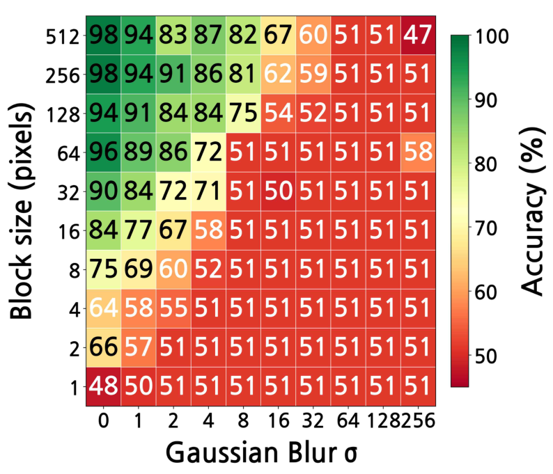
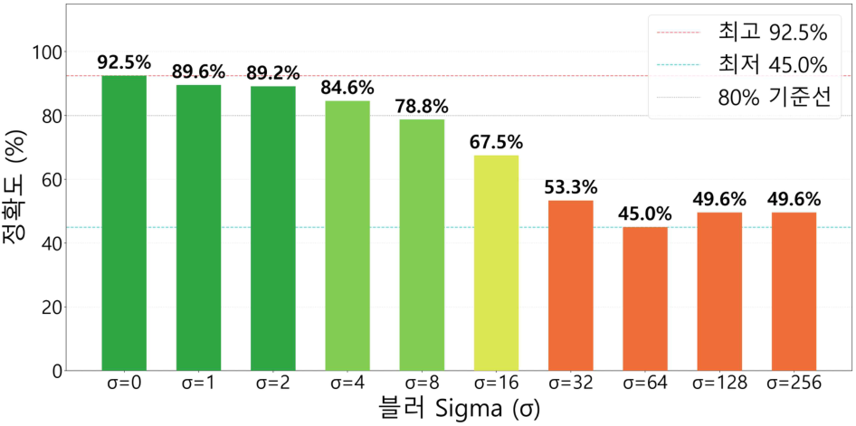
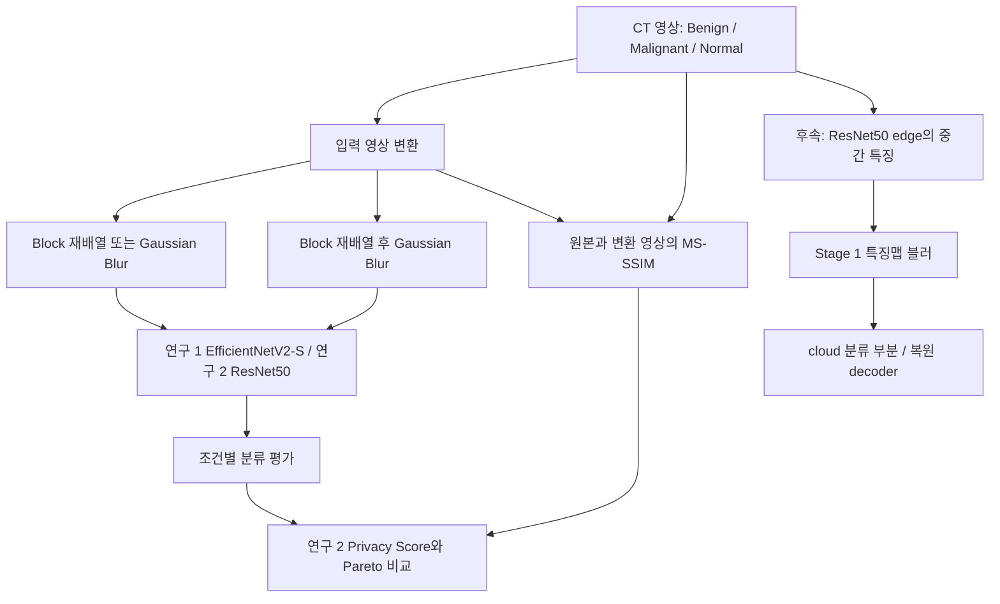

# Lung-CT-Privacy-Project — LEVEL 5 - Expert

**읽기 수준 선택** · [LEVEL 1 - Beginner](%EB%A0%88%EB%B2%A81.md) · [LEVEL 2 - Explorer](%EB%A0%88%EB%B2%A82.md) · [LEVEL 3 - Practitioner](%EB%A0%88%EB%B2%A83.md) · [LEVEL 4 - Advanced](%EB%A0%88%EB%B2%A84.md) · **LEVEL 5 - Expert**

[같은 수준 프로필](https://github.com/PUVKID/PUVKID/blob/main/docs/읽기안내/레벨5.md) · [저장소 첫 화면](../../README.md)

<a id="guide-intro"></a>

## 프로젝트 소개

**입력 MS-SSIM, 특징 SSIM, 분류 정확도, 복원 지표와 재식별 위험은 다른 추정 대상입니다.** 환자 식별·라벨·시험셋 재사용·조건 결과 재사용·고정 100회 정책을 포함해 각 연구의 주장 범위를 분리합니다.

<a id="guide-problem"></a>

## 문제와 주요 기능

원고의 환자 수와 보유 영상의 실제 분할 단위를 구분합니다. 의사 라벨·증강 후 7fold·TTA·시험셋 재사용 조건은 노트북별로 검토합니다. 이를 임상적 일반화와 프라이버시 효과의 입증으로 확대하지 않습니다.

<a id="guide-flow"></a>

## 입력·처리·출력

후속 원고는 입력 1,097장의 MS-SSIM을 사용하며 Stage 1은 정규화한 채널 평균 특징의 단일 SSIM입니다. 추가 Train의 100−accuracy와 특징 수 비율 security도 공격 저항성 실측이 아닙니다. 같은 위험량으로 묶지 않습니다.

<a id="guide-practice"></a>

## 실험과 사용 흐름

고정 100회 실험은 같은 원본·분할·모델·초기 seed·학습 전용 증강·온라인 표본을 유지합니다. 이전 정책의 관찰용 모델과 전체 최저 검증 모델을 같은 시험 자료로 비교합니다. 관찰용 종료는 실제 학습을 멈추지 않으며 재개 상태도 보존합니다.

<a id="guide-results"></a>

## 관측 결과와 해석

원고 보고값과 새 종료 정책 실험의 최종 성능은 별개입니다. 재사용 시험셋의 탐색적 비교를 새 독립 임상 검증으로 부르지 않습니다. 반올림 100.0%와 실제 모든 정답을 구분하고 AUC 정의 불가·미측정도 유지합니다.

<a id="guide-architecture"></a>

## 구현과 핵심 파일

재개는 optimizer·scheduler·RNG·가중치·관찰용 종료를 보존합니다. 결과 API 검증과 학습 통계의 타당성은 별개입니다. 타입 검사 누락 같은 과거 결함을 남기되 실제 의료정보 유출을 관측한 것으로 과장하지 않습니다.

<a id="guide-paper"></a>

## 실제 논문과 원고

원고의 구조·학습 정책·원본 분할·의사 라벨·증강 후 평가를 노트북과 대조합니다. 하계와 후속 원고의 점수 정의·모델 차이를 보존합니다. 비공개 학위 계획서와 개인 자료를 공개 근거에 추가하지 않습니다.

<a id="guide-limits"></a>

## 조건·실패·미검증 한계

표본 독립성·의사 라벨·조건간 재사용·사후 시험 활용·유사도 대리 점수의 타당성을 검토합니다. 촬영 출처·환자 매핑 부재와 검사 범위를 유지합니다. 원영상·가중치·개별 예측·운영 기록·개인 계획서·인증정보는 공개하지 않습니다.

## 전체 차수

차수는 아래의 실제 자료 구분을 따릅니다. 설명은 현재 선택한 수준으로 열리며, 자료 폴더와 당시 전체 비교도 함께 확인할 수 있습니다.

| 차수·단계 · 같은 수준 설명 · 자료 폴더 · 직전 비교·구성 |
| --- |
| **차수·단계**<br>연구 1 · 하계 EfficientNetV2-S<br><br>**같은 수준 설명**<br>[LEVEL 5 - Expert](../revisions/study-1.md#reading-level-5)<br><br>**자료 폴더**<br>[자료](../../%EB%85%BC%EB%AC%B8)<br><br>**직전 비교·구성**<br>[전체 비교](../revision-diffs/study-1.diff) |
| **차수·단계**<br>연구 2 · ResNet50 후속 원고<br><br>**같은 수준 설명**<br>[LEVEL 5 - Expert](../revisions/study-2.md#reading-level-5)<br><br>**자료 폴더**<br>[자료](../../%EB%85%BC%EB%AC%B8)<br><br>**직전 비교·구성**<br>[전체 비교](../revision-diffs/study-2.diff) |
| **차수·단계**<br>1차<br><br>**같은 수준 설명**<br>[LEVEL 5 - Expert](../revisions/folder-1.md#reading-level-5)<br><br>**자료 폴더**<br>[자료](../../1%EC%B0%A8)<br><br>**직전 비교·구성**<br>[전체 비교](../revision-diffs/folder-1.diff) |
| **차수·단계**<br>폴더 2차<br><br>**같은 수준 설명**<br>[LEVEL 5 - Expert](../revisions/folder-2.md#reading-level-5)<br><br>**자료 폴더**<br>[자료](../../%EC%9E%90%EB%A3%8C%EC%B0%A8%EC%88%98/2%EC%B0%A8)<br><br>**직전 비교·구성**<br>[전체 비교](../revision-diffs/folder-2.diff) |
| **차수·단계**<br>폴더 3차<br><br>**같은 수준 설명**<br>[LEVEL 5 - Expert](../revisions/folder-3.md#reading-level-5)<br><br>**자료 폴더**<br>[자료](../../%EC%9E%90%EB%A3%8C%EC%B0%A8%EC%88%98/3%EC%B0%A8/tables)<br><br>**직전 비교·구성**<br>[전체 비교](../revision-diffs/folder-3.diff) |
| **차수·단계**<br>폴더 4차<br><br>**같은 수준 설명**<br>[LEVEL 5 - Expert](../revisions/folder-4.md#reading-level-5)<br><br>**자료 폴더**<br>[자료](../../%EC%9E%90%EB%A3%8C%EC%B0%A8%EC%88%98/4%EC%B0%A8/%EC%BD%94%EB%93%9C)<br><br>**직전 비교·구성**<br>[전체 비교](../revision-diffs/folder-4.diff) |
| **차수·단계**<br>블러 · 2차 실험<br><br>**같은 수준 설명**<br>[LEVEL 5 - Expert](../revisions/experiment-6.md#reading-level-5)<br><br>**자료 폴더**<br>[자료](../../%EB%B8%94%EB%9F%AC/2%EC%B0%A8%20%EC%8B%A4%ED%97%98)<br><br>**직전 비교·구성**<br>[전체 비교](../revision-diffs/experiment-6.diff) |
| **차수·단계**<br>블록 · 2차 실험<br><br>**같은 수준 설명**<br>[LEVEL 5 - Expert](../revisions/experiment-7.md#reading-level-5)<br><br>**자료 폴더**<br>[자료](../../%EB%B8%94%EB%A1%9D/2%EC%B0%A8%20%EC%8B%A4%ED%97%98)<br><br>**직전 비교·구성**<br>[전체 비교](../revision-diffs/experiment-7.diff) |
| **차수·단계**<br>블록+블러 · 기본<br><br>**같은 수준 설명**<br>[LEVEL 5 - Expert](../revisions/experiment-8.md#reading-level-5)<br><br>**자료 폴더**<br>[자료](../../%EB%B8%94%EB%A1%9D%2B%EB%B8%94%EB%9F%AC)<br><br>**직전 비교·구성**<br>[전체 비교](../revision-diffs/experiment-8.diff) |
| **차수·단계**<br>블러 엣지 · 기본<br><br>**같은 수준 설명**<br>[LEVEL 5 - Expert](../revisions/experiment-9.md#reading-level-5)<br><br>**자료 폴더**<br>[자료](../../%EB%B8%94%EB%9F%AC%20%EC%97%A3%EC%A7%80)<br><br>**직전 비교·구성**<br>[전체 비교](../revision-diffs/experiment-9.diff) |
| **차수·단계**<br>블록 엣지 · 기본<br><br>**같은 수준 설명**<br>[LEVEL 5 - Expert](../revisions/experiment-10.md#reading-level-5)<br><br>**자료 폴더**<br>[자료](../../%EB%B8%94%EB%A1%9D%20%EC%97%A3%EC%A7%80)<br><br>**직전 비교·구성**<br>[전체 비교](../revision-diffs/experiment-10.diff) |
| **차수·단계**<br>블록+블러 엣지 · 기본<br><br>**같은 수준 설명**<br>[LEVEL 5 - Expert](../revisions/experiment-11.md#reading-level-5)<br><br>**자료 폴더**<br>[자료](../../%EB%B8%94%EB%A1%9D%2B%EB%B8%94%EB%9F%AC%20%EC%97%A3%EC%A7%80)<br><br>**직전 비교·구성**<br>[전체 비교](../revision-diffs/experiment-11.diff) |
| **차수·단계**<br>블러 스테이지 1 엣지 · 기본<br><br>**같은 수준 설명**<br>[LEVEL 5 - Expert](../revisions/experiment-12.md#reading-level-5)<br><br>**자료 폴더**<br>[자료](../../%EB%B8%94%EB%9F%AC%20%EC%8A%A4%ED%85%8C%EC%9D%B4%EC%A7%80%201%20%EC%97%A3%EC%A7%80)<br><br>**직전 비교·구성**<br>[전체 비교](../revision-diffs/experiment-12.diff) |
| **차수·단계**<br>원본 실험 · 기본<br><br>**같은 수준 설명**<br>[LEVEL 5 - Expert](../revisions/experiment-13.md#reading-level-5)<br><br>**자료 폴더**<br>[자료](../../%EC%9B%90%EB%B3%B8%20%EC%8B%A4%ED%97%98/Lung%20Cancer)<br><br>**직전 비교·구성**<br>[전체 비교](../revision-diffs/experiment-13.diff) |
| **차수·단계**<br>추가 학습모델과 실험 · 기본<br><br>**같은 수준 설명**<br>[LEVEL 5 - Expert](../revisions/experiment-14.md#reading-level-5)<br><br>**자료 폴더**<br>[자료](../../%EC%B6%94%EA%B0%80%20%ED%95%99%EC%8A%B5%EB%AA%A8%EB%8D%B8%EA%B3%BC%20%EC%8B%A4%ED%97%98)<br><br>**직전 비교·구성**<br>[전체 비교](../revision-diffs/experiment-14.diff) |
| **차수·단계**<br>블러 · 1차 실험<br><br>**같은 수준 설명**<br>[LEVEL 5 - Expert](../revisions/experiment-original-blur.md#reading-level-5)<br><br>**자료 폴더**<br>[자료](../../%EC%9B%90%EB%B3%B8%EC%9E%90%EB%A3%8C/%EB%B8%94%EB%9F%AC/1%EC%B0%A8%20%EC%8B%A4%ED%97%98/%EB%B8%94%EB%9F%AC%201/%EB%B8%94%EB%9F%AC%EB%A7%81%20%EA%B2%B0%EA%B3%BC)<br><br>**직전 비교·구성**<br>[전체 비교](../revision-diffs/experiment-original-blur.diff) |
| **차수·단계**<br>블록 · 1차 실험<br><br>**같은 수준 설명**<br>[LEVEL 5 - Expert](../revisions/experiment-original-block.md#reading-level-5)<br><br>**자료 폴더**<br>[자료](../../%EC%9B%90%EB%B3%B8%EC%9E%90%EB%A3%8C/%EB%B8%94%EB%A1%9D/1%EC%B0%A8%20%EC%8B%A4%ED%97%98/%EB%B8%94%EB%A1%9D%201/%EB%B6%88%EB%A1%9D%20%EA%B2%B0%EA%B3%BC)<br><br>**직전 비교·구성**<br>[전체 비교](../revision-diffs/experiment-original-block.diff) |
| **차수·단계**<br>Conv1 블러 OK-NG 실험 · 1차<br><br>**같은 수준 설명**<br>[LEVEL 5 - Expert](../revisions/conv1-okng-round1.md#reading-level-5)<br><br>**자료 폴더**<br>[자료](../../Conv1%20%EB%B8%94%EB%9F%AC%20OK-NG%20%EC%8B%A4%ED%97%98/1%EC%B0%A8)<br><br>**직전 비교·구성**<br>[전체 비교](../revision-diffs/conv1-okng-round1.diff) |
| **차수·단계**<br>Conv1 블러 OK-NG 실험 · 2차<br><br>**같은 수준 설명**<br>[LEVEL 5 - Expert](../revisions/conv1-okng-round2.md#reading-level-5)<br><br>**자료 폴더**<br>[자료](../../Conv1%20%EB%B8%94%EB%9F%AC%20OK-NG%20%EC%8B%A4%ED%97%98/2%EC%B0%A8)<br><br>**직전 비교·구성**<br>[전체 비교](../revision-diffs/conv1-okng-round2.diff) |
| **차수·단계**<br>Conv1 블러 OK-NG 실험 · 3차 (시각화)<br><br>**같은 수준 설명**<br>[LEVEL 5 - Expert](../revisions/conv1-okng-round3.md#reading-level-5)<br><br>**자료 폴더**<br>[자료](../../Conv1%20%EB%B8%94%EB%9F%AC%20OK-NG%20%EC%8B%A4%ED%97%98/3%EC%B0%A8)<br><br>**직전 비교·구성**<br>[전체 비교](../revision-diffs/conv1-okng-round3.diff) |
| **차수·단계**<br>Conv1 블러 OK-NG 실험 · 4차 (강도별 결과 선택)<br><br>**같은 수준 설명**<br>[LEVEL 5 - Expert](../revisions/conv1-okng-round4.md#reading-level-5)<br><br>**자료 폴더**<br>[자료](../../Conv1%20%EB%B8%94%EB%9F%AC%20OK-NG%20%EC%8B%A4%ED%97%98/4%EC%B0%A8)<br><br>**직전 비교·구성**<br>[전체 비교](../revision-diffs/conv1-okng-round4.diff) |
| **차수·단계**<br>Conv1 블러 OK-NG 실험 · 5차 (실험 4차 고정 100회)<br><br>**같은 수준 설명**<br>[LEVEL 5 - Expert](../revisions/conv1-okng-round5.md#reading-level-5)<br><br>**자료 폴더**<br>[자료](../../Conv1%20%EB%B8%94%EB%9F%AC%20OK-NG%20%EC%8B%A4%ED%97%98/5%EC%B0%A8)<br><br>**직전 비교·구성**<br>[전체 비교](../revision-diffs/conv1-okng-round5.diff) |

## 첫 화면의 모든 설명과 공통 근거

아래는 기존 첫 화면의 실질 구성 전체입니다. 각 항목의 개념은 이 페이지의 풀이와 연결하고, 실제 표·코드·그림·상세 조건은 원문 공통 근거에서 확인합니다. 기존 전체 비교는 문장·주석·파일 단위의 작은 변화까지 보존하는 자료입니다.

| 첫 화면 구성 · 이 수준의 풀이 · 원문 공통 근거 |
| --- |
| **첫 화면 구성**<br>연구 요약<br><br>**이 수준의 풀이**<br>[프로젝트 소개](#guide-intro)<br><br>**원문 공통 근거**<br>[전체 설명·표·그림](../../README.md#-%EC%97%B0%EA%B5%AC-%ED%95%B5%EC%8B%AC) |
| **첫 화면 구성**<br>입력·처리·출력<br><br>**이 수준의 풀이**<br>[입력·처리·출력](#guide-flow)<br><br>**원문 공통 근거**<br>[전체 설명·표·그림](../../README.md#-%EC%9E%85%EB%A0%A5%EC%B2%98%EB%A6%AC%EC%B6%9C%EB%A0%A5) |
| **첫 화면 구성**<br>논문과 최신 자료<br><br>**이 수준의 풀이**<br>[실제 논문과 원고](#guide-paper)<br><br>**원문 공통 근거**<br>[전체 설명·표·그림](../../README.md#-%EB%85%BC%EB%AC%B8%EA%B3%BC-%EC%B5%9C%EC%8B%A0-%EC%9E%90%EB%A3%8C) |
| **첫 화면 구성**<br>전체 차수<br><br>**이 수준의 풀이**<br>[문제와 주요 기능](#guide-problem)<br><br>**원문 공통 근거**<br>[전체 설명·표·그림](../../README.md#%EF%B8%8F-%EC%B0%A8%EC%88%98%EB%B3%84-%ED%94%84%EB%A1%9C%EC%A0%9D%ED%8A%B8-%EC%95%88%EB%82%B4) |
| **첫 화면 구성**<br>연구 방법<br><br>**이 수준의 풀이**<br>[프로젝트 소개](#guide-intro)<br><br>**원문 공통 근거**<br>[전체 설명·표·그림](../../README.md#-%ED%94%84%EB%A1%9C%EC%A0%9D%ED%8A%B8-%EC%86%8C%EA%B0%9C) |
| **첫 화면 구성**<br>연구 단계와 보고 결과<br><br>**이 수준의 풀이**<br>[관측 결과와 해석](#guide-results)<br><br>**원문 공통 근거**<br>[전체 설명·표·그림](../../README.md#-%EC%97%B0%EA%B5%AC-%EB%8B%A8%EA%B3%84%EC%99%80-%EB%B3%B4%EA%B3%A0-%EA%B2%B0%EA%B3%BC) |
| **첫 화면 구성**<br>기술과 처리 흐름<br><br>**이 수준의 풀이**<br>[입력·처리·출력](#guide-flow)<br><br>**원문 공통 근거**<br>[전체 설명·표·그림](../../README.md#-%EA%B8%B0%EC%88%A0%EA%B3%BC-%EC%B2%98%EB%A6%AC-%ED%9D%90%EB%A6%84) |
| **첫 화면 구성**<br>저장소 구성<br><br>**이 수준의 풀이**<br>[구현과 핵심 파일](#guide-architecture)<br><br>**원문 공통 근거**<br>[전체 설명·표·그림](../../README.md#-%EC%A0%80%EC%9E%A5%EC%86%8C-%EA%B5%AC%EC%84%B1) |
| **첫 화면 구성**<br>데이터·평가를 해석하는 방법<br><br>**이 수준의 풀이**<br>[조건·실패·미검증 한계](#guide-limits)<br><br>**원문 공통 근거**<br>[전체 설명·표·그림](../../README.md#-%EB%8D%B0%EC%9D%B4%ED%84%B0%ED%8F%89%EA%B0%80%EB%A5%BC-%ED%95%B4%EC%84%9D%ED%95%98%EB%8A%94-%EB%B0%A9%EB%B2%95) |
| **첫 화면 구성**<br>실행 조건과 권장 확인 순서<br><br>**이 수준의 풀이**<br>[실험과 사용 흐름](#guide-practice)<br><br>**원문 공통 근거**<br>[전체 설명·표·그림](../../README.md#-%EC%8B%A4%ED%96%89-%EC%A1%B0%EA%B1%B4%EA%B3%BC-%EA%B6%8C%EC%9E%A5-%ED%99%95%EC%9D%B8-%EC%88%9C%EC%84%9C) |
| **첫 화면 구성**<br>알려진 실행 문제와 점검 지점<br><br>**이 수준의 풀이**<br>[실험과 사용 흐름](#guide-practice)<br><br>**원문 공통 근거**<br>[전체 설명·표·그림](../../README.md#%EF%B8%8F-%EC%95%8C%EB%A0%A4%EC%A7%84-%EC%8B%A4%ED%96%89-%EB%AC%B8%EC%A0%9C%EC%99%80-%EC%A0%90%EA%B2%80-%EC%A7%80%EC%A0%90) |
| **첫 화면 구성**<br>자료와 후속 방향<br><br>**이 수준의 풀이**<br>[프로젝트 소개](#guide-intro)<br><br>**원문 공통 근거**<br>[전체 설명·표·그림](../../README.md#-%EC%9E%90%EB%A3%8C%EC%99%80-%ED%9B%84%EC%86%8D-%EB%B0%A9%ED%96%A5) |
| **첫 화면 구성**<br>최신 문서와 변경 이력<br><br>**이 수준의 풀이**<br>[실제 논문과 원고](#guide-paper)<br><br>**원문 공통 근거**<br>[전체 설명·표·그림](../../README.md#-%ED%98%84%EC%9E%AC-%EC%B2%A8%EB%B6%80-%EB%AC%B8%EC%84%9C) |
| **첫 화면 구성**<br>차수별 방법과 조건<br><br>**이 수준의 풀이**<br>[문제와 주요 기능](#guide-problem)<br><br>**원문 공통 근거**<br>[전체 설명·표·그림](../../README.md#-%EC%97%B0%EA%B5%AC%EA%B5%AC%ED%98%84%EC%9D%98-%EC%84%B8%EB%B6%80-%ED%9D%90%EB%A6%84) |

## 이어 읽기

같은 난이도로 다른 프로젝트를 찾으려면 [프로필의 LEVEL 5 - Expert](https://github.com/PUVKID/PUVKID/blob/main/docs/읽기안내/레벨5.md)를 엽니다. 이 저장소 안에서는 위 전체 차수 표의 같은 수준 설명으로 이동하세요. 단계별 선택표에서 깊이를 바꿀 수 있으며, LEVEL 5 아래에는 기존 상세 전체가 보존되어 있습니다.

<!-- semantic-explanation17:start -->

## LEVEL 5 · 조건과 절차를 상세히 읽기

<a id="semantic-lung-study1-level-5"></a>

### LEVEL 5 · 하계 연구의 입력 변환과 보고값

수락 범위는 하계 3쪽 원고와 저장 실행별 보고값의 대응입니다. CT3분류·입력 크기·단독 조건과 지표를 대조하고 원고에 없는 상세 표본 프로토콜을 후속 원고에서 가져오지 않습니다. 실제 재식별 공격 저항성이나 임상 일반화는 이 정확도 표로 입증되지 않습니다.

<a id="layout18-table-3-row-1"></a>

**입력과 조건**

**조건·자료**

입력과 조건

**의미와 확인 방법**

512×512 CT를 Benign·Malignant·Normal로 분류합니다. 블러 σ0·1·2·4·8·16·32·64·128·256과 블록 512·256·128·64·32·16·8·4·2·1의 단독 조건입니다.

<a id="layout18-table-3-row-2"></a>

**보고값과 자료**

**조건·자료**

보고값과 자료

**의미와 확인 방법**

3쪽 원고는 원본 92.5%, σ32 53.3%, Block32 79.2%, Block1 52.9%를 보고합니다. 발표 19장·대본 9쪽·그래프 노트북은 같은 연구의 설명 자료입니다.

<a id="layout18-table-3-row-3"></a>

**실행의 구분**

**조건·자료**

실행의 구분

**의미와 확인 방법**

Block512 저장 원비율 0.9291666666666667과 Blurσ0의 0.925는 다른 실행입니다. 그래프 재작성은 새 학습이 아니며 연구 2의 표본 세부를 연구 1에 소급하지 않습니다.


<a id="semantic-lung-study2-level-5"></a>

### LEVEL 5 · 후속 원고의 분모·조건·점수

시험109장의 클래스 분모와 유사도1,097장의 분모, 110명이라는 원고의 환자 수를 구별합니다. 아래 원고 수치는 원정밀도로 보존합니다. 테스트 의사 라벨·증강 후fold의 누수 가능성과 코드/원고 차이를 함께 검토해야 하며 7-fold앙상블은 다중시드 반복이나 기관 외 검증을 대신하지 않습니다. 구조 점수는 공격 성공률·재식별 확률·암호학적 안전성·차등프라이버시 보장이 아닙니다.

<a id="layout18-table-4-row-1"></a>

**표본과 분할**

**조건·자료**

표본과 분할

**의미와 확인 방법**

IQ-OTH/NCCD는 두 병원·110명·1,097장으로 Benign120·Malignant561·Normal416입니다. 클래스별 원본 10%의 시험109장(12·56·41)을 먼저 분리하고 나머지를 클래스당1,000장으로 증강해 7-fold·20회TTA를 적용한 원고입니다.

<a id="layout18-table-4-row-2"></a>

**비교 조건**

**조건·자료**

비교 조건

**의미와 확인 방법**

ImageNet 사전학습 ResNet50에서 Block10·Blur10의 단독20조건과 Block→Blur100조합을 구분합니다. 100조합 노트북 하나가 전체120조건을 수행하지 않습니다.

<a id="layout18-table-4-row-3"></a>

**점수 정의**

**조건·자료**

점수 정의

**의미와 확인 방법**

Privacy Score=50×(1−MS-SSIM)이며 전체1,097장의 원본/변환 영상을 5개 스케일로 비교합니다. 단일SSIM 기반 소규모·특징맵 점수와 다릅니다.

<a id="layout18-table-4-row-4"></a>

**원고 보고값**

**조건·자료**

원고 보고값

**의미와 확인 방법**

원본98.17%; 조합 Block256+σ0는98.17%·49.65점, +σ16은62.39%·49.70점, +σ32는58.72%·49.85점입니다. Blur단독σ256은51.38%·34.62점입니다.

<a id="layout18-table-4-row-5"></a>

**다른 실행과 붕괴**

**조건·자료**

다른 실행과 붕괴

**의미와 확인 방법**

조합100조건 중53조건의51.38%는 시험56/109와 대응해 다수클래스 붕괴로 해석합니다. 조합Block512+σ256의46.8%, 단독Block256의97.25%와 조합σ0의98.17%는 서로 다른 실행입니다.

<a id="layout18-table-4-row-6"></a>

**원고와 재현**

**조건·자료**

원고와 재현

**의미와 확인 방법**

19쪽 원고이며 RTX4090·TensorFlow·혼합정밀도를 보고합니다. Precision·F1은 산출하지 않았고 독립 기관·환자 검증과 실제 복원 공격·사람의 지각 평가는 후속 과제입니다.


<a id="semantic-lung-training-level-5"></a>

### LEVEL 5 · 노트북 학습·평가의 연결과 실패 조건

관측된 코드 경로를 엄격 hold-out 프로토콜로 확대하지 않습니다. test 선분리 여부와 별개로 파생 영상 fold 중복·전체 학습 자료 재사용·동일 test 재평가를 확인해야 합니다. 실측과 예시 분기·캐시 재사용·체크포인트 실체를 결합해 검토하며 아래 설정의 존재를 학습 완료·성능 재현의 증거로 삼지 않습니다.

<a id="layout18-table-5-row-1"></a>

**입력·헤드**

**조건·자료**

입력·헤드

**의미와 확인 방법**

JPEG3채널·512×512·float32의0~255 입력입니다. GAP와GMP를 연결하고 Dense512→BatchNorm·ReLU·Dropout0.35→Dense256→BatchNorm·ReLU·Dropout0.25→softmax로 분류하는 변형이 있습니다.

<a id="layout18-table-5-row-2"></a>

**학습·TTA**

**조건·자료**

학습·TTA

**의미와 확인 방법**

seed42·test0.10·StratifiedKFold7·shuffle·클래스가중치·batch8이며 변형별batch4도 있습니다. EPOCHS_S1=80·EPOCHS_S2=200, 분리모델fit은 최대280epoch, SWA시작40·TTA20입니다.

<a id="layout18-table-5-row-3"></a>

**증강·손실**

**조건·자료**

증강·손실

**의미와 확인 방법**

학습 좌우/상하반전·밝기최대0.25×255·대비0.75~1.25·Gaussian잡음표준편차5, TTA좌우반전·밝기최대0.15×255·대비0.85~1.15입니다. focal gamma2·학습label smoothing0.02·AdamW lr1e-4·weight decay1e-4를 사용하며 후속재학습은lr3e-5·smoothing0.05입니다.

<a id="layout18-table-5-row-4"></a>

**시험 재사용**

**조건·자료**

시험 재사용

**의미와 확인 방법**

시험 예측 확신도0.88이상 영상이10장이상이면 예측라벨로15epochs추가학습한 뒤 같은 시험을 다시 평가하는 경로가 있습니다. 추가모델이7fold모델과 앙상블되며 일부는 전체증강학습을 이용해fold검증도 다시 포함합니다.

<a id="layout18-table-5-row-5"></a>

**누수·코드차이**

**조건·자료**

누수·코드차이

**의미와 확인 방법**

원본test선분리와 증강후fold분리는 다릅니다. 일부이전셀은 증강후test도 분리합니다. 논문의Mixup Beta설명과 코드uniform샘플링, preprocess_input누락, 중첩모델미세조정, 최적체크포인트를종료/SWA가중치로다시저장하는 흐름을 확인합니다.

<a id="layout18-table-5-row-6"></a>

**실행 준비**

**조건·자료**

실행 준비

**의미와 확인 방법**

Python·TensorFlow/Keras·CUDA·드라이버·AdamW API·NumPy·Pillow·scikit-learn·Matplotlib·Seaborn·추가import를 확인합니다. BASE_TRAIN과 실제지원 BB_OUTPUT_ROOT/SB_OUTPUT_ROOT, 입력·결과폴더·디스크·캐시를 구분합니다. 의존성잠금으로 재현을 보증하지 않습니다.

<a id="layout18-table-5-row-7"></a>

**실측과 예시**

**조건·자료**

실측과 예시

**의미와 확인 방법**

_dummy_results·_dummy_histories·GPU예시로그·하드코딩히트맵은 실측이 아닙니다. 결과JSON·분할·시드·가중치·실제로그를 함께 확인합니다.


<a id="semantic-lung-feature-level-5"></a>

### LEVEL 5 · 입력 변환·분리 모델·특징 블러의 차이

동일 프로세스 연결을 실제 분산 전송 성능으로 평가하지 않습니다. 특징의 정규화·단일 SSIM과 입력 영상 5스케일 MS-SSIM은 대상과 계산이 달라 점수만 비교할 수 없습니다. σ32 재사용 여부·실제 가중치·복원 분기의 완전성과 저장 측정을 검토하고 미실행 공격 결과를 만들지 않습니다.

<a id="layout18-table-6-row-1"></a>

**입력 변환**

**조건·자료**

입력 변환

**의미와 확인 방법**

블러는PIL GaussianBlur이며σ0은복사합니다. 블록은seed순열로위치를바꾸고내부픽셀을유지하며영상보다작지않은블록은복사합니다. 조합은Block10×Blur10=100이며Block뒤Blur입니다.

<a id="layout18-table-6-row-2"></a>

**분리 경계**

**조건·자료**

분리 경계

**의미와 확인 방법**

edge/cloud는ResNet50 pool1_pool경계의모듈을동일TensorFlow프로세스에서연결한코드입니다. 실제원격전송구현이아닙니다.

<a id="layout18-table-6-row-3"></a>

**특징 변환**

**조건·자료**

특징 변환

**의미와 확인 방법**

Stage1은edge→FeatureGaussianBlur→cloud입니다. 채널별고정Gaussian커널을depthwise_conv2d로적용합니다. σ32·64·128·256은전역평균분기이며REUSE_COLLAPSED_RESULTS기본경로는σ32결과를64·128·256에재사용합니다.

<a id="layout18-table-6-row-4"></a>

**별도 분석**

**조건·자료**

별도 분석

**의미와 확인 방법**

채널평균특징맵을각각정규화한단일SSIM점수·cosine·클래스분리도와선택decoder의PSNR/SSIM을봅니다. decoder는AdamW lr5e-4·weight decay1e-5·MAE이며Conv2D import/정의확인이필요합니다.


<a id="semantic-lung-tools-level-5"></a>

### LEVEL 5 · 자료 차수의 수정 도구와 소규모 계산

자료 1~4차의 수락 범위는 변형 코드·변경 도구·3장 8조건 점검·최종 원고 대응입니다. 35.3667978…은 저장표의 축약 표기이며 원정밀도 CSV를 유지합니다. SSIM 매칭은 분류 성능 동등성이나 공격 저항성 동등성을 증명하지 않고 0바이트 파일에서 분석 성과를 추정하지 않습니다.

<a id="layout18-table-7-row-1"></a>

**자료1차**

**조건·자료**

자료1차

**의미와 확인 방법**

블록·블러각각rebuilt·same_settings·metric_matched의여섯노트북입니다. metric_matched는블록평균SSIM/PSNR에맞는sigma를탐색하며batch4/8·epoch·SWA가변형별로다릅니다. 보조도구는지정노트북을다시씁니다.

<a id="layout18-table-7-row-2"></a>

**자료2차**

**조건·자료**

자료2차

**의미와 확인 방법**

align_experiment_methods.mjs는GPU모니터필드/그래프호환을맞추고build_block_blur_notebook.mjs는Blur사본에서Block→Blur100조합을만듭니다. replaceOrThrow는대상문자열누락시중단하고rollback_original_notebooks.mjs는보관본/지정셀을복원합니다. Node.js와실제입력·출력경로가필요합니다.

<a id="layout18-table-7-row-3"></a>

**자료3차**

**조건·자료**

자료3차

**의미와 확인 방법**

512·seed42의3장입력, Block512·32/Blurσ0·2/조합4의8조건입니다. Privacy Score=((1−SSIM)/2)×100이며PSNR은별도참고값입니다. long·방법요약·조합pivot·best_conditions의4CSV가있습니다. 항등조건0, Block32와B32_S0의35.3667978…은3장계산확인값입니다.

<a id="layout18-table-7-row-4"></a>

**자료4차**

**조건·자료**

자료4차

**의미와 확인 방법**

자료차수/4차/코드의학습·MS-SSIM·도표코드를19쪽원고와연결합니다. pareto_scatter.ipynb는0바이트로실행내용이없습니다. 소규모SSIM표와원고1,097장MS-SSIM을섞지않습니다.


<a id="semantic-lung-legacy-level-5"></a>

### LEVEL 5 · 초기 조직영상 앱과 추가 학습 코드

초기 조직영상 앱과 후속 CT 연구의 입력 도메인·모델·분모를 분리합니다. 백틱/문법 문제와 미확인 가중치 대응이 남아 있는 코드를 완전 실행 검증으로 소개하지 않고 security라는 변수명으로 개인정보 보호 효과를 추정하지 않습니다.

<a id="layout18-table-8-row-1"></a>

**초기화면**

**조건·자료**

초기화면

**의미와 확인 방법**

Streamlit이업로드영상을224×224·255로나눔·배치차원추가후Model.h5의대장선암/대장정상/폐선암/폐정상/폐편평상피암5라벨확률을텍스트와원형그래프로보입니다. Train.ipynb는MobileNetV2 3클래스·224·batch16·10epoch여서모델대응을따로확인합니다.

<a id="layout18-table-8-row-2"></a>

**추가셀**

**조건·자료**

추가셀

**의미와 확인 방법**

Train.ipynb셀0은조직영상5클래스, 셀1·2는EfficientNetV2-S CT블록/블러, 셀3~5는MobileNetV2/풀링비교입니다. 코드별입력224/512와클래스수를확인합니다.

<a id="layout18-table-8-row-3"></a>

**계산과제약**

**조건·자료**

계산과제약

**의미와 확인 방법**

SSIM·PSNR·MS-SSIM·DSSIM변형과저장분류JSON/유사도CSV를그리는코드를구분합니다. 100−accuracy·특징수비율security는공격저항성실측이아니며첫학습셀끝의Markdown백틱·문법·사본별설정을확인합니다.


<a id="semantic-lung-conv1-level-5"></a>

### LEVEL 5 · Conv1 실험의 분할·수치·공개 차수

원본 환자 식별과 촬영 출처가 없다는 제약을 유지합니다. 유사 그룹은 환자 독립 분할의 대체물이 아니며 온라인 증강 표본을 독립 분모로 세지 않습니다. CPU 검사·GPU 배치 연결·장시간 10조건 학습 완료를 각각 구분하고 공개에 제외된 의료 자료를 문서 검증용으로 추가하지 않습니다.

<a id="layout18-table-9-row-1"></a>

**분류와표본**

**조건·자료**

분류와표본

**의미와 확인 방법**

OK=양성+정상, NG=악성이며클래스당5,000은학습온라인표본수입니다. 원본환자ID가없어영상단위예비실험입니다. 원본/환자/증강표본수를구분합니다.

<a id="layout18-table-9-row-2"></a>

**공개2차변경**

**조건·자료**

공개2차변경

**의미와 확인 방법**

최대35→100회·조기종료7→15회·절대개선량0.0001과최저손실선택분리, Adam→AdamW·lr0.00008→0.00003·weight decay0.0001입니다. 검증미개선4회다음미개선에서lr0.5배·하한0.000001, batch2→8로epoch당갱신5000→1250입니다.

<a id="layout18-table-9-row-3"></a>

**그룹·평가**

**조건·자료**

그룹·평가

**의미와 확인 방법**

완전중복에64px회색조RMSE≤5유사그룹을더합니다. 그룹은환자ID가아닙니다. FP32평가·FP64손실·로짓순위AUC/AP와optimizer/scheduler/RNG재개를구분합니다.

<a id="layout18-table-9-row-4"></a>

**당시구현검사**

**조건·자료**

당시구현검사

**의미와 확인 방법**

공개1차단위/통합33개·reader/writer500회·BF16 512배치연결, 공개2차43개·실제batch8 BF16학습20번·검증164장연결은전체학습성능이아닙니다. 당시분할은학습769(84·292·393), 검증/시험각164(18·62·84), 원본1097·완전중복그룹1054·유사그룹820·최대26장입니다.

<a id="layout18-table-9-row-5"></a>

**공개범위**

**조건·자료**

공개범위

**의미와 확인 방법**

설정예제·코드·글꼴/라이선스는공개하고의료영상·특징맵PNG·영상별목록·가중치·운영로그·접속정보·개인계획서는포함하지않습니다. source_class는원본범주폴더라벨이며병원/환자/스캐너ID가아닙니다.


<a id="semantic-lung-view-level-5"></a>

### LEVEL 5 · 단계별 특징맵과 강도 선택 화면

실제 checkpoint에서 계산된 특징과 과거 참고 PNG를 혼동하지 않습니다. 180경로 검사는 출력 구조이며 의료영상의 연구 효과 증거가 아닙니다. 원본 선택 대표성·패널별 정규화·인증 응답 제한과 52개 당시 검사의 범위를 검토하고 과거 실패를 최종 PASS로 삭제하지 않습니다.

<a id="layout18-table-10-row-1"></a>

**공개3차**

**조건·자료**

공개3차

**의미와 확인 방법**

실제학습2차의시각화소프트웨어입니다. 원본+σ1·2·4·8·16·32·64·128·256의10조건×3원본범주×입력/Conv1블러직후/잔차묶음1~4의6단계=180PNG이며조건당18장입니다.

<a id="layout18-table-10-row-2"></a>

**패널과조건**

**조건·자료**

패널과조건

**의미와 확인 방법**

채널평균·채널최대·균등선택8채널의10패널입니다. Conv1은64채널이고후속단계의공간/채널수가다릅니다. 패널별최소/최대정규화이므로같은색을같은수치로비교하지않습니다. 완료최적체크포인트·CPU FP32추론과학습정밀도를구분합니다.

<a id="layout18-table-10-row-3"></a>

**도구·보안**

**조건·자료**

도구·보안

**의미와 확인 방법**

생성도구의--experiment-root·--output-root·--reference-root·--run-id를실제값으로지정합니다. 학습분할의범주별상대경로정렬첫원본을선택하며대표성을보장하지않습니다. 180경로·조건18장·run/원본/체크포인트해시·유한텐서·이미지크기를대조하고원본경로·인증정보는응답에넣지않습니다.

<a id="layout18-table-10-row-4"></a>

**공개4차**

**조건·자료**

공개4차

**의미와 확인 방법**

학습2차용로컬화면수정3차를공개4차로보존했습니다. 사진·곡선·시험수치가같은강도로바뀌고3초갱신·테마·화면크기변경에도선택을유지합니다. 빠른0→256→0의늦은응답을버리고run전환시이전수치를비웁니다.

<a id="layout18-table-10-row-5"></a>

**API와표시**

**조건·자료**

API와표시

**의미와 확인 방법**

읽기전용인증/api/sigma-results/<강도>는10강도·경계·크기·run·수치타입/유한성/범위를검사합니다. 미완료/누락/타run/오류는대기/미측정입니다. 공개4차의백분율소수둘째자리버림기록과공개5차의첫째자리반올림·원비율/정답수조회는시점이다릅니다.

<a id="layout18-table-10-row-6"></a>

**당시검사**

**조건·자료**

당시검사

**의미와 확인 방법**

공개4차당시전체52개(대시보드25개)·Node문법·지연응답회귀·실제10강도응답대조기록입니다. 초기모의DOM누락등2실패와후속중첩객체결함검토를보존합니다. 소프트웨어검사는임상성능이나학습완료가아닙니다.


<a id="semantic-lung-fixed100-level-5"></a>

### LEVEL 5 · 고정100회와 관찰용 조기종료 비교

같은 학습 경로의 구간 선택 비교여서 독립적인 두 학습이나 새 외부 검증으로 해석하지 않습니다. 이미 사용한 시험 셋 재이용과 원본 환자 ID 부재를 한계로 남깁니다. 첫째 자리 반올림은 표시 정책이며 저장 값·baseline을 바꾸지 않고 예제 해시 부재를 기존 값으로 임의 채우지 않습니다.

<a id="layout18-table-11-row-1"></a>

**차수와정책**

**조건·자료**

차수와정책

**의미와 확인 방법**

실제실험4차를공개5차로보존합니다. 원본/분할·모델·seed·학습증강·클래스당5000·batch·AdamW·val_loss학습률감소는유지하고10강도각100회까지학습하며실제조기종료는끄고관찰만합니다.

<a id="layout18-table-11-row-2"></a>

**선택과재개**

**조건·자료**

선택과재개

**의미와 확인 방법**

기존정책이멈췄을첫회차와그때까지최저검증모델, 전체100회최저검증모델을같은시험자료로비교합니다. 같은학습경로의앞부분/전체에서고른모델이며관찰상태·가중치·optimizer·scheduler·RNG를재개시보존합니다.

<a id="layout18-table-11-row-3"></a>

**필수입력**

**조건·자료**

필수입력

**의미와 확인 방법**

expected_reference_manifest·expected_reference_manifest_sha256·expected_reference_records_sha256를자신의기준manifest로채워야합니다. 예제에는실제식별해시가없어그대로실행할수없으며원본목록/정확한분할이불일치하면중단합니다.

<a id="layout18-table-11-row-4"></a>

**표시와한계**

**조건·자료**

표시와한계

**의미와 확인 방법**

기본백분율은첫째자리반올림이며원비율·전체백분율·정답수를펼쳐100.0%반올림과전부정답을구분합니다. 결과API는혼동행렬/정답수/정확도일관성도대조합니다. 시험셋재사용의탐색비교이며새독립임상검증·전조건학습완료를주장하지않습니다.


<!-- semantic-explanation17:end -->

<!-- complete-source-facts17:start -->

## 첫 화면의 세부 사실을 빠짐없이 읽기

위의 수준별 풀이에 대응하는 실제 세부 사실입니다. 입력·조건·수치·표·그림·문서 판본과 작은 변경까지 같은 페이지에서 확인하도록 기존 첫 화면의 내용을 함께 수록했습니다. 각 절은 해당 수준의 앞선 설명과 연결해 읽으며, 원래 실행 코드·전체 비교·원고는 원문 주소로 이어집니다.

<a id="facts-section-0"></a>

### LEVEL 5 · 첫 화면 기본 정보


블러·블록 변환이 폐 CT 분류 성능과 프라이버시에 미치는 영향을 비교합니다.

분야: 컴퓨터 비전 › 딥러닝 영상 분류 › 입력·특징 변환과 프라이버시 평가

`Python` `TensorFlow` `Jupyter` `논문·연구 자료`

[빠른 시작](../../README.md#quick-start) · [저장소 구성](../../README.md#repository-structure) · [데이터와 평가](../../README.md#data-settings) · [연구 단계](../../docs/RESEARCH_STAGES.md) · [하계 논문](../../%EB%85%BC%EB%AC%B8/1%EC%B0%A8_EfficientNetV2-S_%ED%95%98%EA%B3%84_%EC%B5%9C%EC%A2%85.pdf) · [최신 PDF](../../%EB%85%BC%EB%AC%B8/%EC%97%B0%EA%B5%AC2_%EC%9B%90%EB%AC%B8_%EC%B5%9C%EC%A2%85.pdf) · [버전 기록](../../docs/VERSIONS.md)

[핵심 구성](../../README.md#input-processing-output)


<a id="facts-section-1"></a>

### LEVEL 5 · 연구 요약


#### LEVEL 5 · 연구 1 · 하계 EfficientNetV2-S

512×512 CT 입력에 블러와 블록 재배열을 각각 적용하고 분류 정확도·ROC-AUC·혼동행렬을 비교합니다.

하계 3쪽 원고의 보고 정확도는 원본 92.5%, σ32 53.3%, Block32 79.2%입니다. [연구 1 상세](../../docs/versions/stage-1.md)


#### LEVEL 5 · 연구 2 · ResNet50와 프라이버시·정확도 절충

분류 성능과 영상 구조의 비유사도를 함께 비교합니다. 단독 20조건과 Block→Blur 100조합을 비교하고, 전체 1,097장의 입력 영상 MS-SSIM으로 Privacy Score를 계산한 19쪽 후속 원고입니다.

조합 Block256+σ0의 보고값은 정확도 98.17%·49.65점입니다. 점수는 복원 공격 성공률이 아니며 테스트 의사 라벨 사용 등 평가 조건을 함께 읽어야 합니다. [연구 2 상세](../../docs/versions/stage-2.md)


#### LEVEL 5 · 후속 코드 · 모델 분리와 특징맵 블러

입력 변환을 유지한 edge/cloud 분리 모델에서, `pool1_pool` **특징 자체**를 흐리는 Stage 1 실험으로 확장합니다. 동일 프로세스의 모델 연결이며 실제 원격 전송 구현은 아닙니다.

특징 SSIM·cosine과 decoder 복원 PSNR/SSIM을 계산하는 코드가 있지만 큰 σ 결과 재사용, `Conv2D` import 누락, 대체 가중치·예시 결과 분기가 남아 있습니다. [후속 특징맵 상세](../../docs/versions/stage-3.md) · [전체 기록](../../docs/VERSIONS.md)




**논문 그림** — 2차 ResNet50 공개 원고 12쪽: 블록 크기와 블러 강도에 따른 정확도 집계 그래프입니다. 연결한 도표에는 의료 원영상이 없습니다. 셀 숫자는 원고에서 정수로 표시한 정확도이며, 아래 표의 소수점 보고값과 표시 정밀도가 다릅니다.

[최신 PDF](../../%EB%85%BC%EB%AC%B8/%EC%97%B0%EA%B5%AC2_%EC%9B%90%EB%AC%B8_%EC%B5%9C%EC%A2%85.pdf)



**논문 그림** — 1차 EfficientNetV2-S 하계 공개 원고 2쪽: 블러 강도별 정확도 비교입니다. 원고의 기존 결과를 그대로 추출했습니다.

[근거 파일 보기](../../%EB%85%BC%EB%AC%B8/1%EC%B0%A8_EfficientNetV2-S_%ED%95%98%EA%B3%84_%EC%B5%9C%EC%A2%85.pdf)


<a id="facts-section-2"></a>

### LEVEL 5 · 입력·처리·출력


**구분**

문제

**내용**

영상 변환의 강도와 적용 위치에 따라 분류 성능과 프라이버시 지표가 어떻게 달라지는지 비교합니다.


**구분**

입력

**내용**

CT 영상·클래스 라벨


**구분**

처리

**내용**

EfficientNetV2-S·ResNet50 분류, 블러·블록 변환, 구조 유사도 비교


**구분**

출력

**내용**

조건별 분류 지표·Privacy Score·그래프


<a id="facts-section-3"></a>

### LEVEL 5 · 논문과 최신 자료


| 자료 · 원문 파일 |
| --- |
| **자료**<br>연구 1 최종 논문 · EfficientNetV2-S<br><br>**원문 파일**<br>[PDF 다운로드](../../%EB%85%BC%EB%AC%B8/1%EC%B0%A8_EfficientNetV2-S_%ED%95%98%EA%B3%84_%EC%B5%9C%EC%A2%85.pdf) |
| **자료**<br>연구 1 최종 논문 · EfficientNetV2-S<br><br>**원문 파일**<br>[HWP 다운로드](../../%EC%97%B0%EA%B5%AC1_%ED%95%98%EA%B3%84_EfficientNetV2-S/%EB%85%BC%EB%AC%B8/%EC%9B%90%EB%AC%B8_%EC%B5%9C%EC%A2%85.hwp) |
| **자료**<br>연구 2 최종 논문 · ResNet50<br><br>**원문 파일**<br>[PDF 다운로드](../../%EB%85%BC%EB%AC%B8/%EC%97%B0%EA%B5%AC2_%EC%9B%90%EB%AC%B8_%EC%B5%9C%EC%A2%85.pdf) |
| **자료**<br>연구 2 최종 논문 · ResNet50<br><br>**원문 파일**<br>[HWP 다운로드](../../%EB%85%BC%EB%AC%B8/%EC%97%B0%EA%B5%AC2_%EC%9B%90%EB%AC%B8_%EC%B5%9C%EC%A2%85.hwp) |
| **자료**<br>최종 발표 · 하계 연구<br><br>**원문 파일**<br>[PDF 다운로드](../../%EC%97%B0%EA%B5%AC1_%ED%95%98%EA%B3%84_EfficientNetV2-S/%EB%B0%9C%ED%91%9C%EC%9E%90%EB%A3%8C/%ED%95%98%EA%B3%84%ED%95%99%EC%88%A0%EB%8C%80%ED%9A%8C%20PPT.pdf) |
| **자료**<br>최종 발표 · 하계 연구<br><br>**원문 파일**<br>[PPTX 다운로드](../../%EC%97%B0%EA%B5%AC1_%ED%95%98%EA%B3%84_EfficientNetV2-S/%EB%B0%9C%ED%91%9C%EC%9E%90%EB%A3%8C/%ED%95%98%EA%B3%84%ED%95%99%EC%88%A0%EB%8C%80%ED%9A%8C%20PPT.pptx) |
| **자료**<br>완성 대본 · 하계 연구<br><br>**원문 파일**<br>[PDF 다운로드](../../%EC%97%B0%EA%B5%AC1_%ED%95%98%EA%B3%84_EfficientNetV2-S/%EB%B0%9C%ED%91%9C%EC%9E%90%EB%A3%8C/%ED%95%98%EA%B3%84%ED%95%99%EC%88%A0%EB%8C%80%ED%9A%8C%20%EB%B0%9C%ED%91%9C%20%EB%8C%80%EB%B3%B8.pdf) |
| **자료**<br>완성 대본 · 하계 연구<br><br>**원문 파일**<br>[DOCX 다운로드](../../%EC%97%B0%EA%B5%AC1_%ED%95%98%EA%B3%84_EfficientNetV2-S/%EB%B0%9C%ED%91%9C%EC%9E%90%EB%A3%8C/%ED%95%98%EA%B3%84%ED%95%99%EC%88%A0%EB%8C%80%ED%9A%8C%20%EB%B0%9C%ED%91%9C%20%EB%8C%80%EB%B3%B8.docx) |

[자료별 설명](../../docs/PAPERS.md) · [코드 차수와 변경 이력](../../docs/REVISION_INDEX.md)


<a id="facts-section-4"></a>

### LEVEL 5 · 전체 차수


| 차수·단계 · 주요 내용 · 자료 · 직전 비교 |
| --- |
| **차수·단계**<br>[연구 1 · 하계 EfficientNetV2-S](../../docs/revisions/study-1.md#reading-level-5)<br><br>**주요 내용**<br>[상세 설명](#layout18-table-14-row-1-field-1)<br><br>**자료**<br>[폴더](../../%EB%85%BC%EB%AC%B8)<br><br>**직전 비교**<br>[전체 비교](../../docs/revision-diffs/study-1.diff) |
| **차수·단계**<br>[연구 2 · ResNet50 후속 원고](../../docs/revisions/study-2.md#reading-level-5)<br><br>**주요 내용**<br>[상세 설명](#layout18-table-14-row-2-field-1)<br><br>**자료**<br>[폴더](../../%EB%85%BC%EB%AC%B8)<br><br>**직전 비교**<br>[전체 비교](../../docs/revision-diffs/study-2.diff) |
| **차수·단계**<br>[1차](../../docs/revisions/folder-1.md#reading-level-5)<br><br>**주요 내용**<br>[상세 설명](#layout18-table-14-row-3-field-1)<br><br>**자료**<br>[폴더](../../1%EC%B0%A8)<br><br>**직전 비교**<br>[전체 비교](../../docs/revision-diffs/folder-1.diff) |
| **차수·단계**<br>[폴더 2차](../../docs/revisions/folder-2.md#reading-level-5)<br><br>**주요 내용**<br>[상세 설명](#layout18-table-14-row-4-field-1)<br><br>**자료**<br>[폴더](../../%EC%9E%90%EB%A3%8C%EC%B0%A8%EC%88%98/2%EC%B0%A8)<br><br>**직전 비교**<br>[전체 비교](../../docs/revision-diffs/folder-2.diff) |
| **차수·단계**<br>[폴더 3차](../../docs/revisions/folder-3.md#reading-level-5)<br><br>**주요 내용**<br>[상세 설명](#layout18-table-14-row-5-field-1)<br><br>**자료**<br>[폴더](../../%EC%9E%90%EB%A3%8C%EC%B0%A8%EC%88%98/3%EC%B0%A8/tables)<br><br>**직전 비교**<br>[전체 비교](../../docs/revision-diffs/folder-3.diff) |
| **차수·단계**<br>[폴더 4차](../../docs/revisions/folder-4.md#reading-level-5)<br><br>**주요 내용**<br>[상세 설명](#layout18-table-14-row-6-field-1)<br><br>**자료**<br>[폴더](../../%EC%9E%90%EB%A3%8C%EC%B0%A8%EC%88%98/4%EC%B0%A8/%EC%BD%94%EB%93%9C)<br><br>**직전 비교**<br>[전체 비교](../../docs/revision-diffs/folder-4.diff) |
| **차수·단계**<br>[블러 · 2차 실험](../../docs/revisions/experiment-6.md#reading-level-5)<br><br>**주요 내용**<br>[상세 설명](#layout18-table-14-row-7-field-1)<br><br>**자료**<br>[폴더](../../%EB%B8%94%EB%9F%AC/2%EC%B0%A8%20%EC%8B%A4%ED%97%98)<br><br>**직전 비교**<br>[전체 비교](../../docs/revision-diffs/experiment-6.diff) |
| **차수·단계**<br>[블록 · 2차 실험](../../docs/revisions/experiment-7.md#reading-level-5)<br><br>**주요 내용**<br>[상세 설명](#layout18-table-14-row-8-field-1)<br><br>**자료**<br>[폴더](../../%EB%B8%94%EB%A1%9D/2%EC%B0%A8%20%EC%8B%A4%ED%97%98)<br><br>**직전 비교**<br>[전체 비교](../../docs/revision-diffs/experiment-7.diff) |
| **차수·단계**<br>[블록+블러 · 기본](../../docs/revisions/experiment-8.md#reading-level-5)<br><br>**주요 내용**<br>[상세 설명](#layout18-table-14-row-9-field-1)<br><br>**자료**<br>[폴더](../../%EB%B8%94%EB%A1%9D%2B%EB%B8%94%EB%9F%AC)<br><br>**직전 비교**<br>[전체 비교](../../docs/revision-diffs/experiment-8.diff) |
| **차수·단계**<br>[블러 엣지 · 기본](../../docs/revisions/experiment-9.md#reading-level-5)<br><br>**주요 내용**<br>[상세 설명](#layout18-table-14-row-10-field-1)<br><br>**자료**<br>[폴더](../../%EB%B8%94%EB%9F%AC%20%EC%97%A3%EC%A7%80)<br><br>**직전 비교**<br>[전체 비교](../../docs/revision-diffs/experiment-9.diff) |
| **차수·단계**<br>[블록 엣지 · 기본](../../docs/revisions/experiment-10.md#reading-level-5)<br><br>**주요 내용**<br>[상세 설명](#layout18-table-14-row-11-field-1)<br><br>**자료**<br>[폴더](../../%EB%B8%94%EB%A1%9D%20%EC%97%A3%EC%A7%80)<br><br>**직전 비교**<br>[전체 비교](../../docs/revision-diffs/experiment-10.diff) |
| **차수·단계**<br>[블록+블러 엣지 · 기본](../../docs/revisions/experiment-11.md#reading-level-5)<br><br>**주요 내용**<br>[상세 설명](#layout18-table-14-row-12-field-1)<br><br>**자료**<br>[폴더](../../%EB%B8%94%EB%A1%9D%2B%EB%B8%94%EB%9F%AC%20%EC%97%A3%EC%A7%80)<br><br>**직전 비교**<br>[전체 비교](../../docs/revision-diffs/experiment-11.diff) |
| **차수·단계**<br>[블러 스테이지 1 엣지 · 기본](../../docs/revisions/experiment-12.md#reading-level-5)<br><br>**주요 내용**<br>[상세 설명](#layout18-table-14-row-13-field-1)<br><br>**자료**<br>[폴더](../../%EB%B8%94%EB%9F%AC%20%EC%8A%A4%ED%85%8C%EC%9D%B4%EC%A7%80%201%20%EC%97%A3%EC%A7%80)<br><br>**직전 비교**<br>[전체 비교](../../docs/revision-diffs/experiment-12.diff) |
| **차수·단계**<br>[원본 실험 · 기본](../../docs/revisions/experiment-13.md#reading-level-5)<br><br>**주요 내용**<br>[상세 설명](#layout18-table-14-row-14-field-1)<br><br>**자료**<br>[폴더](../../%EC%9B%90%EB%B3%B8%20%EC%8B%A4%ED%97%98/Lung%20Cancer)<br><br>**직전 비교**<br>[전체 비교](../../docs/revision-diffs/experiment-13.diff) |
| **차수·단계**<br>[추가 학습모델과 실험 · 기본](../../docs/revisions/experiment-14.md#reading-level-5)<br><br>**주요 내용**<br>[상세 설명](#layout18-table-14-row-15-field-1)<br><br>**자료**<br>[폴더](../../%EC%B6%94%EA%B0%80%20%ED%95%99%EC%8A%B5%EB%AA%A8%EB%8D%B8%EA%B3%BC%20%EC%8B%A4%ED%97%98)<br><br>**직전 비교**<br>[전체 비교](../../docs/revision-diffs/experiment-14.diff) |
| **차수·단계**<br>[블러 · 1차 실험](../../docs/revisions/experiment-original-blur.md#reading-level-5)<br><br>**주요 내용**<br>[상세 설명](#layout18-table-14-row-16-field-1)<br><br>**자료**<br>[폴더](../../%EC%9B%90%EB%B3%B8%EC%9E%90%EB%A3%8C/%EB%B8%94%EB%9F%AC/1%EC%B0%A8%20%EC%8B%A4%ED%97%98/%EB%B8%94%EB%9F%AC%201/%EB%B8%94%EB%9F%AC%EB%A7%81%20%EA%B2%B0%EA%B3%BC)<br><br>**직전 비교**<br>[전체 비교](../../docs/revision-diffs/experiment-original-blur.diff) |
| **차수·단계**<br>[블록 · 1차 실험](../../docs/revisions/experiment-original-block.md#reading-level-5)<br><br>**주요 내용**<br>[상세 설명](#layout18-table-14-row-17-field-1)<br><br>**자료**<br>[폴더](../../%EC%9B%90%EB%B3%B8%EC%9E%90%EB%A3%8C/%EB%B8%94%EB%A1%9D/1%EC%B0%A8%20%EC%8B%A4%ED%97%98/%EB%B8%94%EB%A1%9D%201/%EB%B6%88%EB%A1%9D%20%EA%B2%B0%EA%B3%BC)<br><br>**직전 비교**<br>[전체 비교](../../docs/revision-diffs/experiment-original-block.diff) |
| **차수·단계**<br>Conv1 블러 OK-NG 실험 · 1차<br><br>**주요 내용**<br>[폴더](../../Conv1%20%EB%B8%94%EB%9F%AC%20OK-NG%20%EC%8B%A4%ED%97%98/1%EC%B0%A8)<br><br>**자료**<br>[설명](../../docs/revisions/conv1-okng-round1.md#reading-level-5)<br><br>**직전 비교**<br>[전체 비교](../../docs/revision-diffs/conv1-okng-round1.diff) |
| **차수·단계**<br>Conv1 블러 OK-NG 실험 · 2차<br><br>**주요 내용**<br>[폴더](../../Conv1%20%EB%B8%94%EB%9F%AC%20OK-NG%20%EC%8B%A4%ED%97%98/2%EC%B0%A8)<br><br>**자료**<br>[설명](../../docs/revisions/conv1-okng-round2.md#reading-level-5)<br><br>**직전 비교**<br>[전체 비교](../../docs/revision-diffs/conv1-okng-round2.diff) |
| **차수·단계**<br>Conv1 블러 OK-NG 실험 · 3차 (시각화)<br><br>**주요 내용**<br>[폴더](../../Conv1%20%EB%B8%94%EB%9F%AC%20OK-NG%20%EC%8B%A4%ED%97%98/3%EC%B0%A8)<br><br>**자료**<br>[설명](../../docs/revisions/conv1-okng-round3.md#reading-level-5)<br><br>**직전 비교**<br>[전체 비교](../../docs/revision-diffs/conv1-okng-round3.diff) |
| **차수·단계**<br>Conv1 블러 OK-NG 실험 · 4차 (강도별 결과 선택)<br><br>**주요 내용**<br>[폴더](../../Conv1%20%EB%B8%94%EB%9F%AC%20OK-NG%20%EC%8B%A4%ED%97%98/4%EC%B0%A8)<br><br>**자료**<br>[설명](../../docs/revisions/conv1-okng-round4.md#reading-level-5)<br><br>**직전 비교**<br>[전체 비교](../../docs/revision-diffs/conv1-okng-round4.diff) |
| **차수·단계**<br>Conv1 블러 OK-NG 실험 · 5차 (실험 4차 고정 100회)<br><br>**주요 내용**<br>[폴더](../../Conv1%20%EB%B8%94%EB%9F%AC%20OK-NG%20%EC%8B%A4%ED%97%98/5%EC%B0%A8)<br><br>**자료**<br>[설명](../../docs/revisions/conv1-okng-round5.md#reading-level-5)<br><br>**직전 비교**<br>[전체 비교](../../docs/revision-diffs/conv1-okng-round5.diff) |

<a id="layout18-table-14-row-1-field-1"></a>

**[연구 1 · 하계 EfficientNetV2-S](../../docs/revisions/study-1.md#reading-level-5)**

**주요 내용**

EfficientNetV2-S에서 입력 CT 영상에 Gaussian Blur와 블록 재배열을 각각 적용했을 때 분류 결과가 어떻게 달라지는지 비교한 하계 3쪽 연구입니다.

<a id="layout18-table-14-row-2-field-1"></a>

**[연구 2 · ResNet50 후속 원고](../../docs/revisions/study-2.md#reading-level-5)**

**주요 내용**

ResNet50에서 Block·Blur 단독 20조건과 Block→Blur 조합 100조건을 비교하고, 분류 정확도와 영상 유사도 기반 점수를 함께 읽는 19쪽 후속 원고입니다.

<a id="layout18-table-14-row-3-field-1"></a>

**[1차](../../docs/revisions/folder-1.md#reading-level-5)**

**주요 내용**

블록·블러의 rebuilt·same_settings·metric_matched 변형과 노트북 수정 보조 스크립트를 함께 읽는 코드 자료 차수입니다.

<a id="layout18-table-14-row-4-field-1"></a>

**[폴더 2차](../../docs/revisions/folder-2.md#reading-level-5)**

**주요 내용**

기존 Blur·Block 노트북의 학습·모니터 출력을 맞추고 Block→Blur 조합 노트북을 만드는 JavaScript 보조 도구 단계입니다.

<a id="layout18-table-14-row-5-field-1"></a>

**[폴더 3차](../../docs/revisions/folder-3.md#reading-level-5)**

**주요 내용**

SSIM에서 DSSIM 기반 Privacy Score를 계산하는 경로와 3장·8조건의 저장 결과를 확인하는 자료 차수입니다. 전체 논문의 1,097장 실험과 구분합니다.

<a id="layout18-table-14-row-6-field-1"></a>

**[폴더 4차](../../docs/revisions/folder-4.md#reading-level-5)**

**주요 내용**

ResNet50 후속 원고와 입력 변환·유사도·도표 코드를 연결해 읽는 자료 차수입니다. 실제 코드 폴더는 자료차수/4차/코드에 있습니다.

<a id="layout18-table-14-row-7-field-1"></a>

**[블러 · 2차 실험](../../docs/revisions/experiment-6.md#reading-level-5)**

**주요 내용**

입력 영상에 PIL GaussianBlur를 적용하는 10조건 실험입니다. σ0은 원본 배열을 복사합니다.

<a id="layout18-table-14-row-8-field-1"></a>

**[블록 · 2차 실험](../../docs/revisions/experiment-7.md#reading-level-5)**

**주요 내용**

시드로 정한 순열에 따라 입력 블록의 위치를 바꾸며 블록 내부 픽셀 배열은 유지합니다. 영상보다 작지 않은 블록은 원본을 복사합니다.

<a id="layout18-table-14-row-9-field-1"></a>

**[블록+블러 · 기본](../../docs/revisions/experiment-8.md#reading-level-5)**

**주요 내용**

블록 10개와 블러 10개의 100조합을 비교합니다. 입력 영상을 블록 재배열한 뒤 Gaussian Blur를 적용합니다.

<a id="layout18-table-14-row-10-field-1"></a>

**[블러 엣지 · 기본](../../docs/revisions/experiment-9.md#reading-level-5)**

**주요 내용**

입력 영상을 블러 처리한 뒤 ResNet50의 pool1_pool 경계에서 edge와 cloud로 나눈 모델을 연결합니다.

<a id="layout18-table-14-row-11-field-1"></a>

**[블록 엣지 · 기본](../../docs/revisions/experiment-10.md#reading-level-5)**

**주요 내용**

입력 블록을 재배열한 뒤 pool1_pool 경계에서 edge와 cloud로 나눈 모델을 학습합니다.

<a id="layout18-table-14-row-12-field-1"></a>

**[블록+블러 엣지 · 기본](../../docs/revisions/experiment-11.md#reading-level-5)**

**주요 내용**

입력 Block→Blur의 100조합 뒤에 분리 모델을 연결합니다. 경계 특징에 FeatureGaussianBlur를 넣는 Stage1 실험과 변환 위치가 다릅니다.

<a id="layout18-table-14-row-13-field-1"></a>

**[블러 스테이지 1 엣지 · 기본](../../docs/revisions/experiment-12.md#reading-level-5)**

**주요 내용**

ResNet50의 pool1_pool 특징에 채널별 고정 Gaussian 커널을 depthwise_conv2d로 적용합니다.

<a id="layout18-table-14-row-14-field-1"></a>

**[원본 실험 · 기본](../../docs/revisions/experiment-13.md#reading-level-5)**

**주요 내용**

Streamlit 화면은 업로드 영상을 224×224로 전처리해 Model.h5의 조직영상 5라벨 예측을 표시합니다. 함께 있는 학습 노트북은 MobileNetV2의 3클래스 구성이어서 그대로 같은 모델로 간주하면 안 됩니다.

<a id="layout18-table-14-row-15-field-1"></a>

**[추가 학습모델과 실험 · 기본](../../docs/revisions/experiment-14.md#reading-level-5)**

**주요 내용**

EfficientNetV2-S·MobileNetV2·ResNet50의 서로 다른 학습 셀과 SSIM/MS-SSIM·도표 코드를 모은 자료입니다.

<a id="layout18-table-14-row-16-field-1"></a>

**[블러 · 1차 실험](../../docs/revisions/experiment-original-blur.md#reading-level-5)**

**주요 내용**

입력 변환 조건별 정확도·ROC-AUC·클래스별 Recall·혼동행렬을 보관한 결과 JSON입니다. 저장 결과와 그래프 입력을 대조할 수 있습니다.

<a id="layout18-table-14-row-17-field-1"></a>

**[블록 · 1차 실험](../../docs/revisions/experiment-original-block.md#reading-level-5)**

**주요 내용**

입력 변환 조건별 정확도·ROC-AUC·클래스별 Recall·혼동행렬을 보관한 결과 JSON입니다. 저장 결과와 그래프 입력을 대조할 수 있습니다.


<a id="facts-section-5"></a>

### LEVEL 5 · 연구 방법


의료영상의 전역적인 모습을 흐리거나 재배열하면 원본을 알아보기 어려워지는 대신, 분류에 필요한 병변의 경계와 질감도 달라집니다. 이 프로젝트는 Gaussian Blur와 블록 위치 재배열을 적용하면서 폐암 CT 분류 정확도가 얼마나 유지되는지 조사합니다. 첫 연구의 EfficientNetV2-S 비교를 ResNet50, 두 변환의 조합, 구조 유사도 기반 Privacy Score 분석으로 확장했습니다.

한국컴퓨터교육학회 **제 58회 2026 하계학술대회** 연구를 연구 1로 함께 수록했습니다. 연구 2는 **한국정보기술학회 논문 양식**으로 작성한 원고입니다. 논문 두 편, 연구 코드, 그래프 생성 코드, 초기 분류 앱을 연구 단계별로 정리했습니다.

아래 성능은 **원고에 보고된 값**입니다. 노트북 실행에는 데이터와 모델 가중치가 필요합니다.


<a id="facts-section-6"></a>

### LEVEL 5 · 연구 단계와 보고 결과


<a id="layout18-table-15-row-1"></a>

**질문**

**구분**

질문

**연구 1: 하계 연구**

Blur와 Block 중 어떤 변환이 분류 성능을 더 유지하는가?

**연구 2: ResNet50 연구**

정확도와 구조 유사도 기반 프라이버시 점수를 함께 고려하면 어떤 조건이 유리한가?

**후속 추가 실험**

입력 영상 대신 중간 특징을 변환하면 분류·복원 가능성이 어떻게 달라지는가?

<a id="layout18-table-15-row-2"></a>

**모델**

**구분**

모델

**연구 1: 하계 연구**

EfficientNetV2-S

**연구 2: ResNet50 연구**

ImageNet 사전학습 ResNet50

**후속 추가 실험**

ResNet50의 `pool1_pool` 경계 분리

<a id="layout18-table-15-row-3"></a>

**변환**

**구분**

변환

**연구 1: 하계 연구**

입력 영상 Blur·Block 각각 비교

**연구 2: ResNet50 연구**

Block 10조건, Blur 10조건, Block→Blur 100조합

**후속 추가 실험**

입력 변환을 사용하는 분리 모델 및 Stage 1 특징맵 Gaussian Blur

<a id="layout18-table-15-row-4"></a>

**주요 평가**

**구분**

주요 평가

**연구 1: 하계 연구**

정확도·ROC-AUC·혼동행렬

**연구 2: ResNet50 연구**

정확도·macro OvR ROC-AUC·클래스별 Recall·MS-SSIM Privacy Score·Pareto 분석

**후속 추가 실험**

특징 유사도·클래스 분리도·decoder 복원 PSNR/SSIM을 계산하는 코드

<a id="layout18-table-15-row-5"></a>

**해석 범위**

**구분**

해석 범위

**연구 1: 하계 연구**

초기 비식별화 성능 비교

**연구 2: ResNet50 연구**

동일 평가 절차 내 조건 비교

**후속 추가 실험**

논문 2 이후의 특징 변환·복원 실험 코드


#### LEVEL 5 · 연구 1 · EfficientNetV2-S

[「EfficientNetV2-S 모델에서 개인정보 보호를 위한 영상 비식별화 기법의 성능 분석」](../../%EB%85%BC%EB%AC%B8/1%EC%B0%A8_EfficientNetV2-S_%ED%95%98%EA%B3%84_%EC%B5%9C%EC%A2%85.pdf)은 512×512 CT 영상을 Benign·Malignant·Normal의 세 클래스로 분류합니다. Gaussian Blur와 시드 기반 블록 재배열을 각각 적용하여 형태 변화에 따른 분류 성능을 비교합니다.

| 원고의 조건 | 보고 정확도 |
| :--- | ---: |
| 원본 | 92.5% |
| Gaussian Blur σ=32 | 53.3% |
| Block 32×32 | 79.2% |
| Block 1×1 | 52.9% |

이 결과는 해당 실험에서 블록 내부의 국소 정보를 남기는 변환이 강한 블러보다 정확도를 더 유지했음을 보여줍니다. 원고의 결론에서 ResNet50 비교와 엣지 기반 분산 처리로의 확장을 후속 방향으로 제시합니다. [하계 그래프 노트북](../../%EC%97%B0%EA%B5%AC1_%ED%95%98%EA%B3%84_EfficientNetV2-S/%EA%B7%B8%EB%9E%98%ED%94%84/Blur_Block_1%EC%B0%A8_%EA%B7%B8%EB%9E%98%ED%94%84_white.ipynb)은 결과 JSON을 읽어 도표를 만드는 자료입니다. 그래프 생성 자체가 분류 모델의 재학습이나 보고값 재현을 의미하지 않습니다.


#### LEVEL 5 · 연구 2 · ResNet50와 정량적 트레이드오프

[최신 PDF](../../%EB%85%BC%EB%AC%B8/%EC%97%B0%EA%B5%AC2_%EC%9B%90%EB%AC%B8_%EC%B5%9C%EC%A2%85.pdf)은 단독 20조건과 조합 100조건을 비교합니다. **100조합 노트북 하나가 120조건 전체를 수행하는 구조는 아닙니다.** 블록 변환은 고정 시드 순열로 블록의 위치를 바꾸며, 조합에서는 그 뒤 PIL GaussianBlur를 적용합니다.

**원고의 실험·조건**

원본

**정확도**

98.17%

**Privacy Score**

기준 조건

**해석**

논문 평가 절차의 기준 성능


**원고의 실험·조건**

조합 실험 Block256 + σ0

**정확도**

98.17%

**Privacy Score**

49.65

**해석**

원고가 실질적인 절충점으로 제시한 조건


**원고의 실험·조건**

조합 실험 Block256 + σ16

**정확도**

62.39%

**Privacy Score**

49.70

**해석**

점수 0.05 상승에 큰 정확도 손실


**원고의 실험·조건**

조합 실험 Block256 + σ32

**정확도**

58.72%

**Privacy Score**

49.85

**해석**

점수 0.20 상승에 큰 정확도 손실


**원고의 실험·조건**

Blur 단독 σ256

**정확도**

51.38%

**Privacy Score**

34.62

**해석**

강한 정보 손실 조건


100조합 중 53조건에서 51.38%가 보고됩니다. 테스트 109장 중 Malignant 56장에 해당하는 `56/109`와 같아, 원고는 혼동행렬과 함께 다수 클래스 붕괴로 해석합니다. 모든 조건의 보편적인 하한은 아닙니다.

조합 실험의 Block512 + σ256은 46.8%로, 별도로 학습한 Blur 단독 σ256의 51.38%와 다릅니다. 원고 본문 4.1절의 Block256 단독 97.25%와 조합 실험 σ0의 98.17%도 동일 실행의 값으로 합치지 않습니다.

Privacy Score는 `50 × (1 − MS-SSIM)`입니다. 원고에서는 전체 1,097장의 원본·변환 영상에 대한 5개 스케일 구조 유사도로 산출합니다. **공격 성공률·재식별 확률·암호학적 안전성·차등 프라이버시 보증값이 아닙니다.** 원고는 실제 복원 공격과 사람의 지각 평가를 후속 과제로 남깁니다.


<a id="facts-section-7"></a>

### LEVEL 5 · 기술과 처리 흐름


**기술**

Python·Jupyter

**역할과 구현 범위**

조건별 실험, 결과 정리, 시각화


**기술**

TensorFlow/Keras

**역할과 구현 범위**

EfficientNetV2-S·ResNet50·MobileNetV2 학습 및 모델 구성


**기술**

Pillow·NumPy

**역할과 구현 범위**

블록 재배열과 입력 영상 Gaussian Blur


**기술**

scikit-learn

**역할과 구현 범위**

층화 분할, 혼동행렬, ROC-AUC 등


**기술**

Matplotlib·Seaborn

**역할과 구현 범위**

학습 곡선, 조건별 그래프, 히트맵


**기술**

SSIM·MS-SSIM·PSNR

**역할과 구현 범위**

원본과 변환·복원 결과 사이의 영상 유사도


**기술**

Streamlit

**역할과 구현 범위**

초기 5클래스 조직 영상 분류 화면




연구 2의 일반 ResNet50 분류 헤드는 Global Average/Max Pooling을 합치고 Dense 512·BatchNorm·ReLU·Dropout 0.35, Dense 256·BatchNorm·ReLU·Dropout 0.25, 3클래스 softmax로 이어집니다.

원고는 백본을 동결한 최대 80 epoch 학습 뒤 마지막 30개 레이어를 최대 200 epoch 미세조정하고, AdamW·Focal Loss(γ=2, label smoothing 0.02)·Mixup/CutMix·40 epoch 이후 SWA를 사용한다고 설명합니다.

노트북별 동결·미세조정 설정과 모델 저장 순서는 서로 다르므로, 이 원고 설정을 모든 파일의 공통값으로 적용하지 않습니다.

후속 분리 모델은 512×512 입력에서 `pool1_pool`의 128×128×64 특징을 경계로 나눕니다. Stage 1 실험은 이 특징에 블러를 적용한 뒤 나머지 ResNet50을 연결합니다. `edge`·`cloud`라는 이름과 별도 가중치 저장은 **동일 TensorFlow 프로세스 안의 모델 분리**를 뜻합니다. 실제 네트워크 전송·원격 배포·기기별 지연 측정을 완료한 코드로 설명하지 않습니다.


<a id="facts-section-8"></a>

### LEVEL 5 · 저장소 구성


주요 실험 경로와 하계 연구 자료의 구성은 다음과 같습니다.

```text
.
├── 논문/
│   ├── 1차_EfficientNetV2-S_하계_최종.pdf
│   └── 2차_ResNet50_최종.pdf
├── 연구1_하계_EfficientNetV2-S/그래프/
│   └── Blur_Block_1차_그래프_white.ipynb
├── 블러/2차 실험/blur_resnet50_rebuilt2_KO.ipynb
├── 블록/2차 실험/block_encryption_resnet50_rebuilt_KO.ipynb
├── 블록+블러/block_blur_resnet50_v4_KO.ipynb
├── 블러 엣지/blur_resnet50_edge_v6.ipynb
├── 블록 엣지/block_encryption_resnet50_edge_v2.ipynb
├── 블록+블러 엣지/block_blur_resnet50_edge.ipynb
├── 블러 스테이지 1 엣지/stage1_edge_feature_blur_resnet50.ipynb
├── 폐암 2차 논문/코드/
├── 추가 학습모델과 실험/
├── 원본 실험/Lung Cancer/
│   ├── main.py
│   ├── main.ipynb
│   └── Train.ipynb
├── docs/RESEARCH_STAGES.md
├── docs/VERSIONS.md
└── CHANGELOG.md
```

<a id="layout18-table-19-row-1"></a>

**[블록 단독](../../%EB%B8%94%EB%A1%9D/2%EC%B0%A8%20%EC%8B%A4%ED%97%98/block_encryption_resnet50_rebuilt_KO.ipynb) · [블러 단독](../../%EB%B8%94%EB%9F%AC/2%EC%B0%A8%20%EC%8B%A4%ED%97%98/blur_resnet50_rebuilt2_KO.ipynb) · [100조합](../../%EB%B8%94%EB%A1%9D%2B%EB%B8%94%EB%9F%AC/block_blur_resnet50_v4_KO.ipynb)**

**읽을 자료**

[블록 단독](../../%EB%B8%94%EB%A1%9D/2%EC%B0%A8%20%EC%8B%A4%ED%97%98/block_encryption_resnet50_rebuilt_KO.ipynb) · [블러 단독](../../%EB%B8%94%EB%9F%AC/2%EC%B0%A8%20%EC%8B%A4%ED%97%98/blur_resnet50_rebuilt2_KO.ipynb) · [100조합](../../%EB%B8%94%EB%A1%9D%2B%EB%B8%94%EB%9F%AC/block_blur_resnet50_v4_KO.ipynb)

**목적**

입력 변환별 학습 흐름

<a id="layout18-table-19-row-2"></a>

**[입력 변환과 모델 분리](../../%EB%B8%94%EB%A1%9D%2B%EB%B8%94%EB%9F%AC%20%EC%97%A3%EC%A7%80/block_blur_resnet50_edge.ipynb)**

**읽을 자료**

[입력 변환과 모델 분리](../../%EB%B8%94%EB%A1%9D%2B%EB%B8%94%EB%9F%AC%20%EC%97%A3%EC%A7%80/block_blur_resnet50_edge.ipynb)

**목적**

edge/cloud 부분 구성과 저장

<a id="layout18-table-19-row-3"></a>

**[Stage 1 특징맵 블러](../../%EB%B8%94%EB%9F%AC%20%EC%8A%A4%ED%85%8C%EC%9D%B4%EC%A7%80%201%20%EC%97%A3%EC%A7%80/stage1_edge_feature_blur_resnet50.ipynb)**

**읽을 자료**

[Stage 1 특징맵 블러](../../%EB%B8%94%EB%9F%AC%20%EC%8A%A4%ED%85%8C%EC%9D%B4%EC%A7%80%201%20%EC%97%A3%EC%A7%80/stage1_edge_feature_blur_resnet50.ipynb)

**목적**

중간 특징 변환과 복원 공격 추가 코드

<a id="layout18-table-19-row-4"></a>

**[추가 Train 모음](../../%EC%B6%94%EA%B0%80%20%ED%95%99%EC%8A%B5%EB%AA%A8%EB%8D%B8%EA%B3%BC%20%EC%8B%A4%ED%97%98/Train.ipynb)**

**읽을 자료**

[추가 Train 모음](../../%EC%B6%94%EA%B0%80%20%ED%95%99%EC%8A%B5%EB%AA%A8%EB%8D%B8%EA%B3%BC%20%EC%8B%A4%ED%97%98/Train.ipynb)

**목적**

조직 영상 5클래스 학습, EfficientNetV2-S 변환 비교, MobileNetV2 풀링 실험을 셀별로 보존

<a id="layout18-table-19-row-5"></a>

**[히트맵](../../%EC%B6%94%EA%B0%80%20%ED%95%99%EC%8A%B5%EB%AA%A8%EB%8D%B8%EA%B3%BC%20%EC%8B%A4%ED%97%98/heatmaps.py) · [지표 그래프](../../%EC%B6%94%EA%B0%80%20%ED%95%99%EC%8A%B5%EB%AA%A8%EB%8D%B8%EA%B3%BC%20%EC%8B%A4%ED%97%98/plot_privacy_metrics_split.py)**

**읽을 자료**

[히트맵](../../%EC%B6%94%EA%B0%80%20%ED%95%99%EC%8A%B5%EB%AA%A8%EB%8D%B8%EA%B3%BC%20%EC%8B%A4%ED%97%98/heatmaps.py) · [지표 그래프](../../%EC%B6%94%EA%B0%80%20%ED%95%99%EC%8A%B5%EB%AA%A8%EB%8D%B8%EA%B3%BC%20%EC%8B%A4%ED%97%98/plot_privacy_metrics_split.py)

**목적**

입력된 결과표를 시각화

<a id="layout18-table-19-row-6"></a>

**[2×2 영상 합성](../../%ED%8F%90%EC%95%94%202%EC%B0%A8%20%EB%85%BC%EB%AC%B8/%EC%BD%94%EB%93%9C/picture2x2.ipynb)**

**읽을 자료**

[2×2 영상 합성](../../%ED%8F%90%EC%95%94%202%EC%B0%A8%20%EB%85%BC%EB%AC%B8/%EC%BD%94%EB%93%9C/picture2x2.ipynb)

**목적**

이미 만들어진 원본·변환 예시 영상 배치


#### LEVEL 5 · 초기 앱과 CT 연구의 구분

[초기 앱](../../%EC%9B%90%EB%B3%B8%20%EC%8B%A4%ED%97%98/Lung%20Cancer/main.py)은 `Model.h5`를 읽어 224×224 영상에 대해 대장 선암·대장 정상 조직·폐 선암·폐 정상 조직·폐 편평상피암의 **조직 영상 5라벨**을 표시합니다. CT의 Benign·Malignant·Normal 3클래스와 데이터 의미·출력 차원이 다릅니다.

같은 폴더의 [초기 Train](../../%EC%9B%90%EB%B3%B8%20%EC%8B%A4%ED%97%98/Lung%20Cancer/Train.ipynb)은 동결한 MobileNetV2와 GAP·Dropout 0.3·3클래스 softmax를 학습하고 `LungCancer_3Class_Model.h5`를 저장합니다. 이 가중치를 파일명만 바꾸어 5라벨 앱에 연결하면 안 됩니다. 별도 `추가 학습모델과 실험/Train.ipynb`의 첫 셀은 `lung_colon_image_set` 조직 영상 5클래스 학습이며, 이후 셀의 EfficientNetV2-S·MobileNetV2 CT 실험과도 구분해야 합니다.


<a id="facts-section-9"></a>

### LEVEL 5 · 데이터·평가를 해석하는 방법


연구 2 원고의 IQ-OTH/NCCD 데이터는 두 병원에서 수집한 110명의 영상 1,097장(Benign 120, Malignant 561, Normal 416)입니다. 환자 수와 영상 수는 서로 다른 단위입니다.

원고는 클래스별 원본 10%를 먼저 분리하여 테스트 109장(12·56·41)을 만들고, 나머지를 클래스당 1,000장으로 증강한 뒤 7-fold·20회 TTA를 적용했다고 설명합니다. 연구 1의 3쪽 원고는 이 세부 표본 구성을 별도로 기술하지 않습니다.

1. **원본 분리와 fold 분리는 따로 확인합니다.** 일부 최신 실험은 원본 테스트를 먼저 분리하지만, 증강한 학습 영상에 다시 fold를 나누므로 같은 원본의 파생 영상이 학습·검증 fold에 걸칠 가능성이 있습니다. 이전 블록 실험과 추가 Train의 일부 셀은 증강 후 테스트도 나눕니다. 환자 단위 분리와 파생 영상의 중복 여부를 점검하는 것은 후속 검증 과제입니다.
2. **테스트 의사 라벨을 사용하는 평가입니다.** 여러 노트북에서 테스트 예측 확신도 0.88 이상인 영상이 10장 이상이면 추가 학습 15 epochs를 수행하고 같은 테스트를 다시 평가합니다. 추가 모델은 7개 fold 모델과 함께 앙상블에 들어갑니다. 일부 구현에서는 이 학습에 전체 증강 학습 자료가 들어가 fold 검증 자료도 다시 포함됩니다. 순수 hold-out 정확도와 구분해야 합니다.
3. **논문 설명과 코드가 완전히 같지는 않습니다.** 예를 들어 논문은 Mixup 계수의 Beta 분포를 설명하지만 검토한 코드에는 uniform 샘플링이 있습니다. ImageNet ResNet50 입력에 `preprocess_input`이 없는 변형, 중첩 모델 내부 미세조정 범위를 확인해야 하는 변형, 최적 체크포인트를 종료/SWA 가중치로 다시 저장하는 흐름도 있습니다.
4. **그림이 만들어졌다고 실측 자료인 것은 아닙니다.** 일부 실험 노트북은 결과·학습 이력·GPU 로그가 없을 때 예시 데이터를 생성합니다. 히트맵 스크립트는 코드에 들어 있는 표를 그립니다. 원본 결과 JSON, 학습 로그, 실행 조건과 대응되는 가중치를 확인해야 합니다.
5. **조건별 반복 실험과 외부 검증이 필요합니다.** 7-fold 앙상블은 조건별 다중 시드 반복이나 별도 기관·환자 검증을 대신하지 않습니다. 논문 2는 Precision·F1을 산출하지 않았다고 명시합니다. 사람의 식별 가능성과 공격 저항성은 구조 비유사도와 별도로 평가할 과제입니다.

Stage 1의 Privacy Score는 채널 평균 특징맵을 각각 정규화한 뒤 계산한 **단일 SSIM 기반 점수**이므로 논문 2의 입력 영상 MS-SSIM 점수와 수치만으로 비교하지 않습니다.

이 실험은 큰 σ에서 특징 전체 평균으로 대체하며 기본 설정에서 σ32 결과를 σ64·128·256에 재사용합니다. 열 조건 중 일부는 동일 학습 결과를 사용합니다.

추가 Train의 `100 − accuracy` 또는 특징 수 비율 기반 `security` 값 역시 공격 저항성 실측값이 아닙니다.


<a id="facts-section-10"></a>

### LEVEL 5 · 실행 조건과 권장 확인 순서


논문 2는 RTX 4090 한 대, TensorFlow, 혼합정밀도 학습 환경을 보고합니다. 이 사양을 모든 코드의 필수·충분 조건이나 검증된 현재 환경으로 제시하지 않습니다. Python·TensorFlow/Keras·CUDA·드라이버 조합, AdamW 등 API, NumPy·Pillow·scikit-learn·Matplotlib·Seaborn 및 선택 노트북의 추가 import를 먼저 확인해야 합니다. 고정 의존성 잠금 파일로 재현 환경을 보증하는 저장소가 아닙니다.

1. 연구 목적에 맞는 노트북을 고르고 설정 셀과 아래 알려진 실행 문제를 먼저 읽습니다. 전체 셀 일괄 실행 전에 해당 코드의 문법·import·입력 경로를 점검합니다.
2. 허가된 데이터와 클래스 폴더를 별도로 준비합니다. 의료 원본 영상·학습 가중치·개인 원본 자료는 이 공개 저장소에 포함하지 않습니다.
3. 학습 코드의 `BASE_TRAIN`(여러 파일의 기본값 `/workspace/Train`), 조건 목록, 출력 루트와 디스크 여유를 확인합니다. `BB_OUTPUT_ROOT`, `SB_OUTPUT_ROOT` 등은 해당 노트북에서 실제 읽는 변수만 사용합니다.
4. 하계 그래프 노트북은 `EXPERIMENT_JSON_PATH_1`, `EXPERIMENT_JSON_PATH_2`, `EXPERIMENT_OUTPUT_DIR`을 준비합니다. 학습 데이터 경로와 그래프 입력 JSON 경로는 서로 다른 입력입니다.
5. 기존 캐시를 새 실험과 구분하고 결과 JSON·분할 목록·시드·가중치·실제 로그를 함께 보관합니다. 조건별 전체 학습은 7-fold, TTA, 추가 학습, 최대 수백 epochs를 포함할 수 있습니다.

준비된 Jupyter 환경에서 저장소 루트 기준으로 노트북을 열 수 있습니다. 아래 명령은 학습을 자동 수행하지 않습니다.

```powershell
python -m jupyter lab "블록+블러/block_blur_resnet50_v4_KO.ipynb"
```


<a id="facts-section-11"></a>

### LEVEL 5 · 알려진 실행 문제와 점검 지점


실험 코드는 당시 상태로 보관되어 있습니다. 실행할 노트북을 고를 때 다음 문제와 입력 조건을 먼저 확인하세요.

<a id="layout18-table-20-row-1"></a>

**`unterminated f-string literal`**

**증상·위험**

`unterminated f-string literal`

**해당 위치와 확인할 내용**

`블러 엣지/blur_resnet50_edge_v6.ipynb`의 0부터 세는 셀 20, 셀 내부 263행에서 정적 파싱 오류가 확인되었습니다. 문자열 안의 실제 개행 문제입니다.

<a id="layout18-table-20-row-2"></a>

**`Conv2D` 이름을 찾지 못함**

**증상·위험**

`Conv2D` 이름을 찾지 못함

**해당 위치와 확인할 내용**

두 Stage 1 특징맵 블러 사본의 복원 decoder가 `Conv2D`를 사용하지만 해당 import/정의가 없습니다. 깨끗한 커널에서 공격 단계 실행이 막힐 수 있습니다.

<a id="layout18-table-20-row-3"></a>

**추가 Train 첫 셀 문법 오류**

**증상·위험**

추가 Train 첫 셀 문법 오류

**해당 위치와 확인할 내용**

`추가 학습모델과 실험/Train.ipynb` 첫 코드 셀 끝에 Markdown용 백틱 세 개가 남아 있습니다.

<a id="layout18-table-20-row-4"></a>

**파일은 있는데 이미지 디코딩 실패**

**증상·위험**

파일은 있는데 이미지 디코딩 실패

**해당 위치와 확인할 내용**

일부 로더는 PNG/BMP 확장자도 수집하면서 `decode_jpeg`로 고정 디코딩합니다. 실제 입력 형식을 확인합니다.

<a id="layout18-table-20-row-5"></a>

**기존 학습 결과가 계속 사용됨**

**증상·위험**

기존 학습 결과가 계속 사용됨

**해당 위치와 확인할 내용**

조건별 캐시와 파일 개수만으로 재사용하는 증강 폴더를 확인합니다. 다른 데이터·설정의 결과가 섞이지 않도록 구분해야 합니다.

<a id="layout18-table-20-row-6"></a>

**누락한 edge 가중치로도 그림이 생성됨**

**증상·위험**

누락한 edge 가중치로도 그림이 생성됨

**해당 위치와 확인할 내용**

일부 경로는 ImageNet 초기 가중치로 대체합니다. 학습된 edge를 평가한 것인지 확인합니다.

<a id="layout18-table-20-row-7"></a>

**GPU 그래프에서 키 오류**

**증상·위험**

GPU 그래프에서 키 오류

**해당 위치와 확인할 내용**

블러 변형의 로그 생성 키와 그래프가 기대하는 키가 다릅니다. 예시 GPU 로그로 그린 그림도 실제 GPU 측정과 구분합니다.

<a id="layout18-table-20-row-8"></a>

**분류와 시각화가 다른 결과를 보임**

**증상·위험**

분류와 시각화가 다른 결과를 보임

**해당 위치와 확인할 내용**

입력 범위 0~255와 시각화의 `/255`, `training=True` 고정 호출, edge 저장 뒤 전체 모델 덮어쓰기의 영향을 확인합니다.

<a id="layout18-table-20-row-9"></a>

**한글·글꼴·경로 오류**

**증상·위험**

한글·글꼴·경로 오류

**해당 위치와 확인할 내용**

노트북별 Linux/Windows 경로와 글꼴을 확인합니다. 일부 셀은 apt-get 설치, 글꼴 다운로드, Matplotlib 캐시 삭제를 수행합니다.

<a id="layout18-table-20-row-10"></a>

**예상과 다른 보안·압축 그래프**

**증상·위험**

예상과 다른 보안·압축 그래프

**해당 위치와 확인할 내용**

일부 추가 Train의 security는 정확도나 특징 수를 뒤집은 산식입니다. 풀링 크기 설명과 실제 특징 수 감소 방향도 함께 확인합니다.


<a id="facts-section-12"></a>

### LEVEL 5 · 자료와 후속 방향


[연구 단계 상세](../../docs/RESEARCH_STAGES.md)에는 원고와 코드의 대응, 원고에서 주장하는 범위, 후속 실험을 따로 정리했습니다. 기존 두 PDF는 이전 공개 경로에 보존하고, 연구 2의 연락처·저자사진을 포함한 전체 원문 PDF/HWP를 현재 논문 항목에 추가했습니다. 기존 하계 저장소는 [Lung CT Study 1 Archive](https://github.com/PUVKID/Lung-CT-Study-1-Archive)에서 통합 위치를 안내합니다.

후속 검증에는 환자 단위 분할, 증강 원본별 fold 분리, 테스트 의사 라벨 사용 여부의 분리 비교, 조건별 다중 시드 반복, 외부 기관 데이터 검증과 실제 복원·재식별 공격 평가가 필요합니다. 특징맵 decoder 구현을 포함했다는 사실만으로 이러한 검증이 끝났다고 판단하지 않습니다.

---

**Kwak Yunsuk**
영상의 구조 변화와 분류 성능을 함께 살피는 연구 기록입니다.


<a id="facts-section-13"></a>

### LEVEL 5 · 최신 문서와 변경 이력


현재 제공하는 원문과 직전 공개본의 비교입니다. 이전 원고·발표와 코드는 전체 차수 표에서 확인할 수 있습니다.

| 문서 · 자료 폴더 · 상세 · 직전 공개본 전체 비교 |
| --- |
| **문서**<br>연구 1 최종 논문 · EfficientNetV2-S<br><br>**자료 폴더**<br>[폴더](../../%EB%85%BC%EB%AC%B8)<br><br>**상세**<br>[설명](../../docs/latest/lung-study1-efficientnet.md)<br><br>**직전 공개본 전체 비교**<br>[전체 비교](../../docs/changes/2026-11-02-%EC%B5%9C%EC%8B%A0%EB%AC%B8%EC%84%9C-%EC%A0%84%EC%B2%B4%EB%B9%84%EA%B5%90.md) |
| **문서**<br>연구 2 최종 논문 · ResNet50<br><br>**자료 폴더**<br>[폴더](../../%EB%85%BC%EB%AC%B8)<br><br>**상세**<br>[설명](../../docs/latest/lung-study2-resnet.md)<br><br>**직전 공개본 전체 비교**<br>[전체 비교](../../docs/changes/2026-11-02-%EC%B5%9C%EC%8B%A0%EB%AC%B8%EC%84%9C-%EC%A0%84%EC%B2%B4%EB%B9%84%EA%B5%90.md) |
| **문서**<br>최종 발표 · 하계 연구<br><br>**자료 폴더**<br>[폴더](../../%EC%97%B0%EA%B5%AC1_%ED%95%98%EA%B3%84_EfficientNetV2-S/%EB%B0%9C%ED%91%9C%EC%9E%90%EB%A3%8C)<br><br>**상세**<br>[설명](../../docs/latest/lung-study1-presentation.md)<br><br>**직전 공개본 전체 비교**<br>[전체 비교](../../docs/changes/2026-11-02-%EC%B5%9C%EC%8B%A0%EB%AC%B8%EC%84%9C-%EC%A0%84%EC%B2%B4%EB%B9%84%EA%B5%90.md) |
| **문서**<br>완성 대본 · 하계 연구<br><br>**자료 폴더**<br>[폴더](../../%EC%97%B0%EA%B5%AC1_%ED%95%98%EA%B3%84_EfficientNetV2-S/%EB%B0%9C%ED%91%9C%EC%9E%90%EB%A3%8C)<br><br>**상세**<br>[설명](../../docs/latest/lung-complete-talk-script.md)<br><br>**직전 공개본 전체 비교**<br>[전체 비교](../../docs/changes/2026-11-02-%EC%B5%9C%EC%8B%A0%EB%AC%B8%EC%84%9C-%EC%A0%84%EC%B2%B4%EB%B9%84%EA%B5%90.md) |

[최신 문서 구성 변경](../../docs/changes/2026-11-02-%EC%B5%9C%EC%8B%A0%EB%AC%B8%EC%84%9C.md)


<a id="facts-section-14"></a>

### LEVEL 5 · 차수별 방법과 조건


차수별 입력, 처리 방법, 실행 조건과 결과를 정리했습니다.


<details>
<summary>연구 1 · EfficientNetV2-S와 입력 비식별화</summary>

#### LEVEL 5 · 연구 1 · EfficientNetV2-S와 입력 비식별화

EfficientNetV2-S에서 입력 CT 영상에 Gaussian Blur와 블록 재배열을 각각 적용했을 때 분류 결과가 어떻게 달라지는지 비교한 하계 3쪽 연구입니다.

**구성**

블러 비교

**처리 내용**

σ0·1·2·4·8·16·32·64·128·256의 입력 블러를 비교합니다.


**구성**

블록 비교

**처리 내용**

512에서 1까지 10개 블록 크기로 재배열한 입력을 비교합니다.


**구성**

지표 읽기

**처리 내용**

정확도·ROC-AUC·클래스별 Recall과 혼동행렬을 함께 봅니다.


**구성**

발표 연결

**처리 내용**

완성 발표 19장·전체 대본 9쪽·그래프 노트북을 같은 연구의 설명 자료로 연결합니다.


**입력·실행 조건**

원고

**내용**

하계 최종 3쪽 PDF/HWP


**입력·실행 조건**

입력

**내용**

512×512 CT3분류


**입력·실행 조건**

조건

**내용**

Blur10·Block10 단독 비교


**입력·실행 조건**

결과 자료

**내용**

조건별 JSON·그래프 노트북·발표/대본


원고는 원본 92.5%, Blurσ32 53.3%, Block32 79.2%, Block1 52.9% 등을 보고합니다.

이 값은 하계 연구의 보고값이며 후속 연구의 수치로 대체하지 않습니다.

저장된 Block512의 정확도 0.929166…와 Blurσ0의 0.925는 서로 다른 실행의 기준값입니다. 같은 원본 조건이라는 이유로 합치지 않고 실행과 지표를 구분해 읽습니다.

**제약**

연구 간 조건

**확인할 내용**

연구 2의 1,097장·ResNet50 설정을 이 하계 연구에 소급하지 않습니다.


**제약**

프라이버시 해석

**확인할 내용**

입력 변환의 분류 유용성 분석이며 실제 개인정보 공격 저항성의 입증과 구분합니다.


**제약**

자료 범위

**확인할 내용**

의료 원영상·환자 기록은 포함하지 않습니다.


[파일 구성·핵심 정의·사용 순서](../../docs/revisions/study-1.md#reading-level-5) · [이 단계 전체 비교](../../docs/revision-diffs/study-1.diff)


</details>

<details>
<summary>연구 2 · ResNet50의 프라이버시·정확도 절충</summary>

#### LEVEL 5 · 연구 2 · ResNet50의 프라이버시·정확도 절충

ResNet50에서 Block·Blur 단독 20조건과 Block→Blur 조합 100조건을 비교하고, 분류 정확도와 영상 유사도 기반 점수를 함께 읽는 19쪽 후속 원고입니다.

**구성**

단독·조합

**처리 내용**

블록 10개·블러 10개와 Block→Blur100조합을 비교합니다.


**구성**

분류 평가

**처리 내용**

정확도·macro OvR ROC-AUC·클래스별 Recall·혼동행렬을 봅니다.


**구성**

영상 유사도

**처리 내용**

입력 1,097장에 대한 MS-SSIM과 Privacy Score를 정리합니다.


**구성**

절충 분석

**처리 내용**

정확도와 구조 변화의 두 축에서 조건을 선택하는 Pareto 결과를 읽습니다.


**입력·실행 조건**

원고

**내용**

19쪽 최종 PDF/HWP


**입력·실행 조건**

조건

**내용**

단독 20·조합 100


**입력·실행 조건**

유사도 입력

**내용**

원고의 전체 1,097장


**입력·실행 조건**

점수식

**내용**

Privacy Score=((1−MS-SSIM)/2)×100


원고는 원본 정확도 98.17%와 Block256+σ0의 98.17%·Privacy Score49.65점 등을 보고합니다.

모델 변경만으로 연구 1 대비 차이의 원인을 확정하지 않습니다.

Privacy Score는 원본과 변환 영상의 구조적 차이에서 만든 상대 지표입니다. 복원 공격·신원 재식별·암호학적 안전성을 직접 측정한 값과 구분합니다.

**제약**

점수 정의

**확인할 내용**

SSIM 기반 소규모 점검 자료와 최종 MS-SSIM 점수식을 구분합니다.


**제약**

기준 영상

**확인할 내용**

의료 원영상은 별도로 준비해야 하며 공개 첨부에 포함하지 않습니다.


**제약**

후속 코드

**확인할 내용**

pool1_pool 특징 블러·복원 코드를 원고의 입력 변환 실험 결과와 섞지 않습니다.


[파일 구성·핵심 정의·사용 순서](../../docs/revisions/study-2.md#reading-level-5) · [이 단계 전체 비교](../../docs/revision-diffs/study-2.diff)


</details>

<details>
<summary>자료 1차 · ResNet50 비교 노트북의 설정 정리</summary>

#### LEVEL 5 · 자료 1차 · ResNet50 비교 노트북의 설정 정리

블록·블러의 rebuilt·same_settings·metric_matched 변형과 노트북 수정 보조 스크립트를 함께 읽는 코드 자료 차수입니다.

<a id="layout18-table-28-row-1"></a>

**여섯 노트북**

**구성**

여섯 노트북

**처리 내용**

블록·블러 각각 rebuilt·same_settings·metric_matched로 나누어 보관합니다.

<a id="layout18-table-28-row-2"></a>

**강도 매칭**

**구성**

강도 매칭

**처리 내용**

metric_matched 블러는 블록 변환의 평균 SSIM/PSNR에 맞는 sigma를 보정하는 함수를 포함합니다.

<a id="layout18-table-28-row-3"></a>

**학습 설정**

**구성**

학습 설정

**처리 내용**

변형별 batch4/8과 단계별 epoch·SWA 시작값이 다르므로 설정 셀을 확인합니다.

<a id="layout18-table-28-row-4"></a>

**수정 도구**

**구성**

수정 도구

**처리 내용**

노트북 생성·콜백·반복 학습·과적합 제어를 수정하는 보조 스크립트가 있습니다.


**입력·실행 조건**

입력 크기

**내용**

512


**입력·실행 조건**

변환

**내용**

블록 512~1·블러 조건별 sigma


**입력·실행 조건**

비교 목적

**내용**

same_settings와 metric_matched 구분


**입력·실행 조건**

수정 도구

**내용**

Python 및 Node.js·실제 notebook 경로


노트북 변형은 실험 조건을 정리한 코드입니다. 설정이 달라졌다고 새 성능 결과가 이미 확보된 것으로 보지 않습니다.

영상 유사도를 맞추는 보정은 분류 성능이나 프라이버시가 동등하다는 보장이 아닙니다. 보정에 사용하는 자료와 시험 자료의 관계도 확인해야 합니다.

**제약**

이름과 역할

**확인할 내용**

rebuilt·same_settings·metric_matched가 같은 실행이라는 뜻은 아닙니다.


**제약**

파일 쓰기

**확인할 내용**

보조 도구는 지정 노트북을 덮어쓸 수 있으므로 사본과 경로를 준비합니다.


**제약**

평가 기준

**확인할 내용**

유사도 매칭과 독립 분류 시험을 구분합니다.


[파일 구성·핵심 정의·사용 순서](../../docs/revisions/folder-1.md#reading-level-5) · [이 단계 전체 비교](../../docs/revision-diffs/folder-1.diff)


</details>

<details>
<summary>자료 2차 · 실험 방식 정렬과 조합 노트북 생성</summary>

#### LEVEL 5 · 자료 2차 · 실험 방식 정렬과 조합 노트북 생성

기존 Blur·Block 노트북의 학습·모니터 출력을 맞추고 Block→Blur 조합 노트북을 만드는 JavaScript 보조 도구 단계입니다.

<a id="layout18-table-31-row-1"></a>

**방식 정렬**

**구성**

방식 정렬

**처리 내용**

align_experiment_methods.mjs가 Blur 설계를 유지하며 GPU 모니터 필드·그래프의 호환 처리를 맞춥니다.

<a id="layout18-table-31-row-2"></a>

**조합 생성**

**구성**

조합 생성

**처리 내용**

build_block_blur_notebook.mjs가 Blur 노트북을 바탕으로 Block→Blur100조합의 설정·함수를 구성합니다.

<a id="layout18-table-31-row-3"></a>

**입력 확인**

**구성**

입력 확인

**처리 내용**

replaceOrThrow가 대상 문자열이 없으면 중단하도록 구성돼 있습니다.

<a id="layout18-table-31-row-4"></a>

**복원**

**구성**

복원

**처리 내용**

rollback_original_notebooks.mjs가 보관본과 지정 셀을 이용해 이전 구성을 복원합니다.


**입력·실행 조건**

실행기

**내용**

Node.js


**입력·실행 조건**

입력

**내용**

스크립트에 지정된 원본·보관 노트북


**입력·실행 조건**

출력

**내용**

수정·생성된 ipynb


**입력·실행 조건**

주의

**내용**

입력 경로·셀 번호·치환 문자열을 먼저 확인


도구의 실행 결과는 노트북 코드의 변경입니다. 학습이나 새 성능 평가의 완료를 의미하지 않습니다.

공통 모니터 필드와 그래프의 호환성, 변환 순서와 원본 복원 범위를 구별해 읽습니다.

**제약**

경로

**확인할 내용**

도구에 지정된 경로와 실행 위치를 확인합니다.


**제약**

원문 변경

**확인할 내용**

노트북을 직접 다시 쓰므로 원본과 작업 사본을 구분합니다.


**제약**

정확한 치환

**확인할 내용**

예상 셀이 다른 버전이면 치환 전 조건부터 확인합니다.


[파일 구성·핵심 정의·사용 순서](../../docs/revisions/folder-2.md#reading-level-5) · [이 단계 전체 비교](../../docs/revision-diffs/folder-2.diff)


</details>

<details>
<summary>자료 3차 · Privacy Score의 소규모 계산 확인</summary>

#### LEVEL 5 · 자료 3차 · Privacy Score의 소규모 계산 확인

SSIM에서 DSSIM 기반 Privacy Score를 계산하는 경로와 3장·8조건의 저장 결과를 확인하는 자료 차수입니다. 전체 논문의 1,097장 실험과 구분합니다.

<a id="layout18-table-34-row-1"></a>

**점수식**

**구성**

점수식

**처리 내용**

Privacy Score=((1−SSIM)/2)×100을 사용하며 PSNR은 참고값으로 따로 저장합니다.

<a id="layout18-table-34-row-2"></a>

**작은 조건 집합**

**구성**

작은 조건 집합

**처리 내용**

블록 512·32, 블러σ0·2와 네 조합을 사용합니다.

<a id="layout18-table-34-row-3"></a>

**집계**

**구성**

집계

**처리 내용**

long·방법별 요약·조합 pivot·best_conditions의 4CSV를 제공합니다.

<a id="layout18-table-34-row-4"></a>

**점검 결과**

**구성**

점검 결과

**처리 내용**

각 조건 n_images=3이며 동일 변환과 항등 조건의 값 대응을 읽습니다.


**입력·실행 조건**

입력 수

**내용**

각 조건 3장


**입력·실행 조건**

조건 수

**내용**

블록 2·블러 2·조합 4


**입력·실행 조건**

크기·시드

**내용**

512·42


**입력·실행 조건**

지표

**내용**

SSIM·PSNR·DSSIM 기반점수


저장표에서 Block32와 B32+σ0는 같은 점수 35.3667978…이고 항등 조건은 0입니다. 이는 3장 입력에 대한 계산 확인값입니다.

계산 경로를 확인한 소규모 자료이지 임상·공격 저항성 평가나 전체 1,097장 논문 결과를 대신하지 않습니다.

**제약**

표본

**확인할 내용**

3장 결과를 전체 논문 수치로 일반화하지 않습니다.


**제약**

점수식

**확인할 내용**

이 자료는 SSIM이며 최종 MS-SSIM 기반점수와 구분합니다.


**제약**

원영상

**확인할 내용**

의료 원본·비교 이미지 자체는 포함하지 않습니다.


[파일 구성·핵심 정의·사용 순서](../../docs/revisions/folder-3.md#reading-level-5) · [이 단계 전체 비교](../../docs/revision-diffs/folder-3.diff)


</details>

<details>
<summary>자료 4차 · 후속 원고와 지표·도표 코드</summary>

#### LEVEL 5 · 자료 4차 · 후속 원고와 지표·도표 코드

ResNet50 후속 원고와 입력 변환·유사도·도표 코드를 연결해 읽는 자료 차수입니다. 실제 코드 폴더는 자료차수/4차/코드에 있습니다.

<a id="layout18-table-37-row-1"></a>

**학습 코드**

**구성**

학습 코드

**처리 내용**

Blur·Block·조합 노트북이 조건별 입력과 ResNet50 평가를 구성합니다.

<a id="layout18-table-37-row-2"></a>

**지표 계산**

**구성**

지표 계산

**처리 내용**

privacy_score_ssim_psnr_updated가 MS-SSIM과 점수식을 계산합니다.

<a id="layout18-table-37-row-3"></a>

**그림 코드**

**구성**

그림 코드

**처리 내용**

heatmaps_windows·paper_figures_resnet50·plot_privacy_metrics_split 등이 표와 그림을 구성합니다.

<a id="layout18-table-37-row-4"></a>

**원고 연결**

**구성**

원고 연결

**처리 내용**

연구 2 최종 PDF/HWP와 코드의 조건·그림을 대조합니다.


**입력·실행 조건**

코드 위치

**내용**

자료차수/4차/코드


**입력·실행 조건**

원고

**내용**

연구 2 최종 19쪽


**입력·실행 조건**

입력

**내용**

의료 원영상·가중치는 별도 준비


**입력·실행 조건**

빈 파일

**내용**

pareto_scatter.ipynb는 0바이트


원고의 보고값과 코드의 설정·저장 결과를 대조하는 자료입니다. 도표 파일명만으로 새로운 실험 결과를 추정하지 않습니다.

0바이트 pareto_scatter.ipynb는 내용 없는 원본 파일입니다. 실제 산점도·지표 계산 기능은 내용이 있는 대응 노트북을 확인해야 합니다.

**제약**

빈 노트북

**확인할 내용**

0바이트 파일에는 실행 가능한 분석 내용이 없습니다.


**제약**

자료 범위

**확인할 내용**

개인 실행기록과 의료 원영상은 포함하지 않습니다.


**제약**

번호 구분

**확인할 내용**

자료 4차는 코드·자료 보관 구분이며 네 번째 연구논문을 뜻하지 않습니다.


[파일 구성·핵심 정의·사용 순서](../../docs/revisions/folder-4.md#reading-level-5) · [이 단계 전체 비교](../../docs/revision-diffs/folder-4.diff)


</details>

<details>
<summary>블러 2차 · 입력 영상과 ResNet50</summary>

#### LEVEL 5 · 블러 2차 · 입력 영상과 ResNet50

입력 영상에 PIL GaussianBlur를 적용하는 10조건 실험입니다. σ0은 원본 배열을 복사합니다.

<a id="layout18-table-40-row-1"></a>

**변환 위치**

**구성**

변환 위치

**처리 내용**

입력 영상에 PIL GaussianBlur를 적용하는 10조건 실험입니다. σ0은 원본 배열을 복사합니다.

<a id="layout18-table-40-row-2"></a>

**모델 연결**

**구성**

모델 연결

**처리 내용**

일반 ResNet50 분류 모델을 사용합니다.

<a id="layout18-table-40-row-3"></a>

**분할·증강**

**구성**

분할·증강

**처리 내용**

원본 train/test를 먼저 나누고 학습 쪽을 증강합니다.

<a id="layout18-table-40-row-4"></a>

**입력과 증강**

**구성**

입력과 증강

**처리 내용**

JPEG 3채널을 512×512 float32로 읽습니다. 학습에서는 좌우·상하 반전, 밝기·대비·잡음을 적용하며 평가 입력과 구분합니다.

<a id="layout18-table-40-row-5"></a>

**분류 헤드**

**구성**

분류 헤드

**처리 내용**

GAP와 GMP를 연결하고 Dense512→BatchNorm·ReLU·Dropout0.35→Dense256→BatchNorm·ReLU·Dropout0.25→softmax로 분류합니다.

<a id="layout18-table-40-row-6"></a>

**평가·저장**

**구성**

평가·저장

**처리 내용**

조건별 정확도·ROC-AUC·클래스별 Recall·혼동행렬과 모델·그래프 출력을 구분합니다.

<a id="layout18-table-40-row-7"></a>

**테스트 의사 라벨**

**구성**

테스트 의사 라벨

**처리 내용**

테스트 예측의 최대 확률이 0.88 이상인 영상을 예측 라벨로 학습 자료에 추가하는 후속 경로가 있습니다.


**입력·실행 조건**

이미지·배치

**내용**

512×512·batch8


**입력·실행 조건**

재현 설정

**내용**

seed42·7fold·test 비율 0.10


**입력·실행 조건**

학습 설정

**내용**

설정 셀의 단계별 epoch·SWA 시작 40·TTA20


**입력·실행 조건**

입력

**내용**

별도 CT 데이터와 클래스 폴더


**입력·실행 조건**

변환 조건

**내용**

입력 10조건


**입력·실행 조건**

최대 epoch

**내용**

EPOCHS_S1=80·EPOCHS_S2=200


**입력·실행 조건**

학습 증강

**내용**

밝기 최대 0.25×255·대비 0.75~1.25·Gaussian 잡음 표준편차 5


**입력·실행 조건**

TTA 증강

**내용**

좌우 반전·밝기 최대 0.15×255·대비 0.85~1.15


**입력·실행 조건**

fold

**내용**

StratifiedKFold·shuffle·seed42·클래스 가중치


**입력·실행 조건**

손실

**내용**

focal_loss: gamma2·학습 label smoothing0.02


**입력·실행 조건**

최적화

**내용**

AdamW·weight decay1e-4·학습률 1e-3→1e-4


**입력·실행 조건**

후속 재학습

**내용**

학습률 3e-5·label smoothing0.05


**입력·실행 조건**

중단·체크포인트

**내용**

val_loss 조기 중단·최선 가중치·과적합 제어·SWA/TTA 경로


입력 σ0~256에 따른 분류 결과를 읽습니다.

원고 보고값과 이 코드의 조건별 저장 결과를 구분합니다. 변환 위치·분할·시드와 실제 결과 파일이 같은지 확인합니다.

<a id="layout18-table-42-row-1"></a>

**변환의 의미**

**제약**

변환의 의미

**확인할 내용**

블록 재배열·블러 강도만으로 환자 재식별 저항성이나 암호학적 안전성을 보증하지 않습니다.

<a id="layout18-table-42-row-2"></a>

**결과 재사용**

**제약**

결과 재사용

**확인할 내용**

조건별 데이터·가중치·결과를 만들거나 재사용하므로 입력·출력 폴더와 기존 결과를 구분합니다.

<a id="layout18-table-42-row-3"></a>

**분할**

**제약**

분할

**확인할 내용**

원본 train/test를 먼저 나누고 학습 쪽을 증강합니다.

<a id="layout18-table-42-row-4"></a>

**평가 방식**

**제약**

평가 방식

**확인할 내용**

테스트 의사 라벨 추가 학습 후의 수치는 transductive 평가입니다. 테스트 자료를 전혀 이용하지 않은 독립 평가와 구분합니다.

<a id="layout18-table-42-row-5"></a>

**예시 그래프**

**제약**

예시 그래프

**확인할 내용**

실제 결과·학습 이력이 없으면 _dummy_results 또는 _dummy_histories 계열로 예시 값을 만드는 그래프 셀이 있습니다. 그래프가 그려졌다는 사실만으로 학습 결과로 인용하지 않습니다.

<a id="layout18-table-42-row-6"></a>

**입력 스케일**

**제약**

입력 스케일

**확인할 내용**

load_image는 float32 변환으로 0~255 입력을 유지합니다. ImageNet 사전학습과 연결할 때 전처리 가정을 확인합니다.


[파일 구성·핵심 정의·사용 순서](../../docs/revisions/experiment-6.md#reading-level-5) · [이 단계 전체 비교](../../docs/revision-diffs/experiment-6.diff)


</details>

<details>
<summary>블록 2차 · 위치 재배열과 ResNet50</summary>

#### LEVEL 5 · 블록 2차 · 위치 재배열과 ResNet50

시드로 정한 순열에 따라 입력 블록의 위치를 바꾸며 블록 내부 픽셀 배열은 유지합니다. 영상보다 작지 않은 블록은 원본을 복사합니다.

<a id="layout18-table-43-row-1"></a>

**변환 위치**

**구성**

변환 위치

**처리 내용**

시드로 정한 순열에 따라 입력 블록의 위치를 바꾸며 블록 내부 픽셀 배열은 유지합니다. 영상보다 작지 않은 블록은 원본을 복사합니다.

<a id="layout18-table-43-row-2"></a>

**모델 연결**

**구성**

모델 연결

**처리 내용**

일반 ResNet50 분류 모델을 사용합니다.

<a id="layout18-table-43-row-3"></a>

**분할·증강**

**구성**

분할·증강

**처리 내용**

이 사본은 oversample_dir 뒤 prepare_split을 호출해 증강 후 train/test를 나눕니다.

<a id="layout18-table-43-row-4"></a>

**입력과 증강**

**구성**

입력과 증강

**처리 내용**

JPEG 3채널을 512×512 float32로 읽습니다. 학습에서는 좌우·상하 반전, 밝기·대비·잡음을 적용하며 평가 입력과 구분합니다.

<a id="layout18-table-43-row-5"></a>

**분류 헤드**

**구성**

분류 헤드

**처리 내용**

GAP와 GMP를 연결하고 Dense512→BatchNorm·ReLU·Dropout0.35→Dense256→BatchNorm·ReLU·Dropout0.25→softmax로 분류합니다.

<a id="layout18-table-43-row-6"></a>

**평가·저장**

**구성**

평가·저장

**처리 내용**

조건별 정확도·ROC-AUC·클래스별 Recall·혼동행렬과 모델·그래프 출력을 구분합니다.

<a id="layout18-table-43-row-7"></a>

**테스트 의사 라벨**

**구성**

테스트 의사 라벨

**처리 내용**

테스트 예측의 최대 확률이 0.88 이상인 영상을 예측 라벨로 학습 자료에 추가하는 후속 경로가 있습니다.


**입력·실행 조건**

이미지·배치

**내용**

512×512·batch8


**입력·실행 조건**

재현 설정

**내용**

seed42·7fold·test 비율 0.10


**입력·실행 조건**

학습 설정

**내용**

설정 셀의 단계별 epoch·SWA 시작 40·TTA20


**입력·실행 조건**

입력

**내용**

별도 CT 데이터와 클래스 폴더


**입력·실행 조건**

변환 조건

**내용**

입력 10조건


**입력·실행 조건**

최대 epoch

**내용**

EPOCHS_S1=80·EPOCHS_S2=200


**입력·실행 조건**

학습 증강

**내용**

밝기 최대 0.25×255·대비 0.75~1.25·Gaussian 잡음 표준편차 5


**입력·실행 조건**

TTA 증강

**내용**

좌우 반전·밝기 최대 0.15×255·대비 0.85~1.15


**입력·실행 조건**

fold

**내용**

StratifiedKFold·shuffle·seed42·클래스 가중치


**입력·실행 조건**

손실

**내용**

focal_loss: gamma2·학습 label smoothing0.02


**입력·실행 조건**

최적화

**내용**

AdamW·weight decay1e-4·학습률 1e-3→1e-4


**입력·실행 조건**

후속 재학습

**내용**

학습률 3e-5·label smoothing0.05


**입력·실행 조건**

중단·체크포인트

**내용**

val_loss 조기 중단·최선 가중치·과적합 제어·SWA/TTA 경로


블록 크기 512~1의 분류 결과를 비교합니다.

원고 보고값과 이 코드의 조건별 저장 결과를 구분합니다. 변환 위치·분할·시드와 실제 결과 파일이 같은지 확인합니다.

<a id="layout18-table-45-row-1"></a>

**변환의 의미**

**제약**

변환의 의미

**확인할 내용**

블록 재배열·블러 강도만으로 환자 재식별 저항성이나 암호학적 안전성을 보증하지 않습니다.

<a id="layout18-table-45-row-2"></a>

**결과 재사용**

**제약**

결과 재사용

**확인할 내용**

조건별 데이터·가중치·결과를 만들거나 재사용하므로 입력·출력 폴더와 기존 결과를 구분합니다.

<a id="layout18-table-45-row-3"></a>

**분할**

**제약**

분할

**확인할 내용**

이 사본은 oversample_dir 뒤 prepare_split을 호출해 증강 후 train/test를 나눕니다.

<a id="layout18-table-45-row-4"></a>

**평가 방식**

**제약**

평가 방식

**확인할 내용**

테스트 의사 라벨 추가 학습 후의 수치는 transductive 평가입니다. 테스트 자료를 전혀 이용하지 않은 독립 평가와 구분합니다.

<a id="layout18-table-45-row-5"></a>

**자료 중복**

**제약**

자료 중복

**확인할 내용**

증강 후 분할하는 이 사본에서는 같은 원영상에서 파생한 자료가 학습·시험 양쪽에 들어갈 위험을 확인해야 합니다.

<a id="layout18-table-45-row-6"></a>

**예시 그래프**

**제약**

예시 그래프

**확인할 내용**

실제 결과·학습 이력이 없으면 _dummy_results 또는 _dummy_histories 계열로 예시 값을 만드는 그래프 셀이 있습니다. 그래프가 그려졌다는 사실만으로 학습 결과로 인용하지 않습니다.

<a id="layout18-table-45-row-7"></a>

**입력 스케일**

**제약**

입력 스케일

**확인할 내용**

load_image는 float32 변환으로 0~255 입력을 유지합니다. ImageNet 사전학습과 연결할 때 전처리 가정을 확인합니다.


[파일 구성·핵심 정의·사용 순서](../../docs/revisions/experiment-7.md#reading-level-5) · [이 단계 전체 비교](../../docs/revision-diffs/experiment-7.diff)


</details>

<details>
<summary>조합기본 · 입력 Block→Blur100조건</summary>

#### LEVEL 5 · 조합기본 · 입력 Block→Blur100조건

블록 10개와 블러 10개의 100조합을 비교합니다. 입력 영상을 블록 재배열한 뒤 Gaussian Blur를 적용합니다.

<a id="layout18-table-46-row-1"></a>

**변환 위치**

**구성**

변환 위치

**처리 내용**

블록 10개와 블러 10개의 100조합을 비교합니다. 입력 영상을 블록 재배열한 뒤 Gaussian Blur를 적용합니다.

<a id="layout18-table-46-row-2"></a>

**모델 연결**

**구성**

모델 연결

**처리 내용**

일반 ResNet50 분류 모델을 사용합니다.

<a id="layout18-table-46-row-3"></a>

**분할·증강**

**구성**

분할·증강

**처리 내용**

변환 원본에서 train/test를 먼저 나누고 학습 쪽을 증강합니다.

<a id="layout18-table-46-row-4"></a>

**입력과 증강**

**구성**

입력과 증강

**처리 내용**

JPEG 3채널을 512×512 float32로 읽습니다. 학습에서는 좌우·상하 반전, 밝기·대비·잡음을 적용하며 평가 입력과 구분합니다.

<a id="layout18-table-46-row-5"></a>

**분류 헤드**

**구성**

분류 헤드

**처리 내용**

GAP와 GMP를 연결하고 Dense512→BatchNorm·ReLU·Dropout0.35→Dense256→BatchNorm·ReLU·Dropout0.25→softmax로 분류합니다.

<a id="layout18-table-46-row-6"></a>

**평가·저장**

**구성**

평가·저장

**처리 내용**

조건별 정확도·ROC-AUC·클래스별 Recall·혼동행렬과 모델·그래프 출력을 구분합니다.

<a id="layout18-table-46-row-7"></a>

**테스트 의사 라벨**

**구성**

테스트 의사 라벨

**처리 내용**

테스트 예측의 최대 확률이 0.88 이상인 영상을 예측 라벨로 학습 자료에 추가하는 후속 경로가 있습니다.


**입력·실행 조건**

이미지·배치

**내용**

512×512·batch8


**입력·실행 조건**

재현 설정

**내용**

seed42·7fold·test 비율 0.10


**입력·실행 조건**

학습 설정

**내용**

설정 셀의 단계별 epoch·SWA 시작 40·TTA20


**입력·실행 조건**

입력

**내용**

별도 CT 데이터와 클래스 폴더


**입력·실행 조건**

변환 조건

**내용**

입력 100조합


**입력·실행 조건**

최대 epoch

**내용**

EPOCHS_S1=80·EPOCHS_S2=200


**입력·실행 조건**

학습 증강

**내용**

밝기 최대 0.25×255·대비 0.75~1.25·Gaussian 잡음 표준편차 5


**입력·실행 조건**

TTA 증강

**내용**

좌우 반전·밝기 최대 0.15×255·대비 0.85~1.15


**입력·실행 조건**

fold

**내용**

StratifiedKFold·shuffle·seed42·클래스 가중치


**입력·실행 조건**

손실

**내용**

focal_loss: gamma2·학습 label smoothing0.02


**입력·실행 조건**

최적화

**내용**

AdamW·weight decay1e-4·학습률 1e-3→1e-4


**입력·실행 조건**

후속 재학습

**내용**

학습률 3e-5·label smoothing0.05


**입력·실행 조건**

중단·체크포인트

**내용**

val_loss 조기 중단·최선 가중치·과적합 제어·SWA/TTA 경로


같은 블러 강도에서 블록 크기를 바꾸거나 같은 블록 크기에서 블러 강도를 바꿔 읽습니다.

원고 보고값과 이 코드의 조건별 저장 결과를 구분합니다. 변환 위치·분할·시드와 실제 결과 파일이 같은지 확인합니다.

<a id="layout18-table-48-row-1"></a>

**변환의 의미**

**제약**

변환의 의미

**확인할 내용**

블록 재배열·블러 강도만으로 환자 재식별 저항성이나 암호학적 안전성을 보증하지 않습니다.

<a id="layout18-table-48-row-2"></a>

**결과 재사용**

**제약**

결과 재사용

**확인할 내용**

조건별 데이터·가중치·결과를 만들거나 재사용하므로 입력·출력 폴더와 기존 결과를 구분합니다.

<a id="layout18-table-48-row-3"></a>

**분할**

**제약**

분할

**확인할 내용**

변환 원본에서 train/test를 먼저 나누고 학습 쪽을 증강합니다.

<a id="layout18-table-48-row-4"></a>

**평가 방식**

**제약**

평가 방식

**확인할 내용**

테스트 의사 라벨 추가 학습 후의 수치는 transductive 평가입니다. 테스트 자료를 전혀 이용하지 않은 독립 평가와 구분합니다.

<a id="layout18-table-48-row-5"></a>

**예시 그래프**

**제약**

예시 그래프

**확인할 내용**

실제 결과·학습 이력이 없으면 _dummy_results 또는 _dummy_histories 계열로 예시 값을 만드는 그래프 셀이 있습니다. 그래프가 그려졌다는 사실만으로 학습 결과로 인용하지 않습니다.

<a id="layout18-table-48-row-6"></a>

**입력 스케일**

**제약**

입력 스케일

**확인할 내용**

load_image는 float32 변환으로 0~255 입력을 유지합니다. ImageNet 사전학습과 연결할 때 전처리 가정을 확인합니다.


[파일 구성·핵심 정의·사용 순서](../../docs/revisions/experiment-8.md#reading-level-5) · [이 단계 전체 비교](../../docs/revision-diffs/experiment-8.diff)


</details>

<details>
<summary>블러엣지 · 입력 블러와 분리 모델</summary>

#### LEVEL 5 · 블러엣지 · 입력 블러와 분리 모델

입력 영상을 블러 처리한 뒤 ResNet50의 pool1_pool 경계에서 edge와 cloud로 나눈 모델을 연결합니다.

<a id="layout18-table-49-row-1"></a>

**변환 위치**

**구성**

변환 위치

**처리 내용**

입력 영상을 블러 처리한 뒤 ResNet50의 pool1_pool 경계에서 edge와 cloud로 나눈 모델을 연결합니다.

<a id="layout18-table-49-row-2"></a>

**모델 연결**

**구성**

모델 연결

**처리 내용**

edge와 cloud를 같은 TensorFlow 프로세스에서 연결합니다.

<a id="layout18-table-49-row-3"></a>

**분할·증강**

**구성**

분할·증강

**처리 내용**

이 사본은 증강 후 train/test를 나누는 경로입니다.

<a id="layout18-table-49-row-4"></a>

**입력과 증강**

**구성**

입력과 증강

**처리 내용**

JPEG 3채널을 512×512 float32로 읽습니다. 학습에서는 좌우·상하 반전, 밝기·대비·잡음을 적용하며 평가 입력과 구분합니다.

<a id="layout18-table-49-row-5"></a>

**분류 헤드**

**구성**

분류 헤드

**처리 내용**

GAP와 GMP를 연결하고 Dense512→BatchNorm·ReLU·Dropout0.35→Dense256→BatchNorm·ReLU·Dropout0.25→softmax로 분류합니다.

<a id="layout18-table-49-row-6"></a>

**평가·저장**

**구성**

평가·저장

**처리 내용**

조건별 정확도·ROC-AUC·클래스별 Recall·혼동행렬과 모델·그래프 출력을 구분합니다.

<a id="layout18-table-49-row-7"></a>

**테스트 의사 라벨**

**구성**

테스트 의사 라벨

**처리 내용**

테스트 예측의 최대 확률이 0.88 이상인 영상을 예측 라벨로 학습 자료에 추가하는 후속 경로가 있습니다.


**입력·실행 조건**

이미지·배치

**내용**

512×512·batch8


**입력·실행 조건**

재현 설정

**내용**

seed42·7fold·test 비율 0.10


**입력·실행 조건**

학습 설정

**내용**

설정 셀의 단계별 epoch·SWA 시작 40·TTA20


**입력·실행 조건**

입력

**내용**

별도 CT 데이터와 클래스 폴더


**입력·실행 조건**

변환 조건

**내용**

입력 10조건


**입력·실행 조건**

최대 epoch

**내용**

EPOCHS_S1=80·EPOCHS_S2=200


**입력·실행 조건**

학습 증강

**내용**

밝기 최대 0.25×255·대비 0.75~1.25·Gaussian 잡음 표준편차 5


**입력·실행 조건**

TTA 증강

**내용**

좌우 반전·밝기 최대 0.15×255·대비 0.85~1.15


**입력·실행 조건**

fold

**내용**

StratifiedKFold·shuffle·seed42·클래스 가중치


**입력·실행 조건**

손실

**내용**

focal_loss: gamma2·학습 label smoothing0.02


**입력·실행 조건**

최적화

**내용**

AdamW·weight decay1e-4·학습률 1e-4


**입력·실행 조건**

후속 재학습

**내용**

학습률 3e-5·label smoothing0.05


**입력·실행 조건**

중단·체크포인트

**내용**

val_loss 조기 중단·최선 가중치·과적합 제어·SWA/TTA 경로


**입력·실행 조건**

분리 모델의 fit

**내용**

최대 EPOCHS_S1+EPOCHS_S2=280epoch로 연결 학습


셀 20에는 닫히지 않은 다중행 f-string이 있습니다. 실행 전에 이 문자열 구문을 확인해야 합니다.

원고 보고값과 이 코드의 조건별 저장 결과를 구분합니다. 변환 위치·분할·시드와 실제 결과 파일이 같은지 확인합니다.

<a id="layout18-table-51-row-1"></a>

**변환의 의미**

**제약**

변환의 의미

**확인할 내용**

블록 재배열·블러 강도만으로 환자 재식별 저항성이나 암호학적 안전성을 보증하지 않습니다.

<a id="layout18-table-51-row-2"></a>

**결과 재사용**

**제약**

결과 재사용

**확인할 내용**

조건별 데이터·가중치·결과를 만들거나 재사용하므로 입력·출력 폴더와 기존 결과를 구분합니다.

<a id="layout18-table-51-row-3"></a>

**분할**

**제약**

분할

**확인할 내용**

이 사본은 증강 후 train/test를 나누는 경로입니다.

<a id="layout18-table-51-row-4"></a>

**평가 방식**

**제약**

평가 방식

**확인할 내용**

테스트 의사 라벨 추가 학습 후의 수치는 transductive 평가입니다. 테스트 자료를 전혀 이용하지 않은 독립 평가와 구분합니다.

<a id="layout18-table-51-row-5"></a>

**자료 중복**

**제약**

자료 중복

**확인할 내용**

증강 후 분할하는 이 사본에서는 같은 원영상에서 파생한 자료가 학습·시험 양쪽에 들어갈 위험을 확인해야 합니다.

<a id="layout18-table-51-row-6"></a>

**문법 오류**

**제약**

문법 오류

**확인할 내용**

셀 20의 다중행 f-string이 닫히지 않아 해당 구문에서 실행이 중단됩니다.

<a id="layout18-table-51-row-7"></a>

**배치 구조**

**제약**

배치 구조

**확인할 내용**

edge/cloud는 코드의 모듈 분리입니다. 이 노트북은 같은 프로세스에서 연결합니다.

<a id="layout18-table-51-row-8"></a>

**예시 그래프**

**제약**

예시 그래프

**확인할 내용**

실제 결과·학습 이력이 없으면 _dummy_results 또는 _dummy_histories 계열로 예시 값을 만드는 그래프 셀이 있습니다. 그래프가 그려졌다는 사실만으로 학습 결과로 인용하지 않습니다.

<a id="layout18-table-51-row-9"></a>

**입력 스케일**

**제약**

입력 스케일

**확인할 내용**

load_image는 float32 변환으로 0~255 입력을 유지합니다. ImageNet 사전학습과 연결할 때 전처리 가정을 확인합니다.


[파일 구성·핵심 정의·사용 순서](../../docs/revisions/experiment-9.md#reading-level-5) · [이 단계 전체 비교](../../docs/revision-diffs/experiment-9.diff)


</details>

<details>
<summary>블록엣지 · 입력 재배열과 분리 모델</summary>

#### LEVEL 5 · 블록엣지 · 입력 재배열과 분리 모델

입력 블록을 재배열한 뒤 pool1_pool 경계에서 edge와 cloud로 나눈 모델을 학습합니다.

<a id="layout18-table-52-row-1"></a>

**변환 위치**

**구성**

변환 위치

**처리 내용**

입력 블록을 재배열한 뒤 pool1_pool 경계에서 edge와 cloud로 나눈 모델을 학습합니다.

<a id="layout18-table-52-row-2"></a>

**모델 연결**

**구성**

모델 연결

**처리 내용**

edge와 cloud를 같은 TensorFlow 프로세스에서 연결합니다.

<a id="layout18-table-52-row-3"></a>

**분할·증강**

**구성**

분할·증강

**처리 내용**

이 사본은 증강 후 train/test를 나누는 경로입니다.

<a id="layout18-table-52-row-4"></a>

**입력과 증강**

**구성**

입력과 증강

**처리 내용**

JPEG 3채널을 512×512 float32로 읽습니다. 학습에서는 좌우·상하 반전, 밝기·대비·잡음을 적용하며 평가 입력과 구분합니다.

<a id="layout18-table-52-row-5"></a>

**분류 헤드**

**구성**

분류 헤드

**처리 내용**

GAP와 GMP를 연결하고 Dense512→BatchNorm·ReLU·Dropout0.35→Dense256→BatchNorm·ReLU·Dropout0.25→softmax로 분류합니다.

<a id="layout18-table-52-row-6"></a>

**평가·저장**

**구성**

평가·저장

**처리 내용**

조건별 정확도·ROC-AUC·클래스별 Recall·혼동행렬과 모델·그래프 출력을 구분합니다.

<a id="layout18-table-52-row-7"></a>

**테스트 의사 라벨**

**구성**

테스트 의사 라벨

**처리 내용**

테스트 예측의 최대 확률이 0.88 이상인 영상을 예측 라벨로 학습 자료에 추가하는 후속 경로가 있습니다.


**입력·실행 조건**

이미지·배치

**내용**

512×512·batch8


**입력·실행 조건**

재현 설정

**내용**

seed42·7fold·test 비율 0.10


**입력·실행 조건**

학습 설정

**내용**

설정 셀의 단계별 epoch·SWA 시작 40·TTA20


**입력·실행 조건**

입력

**내용**

별도 CT 데이터와 클래스 폴더


**입력·실행 조건**

변환 조건

**내용**

입력 10조건


**입력·실행 조건**

최대 epoch

**내용**

EPOCHS_S1=80·EPOCHS_S2=200


**입력·실행 조건**

학습 증강

**내용**

밝기 최대 0.25×255·대비 0.75~1.25·Gaussian 잡음 표준편차 5


**입력·실행 조건**

TTA 증강

**내용**

좌우 반전·밝기 최대 0.15×255·대비 0.85~1.15


**입력·실행 조건**

fold

**내용**

StratifiedKFold·shuffle·seed42·클래스 가중치


**입력·실행 조건**

손실

**내용**

focal_loss: gamma2·학습 label smoothing0.02


**입력·실행 조건**

최적화

**내용**

AdamW·weight decay1e-4·학습률 1e-4


**입력·실행 조건**

후속 재학습

**내용**

학습률 3e-5·label smoothing0.05


**입력·실행 조건**

중단·체크포인트

**내용**

val_loss 조기 중단·최선 가중치·과적합 제어·SWA/TTA 경로


**입력·실행 조건**

분리 모델의 fit

**내용**

최대 EPOCHS_S1+EPOCHS_S2=280epoch로 연결 학습


블록별 특징 그림과 edge·cloud 가중치 저장 경로를 함께 확인합니다.

원고 보고값과 이 코드의 조건별 저장 결과를 구분합니다. 변환 위치·분할·시드와 실제 결과 파일이 같은지 확인합니다.

<a id="layout18-table-54-row-1"></a>

**변환의 의미**

**제약**

변환의 의미

**확인할 내용**

블록 재배열·블러 강도만으로 환자 재식별 저항성이나 암호학적 안전성을 보증하지 않습니다.

<a id="layout18-table-54-row-2"></a>

**결과 재사용**

**제약**

결과 재사용

**확인할 내용**

조건별 데이터·가중치·결과를 만들거나 재사용하므로 입력·출력 폴더와 기존 결과를 구분합니다.

<a id="layout18-table-54-row-3"></a>

**분할**

**제약**

분할

**확인할 내용**

이 사본은 증강 후 train/test를 나누는 경로입니다.

<a id="layout18-table-54-row-4"></a>

**평가 방식**

**제약**

평가 방식

**확인할 내용**

테스트 의사 라벨 추가 학습 후의 수치는 transductive 평가입니다. 테스트 자료를 전혀 이용하지 않은 독립 평가와 구분합니다.

<a id="layout18-table-54-row-5"></a>

**자료 중복**

**제약**

자료 중복

**확인할 내용**

증강 후 분할하는 이 사본에서는 같은 원영상에서 파생한 자료가 학습·시험 양쪽에 들어갈 위험을 확인해야 합니다.

<a id="layout18-table-54-row-6"></a>

**배치 구조**

**제약**

배치 구조

**확인할 내용**

edge/cloud는 코드의 모듈 분리입니다. 이 노트북은 같은 프로세스에서 연결합니다.

<a id="layout18-table-54-row-7"></a>

**예시 그래프**

**제약**

예시 그래프

**확인할 내용**

실제 결과·학습 이력이 없으면 _dummy_results 또는 _dummy_histories 계열로 예시 값을 만드는 그래프 셀이 있습니다. 그래프가 그려졌다는 사실만으로 학습 결과로 인용하지 않습니다.

<a id="layout18-table-54-row-8"></a>

**입력 스케일**

**제약**

입력 스케일

**확인할 내용**

load_image는 float32 변환으로 0~255 입력을 유지합니다. ImageNet 사전학습과 연결할 때 전처리 가정을 확인합니다.


[파일 구성·핵심 정의·사용 순서](../../docs/revisions/experiment-10.md#reading-level-5) · [이 단계 전체 비교](../../docs/revision-diffs/experiment-10.diff)


</details>

<details>
<summary>조합엣지 · 입력 100조합과 분리 모델</summary>

#### LEVEL 5 · 조합엣지 · 입력 100조합과 분리 모델

입력 Block→Blur의 100조합 뒤에 분리 모델을 연결합니다. 경계 특징에 FeatureGaussianBlur를 넣는 Stage1 실험과 변환 위치가 다릅니다.

<a id="layout18-table-55-row-1"></a>

**변환 위치**

**구성**

변환 위치

**처리 내용**

입력 Block→Blur의 100조합 뒤에 분리 모델을 연결합니다. 경계 특징에 FeatureGaussianBlur를 넣는 Stage1 실험과 변환 위치가 다릅니다.

<a id="layout18-table-55-row-2"></a>

**모델 연결**

**구성**

모델 연결

**처리 내용**

edge와 cloud를 같은 TensorFlow 프로세스에서 연결합니다.

<a id="layout18-table-55-row-3"></a>

**분할·증강**

**구성**

분할·증강

**처리 내용**

변환 원본에서 train/test를 먼저 나누고 학습 쪽을 증강합니다.

<a id="layout18-table-55-row-4"></a>

**입력과 증강**

**구성**

입력과 증강

**처리 내용**

JPEG 3채널을 512×512 float32로 읽습니다. 학습에서는 좌우·상하 반전, 밝기·대비·잡음을 적용하며 평가 입력과 구분합니다.

<a id="layout18-table-55-row-5"></a>

**분류 헤드**

**구성**

분류 헤드

**처리 내용**

GAP와 GMP를 연결하고 Dense512→BatchNorm·ReLU·Dropout0.35→Dense256→BatchNorm·ReLU·Dropout0.25→softmax로 분류합니다.

<a id="layout18-table-55-row-6"></a>

**평가·저장**

**구성**

평가·저장

**처리 내용**

조건별 정확도·ROC-AUC·클래스별 Recall·혼동행렬과 모델·그래프 출력을 구분합니다.

<a id="layout18-table-55-row-7"></a>

**테스트 의사 라벨**

**구성**

테스트 의사 라벨

**처리 내용**

테스트 예측의 최대 확률이 0.88 이상인 영상을 예측 라벨로 학습 자료에 추가하는 후속 경로가 있습니다.


**입력·실행 조건**

이미지·배치

**내용**

512×512·batch8


**입력·실행 조건**

재현 설정

**내용**

seed42·7fold·test 비율 0.10


**입력·실행 조건**

학습 설정

**내용**

설정 셀의 단계별 epoch·SWA 시작 40·TTA20


**입력·실행 조건**

입력

**내용**

별도 CT 데이터와 클래스 폴더


**입력·실행 조건**

변환 조건

**내용**

입력 100조합


**입력·실행 조건**

최대 epoch

**내용**

EPOCHS_S1=80·EPOCHS_S2=200


**입력·실행 조건**

학습 증강

**내용**

밝기 최대 0.25×255·대비 0.75~1.25·Gaussian 잡음 표준편차 5


**입력·실행 조건**

TTA 증강

**내용**

좌우 반전·밝기 최대 0.15×255·대비 0.85~1.15


**입력·실행 조건**

fold

**내용**

StratifiedKFold·shuffle·seed42·클래스 가중치


**입력·실행 조건**

손실

**내용**

focal_loss: gamma2·학습 label smoothing0.02


**입력·실행 조건**

최적화

**내용**

AdamW·weight decay1e-4·학습률 1e-4


**입력·실행 조건**

후속 재학습

**내용**

학습률 3e-5·label smoothing0.05


**입력·실행 조건**

중단·체크포인트

**내용**

val_loss 조기 중단·최선 가중치·과적합 제어·SWA/TTA 경로


**입력·실행 조건**

분리 모델의 fit

**내용**

최대 EPOCHS_S1+EPOCHS_S2=280epoch로 연결 학습


두 입력 변환의 순서와 특징 시각화를 같은 조건명으로 읽습니다.

원고 보고값과 이 코드의 조건별 저장 결과를 구분합니다. 변환 위치·분할·시드와 실제 결과 파일이 같은지 확인합니다.

<a id="layout18-table-57-row-1"></a>

**변환의 의미**

**제약**

변환의 의미

**확인할 내용**

블록 재배열·블러 강도만으로 환자 재식별 저항성이나 암호학적 안전성을 보증하지 않습니다.

<a id="layout18-table-57-row-2"></a>

**결과 재사용**

**제약**

결과 재사용

**확인할 내용**

조건별 데이터·가중치·결과를 만들거나 재사용하므로 입력·출력 폴더와 기존 결과를 구분합니다.

<a id="layout18-table-57-row-3"></a>

**분할**

**제약**

분할

**확인할 내용**

변환 원본에서 train/test를 먼저 나누고 학습 쪽을 증강합니다.

<a id="layout18-table-57-row-4"></a>

**평가 방식**

**제약**

평가 방식

**확인할 내용**

테스트 의사 라벨 추가 학습 후의 수치는 transductive 평가입니다. 테스트 자료를 전혀 이용하지 않은 독립 평가와 구분합니다.

<a id="layout18-table-57-row-5"></a>

**배치 구조**

**제약**

배치 구조

**확인할 내용**

edge/cloud는 코드의 모듈 분리입니다. 이 노트북은 같은 프로세스에서 연결합니다.

<a id="layout18-table-57-row-6"></a>

**예시 그래프**

**제약**

예시 그래프

**확인할 내용**

실제 결과·학습 이력이 없으면 _dummy_results 또는 _dummy_histories 계열로 예시 값을 만드는 그래프 셀이 있습니다. 그래프가 그려졌다는 사실만으로 학습 결과로 인용하지 않습니다.

<a id="layout18-table-57-row-7"></a>

**입력 스케일**

**제약**

입력 스케일

**확인할 내용**

load_image는 float32 변환으로 0~255 입력을 유지합니다. ImageNet 사전학습과 연결할 때 전처리 가정을 확인합니다.


[파일 구성·핵심 정의·사용 순서](../../docs/revisions/experiment-11.md#reading-level-5) · [이 단계 전체 비교](../../docs/revision-diffs/experiment-11.diff)


</details>

<details>
<summary>Stage1엣지 · 특징맵 자체에 블러</summary>

#### LEVEL 5 · Stage1엣지 · 특징맵 자체에 블러

ResNet50의 pool1_pool 특징에 채널별 고정 Gaussian 커널을 depthwise_conv2d로 적용합니다.

<a id="layout18-table-58-row-1"></a>

**변환 위치**

**구성**

변환 위치

**처리 내용**

ResNet50의 pool1_pool 특징에 채널별 고정 Gaussian 커널을 depthwise_conv2d로 적용합니다.

<a id="layout18-table-58-row-2"></a>

**모델 연결**

**구성**

모델 연결

**처리 내용**

edge→FeatureGaussianBlur→cloud 순서로 연결합니다.

<a id="layout18-table-58-row-3"></a>

**분할·증강**

**구성**

분할·증강

**처리 내용**

원본 test를 먼저 분리하고 학습 쪽을 증강합니다.

<a id="layout18-table-58-row-4"></a>

**입력과 증강**

**구성**

입력과 증강

**처리 내용**

JPEG 3채널을 512×512 float32로 읽습니다. 학습에서는 좌우·상하 반전, 밝기·대비·잡음을 적용하며 평가 입력과 구분합니다.

<a id="layout18-table-58-row-5"></a>

**분류 헤드**

**구성**

분류 헤드

**처리 내용**

GAP와 GMP를 연결하고 Dense512→BatchNorm·ReLU·Dropout0.35→Dense256→BatchNorm·ReLU·Dropout0.25→softmax로 분류합니다.

<a id="layout18-table-58-row-6"></a>

**평가·저장**

**구성**

평가·저장

**처리 내용**

조건별 정확도·ROC-AUC·클래스별 Recall·혼동행렬과 모델·그래프 출력을 구분합니다.

<a id="layout18-table-58-row-7"></a>

**테스트 의사 라벨**

**구성**

테스트 의사 라벨

**처리 내용**

테스트 예측의 최대 확률이 0.88 이상인 영상을 예측 라벨로 학습 자료에 추가하는 후속 경로가 있습니다.

<a id="layout18-table-58-row-8"></a>

**추가 분석**

**구성**

추가 분석

**처리 내용**

특징 SSIM·cosine과 선택적 디코더 복원의 PSNR/SSIM 경로를 제공합니다. 설정과 저장된 결과를 구분합니다.


**입력·실행 조건**

이미지·배치

**내용**

512×512·batch8


**입력·실행 조건**

재현 설정

**내용**

seed42·7fold·test 비율 0.10


**입력·실행 조건**

학습 설정

**내용**

설정 셀의 단계별 epoch·SWA 시작 40·TTA20


**입력·실행 조건**

입력

**내용**

별도 CT 데이터와 클래스 폴더


**입력·실행 조건**

변환 조건

**내용**

특징 σ 10개


**입력·실행 조건**

최대 epoch

**내용**

EPOCHS_S1=80·EPOCHS_S2=200


**입력·실행 조건**

학습 증강

**내용**

밝기 최대 0.25×255·대비 0.75~1.25·Gaussian 잡음 표준편차 5


**입력·실행 조건**

TTA 증강

**내용**

좌우 반전·밝기 최대 0.15×255·대비 0.85~1.15


**입력·실행 조건**

fold

**내용**

StratifiedKFold·shuffle·seed42·클래스 가중치


**입력·실행 조건**

손실

**내용**

focal_loss: gamma2·학습 label smoothing0.02


**입력·실행 조건**

최적화

**내용**

AdamW·weight decay1e-4·학습률 1e-4


**입력·실행 조건**

후속 재학습

**내용**

학습률 3e-5·label smoothing0.05


**입력·실행 조건**

중단·체크포인트

**내용**

val_loss 조기 중단·최선 가중치·과적합 제어·SWA/TTA 경로


**입력·실행 조건**

분리 모델의 fit

**내용**

최대 EPOCHS_S1+EPOCHS_S2=280epoch로 연결 학습


**입력·실행 조건**

선택적 복원 디코더

**내용**

AdamW 학습률 5e-4·weight decay1e-5·MAE 손실


σ32·64·128·256은 전역 평균 분기로 처리됩니다. REUSE_COLLAPSED_RESULTS를 켜면 같은 분기의 결과를 재사용합니다.

원고 보고값과 이 코드의 조건별 저장 결과를 구분합니다. 변환 위치·분할·시드와 실제 결과 파일이 같은지 확인합니다.

<a id="layout18-table-60-row-1"></a>

**변환의 의미**

**제약**

변환의 의미

**확인할 내용**

블록 재배열·블러 강도만으로 환자 재식별 저항성이나 암호학적 안전성을 보증하지 않습니다.

<a id="layout18-table-60-row-2"></a>

**결과 재사용**

**제약**

결과 재사용

**확인할 내용**

조건별 데이터·가중치·결과를 만들거나 재사용하므로 입력·출력 폴더와 기존 결과를 구분합니다.

<a id="layout18-table-60-row-3"></a>

**분할**

**제약**

분할

**확인할 내용**

원본 test를 먼저 분리하고 학습 쪽을 증강합니다.

<a id="layout18-table-60-row-4"></a>

**평가 방식**

**제약**

평가 방식

**확인할 내용**

테스트 의사 라벨 추가 학습 후의 수치는 transductive 평가입니다. 테스트 자료를 전혀 이용하지 않은 독립 평가와 구분합니다.

<a id="layout18-table-60-row-5"></a>

**배치 구조**

**제약**

배치 구조

**확인할 내용**

edge/cloud는 코드의 모듈 분리입니다. 이 노트북은 같은 프로세스에서 연결합니다.

<a id="layout18-table-60-row-6"></a>

**전역 평균 분기**

**제약**

전역 평균 분기

**확인할 내용**

같은 분기의 재사용 결과를 조건마다 독립 재학습한 값으로 세지 않습니다.

<a id="layout18-table-60-row-7"></a>

**예시 그래프**

**제약**

예시 그래프

**확인할 내용**

실제 결과·학습 이력이 없으면 _dummy_results 또는 _dummy_histories 계열로 예시 값을 만드는 그래프 셀이 있습니다. 그래프가 그려졌다는 사실만으로 학습 결과로 인용하지 않습니다.

<a id="layout18-table-60-row-8"></a>

**입력 스케일**

**제약**

입력 스케일

**확인할 내용**

load_image는 float32 변환으로 0~255 입력을 유지합니다. ImageNet 사전학습과 연결할 때 전처리 가정을 확인합니다.

<a id="layout18-table-60-row-9"></a>

**복원 코드 의존성**

**제약**

복원 코드 의존성

**확인할 내용**

선택적 디코더는 Conv2D를 사용하지만 해당 이름의 import/정의가 필요합니다. 공격 실험을 실행하기 전에 의존성을 확인합니다.


[파일 구성·핵심 정의·사용 순서](../../docs/revisions/experiment-12.md#reading-level-5) · [이 단계 전체 비교](../../docs/revision-diffs/experiment-12.diff)


</details>

<details>
<summary>원본 실험 · 조직영상 화면과 학습 노트북</summary>

#### LEVEL 5 · 원본 실험 · 조직영상 화면과 학습 노트북

Streamlit 화면은 업로드 영상을 224×224로 전처리해 Model.h5의 조직영상 5라벨 예측을 표시합니다. 함께 있는 학습 노트북은 MobileNetV2의 3클래스 구성이어서 그대로 같은 모델로 간주하면 안 됩니다.

<a id="layout18-table-61-row-1"></a>

**전처리**

**구성**

전처리

**처리 내용**

preprocess_image가 영상을 224×224로 맞추고 255로 나누어 배치 차원을 추가합니다.

<a id="layout18-table-61-row-2"></a>

**5라벨 화면**

**구성**

5라벨 화면

**처리 내용**

대장선암·대장정상·폐선암·폐정상·폐편평상피암의 예측 확률을 표시합니다.

<a id="layout18-table-61-row-3"></a>

**그래프**

**구성**

그래프

**처리 내용**

예측 확률을 텍스트와 원형 그래프로 보여 줍니다.

<a id="layout18-table-61-row-4"></a>

**학습 사본**

**구성**

학습 사본

**처리 내용**

Train.ipynb의 MobileNetV2 3클래스·224·batch16·10epoch와 화면의 5라벨을 구분합니다.


**입력·실행 조건**

환경

**내용**

Streamlit·TensorFlow·NumPy·Matplotlib


**입력·실행 조건**

입력 크기

**내용**

224×224


**입력·실행 조건**

모델

**내용**

화면은 Model.h5와 5라벨


**입력·실행 조건**

학습 노트북

**내용**

3클래스 MobileNetV2·별도 모델 대응 확인


화면의 확률은 지정한 모델의 출력입니다. 5라벨 화면과 3클래스 학습 파일은 같은 모델이라는 근거가 필요합니다.

이 초기 조직영상 코드는 후속 CT 비식별화 실험과 입력·모델이 다릅니다. 실제 진단 결과를 제공하는 자료로 해석하지 않습니다.

**제약**

모델 불일치

**확인할 내용**

5라벨 화면과 3클래스 학습의 모델·라벨 대응을 먼저 확인합니다.


**제약**

입력 범위

**확인할 내용**

조직영상과 CT를 구분합니다.


**제약**

사용 목적

**확인할 내용**

연구용 예측 화면이며 임상 진단 승인 자료가 아닙니다.


[파일 구성·핵심 정의·사용 순서](../../docs/revisions/experiment-13.md#reading-level-5) · [이 단계 전체 비교](../../docs/revision-diffs/experiment-13.diff)


</details>

<details>
<summary>추가 실험 · 학습·유사도·도표 코드 모음</summary>

#### LEVEL 5 · 추가 실험 · 학습·유사도·도표 코드 모음

EfficientNetV2-S·MobileNetV2·ResNet50의 서로 다른 학습 셀과 SSIM/MS-SSIM·도표 코드를 모은 자료입니다.

<a id="layout18-table-64-row-1"></a>

**Train.ipynb**

**구성**

Train.ipynb

**처리 내용**

셀 0은 조직영상 5클래스, 셀 1·2는 EfficientNetV2-S의 CT 블록·블러, 셀 3~5는 MobileNetV2와 풀링 비교입니다.

<a id="layout18-table-64-row-2"></a>

**ResNet50 사본**

**구성**

ResNet50 사본

**처리 내용**

단독·조합·edge·Stage1 특징 블러 노트북을 각각 구분합니다.

<a id="layout18-table-64-row-3"></a>

**유사도 코드**

**구성**

유사도 코드

**처리 내용**

SSIM·PSNR·MS-SSIM과 DSSIM 기반 점수의 여러 버전을 보관합니다.

<a id="layout18-table-64-row-4"></a>

**도표**

**구성**

도표

**처리 내용**

저장된 분류 JSON과 유사도 CSV에서 막대·히트맵·논문 그림을 구성합니다.


**입력·실행 조건**

입력 크기

**내용**

코드별 224 또는 512


**입력·실행 조건**

점수식

**내용**

SSIM과 MS-SSIM 기반 변형을 구분


**입력·실행 조건**

모델

**내용**

조직영상·CT 모델과 클래스 수를 각 셀에서 확인


**입력·실행 조건**

실행

**내용**

선택한 입력·가중치·패키지·GPU를 준비


Train.ipynb에는 정확도나 특징 수의 비율로 만든 security 표현도 있습니다. 이 값은 실제 공격 저항성 평가와 다릅니다.

첫 학습 셀 끝의 Markdown 백틱과 사본별 문법·설정 차이를 확인해야 합니다. 후속 논문 보고값과 여러 실험 코드를 한 번의 동일 실행으로 합치지 않습니다.

**제약**

셀 독립성

**확인할 내용**

입력 종류·모델·클래스가 달라 모든 셀을 같은 학습으로 연속 실행하지 않습니다.


**제약**

점수 정의

**확인할 내용**

유사도·정확도·특징 수 비율로 만든 값은 서로 다른 지표입니다.


**제약**

문법

**확인할 내용**

Train 첫 셀 끝의 백틱과 각 노트북의 구문을 확인합니다.


[파일 구성·핵심 정의·사용 순서](../../docs/revisions/experiment-14.md#reading-level-5) · [이 단계 전체 비교](../../docs/revision-diffs/experiment-14.diff)


</details>

<details>
<summary>블러 1차 · 저장된 10조건 분류 결과</summary>

#### LEVEL 5 · 블러 1차 · 저장된 10조건 분류 결과

입력 변환 조건별 정확도·ROC-AUC·클래스별 Recall·혼동행렬을 보관한 결과 JSON입니다. 저장 결과와 그래프 입력을 대조할 수 있습니다.

**구성**

조건

**처리 내용**

실제로 저장된 σ0·1·2·4·8·16·32·64·128·256의 10조건을 읽습니다.


**구성**

분류 지표

**처리 내용**

acc·roc_auc·per_class_acc를 조건별로 담습니다.


**구성**

혼동행렬

**처리 내용**

cm과 class_names의 순서를 함께 보며 클래스별 Recall을 확인합니다.


**구성**

그래프 입력

**처리 내용**

연구 1의 그래프 노트북에서 같은 조건명·실행의 값을 사용하는지 확인합니다.


**입력·실행 조건**

읽기

**내용**

JSON 뷰어 또는 Python


**입력·실행 조건**

조건 수

**내용**

10


**입력·실행 조건**

클래스 순서

**내용**

Bengin cases·Malignant cases·Normal cases


**입력·실행 조건**

기준 정확도

**내용**

0.925


per_class_acc는 혼동행렬의 해당 행 정답 비율과 대응하므로 클래스별 Recall로 읽습니다.

저장 JSON은 조건별 결과 기록입니다. 전체 학습을 재현하려면 원영상·가중치·분할 기록이 따로 필요하며 후속 ResNet50 원고의 결과와 구분합니다.

**제약**

실행 범위

**확인할 내용**

결과 기록이며 새 학습을 진행하는 코드가 아닙니다.


**제약**

재현 입력

**확인할 내용**

원영상·모델·분할·학습 기록은 별도로 필요합니다.


**제약**

연구 구분

**확인할 내용**

EfficientNetV2-S 하계 결과와 후속 ResNet50 결과를 혼합하지 않습니다.


[파일 구성·핵심 정의·사용 순서](../../docs/revisions/experiment-original-blur.md#reading-level-5) · [이 단계 전체 비교](../../docs/revision-diffs/experiment-original-blur.diff)


</details>

<details>
<summary>블록 1차 · 저장된 10조건 분류 결과</summary>

#### LEVEL 5 · 블록 1차 · 저장된 10조건 분류 결과

입력 변환 조건별 정확도·ROC-AUC·클래스별 Recall·혼동행렬을 보관한 결과 JSON입니다. 저장 결과와 그래프 입력을 대조할 수 있습니다.

**구성**

조건

**처리 내용**

실제로 저장된 블록 512·256·128·64·32·16·8·4·2·1의 10조건을 읽습니다.


**구성**

분류 지표

**처리 내용**

acc·roc_auc·per_class_acc를 조건별로 담습니다.


**구성**

혼동행렬

**처리 내용**

cm과 class_names의 순서를 함께 보며 클래스별 Recall을 확인합니다.


**구성**

그래프 입력

**처리 내용**

연구 1의 그래프 노트북에서 같은 조건명·실행의 값을 사용하는지 확인합니다.


**입력·실행 조건**

읽기

**내용**

JSON 뷰어 또는 Python


**입력·실행 조건**

조건 수

**내용**

10


**입력·실행 조건**

클래스 순서

**내용**

Bengin cases·Malignant cases·Normal cases


**입력·실행 조건**

기준 정확도

**내용**

0.9291666666666667


per_class_acc는 혼동행렬의 해당 행 정답 비율과 대응하므로 클래스별 Recall로 읽습니다.

저장 JSON은 조건별 결과 기록입니다. 전체 학습을 재현하려면 원영상·가중치·분할 기록이 따로 필요하며 후속 ResNet50 원고의 결과와 구분합니다.

**제약**

실행 범위

**확인할 내용**

결과 기록이며 새 학습을 진행하는 코드가 아닙니다.


**제약**

재현 입력

**확인할 내용**

원영상·모델·분할·학습 기록은 별도로 필요합니다.


**제약**

연구 구분

**확인할 내용**

EfficientNetV2-S 하계 결과와 후속 ResNet50 결과를 혼합하지 않습니다.


[파일 구성·핵심 정의·사용 순서](../../docs/revisions/experiment-original-block.md#reading-level-5) · [이 단계 전체 비교](../../docs/revision-diffs/experiment-original-block.diff)

[차수별 안내 변경](../../docs/changes/2026-11-03-%EC%B0%A8%EC%88%98%EB%B3%84%ED%94%84%EB%A1%9C%EC%A0%9D%ED%8A%B8%EC%95%88%EB%82%B4.md)

</details>


<!-- complete-source-facts17:end -->
