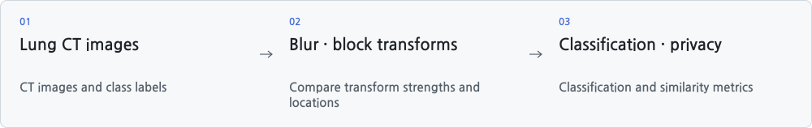
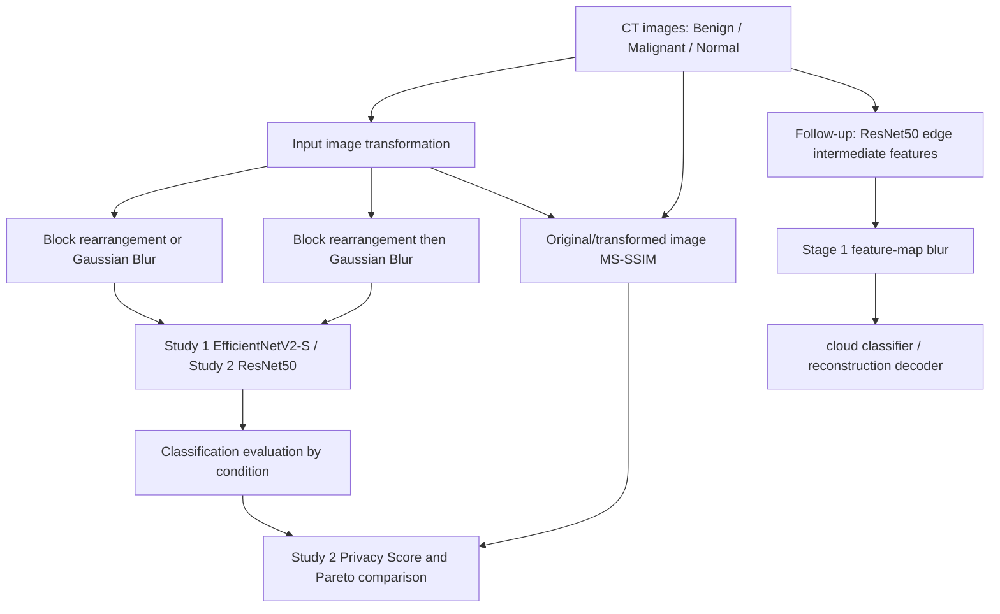

<a id="연구-2resnet50와-정량적-트레이드-오프"></a>
<a name="폐암-영상-분류와-프라이버시-변환-실험"></a>
<a name="폐-ct-영상-변환과-분류-성능을-비교합니다"></a>

<a id="-lung-ct-privacy-project"></a>

<a id="lung-ct-privacy-project"></a>
<!-- readme-header32:start -->
<p align="center"></p>
<h1 align="center" id="project-title">Lung CT Privacy Project</h1>
<p align="center">CT transformations, classification, and privacy comparisons</p>
<p align="center">
  <a href="../README.md"></a>
  <a href="README.md"></a>
</p>
<p align="center">
  <a href="../docs/%EC%9D%BD%EA%B8%B0%EC%95%88%EB%82%B4/%EB%A0%88%EB%B2%A81.md"></a>
  <a href="../docs/%EC%9D%BD%EA%B8%B0%EC%95%88%EB%82%B4/%EB%A0%88%EB%B2%A82.md"></a>
  <a href="../docs/%EC%9D%BD%EA%B8%B0%EC%95%88%EB%82%B4/%EB%A0%88%EB%B2%A83.md"></a>
  <a href="../docs/%EC%9D%BD%EA%B8%B0%EC%95%88%EB%82%B4/%EB%A0%88%EB%B2%A84.md"></a>
  <a href="../docs/%EC%9D%BD%EA%B8%B0%EC%95%88%EB%82%B4/%EB%A0%88%EB%B2%A85.md"></a>
</p>
<p align="center"><small>LEVEL links open the Korean source at the same reading level.</small></p>
<picture>
  <source media="(max-width: 600px) and (prefers-color-scheme: dark)" srcset="../assets/readme/flow-en-dark-mobile.svg" />
  <source media="(max-width: 600px)" srcset="../assets/readme/flow-en-light-mobile.svg" />
  <source media="(prefers-color-scheme: dark)" srcset="../assets/readme/flow-en-dark.svg" />
  <source media="(prefers-color-scheme: light)" srcset="../assets/readme/flow-en-light.svg" />
  
</picture>
<!-- readme-header32:end -->


Compares the effects of blur/block transformations on lung CT classification and privacy.

<!-- reading-levels17:start -->
| Reading level | Guide contents |
| --- | --- |
| [LEVEL 1 - Beginner (Korean source)](../docs/%EC%9D%BD%EA%B8%B0%EC%95%88%EB%82%B4/%EB%A0%88%EB%B2%A81.md) | Explains unfamiliar terms with concrete examples from input to results |
| [LEVEL 2 - Explorer (Korean source)](../docs/%EC%9D%BD%EA%B8%B0%EC%95%88%EB%82%B4/%EB%A0%88%EB%B2%A82.md) | Understand relationships between core concepts and processing flows |
| [LEVEL 3 - Practitioner (Korean source)](../docs/%EC%9D%BD%EA%B8%B0%EC%95%88%EB%82%B4/%EB%A0%88%EB%B2%A83.md) | Follow experiment/usage procedures and interpretation of results |
| [LEVEL 4 - Advanced (Korean source)](../docs/%EC%9D%BD%EA%B8%B0%EC%95%88%EB%82%B4/%EB%A0%88%EB%B2%A84.md) | Review code structure, settings, design choices, and constraints |
| [LEVEL 5 - Expert (Korean source)](../docs/%EC%9D%BD%EA%B8%B0%EC%95%88%EB%82%B4/%EB%A0%88%EB%B2%A85.md) | Compare papers, protocols, denominators, leakage, and unverified scope |
<!-- reading-levels17:end -->

<!-- fixed-model-publication-20261120:start -->

<a id="conv1-실제-실험-17차와-공개-코드의-대응"></a>
## Correspondence between actual Conv1 experiments 1–7 and public code

Existing public revisions 1–5 and actual experiment numbers are separate numbering systems. Public revision 3 is feature-visualization software for training round 2; public revision 4 repairs the selection screen in local round 3; public revision 5 contains fixed-100-epoch code for actual round 4.

Existing numbers/originals are preserved; actual round 5 recovery was added under a separate name.

Actual round 3 means screen repairs for training round 2, not a new training experiment.

| Actual round | Main change | Materials · details · preceding comparison |
| --- | --- | --- |
| Actual round 1 | First preliminary experiment with a 35-epoch cap and separation of exact duplicates | [Materials (Korean source)](../Conv1%20%EB%B8%94%EB%9F%AC%20OK-NG%20%EC%8B%A4%ED%97%98/1%EC%B0%A8) · [Details (Korean source)](../docs/revisions/conv1-okng-round1.md) · [Preceding comparison (Korean source)](../docs/revision-diffs/conv1-okng-round1-%EC%97%B4%EB%9E%8C.md) |
| Actual round 2 | 100-epoch cap, similarity groups, and more precise evaluation | [Materials (Korean source)](../Conv1%20%EB%B8%94%EB%9F%AC%20OK-NG%20%EC%8B%A4%ED%97%98/2%EC%B0%A8) · [Details (Korean source)](../docs/revisions/conv1-okng-round2.md) · [Preceding comparison (Korean source)](../docs/revision-diffs/conv1-okng-round2-%EC%97%B4%EB%9E%8C.md) |
| Actual round 3 · screen repair for training round 2 | Repairs training round 2 intensity-selection screen; no new training | [Materials (Korean source)](../Conv1%20%EB%B8%94%EB%9F%AC%20OK-NG%20%EC%8B%A4%ED%97%98/4%EC%B0%A8) · [Details (Korean source)](../docs/revisions/conv1-okng-round4.md) · [Preceding comparison (Korean source)](../docs/revision-diffs/conv1-okng-round4-%EC%97%B4%EB%9E%8C.md) |
| Actual round 4 | 100 training epochs per intensity; comparison of end-of-training models for observation | [Materials (Korean source)](../Conv1%20%EB%B8%94%EB%9F%AC%20OK-NG%20%EC%8B%A4%ED%97%98/5%EC%B0%A8) · [Details (Korean source)](../docs/revisions/conv1-okng-round5.md) · [Preceding comparison (Korean source)](../docs/revision-diffs/conv1-okng-round5-%EC%97%B4%EB%9E%8C.md) |
| Actual round 5 | Preserves and recovers training state while retaining scientific conditions | [Materials (Korean source)](../Conv1%20%EB%B8%94%EB%9F%AC%20OK-NG%20%EC%8B%A4%ED%97%98/%EC%8B%A4%EC%A0%9C5%EC%B0%A8_%ED%95%99%EC%8A%B5%EB%B3%B5%EA%B5%AC) · [Details (Korean source)](../docs/revisions/conv1-actual-round5-recovery.md) · [Preceding comparison (Korean source)](../docs/revision-diffs/conv1-actual-round5-recovery.md) |
| Actual round 6 | Diagnoses blur formulas and differences between adaptive training and fixed models | [Materials (Korean source)](../Conv1%20%EB%B8%94%EB%9F%AC%20OK-NG%20%EC%8B%A4%ED%97%98/6%EC%B0%A8) · [Details (Korean source)](../docs/revisions/conv1-okng-round6.md) · [Preceding comparison (Korean source)](../docs/revision-diffs/conv1-okng-round6.md) |
| Actual round 7 | Fixes one new σ0 model; evaluates ten intensities without additional training | [Materials (Korean source)](../Conv1%20%EB%B8%94%EB%9F%AC%20OK-NG%20%EC%8B%A4%ED%97%98/7%EC%B0%A8) · [Details (Korean source)](../docs/revisions/conv1-okng-round7.md) · [Preceding comparison (Korean source)](../docs/revision-diffs/conv1-okng-round7.md) |

Actual round 6 is exploratory diagnosis using existing round 5 models and **the same 164 test images**.

Actual round 7 is **a separate experiment starting from fresh ImageNet initialization**. At publication on 2026-11-20, training was in progress and final test results were unmeasured. Round 6 figures are not used to fill missing round 7 results.

[This publication's change log (Korean source)](../docs/changes/2026-11-20-%EA%B3%A0%EC%A0%95%EB%AA%A8%EB%8D%B8%EC%8B%A4%ED%97%98%EA%B3%BC%EC%A7%84%EB%8B%A8.md) · [Full public-bundle comparison (Korean source)](../docs/changes/2026-11-20-%EA%B3%A0%EC%A0%95%EB%AA%A8%EB%8D%B8%EC%8B%A4%ED%97%98%EA%B3%BC%EC%A7%84%EB%8B%A8-%EC%A0%84%EC%B2%B4%EB%B9%84%EA%B5%90.md)

<!-- fixed-model-publication-20261120:end -->


Field: Computer vision › deep-learning image classification › input/feature transformations and privacy evaluation

`Python` `TensorFlow` `Jupyter` `Papers and research materials`

[Quick start](#quick-start) · [Repository structure](#repository-structure) · [Data and evaluation](#data-settings) · [Research stages (Korean source)](../docs/RESEARCH_STAGES.md) · [Writing/publication status (Korean source)](../docs/%EB%85%BC%EB%AC%B8%EC%83%81%ED%83%9C.md) · [Version history (Korean source)](../docs/VERSIONS.md)

[Core structure](#input-processing-output)

<a id="-연구-핵심"></a>

<a id="연구-요약"></a>
## Research overview

<a id="-연구-1--하계-efficientnetv2-s"></a>

<a id="연구-1--하계-efficientnetv2-s"></a>
### Study 1 · summer EfficientNetV2-S study

Applies blur and block rearrangement separately to 512×512 CT inputs, comparing classification accuracy, ROC-AUC, and confusion matrices.

The three-page summer manuscript reports accuracy of 92.5% for originals, 53.3% for σ32, and 79.2% for Block32. [Study 1 details (Korean source)](../docs/versions/stage-1.md)

<a id="-연구-2--resnet50와-프라이버시정확도-절충"></a>

<a id="연구-2resnet50와-프라이버시정확도-절충"></a>
### Study 2 · ResNet50 privacy–accuracy trade-off

Compares classification performance with image-structure dissimilarity. This 19-page follow-up manuscript compares 20 standalone conditions and 100 Block → Blur combinations, computing Privacy Score from input-image MS-SSIM across all 1,097 images.

Reported values for combined Block256 + σ0 are 98.17% accuracy and 49.65 points. The score is not reconstruction-attack success rate; read it alongside evaluation conditions including test pseudo-label use. [Study 2 details (Korean source)](../docs/versions/stage-2.md)

<a id="-후속-코드--모델-분리와-특징맵-블러"></a>

<a id="후속-코드--모델-분리와-특징맵-블러"></a>
### Follow-up code · model splitting and feature-map blur

Extends an edge/cloud split model retaining input transformations to a Stage 1 experiment blurring **the features themselves** at `pool1_pool`. Models are connected in one process; this is not an actual remote-transmission implementation.

Code computes feature SSIM/cosine and decoder-reconstruction PSNR/SSIM, but large-σ result reuse, a missing `Conv2D` import, and fallback-weight/example-result branches remain. [Follow-up feature-map details (Korean source)](../docs/versions/stage-3.md) · [Complete history (Korean source)](../docs/VERSIONS.md)

<a name="preview"></a>


**Original research figure** — page 12 of the revision 2 ResNet50 manuscript: aggregate accuracy by block size and blur intensity. The linked chart contains no original medical images. Cell numbers are manuscript accuracies displayed as integers, at different precision from the decimal values reported below.

[Writing/publication status (Korean source)](../docs/%EB%85%BC%EB%AC%B8%EC%83%81%ED%83%9C.md)


**Original research figure** — page 2 of the revision 1 EfficientNetV2-S summer manuscript: accuracy by blur intensity. This is a separately saved original graph.

[Writing/publication status (Korean source)](../docs/%EB%85%BC%EB%AC%B8%EC%83%81%ED%83%9C.md)

<a name="input-processing-output"></a>

<a id="-입력처리출력"></a>

<a id="입력처리출력"></a>
## Input, processing, and output

| Category | Content |
| --- | --- |
| Problem | Compares how classification performance and privacy metrics vary with transformation intensity and application location. |
| Input | CT images and class labels |
| Processing | EfficientNetV2-S/ResNet50 classification, blur/block transformations, and structural-similarity comparison |
| Output | Classification metrics, Privacy Scores, and graphs by condition |

<a id="-논문과-최신-자료"></a>

<a id="논문과-최신-자료"></a>
## Papers and latest materials

| Material | Original file |
| --- | --- |
| Study 1 final paper · EfficientNetV2-S | [Writing/publication status (Korean source)](../docs/%EB%85%BC%EB%AC%B8%EC%83%81%ED%83%9C.md) |
| Study 2 final paper · ResNet50 | [Writing/publication status (Korean source)](../docs/%EB%85%BC%EB%AC%B8%EC%83%81%ED%83%9C.md) |
| Final presentation · summer study | [Download PDF (Korean source)](../%EC%97%B0%EA%B5%AC1_%ED%95%98%EA%B3%84_EfficientNetV2-S/%EB%B0%9C%ED%91%9C%EC%9E%90%EB%A3%8C/%ED%95%98%EA%B3%84%ED%95%99%EC%88%A0%EB%8C%80%ED%9A%8C%20PPT.pdf) |
| Final presentation · summer study | [Download PPTX (Korean source)](../%EC%97%B0%EA%B5%AC1_%ED%95%98%EA%B3%84_EfficientNetV2-S/%EB%B0%9C%ED%91%9C%EC%9E%90%EB%A3%8C/%ED%95%98%EA%B3%84%ED%95%99%EC%88%A0%EB%8C%80%ED%9A%8C%20PPT.pptx) |
| Completed script · summer study | [Download PDF (Korean source)](../%EC%97%B0%EA%B5%AC1_%ED%95%98%EA%B3%84_EfficientNetV2-S/%EB%B0%9C%ED%91%9C%EC%9E%90%EB%A3%8C/%ED%95%98%EA%B3%84%ED%95%99%EC%88%A0%EB%8C%80%ED%9A%8C%20%EB%B0%9C%ED%91%9C%20%EB%8C%80%EB%B3%B8.pdf) |
| Completed script · summer study | [Download DOCX (Korean source)](../%EC%97%B0%EA%B5%AC1_%ED%95%98%EA%B3%84_EfficientNetV2-S/%EB%B0%9C%ED%91%9C%EC%9E%90%EB%A3%8C/%ED%95%98%EA%B3%84%ED%95%99%EC%88%A0%EB%8C%80%ED%9A%8C%20%EB%B0%9C%ED%91%9C%20%EB%8C%80%EB%B3%B8.docx) |

[Material descriptions (Korean source)](../docs/PAPERS.md) · [Code revisions and change history (Korean source)](../docs/REVISION_INDEX.md)

<a id="️-차수별-프로젝트-안내"></a>

<a id="전체-차수"></a>
## All revisions

| Revision/stage | Main contents | Materials · preceding comparison |
| --- | --- | --- |
| [Study 1 · summer EfficientNetV2-S (Korean source)](../docs/revisions/study-1.md) | <a id="layout18-table-4-row-1-field-1"></a>A three-page summer study comparing classification changes when Gaussian Blur and block rearrangement are separately applied to input CT images in EfficientNetV2-S. | [Folder (Korean source)](../%EB%85%BC%EB%AC%B8)<br>[Full comparison (Korean source)](../docs/revision-diffs/study-1-%EC%97%B4%EB%9E%8C.md) |
| [Study 2 · ResNet50 follow-up manuscript (Korean source)](../docs/revisions/study-2.md) | <a id="layout18-table-4-row-2-field-1"></a>A 19-page follow-up manuscript comparing 20 standalone Block/Blur conditions and 100 Block → Blur combinations in ResNet50, considering classification accuracy alongside image-similarity-based scores. | [Folder (Korean source)](../%EB%85%BC%EB%AC%B8)<br>[Full comparison (Korean source)](../docs/revision-diffs/study-2-%EC%97%B4%EB%9E%8C.md) |
| [Revision 1 (Korean source)](../docs/revisions/folder-1.md) | <a id="layout18-table-4-row-3-field-1"></a>A code-material revision covering rebuilt, same_settings, and metric_matched block/blur variants alongside notebook-modification helpers. | [Folder (Korean source)](../1%EC%B0%A8)<br>[Full comparison (Korean source)](../docs/revision-diffs/folder-1-%EC%97%B4%EB%9E%8C.md) |
| [Folder revision 2 (Korean source)](../docs/revisions/folder-2.md) | <a id="layout18-table-4-row-4-field-1"></a>A JavaScript helper-tool stage aligning training/monitor outputs in existing Blur/Block notebooks and generating a Block→Blur combination notebook. | [Folder (Korean source)](../%EC%9E%90%EB%A3%8C%EC%B0%A8%EC%88%98/2%EC%B0%A8)<br>[Full comparison (Korean source)](../docs/revision-diffs/folder-2-%EC%97%B4%EB%9E%8C.md) |
| [Folder revision 3 (Korean source)](../docs/revisions/folder-3.md) | <a id="layout18-table-4-row-5-field-1"></a>A material revision checking the SSIM-to-DSSIM-based Privacy Score calculation and saved results for 3 images/8 conditions.<br>Distinct from the full paper's 1,097-image experiment. | [Folder (Korean source)](../%EC%9E%90%EB%A3%8C%EC%B0%A8%EC%88%98/3%EC%B0%A8/tables)<br>[Full comparison (Korean source)](../docs/revision-diffs/folder-3-%EC%97%B4%EB%9E%8C.md) |
| [Folder revision 4 (Korean source)](../docs/revisions/folder-4.md) | <a id="layout18-table-4-row-6-field-1"></a>A material revision connecting the ResNet50 follow-up manuscript with input-transformation, similarity, and chart code.<br>The actual code folder is `자료 차수/4차/코드`. | [Folder (Korean source)](../%EC%9E%90%EB%A3%8C%EC%B0%A8%EC%88%98/4%EC%B0%A8/%EC%BD%94%EB%93%9C)<br>[Full comparison (Korean source)](../docs/revision-diffs/folder-4-%EC%97%B4%EB%9E%8C.md) |
| [Blur · experiment 2 (Korean source)](../docs/revisions/experiment-6.md) | <a id="layout18-table-4-row-7-field-1"></a>A 10-condition experiment applying PIL GaussianBlur to input images. σ0 copies the original array. | [Folder (Korean source)](../%EB%B8%94%EB%9F%AC/2%EC%B0%A8%20%EC%8B%A4%ED%97%98)<br>[Full comparison (Korean source)](../docs/revision-diffs/experiment-6-%EC%97%B4%EB%9E%8C.md) |
| [Block · experiment 2 (Korean source)](../docs/revisions/experiment-7.md) | <a id="layout18-table-4-row-8-field-1"></a>Repositions input blocks using a seeded permutation while preserving pixels within each block.<br>Blocks no smaller than the image copy the original. | [Folder (Korean source)](../%EB%B8%94%EB%A1%9D/2%EC%B0%A8%20%EC%8B%A4%ED%97%98)<br>[Full comparison (Korean source)](../docs/revision-diffs/experiment-7-%EC%97%B4%EB%9E%8C.md) |
| [Block+Blur · base (Korean source)](../docs/revisions/experiment-8.md) | <a id="layout18-table-4-row-9-field-1"></a>Compares 100 combinations of 10 block sizes and 10 blur intensities.<br>Rearranges input blocks before applying Gaussian Blur. | [Folder (Korean source)](../%EB%B8%94%EB%A1%9D%2B%EB%B8%94%EB%9F%AC)<br>[Full comparison (Korean source)](../docs/revision-diffs/experiment-8-%EC%97%B4%EB%9E%8C.md) |
| [Blur edge · base (Korean source)](../docs/revisions/experiment-9.md) | <a id="layout18-table-4-row-10-field-1"></a>Blurs input images, then connects a model split into edge/cloud at ResNet50's pool1_pool boundary. | [Folder (Korean source)](../%EB%B8%94%EB%9F%AC%20%EC%97%A3%EC%A7%80)<br>[Full comparison (Korean source)](../docs/revision-diffs/experiment-9-%EC%97%B4%EB%9E%8C.md) |
| [Block edge · base (Korean source)](../docs/revisions/experiment-10.md) | <a id="layout18-table-4-row-11-field-1"></a>Rearranges input blocks, then trains a model split into edge/cloud at the pool1_pool boundary. | [Folder (Korean source)](../%EB%B8%94%EB%A1%9D%20%EC%97%A3%EC%A7%80)<br>[Full comparison (Korean source)](../docs/revision-diffs/experiment-10-%EC%97%B4%EB%9E%8C.md) |
| [Block+Blur edge · base (Korean source)](../docs/revisions/experiment-11.md) | <a id="layout18-table-4-row-12-field-1"></a>Connects a split model after 100 input Block → Blur combinations.<br>The transformation location differs from Stage1 experiments inserting FeatureGaussianBlur into boundary features. | [Folder (Korean source)](../%EB%B8%94%EB%A1%9D%2B%EB%B8%94%EB%9F%AC%20%EC%97%A3%EC%A7%80)<br>[Full comparison (Korean source)](../docs/revision-diffs/experiment-11-%EC%97%B4%EB%9E%8C.md) |
| [Blur Stage 1 edge · base (Korean source)](../docs/revisions/experiment-12.md) | <a id="layout18-table-4-row-13-field-1"></a>Applies fixed per-channel Gaussian kernels to ResNet50 pool1_pool features with depthwise_conv2d. | [Folder (Korean source)](../%EB%B8%94%EB%9F%AC%20%EC%8A%A4%ED%85%8C%EC%9D%B4%EC%A7%80%201%20%EC%97%A3%EC%A7%80)<br>[Full comparison (Korean source)](../docs/revision-diffs/experiment-12-%EC%97%B4%EB%9E%8C.md) |
| [Original experiment · base (Korean source)](../docs/revisions/experiment-13.md) | <a id="layout18-table-4-row-14-field-1"></a>The Streamlit screen preprocesses uploaded images to 224×224 and displays Model.h5 predictions for 5 tissue-image labels.<br>The accompanying training notebook uses a 3-class MobileNetV2 configuration and must not be assumed to be the same model. | [Folder (Korean source)](../%EC%9B%90%EB%B3%B8%20%EC%8B%A4%ED%97%98/Lung%20Cancer)<br>[Full comparison (Korean source)](../docs/revision-diffs/experiment-13.diff) |
| [Additional training models and experiments · base (Korean source)](../docs/revisions/experiment-14.md) | <a id="layout18-table-4-row-15-field-1"></a>Collects distinct EfficientNetV2-S/MobileNetV2/ResNet50 training cells and SSIM/MS-SSIM/chart code. | [Folder (Korean source)](../%EC%B6%94%EA%B0%80%20%ED%95%99%EC%8A%B5%EB%AA%A8%EB%8D%B8%EA%B3%BC%20%EC%8B%A4%ED%97%98)<br>[Full comparison (Korean source)](../docs/revision-diffs/experiment-14-%EC%97%B4%EB%9E%8C.md) |
| [Blur · experiment 1 (Korean source)](../docs/revisions/experiment-original-blur.md) | <a id="layout18-table-4-row-16-field-1"></a>Result JSON preserving accuracy, ROC-AUC, per-class Recall, and confusion matrices by input-transformation condition.<br>Saved results can be compared with graph inputs. | [Folder (Korean source)](../%EC%9B%90%EB%B3%B8%EC%9E%90%EB%A3%8C/%EB%B8%94%EB%9F%AC/1%EC%B0%A8%20%EC%8B%A4%ED%97%98/%EB%B8%94%EB%9F%AC%201/%EB%B8%94%EB%9F%AC%EB%A7%81%20%EA%B2%B0%EA%B3%BC)<br>[Full comparison (Korean source)](../docs/revision-diffs/experiment-original-blur.diff) |
| [Block · experiment 1 (Korean source)](../docs/revisions/experiment-original-block.md) | <a id="layout18-table-4-row-17-field-1"></a>Result JSON preserving accuracy, ROC-AUC, per-class Recall, and confusion matrices by input-transformation condition.<br>Saved results can be compared with graph inputs. | [Folder (Korean source)](../%EC%9B%90%EB%B3%B8%EC%9E%90%EB%A3%8C/%EB%B8%94%EB%A1%9D/1%EC%B0%A8%20%EC%8B%A4%ED%97%98/%EB%B8%94%EB%A1%9D%201/%EB%B6%88%EB%A1%9D%20%EA%B2%B0%EA%B3%BC)<br>[Full comparison (Korean source)](../docs/revision-diffs/experiment-original-block.diff) |
| Conv1 blur OK-NG experiment · round 1 | [Folder (Korean source)](../Conv1%20%EB%B8%94%EB%9F%AC%20OK-NG%20%EC%8B%A4%ED%97%98/1%EC%B0%A8) | [Description (Korean source)](../docs/revisions/conv1-okng-round1.md)<br>[Full comparison (Korean source)](../docs/revision-diffs/conv1-okng-round1-%EC%97%B4%EB%9E%8C.md) |
| Conv1 blur OK-NG experiment · round 2 | [Folder (Korean source)](../Conv1%20%EB%B8%94%EB%9F%AC%20OK-NG%20%EC%8B%A4%ED%97%98/2%EC%B0%A8) | [Description (Korean source)](../docs/revisions/conv1-okng-round2.md)<br>[Full comparison (Korean source)](../docs/revision-diffs/conv1-okng-round2-%EC%97%B4%EB%9E%8C.md) |
| Conv1 blur OK-NG experiment · round 3 (visualization) | [Folder (Korean source)](../Conv1%20%EB%B8%94%EB%9F%AC%20OK-NG%20%EC%8B%A4%ED%97%98/3%EC%B0%A8) | [Description (Korean source)](../docs/revisions/conv1-okng-round3.md)<br>[Full comparison (Korean source)](../docs/revision-diffs/conv1-okng-round3-%EC%97%B4%EB%9E%8C.md) |
| Conv1 blur OK-NG experiment · round 4 (intensity-specific result selection) | [Folder (Korean source)](../Conv1%20%EB%B8%94%EB%9F%AC%20OK-NG%20%EC%8B%A4%ED%97%98/4%EC%B0%A8) | [Description (Korean source)](../docs/revisions/conv1-okng-round4.md)<br>[Full comparison (Korean source)](../docs/revision-diffs/conv1-okng-round4-%EC%97%B4%EB%9E%8C.md) |
| Conv1 blur OK-NG experiment · round 5 (actual experiment 4, fixed 100 epochs) | [Folder (Korean source)](../Conv1%20%EB%B8%94%EB%9F%AC%20OK-NG%20%EC%8B%A4%ED%97%98/5%EC%B0%A8) | [Description (Korean source)](../docs/revisions/conv1-okng-round5.md)<br>[Full comparison (Korean source)](../docs/revision-diffs/conv1-okng-round5-%EC%97%B4%EB%9E%8C.md) |


<a id="-프로젝트-소개"></a>

<a id="연구-방법"></a>
## Research methods

Blurring or rearranging the global appearance of medical images makes originals harder to recognize, while changing lesion boundaries and textures needed for classification.

This project investigates how much lung CT classification accuracy remains after Gaussian Blur and block-position rearrangement.

Extends the first EfficientNetV2-S comparison to ResNet50, combinations of both transformations, and structural-similarity-based Privacy Score analysis.

Study 1 includes research for the Korean Association of Computer Education's **58th 2026 Summer Academic Conference**. Study 2 is a manuscript prepared in the **Korean Institute of Information Technology journal format**. Two papers, research code, graph-generation code, and an early classification app are organized by research stage.

Performance below consists of **values reported in the manuscripts**. Running notebooks requires data and model weights.

<a id="-연구-단계와-보고-결과"></a>

<a id="연구-단계와-보고-결과"></a>
## Research stages and reported results

| Category | Study 1: summer study | Study 2: ResNet50 study | Subsequent additional experiments |
| --- | --- | --- | --- |
| <a id="layout18-table-5-row-1"></a> Question | Which transformation, Blur or Block, preserves more classification performance? | Which conditions are favorable when considering accuracy and structural-similarity-based privacy scores together? | How do classification and reconstruction possibilities change when transforming intermediate features instead of input images? |
| <a id="layout18-table-5-row-2"></a> Model | EfficientNetV2-S | ImageNet-pretrained ResNet50 | ResNet50 split at the `pool1_pool` boundary |
| <a id="layout18-table-5-row-3"></a> Transformation | Separate comparisons of input-image Blur and Block | 10 Block conditions, 10 Blur conditions, and 100 Block → Blur combinations | Split models using input transformations and Stage 1 feature-map Gaussian Blur |
| <a id="layout18-table-5-row-4"></a> Main evaluation | Accuracy, ROC-AUC, and confusion matrices | Accuracy, macro OvR ROC-AUC, per-class Recall, MS-SSIM Privacy Score, and Pareto analysis | Code calculating feature similarity, class separability, and decoder-reconstruction PSNR/SSIM |
| <a id="layout18-table-5-row-5"></a> Interpretation scope | Initial comparison of de-identification performance | Condition comparisons within the same evaluation procedure | Feature-transformation/reconstruction experiment code following paper 2 |


<a name="연구-1--efficientnetv2-s"></a>

<a id="-연구-1--efficientnetv2-s"></a>

<a id="연구-1--efficientnetv2-s"></a>
### Study 1 · EfficientNetV2-S

The study described under [writing/publication status (Korean source)](../docs/%EB%85%BC%EB%AC%B8%EC%83%81%ED%83%9C.md) classifies 512×512 CT images into Benign, Malignant, and Normal.

Separately applies Gaussian Blur and seeded block rearrangement to compare classification performance as morphology changes.

| Manuscript condition | Reported accuracy |
| --- | --- |
| Original | 92.5% |
| Gaussian Blur σ=32 | 53.3% |
| Block 32×32 | 79.2% |
| Block 1×1 | 52.9% |

In this experiment, transformations retaining local information within blocks preserved accuracy better than strong blur.

The manuscript's conclusion proposes ResNet50 comparisons and edge-based distributed processing as follow-up directions. The [summer graph notebook (Korean source)](../%EC%97%B0%EA%B5%AC1_%ED%95%98%EA%B3%84_EfficientNetV2-S/%EA%B7%B8%EB%9E%98%ED%94%84/Blur_Block_1%EC%B0%A8_%EA%B7%B8%EB%9E%98%ED%94%84_white.ipynb) reads result JSON to generate charts.

Generating graphs alone does not mean retraining classification models or reproducing reported values.

<a name="연구-2--resnet50와-정량적-트레이드오프"></a>

<a id="-연구-2--resnet50와-정량적-트레이드오프"></a>

<a id="연구-2resnet50와-정량적-트레이드오프"></a>
### Study 2 · ResNet50 and quantitative trade-offs

The study described under [writing/publication status (Korean source)](../docs/%EB%85%BC%EB%AC%B8%EC%83%81%ED%83%9C.md) compares 20 standalone conditions and 100 combinations.

One 100-combination notebook does not execute all 120 conditions. Block transformation repositions blocks with a fixed-seed permutation; combinations then apply PIL GaussianBlur.

| Manuscript experiment/condition | Accuracy | Privacy Score | Interpretation |
| --- | --- | --- | --- |
| Original | 98.17% | Baseline condition | Baseline performance under the paper's evaluation procedure |
| Combination experiment Block256 + σ0 | 98.17% | 49.65 | Condition presented by the manuscript as a practical trade-off |
| Combination experiment Block256 + σ16 | 62.39% | 49.70 | Large accuracy loss for a 0.05-point score increase |
| Combination experiment Block256 + σ32 | 58.72% | 49.85 | Large accuracy loss for a 0.20-point score increase |
| Standalone Blur σ256 | 51.38% | 34.62 | Strong information-loss condition |

51.38% is reported for 53 of the 100 combinations. This equals `56/109`, corresponding to 56 Malignant images among 109 test images; the manuscript interprets it as majority-class collapse alongside confusion matrices. It is not a universal lower bound for every condition.

Combined Block512 + σ256 gives 46.8%, differing from 51.38% for separately trained standalone Blur σ256. The standalone Block256 value of 97.25% in section 4.1 and 98.17% for combination σ0 are also not merged as results from the same run.

Privacy Score is `50 × (1 − MS-SSIM)`. The manuscript computes it from five-scale structural similarity of all 1,097 original/transformed images. It is not attack success rate, re-identification probability, cryptographic security, or a differential-privacy guarantee. Actual reconstruction attacks and human perceptual evaluation remain future work.

<a id="-기술과-처리-흐름"></a>

<a id="기술과-처리-흐름"></a>
## Technologies and processing flow

| Technology | Role and implementation scope |
| --- | --- |
| Python·Jupyter | Condition-specific experiments, result organization, and visualization |
| TensorFlow/Keras | EfficientNetV2-S/ResNet50/MobileNetV2 training and model construction |
| Pillow·NumPy | Block rearrangement and input-image Gaussian Blur |
| scikit-learn | Stratified splits, confusion matrices, ROC-AUC, and related metrics |
| Matplotlib·Seaborn | Learning curves, condition-specific graphs, and heatmaps |
| SSIM·MS-SSIM·PSNR | Image similarity between originals and transformed/reconstructed outputs |
| Streamlit | Early five-class tissue-image classification screen |



Study 2's standard ResNet50 classification head concatenates Global Average/Max Pooling, followed by Dense 512/BatchNorm/ReLU/Dropout 0.35, Dense 256/BatchNorm/ReLU/Dropout 0.25, and three-class softmax.

The manuscript describes up to 80 epochs with the backbone frozen, then up to 200 epochs fine-tuning the last 30 layers, using AdamW, Focal Loss (γ=2, label smoothing 0.02), Mixup/CutMix, and SWA after epoch 40.

Freezing/fine-tuning settings and model-saving order differ between notebooks; manuscript settings are not applied as universal values to every file.

The later split model uses 128×128×64 features at `pool1_pool` as the boundary for 512×512 inputs.

Stage 1 blurs these features before connecting the rest of ResNet50. Names `edge`/`cloud` and separate weight storage mean **model separation within the same TensorFlow process**.

The code is not described as having completed actual network transmission, remote deployment, or device-specific latency measurements.

<a name="repository-structure"></a>

<a id="-저장소-구성"></a>

<a id="저장소-구성"></a>
## Repository structure

Main experiment paths and summer research materials are organized as follows.

```text
.
├── 논문/
│   ├── 1차_EfficientNetV2-S_하계_최종.pdf
│   └── 2차_ResNet50_최종.pdf
├── 연구1_하계_EfficientNetV2-S/그래프/
│   └── Blur_Block_1차_그래프_white.ipynb
├── 블러/2차 실험/blur_resnet50_rebuilt2_KO.ipynb
├── 블록/2차 실험/block_encryption_resnet50_rebuilt_KO.ipynb
├── 블록+블러/block_blur_resnet50_v4_KO.ipynb
├── 블러 엣지/blur_resnet50_edge_v6.ipynb
├── 블록 엣지/block_encryption_resnet50_edge_v2.ipynb
├── 블록+블러 엣지/block_blur_resnet50_edge.ipynb
├── 블러 스테이지 1 엣지/stage1_edge_feature_blur_resnet50.ipynb
├── 폐암 2차 논문/코드/
├── 추가 학습모델과 실험/
├── 원본 실험/Lung Cancer/
│   ├── main.py
│   ├── main.ipynb
│   └── Train.ipynb
├── docs/RESEARCH_STAGES.md
├── docs/VERSIONS.md
└── CHANGELOG.md
```

| Material to read | Purpose |
| --- | --- |
| <a id="layout18-table-9-row-1"></a> [Standalone Block (Korean source)](../%EB%B8%94%EB%A1%9D/2%EC%B0%A8%20%EC%8B%A4%ED%97%98/block_encryption_resnet50_rebuilt_KO.ipynb) · [Standalone Blur (Korean source)](../%EB%B8%94%EB%9F%AC/2%EC%B0%A8%20%EC%8B%A4%ED%97%98/blur_resnet50_rebuilt2_KO.ipynb) · [100 combinations (Korean source)](../%EB%B8%94%EB%A1%9D%2B%EB%B8%94%EB%9F%AC/block_blur_resnet50_v4_KO.ipynb) | Training flows for each input transformation |
| <a id="layout18-table-9-row-2"></a> [Input transformations and model splitting (Korean source)](../%EB%B8%94%EB%A1%9D%2B%EB%B8%94%EB%9F%AC%20%EC%97%A3%EC%A7%80/block_blur_resnet50_edge.ipynb) | Constructing and saving edge/cloud components |
| <a id="layout18-table-9-row-3"></a> [Stage 1 feature-map blur (Korean source)](../%EB%B8%94%EB%9F%AC%20%EC%8A%A4%ED%85%8C%EC%9D%B4%EC%A7%80%201%20%EC%97%A3%EC%A7%80/stage1_edge_feature_blur_resnet50.ipynb) | Additional intermediate-feature transformation and reconstruction-attack code |
| <a id="layout18-table-9-row-4"></a> [Additional Train collection (Korean source)](../%EC%B6%94%EA%B0%80%20%ED%95%99%EC%8A%B5%EB%AA%A8%EB%8D%B8%EA%B3%BC%20%EC%8B%A4%ED%97%98/Train.ipynb) | Preserves five-class tissue training, EfficientNetV2-S transformation comparisons, and MobileNetV2 pooling experiments by cell |
| <a id="layout18-table-9-row-5"></a> [Heatmaps (Korean source)](../%EC%B6%94%EA%B0%80%20%ED%95%99%EC%8A%B5%EB%AA%A8%EB%8D%B8%EA%B3%BC%20%EC%8B%A4%ED%97%98/heatmaps.py) · [Metric graphs (Korean source)](../%EC%B6%94%EA%B0%80%20%ED%95%99%EC%8A%B5%EB%AA%A8%EB%8D%B8%EA%B3%BC%20%EC%8B%A4%ED%97%98/plot_privacy_metrics_split.py) | Visualizes supplied result tables |
| <a id="layout18-table-9-row-6"></a> [2×2 image composition (Korean source)](../%ED%8F%90%EC%95%94%202%EC%B0%A8%20%EB%85%BC%EB%AC%B8/%EC%BD%94%EB%93%9C/picture2x2.ipynb) | Arranges previously generated original/transformed example images |


<a name="초기-앱과-ct-연구의-구분"></a>

<a id="-초기-앱과-ct-연구의-구분"></a>

<a id="초기-앱과-ct-연구의-구분"></a>
### Distinguishing the early app from CT research

The [early app (Korean source)](../%EC%9B%90%EB%B3%B8%20%EC%8B%A4%ED%97%98/Lung%20Cancer/main.py) loads `Model.h5` and displays **five tissue-image labels** for 224×224 images: colon adenocarcinoma, normal colon tissue, lung adenocarcinoma, normal lung tissue, and lung squamous-cell carcinoma.

Data meaning and output dimensions differ from the three CT classes Benign/Malignant/Normal.

The [early Train (Korean source)](../%EC%9B%90%EB%B3%B8%20%EC%8B%A4%ED%97%98/Lung%20Cancer/Train.ipynb) in the same folder trains frozen MobileNetV2 with GAP, Dropout 0.3, and three-class softmax, saving `LungCancer_3Class_Model.h5`.

Do not connect these weights to the five-label app merely by renaming the file.

The first cell of the separate `추가 학습모델과 실험/Train.ipynb` trains five tissue-image classes from `lung_colon_image_set`; distinguish it from subsequent EfficientNetV2-S/MobileNetV2 CT experiment cells as well.

<a name="data-settings"></a>

<a id="-데이터평가를-해석하는-방법"></a>

<a id="데이터평가를-해석하는-방법"></a>
## Interpreting data and evaluation

Study 2's IQ-OTH/NCCD data comprise 1,097 images from 110 people at two hospitals (Benign 120, Malignant 561, Normal 416). Patient counts and image counts are different units.

The manuscript describes first holding out 10% of originals per class for 109 test images (12/56/41), augmenting the remainder to 1,000 per class, then applying 7-fold and 20-pass TTA. Study 1's three-page manuscript does not separately describe this detailed sample composition.

1.

Check original-image separation and fold separation independently. Some recent experiments hold out original test data first, but then split augmented training images into folds, so derivatives of the same original may span training/validation folds.

Earlier block experiments and some additional Train cells also split test data after augmentation.

Patient-level separation and duplicate derivatives remain follow-up verification tasks.
2.

Evaluation uses test pseudo-labels. In several notebooks, if at least 10 test images have prediction confidence of 0.88 or higher, they undergo 15 additional training epochs before the same test is evaluated again.

The additional model joins the ensemble with the 7 fold models.

Some implementations use the full augmented training set for this fitting, reincorporating fold-validation data.

Distinguish this from pure hold-out accuracy.
3.

Paper descriptions and code are not identical. For example, the paper describes a Beta distribution for Mixup coefficients, whereas reviewed code uses uniform sampling.

Variants include ImageNet ResNet50 inputs without `preprocess_input`, nested models whose internal fine-tuning scope needs inspection, and flows resaving best checkpoints with end-of-training/SWA weights.
4. A generated figure is not necessarily measured data. Some notebooks generate examples when results, histories, or GPU logs are absent. Heatmap scripts plot hard-coded tables. Check original result JSON, training logs, execution conditions, and corresponding weights.
5. Repeated experiments per condition and external validation are needed. A 7-fold ensemble does not replace multi-seed repetitions per condition or validation on separate institutions/patients. Paper 2 explicitly states that Precision/F1 were not calculated. Human identifiability and attack resistance require evaluation separate from structural dissimilarity.

Stage 1 Privacy Score is a **single-SSIM-based score**, computed after separately normalizing channel-averaged feature maps. Do not compare its numbers directly with paper 2's input-image MS-SSIM scores.

This experiment substitutes the global feature mean at large σ and, by default, reuses σ32 results for σ64/128/256. Some of the ten conditions share the same training results.

The additional Train's `100 − accuracy` or feature-count-ratio-based `security` values are likewise not measured attack resistance.

<a name="quick-start"></a>

<a id="-실행-조건과-권장-확인-순서"></a>

<a id="실행-조건과-권장-확인-순서"></a>
## Execution requirements and recommended checks

Paper 2 reports one RTX 4090, TensorFlow, and mixed-precision training.

These specifications are not presented as necessary/sufficient for every file or as the verified current environment.

First check Python/TensorFlow/Keras/CUDA/driver combinations, APIs such as AdamW, NumPy/Pillow/scikit-learn/Matplotlib/Seaborn, and additional imports in the chosen notebook.

This repository does not guarantee a reproducible environment through a pinned dependency lockfile.

1. Choose the notebook for the research purpose and first read its settings cell and known issues below. Check syntax, imports, and input paths before running all cells.
2. Prepare authorized data and class folders separately. Original medical images, trained weights, and personal original materials are excluded from this public repository.
3. Check training `BASE_TRAIN` (defaulting to `/workspace/Train` in several files), condition lists, output roots, and free disk space. Use `BB_OUTPUT_ROOT`, `SB_OUTPUT_ROOT`, and similar variables only when read by the selected notebook.
4. For summer graph notebooks, prepare `EXPERIMENT_JSON_PATH_1`, `EXPERIMENT_JSON_PATH_2`, and `EXPERIMENT_OUTPUT_DIR`. Training-data paths and graph-input JSON paths are separate inputs.
5. Distinguish existing caches from new experiments and preserve result JSON, split lists, seeds, weights, and actual logs together. Full training per condition may include 7 folds, TTA, additional fitting, and up to hundreds of epochs.

Open notebooks from the repository root in a prepared Jupyter environment. The following command does not automatically train models.

```powershell
python -m jupyter lab "블록+블러/block_blur_resnet50_v4_KO.ipynb"
```

<a id="️-알려진-실행-문제와-점검-지점"></a>

<a id="알려진-실행-문제와-점검-지점"></a>
## Known execution issues and inspection points

Experimental code is preserved in its historical state. Check these issues and input conditions before selecting a notebook to run.

| Symptom/risk | Location and checks |
| --- | --- |
| <a id="layout18-table-10-row-1"></a> `unterminated f-string literal` | Static parsing found an error in zero-based cell 20, line 263 within that cell, of `블러 엣지/blur_resnet50_edge_v6.ipynb`.<br>The issue is an actual newline inside a string. |
| <a id="layout18-table-10-row-2"></a> `Conv2D` name not found | The reconstruction decoders in two Stage 1 feature-map-blur copies use `Conv2D` without the required import/definition.<br>This may block the attack stage in a clean kernel. |
| <a id="layout18-table-10-row-3"></a> Syntax error in the first additional Train cell | Three Markdown backticks remain at the end of the first code cell in `추가 학습모델과 실험/Train.ipynb`. |
| <a id="layout18-table-10-row-4"></a> Image decoding fails despite an existing file | Some loaders collect PNG/BMP extensions but always decode with `decode_jpeg`.<br>Check actual input formats. |
| <a id="layout18-table-10-row-5"></a> Existing training results keep being reused | Check condition caches and augmented folders reused based only on file counts.<br>Separate results from different data/settings. |
| <a id="layout18-table-10-row-6"></a> Figures generated despite missing edge weights | Some paths fall back to ImageNet initial weights.<br>Check whether the evaluated edge was trained. |
| <a id="layout18-table-10-row-7"></a> Key errors in GPU graphs | Blur variants generate log keys differing from those expected by graphs.<br>Distinguish figures drawn from example GPU logs from actual GPU measurements. |
| <a id="layout18-table-10-row-8"></a> Classification and visualization show different results | Check the effects of 0–255 input ranges versus visualization's `/255`, fixed `training=True` calls, and overwriting the full model after saving edge weights. |
| <a id="layout18-table-10-row-9"></a> Korean, font, or path errors | Check each notebook's Linux/Windows paths and fonts.<br>Some cells install through apt-get, download fonts, or delete Matplotlib caches. |
| <a id="layout18-table-10-row-10"></a> Unexpected security/compression graphs | Some additional Train security values invert accuracy or feature counts.<br>Also compare pooling-size descriptions with the actual direction of feature-count reduction. |


<a id="-자료와-후속-방향"></a>

<a id="자료와-후속-방향"></a>
## Materials and follow-up directions

[Research-stage details (Korean source)](../docs/RESEARCH_STAGES.md) separately organize manuscript/code correspondence, manuscript claims, and follow-up experiments.

Existing PDFs and complete original PDF/HWP files, including study 2 contact details/author photographs, are preserved locally. Current paper entries explain writing/publication status and the research; unpublished manuscript bodies and editable originals are not published.

The earlier summer repository points to the integrated location through [Lung CT Study 1 Archive](https://github.com/PUVKID/Lung-CT-Study-1-Archive).

Follow-up verification requires patient-level splits, fold separation by augmentation original, separate comparisons with/without test pseudo-labels, multi-seed repetition per condition, external-institution data validation, and actual reconstruction/re-identification attacks. Including feature-map decoder code does not establish completion of these checks.

---

**Kwak Yunsuk**
Research records examining structural image changes alongside classification performance.

<a id="-현재-첨부-문서"></a>

<a id="최신-문서와-변경-이력"></a>
## Latest documents and change history

Compares current public materials with the preceding publication. Stage-specific descriptions of earlier manuscripts, presentations, and code appear in the full revision table; unpublished manuscript bodies and editable originals remain local and are not published.

| Document | Material folder | Details · full comparison with the preceding publication |
| --- | --- | --- |
| Study 1 final paper · EfficientNetV2-S | [Folder (Korean source)](../%EB%85%BC%EB%AC%B8) | [Description (Korean source)](../docs/latest/lung-study1-efficientnet.md)<br>[Full comparison (Korean source)](../docs/changes/2026-11-02-%EC%B5%9C%EC%8B%A0%EB%AC%B8%EC%84%9C-%EC%A0%84%EC%B2%B4%EB%B9%84%EA%B5%90.md) |
| Study 2 final paper · ResNet50 | [Folder (Korean source)](../%EB%85%BC%EB%AC%B8) | [Description (Korean source)](../docs/latest/lung-study2-resnet.md)<br>[Full comparison (Korean source)](../docs/changes/2026-11-02-%EC%B5%9C%EC%8B%A0%EB%AC%B8%EC%84%9C-%EC%A0%84%EC%B2%B4%EB%B9%84%EA%B5%90.md) |
| Final presentation · summer study | [Folder (Korean source)](../%EC%97%B0%EA%B5%AC1_%ED%95%98%EA%B3%84_EfficientNetV2-S/%EB%B0%9C%ED%91%9C%EC%9E%90%EB%A3%8C) | [Description (Korean source)](../docs/latest/lung-study1-presentation.md)<br>[Full comparison (Korean source)](../docs/changes/2026-11-02-%EC%B5%9C%EC%8B%A0%EB%AC%B8%EC%84%9C-%EC%A0%84%EC%B2%B4%EB%B9%84%EA%B5%90.md) |
| Completed script · summer study | [Folder (Korean source)](../%EC%97%B0%EA%B5%AC1_%ED%95%98%EA%B3%84_EfficientNetV2-S/%EB%B0%9C%ED%91%9C%EC%9E%90%EB%A3%8C) | [Description (Korean source)](../docs/latest/lung-complete-talk-script.md)<br>[Full comparison (Korean source)](../docs/changes/2026-11-02-%EC%B5%9C%EC%8B%A0%EB%AC%B8%EC%84%9C-%EC%A0%84%EC%B2%B4%EB%B9%84%EA%B5%90.md) |

[Latest document-structure changes (Korean source)](../docs/changes/2026-11-02-%EC%B5%9C%EC%8B%A0%EB%AC%B8%EC%84%9C.md)

<a name="research-details"></a>

<a id="-연구구현의-세부-흐름"></a>

<a id="차수별-방법과-조건"></a>
## Methods and conditions by revision

Organizes revision-specific inputs, processing methods, execution conditions, and results.

<a id="-연구-1--efficientnetv2-s와-입력-비식별화"></a>

<details>
<summary>Study 1 · EfficientNetV2-S and input de-identification</summary>

<a id="연구-1efficientnetv2-s와-입력-비식별화"></a>

A three-page summer study comparing classification changes when Gaussian Blur and block rearrangement are separately applied to input CT images in EfficientNetV2-S.

| Component | Processing |
| --- | --- |
| Blur comparison | Compares input blur at σ0/1/2/4/8/16/32/64/128/256. |
| Block comparison | Compares inputs rearranged with 10 block sizes from 512 down to 1. |
| Reading metrics | Considers accuracy, ROC-AUC, per-class Recall, and confusion matrices together. |
| Presentation links | Connects the completed 19-slide presentation, complete 9-page script, and graph notebook as explanatory materials for the same study. |

| Input/execution conditions | Content |
| --- | --- |
| Manuscript | Final three-page summer PDF/HWP |
| Input | 512×512 CT three-class classification |
| Conditions | Separate comparisons of 10 Blur and 10 Block conditions |
| Result materials | Condition-specific JSON, graph notebook, presentation/script |

The manuscript reports original 92.5%, Blurσ32 53.3%, Block32 79.2%, and Block1 52.9%, among other values.

These are summer-study reported values and are not replaced by follow-up-study numbers.

Saved Block512 accuracy 0.929166… and Blur σ0 accuracy 0.925 are baselines from different runs. Do not merge them because both represent original conditions; distinguish runs and metrics.

| Constraint | What to check |
| --- | --- |
| Conditions across studies | Do not retroactively apply study 2's 1,097-image/ResNet50 settings to this summer study. |
| Privacy interpretation | Analysis concerns input transformations' classification utility, distinct from proving resistance to actual privacy attacks. |
| Material scope | Original medical images and patient records are excluded. |

[File structure, core definitions, and usage order (Korean source)](../docs/revisions/study-1.md) · [Full comparison for this stage (Korean source)](../docs/revision-diffs/study-1-%EC%97%B4%EB%9E%8C.md)

<a id="-연구-2--resnet50의-프라이버시정확도-절충"></a>

</details>

<details>
<summary>Study 2 · ResNet50 privacy–accuracy trade-off</summary>

<a id="연구-2resnet50의-프라이버시정확도-절충"></a>

A 19-page follow-up manuscript comparing 20 standalone Block/Blur conditions and 100 Block → Blur combinations in ResNet50, considering classification accuracy and image-similarity-based scores together.

| Component | Processing |
| --- | --- |
| Standalone/combined | Compares 10 block sizes, 10 blur intensities, and 100 Block → Blur combinations. |
| Classification evaluation | Examines accuracy, macro OvR ROC-AUC, per-class Recall, and confusion matrices. |
| Image similarity | Organizes MS-SSIM and Privacy Score for 1,097 input images. |
| Trade-off analysis | Reads Pareto results selecting conditions on two axes: accuracy and structural change. |

| Input/execution conditions | Content |
| --- | --- |
| Manuscript | Final 19-page PDF/HWP |
| Conditions | 20 standalone conditions/100 combinations |
| Similarity inputs | All 1,097 images in the manuscript |
| Score formula | Privacy Score=((1−MS-SSIM)/2)×100 |

The manuscript reports original accuracy 98.17% and Block256 + σ0 accuracy 98.17%/Privacy Score 49.65, among other values.

A model change alone does not establish the cause of differences from study 1.

Privacy Score is a relative metric derived from structural differences between original/transformed images, distinct from directly measured reconstruction attacks, identity re-identification, or cryptographic security.

| Constraint | What to check |
| --- | --- |
| Score definition | Distinguish small SSIM-based checking materials from the final MS-SSIM score formula. |
| Reference images | Original medical images must be prepared separately and are not included in public attachments. |
| Follow-up code | Do not mix pool1_pool feature-blur/reconstruction code with manuscript input-transformation results. |

[File structure, core definitions, and usage order (Korean source)](../docs/revisions/study-2.md) · [Full comparison for this stage (Korean source)](../docs/revision-diffs/study-2-%EC%97%B4%EB%9E%8C.md)

<a id="-자료-1차--resnet50-비교-노트북의-설정-정리"></a>

</details>

<details>
<summary>Material revision 1 · settings in ResNet50 comparison notebooks</summary>

<a id="자료-1차resnet50-비교-노트북의-설정-정리"></a>

A code-material revision covering rebuilt, same_settings, and metric_matched block/blur variants alongside notebook-modification helpers.

| Component | Processing |
| --- | --- |
| <a id="layout18-table-18-row-1"></a> Six notebooks | Preserves block and blur separately in rebuilt, same_settings, and metric_matched variants. |
| <a id="layout18-table-18-row-2"></a> Intensity matching | metric_matched blur includes a function calibrating sigma to match average SSIM/PSNR from block transformations. |
| <a id="layout18-table-18-row-3"></a> Training settings | Check settings cells because variants differ in batch4/8, stage-specific epochs, and SWA start values. |
| <a id="layout18-table-18-row-4"></a> Modification tools | Helper scripts modify notebook generation, callbacks, repeated training, and overfitting control. |


| Input/execution conditions | Content |
| --- | --- |
| Input size | 512 |
| Transformation | Blocks 512–1 and condition-specific blur sigma |
| Comparison purpose | Distinguish same_settings from metric_matched |
| Modification tools | Python and Node.js, with actual notebook paths |

Notebook variants organize experimental conditions in code. Changed settings do not mean new performance results have already been obtained.

Calibrating image similarity does not guarantee equivalent classification performance or privacy. Check the relationship between calibration and test data too.

| Constraint | What to check |
| --- | --- |
| Names and roles | rebuilt, same_settings, and metric_matched do not mean the same execution. |
| File writing | Helpers can overwrite specified notebooks; prepare copies and paths. |
| Evaluation criteria | Distinguish similarity matching from independent classification testing. |

[File structure, core definitions, and usage order (Korean source)](../docs/revisions/folder-1.md) · [Full comparison for this stage (Korean source)](../docs/revision-diffs/folder-1-%EC%97%B4%EB%9E%8C.md)

<a id="️-자료-2차--실험-방식-정렬과-조합-노트북-생성"></a>

</details>

<details>
<summary>Material revision 2 · aligning experiment methods and generating combination notebooks</summary>

<a id="자료-2차실험-방식-정렬과-조합-노트북-생성"></a>

A JavaScript helper-tool stage aligning training/monitor outputs in existing Blur/Block notebooks and generating a Block→Blur combination notebook.

| Component | Processing |
| --- | --- |
| <a id="layout18-table-21-row-1"></a> Method alignment | align_experiment_methods.mjs retains the Blur design while aligning GPU-monitor fields and graph compatibility handling. |
| <a id="layout18-table-21-row-2"></a> Combination generation | build_block_blur_notebook.mjs configures settings/functions for 100 Block → Blur combinations based on the Blur notebook. |
| <a id="layout18-table-21-row-3"></a> Input checks | replaceOrThrow stops when the target string is absent. |
| <a id="layout18-table-21-row-4"></a> Restoration | rollback_original_notebooks.mjs restores previous configurations using archived copies and specified cells. |


| Input/execution conditions | Content |
| --- | --- |
| Runtime | Node.js |
| Input | Original/archived notebooks specified in the scripts |
| Output | Modified/generated ipynb |
| Caution | First check input paths, cell numbers, and replacement strings |

Tool execution changes notebook code; it does not mean completed training or new performance evaluation.

Distinguish shared monitor-field/graph compatibility, transformation order, and original-restoration scope.

| Constraint | What to check |
| --- | --- |
| Paths | Check tool-specified paths and execution locations. |
| Changing originals | Notebooks are rewritten directly, so distinguish originals from working copies. |
| Exact replacement | If expected cells belong to another version, check pre-replacement conditions first. |

[File structure, core definitions, and usage order (Korean source)](../docs/revisions/folder-2.md) · [Full comparison for this stage (Korean source)](../docs/revision-diffs/folder-2-%EC%97%B4%EB%9E%8C.md)

<a id="-자료-3차--privacy-score의-소규모-계산-확인"></a>

</details>

<details>
<summary>Material revision 3 · small-scale Privacy Score calculation checks</summary>

<a id="자료-3차privacy-score의-소규모-계산-확인"></a>

A material revision checking the SSIM-to-DSSIM-based Privacy Score calculation and saved results for 3 images/8 conditions, distinct from the full paper's 1,097-image experiment.

| Component | Processing |
| --- | --- |
| <a id="layout18-table-24-row-1"></a> Score formula | Uses Privacy Score = ((1 − SSIM)/2)×100; PSNR is saved separately as a reference value. |
| <a id="layout18-table-24-row-2"></a> Small condition set | Uses blocks 512/32, blur σ0/2, and four combinations. |
| <a id="layout18-table-24-row-3"></a> Aggregation | Provides 4 CSVs: long, method summaries, combination pivot, and best_conditions. |
| <a id="layout18-table-24-row-4"></a> Check results | Each condition has n_images = 3; compare values for identical transformations and identity conditions. |


| Input/execution conditions | Content |
| --- | --- |
| Input count | 3 images per condition |
| Condition count | 2 block conditions, 2 blur conditions, 4 combinations |
| Size/seed | 512·42 |
| Metrics | SSIM, PSNR, and DSSIM-based score |

The saved table gives the same score, 35.3667978…, for Block32 and B32 + σ0; identity conditions score 0. These are calculation checks on 3 input images.

These small-scale materials check calculation paths; they do not replace clinical/attack-resistance evaluation or full 1,097-image paper results.

| Constraint | What to check |
| --- | --- |
| Sample | Do not generalize 3-image results to the full paper. |
| Score formula | These materials use SSIM, distinct from the final MS-SSIM-based score. |
| Original images | Original medical/comparison images themselves are excluded. |

[File structure, core definitions, and usage order (Korean source)](../docs/revisions/folder-3.md) · [Full comparison for this stage (Korean source)](../docs/revision-diffs/folder-3-%EC%97%B4%EB%9E%8C.md)

<a id="-자료-4차--후속-원고와-지표도표-코드"></a>

</details>

<details>
<summary>Material revision 4 · follow-up manuscript and metric/chart code</summary>

<a id="자료-4차후속-원고와-지표도표-코드"></a>

A material revision connecting the ResNet50 follow-up manuscript with input-transformation, similarity, and chart code. The actual code folder is `자료 차수/4차/코드`.

| Component | Processing |
| --- | --- |
| <a id="layout18-table-27-row-1"></a> Training code | Blur, Block, and combination notebooks configure condition-specific inputs and ResNet50 evaluation. |
| <a id="layout18-table-27-row-2"></a> Metric calculations | privacy_score_ssim_psnr_updated computes MS-SSIM and the score formula. |
| <a id="layout18-table-27-row-3"></a> Figure code | heatmaps_windows, paper_figures_resnet50, plot_privacy_metrics_split, and related tools compose tables/figures. |
| <a id="layout18-table-27-row-4"></a> Manuscript correspondence | Compares study 2's final PDF/HWP with code conditions/figures. |


| Input/execution conditions | Content |
| --- | --- |
| Code location | `자료 차수/4차/코드` |
| Manuscript | Study 2 final 19-page manuscript |
| Input | Original medical images/weights prepared separately |
| Empty file | pareto_scatter.ipynb is 0 bytes |

Materials for comparing manuscript reports with code settings/saved results. Do not infer new experimental results from chart filenames alone.

The 0-byte pareto_scatter.ipynb is an empty original file. Check corresponding nonempty notebooks for actual scatter plots/metric calculations.

| Constraint | What to check |
| --- | --- |
| Empty notebook | A 0-byte file contains no executable analysis. |
| Material scope | Personal execution records and original medical images are excluded. |
| Numbering distinction | Material revision 4 denotes a code/material archive category, not a fourth research paper. |

[File structure, core definitions, and usage order (Korean source)](../docs/revisions/folder-4.md) · [Full comparison for this stage (Korean source)](../docs/revision-diffs/folder-4-%EC%97%B4%EB%9E%8C.md)

<a id="️-블러-2차--입력-영상과-resnet50"></a>

</details>

<details>
<summary>Blur experiment 2 · input images and ResNet50</summary>

<a id="블러-2차입력-영상과-resnet50"></a>

A 10-condition experiment applying PIL GaussianBlur to input images. σ0 copies the original array.

| Component | Processing |
| --- | --- |
| <a id="layout18-table-30-row-1"></a> Transformation location | A 10-condition experiment applying PIL GaussianBlur to input images. σ0 copies the original array. |
| <a id="layout18-table-30-row-2"></a> Model connection | Uses a standard ResNet50 classifier. |
| <a id="layout18-table-30-row-3"></a> Splitting/augmentation | Splits original train/test first, then augments the training side. |
| <a id="layout18-table-30-row-4"></a> Inputs and augmentation | Reads three-channel JPEGs as 512×512 float32.<br>Training applies horizontal/vertical flips, brightness, contrast, and noise, distinct from evaluation inputs. |
| <a id="layout18-table-30-row-5"></a> Classification head | Concatenates GAP/GMP, then classifies through Dense512 → BatchNorm/ReLU/Dropout0.35 → Dense256 → BatchNorm/ReLU/Dropout0.25 → softmax. |
| <a id="layout18-table-30-row-6"></a> Evaluation/storage | Distinguishes condition-specific accuracy, ROC-AUC, per-class Recall, and confusion matrices from model/graph outputs. |
| <a id="layout18-table-30-row-7"></a> Test pseudo-labels | A subsequent path adds test images with maximum predicted probability of at least 0.88 to training data using predicted labels. |


| Input/execution conditions | Content |
| --- | --- |
| Image/batch | 512×512·batch8 |
| Reproducibility settings | seed42, 7 folds, test ratio 0.10 |
| Training settings | Stage-specific epochs in the settings cell, SWA starting at 40, TTA20 |
| Input | Separate CT data and class folders |
| Transformation conditions | 10 input conditions |
| Maximum epochs | EPOCHS_S1=80·EPOCHS_S2=200 |
| Training augmentation | Brightness up to 0.25×255, contrast 0.75–1.25, Gaussian-noise standard deviation 5 |
| TTA augmentation | Horizontal flip, brightness up to 0.15×255, contrast 0.85–1.15 |
| fold | StratifiedKFold, shuffle, seed42, class weights |
| Loss | focal_loss: gamma2, training label smoothing0.02 |
| Optimization | AdamW, weight decay1e-4, learning rate 1e-3→1e-4 |
| Subsequent retraining | Learning rate 3e-5, label smoothing0.05 |
| Stopping/checkpoints | val_loss early stopping, best weights, overfitting control, and SWA/TTA paths |

Reads classification results across input σ0–256.

Distinguish manuscript reports from this code's saved condition-specific results. Check that transformation location, splits, seeds, and actual result files correspond.

| Constraint | What to check |
| --- | --- |
| <a id="layout18-table-32-row-1"></a> Meaning of transformations | Block rearrangement/blur intensity alone does not guarantee patient re-identification resistance or cryptographic security. |
| <a id="layout18-table-32-row-2"></a> Result reuse | Condition-specific data, weights, and results are created or reused; distinguish input/output folders and existing results. |
| <a id="layout18-table-32-row-3"></a> Splits | Splits original train/test first, then augments the training side. |
| <a id="layout18-table-32-row-4"></a> Evaluation method | Numbers following additional training with test pseudo-labels are transductive evaluation.<br>Distinguish them from independent evaluation that never uses test data. |
| <a id="layout18-table-32-row-5"></a> Example graphs | When actual results/histories are absent, some graph cells generate examples through _dummy_results or _dummy_histories variants.<br>A drawn graph alone must not be cited as a training result. |
| <a id="layout18-table-32-row-6"></a> Input scale | load_image converts to float32 while retaining 0–255 inputs.<br>Check preprocessing assumptions when connecting ImageNet pretraining. |


[File structure, core definitions, and usage order (Korean source)](../docs/revisions/experiment-6.md) · [Full comparison for this stage (Korean source)](../docs/revision-diffs/experiment-6-%EC%97%B4%EB%9E%8C.md)

<a id="-블록-2차--위치-재배열과-resnet50"></a>

</details>

<details>
<summary>Block experiment 2 · position rearrangement and ResNet50</summary>

<a id="블록-2차위치-재배열과-resnet50"></a>

Repositions input blocks using a seeded permutation while preserving pixels within blocks. Blocks no smaller than the image copy the original.

| Component | Processing |
| --- | --- |
| <a id="layout18-table-33-row-1"></a> Transformation location | Repositions input blocks using a seeded permutation while preserving pixels within blocks.<br>Blocks no smaller than the image copy the original. |
| <a id="layout18-table-33-row-2"></a> Model connection | Uses a standard ResNet50 classifier. |
| <a id="layout18-table-33-row-3"></a> Splitting/augmentation | This copy calls prepare_split after oversample_dir, splitting train/test after augmentation. |
| <a id="layout18-table-33-row-4"></a> Inputs and augmentation | Reads three-channel JPEGs as 512×512 float32.<br>Training applies horizontal/vertical flips, brightness, contrast, and noise, distinct from evaluation inputs. |
| <a id="layout18-table-33-row-5"></a> Classification head | Concatenates GAP/GMP, then classifies through Dense512 → BatchNorm/ReLU/Dropout0.35 → Dense256 → BatchNorm/ReLU/Dropout0.25 → softmax. |
| <a id="layout18-table-33-row-6"></a> Evaluation/storage | Distinguishes condition-specific accuracy, ROC-AUC, per-class Recall, and confusion matrices from model/graph outputs. |
| <a id="layout18-table-33-row-7"></a> Test pseudo-labels | A subsequent path adds test images with maximum predicted probability of at least 0.88 to training data using predicted labels. |


| Input/execution conditions | Content |
| --- | --- |
| Image/batch | 512×512·batch8 |
| Reproducibility settings | seed42, 7 folds, test ratio 0.10 |
| Training settings | Stage-specific epochs in the settings cell, SWA starting at 40, TTA20 |
| Input | Separate CT data and class folders |
| Transformation conditions | 10 input conditions |
| Maximum epochs | EPOCHS_S1=80·EPOCHS_S2=200 |
| Training augmentation | Brightness up to 0.25×255, contrast 0.75–1.25, Gaussian-noise standard deviation 5 |
| TTA augmentation | Horizontal flip, brightness up to 0.15×255, contrast 0.85–1.15 |
| fold | StratifiedKFold, shuffle, seed42, class weights |
| Loss | focal_loss: gamma2, training label smoothing0.02 |
| Optimization | AdamW, weight decay1e-4, learning rate 1e-3→1e-4 |
| Subsequent retraining | Learning rate 3e-5, label smoothing0.05 |
| Stopping/checkpoints | val_loss early stopping, best weights, overfitting control, and SWA/TTA paths |

Compares classification results for block sizes 512–1.

Distinguish manuscript reports from this code's saved condition-specific results. Check that transformation location, splits, seeds, and actual result files correspond.

| Constraint | What to check |
| --- | --- |
| <a id="layout18-table-35-row-1"></a> Meaning of transformations | Block rearrangement/blur intensity alone does not guarantee patient re-identification resistance or cryptographic security. |
| <a id="layout18-table-35-row-2"></a> Result reuse | Condition-specific data, weights, and results are created or reused; distinguish input/output folders and existing results. |
| <a id="layout18-table-35-row-3"></a> Splits | This copy calls prepare_split after oversample_dir, splitting train/test after augmentation. |
| <a id="layout18-table-35-row-4"></a> Evaluation method | Numbers following additional training with test pseudo-labels are transductive evaluation.<br>Distinguish them from independent evaluation that never uses test data. |
| <a id="layout18-table-35-row-5"></a> Duplicate data | For this post-augmentation split, check the risk that derivatives of the same original appear in both training and test data. |
| <a id="layout18-table-35-row-6"></a> Example graphs | When actual results/histories are absent, some graph cells generate examples through _dummy_results or _dummy_histories variants.<br>A drawn graph alone must not be cited as a training result. |
| <a id="layout18-table-35-row-7"></a> Input scale | load_image converts to float32 while retaining 0–255 inputs.<br>Check preprocessing assumptions when connecting ImageNet pretraining. |


[File structure, core definitions, and usage order (Korean source)](../docs/revisions/experiment-7.md) · [Full comparison for this stage (Korean source)](../docs/revision-diffs/experiment-7-%EC%97%B4%EB%9E%8C.md)

<a id="️-조합기본--입력-blockblur100조건"></a>

</details>

<details>
<summary>Base combination · 100 input Block → Blur conditions</summary>

<a id="조합-기본입력-block-blur100-조건"></a>

Compares 100 combinations of 10 block sizes and 10 blur intensities. Rearranges input blocks before applying Gaussian Blur.

| Component | Processing |
| --- | --- |
| <a id="layout18-table-36-row-1"></a> Transformation location | Compares 100 combinations of 10 block sizes and 10 blur intensities.<br>Rearranges input blocks before applying Gaussian Blur. |
| <a id="layout18-table-36-row-2"></a> Model connection | Uses a standard ResNet50 classifier. |
| <a id="layout18-table-36-row-3"></a> Splitting/augmentation | Splits train/test from transformed originals first, then augments the training side. |
| <a id="layout18-table-36-row-4"></a> Inputs and augmentation | Reads three-channel JPEGs as 512×512 float32.<br>Training applies horizontal/vertical flips, brightness, contrast, and noise, distinct from evaluation inputs. |
| <a id="layout18-table-36-row-5"></a> Classification head | Concatenates GAP/GMP, then classifies through Dense512 → BatchNorm/ReLU/Dropout0.35 → Dense256 → BatchNorm/ReLU/Dropout0.25 → softmax. |
| <a id="layout18-table-36-row-6"></a> Evaluation/storage | Distinguishes condition-specific accuracy, ROC-AUC, per-class Recall, and confusion matrices from model/graph outputs. |
| <a id="layout18-table-36-row-7"></a> Test pseudo-labels | A subsequent path adds test images with maximum predicted probability of at least 0.88 to training data using predicted labels. |


| Input/execution conditions | Content |
| --- | --- |
| Image/batch | 512×512·batch8 |
| Reproducibility settings | seed42, 7 folds, test ratio 0.10 |
| Training settings | Stage-specific epochs in the settings cell, SWA starting at 40, TTA20 |
| Input | Separate CT data and class folders |
| Transformation conditions | 100 input combinations |
| Maximum epochs | EPOCHS_S1=80·EPOCHS_S2=200 |
| Training augmentation | Brightness up to 0.25×255, contrast 0.75–1.25, Gaussian-noise standard deviation 5 |
| TTA augmentation | Horizontal flip, brightness up to 0.15×255, contrast 0.85–1.15 |
| fold | StratifiedKFold, shuffle, seed42, class weights |
| Loss | focal_loss: gamma2, training label smoothing0.02 |
| Optimization | AdamW, weight decay1e-4, learning rate 1e-3→1e-4 |
| Subsequent retraining | Learning rate 3e-5, label smoothing0.05 |
| Stopping/checkpoints | val_loss early stopping, best weights, overfitting control, and SWA/TTA paths |

Read different block sizes at the same blur intensity, or different blur intensities at the same block size.

Distinguish manuscript reports from this code's saved condition-specific results. Check that transformation location, splits, seeds, and actual result files correspond.

| Constraint | What to check |
| --- | --- |
| <a id="layout18-table-38-row-1"></a> Meaning of transformations | Block rearrangement/blur intensity alone does not guarantee patient re-identification resistance or cryptographic security. |
| <a id="layout18-table-38-row-2"></a> Result reuse | Condition-specific data, weights, and results are created or reused; distinguish input/output folders and existing results. |
| <a id="layout18-table-38-row-3"></a> Splits | Splits train/test from transformed originals first, then augments the training side. |
| <a id="layout18-table-38-row-4"></a> Evaluation method | Numbers following additional training with test pseudo-labels are transductive evaluation.<br>Distinguish them from independent evaluation that never uses test data. |
| <a id="layout18-table-38-row-5"></a> Example graphs | When actual results/histories are absent, some graph cells generate examples through _dummy_results or _dummy_histories variants.<br>A drawn graph alone must not be cited as a training result. |
| <a id="layout18-table-38-row-6"></a> Input scale | load_image converts to float32 while retaining 0–255 inputs.<br>Check preprocessing assumptions when connecting ImageNet pretraining. |


[File structure, core definitions, and usage order (Korean source)](../docs/revisions/experiment-8.md) · [Full comparison for this stage (Korean source)](../docs/revision-diffs/experiment-8-%EC%97%B4%EB%9E%8C.md)

<a id="️-블러엣지--입력-블러와-분리-모델"></a>

</details>

<details>
<summary>Blur edge · input blur and a split model</summary>

<a id="블러엣지--입력-블러와-분리-모델"></a>

Blurs input images, then connects a model split into edge/cloud at ResNet50's pool1_pool boundary.

| Component | Processing |
| --- | --- |
| <a id="layout18-table-39-row-1"></a> Transformation location | Blurs input images, then connects a model split into edge/cloud at ResNet50's pool1_pool boundary. |
| <a id="layout18-table-39-row-2"></a> Model connection | Connects edge/cloud in the same TensorFlow process. |
| <a id="layout18-table-39-row-3"></a> Splitting/augmentation | This copy splits train/test after augmentation. |
| <a id="layout18-table-39-row-4"></a> Inputs and augmentation | Reads three-channel JPEGs as 512×512 float32.<br>Training applies horizontal/vertical flips, brightness, contrast, and noise, distinct from evaluation inputs. |
| <a id="layout18-table-39-row-5"></a> Classification head | Concatenates GAP/GMP, then classifies through Dense512 → BatchNorm/ReLU/Dropout0.35 → Dense256 → BatchNorm/ReLU/Dropout0.25 → softmax. |
| <a id="layout18-table-39-row-6"></a> Evaluation/storage | Distinguishes condition-specific accuracy, ROC-AUC, per-class Recall, and confusion matrices from model/graph outputs. |
| <a id="layout18-table-39-row-7"></a> Test pseudo-labels | A subsequent path adds test images with maximum predicted probability of at least 0.88 to training data using predicted labels. |


| Input/execution conditions | Content |
| --- | --- |
| Image/batch | 512×512·batch8 |
| Reproducibility settings | seed42, 7 folds, test ratio 0.10 |
| Training settings | Stage-specific epochs in the settings cell, SWA starting at 40, TTA20 |
| Input | Separate CT data and class folders |
| Transformation conditions | 10 input conditions |
| Maximum epochs | EPOCHS_S1=80·EPOCHS_S2=200 |
| Training augmentation | Brightness up to 0.25×255, contrast 0.75–1.25, Gaussian-noise standard deviation 5 |
| TTA augmentation | Horizontal flip, brightness up to 0.15×255, contrast 0.85–1.15 |
| fold | StratifiedKFold, shuffle, seed42, class weights |
| Loss | focal_loss: gamma2, training label smoothing0.02 |
| Optimization | AdamW, weight decay1e-4, learning rate 1e-4 |
| Subsequent retraining | Learning rate 3e-5, label smoothing0.05 |
| Stopping/checkpoints | val_loss early stopping, best weights, overfitting control, and SWA/TTA paths |
| Split-model fit | Connected training for up to EPOCHS_S1 + EPOCHS_S2 = 280 epochs |

Cell 20 contains an unterminated multiline f-string. Check this string syntax before execution.

Distinguish manuscript reports from this code's saved condition-specific results. Check that transformation location, splits, seeds, and actual result files correspond.

| Constraint | What to check |
| --- | --- |
| <a id="layout18-table-41-row-1"></a> Meaning of transformations | Block rearrangement/blur intensity alone does not guarantee patient re-identification resistance or cryptographic security. |
| <a id="layout18-table-41-row-2"></a> Result reuse | Condition-specific data, weights, and results are created or reused; distinguish input/output folders and existing results. |
| <a id="layout18-table-41-row-3"></a> Splits | This copy splits train/test after augmentation. |
| <a id="layout18-table-41-row-4"></a> Evaluation method | Numbers following additional training with test pseudo-labels are transductive evaluation.<br>Distinguish them from independent evaluation that never uses test data. |
| <a id="layout18-table-41-row-5"></a> Duplicate data | For this post-augmentation split, check the risk that derivatives of the same original appear in both training and test data. |
| <a id="layout18-table-41-row-6"></a> Syntax error | The unterminated multiline f-string in cell 20 stops execution at that syntax. |
| <a id="layout18-table-41-row-7"></a> Deployment structure | edge/cloud denote modular code separation.<br>This notebook connects them in the same process. |
| <a id="layout18-table-41-row-8"></a> Example graphs | When actual results/histories are absent, some graph cells generate examples through _dummy_results or _dummy_histories variants.<br>A drawn graph alone must not be cited as a training result. |
| <a id="layout18-table-41-row-9"></a> Input scale | load_image converts to float32 while retaining 0–255 inputs.<br>Check preprocessing assumptions when connecting ImageNet pretraining. |


[File structure, core definitions, and usage order (Korean source)](../docs/revisions/experiment-9.md) · [Full comparison for this stage (Korean source)](../docs/revision-diffs/experiment-9-%EC%97%B4%EB%9E%8C.md)

<a id="-블록엣지--입력-재배열과-분리-모델"></a>

</details>

<details>
<summary>Block edge · input rearrangement and a split model</summary>

<a id="블록엣지--입력-재배열과-분리-모델"></a>

Rearranges input blocks, then trains a model split into edge/cloud at the pool1_pool boundary.

| Component | Processing |
| --- | --- |
| <a id="layout18-table-42-row-1"></a> Transformation location | Rearranges input blocks, then trains a model split into edge/cloud at the pool1_pool boundary. |
| <a id="layout18-table-42-row-2"></a> Model connection | Connects edge/cloud in the same TensorFlow process. |
| <a id="layout18-table-42-row-3"></a> Splitting/augmentation | This copy splits train/test after augmentation. |
| <a id="layout18-table-42-row-4"></a> Inputs and augmentation | Reads three-channel JPEGs as 512×512 float32.<br>Training applies horizontal/vertical flips, brightness, contrast, and noise, distinct from evaluation inputs. |
| <a id="layout18-table-42-row-5"></a> Classification head | Concatenates GAP/GMP, then classifies through Dense512 → BatchNorm/ReLU/Dropout0.35 → Dense256 → BatchNorm/ReLU/Dropout0.25 → softmax. |
| <a id="layout18-table-42-row-6"></a> Evaluation/storage | Distinguishes condition-specific accuracy, ROC-AUC, per-class Recall, and confusion matrices from model/graph outputs. |
| <a id="layout18-table-42-row-7"></a> Test pseudo-labels | A subsequent path adds test images with maximum predicted probability of at least 0.88 to training data using predicted labels. |


| Input/execution conditions | Content |
| --- | --- |
| Image/batch | 512×512·batch8 |
| Reproducibility settings | seed42, 7 folds, test ratio 0.10 |
| Training settings | Stage-specific epochs in the settings cell, SWA starting at 40, TTA20 |
| Input | Separate CT data and class folders |
| Transformation conditions | 10 input conditions |
| Maximum epochs | EPOCHS_S1=80·EPOCHS_S2=200 |
| Training augmentation | Brightness up to 0.25×255, contrast 0.75–1.25, Gaussian-noise standard deviation 5 |
| TTA augmentation | Horizontal flip, brightness up to 0.15×255, contrast 0.85–1.15 |
| fold | StratifiedKFold, shuffle, seed42, class weights |
| Loss | focal_loss: gamma2, training label smoothing0.02 |
| Optimization | AdamW, weight decay1e-4, learning rate 1e-4 |
| Subsequent retraining | Learning rate 3e-5, label smoothing0.05 |
| Stopping/checkpoints | val_loss early stopping, best weights, overfitting control, and SWA/TTA paths |
| Split-model fit | Connected training for up to EPOCHS_S1 + EPOCHS_S2 = 280 epochs |

Check block-specific feature figures alongside edge/cloud weight-saving paths.

Distinguish manuscript reports from this code's saved condition-specific results. Check that transformation location, splits, seeds, and actual result files correspond.

| Constraint | What to check |
| --- | --- |
| <a id="layout18-table-44-row-1"></a> Meaning of transformations | Block rearrangement/blur intensity alone does not guarantee patient re-identification resistance or cryptographic security. |
| <a id="layout18-table-44-row-2"></a> Result reuse | Condition-specific data, weights, and results are created or reused; distinguish input/output folders and existing results. |
| <a id="layout18-table-44-row-3"></a> Splits | This copy splits train/test after augmentation. |
| <a id="layout18-table-44-row-4"></a> Evaluation method | Numbers following additional training with test pseudo-labels are transductive evaluation.<br>Distinguish them from independent evaluation that never uses test data. |
| <a id="layout18-table-44-row-5"></a> Duplicate data | For this post-augmentation split, check the risk that derivatives of the same original appear in both training and test data. |
| <a id="layout18-table-44-row-6"></a> Deployment structure | edge/cloud denote modular code separation.<br>This notebook connects them in the same process. |
| <a id="layout18-table-44-row-7"></a> Example graphs | When actual results/histories are absent, some graph cells generate examples through _dummy_results or _dummy_histories variants.<br>A drawn graph alone must not be cited as a training result. |
| <a id="layout18-table-44-row-8"></a> Input scale | load_image converts to float32 while retaining 0–255 inputs.<br>Check preprocessing assumptions when connecting ImageNet pretraining. |


[File structure, core definitions, and usage order (Korean source)](../docs/revisions/experiment-10.md) · [Full comparison for this stage (Korean source)](../docs/revision-diffs/experiment-10-%EC%97%B4%EB%9E%8C.md)

<a id="️-조합엣지--입력-100조합과-분리-모델"></a>

</details>

<details>
<summary>Combination edge · 100 input combinations and a split model</summary>

<a id="조합엣지입력-100-조합과-분리-모델"></a>

Connects a split model after 100 input Block → Blur combinations. The transformation location differs from Stage1 experiments inserting FeatureGaussianBlur into boundary features.

| Component | Processing |
| --- | --- |
| <a id="layout18-table-45-row-1"></a> Transformation location | Connects a split model after 100 input Block → Blur combinations.<br>The transformation location differs from Stage1 experiments inserting FeatureGaussianBlur into boundary features. |
| <a id="layout18-table-45-row-2"></a> Model connection | Connects edge/cloud in the same TensorFlow process. |
| <a id="layout18-table-45-row-3"></a> Splitting/augmentation | Splits train/test from transformed originals first, then augments the training side. |
| <a id="layout18-table-45-row-4"></a> Inputs and augmentation | Reads three-channel JPEGs as 512×512 float32.<br>Training applies horizontal/vertical flips, brightness, contrast, and noise, distinct from evaluation inputs. |
| <a id="layout18-table-45-row-5"></a> Classification head | Concatenates GAP/GMP, then classifies through Dense512 → BatchNorm/ReLU/Dropout0.35 → Dense256 → BatchNorm/ReLU/Dropout0.25 → softmax. |
| <a id="layout18-table-45-row-6"></a> Evaluation/storage | Distinguishes condition-specific accuracy, ROC-AUC, per-class Recall, and confusion matrices from model/graph outputs. |
| <a id="layout18-table-45-row-7"></a> Test pseudo-labels | A subsequent path adds test images with maximum predicted probability of at least 0.88 to training data using predicted labels. |


| Input/execution conditions | Content |
| --- | --- |
| Image/batch | 512×512·batch8 |
| Reproducibility settings | seed42, 7 folds, test ratio 0.10 |
| Training settings | Stage-specific epochs in the settings cell, SWA starting at 40, TTA20 |
| Input | Separate CT data and class folders |
| Transformation conditions | 100 input combinations |
| Maximum epochs | EPOCHS_S1=80·EPOCHS_S2=200 |
| Training augmentation | Brightness up to 0.25×255, contrast 0.75–1.25, Gaussian-noise standard deviation 5 |
| TTA augmentation | Horizontal flip, brightness up to 0.15×255, contrast 0.85–1.15 |
| fold | StratifiedKFold, shuffle, seed42, class weights |
| Loss | focal_loss: gamma2, training label smoothing0.02 |
| Optimization | AdamW, weight decay1e-4, learning rate 1e-4 |
| Subsequent retraining | Learning rate 3e-5, label smoothing0.05 |
| Stopping/checkpoints | val_loss early stopping, best weights, overfitting control, and SWA/TTA paths |
| Split-model fit | Connected training for up to EPOCHS_S1 + EPOCHS_S2 = 280 epochs |

Read the ordering of both input transformations and feature visualizations under the same condition names.

Distinguish manuscript reports from this code's saved condition-specific results. Check that transformation location, splits, seeds, and actual result files correspond.

| Constraint | What to check |
| --- | --- |
| <a id="layout18-table-47-row-1"></a> Meaning of transformations | Block rearrangement/blur intensity alone does not guarantee patient re-identification resistance or cryptographic security. |
| <a id="layout18-table-47-row-2"></a> Result reuse | Condition-specific data, weights, and results are created or reused; distinguish input/output folders and existing results. |
| <a id="layout18-table-47-row-3"></a> Splits | Splits train/test from transformed originals first, then augments the training side. |
| <a id="layout18-table-47-row-4"></a> Evaluation method | Numbers following additional training with test pseudo-labels are transductive evaluation.<br>Distinguish them from independent evaluation that never uses test data. |
| <a id="layout18-table-47-row-5"></a> Deployment structure | edge/cloud denote modular code separation.<br>This notebook connects them in the same process. |
| <a id="layout18-table-47-row-6"></a> Example graphs | When actual results/histories are absent, some graph cells generate examples through _dummy_results or _dummy_histories variants.<br>A drawn graph alone must not be cited as a training result. |
| <a id="layout18-table-47-row-7"></a> Input scale | load_image converts to float32 while retaining 0–255 inputs.<br>Check preprocessing assumptions when connecting ImageNet pretraining. |


[File structure, core definitions, and usage order (Korean source)](../docs/revisions/experiment-11.md) · [Full comparison for this stage (Korean source)](../docs/revision-diffs/experiment-11-%EC%97%B4%EB%9E%8C.md)

<a id="-stage1엣지--특징맵-자체에-블러"></a>

</details>

<details>
<summary>Stage1 edge · blurring feature maps themselves</summary>

<a id="stage1-엣지특징맵-자체에-블러"></a>

Applies fixed per-channel Gaussian kernels to ResNet50 pool1_pool features with depthwise_conv2d.

| Component | Processing |
| --- | --- |
| <a id="layout18-table-48-row-1"></a> Transformation location | Applies fixed per-channel Gaussian kernels to ResNet50 pool1_pool features with depthwise_conv2d. |
| <a id="layout18-table-48-row-2"></a> Model connection | Connects edge → FeatureGaussianBlur → cloud. |
| <a id="layout18-table-48-row-3"></a> Splitting/augmentation | Holds out original test data first, then augments the training side. |
| <a id="layout18-table-48-row-4"></a> Inputs and augmentation | Reads three-channel JPEGs as 512×512 float32.<br>Training applies horizontal/vertical flips, brightness, contrast, and noise, distinct from evaluation inputs. |
| <a id="layout18-table-48-row-5"></a> Classification head | Concatenates GAP/GMP, then classifies through Dense512 → BatchNorm/ReLU/Dropout0.35 → Dense256 → BatchNorm/ReLU/Dropout0.25 → softmax. |
| <a id="layout18-table-48-row-6"></a> Evaluation/storage | Distinguishes condition-specific accuracy, ROC-AUC, per-class Recall, and confusion matrices from model/graph outputs. |
| <a id="layout18-table-48-row-7"></a> Test pseudo-labels | A subsequent path adds test images with maximum predicted probability of at least 0.88 to training data using predicted labels. |
| <a id="layout18-table-48-row-8"></a> Additional analyses | Provides feature SSIM/cosine and optional decoder-reconstruction PSNR/SSIM paths.<br>Distinguish settings from saved results. |


| Input/execution conditions | Content |
| --- | --- |
| Image/batch | 512×512·batch8 |
| Reproducibility settings | seed42, 7 folds, test ratio 0.10 |
| Training settings | Stage-specific epochs in the settings cell, SWA starting at 40, TTA20 |
| Input | Separate CT data and class folders |
| Transformation conditions | 10 feature σ conditions |
| Maximum epochs | EPOCHS_S1=80·EPOCHS_S2=200 |
| Training augmentation | Brightness up to 0.25×255, contrast 0.75–1.25, Gaussian-noise standard deviation 5 |
| TTA augmentation | Horizontal flip, brightness up to 0.15×255, contrast 0.85–1.15 |
| fold | StratifiedKFold, shuffle, seed42, class weights |
| Loss | focal_loss: gamma2, training label smoothing0.02 |
| Optimization | AdamW, weight decay1e-4, learning rate 1e-4 |
| Subsequent retraining | Learning rate 3e-5, label smoothing0.05 |
| Stopping/checkpoints | val_loss early stopping, best weights, overfitting control, and SWA/TTA paths |
| Split-model fit | Connected training for up to EPOCHS_S1 + EPOCHS_S2 = 280 epochs |
| Optional reconstruction decoder | AdamW learning rate 5e-4, weight decay1e-5, MAE loss |

σ32/64/128/256 use the global-mean branch. Enabling REUSE_COLLAPSED_RESULTS reuses results from the same branch.

Distinguish manuscript reports from this code's saved condition-specific results. Check that transformation location, splits, seeds, and actual result files correspond.

| Constraint | What to check |
| --- | --- |
| <a id="layout18-table-50-row-1"></a> Meaning of transformations | Block rearrangement/blur intensity alone does not guarantee patient re-identification resistance or cryptographic security. |
| <a id="layout18-table-50-row-2"></a> Result reuse | Condition-specific data, weights, and results are created or reused; distinguish input/output folders and existing results. |
| <a id="layout18-table-50-row-3"></a> Splits | Holds out original test data first, then augments the training side. |
| <a id="layout18-table-50-row-4"></a> Evaluation method | Numbers following additional training with test pseudo-labels are transductive evaluation.<br>Distinguish them from independent evaluation that never uses test data. |
| <a id="layout18-table-50-row-5"></a> Deployment structure | edge/cloud denote modular code separation.<br>This notebook connects them in the same process. |
| <a id="layout18-table-50-row-6"></a> Global-mean branch | Do not count reused results from the same branch as independent retraining for each condition. |
| <a id="layout18-table-50-row-7"></a> Example graphs | When actual results/histories are absent, some graph cells generate examples through _dummy_results or _dummy_histories variants.<br>A drawn graph alone must not be cited as a training result. |
| <a id="layout18-table-50-row-8"></a> Input scale | load_image converts to float32 while retaining 0–255 inputs.<br>Check preprocessing assumptions when connecting ImageNet pretraining. |
| <a id="layout18-table-50-row-9"></a> Reconstruction-code dependencies | The optional decoder uses Conv2D and requires its import/definition.<br>Check dependencies before running the attack experiment. |


[File structure, core definitions, and usage order (Korean source)](../docs/revisions/experiment-12.md) · [Full comparison for this stage (Korean source)](../docs/revision-diffs/experiment-12-%EC%97%B4%EB%9E%8C.md)

<a id="️-원본-실험--조직영상-화면과-학습-노트북"></a>

</details>

<details>
<summary>Original experiment · tissue-image screen and training notebook</summary>

<a id="원본-실험--조직영상-화면과-학습-노트북"></a>

The Streamlit screen preprocesses uploads to 224×224 and displays Model.h5 predictions for 5 tissue-image labels. Its accompanying training notebook uses 3-class MobileNetV2 and must not be assumed to be the same model.

| Component | Processing |
| --- | --- |
| <a id="layout18-table-51-row-1"></a> Preprocessing | preprocess_image resizes to 224×224, divides by 255, and adds a batch dimension. |
| <a id="layout18-table-51-row-2"></a> Five-label screen | Displays probabilities for colon adenocarcinoma, normal colon, lung adenocarcinoma, normal lung, and lung squamous-cell carcinoma. |
| <a id="layout18-table-51-row-3"></a> Graphs | Shows prediction probabilities as text and a pie chart. |
| <a id="layout18-table-51-row-4"></a> Training copy | Distinguish Train.ipynb's MobileNetV2 with 3 classes, 224 input, batch16, and 10 epochs from the screen's 5 labels. |


| Input/execution conditions | Content |
| --- | --- |
| Environment | Streamlit·TensorFlow·NumPy·Matplotlib |
| Input size | 224×224 |
| Model | Screen uses Model.h5 with 5 labels |
| Training notebook | 3-class MobileNetV2; model correspondence needs separate checking |

Screen probabilities are the designated model's outputs. Evidence is needed that the five-label screen and three-class training file correspond to the same model.

This early tissue-image code differs in inputs/models from later CT de-identification experiments. Do not interpret it as providing actual diagnostic results.

| Constraint | What to check |
| --- | --- |
| Model mismatch | First check model/label correspondence between the five-label screen and three-class training. |
| Input scope | Distinguish tissue images from CT. |
| Purpose | A research prediction screen, not evidence of clinical diagnostic approval. |

[File structure, core definitions, and usage order (Korean source)](../docs/revisions/experiment-13.md) · [Full comparison for this stage (Korean source)](../docs/revision-diffs/experiment-13.diff)

<a id="-추가-실험--학습유사도도표-코드-모음"></a>

</details>

<details>
<summary>Additional experiments · training, similarity, and chart code</summary>

<a id="추가-실험--학습유사도도표-코드-모음"></a>

Collects distinct EfficientNetV2-S/MobileNetV2/ResNet50 training cells and SSIM/MS-SSIM/chart code.

| Component | Processing |
| --- | --- |
| <a id="layout18-table-54-row-1"></a> Train.ipynb | Cell 0 covers five tissue classes; cells 1/2 cover EfficientNetV2-S CT block/blur; cells 3–5 compare MobileNetV2 and pooling. |
| <a id="layout18-table-54-row-2"></a> ResNet50 copies | Distinguish standalone, combination, edge, and Stage1 feature-blur notebooks. |
| <a id="layout18-table-54-row-3"></a> Similarity code | Preserves several versions of SSIM, PSNR, MS-SSIM, and DSSIM-based scores. |
| <a id="layout18-table-54-row-4"></a> Charts | Composes bars, heatmaps, and paper figures from saved classification JSON and similarity CSV. |


| Input/execution conditions | Content |
| --- | --- |
| Input size | 224 or 512 depending on code |
| Score formula | Distinguish SSIM-based from MS-SSIM-based variants |
| Model | Check tissue/CT models and class counts in each cell |
| Execution | Prepare selected inputs, weights, packages, and GPU |

Train.ipynb also contains security expressions derived from accuracy or feature-count ratios. These differ from actual attack-resistance evaluations.

Check Markdown backticks at the end of the first training cell and syntax/settings differences between copies. Do not combine later paper reports and multiple experiment codes into one identical execution.

| Constraint | What to check |
| --- | --- |
| Cell independence | Inputs, models, and classes differ; do not run every cell consecutively as one training experiment. |
| Score definition | Similarity, accuracy, and feature-count-ratio-derived values are different metrics. |
| Syntax | Check backticks at the end of the first Train cell and syntax in each notebook. |

[File structure, core definitions, and usage order (Korean source)](../docs/revisions/experiment-14.md) · [Full comparison for this stage (Korean source)](../docs/revision-diffs/experiment-14-%EC%97%B4%EB%9E%8C.md)

<a id="️-블러-1차--저장된-10조건-분류-결과"></a>

</details>

<details>
<summary>Blur experiment 1 · saved classification results for 10 conditions</summary>

<a id="블러-1차저장된-10-조-건-분류-결과"></a>
### Blur experiment 1 · saved classification results for 10 conditions

Result JSON preserving accuracy, ROC-AUC, per-class Recall, and confusion matrices by input-transformation condition. Saved results can be compared with graph inputs.

| Component | Processing |
| --- | --- |
| Conditions | Reads the 10 saved conditions σ0/1/2/4/8/16/32/64/128/256. |
| Classification metrics | Contains acc, roc_auc, and per_class_acc by condition. |
| Confusion matrix | Checks per-class Recall alongside cm and class_names order. |
| Graph inputs | Check that study 1's graph notebook uses values from the same condition names/runs. |

| Input/execution conditions | Content |
| --- | --- |
| Reading | JSON viewer or Python |
| Condition count | 10 |
| Class order | Bengin cases·Malignant cases·Normal cases |
| Baseline accuracy | 0.925 |

per_class_acc corresponds to the fraction correct in the relevant confusion-matrix row, so read it as per-class Recall.

Saved JSON records condition-specific results. Reproducing full training requires separate original images, weights, and split records; distinguish these results from the follow-up ResNet50 manuscript.

| Constraint | What to check |
| --- | --- |
| Execution scope | Result records, not code performing new training. |
| Reproduction inputs | Original images, models, splits, and training records are needed separately. |
| Study distinction | Do not mix EfficientNetV2-S summer results with later ResNet50 results. |

[File structure, core definitions, and usage order (Korean source)](../docs/revisions/experiment-original-blur.md) · [Full comparison for this stage (Korean source)](../docs/revision-diffs/experiment-original-blur.diff)

<a id="-블록-1차--저장된-10조건-분류-결과"></a>

</details>

<details>
<summary>Block experiment 1 · saved classification results for 10 conditions</summary>

<a id="블록-1차저장된-10-조-건-분류-결과"></a>
### Block experiment 1 · saved classification results for 10 conditions

Result JSON preserving accuracy, ROC-AUC, per-class Recall, and confusion matrices by input-transformation condition. Saved results can be compared with graph inputs.

| Component | Processing |
| --- | --- |
| Conditions | Reads the 10 saved block conditions 512/256/128/64/32/16/8/4/2/1. |
| Classification metrics | Contains acc, roc_auc, and per_class_acc by condition. |
| Confusion matrix | Checks per-class Recall alongside cm and class_names order. |
| Graph inputs | Check that study 1's graph notebook uses values from the same condition names/runs. |

| Input/execution conditions | Content |
| --- | --- |
| Reading | JSON viewer or Python |
| Condition count | 10 |
| Class order | Bengin cases·Malignant cases·Normal cases |
| Baseline accuracy | 0.9291666666666667 |

per_class_acc corresponds to the fraction correct in the relevant confusion-matrix row, so read it as per-class Recall.

Saved JSON records condition-specific results. Reproducing full training requires separate original images, weights, and split records; distinguish these results from the follow-up ResNet50 manuscript.

| Constraint | What to check |
| --- | --- |
| Execution scope | Result records, not code performing new training. |
| Reproduction inputs | Original images, models, splits, and training records are needed separately. |
| Study distinction | Do not mix EfficientNetV2-S summer results with later ResNet50 results. |

[File structure, core definitions, and usage order (Korean source)](../docs/revisions/experiment-original-block.md) · [Full comparison for this stage (Korean source)](../docs/revision-diffs/experiment-original-block.diff)

[Changes to revision guides (Korean source)](../docs/changes/2026-11-03-%EC%B0%A8%EC%88%98%EB%B3%84%ED%94%84%EB%A1%9C%EC%A0%9D%ED%8A%B8%EC%95%88%EB%82%B4.md)

</details>


<!-- independent-privacy-publication:start -->

<a id="실제-8차독립-학습과-제안-점수"></a>
## Actual round 8 · independent training and a proposed score

Round 8 is a separate experiment performing fresh 100-epoch training per intensity, then calculating classification accuracy and a proposed privacy score. It differs from round 7's single-fixed-model protocol; existing rounds 1–7, manuscripts, and observations are preserved.

| Round | Behavior/current result | Materials · details · preceding comparison |
| --- | --- | --- |
| Actual round 8 | 100 epochs for each of ten intensities → classification/attack completion → next intensity. σ0 training in progress; classification performance and score unmeasured | [Materials (Korean source)](../Conv1%20%EB%B8%94%EB%9F%AC%20OK-NG%20%EC%8B%A4%ED%97%98/8%EC%B0%A8) · [Details (Korean source)](../docs/revisions/conv1-okng-round8.md) · [Preceding comparison (Korean source)](../docs/revision-diffs/conv1-okng-round8.md) |

The score is **gallery-residual-v1**, a research residual measure with a known encoder and a gallery of original candidates.

Higher values mean harder recovery under this attack, not a probability of privacy protection or a guarantee of standards compliance, novelty in the literature, or clinical suitability.

Measured zero scores remain zero; incomplete/error states are not filled with numbers.

Read curves, accuracy, scores, and figures for the same intensity together, checking original ratios, correct counts, and denominators.

[This publication's change log (Korean source)](../docs/changes/2026-11-20-%EA%B0%95%EB%8F%84%EB%B3%84%EB%8F%85%EB%A6%BD%ED%95%99%EC%8A%B5%EA%B3%BC%EC%A0%9C%EC%95%88%EC%A0%90%EC%88%98.md) · [Full public comparison (Korean source)](../docs/changes/2026-11-20-%EA%B0%95%EB%8F%84%EB%B3%84%EB%8F%85%EB%A6%BD%ED%95%99%EC%8A%B5%EA%B3%BC%EC%A0%9C%EC%95%88%EC%A0%90%EC%88%98-%EC%A0%84%EC%B2%B4%EB%B9%84%EA%B5%90.md)

<!-- independent-privacy-publication:end -->
